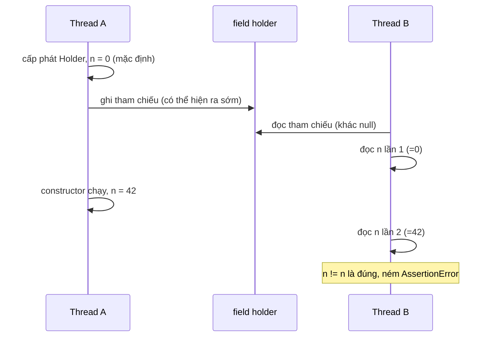
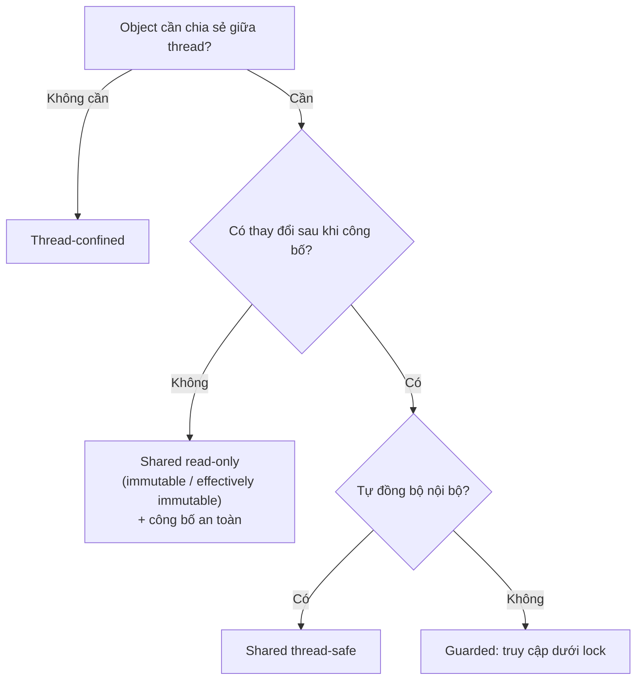

# Lý thuyết 03: Chia sẻ object: visibility, publication, immutability

## Bài này giải quyết vấn đề gì

Ở bài 02 bạn đã thấy `synchronized` giúp hai thread không chạy chen vào nhau. Nhưng còn một nửa câu chuyện: khi thread A ghi một giá trị, **thread B có thấy giá trị đó không, và thấy khi nào?** Câu trả lời mặc định là không được bảo đảm. Nếu không đồng bộ, thread đọc có thể thấy giá trị cũ, thấy các lần ghi theo thứ tự sai, hoặc thấy một object đang dựng dở. Nói cách khác, `synchronized` không chỉ là loại trừ tương hỗ mà còn là **memory visibility**.

Bài này nói về cách chia sẻ và **công bố (publish)** object giữa các thread sao cho thread khác thấy **đúng** và **nhất quán** những gì ta đã ghi. Có bốn trụ: visibility (nhìn thấy giá trị mới), publication/escape (công bố và leak), thread confinement (không chia sẻ) và immutability. Bạn cần chúng bất cứ khi nào một thread ghi dữ liệu mà thread khác sẽ đọc, khi trả về hoặc truyền object nội bộ ra ngoài, khi khởi tạo object dùng chung, và khi tách việc cho worker thread.

Cách làm: dùng lock (hoặc `volatile`) ở cả hai phía đọc và ghi; không để `this` hay state nội bộ leak; ưu tiên thread confinement và immutable object; và công bố object bằng các "idiom" an toàn đã được Java Memory Model bảo đảm. Nếu sai, hiện tượng thường gặp là vòng lặp không bao giờ dừng, giá trị đọc ra bằng 0 hoặc null dù đã ghi, hoặc invariant của object bị phá trong mắt thread khác, và những lỗi này khó tái hiện.

**Tóm tắt:**

- Không đồng bộ thì thread đọc có thể thấy giá trị cũ, thấy thứ tự ghi sai, hoặc thấy object dựng dở; `synchronized` vì vậy bảo đảm cả atomicity lẫn visibility.
- `volatile` chỉ bảo đảm visibility và thứ tự, không làm `count++` atomic; hợp với cờ dừng hoặc tham chiếu tới immutable object.
- Object bị publish ra ngoài khi trả từ getter, lưu vào field công khai hoặc để `this` leak trong constructor; thread khác có thể thấy nó khi chưa dựng xong.
- Thread confinement (ad-hoc, stack, `ThreadLocal`) tránh được đồng bộ vì object chỉ một thread chạm tới.
- Immutable object (trạng thái không đổi, mọi field `final`, dựng đúng) luôn thread-safe; `final` một mình chưa đủ nếu trỏ tới object mutable.
- JMM cho initialization safety: field `final` của object dựng đúng được thấy đúng kể cả khi publish ẩu.
- Bốn cách safe publication: static initializer, `volatile`/`AtomicReference`, field `final`, hoặc field có lock bảo vệ (kể cả collection thread-safe).

### Các khái niệm cần biết

| Khái niệm | Là gì | Dùng/gặp khi nào |
|---|---|---|
| Java Memory Model (JMM) | Phần đặc tả của Java quy định khi nào một lần ghi của thread này được thread khác nhìn thấy | Là cơ sở cho mọi bảo đảm bên dưới; không có JMM thì "dòng này chạy trước dòng kia" không có nghĩa với thread khác |
| Reordering | Compiler, JIT hoặc CPU đổi thứ tự thực thi các lệnh miễn là thread hiện tại không phân biệt được | Gây ra việc thấy `ready = true` mà `answer` vẫn chưa được ghi |
| Stale data | Giá trị cũ còn nằm trong cache hoặc thanh ghi của core | Đọc biến chia sẻ không đồng bộ |
| Publish và escape | Publish: làm object với tới được từ code ngoài phạm vi hiện tại. Escape: publish khi không được phép | Getter trả mảng nội bộ, đăng ký listener trong constructor |
| Alien method | Method mà class bạn không kiểm soát hành vi (method class khác, hoặc method overridable) | Truyền object vào alien method coi như publish |
| Defensive copy | Trả hoặc nhận bản sao thay vì tham chiếu gốc | Bảo vệ trạng thái nội bộ khỏi bị sửa từ ngoài |
| Thread confinement | Chỉ cho đúng một thread truy cập object | Tránh đồng bộ cho object không thread-safe |
| Immutable | Trạng thái không đổi sau khi dựng | Chia sẻ tự do giữa thread |
| Safe publication | Cách công bố bảo đảm thread khác thấy cả tham chiếu lẫn trạng thái đầy đủ | Chia sẻ object lúc khởi tạo |
| Initialization safety | Bảo đảm riêng của JMM: immutable object dựng đúng thì an toàn dù công bố ẩu | Giải thích vì sao field `final` quan trọng |

Từng khái niệm được giải thích kỹ ở mục tương ứng bên dưới.

## Visibility (tính nhìn thấy)

Với một thread, ghi rồi đọc lại sẽ ra giá trị vừa ghi. Nhưng khi đọc và ghi diễn ra ở **hai thread khác nhau**, điều đó **không được bảo đảm**: thread đọc có thể thấy giá trị rất trễ, hoặc không bao giờ thấy.

```java
public class StopFlag {
    private static boolean ready;
    private static int answer;

    private static class Reader extends Thread {
        @Override public void run() {
            while (!ready) {          // có thể lặp mãi mãi
                Thread.yield();
            }
            System.out.println(answer);   // có thể in 0
        }
    }

    public static void main(String[] args) {
        new Reader().start();
        answer = 42;
        ready = true;
    }
}
```

Chương trình nhỏ xíu này có thể:

- **Không bao giờ kết thúc**, vì giá trị `ready = true` không bao giờ "hiện" cho Reader (compiler/JIT có thể kéo phép kiểm tra ra ngoài vòng lặp, CPU giữ giá trị trong cache/thanh ghi).
- **In 0** thay vì 42, vì hai lần ghi có thể bị **sắp xếp lại (reordering)**: Reader thấy `ready = true` trước khi thấy `answer = 42`.

Compiler, CPU và runtime được phép sắp lại thao tác và lưu đệm giá trị miễn là thread hiện tại không phân biệt được. Việc này giúp hiệu năng, nhưng nghĩa là mọi suy luận kiểu "dòng này chắc chạy trước dòng kia" trong chương trình multithreaded thiếu đồng bộ đều gần như chắc chắn sai.

**Nền tảng:** Khi hai thread đọc và ghi cùng một biến mà không đồng bộ, Java **không bảo đảm** thread đọc thấy giá trị mới, cũng không bảo đảm thứ tự các lần ghi. Compiler, JIT và CPU được phép giữ giá trị trong thanh ghi hoặc cache và sắp xếp lại lệnh. Vì vậy mọi cơ chế đồng bộ (lock, volatile, final, safe publication) thực chất là cách để tạo ra bảo đảm visibility và thứ tự.

> Cách đơn giản để tránh mọi rắc rối này: **luôn đồng bộ đúng cách mỗi khi dữ liệu được chia sẻ giữa các thread.**

### Dữ liệu cũ (stale data)

Nếu không đồng bộ ở **mọi** lần truy cập, một lần đọc có thể trả về giá trị lỗi thời. Tệ hơn, "cũ" không phải tất-cả-hoặc-không: một thread có thể thấy giá trị mới của biến này nhưng giá trị cũ của biến khác dù biến kia được ghi trước. Hậu quả nặng nề hơn nhiều so với "đếm lệch một chút": exception bất ngờ, cấu trúc dữ liệu hỏng (đặc biệt con trỏ trong linked list), tính sai, vòng lặp vô hạn.

```java
// KHÔNG thread-safe: set của thread này có thể không bao giờ hiện cho get của thread khác
public class MutableInt {
    private int value;
    public int get() { return value; }
    public void set(int v) { this.value = v; }
}

// Thread-safe: cả hai phía cùng một lock
public class SafeInt {
    private int value;                       // @GuardedBy("this")
    public synchronized int get() { return value; }
    public synchronized void set(int v) { this.value = v; }
}
```

Chỉ đồng bộ `set` mà để `get` trần là chưa đủ: người đọc vẫn có thể thấy giá trị cũ.

### Thao tác 64-bit không atomic

Dù thấy giá trị cũ, thông thường ít nhất đó là giá trị do **một thread nào đó thực sự đã ghi** (gọi là *out-of-thin-air safety*, "không từ không khí mà ra"). Ngoại lệ: biến `long` và `double` không `volatile`. JVM được phép tách một lần đọc/ghi 64-bit thành hai thao tác 32-bit; một thread có thể đọc nửa cao của giá trị này ghép với nửa thấp của giá trị khác. Vì vậy dùng `long`/`double` mutable dùng chung thì phải `volatile` hoặc có lock, kể cả khi bạn không quan tâm tới giá trị cũ. (Trên JVM 64-bit hiện đại thường vẫn atomic, nhưng đặc tả không bảo đảm.)

### Lock và visibility

Lock bảo đảm một thread thấy hiệu ứng của thread khác theo cách dự đoán được: **mọi thứ thread A đã làm trước hoặc trong khối `synchronized` đều hiển thị cho thread B khi B vào khối `synchronized` bởi cùng lock đó**.

```mermaid
sequenceDiagram
    participant A as Thread A
    participant M as Lock M
    participant B as Thread B
    A->>M: lock(M)
    Note over A: y = 1; x = 1
    A->>M: unlock(M)
    Note over M: mọi thứ trước unlock...
    B->>M: lock(M)
    Note over B: ...hiển thị cho mọi thứ sau lock<br/>i = x (=1), j = y (=1)
    B->>M: unlock(M)
```

Đây là lý do thứ hai cho quy tắc "mọi truy cập một biến chia sẻ phải dùng cùng một lock": ngoài atomicity, còn để giá trị do thread này ghi hiện ra cho thread khác. Nếu thread đọc không lấy đúng lock, nó có thể thấy giá trị cũ.

> Lock không chỉ là loại trừ tương hỗ mà còn là **memory hiển thị**. Muốn mọi thread thấy giá trị mới nhất của biến mutable dùng chung, bên đọc và bên ghi phải đồng bộ trên cùng một lock.

### Biến `volatile`

`volatile` là hình thức đồng bộ nhẹ hơn, chỉ lo **visibility**. Khi khai báo `volatile`, compiler và runtime biết biến này được chia sẻ nên: không sắp xếp lại thao tác với nó vào chung với các thao tác memory khác, không cất giá trị trong thanh ghi hay cache ẩn; mỗi lần đọc luôn trả về lần ghi gần nhất của bất kỳ thread nào. Nó không dùng lock nên không làm thread bị chặn.

Hiệu ứng hiển thị của `volatile` còn **vượt ra ngoài chính biến đó**: khi thread A ghi vào biến volatile rồi thread B đọc cùng biến, mọi biến A đã thấy trước lúc ghi cũng hiển thị cho B sau lúc đọc. Tương tự "ghi volatile ≈ thoát khối synchronized; đọc volatile ≈ vào khối synchronized". Tuy vậy không nên lạm dụng tính chất này; code dựa vào volatile để công bố trạng thái tùy ý thì mong manh và khó hiểu hơn dùng lock.

```java
public class Worker implements Runnable {
    private volatile boolean stopped;          // cờ trạng thái điển hình

    public void stop() { stopped = true; }

    @Override public void run() {
        while (!stopped) {
            doSomeWork();
        }
    }
}
```

Điều kiện để dùng `volatile` đúng, phải thỏa **cả ba**:

| Điều kiện | Giải thích |
|---|---|
| Ghi không phụ thuộc giá trị hiện tại | Hoặc bảo đảm chỉ có một thread duy nhất ghi |
| Không tham gia invariant với biến khác | Nếu có ràng buộc giữa các biến thì cần lock |
| Không cần lock vì lý do khác khi truy cập | Nếu cần atomic cho cả chuỗi, volatile không đủ |

Nói ngắn gọn khi nào dùng `volatile`: chọn nó cho cờ trạng thái (dừng, hoàn tất) hoặc tham chiếu tới immutable object, nơi chỉ cần thread khác thấy giá trị mới. Không dùng khi giá trị mới phụ thuộc giá trị cũ (đếm, cộng dồn) hoặc khi nhiều biến phải đổi cùng lúc; khi đó hãy dùng `synchronized` hoặc `Atomic*`.

`count++` trên biến volatile **vẫn không atomic** (vẫn là đọc-cộng-ghi). Dùng `AtomicInteger` nếu cần. Ứng dụng tốt của volatile: cờ hoàn tất/interrupt/trạng thái, và tham chiếu đến immutable object (xem phần dưới).

**Phải thuộc:** `synchronized` bảo đảm cả atomicity (loại trừ tương hỗ) và visibility; `volatile` chỉ bảo đảm visibility và thứ tự, không làm `count++` atomic. Chỉ dùng `volatile` khi ghi không phụ thuộc giá trị cũ, không tham gia invariant với biến khác, và không cần lock vì lý do khác. Ứng dụng điển hình: cờ dừng, tham chiếu tới immutable object.

| | Atomicity | Visibility |
|---|---|---|
| `synchronized` | Có | Có |
| `volatile` | Không | Có |

**Suy luận:** Visibility không được bảo đảm mặc định vì một lý do về hiệu năng. Mỗi core có thanh ghi và cache riêng, còn compiler và JIT muốn giữ giá trị trong đó và sắp xếp lại lệnh để chạy nhanh; nếu Java buộc mọi lần ghi phải thấy ngay ở mọi thread, mọi chương trình, kể cả đơn luồng, đều chậm đi. Vì vậy Java Memory Model chỉ hứa hẹn thứ tự và tính hiển thị tại các điểm đồng bộ rõ ràng: nhả và lấy cùng một lock, ghi và đọc cùng một biến `volatile`. Từ đây suy ra hai hệ quả. Thứ nhất, bảo vệ chỉ ở phía ghi là chưa đủ, vì thread đọc không đi qua điểm đồng bộ nào nên vẫn có thể đọc giá trị cũ trong cache của nó. Thứ hai, vòng lặp `while (!ready)` với `ready` thường có thể chạy mãi, vì JIT được phép đưa phép đọc ra ngoài vòng lặp. Điểm dễ nhầm là thấy test pass trên máy mình rồi kết luận đúng, trong khi việc giá trị mới "hiện ra" chỉ là hên xui của phần cứng. Khi review, hãy kiểm tra mỗi biến chia sẻ có cùng một cơ chế đồng bộ ở cả đường ghi lẫn đường đọc.

## Publication và escape

**Publish** là làm cho object có thể truy cập từ code bên ngoài phạm vi hiện tại: lưu tham chiếu vào chỗ code khác tìm thấy, trả về từ method không `private`, hoặc truyền vào method của class khác. Object bị công bố khi **không được phép** gọi là đã **leak (escaped)**.

```java
// Cách công bố lộ liễu nhất: field public static
public static Set<Secret> knownSecrets;

// Rò rỉ trạng thái nội bộ: ai cũng sửa được mảng "private" này
public class Months {
    private final String[] names = {"Jan", "Feb", "Mar"};
    public String[] getNames() { return names; }      // mảng đã thoát ra ngoài
}
```

Công bố một object kéo theo công bố mọi thứ **với tới được** từ nó qua chuỗi field không private hoặc lời gọi method. Lưu một `Secret` vào `knownSecrets` đã công bố luôn cả `Secret`. Truyền object vào một **alien method** (method mà class bạn không kiểm soát hoàn toàn hành vi: method của class khác, hoặc method overridable của chính class mình) cũng coi như công bố, vì bạn không biết nó có giữ lại tham chiếu để dùng từ thread khác không. Dù thread khác chưa làm gì, rủi ro vẫn tồn tại; một khi đã leak, phải giả định bị lạm dụng, vô tình hoặc cố ý.

Cách phòng: trả bản sao phòng vệ (defensive copy) hoặc immutable view.

```java
public List<String> getNames() {
    // hoặc Collections.unmodifiableList / Arrays.copyOf
    return List.of(names);
}
```

### Rò rỉ `this` khi khởi tạo

Cách tinh vi nhất: công bố **instance của inner class** cũng công bố luôn instance bao ngoài (inner class giữ tham chiếu ẩn tới outer).

```java
// SAI: this thoát ra trước khi constructor kết thúc
public class PriceWatcher {
    private final BigDecimal threshold;

    public PriceWatcher(EventSource source) {
        // lambda/inner class giữ tham chiếu PriceWatcher.this
        source.register(new Listener() {
            @Override public void onEvent(Event e) { handle(e); }
        });
        this.threshold = new BigDecimal("100");   // listener có thể chạy trước dòng này
    }
}
```

Một object chỉ ở trạng thái nhất quán sau khi constructor **trả về**. Công bố nó từ trong constructor, kể cả ở câu lệnh cuối cùng, nghĩa là công bố object dựng dở. Các lỗi hay gặp: đăng ký listener trong constructor, **khởi chạy thread trong constructor** (thread mới có `this` ngầm hoặc tường minh), gọi method overridable trong constructor.

> Không để tham chiếu `this` thoát ra trong lúc khởi tạo.

Cách an toàn: constructor `private` kèm **factory method** công khai; việc đăng ký/khởi chạy chỉ làm sau khi object đã dựng xong.

```java
public class PriceWatcher {
    private final BigDecimal threshold;
    private final Listener listener;

    private PriceWatcher() {
        this.threshold = new BigDecimal("100");
        this.listener = e -> handle(e);          // chỉ tạo, chưa công bố
    }

    public static PriceWatcher create(EventSource source) {
        PriceWatcher w = new PriceWatcher();     // dựng xong
        source.register(w.listener);              // rồi mới công bố
        return w;
    }
}
```

Tạo thread trong constructor thì không sai, nhưng đừng `start()` ngay; hãy cung cấp method `start()`/`initialize()` riêng (lifecycle dịch vụ, bài 07).

## Thread confinement (nhốt trong thread)

Muốn tránh đồng bộ cho dữ liệu mutable thì **đừng chia sẻ**. Dữ liệu chỉ được một thread truy cập thì không cần đồng bộ; object bị nhốt trong một thread tự động an toàn dù bản thân nó không thread-safe.

Ví dụ thực tế: Swing nhốt mọi component vào event thread; connection JDBC lấy từ pool được dùng bởi đúng một thread trong suốt một request nên ngầm bị nhốt (pool không phát cùng connection cho thread khác đến khi trả lại). Ngôn ngữ không có cơ chế bắt buộc việc nhốt; đây là yếu tố **thiết kế** bạn phải tự bảo đảm trong code.

| Kiểu nhốt | Cách thực hiện | Độ chắc chắn |
|---|---|---|
| **Ad-hoc** | Chỉ dựa vào kỷ luật của lập trình viên (như UI luôn do một thread xử lý) | Mong manh, nên hạn chế |
| **Stack confinement** | Object chỉ truy cập qua biến cục bộ (trên stack riêng của thread) | Chắc, đơn giản |
| **`ThreadLocal`** | Mỗi thread có bản riêng của giá trị | Chắc, nhưng cần cẩn trọng |

### Ad-hoc

Toàn bộ trách nhiệm đặt lên người triển khai: không có `private`, biến cục bộ hay công cụ nào giúp. Thường là hệ quả của quyết định coi cả một hệ con (như GUI) là single-threaded. Một trường hợp đặc biệt hợp lệ: thực hiện read-modify-write trên biến `volatile` **chỉ khi** biến đó chỉ bị ghi từ đúng một thread (nhốt việc ghi), còn các thread khác chỉ đọc nhờ visibility của volatile.

### Stack confinement

Object chỉ với tới được qua biến cục bộ nên không thread nào khác thấy được. Biến cục bộ kiểu nguyên tcancel luôn tự nhốt (không thể lấy "tham chiếu" tới nó). Với tham chiếu object, bạn phải đảm bảo không để tham chiếu thoát ra.

```java
public int countDistinctMates(Collection<Animal> candidates) {
    // TreeSet không thread-safe nhưng chỉ có một tham chiếu, ở biến cục bộ
    SortedSet<Animal> sorted = new TreeSet<>(new SpeciesGenderComparator());
    sorted.addAll(candidates);
    int pairs = 0;
    for (Animal a : sorted) {
        // ...
        pairs++;
    }
    return pairs;      // sorted không bao giờ được trả ra hay lưu vào field
}
```

Cẩn thận: yêu cầu "chỉ dùng trong thread" thường chỉ nằm trong đầu người viết; không ghi lại thì người bảo trì sau có thể làm object leak.

### ThreadLocal

`ThreadLocal<T>` gắn một giá trị riêng cho mỗi thread. `get()` trả về giá trị mới nhất mà **chính thread đang chạy** đã `set()`; lần `get()` đầu tiên của thread gọi `initialValue` (ngày nay dùng `ThreadLocal.withInitial`). Về khái niệm giống một `Map<Thread, T>`; thực tế giá trị lưu trong chính object `Thread` nên được dọn khi thread kết thúc.

```java
private static final ThreadLocal<SimpleDateFormat> FMT =
        // SimpleDateFormat không thread-safe
        ThreadLocal.withInitial(() -> new SimpleDateFormat("yyyy-MM-dd"));

public static String format(Date d) {
    return FMT.get().format(d);        // mỗi thread có bản SimpleDateFormat riêng
}
```

Dùng hợp lý khi chuyển chương trình single-threaded (có biến toàn cục, singleton có trạng thái, connection toàn cục) sang multithreaded: biến thành `ThreadLocal` để mỗi thread có bản riêng (nếu ngữ nghĩa cho phép; cache toàn ứng dụng mà tách thành nhiều cache theo thread thì mất tác dụng). Framework dùng rất nhiều: ngữ cảnh transaction, security context gắn với thread đang xử lý request.

Lạm dụng: coi `ThreadLocal` như biến toàn cục hay "tham số ẩn" của method tạo ra ràng buộc ngầm giữa các class, giảm khả năng tái sử dụng. Với thread pool, nhớ `remove()` khi xong để tránh leak dữ liệu sang request sau và leak memory. Kịch bản leak giữa hai request, MDC và bẫy với `InheritableThreadLocal` được tái hiện (có kết quả chạy thật) ở [ThreadLocal, Fork/Join và Reference](/go?p=08-Java%2FJava-Core%2Fhard%2Flt-31-threadlocal-forkjoin-reference.md).

> Ghi chú Java hiện đại: với virtual thread (Java 21) mỗi task có thread riêng nên `ThreadLocal` vẫn dùng được nhưng dễ tốn memory khi có hàng triệu thread; Java mới đang bổ sung `ScopedValue` cho nhu cầu truyền ngữ cảnh immutable.

## Immutability

Một cách khác tránh đồng bộ: dùng **immutable object**. Hầu hết lỗi atomic và visibility (giá trị cũ, mất cập nhật, thấy trạng thái nửa vời) đều đến từ nhiều thread cùng thay đổi một trạng thái. Nếu trạng thái không đổi được thì mọi rủi ro đó biến mất.

**Nền tảng:** immutable object luôn thread-safe, vì mọi rủi ro (stale data, mất cập nhật, thấy trạng thái nửa vời) đều đến từ việc nhiều thread cùng **thay đổi** một trạng thái. Không cho đổi thì không còn gì để contention. Đây là lý do mọi thiết kế multithreaded tốt đều ưu tiên immutable trước khi nghĩ đến lock.

Một object là immutable khi thỏa **cả ba**:

1. Trạng thái không thể sửa sau khi dựng xong.
2. Mọi field đều `final`.
3. Được dựng đúng cách (không để `this` leak trong constructor).

Chú ý: tất cả field `final` **chưa chắc** là immutable, vì `final` chỉ cố định tham chiếu; object được trỏ tới có thể vẫn đổi được. immutable object vẫn có thể dùng object mutable bên trong, miễn là không ai sửa được chúng sau khi constructor xong.

```java
public final class AllowedRoles {
    // tham chiếu final tới Set mutable...
    private final Set<String> roles;

    public AllowedRoles(Collection<String> input) {
        // ...nhưng Set không bao giờ lộ ra ngoài
        this.roles = new HashSet<>(input);
    }

    public boolean allows(String role) { return roles.contains(role); }
}
```

Đừng nhầm *immutable object* với *tham chiếu immutable*: trạng thái chương trình vẫn đổi được bằng cách **thay** immutable object cũ bằng một instance mới. Nỗi lo về hiệu năng thường không cần thiết: cấp phát rẻ hơn ta nghĩ, và immutable giúp giảm lock, bản sao phòng vệ và tác động lên generational GC.

> Ghi chú Java hiện đại: `record` (Java 16+) và `List.of/Map.of` giúp viết immutable gọn; nhớ rằng record chứa field là collection mutable vẫn chưa immutable, cần sao chép phòng vệ.

### Field `final`

`final` hỗ trợ tạo immutable object, đồng thời có ngữ nghĩa đặc biệt trong Java Memory Model: chính nó tạo ra bảo đảm **initialization safety** (xem dưới). Ngay cả object mutable, làm các field không cần đổi thành `final` cũng giảm số trạng thái có thể có và nói rõ ý đồ cho người bảo trì.

> Nguyên tắc: giống như mọi field nên là `private` trừ khi cần rộng hơn, mọi field nên là `final` trừ khi cần đổi được.

### Dùng `volatile` để công bố immutable object

Ở bài 02, hai biến liên quan (`lastNumber`, `lastFactors`) không thể cập nhật atomic riêng lẻ, kể cả khi `volatile`. Giải pháp: gộp chúng vào **một immutable object**, và dùng **một tham chiếu volatile** trỏ tới nó. Đổi trạng thái = tạo object mới rồi gán lại tham chiếu.

```java
// immutable Holder: cặp (số, các thừa số) luôn nhất quán
final class FactorResult {
    private final BigInteger number;
    private final BigInteger[] factors;

    FactorResult(BigInteger number, BigInteger[] factors) {
        this.number = number;
        // sao chép phòng vệ khi vào (cho phép null ở holder rỗng)
        this.factors = factors == null ? null : Arrays.copyOf(factors, factors.length);
    }

    BigInteger[] factorsFor(BigInteger n) {
        if (number == null || !number.equals(n)) return null;
        return Arrays.copyOf(factors, factors.length);           // và khi ra
    }
}

public class CachingFactorizer {
    private volatile FactorResult cache = new FactorResult(null, null);

    public BigInteger[] factorsOf(BigInteger n) {
        // đọc volatile ĐÚNG MỘT LẦN rồi dùng bản đó
        BigInteger[] f = cache.factorsFor(n);
        if (f == null) {
            f = factor(n);
            cache = new FactorResult(n, f);           // thay nguyên cả holder
        }
        return f;
    }
}
```

Không có lock tường minh mà vẫn thread-safe: immutable holder bảo đảm cặp giá trị không bao giờ lệch nhau; volatile bảo đảm bản mới nhất hiện ra cho mọi thread. Thread đang dùng holder cũ vẫn thấy nó nhất quán.

**Suy luận:** Initialization safety tồn tại vì immutable object là trường hợp mà JMM có thể hứa nhiều hơn mà không tốn thêm chi phí. Với object bình thường, constructor ghi các field rồi gán tham chiếu ra ngoài, và hai việc đó có thể bị sắp xếp lại hoặc bị thread khác nhìn thấy theo thứ tự ngược, nên thread đọc thấy tham chiếu mới nhưng field còn là giá trị mặc định. JMM xử lý riêng field `final` bằng cách chèn một rào chắn ở cuối constructor, bảo đảm mọi thread thấy giá trị `final` đã gán xong khi thấy tham chiếu. Vì object immutable chỉ gồm field `final` và không đổi sau đó, không còn gì có thể thay đổi, nên nó an toàn kể cả khi publish ẩu. Điểm dễ nhầm có hai: field `final` trỏ tới object mutable chỉ bảo đảm tham chiếu, không bảo đảm trạng thái bên trong, và `this` leak trong constructor phá luôn bảo đảm này. Hệ quả thiết kế là ưu tiên immutable cho dữ liệu chia sẻ; còn object mutable vẫn phải được safe publication và bảo vệ khi truy cập.

## Công bố an toàn (safe publication)

Có lúc ta **muốn** chia sẻ object giữa thread. Chỉ gán tham chiếu vào field công khai là không đủ:

```java
public Holder holder;                      // không an toàn

public void initialize() {
    holder = new Holder(42);
}
```

### Công bố không đúng: khi object tốt hóa xấu

```java
public class Holder {
    private int n;
    public Holder(int n) { this.n = n; }

    public void assertSanity() {
        if (n != n) throw new AssertionError("không thể xảy ra... ?");
    }
}
```



Đọc sơ đồ: vì không có đồng bộ, tham chiếu có thể hiện ra cho thread B trước khi constructor của A hoàn tất. Đây là lịch chạy có thể xảy ra theo đặc tả chứ không phải lúc nào cũng xảy ra, và chính vì hiếm nên lỗi rất khó bắt.

Nếu `Holder` được công bố không đúng cách, thread khác có thể gặp hai vấn đề: (1) thấy giá trị cũ của field `holder` (null hoặc tham chiếu trước đó); (2) tệ hơn, thấy tham chiếu mới nhưng **trạng thái cũ** bên trong `Holder`. Thậm chí lần đọc đầu thấy `n = 0` (giá trị mặc định do `Object` ghi trước khi constructor chạy), lần đọc sau thấy `42`, nên `n != n` có thể đúng và ném `AssertionError`. Invariant do constructor thiết lập đã bị phá vỡ trong mắt thread khác.

### Immutable object và initialization safety

Vì immutability quá quan trọng, JMM cho một bảo đảm riêng: **initialization safety**. immutable object (thỏa đủ ba điều kiện) có thể được truy cập an toàn **kể cả khi công bố không đồng bộ**. Nếu `Holder` ở trên có field `n` là `final` thì `assertSanity` không thể ném lỗi, dù công bố ẩu. Bảo đảm này mở rộng cho giá trị của mọi field `final` của object đã dựng đúng, nhưng nếu field `final` trỏ tới object mutable, bạn vẫn cần đồng bộ để truy cập trạng thái của object đó.

### Các cách công bố an toàn

Object chưa immutable thì phải công bố an toàn, thường cần đồng bộ ở **cả hai phía** (người công bố và người dùng). Để cả tham chiếu lẫn trạng thái cùng hiện ra, một object đã dựng đúng có thể được công bố bằng cách:

| Idiom | Ví dụ |
|---|---|
| Khởi tạo từ static initializer | `public static final Holder H = new Holder(42);` (JVM đồng bộ khi khởi tạo class) |
| Lưu vào field `volatile` hoặc `AtomicReference` | `private volatile Holder h;` |
| Lưu vào field `final` của object đã dựng đúng | Tham chiếu qua field `final` |
| Lưu vào field được bảo vệ bởi một lock | `synchronized` getter/setter |

Đồng bộ nội tại của collection thread-safe cũng thỏa yêu cầu: đặt object vào rồi thread khác lấy ra thì thấy đúng trạng thái. Cụ thể:

- Đặt key/value vào `Hashtable`, `synchronizedMap`, `ConcurrentMap` công bố an toàn cho thread lấy chúng ra.
- Đặt phần tử vào `Vector`, `CopyOnWriteArrayList`, `CopyOnWriteArraySet`, `synchronizedList`, `synchronizedSet`.
- Đặt phần tử vào `BlockingQueue` hoặc `ConcurrentLinkedQueue`.
- Các cơ chế bàn giao khác trong thư viện như `Future`, `Exchanger` cũng là công bố an toàn.

**Phải thuộc:** Bốn cách công bố an toàn (safe publication): khởi tạo trong static initializer; lưu vào field `volatile` hoặc `AtomicReference`; lưu vào field `final` của object dựng đúng; lưu vào field được lock bảo vệ (kể cả đưa vào collection thread-safe). Immutable thì công bố cách nào cũng an toàn nhờ initialization safety; effectively immutable phải công bố an toàn; mutable phải công bố an toàn và được bảo vệ khi truy cập.

### Object "effectively immutable"

Object không immutable về mặt kỹ thuật nhưng **không bị sửa sau khi công bố** là effectively immutable. Chỉ cần công bố an toàn rồi dùng như thể immutable, không cần đồng bộ thêm. Ví dụ `Date` mutable, nhưng nếu chỉ lưu vào `synchronizedMap` rồi không ai sửa, thread lấy ra thấy đúng giá trị:

```java
Map<String, Date> lastLogin = Collections.synchronizedMap(new HashMap<>());
lastLogin.put(user, new Date());        // sau đó không ai gọi setTime trên Date này
```

### Object mutable và các chính sách chia sẻ

Nếu object còn bị sửa sau khi công bố, công bố an toàn chỉ bảo đảm thấy **trạng thái lúc công bố**. Mỗi lần truy cập tiếp theo vẫn phải đồng bộ.

| Loại object | Yêu cầu công bố/truy cập |
|---|---|
| Immutable | Công bố bằng cách nào cũng được |
| Effectively immutable | Phải công bố an toàn |
| Mutable | Công bố an toàn **và** (thread-safe hoặc được bảo vệ bởi lock) |

Khi cầm một tham chiếu, bạn cần biết "luật chơi": có phải lấy lock không, được sửa hay chỉ được đọc? Nên ghi rõ khi công bố. Bốn chính sách hữu ích nhất:

1. **Thread-confined**: do đúng một thread sở hữu và sửa.
2. **Shared read-only**: nhiều thread đọc đồng thời, không ai sửa (immutable hoặc effectively immutable).
3. **Shared thread-safe**: object tự đồng bộ bên trong; dùng qua interface công khai mà không cần đồng bộ thêm.
4. **Guarded**: chỉ truy cập khi giữ một lock cụ thể (nằm trong object thread-safe khác hoặc được ghi nhận là do một lock bảo vệ).



## Bẫy thường gặp

- **Cờ dừng không `volatile`**: vòng lặp có thể không bao giờ thoát (nhất là khi JIT tối ưu).
- **Chỉ đồng bộ phía ghi**, bỏ trần phía đọc.
- **Dùng `volatile` cho `count++`** hay cho nhiều biến liên quan: không atomic.
- **`long`/`double` mutable dùng chung không volatile**: có thể "xé" giá trị.
- **Getter trả về collection/mảng nội bộ**: người ngoài sửa được.
- **Đăng ký listener, start thread trong constructor**: `this` thoát trước khi dựng xong.
- **Nghĩ "final field = immutable"**: final chỉ cố định tham chiếu.
- **Lưu `SimpleDateFormat`, `Random`... dùng chung mà không đồng bộ** (object không thread-safe).
- **`ThreadLocal` trong thread pool không `remove()`**: dữ liệu rò sang request khác.

## Điểm cần nhớ

- Thiếu đồng bộ thì có stale data và reordering; tránh bằng cách đồng bộ **mọi** truy cập dữ liệu chia sẻ.
- Lock bảo đảm cả loại trừ tương hỗ **và** visibility; `volatile` chỉ bảo đảm visibility.
- `volatile` phù hợp cờ trạng thái và tham chiếu tới immutable object, không dùng cho read-modify-write nhiều thread.
- Đừng để state nội bộ và `this` leak; dùng factory method thay vì đăng ký/start trong constructor.
- Thread confinement (ad-hoc, stack, ThreadLocal) tránh đồng bộ bằng cách không chia sẻ.
- Immutable = trạng thái không đổi + mọi field `final` + dựng đúng; luôn thread-safe và có initialization safety.
- Gộp các biến liên quan vào một immutable holder, đặt sau tham chiếu `volatile`: cập nhật atomic không cần lock.
- Mutable object phải công bố an toàn **và** được bảo vệ bởi lock hoặc thread-safe.
- Mặc định: field `final` trừ khi cần đổi được.

## Câu hỏi tự kiểm tra

Với mỗi câu, thử trả lời theo các gợi ý trước rồi mới đọc đáp án.

1. Vòng lặp chờ cờ `ready` không `volatile` có thể không bao giờ dừng, hoặc dừng nhưng in ra 0. Vì sao?
   - *Gợi ý suy luận:* Không có đồng bộ thì thread đọc có bắt buộc thấy giá trị mới ghi không? Hai lệnh ghi liên tiếp có bắt buộc theo thứ tự trong mã không?
   - *Đáp án:* Không có đồng bộ nên giá trị mới có thể không hiện ra (stale data), và hai lần ghi có thể bị sắp xếp lại (reordering), nên thread đọc thấy `ready` mà chưa thấy giá trị kia.
2. `synchronized` và `volatile` khác nhau thế nào về atomicity và visibility?
   - *Gợi ý suy luận:* Lock cho phép một thread vào khối tại một thời điểm; `volatile` có làm được điều đó không? Cả hai có làm giá trị hiện ra cho thread khác không?
   - *Đáp án:* `synchronized` bảo đảm cả loại trừ tương hỗ và visibility. `volatile` chỉ bảo đảm visibility (và thứ tự), không làm compound action atomic.
3. Vì sao không được `start()` thread hay đăng ký listener trong constructor?
   - *Gợi ý suy luận:* Lúc constructor chưa xong, object đã dựng xong chưa? Thread mới hay listener nhận được `this` thì thấy gì?
   - *Đáp án:* `this` thoát ra khi object chưa dựng xong, nên thread/listener có thể thấy trạng thái nửa vời. Dùng factory method để start/đăng ký sau khi dựng.
4. Một object có mọi field `final` có chắc chắn immutable không?
   - *Gợi ý suy luận:* `final` cố định cái gì: tham chiếu hay nội dung của object được trỏ tới?
   - *Đáp án:* Không. Field `final` có thể trỏ tới object mutable. Immutable cần cả trạng thái không đổi sau khi dựng và dựng đúng cách.
5. Kể bốn idiom công bố an toàn.
   - *Gợi ý suy luận:* Công bố an toàn cần một mối quan hệ happens-before giữa thread ghi tham chiếu và thread đọc. Cái gì tạo ra nó: class được khởi tạo, `volatile`, `final`, lock?
   - *Đáp án:* Static initializer; field `volatile`/`AtomicReference`; field `final` của object dựng đúng; field được lock bảo vệ (hoặc đưa vào collection thread-safe).
6. Mô hình "immutable holder cộng một tham chiếu volatile" giải quyết bài toán gì?
   - *Gợi ý suy luận:* Nhiều biến có chung invariant mà không dùng lock: nếu gộp chúng vào một immutable object thì một lần gán tham chiếu thay được mấy thứ cùng lúc? `volatile` đảm bảo gì cho lần gán đó?
   - *Đáp án:* Cập nhật atomic nhiều biến có invariant chung mà không cần lock: đổi cả holder trong một phép gán, mọi thread luôn thấy cặp giá trị nhất quán.

Nguồn: Java Concurrency in Practice, Chương 3.

