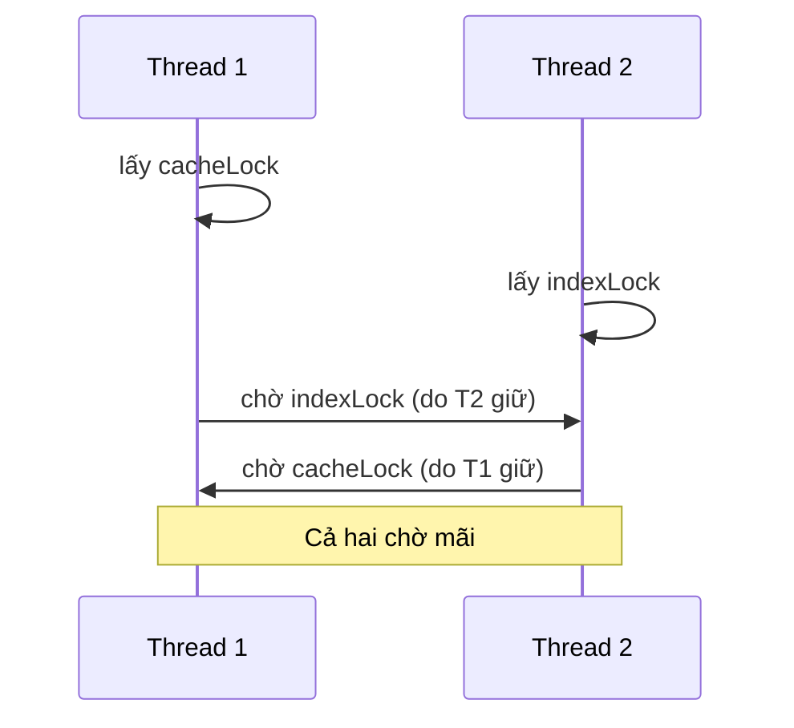
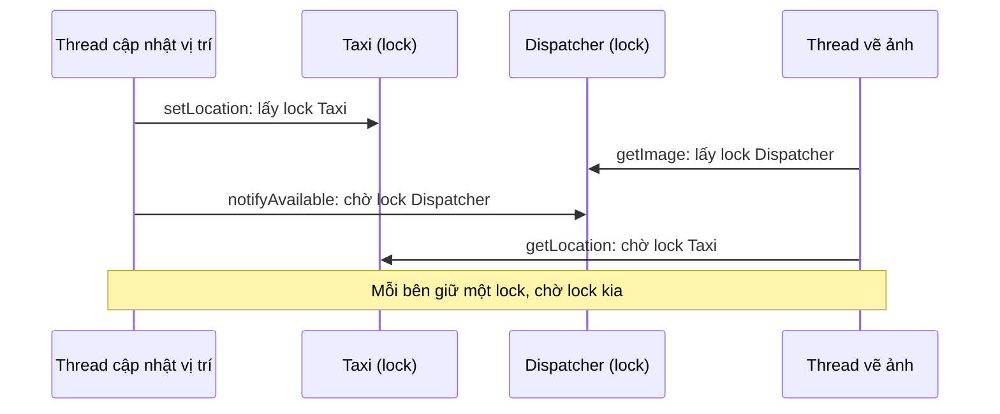
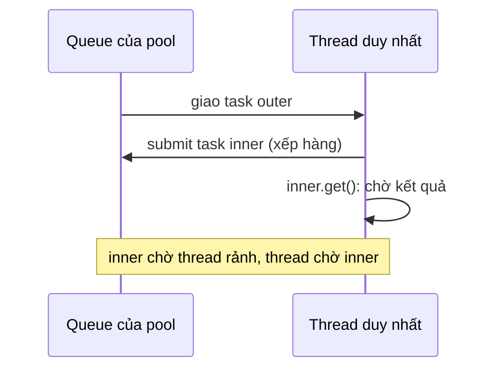
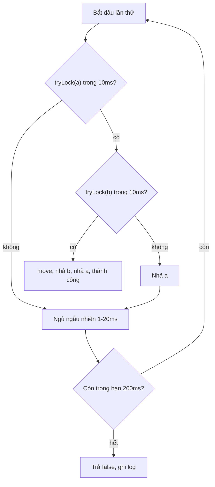

# Lý thuyết 10: Liveness hazards: deadlock, starvation, livelock

Khi học multithreading, phần lớn thời gian ta lo về **safety**: không để hai thread làm hỏng dữ liệu của nhau, và lock sinh ra để làm việc đó. Bài này nói về mặt còn lại: **liveness**. Liveness là cam kết "việc tốt rồi sẽ xảy ra", tức mỗi thread cuối cùng cũng tiến lên được. Lỗi liveness là khi một hoạt động rơi vào trạng thái vĩnh viễn không thể tiến tiếp: chương trình không sai kết quả, nó chỉ đứng im.

**Tóm tắt:**

- Liveness là cam kết "việc tốt rồi sẽ xảy ra": lỗi liveness không làm sai kết quả mà làm chương trình đứng im.
- Ba dạng lỗi: deadlock (các thread chờ nhau theo cycle), starvation (không bao giờ được cấp tài nguyên), livelock (vẫn chạy nhưng thử lại mãi một việc luôn thất bại).
- JVM không tự phát hiện và phục hồi deadlock như database, nên chỉ có cách ngăn từ thiết kế.
- Lock-ordering deadlock biến mất khi mọi thread lấy lock theo một thứ tự toàn cục; khi thứ tự phụ thuộc đối số thì phải ép thứ tự bằng natural key hoặc `identityHashCode` kèm tie-breaking lock.
- Gọi alien method khi đang giữ lock là nguồn deadlock hay gặp; open call (gọi khi không giữ lock) giảm chỗ giữ nhiều lock, đổi lại có thể mất atomicity.
- Không chỉ lock: connection pool và thread pool có giới hạn cũng gây resource deadlock, nên task chờ task con trong cùng bounded pool là mẫu cần tránh.
- Công cụ phát hiện và chẩn đoán: `tryLock` có timeout và thread dump; không dùng thread priority để chữa lỗi.
- Livelock chữa bằng giới hạn số lần retry, dead letter queue, và thêm yếu tố ngẫu nhiên cùng exponential backoff.

## Vấn đề nó giải quyết

Lock đem lại an toàn, nhưng lạm dụng lock lại sinh ra lỗi liveness. Tương tự, ta dùng thread pool hay semaphore để giới hạn tài nguyên, nhưng hiểu sai các hoạt động bị giới hạn đó lại sinh ra resource deadlock. Điểm đáng sợ nhất: **JVM không tự phục hồi** khi deadlock. Cách duy nhất là dừng và khởi động lại process. Trong khi đó, database thì khác, nó tự dò và hủy một transaction để gỡ kẹt (xem mục 1).

Ba dạng lỗi chính của liveness:

- **Deadlock**: các thread chờ nhau theo vòng tròn, không ai chạy tiếp được. Giống bốn xe ở ngã tư, xe nào cũng đợi xe bên phải đi trước.
- **Starvation**: một thread liên tục bị từ chối tài nguyên cần thiết, thường là CPU, nên không bao giờ đến lượt.
- **Livelock**: thread không bị block, vẫn chạy, nhưng cứ thử lại một việc luôn thất bại nên không tiến lên được. Giống hai người đi ngược chiều trong hành lang, cùng nhường đường rồi lại chắn nhau.

Điểm khó: deadlock hiếm khi lộ ngay. Một class **có khả năng** deadlock không có nghĩa nó sẽ deadlock lúc test; thường nó nổ ở lúc tải nặng nhất trên production. Một hệ thống thực có thể thực hiện hàng tỉ chu kỳ lấy/nhả lock mỗi ngày, chỉ cần một lần trùng thời điểm xui là đủ.

## Khi nào cần để ý, và cách đối phó

Hãy cảnh giác bất cứ khi nào một đoạn code cần giữ **hơn một lock** cùng lúc, gọi code lạ (callback, listener, method overridable) khi đang giữ lock, hoặc để các task phụ thuộc nhau chạy trong pool có giới hạn. Nếu code chỉ giữ một lock tại một thời điểm và không gọi code lạ trong lúc giữ, bạn gần như không phải lo deadlock kiểu lock.

Cách đối phó, mà các mục sau sẽ đi từng bước: ưu tiên chỉ giữ một lock; nếu buộc giữ nhiều lock thì đặt thứ tự toàn cục; dùng **open call**; dùng `tryLock` có timeout; đọc **thread dump** khi nghi ngờ; không chỉnh thread priority; thêm yếu tố ngẫu nhiên và backoff khi retry.

## Các khái niệm cần biết

- **Wait-for graph:** đồ thị mà mỗi node là một thread, cạnh "A chờ B" nghĩa là A đang đợi tài nguyên do B giữ. Có cycle là có deadlock.
- **Monitor / intrinsic lock:** lock gắn với mọi object Java, được lấy bằng `synchronized`. Chờ lock này là chờ vô hạn, không đặt được timeout.
- **Alien method:** method mà bạn không kiểm soát được hành vi: của class khác, có thể bị override, hoặc là callback do người dùng cung cấp. Gọi nó khi đang giữ lock là nguồn deadlock hay gặp (mục 4).
- **Open call:** lời gọi method mà lúc đó không giữ lock nào (mục 5).
- **Thread dump:** snapshot trạng thái và stack của mọi thread trong JVM tại một thời điểm, dùng để chẩn đoán đứng treo (mục 8).
- **Backoff và jitter:** backoff là chờ một khoảng rồi mới thử lại, tăng dần sau mỗi lần thất bại. Jitter là phần ngẫu nhiên cộng thêm để các thread không thử lại cùng nhịp (mục 10).
- **Dead letter queue:** nơi chuyển các message xử lý mãi không được, để chúng không chặn queue chính (mục 10).

## 1. Deadlock là gì

Hình dung các thread là node của đồ thị có hướng, cạnh "A đang chờ tài nguyên do B giữ". **Có cycle trong đồ thị này là có deadlock.**


So sánh với database: DB tự dò cycle trong wait-for graph, chọn một transaction làm "nạn nhân", hủy nó để các transaction khác chạy tiếp, rồi ứng dụng retry. JVM không làm vậy: các thread deadlock thì mất tác dụng vĩnh viễn. Tùy chúng làm gì mà cả ứng dụng, một phân hệ, hoặc chỉ hiệu năng bị ảnh hưởng.

**Nền tảng:** Deadlock là cycle trong wait-for graph: mỗi thread giữ một tài nguyên và chờ tài nguyên do thread khác giữ. Khác với database, JVM không tự phát hiện và phục hồi deadlock, nên chỉ có cách ngăn từ thiết kế. Tài nguyên ở đây không chỉ là lock mà còn là connection, thread trong pool.

## 2. Lock-ordering deadlock

Dạng cơ bản nhất: hai thread lấy cùng hai lock nhưng **theo thứ tự ngược nhau**.

```java
// DỄ DEADLOCK
class CacheSyncer {
    private final Object cacheLock = new Object();
    private final Object indexLock = new Object();

    void refreshCacheThenIndex() {
        synchronized (cacheLock) {
            synchronized (indexLock) { rebuild(); }
        }
    }

    void reindexThenCache() {
        synchronized (indexLock) {
            synchronized (cacheLock) { flush(); }
        }
    }
}
```

Nếu thread 1 gọi `refreshCacheThenIndex` và thread 2 gọi `reindexThenCache`, mỗi thread giữ một lock rồi chờ lock còn lại: kẹt vĩnh viễn.



**Quy tắc:** nếu mọi thread cần lock L và M cùng lúc đều lấy chúng theo **một thứ tự toàn cục cố định**, sẽ không có lock-ordering deadlock.

**Phải thuộc:** Nếu mọi thread cần nhiều lock đều lấy chúng theo một thứ tự toàn cục cố định thì không có lock-ordering deadlock. Khi thứ tự phụ thuộc đối số (như `transfer(a, b)`), phải ép thứ tự bằng natural key bất biến hoặc `System.identityHashCode` kèm tie-breaking lock. Ba lỗi liveness: deadlock (chờ vòng tròn, các thread bị block), starvation (không bao giờ được cấp tài nguyên), livelock (vẫn chạy nhưng thử lại mãi một việc thất bại).

Kiểm tra từng method riêng lẻ là không đủ: cả hai method trên đều "hợp lý" khi nhìn riêng, chỉ không **tương thích** với nhau. Phải phân tích toàn chương trình.

**Suy luận:** Deadlock chỉ hình thành khi có một cycle trong wait-for graph, tức là ít nhất hai thread giữ lock này và chờ lock kia. Thứ tự toàn cục phá cycle từ gốc: nếu mọi lock được xếp hạng và mọi thread chỉ xin lock hạng cao hơn lock đang giữ, thì chuỗi chờ luôn đi lên và không thể quay về điểm xuất phát. Vì vậy ta không cần biết các thread xen kẽ ra sao lúc chạy, chỉ cần chứng minh quy tắc thứ tự đúng ở mọi chỗ lấy nhiều lock. Điểm dễ nhầm là đọc từng method, thấy "luôn lock `a` rồi `b`" nên tin là đúng, trong khi `a` và `b` là tham số: thứ tự thật là thứ tự của các object được truyền vào, không phải thứ tự dòng code. Hai lần gọi `transfer(x, y)` và `transfer(y, x)` đảo ngược nhau đúng lúc đó, nên review từng method không thấy lỗi nào. Hệ quả khi review hoặc thiết kế: nếu thứ tự lock phụ thuộc đối số hoặc đi qua callback, phải ép thứ tự bằng natural key hoặc `identityHashCode`, hoặc đổi thiết kế để không giữ hai lock cùng lúc (open call).

## 3. Dynamic lock-order deadlock

Đôi khi thứ tự lock phụ thuộc **đối số** do bên ngoài truyền vào, nên nhìn code không thấy được.

```java
// DỄ DEADLOCK vì thứ tự lock phụ thuộc thứ tự tham số
void transfer(Wallet src, Wallet dst, long cents) {
    synchronized (src) {
        synchronized (dst) {
            if (src.balance() < cents) throw new IllegalStateException("không đủ tiền");
            src.debit(cents);
            dst.credit(cents);
        }
    }
}
// Thread A: transfer(x, y, 10)    Thread B: transfer(y, x, 20)  -> deadlock
```

Cách sửa: **ép một thứ tự** lên các object và luôn lấy lock theo thứ tự đó.

### Cách 1: dùng `System.identityHashCode`

```java
private static final Object TIE = new Object();

void transfer(Wallet a, Wallet b, long cents) {
    int ha = System.identityHashCode(a);
    int hb = System.identityHashCode(b);

    if (ha < hb) {
        synchronized (a) { synchronized (b) { move(a, b, cents); } }
    } else if (ha > hb) {
        synchronized (b) { synchronized (a) { move(a, b, cents); } }
    } else {
        // Hai object trùng hash (cực hiếm): dùng "tie-breaking lock"
        synchronized (TIE) {
            synchronized (a) { synchronized (b) { move(a, b, cents); } }
        }
    }
}
```

`System.identityHashCode` trả về hash dựa trên danh tính object (không bị ảnh hưởng nếu class override `hashCode`), dùng ở đây như một con số để sắp thứ tự. Hai object khác nhau vẫn có thể trùng số này, vì vậy cần xử lý trường hợp bằng nhau. Tie-breaking lock đảm bảo tại một thời điểm chỉ một thread được lấy hai lock theo thứ tự tùy ý. Vì trùng hash hiếm đến mức gần như không xảy ra nên lock này gần như không gây nghẽn.

### Cách 2: dùng natural key, bất biến, so sánh được

Nếu object có key duy nhất, bất biến như số tài khoản, hãy sắp xếp theo key đó: không cần tie-breaking lock.

```java
Wallet first  = a.id() < b.id() ? a : b;
Wallet second = first == a ? b : a;
synchronized (first) { synchronized (second) { move(a, b, cents); } }
```

## 4. Deadlock giữa các object cộng tác

Hai lock không nhất thiết phải được lấy trong **cùng một method**. Ví dụ hệ thống điều phối taxi:

- `Taxi.setLocation` (synchronized) cập nhật vị trí, nếu tới đích thì gọi `dispatcher.notifyAvailable(this)`: thứ tự lấy lock **Taxi → Dispatcher**.
- `Dispatcher.getImage` (synchronized) duyệt từng taxi, gọi `taxi.getLocation()`: thứ tự **Dispatcher → Taxi**.

Hãy xem diễn biến khi hai thread chạy đồng thời: một thread cập nhật vị trí taxi, một thread vẽ ảnh bản đồ.



Đọc sơ đồ: mỗi thread đã giữ một lock "của mình" thì lại gọi sang object kia, nơi lock đang do thread còn lại giữ. Hai thread không bao giờ chạm nhau trong cùng một method nên rất khó thấy khi đọc code.

Không method nào tự viết hai `synchronized` lồng nhau, nhưng người gọi vẫn lấy hai lock theo hai thứ tự ngược nhau. Dấu hiệu nhận biết: **đang gọi một alien method khi giữ lock.**

**Phải thuộc:** Gọi alien method khi đang giữ lock là tự rước rắc rối liveness: method đó có thể lấy lock khác (gây deadlock) hoặc chặn rất lâu làm đình trệ các thread khác cần lock bạn đang giữ.

Alien method gồm: method của class khác mà bạn không kiểm soát, method có thể bị override, và callback/listener do người dùng cung cấp.

## 5. Open call: gọi khi không giữ lock

**Open call** là lời gọi method mà lúc đó **không giữ lock nào**. Class dùng open call dễ ghép với nhau và dễ phân tích hơn. Điều này giống encapsulation với thread-safe: không có encapsulate vẫn viết được chương trình an toàn, nhưng phân tích khó hơn nhiều.

Sửa ví dụ taxi: thu nhỏ khối `synchronized` chỉ quanh phần đụng tới trạng thái chung, rồi gọi bên ngoài.

```java
class Taxi {
    private final Dispatcher dispatcher;
    private Point location, destination;   // guarded by this

    void setLocation(Point p) {
        boolean arrived;
        synchronized (this) {               // chỉ bảo vệ trạng thái
            this.location = p;
            arrived = p.equals(destination);
        }
        if (arrived) dispatcher.notifyAvailable(this);   // open call
    }
    synchronized Point getLocation() { return location; }
}

class Dispatcher {
    private final Set<Taxi> taxis = new HashSet<>();           // guarded by this
    private final Set<Taxi> availableTaxis = new HashSet<>();  // guarded by this

    synchronized void notifyAvailable(Taxi t) { availableTaxis.add(t); }

    Image getImage() {
        Set<Taxi> copy;
        synchronized (this) { copy = new HashSet<>(taxis); }   // chụp nhanh
        Image img = new Image();
        for (Taxi t : copy) img.drawMarker(t.getLocation());   // open call
        return img;
    }
}
```

Nguyên nhân gốc thường là dùng `synchronized` cả method cho gọn, trong khi không cần lock toàn bộ. Thu nhỏ khối lock còn giúp tăng scalability (xem bài 11).

### Cái giá: mất atomicity

Open call biến một thao tác atomic thành không atomic. Thường chấp nhận được:

- "Cập nhật vị trí" và "báo taxi rảnh" không cần atomic.
- `getImage` bản mới không còn là snapshot tức thời tuyệt đối mà là vị trí lấy ở các thời điểm hơi lệch nhau.

Khi **buộc phải** giữ atomicity, dùng protocol trạng thái thay vì lock: ví dụ khi tắt dịch vụ, giữ lock vừa đủ để chuyển trạng thái sang "đang tắt". Các thread khác thấy trạng thái này sẽ không bắt đầu việc mới. Sau đó thread tắt có thể chờ các việc dở dang xong mà không giữ lock. Ý tưởng là **xây protocol để thread khác không cố vào**, thay vì dùng lock chặn chúng.

## 6. Resource deadlock

Không chỉ lock, **bất kỳ tài nguyên bị giới hạn nào** cũng có thể gây deadlock khi chờ vòng tròn.

**Hai pool connection.** Task cần connection tới cả DB1 và DB2 nhưng lấy không cùng thứ tự: thread A giữ connection DB1 chờ DB2, thread B giữ DB2 chờ DB1. Pool càng lớn càng ít xảy ra (cần đủ N cặp thread chờ vòng), nhưng không bao giờ loại trừ được.

**Thread-starvation deadlock.** Task nộp task con vào cùng pool rồi chờ kết quả.

```java
ExecutorService single = Executors.newSingleThreadExecutor();

Future<String> outer = single.submit(() -> {
    Future<String> inner = single.submit(() -> "dữ liệu");  // xếp hàng sau chính nó
    return inner.get();   // chờ mãi: pool chỉ có 1 thread và nó đang bận chờ
});
```

Thread duy nhất đang chờ `inner`, mà `inner` chỉ chạy được khi thread đó rảnh: kẹt vĩnh viễn, mọi task sau cũng không chạy.



Pool lớn hơn chỉ làm lỗi hiếm đi: nếu đủ nhiều task `outer` cùng chiếm hết thread thì vẫn kẹt, và thường là lúc tải cao.

**Suy luận:** Thread-starvation deadlock không cần lock nào: thứ bị tranh là chính chỗ trống của thread trong pool. Task `outer` chiếm một thread rồi chờ `inner`, mà `inner` chỉ chạy khi pool có thread rảnh, nên `outer` đang giữ đúng thứ `inner` cần, đó là cycle giữ-và-chờ. Pool lớn hơn không phá cycle mà chỉ cần thêm nhiều `outer` để lấp đầy nó, vì vậy lỗi chuyển từ "luôn xảy ra" sang "chỉ xảy ra khi tải cao", loại lỗi khó tái hiện nhất. Điểm dễ nhầm là nghĩ "pool 200 thread thì đủ"; con số an toàn không tồn tại khi mỗi task giữ một thread trong lúc chờ task khác. Hệ quả khi review: tìm mọi chỗ gọi `get()` hoặc `join()` trên task được nộp vào chính executor đang chạy, rồi tách pool theo tầng hoặc chuyển sang `CompletableFuture` để không giữ thread lúc chờ.

Quy tắc: **task chờ kết quả của task khác không hợp với pool có giới hạn.** Dùng pool riêng cho từng tầng task, hoặc thiết kế asynchronous (`CompletableFuture.thenCompose`) để không chiếm thread khi chờ.

## 7. Tránh deadlock

| Chiến lược | Ghi chú |
|---|---|
| Không giữ quá một lock cùng lúc | Triệt để nhất, nhưng không phải lúc nào cũng làm được. |
| Dùng open call khắp nơi | Giảm mạnh chỗ giữ nhiều lock, và làm chỗ đó dễ nhìn thấy. |
| Thứ tự lock toàn cục | Phải **ghi tài liệu** protocol thứ tự lock cho các lock có thể lấy chung. |
| Giảm số tương tác lock tiềm tàng | Càng ít cặp lock đi chung càng dễ kiểm chứng. |
| `tryLock` có timeout | Phát hiện và thoát deadlock, xem mục 8. |
| Dùng concurrent collection, immutable object | Tránh hẳn nhu cầu lock thủ công. |

Chiến lược kiểm tra mã khi dùng lock mịn (fine-grained):

1. **Xác định** những chỗ có thể lấy nhiều lock (cố gắng giữ tập này nhỏ).
2. **Phân tích toàn cục** mọi chỗ đó để chắc thứ tự nhất quán trên cả chương trình. Nếu chỉ dùng open call thì bước 1 rất dễ: tìm bằng review hoặc công cụ phân tích bytecode/mã nguồn.

## 8. Timed lock và thread dump

### `tryLock` có timeout

Vấn đề đặt ra: nếu chắc chắn không tránh được việc lấy nhiều lock, làm sao để một lần kẹt không treo cả chương trình? Intrinsic lock (`synchronized`) chờ vô hạn nên không có đường lui. Explicit lock (`java.util.concurrent.locks.Lock`) cho phép đặt hạn: nếu quá hạn thì nhả lock đang giữ, lùi một chút rồi thử lại.



Mã tương ứng:

```java
boolean transferWithRetry(Account a, Account b, long cents) throws InterruptedException {
    long deadline = System.nanoTime() + TimeUnit.MILLISECONDS.toNanos(200);
    while (System.nanoTime() < deadline) {
        if (a.lock.tryLock(10, TimeUnit.MILLISECONDS)) {
            try {
                if (b.lock.tryLock(10, TimeUnit.MILLISECONDS)) {
                    try { move(a, b, cents); return true; }
                    finally { b.lock.unlock(); }
                }
            } finally { a.lock.unlock(); }
        }
        // Lùi một lượng NGẪU NHIÊN để hai thread không đồng bộ hóa nhau
        Thread.sleep(ThreadLocalRandom.current().nextInt(1, 20));
    }
    return false;   // thất bại: ghi log, báo lỗi nhẹ nhàng
}
```

Điểm hay: dùng timeout dài hơn nhiều so với thời gian lấy lock bình thường để lấy lại quyền kiểm soát. Khi hết giờ, bạn **không biết nguyên nhân** (deadlock, vòng lặp vô hạn trong lúc giữ lock, hay chỉ chậm), nhưng ít nhất có thể ghi log và thử lại thay vì giết cả process. Kỹ thuật này chỉ dùng được khi hai lock được lấy **cùng nhau**; nếu chúng lồng nhau qua nhiều tầng gọi hàm thì không thể nhả lock ngoài. Nên dùng khi bạn kiểm soát được cả hai lock và có đường xử lý thất bại hợp lý (báo lỗi, thử lại sau); không nên xem nó thay thế cho việc đặt thứ tự lock, vì nó chỉ là lưới an toàn.

### Thread dump

JVM có thể giúp **chẩn đoán**. Trước khi in thread dump, JVM tìm cycle trong wait-for graph; nếu có, nó in rõ thread nào, lock nào, đang ở dòng code nào.

| Cách tạo thread dump | Ghi chú |
|---|---|
| `jstack <pid>` | Phổ biến nhất, có sẵn trong JDK. |
| `jcmd <pid> Thread.print` | Cách hiện đại, cùng kết quả. |
| `kill -3 <pid>` (Unix) / `Ctrl-Break` (Windows) | Dump ra stdout của process. |
| `ThreadMXBean.findDeadlockedThreads()` | Phát hiện bằng code (JMX), có thể cảnh báo tự động. |

```text
Found one Java-level deadlock:
"worker-1": waiting to lock monitor ... (a Connection), which is held by "worker-2"
"worker-2": waiting to lock monitor ... (a Statement), which is held by "worker-1"
```

Một ca thực tế sách mô tả: ba sản phẩm thương mại (ứng dụng, container, driver JDBC), mỗi cái có một lỗi vô hại riêng. Driver có lỗi thứ tự lock; ứng dụng dùng chung một `Connection` giữa nhiều thread (JDBC không yêu cầu thread-safe). Chỉ khi hai lỗi gặp nhau mới deadlock, nên chúng sống sót qua nhiều vòng kiểm thử.

Lưu ý: thread dump cũng hữu ích **ngay cả khi không có deadlock**; chụp định kỳ giúp quan sát hành vi lock của chương trình. Với explicit `Lock`, thông tin chỗ lấy lock kém chính xác hơn intrinsic lock (intrinsic lock gắn với stack frame, explicit `Lock` chỉ gắn với thread giữ nó).

## 9. Starvation

Starvation: một thread liên tục bị từ chối tài nguyên cần để tiến lên, thường nhất là chu kỳ CPU. Nguyên nhân:

- **Dùng sai thread priority.**
- **Vòng lặp vô hạn hoặc chờ không kết thúc khi đang giữ lock:** các thread khác cần lock đó sẽ không bao giờ lấy được.

### Về priority

Mức ưu tiên trong `Thread` chỉ là **gợi ý** cho scheduling. Có 10 mức, JVM tự ánh xạ sang mức của OS; hai mức Java có thể trùng một mức OS trên máy này nhưng khác nhau trên máy kia. Tăng priority có thể chẳng làm gì, hoặc làm thread đó luôn thắng và gây đói thread khác.

> Tránh dùng thread priority: nó làm ứng dụng phụ thuộc nền tảng và dễ gây lỗi liveness. Đa số ứng dụng dùng priority mặc định (`NORM_PRIORITY`) cho mọi thread.

Dấu hiệu một chương trình đang "chữa cháy" cho lỗi này: thấy `Thread.sleep` hoặc `Thread.yield` ở những chỗ kỳ lạ để nhường CPU. Ngữ nghĩa `yield` còn không được JLS định nghĩa chặt (JVM được phép coi như no-op).

### Poor responsiveness

Gần với starvation: task nền tính toán nặng tranh CPU với UI thread. Đây là một trong số ít trường hợp hạ priority của thread nền là hợp lý. Hoặc do giữ lock quá lâu (ví dụ duyệt cả collection lớn và xử lý nặng từng phần tử khi đang giữ lock) khiến thread khác chờ rất lâu.

## 10. Livelock

Thread **không bị block** nhưng vẫn không tiến lên được vì cứ thử lại một việc luôn thất bại. Hai dạng:

**Dạng 1: message độc (poison message).** Hệ thống nhắn tin có transaction: xử lý lỗi thì rollback và trả message về đầu queue. Nếu handler có lỗi với một loại message nào đó, nó nhận lại, lỗi lại, rollback lại, mãi mãi. Nguyên nhân thường là mã phục hồi quá hăng hái, coi lỗi không thể phục hồi là có thể phục hồi.

```java
// Cách giảm nhẹ: giới hạn số lần thử và chuyển sang queue "thư chết"
void handle(Message m) {
    try {
        process(m);
    } catch (Exception e) {
        // thôi, đem đi chỗ khác
        if (m.attempts() >= MAX_RETRIES) deadLetterQueue.add(m);
        else retryQueue.add(m.withAttempt(m.attempts() + 1));
    }
}
```

**Dạng 2: các thread hợp tác đáp trả nhau.** Giống hai người đi ngược chiều trong hành lang, cùng nhường đường rồi lại chắn nhau mãi. Cách chữa: **thêm ngẫu nhiên và lùi theo cấp số core (exponential backoff)** vào cơ chế thử lại, như protocol Ethernet khi hai trạm gửi đụng độ (nếu cùng chờ đúng 1 giây thì đụng độ mãi).

```java
long backoff = 5;
for (int attempt = 0; attempt < 8; attempt++) {
    if (tryOperation()) break;
    Thread.sleep(backoff + ThreadLocalRandom.current().nextLong(backoff)); // jitter
    backoff = Math.min(backoff * 2, 500);
}
```

## Bẫy thường gặp

- **Lấy hai lock theo thứ tự khác nhau ở hai nơi**, nhất là khi một trong hai là qua gọi hàm.
- **Gọi listener, callback, method overridable** trong khối `synchronized`.
- **Dùng `synchronized` cho cả method** chỉ vì tiện, làm cho khối lock quá rộng.
- **Thứ tự lock phụ thuộc đối số** (chuyển tiền, hợp nhất hai object, `a.merge(b)` và `b.merge(a)`).
- **Task chờ task con trong cùng pool giới hạn** (thread-starvation deadlock).
- **Dùng chung một object không thread-safe** như `Connection`, rồi vá bằng lock lung tung.
- **Chỉnh priority hoặc chèn `sleep`/`yield`** thay vì tìm nguyên nhân thật.
- **Retry cố định, không ngẫu nhiên** dẫn tới livelock.
- **Tin rằng "lock giữ rất ngắn nên không sao"**: giữ ngắn khiến test khó lộ lỗi chứ không loại bỏ lỗi.

> Ghi chú Java hiện đại: với virtual threads (Java 21), khối `synchronized` có thể "ghim" virtual thread vào carrier thread khi chờ I/O (JDK 24, JEP 491, đã gỡ phần lớn trường hợp này; kiểm tra lại theo phiên bản; chi tiết ở [Virtual Threads](/go?p=08-Java%2FJava-Core%2Fhard%2Flt-20-virtual-threads-structured-concurrency.md)); lock-ordering deadlock vẫn y nguyên, và thread dump nên dùng `jcmd <pid> Thread.dump_to_file`.

## Điểm cần nhớ

- Không có cơ chế tự phục hồi deadlock trong JVM: phải **ngăn từ thiết kế**.
- Không giữ quá một lock cùng lúc nếu có thể; nếu không, lấy lock theo **thứ tự toàn cục nhất quán** và ghi tài liệu.
- Với đối số quyết định thứ tự lock, ép thứ tự bằng natural key hoặc `identityHashCode` kèm tie-breaking lock.
- **Open call mọi nơi:** đừng gọi alien method khi đang giữ lock.
- Thu nhỏ khối `synchronized`, chấp nhận mất atomicity khi nghiệp vụ cho phép.
- Bounded pool và các task phụ thuộc nhau không đi chung.
- `tryLock` có timeout và thread dump là công cụ phát hiện và chẩn đoán.
- Tránh thread priority; thêm ngẫu nhiên và backoff vào retry để tránh livelock.

## Câu hỏi tự kiểm tra

1. **Nhiều thread cần nhiều lock cùng lúc. Cần điều kiện gì để chắc chắn không bị lock-ordering deadlock?**
   - **Gợi ý suy luận:** Deadlock cần một cycle chờ: thread 1 giữ A chờ B, thread 2 giữ B chờ A. Làm sao để cycle đó không thể tồn tại? Nếu mọi lock được xếp hạng thì thread giữ lock hạng cao có thể chờ lock hạng thấp không?
   - **Lập luận:** Cycle chờ chỉ hình thành khi có hai thread lấy cùng cặp lock theo thứ tự ngược nhau. Nếu mọi thread đều lấy lock theo cùng một thứ tự toàn cục, thì thread giữ lock hạng cao chỉ chờ lock hạng cao hơn nữa, không bao giờ chờ lock thấp hơn. Chuỗi chờ luôn đi lên, nên không thể quay vòng.
   - **Đáp án ngắn:** Mọi thread cần nhiều lock phải lấy chúng theo cùng một thứ tự toàn cục.
   - **Nhớ:** Không có cycle chờ thì không có deadlock; thứ tự lock nhất quán phá cycle (mục 2 và 7).

2. **`transfer(a, b)` luôn "lấy lock a rồi lock b" nhưng vẫn deadlock. Vì sao?**
   - **Gợi ý suy luận:** Trong `transfer(from, to)`, "a" và "b" là tham số hay object cụ thể? Hai thread gọi `transfer(x, y)` và `transfer(y, x)` cùng lúc thì mỗi thread lấy lock nào trước?
   - **Lập luận:** Thứ tự lock trong code là theo vị trí tham số, không theo danh tính object. Thread 1 lấy x rồi chờ y, thread 2 lấy y rồi chờ x. Hai thread cùng giữ một lock và chờ lock còn lại, tạo cycle, nên deadlock dù code nhìn "nhất quán".
   - **Đáp án ngắn:** Thứ tự thực tế phụ thuộc đối số: `transfer(x, y)` và `transfer(y, x)` đảo ngược nhau nên có thể deadlock.
   - **Nhớ:** Phải ép thứ tự bằng natural key hoặc `identityHashCode` kèm tie-breaking lock (mục 3).

3. **Gọi một alien method khi đang giữ lock có rủi ro gì, và open call giải quyết ra sao?**
   - **Gợi ý suy luận:** Bạn không biết alien method sẽ lấy lock nào. Nếu nó lấy lock khác trong lúc bạn đang giữ lock của mình thì có thể tạo ra thứ tự lock nào? Nếu bạn nhả lock trước khi gọi thì còn giữ lock nào nữa?
   - **Lập luận:** Giữ lock rồi gọi mã ngoài nghĩa là có thể giữ lock của mình và xin thêm lock của người khác, tạo thứ tự lock ta không kiểm soát và không chứng minh được. Nếu gọi khi không giữ lock nào, thì không có thứ tự giữ-rồi-chờ nào được tạo ra. Số chỗ giữ nhiều lock giảm, nên dễ chứng minh không deadlock.
   - **Đáp án ngắn:** Open call là gọi method khi không giữ lock; nó giảm chỗ giữ nhiều lock nên dễ lập luận là không deadlock.
   - **Nhớ:** Đổi lại có thể mất atomicity của cả thao tác; chỉ dùng khi nghiệp vụ cho phép (mục 5).

4. **Có deadlock nào không dính gì tới `synchronized` không? Cho ví dụ.**
   - **Gợi ý suy luận:** Deadlock cần tài nguyên giữ-và-chờ, không nhất thiết là monitor. Một thread trong pool 1 thread chờ kết quả của task mình nộp thì task đó được ai chạy? Hai pool connection lấy theo thứ tự ngược nhau thì sao?
   - **Lập luận:** Tài nguyên ở đây là chỗ trống của thread hoặc connection. Task cha chiếm thread duy nhất và chờ task con, mà task con cần chính thread đó để chạy, nên chờ nhau mãi. Tương tự, hai thread mỗi bên giữ một connection ở pool khác nhau và xin connection còn lại.
   - **Đáp án ngắn:** Có: task chờ kết quả task con trong pool 1 thread (thread starvation deadlock), hoặc hai pool connection lấy ngược thứ tự.
   - **Nhớ:** Bounded pool và các task phụ thuộc nhau không đi chung (mục 6).

5. **Chương trình đứng yên, CPU gần 0 so với CPU vẫn cao nhưng không tiến triển: đó là deadlock hay livelock?**
   - **Gợi ý suy luận:** Thread trong từng trường hợp ở trạng thái gì: bị block hay vẫn chạy? Việc đang làm có thành công không? Sau mỗi lần thất bại thread làm gì?
   - **Lập luận:** Deadlock: các thread bị block chờ lock của nhau nên không dùng CPU. Livelock: các thread không bị block, vẫn chạy, nhưng việc làm luôn thất bại và được thử lại (như hai người cùng nhường đường), nên CPU vẫn dùng mà không có tiến triển.
   - **Đáp án ngắn:** Deadlock: thread chặn chờ nhau; livelock: thread vẫn chạy nhưng cứ thử lại một việc luôn thất bại.
   - **Nhớ:** Chữa livelock bằng ngẫu nhiên và backoff trong retry (mục 10).

6. **Vì sao nên tránh thread priority?**
   - **Gợi ý suy luận:** Priority được ánh xạ thế nào lên scheduler của OS? Nếu thread ưu tiên cao luôn sẵn sàng thì thread ưu tiên thấp có được chạy không? Việc phải chỉnh priority để chạy đúng nói lên điều gì về thiết kế?
   - **Lập luận:** Priority chỉ là gợi ý và ánh xạ khác nhau theo nền tảng, nên hành vi không di động. Thread ưu tiên cao liên tục sẵn sàng có thể làm thread thấp bị đói (starvation). Nếu cần priority mới chạy đúng thì lỗi nằm ở thiết kế đồng bộ.
   - **Đáp án ngắn:** Nó chỉ là gợi ý phụ thuộc nền tảng, dễ gây starvation, và thường che đậy lỗi thiết kế.
   - **Nhớ:** Starvation là thread không bao giờ được cấp tài nguyên; đừng dùng priority để chữa (mục 9).

Nguồn: Java Concurrency in Practice, Chương 10.

