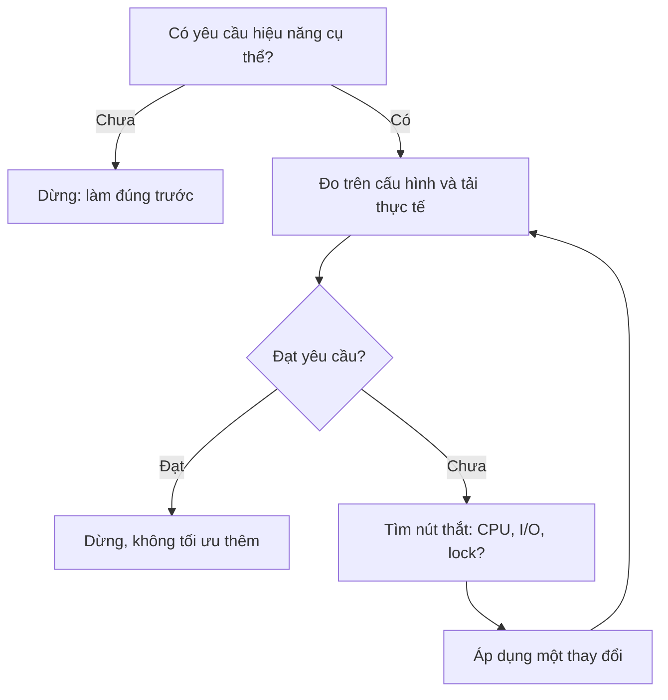
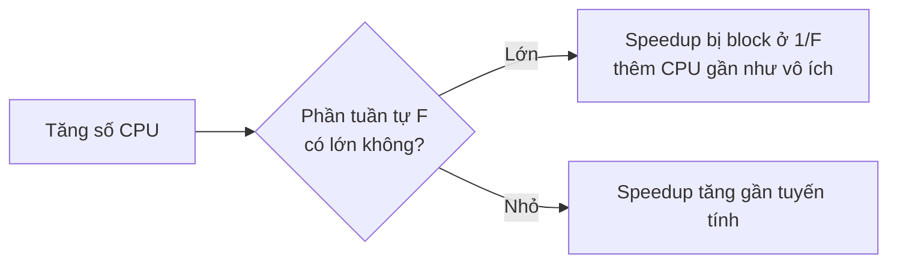
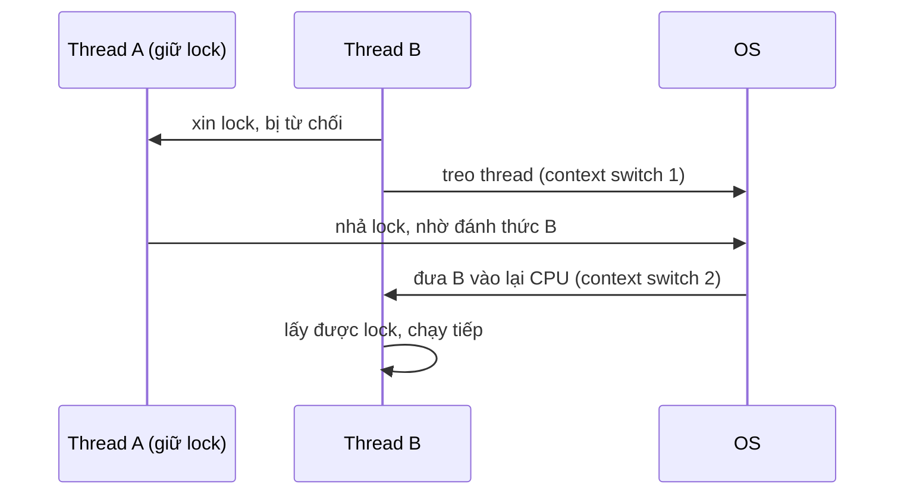
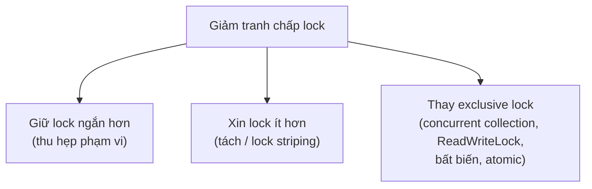
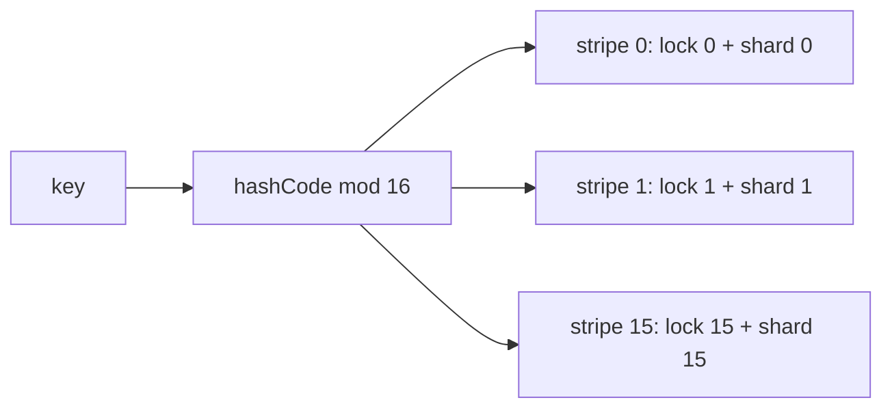

# Lý thuyết 11: Hiệu năng và Scalability

Người ta dùng multithreading chủ yếu vì hiệu năng. Nhưng nếu thiết kế kém, chương trình multithreading có thể **chậm hơn** bản tuần tự, và nhiều kỹ thuật "tăng tốc" lại làm giảm scalability hoặc gây lỗi an toàn và liveness. Bài này giúp bạn hiểu cơ chế đằng sau con số để tối ưu đúng chỗ, thay vì đoán mò.

**Tóm tắt:**

- Làm đúng trước, rồi mới làm nhanh: chỉ tối ưu khi có yêu cầu hiệu năng cụ thể và số đo cho thấy chưa đạt.
- Hiệu năng (nhanh bao nhiêu) khác scalability (làm được bao nhiêu khi thêm tài nguyên); tối ưu cái này có thể làm hại cái kia.
- Định luật Amdahl: speedup tối đa là 1/F với F là phần tuần tự (F = 10% thì tối đa 10 lần); nguồn tuần tự chính trong Java là exclusive lock.
- Chi phí của thread gồm context switch (vài nghìn chu kỳ), memory barrier và việc bị treo khi tranh chấp lock; đồng bộ không tranh chấp rất rẻ.
- Mức contention phụ thuộc tần suất xin lock và thời gian giữ lock; giảm bằng ba hướng: giữ lock ngắn hơn, xin lock ít hơn (lock splitting, lock striping), thay exclusive lock (concurrent collection, atomic, `ReadWriteLock`, immutable object).
- Hot field (như counter `size` dùng chung) triệt tiêu lợi ích của striping; chia counter theo stripe hoặc dùng `LongAdder`.
- Không dùng object pooling cho object nhỏ, vì cấp phát rẻ hơn đồng bộ.
- Phát hiện contention bằng vài thread dump liên tiếp và theo dõi CPU, không bằng trực giác.

## Hiệu năng nhìn theo hai trục

Hiệu năng của chương trình multithreading nên được nhìn theo hai trục khác nhau. Trục thứ nhất là **"nhanh bao nhiêu"**: service time (thời gian xử lý một đơn vị công việc) và latency (độ trễ người dùng cảm nhận). Trục thứ hai là **"làm được bao nhiêu"**: throughput (số việc xong trên một đơn vị thời gian) và capacity (sức chứa tối đa của hệ thống).

**Scalability** là khả năng tăng throughput hoặc capacity khi ta thêm tài nguyên như CPU, memory, I/O. Hệ thống scale tốt là hệ thống thêm máy hay thêm core thì làm được nhiều việc hơn tương ứng. Multithreading luôn có chi phí riêng: điều phối giữa các thread, context switch, đồng bộ memory, tạo và hủy thread, scheduling. Các mục 3 và 4 sẽ đi vào từng loại chi phí này.

## Khi nào nên tối ưu, và nên làm gì

Chỉ nên tối ưu khi đã có yêu cầu hiệu năng cụ thể và số đo cho thấy chưa đạt. Không tối ưu từ đầu: **làm cho đúng trước, rồi mới làm cho nhanh, nếu cần.** Hệ quả của việc làm ngược lại là bạn đánh đổi an toàn lấy tốc độ, và có khi chẳng được cái nào.

Quy trình chung của bài: đo (không đoán), tìm nguồn serialization bằng định luật Amdahl, rồi giảm tranh chấp lock bằng cách thu hẹp phạm vi lock, giảm tần suất xin lock (lock splitting hoặc striping), tránh hot field, và thay exclusive lock bằng cơ chế cho phép đồng thời cao hơn.



Đọc sơ đồ: mỗi vòng chỉ thay đổi một thứ rồi đo lại. Nếu không đo lại, bạn không biết thay đổi đó có giúp ích hay làm tệ hơn.

## Các khái niệm cần biết

- **Serialization trong ngữ cảnh hiệu năng:** phần công việc buộc phải chạy lần lượt, từng thread một (ví dụ đoạn code trong `synchronized`). Đây không phải serialization object ra byte. Phần này quyết định giới hạn của việc thêm CPU.
- **Tranh chấp lock (contention):** nhiều thread cùng muốn một lock tại một thời điểm. Lock không bị tranh thì rất rẻ; lock bị tranh thì thread phải chờ và thường bị OS treo.
- **Context switch:** OS dừng một thread và cho thread khác chạy trên CPU, phải lưu rồi khôi phục ngữ cảnh.
- **Memory barrier:** lệnh buộc CPU và compiler giữ đúng thứ tự và visibility của các thao tác memory; là thứ `synchronized` và `volatile` dùng bên dưới.
- **Lock elision, lock coarsening, escape analysis:** các tối ưu của JVM, giải thích ở mục 3.
- **Lock splitting, lock striping, hot field:** các kỹ thuật và cái bẫy ở mục 4.
- **CAS (compare-and-swap):** lệnh CPU cập nhật một giá trị nếu nó vẫn bằng giá trị mong đợi, nền tảng của các biến atomic không cần lock.

## 1. Tư duy về hiệu năng

Cải thiện hiệu năng nghĩa là làm nhiều việc hơn với ít tài nguyên hơn. Tài nguyên khan hiếm nhất quyết định "bị block bởi gì" (CPU-bound, DB-bound, I/O-bound...).

### Hiệu năng và scalability là hai chuyện khác nhau

| | Tối ưu hiệu năng truyền thống | Tối ưu scalability |
|---|---|---|
| Mục tiêu | Làm cùng một việc **ít công sức hơn** | Chia nhỏ để **dùng thêm tài nguyên** làm nhiều việc hơn |
| Ví dụ | Cache kết quả, thay O(n²) bằng O(n log n) | Tách task thành pipeline, chia nhỏ lock |
| Side effect | Có thể tạo điểm nghẽn tuần tự | Có thể **tăng** công việc cho mỗi task |

Hai trục này đôi khi đối nghịch. Ví dụ mô hình 3 tầng (trình bày, nghiệp vụ, lưu trữ) chậm hơn bản nguyên khối ở yêu cầu đầu tiên (thêm độ trễ mạng, queue, sao chép dữ liệu) nhưng mở rộng được khi tải tăng. Với server, "làm được bao nhiêu" thường quan trọng hơn "nhanh bao nhiêu"; với ứng dụng tương tác thì latency lại quan trọng hơn.

### Đánh đổi và đo đạc

Mọi tối ưu đều là đánh đổi (độ dễ đọc, encapsulate, rủi ro lỗi). Trước khi kết luận cách A "nhanh hơn" cách B, tự hỏi:

- "Nhanh hơn" nghĩa là gì: latency hay throughput?
- Nhanh hơn dưới điều kiện nào: tải nhẹ hay nặng, dữ liệu nhỏ hay lớn? Có số đo chứng minh không?
- Điều kiện đó xảy ra thường xuyên cỡ nào?
- Mã này có bị dùng ở chỗ khác với điều kiện khác không?
- Phải đánh đổi chi phí ẩn nào (bảo trì, rủi ro)?

> **Đo, đừng đoán.** Trực giác của nhiều lập trình viên về chỗ nghẽn hay cách nào "nhanh hơn" trong multithreading thường sai.

Truy tìm lỗi concurrency rất đắt, nên khao khát hiệu năng gần như là nguồn gốc lớn nhất của lỗi concurrency (double-checked locking, bỏ đồng bộ vì "synchronized chậm"). Khi đánh đổi an toàn lấy hiệu năng, có thể bạn chẳng được cái nào. Mọi đợt tối ưu cần: **yêu cầu hiệu năng cụ thể** (biết khi nào bắt đầu và khi nào dừng), **đo trên cấu hình và tải thực tế**, rồi **đo lại** sau khi tối ưu.

## 2. Định luật Amdahl

Một chương trình gồm phần có thể parallelize và phần bắt buộc tuần tự. Gọi `F` là tỉ lệ phần tuần tự, `N` là số CPU:

```text
Speedup  ≤  1 / ( F + (1 − F) / N )
```

Khi `N → ∞`, speedup tiệm cận `1/F`.

| Phần tuần tự F | Speedup tối đa (N → ∞) | N = 10 | N = 100 |
|---|---|---|---|
| 50% | 2 | 1,82 | 1,98 |
| 10% | 10 | 5,26 | 9,17 |
| 5% | 20 | 6,90 | 16,8 |
| 1% | 100 | 9,17 | 50,3 |

Ví dụ tính: F = 10%, N = 10 thì `1 / (0,1 + 0,9/10) = 1 / 0,19 ≈ 5,3`, tức hiệu suất sử dụng CPU chỉ ≈ 53% (speedup chia số CPU). Với N = 100: `1 / (0,1 + 0,009) ≈ 9,2`, hiệu suất chỉ ≈ 9%. Cần rất nhiều CPU dùng không hiệu quả mới tiến gần mốc 10 lần.

**Phải thuộc:** Định luật Amdahl: `Speedup <= 1 / (F + (1 - F) / N)`, với F là tỉ lệ phần tuần tự và N là số CPU. Khi N tiến tới vô cùng, speedup tối đa là `1/F` (F = 10% thì tối đa 10 lần, F = 20% thì tối đa 5 lần). Nguồn tuần tự chính trong Java là exclusive lock, nên giảm phần giữ lock quan trọng hơn thêm CPU.



### Nguồn serialization ẩn

Giả sử N thread worker cùng lấy việc từ một queue dùng chung:

```java
class Worker extends Thread {
    private final BlockingQueue<Runnable> jobs;
    Worker(BlockingQueue<Runnable> jobs) { this.jobs = jobs; }

    @Override public void run() {
        try {
            while (!isInterrupted()) {
                Runnable job = jobs.take();   // <-- bước tuần tự: tranh nhau queue
                job.run();                    // <-- phần parallel thực sự
            }
        } catch (InterruptedException e) { /* thoát */ }
    }
}
```

Thoạt nhìn có vẻ parallel hoàn toàn, nhưng có hai nguồn tuần tự: **lấy việc từ queue chung** và **xử lý kết quả** (ghi log, đưa vào cấu trúc dùng chung; nếu mỗi thread giữ kết quả riêng thì bước gộp cuối cùng cũng là tuần tự). Quy tắc: **mọi ứng dụng concurrent đều có nguồn tuần tự; nếu bạn nghĩ không có, hãy xem lại.**

Nguồn tuần tự còn nằm ẩn trong **framework và thư viện**. Thí nghiệm của sách: nhiều thread liên tục lấy phần tử từ một queue dùng chung rồi xử lý cục bộ.

- `synchronizedList(new LinkedList)`: throughput tăng nhẹ tới ~3 thread rồi **giảm**, vì mỗi lần truy cập queue đều tranh lock nên thời gian bị chi phối bởi context switch.
- `ConcurrentLinkedQueue`: throughput tăng tới số CPU rồi giữ ổn định.

Khác biệt nằm ở mức serialization: loại đầu **serialize cả phép chèn/xóa** (một lock toàn bộ), loại sau chỉ tuần tự cập nhật từng con trỏ (thuật toán không chặn, dùng atomic).

### Dùng Amdahl theo định tính

Dù khó đo trực tiếp F, hãy **nghĩ "trong giới hạn"**: chuyện gì xảy ra nếu có hàng trăm, hàng nghìn CPU? Thuật toán trông mở rộng tốt trên 4 core có thể có nút thắt ẩn chưa lộ ra. Ví dụ: tách một lock thành hai (lock splitting) không đi xa khi số CPU lớn, còn **lock striping** hứa hẹn hơn vì số "mảnh" có thể tăng theo số CPU.

## 3. Chi phí do thread gây ra

### Context switch

Khi số thread sẵn sàng chạy nhiều hơn số CPU, OS phải chiếm quyền một thread để nhường thread khác: lưu và khôi phục execution context, thao tác trên cấu trúc dữ liệu chung của OS/JVM (dùng chính CPU của chương trình bạn), và thread mới vào thường gặp hàng loạt **cache miss** vì dữ liệu của nó không còn trong cache. Đó là lý do scheduler cho mỗi thread một **time quantum** tối thiểu: chia nhỏ chi phí qua nhiều thời gian chạy liên tục (đổi lại phản hồi kém hơn chút).

Quy tắc ngón tay cái: một lần context switch tốn khoảng **5.000 đến 10.000 chu kỳ** (vài micro giây). Chương trình **chặn nhiều** (I/O chặn, lock bị tranh, `wait`) nhảy nhiều lần giữa trạng thái chạy và chặn, nên context switch nhiều hơn chương trình thiên về CPU và throughput thấp hơn. Công cụ quan sát: `vmstat`, `pidstat`, `perfmon`. Tỉ lệ CPU kernel time cao (trên ~10%) thường báo hiệu scheduling nhiều, do I/O hoặc tranh lock.

### Memory synchronization

`synchronized` và `volatile` đảm bảo visibility dữ liệu, nên có thể dùng **memory barrier**: làm sạch/vô hiệu cache, xả write buffer, làm đứng pipeline, và ngăn compiler sắp xếp lại lệnh. Điểm then chốt là phân biệt:

- **Không tranh chấp (uncontended):** đồng bộ chạy theo "đường nhanh", chi phí cỡ 20 đến 250 chu kỳ. Hiếm khi ảnh hưởng đáng kể tới tổng thể.
- **Có tranh chấp (contended):** có thể cần can thiệp của OS, đắt hơn nhiều.

JVM hiện đại tối ưu thêm: **lock elision** (bỏ lock khi chứng minh được object không thoát khỏi thread, dùng *escape analysis*) và **lock coarsening** (gộp các khối `synchronized` liền kề dùng cùng lock).

```java
// JVM có thể loại bỏ hoàn toàn lock vì `names` không thoát khỏi method
String joinNames() {
    StringBuffer names = new StringBuffer();   // StringBuffer có synchronized
    names.append("An").append("Binh").append("Chi");
    return names.toString();
}
```

> Đừng lo quá về chi phí đồng bộ không tranh chấp: cơ chế cơ bản đã rất nhanh và JVM còn tối ưu thêm. Hãy dồn công sức vào chỗ **thực sự có tranh chấp lock**.

Ngoài ra, đồng bộ tạo lưu lượng trên memory bus chung có băng thông giới hạn, nên các thread cạnh tranh băng thông đồng bộ làm chậm lẫn nhau.

### Blocking

Khi tranh lock, thread thua phải chờ bằng một trong hai cách: **spin-waiting** (lặp thử lấy lock; tốt cho chờ ngắn) hoặc **treo thread qua OS** (tốt cho chờ dài). Đa số JVM treo thread. Việc này kéo theo **hai context switch thêm** (rời đi khi chưa hết quantum, rồi quay lại sau) cùng hoạt động OS và cache, và thread đang giữ lock cũng phải nhờ OS đánh thức thread bị block khi nhả lock.



Đọc sơ đồ: một lần tranh lock thua tốn hai lần context switch và hai lần gọi vào OS, trong khi phần việc thật có khi chỉ vài chục chu kỳ. Vì thế spin-waiting hợp với lock giữ rất ngắn, còn treo thread hợp với lock giữ lâu; chọn sai thì hoặc đốt CPU vô ích, hoặc tốn context switch không cần thiết.

**Suy luận:** Lock không tranh chấp rẻ vì đường nhanh chỉ cần một lệnh CAS, còn lock bị tranh chấp thì thread thua phải nhờ OS treo, rồi thread nhả lock lại phải nhờ OS đánh thức. Mỗi lần như vậy là hai context switch và hai lần vào kernel, tốn hàng nghìn chu kỳ, trong khi phần việc thật trong critical section thường chỉ vài chục chu kỳ. Contention còn tự khuếch đại: thread bị treo làm cache nguội, lần chạy lại chậm hơn, lock bị giữ lâu hơn, nên càng nhiều thread xếp hàng chờ. Vì vậy hai chương trình có cùng số lệnh vẫn có thể chênh nhau hàng chục lần throughput, chỉ vì một bên giữ lock ngắn và xin lock ít. Điểm dễ nhầm là đo `synchronized` trong test single-thread rồi kết luận "đồng bộ rẻ" hoặc "đồng bộ đắt"; cả hai đều chưa đúng nếu không biết mức contention thật. Hệ quả: tối ưu phải bắt đầu bằng việc đo nơi các thread thực sự chờ, không phải bằng việc bỏ lock.

## 4. Giảm tranh chấp lock

Serialization làm hại scalability; context switch làm hại hiệu năng; **tranh chấp lock gây cả hai**. Exclusive lock là mối đe dọa chính đối với scalability của ứng dụng concurrent.

Khả năng tranh chấp phụ thuộc hai yếu tố: **tần suất xin lock** và **thời gian giữ lock** mỗi lần (hệ quả của định luật Little). Nếu tích hai đại lượng này đủ nhỏ, đa số lần xin lock sẽ không bị tranh. Ba hướng:

**Nền tảng:** Tranh chấp lock vừa làm hại scalability (serialization) vừa làm hại hiệu năng (context switch), nên là kẻ thù chính của chương trình concurrent. Mức tranh chấp phụ thuộc hai yếu tố: tần suất xin lock và thời gian giữ lock mỗi lần. Mọi kỹ thuật giảm tranh chấp đều nhắm vào một trong hai yếu tố này.



### 4.1 Thu hẹp phạm vi lock ("vào nhanh, ra nhanh")

Đưa mã không cần lock ra ngoài khối `synchronized`, nhất là việc đắt hoặc có thể chặn (I/O). Cận trên throughput: nếu mỗi thao tác giữ lock 2 ms thì tổng không vượt 500 thao tác/giây dù có bao nhiêu CPU; giữ 1 ms thì cận là 1.000.

```java
// Chưa tốt: lock cả hàm, trong khi chỉ cần lock lúc đọc map
class ProfileStore {
    private final Map<String, String> attrs = new HashMap<>();   // guarded by this

    synchronized boolean cityMatches(String user, String regex) {
        String key = "users." + user + ".city";          // không cần lock
        String city = attrs.get(key);                    // CẦN lock
        // không cần lock (tốn CPU)
        return city != null && Pattern.matches(regex, city);
    }
}

// Tốt hơn: chỉ lock đúng chỗ đụng tới trạng thái chung
class ProfileStore {
    private final Map<String, String> attrs = new HashMap<>();   // guarded by this

    boolean cityMatches(String user, String regex) {
        String key = "users." + user + ".city";
        String city;
        synchronized (this) { city = attrs.get(key); }
        return city != null && Pattern.matches(regex, city);
    }
}
```

Tốt hơn nữa: nếu class chỉ có một biến trạng thái, **delegate** thread-safe cho `ConcurrentHashMap`, bỏ hẳn đồng bộ explicit. Như vậy giảm phạm vi lock xuống chỉ còn thời gian truy cập map và loại rủi ro người bảo trì sau này quên lock.

Giới hạn: khối `synchronized` có thể **quá nhỏ**. Các thao tác phải atomic (ví dụ cập nhật nhiều biến thuộc cùng một invariant) phải nằm trong một khối. Chia một khối thành nhiều khối nhỏ đến một mức nào đó còn phản tác dụng vì mỗi lần xin lock đều tốn chi phí (và JVM có thể gộp lại bằng lock coarsening). Chỉ nên bận tâm kích thước khối khi có thể đưa ra ngoài **phần tính toán đáng kể** hoặc **thao tác có thể chặn**.

### 4.2 Giảm lock granularity: lock splitting

Nếu một lock bảo vệ nhiều biến **độc lập**, hãy tách thành nhiều lock, mỗi lock bảo vệ một biến. Mỗi lock sẽ ít bị xin hơn.

```java
// Trước: một lock `this` cho cả hai tập độc lập
class SessionMonitor {
    private final Set<String> onlineUsers = new HashSet<>();
    private final Set<String> runningJobs = new HashSet<>();

    synchronized void login(String u)  { onlineUsers.add(u); }
    synchronized void startJob(String j) { runningJobs.add(j); }
}

// Sau: mỗi tập một lock riêng
class SessionMonitor {
    private final Set<String> onlineUsers = new HashSet<>();   // guarded by onlineUsers
    private final Set<String> runningJobs = new HashSet<>();   // guarded by runningJobs

    void login(String u)    { synchronized (onlineUsers) { onlineUsers.add(u); } }
    void startJob(String j) { synchronized (runningJobs) { runningJobs.add(j); } }
}
```

Hiệu quả cao nhất khi lock **bị tranh chấp ở mức vừa**; có thể biến nó thành lock hầu như không bị tranh, là kết quả lý tưởng. Tách lock vốn ít tranh chấp thì lợi ích nhỏ (chỉ nâng ngưỡng tải bắt đầu suy giảm). Lưu ý: nhiều lock hơn nghĩa là **rủi ro deadlock lớn hơn** (xem bài 10).

### 4.3 Lock striping

Tách đôi một lock đang bị tranh nặng thường chỉ cho ra hai lock bị tranh nặng. Khi cần phân vùng lock trên một tập object độc lập có kích thước thay đổi, dùng **lock striping**. Ví dụ `ConcurrentHashMap` (các bản cũ trước Java 8) dùng mảng 16 lock, mỗi lock bảo vệ 1/16 số bucket (bucket `n` do lock `n mod 16` bảo vệ), nên hỗ trợ tối đa ~16 thread ghi đồng thời.



Đọc sơ đồ: mỗi key được ánh xạ tới đúng một stripe, nên hai thread chỉ tranh nhau khi key của chúng rơi vào cùng stripe. Nên dùng khi có nhiều key độc lập và tranh chấp ghi cao; không đáng khi tranh chấp thấp hoặc khi thao tác toàn cục (như `total`) xảy ra liên tục, vì khi đó phải lấy lần lượt mọi lock. Hãy xem cài đặt tối giản sau.

```java
class StripedCounterMap {
    private static final int STRIPES = 16;
    private final Object[] locks = new Object[STRIPES];
    private final Map<String, Long>[] shards;

    @SuppressWarnings("unchecked")
    StripedCounterMap() {
        shards = new Map[STRIPES];
        for (int i = 0; i < STRIPES; i++) {
            locks[i] = new Object();
            shards[i] = new HashMap<>();
        }
    }

    private int stripe(String key) { return (key.hashCode() & 0x7fffffff) % STRIPES; }

    void increment(String key) {
        int s = stripe(key);
        synchronized (locks[s]) { shards[s].merge(key, 1L, Long::sum); }   // chỉ 1 lock
    }

    long total() {                       // thao tác toàn cục: lần lượt qua mọi stripe
        long sum = 0;
        for (int i = 0; i < STRIPES; i++) {
            synchronized (locks[i]) {
                for (long v : shards[i].values()) sum += v;
            }
        }
        return sum;                      // KHÔNG phải atomic snapshot tại một thời điểm
    }
}
```

Đánh đổi: các thao tác cần lock **toàn bộ** collection (ví dụ mở rộng bảng băm) khó và đắt hơn, vì phải lấy tất cả lock. Các method như `size` hay `clear` thường không atomic; với collection mà client không thể exclusive lock, kết quả `size` có thể đã cũ ngay khi trả về, nên hành vi này thường chấp nhận được. Chỉ tăng số stripe khi có bằng chứng tranh chấp ghi đáng kể.

> Ghi chú: từ Java 8, `ConcurrentHashMap` không còn dùng `Segment` 16 lock; nó lock theo từng bucket (đầu danh sách/cây) kết hợp CAS. Nguyên lý giảm granularity lock vẫn là điều cần học.

**Phải thuộc:** Ba hướng giảm tranh chấp lock: giữ lock ngắn hơn (thu hẹp phạm vi, đưa I/O và tính toán nặng ra ngoài); xin lock ít hơn (lock splitting cho các biến độc lập cố định, lock striping cho tập object có kích thước thay đổi); thay exclusive lock (concurrent collection, `ReadWriteLock`, immutable object, atomic, `LongAdder`). Cẩn thận hot field như counter `size` dùng chung.

### 4.4 Tránh hot field

Giảm lock granularity không giúp được nếu có biến mà **mọi thao tác** đều phải đụng tới. Điển hình: một counter `size` được cập nhật mỗi lần thêm/xóa. Nó làm `size()` từ O(n) thành O(1) nhưng trở thành **hot field**: mọi thao tác ghi tranh nhau cập nhật nó, nên dù lock striping cho các bucket thì tranh chấp quay lại. Một tối ưu single-thread đã biến thành gánh nặng scalability.

**Suy luận:** Contention chỉ xảy ra khi nhiều thread cùng cần một thứ độc quyền, nên mọi kỹ thuật giảm contention thực chất là làm cho ít thread cùng cần cùng một thứ. Lock striping chia dữ liệu thành N phần độc lập, nhờ đó xác suất hai thread đụng nhau giảm khoảng N lần. Nhưng striping chỉ chia những gì ta chia: nếu mọi thao tác ghi còn phải cập nhật một biến chung như `size`, thì biến đó vẫn là điểm tuần tự duy nhất và theo Amdahl nó chặn speedup ở 1/F, bất kể có bao nhiêu stripe. Điểm dễ nhầm là thấy `size()` O(1) là tối ưu, vì trên một thread nó đúng là nhanh hơn, nhưng cái giá chuyển sang mọi thao tác ghi. Cách chữa nhất quán với lập luận trên là chia chính biến đó (counter theo stripe, `LongAdder`) và cộng dồn khi đọc, đổi độ chính xác tức thời lấy scalability. Hệ quả khi review: với mỗi counter hay cache dùng chung, hỏi "mọi thao tác có phải ghi vào nó không?"; nếu có, nó là hot field.

`ConcurrentHashMap` tránh điều này bằng cách giữ counter **riêng từng stripe** (do chính lock stripe bảo vệ) và để `size` cộng dồn các stripe.

| Object | Cách tránh hot field |
|---|---|
| Counter thống kê | `LongAdder` (nhiều ô, cộng dồn lúc đọc) thay cho một `AtomicLong` |
| `size()` của map | Đếm theo stripe, cộng khi cần |
| Cache giá trị tính sẵn | Cân nhắc lại: cache có thể là nguồn tranh chấp |

### 4.5 Thay exclusive lock

Khi mọi cách thu nhỏ hay chia nhỏ lock vẫn chưa đủ, hãy hỏi liệu có cần exclusive lock hay không. Các lựa chọn:

- **Concurrent collection** (`ConcurrentHashMap`, `CopyOnWriteArrayList`, ...).
- **`ReadWriteLock`:** nhiều người đọc cùng lúc, một người ghi độc quyền; hợp với dữ liệu **đọc nhiều ghi ít**. Nếu ghi thường xuyên hoặc đoạn đọc rất ngắn, chi phí quản lý lock đọc có thể làm nó chậm hơn lock thường (xem bài 13).
- **Immutable object:** chỉ đọc thì không cần lock.
- **Biến atomic** (`AtomicLong`, `LongAdder`...): giảm chi phí cập nhật hot field, dựa trên lệnh CAS của CPU. Nhớ rằng atomic chỉ giảm chi phí chứ không loại bỏ tranh chấp; đổi thuật toán để có ít hot field hơn còn tốt hơn.

### 4.6 Giám sát CPU

Khi thử scalability, mục tiêu thường là giữ mọi CPU bận. Công cụ: `vmstat`, `mpstat`, `perfmon`. Nếu CPU **không đều** (vài core nóng, vài core rảnh), việc đầu tiên là tìm thêm parallel trong chương trình. Nếu CPU **chưa được dùng hết**, tìm nguyên nhân:

| Nguyên nhân | Cách kiểm tra |
|---|---|
| Tải chưa đủ | Tăng tải và đo lại; đôi khi chính máy phát tải mới là nút thắt |
| Bị block bởi I/O | `iostat`, theo dõi băng thông mạng |
| Phụ thuộc dịch vụ ngoài | Profiler/công cụ DB xem thời gian chờ phản hồi |
| Tranh chấp lock | Profiler, hoặc lấy mẫu vài thread dump xem thread nào "waiting to lock" cùng một lock |

Lấy mẫu thread dump là cách rẻ: lock hầu như không bị tranh hiếm khi xuất hiện, còn lock bị tranh nặng gần như luôn có thread chờ nên hay lộ mặt.

### 4.7 Đừng dùng object pooling

Thời JVM đầu, cấp phát và GC chậm nên người ta tái chế object bằng pool. Nay cấp phát trong HotSpot chỉ cỡ mười lệnh máy và mỗi thread có vùng cấp phát riêng (hầu như không cần đồng bộ). Pool thì **cần đồng bộ**, mà một lần bị block vì tranh lock đắt gấp hàng trăm lần một lần cấp phát; ngay đồng bộ không tranh chấp thường cũng đắt hơn `new`. Pool còn kéo theo rủi ro: chọn sai kích thước, quên reset trạng thái, trả object về pool mà vẫn dùng.

> **Cấp phát object thường rẻ hơn đồng bộ.** Pool chỉ hợp lý với object thực sự đắt (connection DB, thread, buffer trực tiếp lớn).

## 5. Ví dụ: so sánh các Map

Thí nghiệm của sách: N thread liên tục chọn key ngẫu nhiên, `get`, nếu thiếu thì `put` (xác suất 0,6), nếu có thì `remove` (xác suất 0,02).

| Map | Hành vi khi tăng thread |
|---|---|
| `ConcurrentHashMap`, `ConcurrentSkipListMap` | Throughput tiếp tục tăng, mở rộng tốt |
| `synchronizedMap(HashMap/TreeMap)` | Ngang nhau ở 1 thread, nhưng **sụp đổ ngay từ 2 thread** khi chuyển từ phần lớn không tranh chấp sang phần lớn tranh chấp |

Lý do: `ConcurrentHashMap` tối ưu cho `get` thành công (đa số lần đọc không lock), chỉ lock theo stripe khi ghi. Map bọc `synchronized` có **một lock cho cả map**. Mô hình chung của mã bị giới hạn bởi tranh lock: khi tranh thấp, thời gian mỗi thao tác bị chi phối bởi công việc thật và throughput tăng; khi tranh cao, thời gian bị chi phối bởi context switch và độ trễ scheduling nên thêm thread không giúp ích.

## 6. Giảm chi phí context switch: ví dụ ghi log

Ghi log trực tiếp (mỗi thread yêu cầu tự `println`) gồm I/O và tranh lock trên output stream. Hậu quả: thread chặn, bị đẩy khỏi CPU, quay lại muộn do còn thread khác chờ; service time tăng; và giữ lock lâu hơn nên **càng nhiều tranh chấp hơn**.

Cách khác: chỉ đưa message vào queue, một **logger thread duy nhất** ghi ra đĩa.

```java
class AsyncLogger {
    private final BlockingQueue<String> queue = new LinkedBlockingQueue<>(10_000);
    private final Thread writer;

    AsyncLogger(PrintWriter out) {
        writer = new Thread(() -> {
            try {
                while (true) out.println(queue.take());   // chỉ một thread chạm vào I/O
            } catch (InterruptedException e) { /* dọn dẹp */ }
        }, "logger");
        writer.setDaemon(true);
        writer.start();
    }

    void log(String msg) {
        // nhanh, ít khả năng chặn; queue đầy: bỏ hoặc xử lý riêng
        queue.offer(msg);
    }
}
```

Đây là như nhóm chuyền xô nước thay vì cả trăm người chạy loạn: dòng chảy ổn định, mỗi người chuyên một việc, ít tranh chấp ở nguồn nước, mỗi thread yêu cầu ít bị context switch. Chi phí: phải thiết kế thêm các vấn đề như ngắt, đảm bảo log đã xếp hàng được ghi trước khi tắt, chính sách khi queue đầy và lifecycle dịch vụ (xem bài 7).

## Bẫy thường gặp

- **Tối ưu sớm**, không có yêu cầu hay số đo; bỏ `synchronized` vì tin nó "chậm".
- **Cache/counter dùng chung** tạo hot field, biến tối ưu single-thread thành nút thắt multithreading.
- **Giữ lock khi làm I/O hoặc tính toán nặng.**
- **Tách khối `synchronized` quá nhỏ**, làm hỏng atomicity hoặc tốn thêm chi phí.
- **Tách lock mà không tính tới deadlock.**
- **Dùng pool cho object nhỏ**, thêm đồng bộ không cần thiết.
- **Thêm thread/CPU mà không đo F:** theo Amdahl có thể gần như vô ích.
- **Benchmark tải thấp**: chương trình có thể trông ổn đến khi tranh chấp bùng nổ.
- **Đo trên máy ít core** rồi suy ra cho máy nhiều core.

## Điểm cần nhớ

- Chỉ tối ưu khi có yêu cầu hiệu năng; **làm đúng trước, rồi mới làm nhanh**. An toàn luôn đứng trước.
- Scalability (làm được bao nhiêu) khác hiệu năng đơn lẻ (nhanh bao nhiêu).
- Amdahl: speedup ≤ 1/(F + (1−F)/N); phần tuần tự quyết định giới hạn.
- Nguồn tuần tự chính trong Java là **exclusive lock**.
- Giảm tranh chấp bằng ba hướng: giữ lock ngắn, xin lock ít, thay exclusive lock.
- Không lo quá về đồng bộ không tranh chấp; hãy tìm chỗ có tranh chấp thật.
- Tránh hot field và object pooling; cấp phát thường rẻ hơn đồng bộ.
- Giảm chặn và context switch có thể tăng throughput (ví dụ thread ghi log riêng).

## Câu hỏi tự kiểm tra

1. **Chương trình có 20% phần tuần tự. Thêm bao nhiêu CPU cũng không nhanh hơn một mức. Mức đó là bao nhiêu và vì sao?**
   - **Gợi ý suy luận:** Phần tuần tự không chia được cho nhiều CPU. Nếu phần parallel co về gần 0 thời gian thì thời gian còn lại là bao nhiêu? Speedup là tỉ lệ thời gian trước/sau.
   - **Lập luận:** Gọi tổng thời gian là 1. Dù phần 80% parallel chạy trên vô hạn CPU, nó tiến về 0, còn phần 20% tuần tự vẫn tốn 0,2. Thời gian tối thiểu 0,2 nên speedup tối đa = 1/0,2 = 5. Đây là định luật Amdahl.
   - **Đáp án ngắn:** Tối đa 5 lần, bất kể số CPU.
   - **Nhớ:** Speedup tối đa = 1 / (phần tuần tự), nên giảm phần tuần tự (thường là phần giữ lock) quan trọng hơn thêm CPU.

2. **Lock splitting và lock striping khác nhau thế nào, dùng khi nào?**
   - **Gợi ý suy luận:** Cả hai cùng nhằm giảm tranh chấp bằng cách chia một lock thành nhiều. Khác nhau ở chỗ: số lượng lock có cố định không, và mỗi lock bảo vệ cái gì? Với bucket của hash map thì chia theo gì?
   - **Lập luận:** Nếu một lock bảo vệ vài biến trạng thái độc lập cố định, ta tách thành mỗi biến một lock (splitting). Nếu lock bảo vệ một tập có kích thước biến đổi, như các bucket, ta chia theo hash vào N lock (striping). Hai thread đụng bucket khác stripe không còn tranh nhau.
   - **Đáp án ngắn:** Splitting: tách thành vài lock cho các biến độc lập cố định; striping: chia lock theo tập object có số lượng biến đổi, số stripe có thể tăng theo CPU.
   - **Nhớ:** Giảm tranh chấp bằng cách giảm phạm vi mỗi lock bảo vệ.

3. **Đã dùng striping mà một thao tác vẫn nghẽn. Có thể do hot field không? Hot field là gì?**
   - **Gợi ý suy luận:** Striping cho phép các thread chạy parallel trên stripe khác nhau. Nhưng nếu mọi thao tác đều phải cập nhật một biến chung, như `size` toàn cục, thì biến đó được bảo vệ bằng gì?
   - **Lập luận:** Một biến mà mọi thao tác phải ghi cần một lock hoặc atomic chung. Mọi thread, dù ở stripe nào, đều xếp hàng tại biến đó, nên lợi ích của striping bị triệt tiêu.
   - **Đáp án ngắn:** Hot field là biến mà mọi thao tác phải cập nhật, như counter `size` toàn cục; nó làm hỏng lợi ích của striping.
   - **Nhớ:** Giải pháp thường là đếm riêng theo từng stripe và cộng khi cần đọc, hoặc chấp nhận kết quả xấp xỉ.

4. **Vì sao object pooling thường làm chậm chương trình multithreading?**
   - **Gợi ý suy luận:** Pool được chia sẻ giữa các thread thì cần đồng bộ thế nào? Cấp phát object mới trên JVM hiện đại đắt hay rẻ, và có cần lock không?
   - **Lập luận:** Pool dùng chung phải lấy lock khi mượn và trả, nên tạo ra điểm tranh chấp. Trong khi đó cấp phát object trong JVM hiện đại rất rẻ (cấp phát thread-local, không lock). Chi phí tranh lock lớn hơn lợi ích tái sử dụng.
   - **Đáp án ngắn:** Pool cần đồng bộ, mà tranh lock đắt hơn nhiều so với cấp phát thread-local.
   - **Nhớ:** Chỉ pool những tài nguyên thật sự đắt, như connection.

5. **Hai yếu tố nào quyết định mức tranh chấp trên một lock, và vì thế ta giảm tranh chấp bằng những cách nào?**
   - **Gợi ý suy luận:** Queue chờ lock dài lên khi nào? Khi thread xin lock nhiều hơn, hay khi mỗi lần giữ lâu hơn? Cách giảm mỗi yếu tố là gì?
   - **Lập luận:** Tranh chấp tăng khi tần suất xin lock cao và khi mỗi lần giữ lâu. Giảm thời gian giữ (thu nhỏ khối đồng bộ, đưa việc chậm ra ngoài) và giảm tần suất (chia lock, dùng dữ liệu thread-local) đều làm queue ngắn lại.
   - **Đáp án ngắn:** Tần suất xin lock và thời gian giữ lock mỗi lần.
   - **Nhớ:** Mọi kỹ thuật giảm tranh chấp đều nhắm vào một trong hai yếu tố này.

6. **Chưa có profiler, làm sao nghi ngờ có tranh chấp lock?**
   - **Gợi ý suy luận:** Thread đang chờ lock có trạng thái gì và thread dump ghi lại điều đó thế nào? Nếu lấy vài dump liên tiếp mà nhiều thread cùng chờ một monitor thì điều đó nói gì?
   - **Lập luận:** Một dump chỉ là snapshot tại một thời điểm, nên cần vài dump cách nhau. Nếu liên tục thấy nhiều thread "waiting to lock" cùng một monitor thì đó chính là điểm nghẽn, vì thread đang giữ lock giữ quá lâu hoặc có quá nhiều thread xin.
   - **Đáp án ngắn:** Lấy vài thread dump liên tiếp, xem nhiều thread cùng chờ lock một monitor.
   - **Nhớ:** Thread dump là công cụ chẩn đoán rẻ nhất; một dump đơn lẻ dễ gây hiểu nhầm.

Nguồn: Java Concurrency in Practice, Chương 11.

