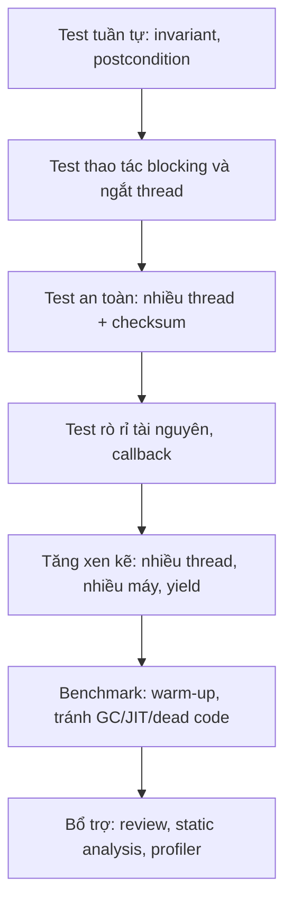
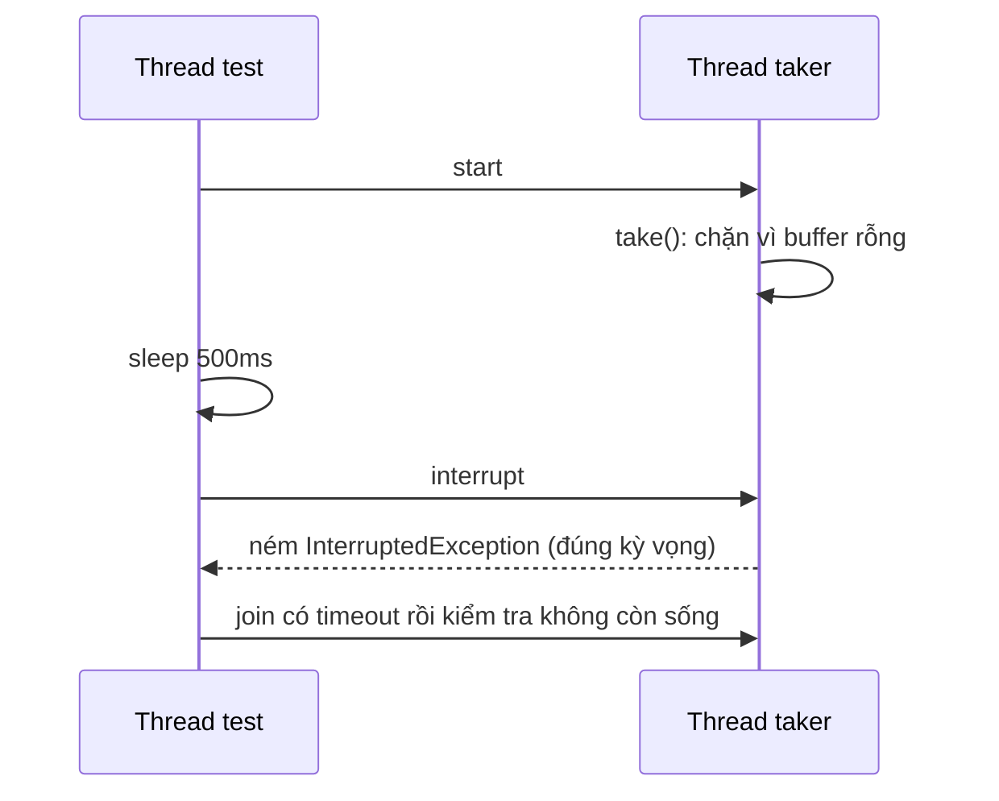
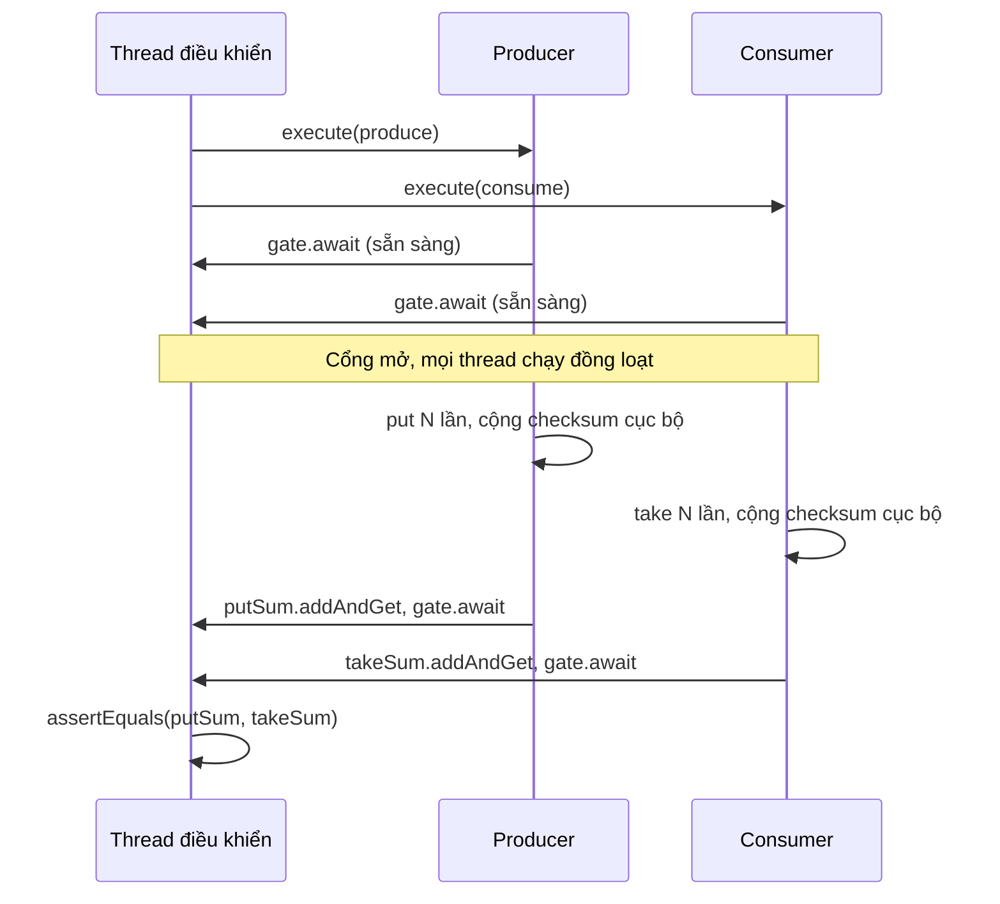
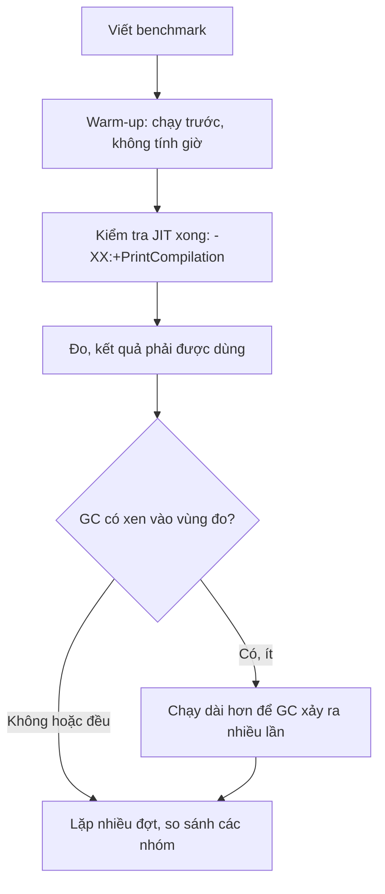

# Lý thuyết 12: Kiểm thử chương trình concurrent

Giả sử bạn vừa viết một class thread-safe, chạy một test single-thread và thấy màu xanh. Test đó gần như không nói lên điều gì: lỗi concurrency không xảy ra ở mỗi lần chạy, mà chỉ khi các thread xen kẽ nhau theo một kiểu hiếm gặp. Bài này hướng dẫn cách dùng lại ý tưởng kiểm thử tuần tự nhưng mở rộng cho không gian lỗi lớn hơn nhiều, để có thêm bằng chứng rằng mã multithreading của bạn chạy đúng.

**Tóm tắt:**

- Lỗi concurrency là event xác suất thấp, nên test qua không chứng minh đúng; test chỉ tăng độ tin cậy.
- Bắt đầu bằng test tuần tự (invariant, postcondition) rồi mới test multithreading.
- Test method blocking: chạy ở thread riêng, chờ đủ lâu, interrupt rồi `join` có hạn; không dùng `Thread.getState()` để kết luận.
- Test safety dùng checksum giao hoán (cộng, XOR) riêng từng thread, gộp một lần ở cuối, cổng xuất phát bằng `CyclicBarrier`, số thread nhiều hơn CPU và timeout toàn cục.
- Kiểm tra cả leak resource và hành vi chính sách (ví dụ đếm qua `ThreadFactory` tùy biến); chèn `Thread.yield()` để tăng interleaving.
- Năm bẫy benchmark: GC, JIT, mẫu đường code thiếu thực tế, mức contention phi thực tế, dead code elimination; nên dùng JMH.
- Không phương pháp nào đủ một mình: kết hợp test, code review, static analysis và profiler (jcstress, JFR cho Java hiện đại).

## Vì sao kiểm thử multithreading khó

Lỗi concurrency thường là **event xác suất thấp**, phụ thuộc thời điểm, tải và môi trường. Hơn nữa, chính mã test có thể tạo ra đồng bộ hoặc thay đổi thời điểm chạy, làm **che mất** lỗi. Hiện tượng lỗi biến mất khi bạn thêm mã debug (như `println`) có tên là **Heisenbug**. Ngoài ra, benchmark Java dễ cho kết quả sai vì JIT và GC (mục 3).

Mục tiêu thực tế của kiểm thử không phải "tìm hết lỗi" (không làm được) mà là **tăng độ tin cậy** rằng mã chạy đúng. Mã concurrent có nhiều thứ có thể sai hơn nên cần nhiều nỗ lực hơn để đạt cùng độ tin cậy.

**Nền tảng:** Lỗi concurrency là event xác suất thấp phụ thuộc thời điểm, nên test qua không chứng minh đúng, test chỉ có thể tăng độ tin cậy. Vì vậy test phải dài, nhiều thread, nhiều cấu hình, và mã test không được tự thêm đồng bộ làm che mất lỗi cần bắt.

Kiểm thử multithreading chia thành ba nhóm: **correctness** (safety, liveness), **hiệu năng** (throughput, responsiveness, scalability) và các kỹ thuật bổ trợ (review, static analysis, profiler).

## Khi nào làm, và làm theo thứ tự nào

Áp dụng cho mọi class concurrent có thể dùng chung: collection, cache, buffer, service. Chạy lặp, đủ lâu, trên máy nhiều core, với nhiều cấu hình. Nếu class chỉ chạy trong một thread duy nhất (không chia sẻ), bạn không cần tốn công này.



Đọc sơ đồ: đi từ rẻ và đơn giản đến đắt và khó. Test tuần tự bắt lỗi logic thường trước khi bạn mất công săn data race.

## Các khái niệm cần biết

- **Invariant và postcondition:** invariant là điều luôn đúng về trạng thái object (ví dụ `size` bằng số phần tử thực); postcondition là điều phải đúng sau khi một thao tác kết thúc. Đây là thứ test kiểm tra.
- **Data race:** hai thread truy cập cùng một biến mà ít nhất một bên ghi và không có đồng bộ phù hợp. Kết quả không xác định.
- **Checksum:** con số tóm tắt dữ liệu (tổng, XOR). Ở đây dùng để so sánh "cái đưa vào" và "cái lấy ra" mà không phải lưu từng phần tử.
- **Giao hoán (commutative):** kết quả không phụ thuộc thứ tự, như phép cộng và XOR. Cần thiết khi thứ tự giữa các thread không xác định.
- **Barrier / latch (`CyclicBarrier`, `CountDownLatch`):** điểm hẹn để nhiều thread cùng xuất phát hoặc cùng chờ nhau xong.
- **Spurious wakeup:** thread đang chờ bị đánh thức dù không ai báo; vì thế điều kiện chờ luôn phải kiểm tra trong vòng lặp.
- **Warm-up, JIT, dead code elimination:** warm-up là chạy trước không tính giờ để JVM biên dịch xong hot code (JIT: Just-In-Time compiler). Dead code elimination là việc compiler cắt bỏ phép tính mà kết quả không ai dùng (mục 3).
- **JMH, jcstress:** thư viện benchmark vi mô và khung kiểm thử concurrency của OpenJDK (mục 3 và mục 4).

## 1. Kiểm thử correctness

### Safety và liveness

- **Safety** ("không điều xấu nào xảy ra"): kiểm tra các invariant và postcondition. Ví dụ danh sách liên kết cache `size`: invariant là `size` bằng số phần tử thực. Điều khó là phải quan sát cả hai **trong một thao tác atomic**; nếu không sẽ có race ngay trong test. Cách làm: exclusive lock object, dùng "atomic snapshot" nếu class hỗ trợ, hoặc có "test point" do class cung cấp.
- **Liveness** ("điều tốt rồi sẽ xảy ra"): kiểm tra tiến triển và không tiến triển. Cực khó định lượng: làm sao biết một method đang *chặn* chứ không phải chỉ *chạy chậm*? Chờ bao lâu thì kết luận deadlock?

Để minh họa, các ví dụ dưới đây xoay quanh một **bounded buffer** (bounded buffer) tự viết, `put` chặn khi đầy, `take` chặn khi rỗng, dùng hai `Semaphore` đếm chỗ trống/phần tử.

```java
class SlotBuffer<E> {
    private final Semaphore items;       // số phần tử có thể lấy
    private final Semaphore spaces;      // số chỗ còn trống
    private final E[] data;
    private int head = 0, tail = 0;      // guarded by this

    @SuppressWarnings("unchecked")
    SlotBuffer(int capacity) {
        items = new Semaphore(0);
        spaces = new Semaphore(capacity);
        data = (E[]) new Object[capacity];
    }

    boolean isEmpty() { return items.availablePermits() == 0; }
    boolean isFull()  { return spaces.availablePermits() == 0; }

    void put(E e) throws InterruptedException {
        spaces.acquire();
        insert(e);
        items.release();
    }

    E take() throws InterruptedException {
        items.acquire();
        E e = extract();
        spaces.release();
        return e;
    }

    private synchronized void insert(E e) { data[tail] = e; tail = (tail + 1) % data.length; }
    private synchronized E extract() {
        E e = data[head];
        data[head] = null;               // quan trọng để không memory leak
        head = (head + 1) % data.length;
        return e;
    }
}
```

*(Thực tế nên dùng `ArrayBlockingQueue`/`LinkedBlockingQueue`; ví dụ này chỉ để minh họa kỹ thuật kiểm thử.)*

### 1.1 Test cơ bản (tuần tự)

Vẫn cần có: buffer mới tạo phải rỗng và không đầy; nhét N phần tử vào buffer dung lượng N thì phải đầy và không rỗng. Bộ test tuần tự cho biết lỗi **không** liên quan đồng thời trước khi bạn đi săn data race.

```java
@Test void emptyWhenNew() {
    SlotBuffer<Integer> b = new SlotBuffer<>(10);
    assertTrue(b.isEmpty());
    assertFalse(b.isFull());
}

@Test void fullAfterNPuts() throws Exception {
    SlotBuffer<Integer> b = new SlotBuffer<>(10);
    for (int i = 0; i < 10; i++) b.put(i);
    assertTrue(b.isFull());
    assertFalse(b.isEmpty());
}
```

### 1.2 Test thao tác blocking

Nếu một method **phải chặn** trong một điều kiện thì test chỉ đạt khi thread **không** đi tiếp. Test này giống test "method phải ném exception": nếu trả về bình thường thì thất bại. Khó ở chỗ phải có cách làm nó *hết chặn*; cách tự nhiên là **ngắt thread (interrupt)**:

```java
@Test void takeBlocksWhenEmptyAndRespondsToInterrupt() throws Exception {
    SlotBuffer<Integer> b = new SlotBuffer<>(10);
    AtomicBoolean returnedNormally = new AtomicBoolean(false);

    Thread taker = new Thread(() -> {
        try {
            b.take();
            returnedNormally.set(true);      // đến đây là LỖI: lẽ ra phải chặn
        } catch (InterruptedException expected) { /* đúng kỳ vọng */ }
    });

    taker.start();
    Thread.sleep(500);                       // chờ đủ lâu để taker chặn
    taker.interrupt();
    taker.join(2_000);                       // join có hạn: test không treo mãi

    assertFalse(taker.isAlive());
    assertFalse(returnedNormally.get());
}
```



Đọc sơ đồ: test chỉ đạt khi `take` thoát bằng exception do bị ngắt. Nếu `take` trả về bình thường thì cờ `returnedNormally` bật lên và test thất bại, nghĩa là method không chặn như thiết kế. Nên dùng kiểu test này cho mọi API có contract "chặn đến khi điều kiện đúng".

Điểm tinh tế:

- **"Chờ đủ lâu"** là phỏng đoán: nếu máy chậm, test sai giả; phải sẵn sàng tăng giá trị.
- **`join` có timeout** để test kết thúc dù `take` kẹt theo cách bất ngờ.
- Ít khi nên tự `extends Thread` hơn dùng `Runnable`, nhưng ở đây cần `join` để kiểm tra thoát đúng.
- **Không dùng `Thread.getState()` để kết luận thread đã chặn.** JVM không bắt buộc thread chặn phải vào `WAITING`/`TIMED_WAITING` (có thể spin), và thread đang `WAITING` vẫn có thể tạm sang `RUNNABLE` do *spurious wakeup*. `getState` chỉ phù hợp cho debug.
- Khung kiểm thử thường **không thân thiện với multithreading**: lỗi ở thread phụ không tự báo về test chính. Cần cơ chế chuyển tiếp lỗi (bắt exception trong thread, lưu lại rồi ném ở thread test chính; hoặc dùng `Thread.setDefaultUncaughtExceptionHandler`/`ExecutorService` và `Future.get()`).

**Suy luận:** Muốn biết một method có thật sự block hay không, ta cần một quan sát không phụ thuộc vào thời điểm đọc. `Thread.getState()` không đáp ứng vì JVM được phép block bằng spin (thread vẫn `RUNNABLE`), còn spurious wakeup đưa thread đang `WAITING` tạm sang `RUNNABLE`, nên giá trị đọc được có thể sai theo cả hai chiều. Interrupt thì khác: nếu method đang block thật, interrupt buộc nó thoát bằng `InterruptedException`; nếu nó đã trả về bình thường thì cờ `returnedNormally` bật lên. Như vậy test chuyển từ câu hỏi "trạng thái hiện giờ là gì" sang câu hỏi "hành vi khi bị ngắt là gì", và câu hỏi sau có đáp án xác định. Điểm dễ nhầm là `sleep(500)` trông như một cơ chế đồng bộ, nhưng nó chỉ là phỏng đoán rằng thread đã kịp block, nên máy chậm sẽ cho kết quả sai giả. Vì vậy phải có `join` với timeout để test không treo, và sẵn sàng tăng thời gian chờ khi môi trường CI chậm.

### 1.3 Test safety: nhiều thread và checksum

Test các thuộc tính cơ bản chưa bắt được lỗi từ data race. Cần nhiều thread `put`/`take` trong một thời gian rồi kiểm tra "không có gì sai". Thách thức: bản thân test là chương trình concurrent, đôi khi **khó viết hơn class được test**. Nguyên tắc:

> Tìm một thuộc tính **dễ kiểm tra**, có xác suất cao thất bại nếu có lỗi, **mà việc kiểm tra không làm giảm concurrency một cách giả tạo**. Tốt nhất là việc kiểm tra không cần đồng bộ.

Với producer-consumer: kiểm tra "mọi thứ đưa vào đều ra, và không có gì khác ra". Cách ngây thơ (danh sách "bóng" ghi lại phần tử vào/ra) cần đồng bộ nên làm méo lịch chạy của chính test. Cách tốt hơn: **checksum**.

- **Một producer, một consumer:** dùng checksum **nhạy với thứ tự** để kiểm tra cả thứ tự ra.
- **Nhiều producer/consumer:** dùng checksum **không phụ thuộc thứ tự** (cộng, XOR: giao hoán), mỗi thread giữ checksum riêng, gộp sau khi xong, để không thêm đồng bộ hay tranh chấp.
- **Dữ liệu ngẫu nhiên, không đoán được:** nếu dùng số nguyên liên tiếp, compiler có thể tính trước kết quả. Nhưng RNG đa dụng (thread-safe) lại tạo đồng bộ ngầm và là nút thắt. Giải pháp: mỗi thread một RNG riêng, hoặc hàm giả ngẫu nhiên rẻ như xorshift, khởi tạo từ `hashCode` và `nanoTime`.

Flow của bài test dưới đây gồm các pha: tạo thread, chờ ở cổng xuất phát, chạy đồng loạt, rồi chờ ở cổng kết thúc để so checksum.



```java
class PutTakeStress {
    private final SlotBuffer<Integer> buf;
    private final int pairs, trialsPerThread;
    // cổng xuất phát và cổng kết thúc
    private final CyclicBarrier gate;
    private final AtomicLong putSum = new AtomicLong(), takeSum = new AtomicLong();

    PutTakeStress(int capacity, int pairs, int trialsPerThread) {
        this.buf = new SlotBuffer<>(capacity);
        this.pairs = pairs;
        this.trialsPerThread = trialsPerThread;
        this.gate = new CyclicBarrier(pairs * 2 + 1);       // +1 cho thread điều khiển
    }

    static int xorshift(int y) { y ^= y << 6; y ^= y >>> 21; y ^= y << 7; return y; }

    void run(ExecutorService pool) throws Exception {
        for (int i = 0; i < pairs; i++) {
            pool.execute(this::produce);
            pool.execute(this::consume);
        }
        gate.await();      // tất cả thread sẵn sàng rồi mới bắt đầu
        gate.await();      // tất cả đã xong
        assertEquals(putSum.get(), takeSum.get());
    }

    private void produce() {
        try {
            int seed = hashCode() ^ (int) System.nanoTime();
            long sum = 0;
            gate.await();
            for (int i = 0; i < trialsPerThread; i++) {
                buf.put(seed);
                sum += seed;
                seed = xorshift(seed);
            }
            putSum.addAndGet(sum);          // chỉ cộng dồn MỘT lần cuối thread
            gate.await();
        } catch (Exception e) { throw new RuntimeException(e); }
    }

    private void consume() {
        try {
            long sum = 0;
            gate.await();
            for (int i = 0; i < trialsPerThread; i++) sum += buf.take();
            takeSum.addAndGet(sum);
            gate.await();
        } catch (Exception e) { throw new RuntimeException(e); }
    }
}
```

Các mẹo quan trọng trong bài test này:

| Mẹo | Lý do |
|---|---|
| Cổng xuất phát/kết thúc bằng `CyclicBarrier` (hoặc 2 `CountDownLatch`) | Tạo thread tốn thời gian; không có cổng thì thread đầu chạy một mình trước, mất nhiều xen kẽ |
| Điều kiện dừng **xác định**: số producer = số consumer, mỗi bên cùng số lần | Không cần phối hợp thêm giữa thread để biết khi nào xong |
| Checksum riêng từng thread, cộng dồn một lần ở cuối | Không thêm đồng bộ làm méo timing |
| Chạy đủ lâu, nhiều thread, nhiều dung lượng, nhiều máy | Lỗi là xác suất thấp: "trò chơi của số lớn" |
| **Nhiều thread hơn số CPU** | Luôn có thread đang chạy và thread bị đẩy ra, giảm khả năng đoán trước tương tác |
| Có timeout cho cả test | Nếu có lỗi làm test không bao giờ kết thúc, framework phải hủy được |

**Phải thuộc:** Mẫu test safety cho producer-consumer: checksum riêng từng thread, dùng phép giao hoán (cộng, XOR), gộp một lần ở cuối rồi so tổng vào với tổng ra; dùng `CyclicBarrier` hoặc latch làm cổng xuất phát và kết thúc; số thread nhiều hơn số CPU; dữ liệu ngẫu nhiên rẻ; có timeout toàn cục. Test method chặn: chạy ở thread riêng, ngắt, `join` có hạn, và không dùng `Thread.getState()` để kết luận.

Kiểu test này bắt khá nhanh lỗi thường gặp: quên rằng đoạn chèn/lấy phần tử cần loại trừ lẫn nhau (bỏ `synchronized` trong `insert`/`extract` thì test thất bại sớm). Chạy trên **máy multicore** để có thêm xen kẽ, nhưng nhiều CPU hơn không nhất thiết hiệu quả hơn; điều quan trọng là có nhiều thread hơn CPU.

**Suy luận:** Mục tiêu của test safety là làm lỗi hiếm xảy ra thường xuyên hơn, nên test không được tự thêm thứ làm các thread chạy tuần tự. Danh sách bóng ghi lại phần tử vào và ra phải được bảo vệ bằng lock, mà lock chính là thứ ép các thread đi lần lượt, nên nó che mất data race ta đang săn. Checksum riêng từng thread chỉ cộng vào biến cục bộ và gộp một lần ở cuối, nên gần như không thêm đồng bộ nào. Vì thứ tự phần tử giữa các producer và consumer không xác định, checksum phải giao hoán (cộng, XOR); nếu không, hai lần chạy đúng vẫn cho hai giá trị khác nhau và test báo lỗi giả. Điểm dễ nhầm là thấy test qua nhiều lần rồi tin là đúng: checksum chỉ bắt được phần tử bị mất hoặc nhân đôi, không bắt lỗi thứ tự khi có nhiều producer, và test qua chỉ nâng độ tin cậy chứ không chứng minh. Hệ quả: chạy dài, số thread nhiều hơn CPU, thử nhiều máy, và không bỏ code review.

### 1.4 Test quản lý tài nguyên (rò rỉ)

Ngoài việc "làm đúng điều cần làm", phải kiểm tra "không làm điều không nên làm", ví dụ **giữ tham chiếu lâu hơn cần thiết**. Object quản lý object khác không được giữ tham chiếu thừa vì sẽ chặn GC thu hồi memory (hoặc thread, file, socket, connection). Với buffer có giới hạn, điều này càng quan trọng vì mục đích của giới hạn chính là chống cạn tài nguyên.

```java
@Test void noLeakAfterDrain() throws Exception {
    class Big { final double[] d = new double[100_000]; }
    SlotBuffer<Big> b = new SlotBuffer<>(CAPACITY);

    long before = usedHeapAfterGc();            // snapshot heap sau khi gợi ý GC
    for (int i = 0; i < CAPACITY; i++) b.put(new Big());
    for (int i = 0; i < CAPACITY; i++) b.take();
    long after = usedHeapAfterGc();

    // nếu extract() quên `data[head] = null` -> thất bại
    assertTrue(Math.abs(after - before) < THRESHOLD);
}
```

`System.gc()` chỉ là gợi ý (có thể bị tắt bằng `-XX:+DisableExplicitGC`). Cách chắc hơn: dùng công cụ heap inspection (JFR, `jcmd GC.class_histogram`, Eclipse MAT) hoặc `WeakReference` để kiểm tra object đã được thu hồi.

### 1.5 Dùng callback và điểm quan sát

Callback tới mã do client cung cấp xảy ra tại các thời điểm đã biết trong lifecycle của object, nên là chỗ tốt để **assert invariant**. Ví dụ `ThreadPoolExecutor` gọi `ThreadFactory` và các `Runnable`. Có thể đếm số thread được tạo qua `ThreadFactory` tùy biến để kiểm tra chính sách của pool:

```java
class CountingThreadFactory implements ThreadFactory {
    final AtomicInteger created = new AtomicInteger();
    private final ThreadFactory delegate = Executors.defaultThreadFactory();

    @Override public Thread newThread(Runnable r) {
        created.incrementAndGet();
        return delegate.newThread(r);
    }
}

@Test void poolGrowsToMaxUnderLoad() throws Exception {
    int max = 10;
    CountingThreadFactory tf = new CountingThreadFactory();
    ExecutorService pool = Executors.newFixedThreadPool(max, tf);

    for (int i = 0; i < max * 10; i++) {
        pool.execute(() -> {
            // giữ thread bận lâu để quan sát
            try { Thread.sleep(Long.MAX_VALUE); }
            catch (InterruptedException e) { Thread.currentThread().interrupt(); }
        });
    }
    for (int i = 0; i < 20 && tf.created.get() < max; i++) Thread.sleep(100);

    assertEquals(max, tf.created.get());
    pool.shutdownNow();
}
```

### 1.6 Tạo thêm nhiều kiểu xen kẽ

Vì lỗi concurrency thường là event xác suất thấp, kiểm thử là trò chơi xác suất; vài cách tăng cơ hội:

- Chạy trên máy multicore với **số core ít hơn số thread**; thử nhiều máy khác nhau (số core, OS, kiến trúc CPU).
- **Chèn `Thread.yield()`** (hoặc `sleep` ngắn, chậm hơn nhưng đáng tin hơn vì JVM được phép coi `yield` là no-op) vào giữa các bước thao tác chạm trạng thái chung để khuyến khích context switch ở chỗ nguy hiểm.

```java
void transferCredits(Account from, Account to, int amount) {
    from.setBalance(from.getBalance() - amount);
    // chỉ cho test
    if (ThreadLocalRandom.current().nextInt(1000) > 990) Thread.yield();
    to.setBalance(to.getBalance() + amount);
}
```

Giữa hai bước cập nhật, invariant "tổng mọi tài khoản bằng 0" tạm thời bị phá; chèn yield giúp lộ lỗi nếu mã thiếu đồng bộ. Để khỏi sửa mã sản xuất, có thể chèn các điểm này bằng AOP/bytecode instrumentation (xem mục 4).

## 2. Kiểm thử hiệu năng

Test hiệu năng thường là bản mở rộng của test chức năng; hầu như luôn nên **kèm kiểm tra tính đúng** để không đo hiệu năng của mã hỏng. Mục tiêu khác nhau: test hiệu năng đo chỉ số **end-to-end** trên kịch bản **đại diện**. Một mục tiêu phụ: chọn kích thước thực nghiệm (số thread, dung lượng buffer...).

### 2.1 Thêm đồng hồ vào test

Đo thời gian cả lượt chạy rồi chia cho số thao tác, chính xác hơn đo từng thao tác. Có thể tận dụng **barrier action** của `CyclicBarrier` để ghi mốc bắt đầu/kết thúc ở thời điểm tất cả thread đã sẵn sàng/đã xong:

```java
class BarrierTimer implements Runnable {
    private boolean started;
    private long startNs, endNs;

    @Override public synchronized void run() {
        long now = System.nanoTime();
        if (!started) { started = true; startNs = now; } else endNs = now;
    }
    synchronized void clear()   { started = false; }
    synchronized long elapsed() { return endNs - startNs; }
}
// new CyclicBarrier(pairs * 2 + 1, timer);   nsPerItem = timer.elapsed() / (pairs * (long) trials)
```

Kết quả điển hình từ sách: buffer dung lượng 1 cho throughput rất kém (mỗi thread chỉ tiến được chút rồi chặn); tăng lên 10 cải thiện mạnh; trên 10 thì hiệu quả giảm dần. Thêm rất nhiều thread chỉ làm giảm nhẹ vì phần lớn thời gian là chặn/bỏ chặn, CPU còn dư. Đừng suy rộng: test này giả lập nghèo nàn (producer/consumer gần như không làm gì); nếu thực tế mỗi bên làm việc đáng kể, thừa thread sẽ gây hại rõ.

### 2.2 So sánh nhiều thuật toán

Buffer tự viết thua cả `ArrayBlockingQueue` lẫn `LinkedBlockingQueue` vì mỗi `put`/`take` có nhiều điểm có thể tranh chấp (lấy semaphore, lấy lock, nhả semaphore). Điều bất ngờ: `LinkedBlockingQueue` mở rộng tốt hơn `ArrayBlockingQueue`, dù phải cấp phát một node cho mỗi lần chèn, vì head và tail cập nhật **độc lập** nhau; mà cấp phát thường là thread-local nên rẻ. Thuật toán giảm tranh chấp bằng cách cấp phát nhiều hơn thường mở rộng tốt hơn: trực giác tối ưu cổ điển đi ngược nhu cầu scalability.

### 2.3 Đo responsiveness và phương sai

Ngoài throughput, đôi khi quan trọng hơn là **độ biến thiên thời gian phục vụ** (khả năng dự đoán). Đo phương sai bằng cách ghi thời gian từng task rồi vẽ **histogram**; để tránh nhiễu do độ phân giải đồng hồ, đo theo lô nhỏ thao tác. Thí nghiệm của sách với `Semaphore`:

| Chế độ | Throughput | Phương sai thời gian hoàn thành |
|---|---|---|
| Unfair (nonfair, mặc định) | Cao | Rất lớn (chênh hơn 80 lần giữa thread nhanh nhất và chậm nhất) |
| Fair | Giảm mạnh | Rất nhỏ |

Chi phí của fairness chủ yếu đến từ việc thread bị block; với buffer dung lượng 1 (thread chặn liên tục) thì hai chế độ gần như ngang nhau. Vì khác biệt quá lớn, `Semaphore` buộc người dùng chọn: tối ưu throughput hay phương sai.

## 3. Bẫy khi benchmark

Về lý thuyết viết benchmark dễ (tìm kịch bản, chạy nhiều lần, bấm giờ). Thực tế, trên Java có nhiều bẫy, và mỗi bẫy làm con số bạn đo lệch khỏi thực tế theo một cách riêng.



Nếu muốn khỏi tự xử lý toàn bộ các bước trên, hãy dùng JMH (xem ghi chú cuối mục 3).

### 3.1 Garbage collection

GC xảy ra lúc nào không đoán trước được. Nếu bài đo N vòng không có GC nhưng vòng N+1 thì có, một thay đổi nhỏ về cỡ bài đo có thể làm thời gian mỗi vòng lệch lớn. Hai chiến lược: bảo đảm **không có GC** trong lúc đo (kiểm tra bằng `-verbose:gc`, hay `-Xlog:gc` ở JDK hiện đại), hoặc chạy đủ lâu để GC xảy ra **nhiều lần**, phản ánh chi phí cấp phát liên tục. Cách sau thường tốt hơn vì sát thực tế (producer cấp phát, consumer bỏ đi).

### 3.2 JIT compilation

JVM bắt đầu bằng thông dịch rồi biên dịch hot code sang mã máy. Thời điểm biên dịch khó đoán; nếu nó chen vào giữa lúc đo, kết quả bị sai lệch (CPU bị dùng để biên dịch, và trung bình trộn thông dịch với mã đã biên dịch không có ý nghĩa). Mã cũng có thể bị **deoptimize** rồi biên dịch lại (ví dụ nạp class làm vô hiệu giả định trước đó). Cách xử lý:

- Chạy đủ lâu (vài phút) để chi phí khởi động thành phần nhỏ, hoặc **warm-up** không tính giờ.
- Kiểm tra bằng `-XX:+PrintCompilation` rằng biên dịch xong **trước** vùng đo.
- Chạy nhiều đợt trong cùng JVM: bỏ nhóm kết quả đầu, nếu các nhóm sau vẫn không nhất quán thì phải xem lại phương pháp.
- Khi đo nhiều hoạt động tính toán độc lập, đặt khoảng nghỉ để các task nền của JVM bắt kịp.

### 3.3 Lấy mẫu đường code thiếu thực tế

Compiler dùng thông tin profile để tối ưu: mã của cùng một method có thể biên dịch khác đi tùy chương trình. Nếu benchmark single-thread thuần túy, JIT có thể áp dụng tối ưu mà ứng dụng thật (thỉnh thoảng có parallel) không áp dụng được. (Ví dụ: biến lời gọi ảo thành lời gọi trực tiếp khi chưa có subclass ghi đè, rồi hủy khi nạp class mới.) Vì vậy nên **trộn** test multithreading vào ngay cả khi muốn đo single-thread.

### 3.4 Mức tranh chấp phi thực tế

Ứng dụng thật xen kẽ truy cập dữ liệu chung với tính toán thread-local. Tỉ lệ này quyết định mức tranh chấp. Benchmark chỉ "đập" vào cấu trúc chung (như test Map ở bài 11) thì mọi lần truy cập đều bị tranh, trong khi ứng dụng thật có thể ít tranh chấp hơn nhiều. Nên mô phỏng cả phần tính toán cục bộ điển hình, nếu không dễ kết luận sai về chỗ nghẽn.

### 3.5 Dead code elimination

Benchmark thường không tính ra thứ gì dùng được, nên optimizer dễ cắt bỏ phần lớn công việc: bạn đang đo ít hơn nhiều so với tưởng. Nếu may mắn, nó cắt hết và số liệu vô lý hiển nhiên; nếu không may, chỉ thấy nhanh hơn một hệ số tưởng như có lý. Quy tắc: **mọi kết quả tính được phải được dùng**, theo cách không cần đồng bộ hay tính toán đáng kể, và **kết quả không được đoán được** (nếu không, compiler có thể thay bằng giá trị tính trước).

```java
// Thủ thuật rẻ: gần như không bao giờ in, nhưng buộc kết quả phải được tính
if (result.hashCode() == System.nanoTime()) System.out.print(" ");
```

> **Ghi chú hiện đại:** bài toán 3.1 đến 3.5 chính là lý do nên dùng **JMH** (Java Microbenchmark Harness) thay vì tự viết vòng lặp bấm giờ. JMH xử lý warm-up, fork JVM riêng, `Blackhole` để chống loại dead code, và hỗ trợ benchmark multithreading (`@Threads`, `@State(Scope.Benchmark)`).

**Phải thuộc:** Năm bẫy benchmark Java: GC xen vào vùng đo, biên dịch JIT giữa chừng (cần warm-up), mẫu đường code thiếu thực tế, mức tranh chấp phi thực tế, và dead code elimination khi kết quả không được dùng. Cách làm đúng là dùng JMH thay vì tự viết vòng lặp bấm giờ.

## 4. Kỹ thuật bổ trợ

Không phương pháp nào bắt hết lỗi; mỗi phương pháp bắt tốt một loại khác nhau. Kết hợp sẽ cho độ tin cậy cao hơn.

### 4.1 Code review

Test stress dù tốt cũng **không thay thế** review kỹ bởi người khác (và review cũng không thay thế test). Chuyên gia concurrency vẫn sai, và người đọc giỏi bắt được race tinh vi hơn đa số test; thêm nữa, chi tiết nền tảng (JVM, memory model CPU) có thể che lỗi trên một số cấu hình. Review còn cải thiện chú thích mô tả chính sách đồng bộ, giảm rủi ro bảo trì.

### 4.2 Static analysis

Phân tích mã mà không chạy. Công cụ thời sách là FindBugs; hậu duệ hiện nay là **SpotBugs**, ngoài ra có **Error Prone** (kèm kiểm tra `@GuardedBy`), SonarQube. Các mẫu lỗi concurrency điển hình mà công cụ phát hiện:

| Mẫu lỗi | Ý nghĩa |
|---|---|
| Đồng bộ không nhất quán | Trường lúc có lock, lúc không, nghĩa là chính sách bị vi phạm |
| Gọi `Thread.run()` | Thường định gọi `start()` |
| Explicit lock không nhả | Phải `unlock()` trong `finally` |
| Khối `synchronized` rỗng | Thường dùng sai, có giải pháp tốt hơn |
| Double-checked locking | Thành ngữ hỏng nếu không có `volatile` |
| Khởi động thread trong constructor | Nguy cơ `this` thoát ra ngoài, lỗi subclass |
| Lỗi thông báo (`notify`/`notifyAll`) | Gọi trong khối không đổi trạng thái |
| Lỗi chờ điều kiện | `wait`/`await` phải trong vòng lặp, giữ lock, sau khi kiểm tra predicate |
| Nhầm `Lock` với `synchronized`; gọi `Condition.wait` thay `await` | Lỗi chính tả nguy hiểm |
| Ngủ hoặc chờ khi giữ lock | Nguy cơ liveness |
| Vòng lặp quay (spin) kiểm tra biến không `volatile` | Phí CPU, có thể không bao giờ kết thúc |

Công cụ phải đoán chính sách đồng bộ vì Java không có đặc tả concurrency hình thức; nếu chú thích như `@GuardedBy` được dùng nhất quán, phân tích sẽ tốt hơn. Kết quả cần người xem xét thủ công vì còn cảnh báo giả.

### 4.3 Kỹ thuật hướng khía cạnh (AOP)

AOP hạn chế với concurrency (hầu hết công cụ không có pointcut ở điểm đồng bộ), nhưng hữu ích để **assert invariant** và chính sách đồng bộ: ví dụ bọc mọi lời gọi method Swing không thread-safe bằng assertion "đang ở event thread". Không cần sửa mã, và có thể lộ lỗi publication hay thread-confinement tinh vi. Cũng là cách chèn `yield`/`sleep` ngẫu nhiên cho test.

### 4.4 Profiler và công cụ giám sát

Profiler thường hiển thị dòng thời gian cho từng thread với màu theo trạng thái (chạy, chặn chờ lock, chờ I/O), cho thấy chương trình dùng CPU kém ở đâu. Lưu ý chúng xâm lấn và có thể đổi hành vi thời gian. JMX cung cấp `ThreadInfo` (trạng thái, lock đang chờ) và, nếu bật "thread contention monitoring" (mặc định tắt vì tốn), cả số lần bị block và tổng thời gian chờ.

> **Công cụ hiện đại cho Java:**
> - **JMH:** benchmark vi mô đúng cách.
> - **jcstress:** khung kiểm thử concurrency của OpenJDK, liệt kê các kết quả xen kẽ/ sắp xếp lại lệnh có thể xảy ra, rất hợp để kiểm tra các giả định về memory model.
> - **JFR (Java Flight Recorder)** và **JDK Mission Control:** ghi event tranh chấp lock, chặn thread, GC với chi phí thấp, dùng được cả trên production.
> - **`jstack`/`jcmd Thread.print`:** thread dump (xem bài 10).
> - **SpotBugs, Error Prone:** static analysis.
> - **ThreadSanitizer (TSan)** là công cụ dò data race cho C/C++/Go, không áp dụng trực tiếp cho JVM; với Java, jcstress và static analysis đóng vai trò gần nhất.

## Bẫy thường gặp

- **Chỉ có test tuần tự** rồi kết luận class thread-safe.
- **Dùng `sleep` làm "đồng bộ"** trong test; dùng `latch`/`barrier` và `join` có timeout.
- **Dùng `Thread.getState()`** để chứng minh thread đã chặn.
- **Test an toàn dùng đồng bộ nặng** (danh sách bóng có lock) làm mất concurrency cần kiểm tra.
- **Dữ liệu test đoán được hoặc RNG thread-safe dùng chung**, bị JIT tính trước hoặc trở thành điểm nghẽn.
- **Không có timeout toàn cục**: test treo mãi khi có deadlock.
- **Chỉ chạy một lần, trên máy ít core** rồi tin kết quả.
- **Benchmark không warm-up, không kiểm tra GC/JIT, kết quả không được dùng**.
- **Đo trên tải phi thực tế** (chỉ "đập" vào cấu trúc chung).
- **Quên kiểm tra tính đúng khi đo hiệu năng**.

## Điểm cần nhớ

- Lỗi concurrency là xác suất thấp: test phải **dài, nhiều thread, nhiều cấu hình**, và code test không được tự thêm đồng bộ che lỗi.
- Bắt đầu bằng test tuần tự rồi mới test multithreading; test chặn dùng interrupt và join có hạn.
- Test safety dùng **checksum giao hoán cho mỗi thread**, dữ liệu ngẫu nhiên rẻ, cổng xuất phát/kết thúc, điều kiện dừng xác định.
- Kiểm tra cả rò rỉ tài nguyên và hành vi chính sách (callback, `ThreadFactory` tùy biến).
- Tăng xen kẽ: nhiều thread hơn CPU, nhiều máy, `yield`/`sleep` ngắn.
- Benchmark: tránh lệch do GC, JIT, mẫu đường code, mức tranh chấp phi thực tế, và dead-code elimination (dùng **JMH**).
- Kết hợp **test + review + static analysis + profiler**: mỗi phương pháp bắt lỗi mà các phương pháp khác bỏ sót.

## Câu hỏi tự kiểm tra

1. **Test thread-safe của queue nên dùng checksum hay lưu danh sách mọi phần tử để so sánh?**
   - **Gợi ý suy luận:** Danh sách chung phải được bảo vệ thế nào khi nhiều thread thêm vào? Việc đồng bộ thêm đó ảnh hưởng gì tới lịch chạy mà ta muốn kiểm tra?
   - **Lập luận:** Danh sách bóng chia sẻ cần lock, mà lock làm các thread chạy tuần tự hơn và che mất lỗi race ta đang săn. Checksum mỗi thread cộng dồn cục bộ rồi gộp một lần ở cuối, không thêm tranh chấp trong lúc chạy.
   - **Đáp án ngắn:** Dùng checksum: danh sách bóng cần đồng bộ nên làm méo lịch chạy.
   - **Nhớ:** Công cụ kiểm thử không được làm thay đổi hành vi concurrent đang đo.

2. **Test có nhiều producer và consumer. Vì sao checksum phải giao hoán (cộng, XOR)?**
   - **Gợi ý suy luận:** Thứ tự mà các phần tử được đặt vào và lấy ra giữa nhiều thread có xác định không? Nếu checksum phụ thuộc thứ tự thì hai lần chạy đúng có cho cùng giá trị không?
   - **Lập luận:** Thứ tự giữa các thread không xác định nên checksum phụ thuộc thứ tự sẽ cho kết quả khác nhau dù code đúng, gây báo lỗi giả. Phép cộng hoặc XOR cho kết quả như nhau với mọi thứ tự, nên tổng đã đặt vào so với tổng lấy ra đúng khi không mất hay nhân đôi phần tử.
   - **Đáp án ngắn:** Vì cần phép gộp không phụ thuộc thứ tự phần tử.
   - **Nhớ:** Tổng các giá trị vào bằng tổng các giá trị ra là invariant kiểm tra được.

3. **Làm sao viết test để chắc một method như `take()` thật sự chặn khi queue rỗng?**
   - **Gợi ý suy luận:** Nếu gọi trực tiếp trong thread test và nó chặn thật thì test đi đâu? Làm sao đánh thức nó để biết nó đã chặn? Nếu trả về bình thường thì test nên làm gì?
   - **Lập luận:** Chạy nó trong thread riêng để thread test còn điều khiển được. Chờ đủ lâu rồi ngắt thread đó. Nếu nó thật sự chặn, ngắt sẽ làm nó ném `InterruptedException`. Nếu nó trả về bình thường thì sai. `join` có hạn để test không treo.
   - **Đáp án ngắn:** Chạy ở thread riêng, chờ đủ lâu, ngắt, rồi `join` có hạn và assert nó ném `InterruptedException` chứ không trả về.
   - **Nhớ:** Dùng interrupt làm cơ chế kết thúc thread bị block trong test.

4. **Có thể gọi `Thread.getState()` để kiểm tra thread đã chặn chưa không?**
   - **Gợi ý suy luận:** Trạng thái này được JVM báo thế nào khi thread đang spin hay vừa tỉnh dậy giả? Nó phản ánh ý định hay chỉ là snapshot thoáng qua?
   - **Lập luận:** JVM có thể chặn bằng spin trước khi park thật, spurious wakeup làm trạng thái chuyển tạm sang RUNNABLE. Nên giá trị đọc được chỉ là snapshot có thể lệch, không phải bảo đảm, và không dùng được để điều khiển hay assert trong test.
   - **Đáp án ngắn:** Không: kết quả không đáng tin cho điều khiển hay kiểm thử.
   - **Nhớ:** Dùng interrupt và thời hạn thay cho dò trạng thái thread.

5. **Benchmark Java cho kết quả đẹp nhưng sai. Ba nguyên nhân thường gặp?**
   - **Gợi ý suy luận:** Đoạn mã chạy lần đầu có tốc độ như lần sau không (JIT)? Điều gì có thể xen vào lúc đang đo (GC)? Nếu kết quả không ai dùng thì compiler có thể làm gì?
   - **Lập luận:** JIT biên dịch giữa chừng nên cần warm-up trước khi đo. GC có thể xảy ra trong vùng đo và làm méo thời gian. Nếu kết quả tính toán không được dùng, JIT có thể loại bỏ dead code, nên đo ra thời gian của việc không làm.
   - **Đáp án ngắn:** GC xen vào vùng đo; JIT biên dịch giữa chừng (cần warm-up); loại bỏ dead code vì kết quả không được dùng.
   - **Nhớ:** Nên dùng công cụ như JMH thay vì tự đo.

6. **Vì sao vẫn cần review code và static analysis khi đã có test concurrent?**
   - **Gợi ý suy luận:** Test chỉ thấy các lịch chạy từng xảy ra. Lỗi race hiếm có thể không xuất hiện trong mọi lần chạy. Người review hay công cụ tĩnh nhìn code theo cách nào khác?
   - **Lập luận:** Test bị giới hạn bởi lịch chạy đã diễn ra, nên bỏ sót race hiếm và lỗi phụ thuộc nền tảng. Review và static analysis xét mọi đường đi có thể, nên bắt được loại lỗi khác. Mỗi phương pháp bù chỗ yếu của phương pháp kia.
   - **Đáp án ngắn:** Mỗi phương pháp bắt một loại lỗi khác nhau, kết hợp mới phủ rộng.
   - **Nhớ:** Test concurrent chỉ chứng minh có lỗi, không chứng minh không có lỗi.

Nguồn: Java Concurrency in Practice, Chương 12.

