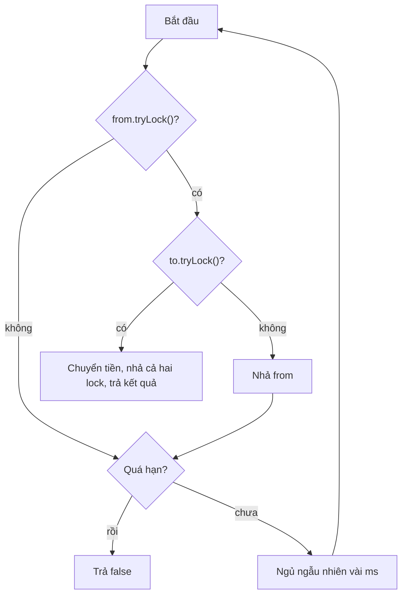
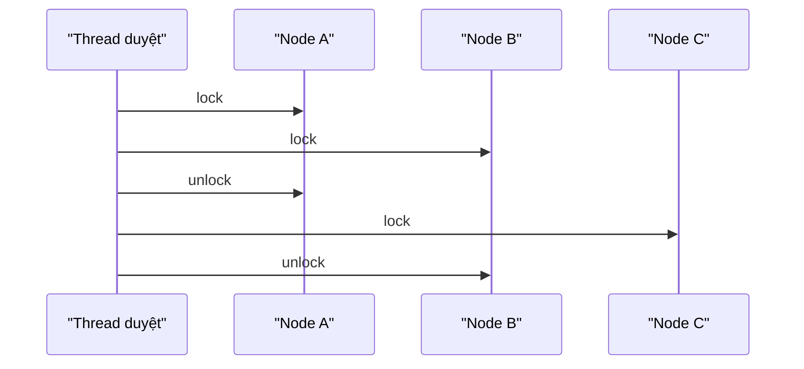
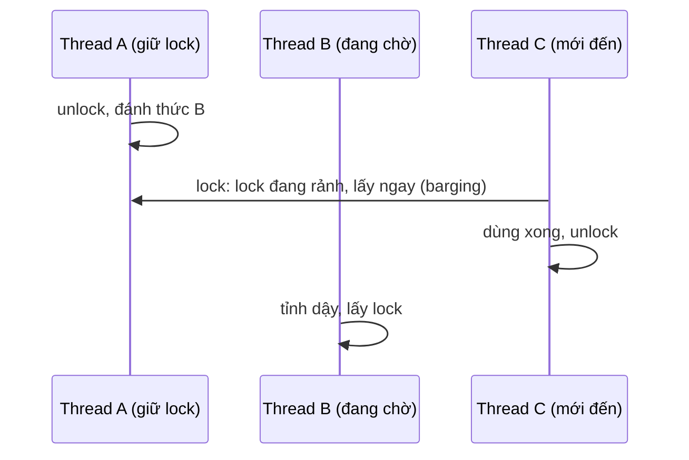
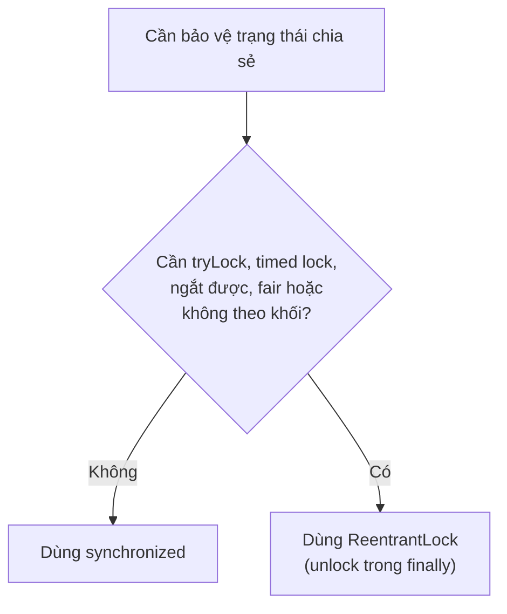
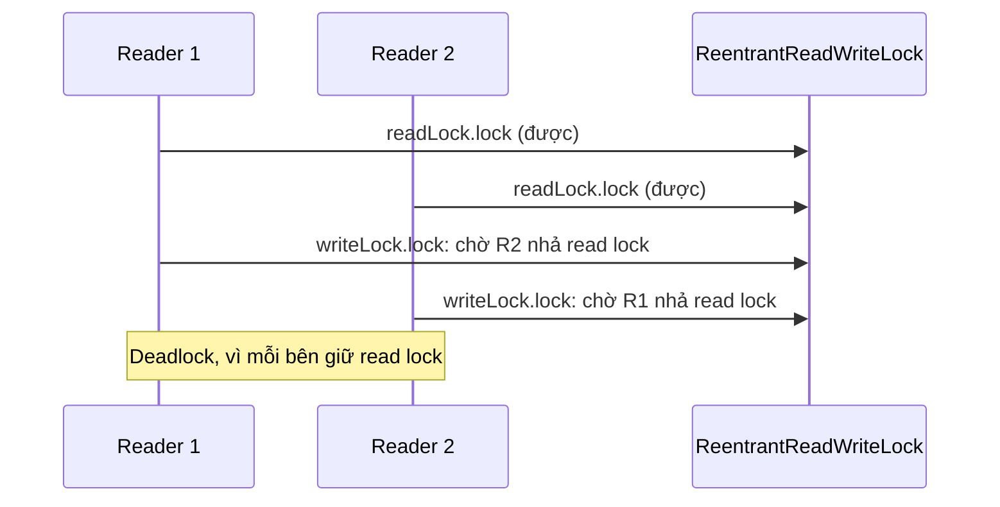

# Lý thuyết 13: Explicit locks: ReentrantLock và ReadWriteLock

Phần lớn thời gian, `synchronized` là đủ để bảo vệ trạng thái chia sẻ. Nhưng nó có những giới hạn cứng: khi đang chờ lock thì không ngắt được, không thể "thử lock rồi bỏ cuộc", không đặt được thời hạn chờ, và lock luôn phải nhả trong cùng khối mã đã lấy nó. Bài này giới thiệu `Lock`/`ReentrantLock` và `ReadWriteLock`, những công cụ mở rộng đúng các giới hạn đó.

**Tóm tắt:**

- `ReentrantLock` có cùng memory semantics với `synchronized`; thứ nó thêm là sự linh hoạt (`tryLock`, lock có hạn, interruptible, fair, không theo cấu trúc khối), nên `synchronized` vẫn là mặc định.
- Khuôn bắt buộc: `lock.lock(); try { ... } finally { lock.unlock(); }`, với `lock()` đặt ngay trước `try`.
- `tryLock` cho phép nhả lock đang giữ rồi thử lại, tránh deadlock theo xác suất; cần ngủ ngẫu nhiên để không livelock, và thứ tự lock nhất quán vẫn đáng tin hơn.
- Hand-over-hand (lock coupling) là lock không theo cấu trúc khối mà `synchronized` không diễn đạt được.
- Unfair lock (mặc định) có throughput cao hơn nhiều nhờ barging; fair lock chỉ đáng dùng khi thật sự cần thứ tự FIFO.
- `ReentrantReadWriteLock`: nhiều reader hoặc một writer; cho phép downgrade, không cho upgrade (tự deadlock); chỉ đáng dùng khi đọc nhiều hơn ghi rõ rệt.
- Trên virtual thread (Java 21), block trong `synchronized` có thể pin carrier thread; JDK mới đã giảm vấn đề này.

## `Lock` và `ReadWriteLock` là gì

`Lock`/`ReentrantLock` là **explicit lock**: bạn gọi `lock()` và `unlock()` bằng tay thay vì để ngôn ngữ tự lấy và nhả ở đầu và cuối khối `synchronized` (intrinsic lock, còn gọi là monitor). `ReadWriteLock` là lock tách đường đọc và đường ghi, để nhiều reader chạy parallel khi không có ai ghi.

## Vấn đề nó giải quyết

Khi gặp đúng những giới hạn của `synchronized`, `Lock` cho thêm lựa chọn để cải thiện **liveness** (tránh deadlock, hủy được task đang chờ) hoặc hiệu năng. Ví dụ: một task có hạn chót không thể chờ lock vô hạn; một thuật toán duyệt danh sách cần giữ lock node này cho đến khi đã lock node kế; một cache đọc nhiều ghi ít không cần chặn các reader lẫn nhau.

## Khi nào dùng, khi nào không

Dùng `Lock` khi bạn cần `tryLock`, `lockInterruptibly`, lock có thời hạn, fair queue, hoặc lock không theo cấu trúc khối. Với dữ liệu đọc nhiều, ghi ít thì cân nhắc `ReadWriteLock`. Nếu không cần những thứ đó, hãy vẫn dùng `synchronized`: nó gọn hơn và không thể quên nhả lock. Hệ quả của việc chọn sai: dùng `ReentrantLock` mà quên `unlock()` làm các thread khác treo vĩnh viễn, còn dùng read-write lock cho dữ liệu ghi nhiều có thể chậm hơn lock thường.

Quy trình sử dụng ngắn gọn: luôn bọc `unlock()` trong `finally`; chọn kiểu lấy lock phù hợp (`lock`, `tryLock`, `tryLock(timeout)`, `lockInterruptibly`); đo bằng profiling trước khi chuyển sang read-write lock.

## Các khái niệm cần biết

- **Reentrant:** thread đang giữ lock có thể lấy lại chính lock đó mà không tự chặn mình; lock đếm số lần lấy và chỉ nhả hẳn khi `unlock()` đủ số lần.
- **Happens-before:** quy tắc của memory model Java nói rằng mọi thay đổi trước khi nhả lock sẽ được thread lấy lock sau đó nhìn thấy. Nhờ đó dữ liệu đúng, không bị đọc giá trị cũ.
- **Fair / unfair:** fair lock cấp theo thứ tự đến; unfair lock cho phép thread đến sau barging. Mục "Fair" bên dưới nói chi tiết.
- **Lock coupling / hand-over-hand:** giữ lock node hiện tại cho đến khi đã lock node kế rồi mới nhả lock cũ.
- **Downgrade / upgrade:** downgrade là đổi write lock sang read lock, upgrade là chiều ngược lại. `ReentrantReadWriteLock` cho phép cái đầu, cấm cái sau.
- **`Condition`:** queue chờ gắn với một `Lock`, thay cho `wait/notify` (xem bài 14).
- **Pinning:** việc virtual thread bị "dính" vào carrier thread khi chặn trong khối `synchronized` (xem ghi chú Java 21 bên dưới).

## Interface Lock

```java
public interface Lock {
    void lock();                                   // chờ vô điều kiện
    void lockInterruptibly() throws InterruptedException; // chờ nhưng ngắt được
    boolean tryLock();                             // thử, không chờ
    boolean tryLock(long time, TimeUnit unit) throws InterruptedException; // chờ có hạn
    void unlock();
    Condition newCondition();                      // xem bài 14
}
```

`ReentrantLock` cho cùng đảm bảo với `synchronized`:

- **Mutual exclusion**: một lúc chỉ một thread giữ lock.
- **Visibility**: lấy lock tương đương vào khối `synchronized`, nhả lock tương đương thoát khối (quan hệ happens-before, xem bài 16).
- **Reentrant**: thread đang giữ lock lấy lại được mà không tự chặn mình.

Điểm khác nằm ở **linh hoạt**, không phải ở ngữ nghĩa memory.

**Nền tảng:** `ReentrantLock` có cùng ngữ nghĩa memory như `synchronized` (mutual exclusion, visibility qua happens-before, reentrant); thứ nó thêm là sự linh hoạt (thử lock, timed lock, ngắt được, fair, không theo khối). Vì vậy `synchronized` vẫn là mặc định, và `Lock` chỉ dùng khi cần đúng những tính năng đó.

## Mẫu dùng chuẩn: nhả lock trong finally

```java
private final Lock lock = new ReentrantLock();
private int stock;

public void reserve(int qty) {
    lock.lock();
    try {
        if (stock < qty) throw new IllegalStateException("het hang");
        stock -= qty;
    } finally {
        lock.unlock();   // chạy cả khi có exception
    }
}
```

`synchronized` tự nhả lock khi thoát khối, còn `Lock` thì không. Quên `finally` là lỗi âm thầm: chương trình vẫn chạy bình thường cho đến một ngày có exception, lock bị giữ mãi, các thread khác treo, và không còn dấu vết nào cho biết ai đã quên nhả. Đây là lý do `ReentrantLock` nguy hiểm hơn `synchronized`, không nên dùng thay thế đại trà.

**Phải thuộc:** Khuôn chuẩn của `Lock`: `lock.lock(); try { ... } finally { lock.unlock(); }`, trong đó `lock()` đặt ngay trước `try` (không đặt trong `try`). Bốn cách lấy lock: `lock()` (chờ, không ngắt được), `tryLock()` (không chờ), `tryLock(t, unit)` (chờ có hạn, ngắt được), `lockInterruptibly()` (chờ, ngắt được).

Lưu ý thêm: nếu exception có thể làm object ở trạng thái không nhất quán, cần `try/catch` bên trong để khôi phục invariant. Quy tắc này đúng với mọi loại lock.

**Suy luận:** `synchronized` gắn việc lấy và nhả lock vào cấu trúc khối, nên compiler và JVM bảo đảm lock luôn được nhả kể cả khi có exception; `Lock` chỉ là một object bình thường, nên việc nhả trở thành trách nhiệm của lập trình viên. Từ đó suy ra hai quy tắc: `unlock()` phải nằm trong `finally`, và `lock()` phải đặt ngay trước `try`, vì nếu `lock()` nằm trong `try` mà ném lỗi thì `finally` sẽ unlock một lock chưa giữ và che mất lỗi gốc. Cái giá của sự linh hoạt cũng nằm ở đây: lỗi quên `unlock()` không làm hỏng gì cho đến ngày có exception, rồi mọi thread khác bị block vĩnh viễn mà không để lại dấu vết ai đã quên. Điểm dễ nhầm là cho rằng explicit lock "mạnh hơn nên tốt hơn"; thực tế nó cùng memory semantics, hiệu năng gần ngang, chỉ có thêm tính năng. Hệ quả thiết kế: mặc định dùng `synchronized`, chỉ chuyển sang `Lock` khi cần đúng một tính năng mà `synchronized` không có.

## Bốn cách lấy lock

| Cách | Hành vi | Dùng khi |
|---|---|---|
| `lock()` | Chờ đến khi có lock, không ngắt được | Trường hợp thông thường |
| `tryLock()` | Có lock thì trả `true`, không thì `false` ngay | Muốn tránh chặn, có phương án dự phòng |
| `tryLock(t, unit)` | Chờ tối đa t, ngắt được | Task có ngân sách thời gian |
| `lockInterruptibly()` | Chờ nhưng phản ứng với `interrupt()` | Task có thể bị hủy |

### tryLock và timed lock: tránh deadlock

Với `synchronized`, deadlock là chết hẳn: chỉ cách khởi động lại, và cách phòng duy nhất là thiết kế thứ tự lock nhất quán. Với `tryLock`, ta có phương án khác: **lấy được cả hai lock thì làm, không thì nhả lock đã lấy rồi thử lại sau**.



Đọc sơ đồ: không bao giờ chờ lock thứ hai khi đang giữ lock thứ nhất, nên không thể tạo cycle chờ. Cái giá là phải có đường xử lý thất bại và vòng thử lại. Dùng cách này khi bạn không sắp xếp được thứ tự lock; không dùng khi thao tác bắt buộc phải thành công ngay, vì nó có thể trả `false`.

```java
public boolean transfer(Account from, Account to, long amount,
                        long timeoutMs) throws InterruptedException {
    long deadline = System.nanoTime() + TimeUnit.MILLISECONDS.toNanos(timeoutMs);
    while (true) {
        if (from.lock.tryLock()) {
            try {
                if (to.lock.tryLock()) {
                    try {
                        if (from.balance < amount) return false;
                        from.balance -= amount;
                        to.balance   += amount;
                        return true;
                    } finally { to.lock.unlock(); }
                }
            } finally { from.lock.unlock(); }
        }
        if (System.nanoTime() > deadline) return false;     // hết hạn, báo thất bại
        // ngủ ngẫu nhiên để hai thread không "đụng" nhau mãi (livelock)
        TimeUnit.MILLISECONDS.sleep(1 + ThreadLocalRandom.current().nextInt(5));
    }
}
```

Hai chi tiết quan trọng:

- Phần ngủ có thành phần **ngẫu nhiên**. Nếu hai thread cùng lùi một khoảng cố định và thử lại, chúng có thể va nhau lặp lại (livelock).
- Hết hạn thì trả về thất bại để phía gọi xử lý nhẹ nhàng, thay vì treo vô hạn.

Đây chỉ là cách tránh deadlock theo xác suất. Thứ tự lock nhất quán (bài 10) vẫn là phương pháp đáng tin hơn khi áp dụng được.

### Lock có ngân sách thời gian

Task có hạn chót (ví dụ gọi nhiều nhà cung cấp, ai trả lời kịp thì lấy) không thể chờ lock vô hạn. `synchronized` không hủy được lần lấy lock đã bắt đầu, nên không dùng được cho tình huống này.

```java
public boolean sendOnSharedLine(String msg, long timeout, TimeUnit unit)
        throws InterruptedException {
    long budget = unit.toNanos(timeout) - estimateSendNanos(msg);
    if (!lineLock.tryLock(budget, TimeUnit.NANOSECONDS))
        return false;                      // không đủ thời gian, bỏ cuộc
    try {
        return doSend(msg);
    } finally {
        lineLock.unlock();
    }
}
```

### Interruptible lock

Bài 7 đã nói: chờ intrinsic lock là một trong số ít thao tác blocking **không phản ứng với interrupt**, khiến task khó hủy. `lockInterruptibly()` khép lỗ hổng này:

```java
public boolean sendCancellable(String msg) throws InterruptedException {
    // bị interrupt khi đang chờ => ném InterruptedException
    lineLock.lockInterruptibly();
    try {
        return doSendCancellable(msg);
    } finally {
        lineLock.unlock();
    }
}
```

`tryLock(timeout)` cũng ngắt được, nên dùng nó khi cần cả "có hạn" lẫn "ngắt được".

## Lock không theo cấu trúc khối: hand-over-hand

`synchronized` luôn nhả lock trong cùng khối đã lấy. Có những thuật toán cần lấy lock này, rồi lấy lock kế tiếp, rồi mới nhả lock trước. Ví dụ danh sách liên kết mà **mỗi node có một lock riêng** (lock coupling):



Thread luôn giữ lock của node hiện tại cho đến khi đã lock node kế, nên không ai chen vào giữa làm đứt liên kết. Các thread khác thao tác ở đoạn khác của danh sách vẫn chạy parallel, giống ý tưởng lock striping ở bài 11. Cấu trúc này không diễn đạt được bằng `synchronized`.

## Hiệu năng

- Khi `ReentrantLock` ra đời (Java 5), nó mở rộng tốt hơn hẳn `synchronized` dưới tranh chấp cao.
- Từ Java 6, thuật toán intrinsic lock được cải tiến, khoảng cách thu hẹp đáng kể. Trên JVM hiện đại, hai loại lock gần ngang nhau, và `synchronized` còn được JVM tối ưu riêng (lock elision, lock coarsening, lightweight locking; biased locking từng có nhưng đã bị loại bỏ ở các bản JDK gần đây) mà lock dựa trên thư viện khó làm được.
- Bài học của sách: câu "X nhanh hơn Y" chỉ đúng trong thời điểm và nền tảng đo. **Hiệu năng là mục tiêu di động**, đừng chọn `ReentrantLock` chỉ vì lý do tốc độ.

## Fairness

```java
Lock fair   = new ReentrantLock(true);   // fair: theo thứ tự đến
Lock unfair = new ReentrantLock();       // mặc định: unfair
```

| | Fair lock | Unfair lock |
|---|---|---|
| Thứ tự cấp | Theo thứ tự yêu cầu | Thread đến sau có thể barging nếu lock vừa rảnh |
| Thread mới đến khi có queue | Phải xếp hàng | Có thể lấy được ngay |
| Throughput | Thấp hơn nhiều | Cao hơn |



Vì sao barging lại nhanh hơn? Giữa lúc thread B đang bị đánh thức và lúc B thật sự chạy có một khoảng trễ. Nếu thread C đến đúng lúc lock rảnh, C có thể lấy lock, dùng xong và nhả trước khi B kịp tỉnh. B vẫn không bị chậm hơn lẽ ra, còn C nhanh hơn nhiều, nên tổng throughput tăng. Trong thí nghiệm của sách, fair lock chậm hơn gần hai bậc độ lớn dưới tranh chấp nặng.

Fair lock chỉ hợp khi giữ lock lâu hoặc khoảng cách giữa các yêu cầu dài (lúc đó lợi thế của barging nhỏ), hoặc khi thuật toán thực sự cần thứ tự FIFO. `synchronized` cũng không đảm bảo fair, và không JVM thực tế nào làm vậy. Hai điểm lưu ý: `tryLock()` không có tham số luôn barging kể cả trên fair lock, và cái ta cần thường chỉ là statistical fairness (không thread nào bị bỏ đói mãi), không phải thứ tự tuyệt đối.

## Chọn synchronized hay ReentrantLock



Lý do vẫn ưu tiên `synchronized` khi không cần tính năng nâng cao:

- Cú pháp gọn, quen thuộc, không thể quên nhả lock.
- Thread dump thể hiện rõ khung stack nào đang giữ lock nào, giúp chẩn đoán deadlock. Explicit lock không gắn với khung stack cụ thể vì không theo cấu trúc khối (JVM mới đã cải thiện phần hiển thị lock trong thread dump, nhưng sự khác biệt về gắn với stack vẫn còn).
- JVM tiếp tục tối ưu `synchronized` ở mức ngôn ngữ.

> Ghi chú Java 21: `synchronized` có thể "ghim" (pin) virtual thread vào carrier thread khi bị block bên trong khối. Với mã chạy trên virtual thread và có chặn I/O dài trong vùng lock, `ReentrantLock` tránh được vấn đề này. Đây là một lý do mới, ngoài năm lý do cổ điển của sách, để cân nhắc `ReentrantLock` (xem [Virtual Threads](/go?p=08-Java%2FJava-Core%2Fhard%2Flt-20-virtual-threads-structured-concurrency.md) trong Java Core; từ JDK 24, JEP 491, trường hợp này đã được giảm đáng kể, kiểm tra lại theo phiên bản).

## Read-write lock

Mutual exclusion lock là chiến lược bảo thủ: nó chặn cả writer/writer, writer/reader lẫn **reader/reader**. Nhưng nhiều reader đọc cùng lúc thì không gây hại gì. Với dữ liệu đọc nhiều, ghi ít, ta có thể nới lỏng:

- Nhiều reader cùng lúc, **hoặc**
- Một writer duy nhất, nhưng không bao giờ cả hai cùng lúc.

```java
public class ReadWriteCache<K, V> {
    private final Map<K, V> map;
    private final ReadWriteLock rw = new ReentrantReadWriteLock();
    private final Lock r = rw.readLock();
    private final Lock w = rw.writeLock();

    public ReadWriteCache(Map<K, V> backing) { this.map = backing; }

    public V get(K key) {
        r.lock();
        try { return map.get(key); } finally { r.unlock(); }
    }

    public V put(K key, V value) {
        w.lock();
        try { return map.put(key, value); } finally { w.unlock(); }
    }
}
```

Đọc lấy `readLock`, sửa lấy `writeLock`. Hai lock thực chất là hai "góc nhìn" của một read-write lock thống nhất. Hàm bọc này hữu ích khi muốn tăng parallelism cho một `Map` đặc biệt như `LinkedHashMap` (dùng cho LRU, vì `get` thực ra cũng sửa thứ tự nên với kiểu access-order phải dùng write lock). Nếu chỉ cần map băm đồng thời thì `ConcurrentHashMap` tốt hơn.

### Các chính sách mà một ReadWriteLock phải quyết định

| Câu hỏi | Ý nghĩa |
|---|---|
| Ưu tiên khi nhả lock | Khi writer nhả mà cả reader lẫn writer đang chờ, ai được trước? |
| Reader barging | Lock đang do reader giữ, writer đang chờ, reader mới đến có được vào ngay không? Cho vào thì tăng parallelism nhưng writer có thể bị bỏ đói. |
| Reentrancy | Read lock, write lock có reentrant không? |
| Downgrade | Đang giữ write lock, có lấy thêm read lock rồi nhả write lock được không? |
| Upgrade | Đang giữ read lock, có đổi lên write lock được không? |

`ReentrantReadWriteLock` cung cấp:

- Reentrant cho cả đọc lẫn ghi, có chế độ fair hoặc không (mặc định không).
- Ở chế độ fair, nếu có writer đang chờ thì reader mới đến phải xếp sau writer, nên không ai bị bỏ đói.
- **Cho phép downgrade** (ghi sang đọc): lấy read lock trong khi còn giữ write lock, rồi nhả write lock. Cách này tránh khoảng trống để writer khác chen vào.
- **Không cho phép upgrade** (đọc sang ghi): thử làm sẽ tự deadlock. Nếu hai reader cùng muốn upgrade, mỗi người chờ người kia nhả read lock, không ai nhả.

**Phải thuộc:** `ReentrantReadWriteLock`: nhiều reader cùng lúc hoặc một writer duy nhất; cho phép downgrade (giữ write lock, lấy read lock, rồi nhả write lock) nhưng không cho upgrade (đọc sang ghi sẽ tự deadlock); mặc định unfair. Chỉ đáng dùng khi đọc nhiều hơn ghi rõ rệt và đoạn đọc đủ tốn thời gian.



Muốn "đọc rồi quyết định ghi", hãy nhả read lock, lấy write lock, rồi **kiểm tra lại điều kiện** vì trạng thái có thể đã đổi trong khoảng hở.

**Suy luận:** Write lock đòi quyền độc quyền, tức là không còn reader nào, kể cả chính reader đang xin upgrade. Một thread giữ read lock và xin write lock thì phải chờ mọi reader khác nhả, nhưng nó không nhả read lock của mình vì còn đang chờ. Nếu có hai thread như vậy, mỗi bên chờ bên kia nên tạo thành cycle và deadlock; ngay cả một thread đơn lẻ cũng tự chờ chính mình. Downgrade thì khác: thread đang là writer duy nhất, nên lấy thêm read lock luôn thành công, rồi nhả write lock để chuyển sang đọc mà không có khoảng hở nào cho writer khác chen vào. Điểm dễ nhầm là nghĩ upgrade chỉ là "đổi loại lock"; thực chất nó là chờ trong khi vẫn giữ, đúng mẫu của deadlock. Hệ quả: khi cần "đọc rồi mới quyết định ghi", hãy nhả read lock, lấy write lock và kiểm tra lại điều kiện, vì state có thể đã đổi trong khoảng hở.

```java
// Downgrade: cập nhật rồi đọc tiếp mà không để ai chen vào giữa
w.lock();
try {
    map.put(key, value);
    r.lock();        // lấy thêm read lock khi còn giữ write lock
} finally {
    w.unlock();      // nhả write lock, vẫn còn read lock
}
try {
    use(map.get(key));
} finally {
    r.unlock();
}
```

### Khi nào read-write lock đáng dùng

- Dữ liệu **đọc nhiều hơn ghi rõ rệt**, và đọc đủ tốn thời gian để lợi từ parallelism. Đọc quá ngắn thì chi phí quản lý lock phức tạp hơn lại làm chậm đi.
- Chạy trên máy nhiều lõi.
- Đã đo thực tế. Vì `ReadWriteLock` dựa trên interface `Lock`, việc đổi qua lại với mutual exclusion lock khá dễ nếu đo thấy không có lợi.

Ghi chú: `StampedLock` (Java 8, sau thời sách) thêm chế độ **optimistic read** (`tryOptimisticRead` rồi `validate`), thường nhanh hơn khi ghi hiếm. Đổi lại nó **không reentrant** và không có `Condition`, nên dễ dùng sai hơn. Nó là công cụ tinh chỉnh, chỉ nên thử khi `ReentrantReadWriteLock` đã đo ra là nút thắt.

## Bẫy thường gặp

- **Quên `unlock()` trong `finally`**: lock bị kẹt vĩnh viễn khi có exception.
- **Gọi `lock()` bên trong `try`**: nếu `lock()` ném lỗi thì `finally` sẽ `unlock()` một lock chưa giữ. Luôn đặt `lock()` ngay trước `try`.
- **Dùng `wait/notify` với `Lock`**: `Lock` (và `Condition`) là `Object` nên có `wait/notify`, nhưng đó là intrinsic lock của chính object `Lock`, không phải thứ ta muốn. Phải dùng `await/signal`.
- **Upgrade read lock lên write lock**: tự deadlock.
- **Tin rằng read-write lock luôn nhanh hơn**: dưới tải ghi cao hoặc đoạn đọc rất ngắn, nó chậm hơn lock thường.
- **Bật fair mặc định "cho chắc"**: trả giá throughput lớn mà thường không cần.

## Điểm cần nhớ

- `ReentrantLock` không thay thế `synchronized`; chỉ dùng khi cần tính năng mà `synchronized` không có: tryLock, timed lock, interruptible lock, fair queue, lock không theo khối.
- Luôn `unlock()` trong `finally`, và `lock()` ngay trước `try`.
- Tranh chấp thấp hay cao, "nhanh hơn" là mục tiêu di động: đo trước khi quyết định, đừng chọn theo tin đồn.
- Fairness có giá rất đắt về throughput; mặc định unfair là ổn trong hầu hết trường hợp.
- Read-write lock cho nhiều reader parallel nhưng chỉ đáng dùng với dữ liệu đọc nhiều và đọc đủ lâu; downgrade được, upgrade thì không.

## Câu hỏi tự kiểm tra

1. **`synchronized` thiếu những gì mà `lockInterruptibly` và `tryLock` có?**
   - **Gợi ý suy luận:** Thread đang chờ monitor bằng `synchronized` có thể bị ngắt hay đặt hạn chờ không? Nếu lock đang bận, có cách nào để thử rồi bỏ cuộc không?
   - **Lập luận:** Chờ `synchronized` không phản hồi ngắt và không có hạn chờ, nên thread bị kẹt cứng nếu đối phương không nhả. `lockInterruptibly` cho phép ngắt khi chờ, `tryLock` cho phép thử ngay hoặc với timeout rồi bỏ cuộc.
   - **Đáp án ngắn:** Chờ lock mà vẫn ngắt được hoặc đặt thời hạn, và thử lock rồi bỏ cuộc.
   - **Nhớ:** Đây là lý do chính để chọn explicit lock.

2. **Unfair lock thường cho throughput cao hơn. Vì sao?**
   - **Gợi ý suy luận:** Khi lock được nhả, thread đầu queue phải được đánh thức, mất thời gian. Trong khoảng đó lock đang trống, một thread vừa đến có thể làm gì? Điều đó làm lock nằm không nhiều hay ít?
   - **Lập luận:** Đánh thức thread bị park tốn thời gian. Với unfair lock, thread vừa đến có thể chiếm lock, làm xong việc ngắn, rồi nhả trước khi thread được đánh thức kịp chạy. Khoảng trống lãng phí giảm nên throughput tăng, đổi lại có thể gây đói.
   - **Đáp án ngắn:** Thread đến sau có thể dùng lock xong trong lúc thread được đánh thức chưa kịp chạy, nên bớt thời gian lock nằm không.
   - **Nhớ:** Fair đổi throughput lấy thứ tự; chỉ bật khi cần.

3. **Vì sao `ReentrantReadWriteLock` không cho upgrade read lock thành write lock?**
   - **Gợi ý suy luận:** Write lock cần độc quyền, tức là không còn reader nào. Nếu hai reader cùng giữ read lock và cùng xin upgrade thì mỗi bên chờ ai nhả?
   - **Lập luận:** Mỗi reader muốn upgrade phải chờ mọi reader khác nhả read lock, trong đó có reader kia. Cả hai chờ nhau, tạo cycle, nên deadlock.
   - **Đáp án ngắn:** Hai reader cùng upgrade sẽ chờ nhau nhả read lock và deadlock.
   - **Nhớ:** Downgrade từ ghi xuống đọc thì được; upgrade thì không.

4. **Vì sao phải đặt `lock()` ngoài và ngay trước khối `try`, chứ không phải bên trong?**
   - **Gợi ý suy luận:** `finally` chạy khi nào? Nếu `lock()` ném exception ở bên trong `try` thì `finally` gọi `unlock()` cho một lock chưa giữ sẽ ra sao?
   - **Lập luận:** `finally` luôn chạy. Nếu `lock()` nằm trong `try` và lỗi, thì `unlock()` trong `finally` cố nhả lock mình chưa giữ và ném `IllegalMonitorStateException`, che mất lỗi gốc. Đặt `lock()` ngay trước `try` đảm bảo chỉ nhả khi đã chắc giữ.
   - **Đáp án ngắn:** Nếu `lock()` lỗi thì `finally` sẽ cố nhả một lock mình chưa giữ.
   - **Nhớ:** Khuôn chuẩn: `lock.lock(); try { ... } finally { lock.unlock(); }`.

5. **`tryLock` tránh deadlock khác gì so với thứ tự lock nhất quán?**
   - **Gợi ý suy luận:** Deadlock cần cycle chờ. Cách nào loại bỏ cycle ngay từ đầu, cách nào chỉ thoát ra khi đã vướng? Điều gì xảy ra nếu hai thread cùng lùi và thử lại đúng lúc?
   - **Lập luận:** Thứ tự nhất quán làm cycle không thể hình thành. `tryLock` cho phép phát hiện khi không lấy được, nhả lock đang giữ và thử lại, nên chỉ thoát ra sau khi đã vướng. Nếu hai thread lùi đồng bộ có thể livelock, nên cần ngủ ngẫu nhiên.
   - **Đáp án ngắn:** `tryLock` phát hiện thất bại rồi lùi lại thử sau (theo xác suất, cần ngủ ngẫu nhiên), còn thứ tự lock loại bỏ cycle chờ ngay từ thiết kế.
   - **Nhớ:** Ưu tiên phòng ngừa bằng thiết kế; `tryLock` là mạng an toàn.

6. **Khi nào chọn `ReentrantLock` thay `synchronized` dù không cần tính năng nâng cao?**
   - **Gợi ý suy luận:** Virtual thread bị "pin" vào carrier thread khi nào? Nếu bị pin khi đang chặn lâu trong vùng lock thì carrier thread xảy ra chuyện gì?
   - **Lập luận:** Trên Java 21, chặn trong khối `synchronized` giữ chặt virtual thread vào carrier thread (pinning), làm carrier thread không phục vụ virtual thread khác. `ReentrantLock` cho virtual thread nhả carrier thread khi chờ, nên không pin.
   - **Đáp án ngắn:** Khi mã chạy trên virtual thread và có chặn lâu trong vùng lock, để tránh pinning (các JDK mới hơn đã giảm vấn đề này với `synchronized`).
   - **Nhớ:** Chọn công cụ theo môi trường chạy, không theo thói quen.

Nguồn: Java Concurrency in Practice, Chương 13.

