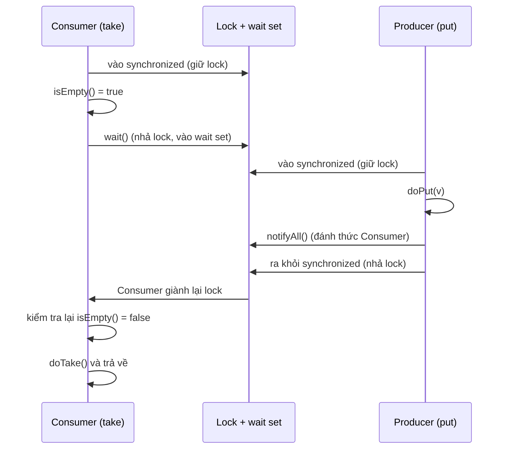
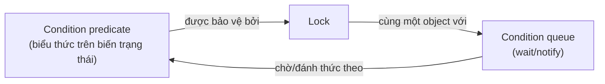
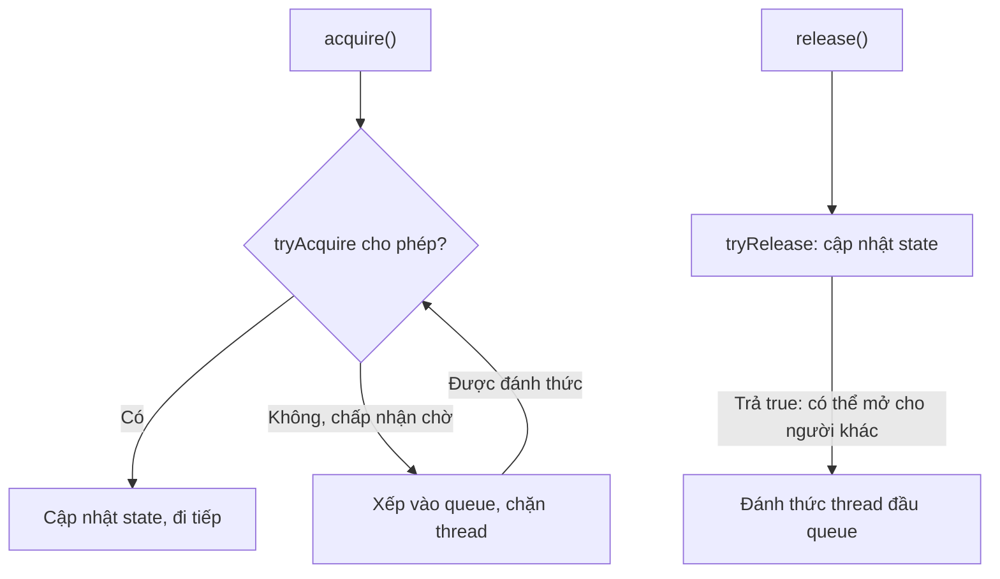
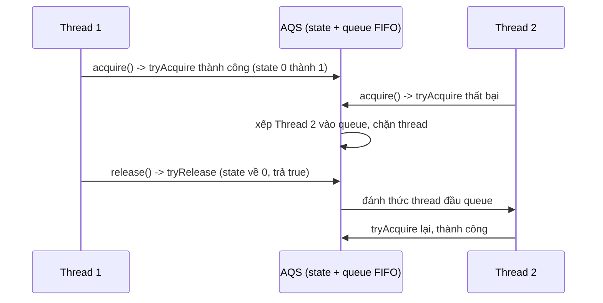

# Lý thuyết 14: Synchronizer tùy biến: condition queue và AQS

## Bài này nói về điều gì?

Nhiều class concurrent có một đặc điểm chung: thao tác của chúng chỉ chạy được khi một **precondition** đang đúng. Lấy phần tử từ queue thì queue phải không rỗng; qua cổng thì cổng phải mở; lấy permit thì phải còn permit. Những class như vậy gọi là class **state-dependent**. Khi precondition chưa đúng, thread gọi không thể làm tiếp, nên phải **chờ** cho đến khi thread khác làm nó đúng.

Java cho bạn ba tầng công cụ để viết kiểu chờ này. Tầng thấp nhất là intrinsic condition queue, tức `wait/notify/notifyAll` có sẵn trên mọi object. Tầng giữa là explicit `Condition` đi cùng `Lock`, cho phép nhiều wait queue trên một lock. Tầng cao nhất là khung `AbstractQueuedSynchronizer` (AQS), nền móng mà `ReentrantLock`, `Semaphore`, `CountDownLatch`, `FutureTask` đều xây trên đó.

Vì sao nên học dù hiếm khi tự viết? Vì `BlockingQueue`, `Semaphore`, `CountDownLatch`, `FutureTask` đều là synchronizer. Hiểu cơ chế bên trong giúp bạn dùng đúng, chẩn đoán được hiện tượng thread treo mãi, và tự xây được khi thư viện không có sẵn thứ mình cần.

**Tóm tắt:**

- Class state-dependent có thao tác chỉ chạy khi một precondition đúng; thread gọi phải chờ, thay vì ném lỗi hay poll and sleep.
- Condition queue (`wait/notify`) là tối ưu về CPU và độ phản hồi, không thêm khả năng mới so với poll and sleep.
- Khuôn chuẩn: `synchronized (lock) { while (!predicate) lock.wait(); act(); }`; `wait` luôn nằm trong `while` vì có spurious wakeup, nhiều predicate dùng chung queue, và state có thể đổi trước khi giành lại lock.
- Mỗi đường làm predicate có thể đúng đều phải có thông báo; mặc định dùng `notifyAll`, vì `notify` đơn lẻ dễ gây hijacked signal.
- `Condition` cho nhiều wait queue trên một lock (mỗi predicate một queue), nên `signal` đơn lẻ trở nên an toàn.
- AQS là khung chung của lock, semaphore, latch: một `state` nguyên, thao tác acquire/release và queue FIFO; subclass chỉ cài `tryAcquire`/`tryRelease` (hoặc bản shared) bằng CAS.
- Ưu tiên ghép từ class có sẵn (`BlockingQueue`, `Semaphore`, `CountDownLatch`); AQS gần như chỉ dành cho tác giả thư viện.

### Khi nào nên tự xây, khi nào không

Nguyên tắc là ưu tiên ghép từ class có sẵn. Trong code ứng dụng, `wait/notify` hiếm khi cần, vì `BlockingQueue` hay `Semaphore` thường đã đủ. AQS gần như chỉ dành cho tác giả thư viện. Chỉ tự xây khi thư viện không đáp ứng, và khi đó quy trình là: xác định **condition predicate**, chờ trong vòng lặp dưới lock, đảm bảo mọi đường làm predicate thành đúng đều có thông báo. Cần nhiều predicate thì tách ra nhiều `Condition`. Cần hiệu năng và tính linh hoạt tối đa thì dùng AQS.

## Các khái niệm cần biết

- **Condition predicate**: biểu thức logic trên biến trạng thái mà thread chờ cho đến khi nó đúng, ví dụ `count > 0` ("chưa rỗng"). Nó là thứ duy nhất quyết định thread được đi tiếp hay không, nên phải được viết rõ (ghi chú trong code) trước khi viết `wait`.
- **Condition queue / wait set**: tập các thread đang ngủ vì predicate chưa đúng. Mỗi object Java có một cái, gắn với intrinsic lock của nó.
- **Spurious wakeup**: thread tỉnh dậy khỏi `wait()` mà không ai gọi `notify`. Đặc tả cho phép điều này, nên đó là lý do bắt buộc phải kiểm tra lại predicate.
- **Missed signal**: thông báo được phát trước khi thread kia kịp chờ, nên bị mất. Thông báo không được lưu lại.
- **Hijacked signal**: `notify` đánh thức nhầm thread đang chờ predicate khác, thread đáng lẽ chạy được vẫn ngủ.
- **CAS (compare-and-set)**: lệnh atomic "nếu giá trị hiện tại bằng X thì đổi thành Y", trả về thành công hay không. AQS dùng nó để đổi `state` mà không cần lock.
- **Exclusive và shared**: chế độ acquire của AQS. Exclusive chỉ cho một thread giữ một lúc (lock). Shared cho nhiều thread cùng qua (semaphore, latch, read lock).
- **Reentrant**: thread đang giữ lock có thể lấy lại lock đó mà không tự chặn mình.
- **Liveness**: tính "sống" của chương trình, tức thread rồi cũng đi tiếp được. Lỗi thông báo gây ra thread ngủ mãi, là lỗi liveness chứ không phải lỗi sai dữ liệu.

Dưới đây là toàn bộ phần diễn giải, bắt đầu từ vấn đề cơ bản nhất: vì sao phải chờ.

## Vì sao phải quản lý state dependence

Trong chương trình tuần tự, nếu precondition sai ("queue rỗng") thì nó sẽ không bao giờ tự đúng, nên cứ ném lỗi là xong. Trong chương trình concurrent, thread khác có thể làm precondition đúng ngay sau đó. Vì vậy thường tốt hơn là **chờ** cho tới khi điều kiện đúng.

Khung chung của một thao tác chờ theo trạng thái:

```text
lấy lock
while (precondition chưa đúng) {
    nhả lock
    chờ đến khi có thể đúng
    (thất bại nếu bị ngắt hoặc hết hạn)
    lấy lại lock
}
thực hiện thao tác
nhả lock
```

Chi tiết cốt lõi: biến trạng thái được lock bảo vệ, nên phải giữ lock khi kiểm tra điều kiện; nhưng lúc chờ thì **phải nhả lock**, nếu không không ai thay đổi được trạng thái để điều kiện đúng.

## Ba cách xử lý khi điều kiện chưa đúng

Ví dụ xuyên suốt là bounded ring buffer với `put` (cần "chưa đầy") và `take` (cần "chưa rỗng"). Base class chứa mảng, `head`, `tail`, `count` và được lock bảo vệ:

```java
abstract class RingBase<T> {
    private final Object[] slots;
    private int head, tail, count;          // guarded by this

    RingBase(int capacity) { slots = new Object[capacity]; }

    protected synchronized final void doPut(T v) {
        slots[tail] = v;
        if (++tail == slots.length) tail = 0;
        count++;
    }
    @SuppressWarnings("unchecked")
    protected synchronized final T doTake() {
        T v = (T) slots[head];
        slots[head] = null;
        if (++head == slots.length) head = 0;
        count--;
        return v;
    }
    public synchronized final boolean isFull()  { return count == slots.length; }
    public synchronized final boolean isEmpty() { return count == 0; }
}
```

### Cách 1: ném lỗi cho người gọi ("khó tính")

```java
public synchronized void put(T v) {
    if (isFull()) throw new BufferFullException();
    doPut(v);
}
```

Dễ viết nhưng người dùng khổ: "đầy" không phải tình huống exception, giống như "đèn đỏ" không phải exception của đèn giao thông. Mọi chỗ gọi phải tự bắt lỗi và thử lại; mất luôn thứ tự FIFO vì phía gọi tự thử lại thì không còn biết ai đến trước. Trả mã lỗi thay vì ném exception cũng chỉ giảm nhẹ, vấn đề gốc là người gọi phải tự lo.

### Cách 2: poll and sleep

```java
public T take() throws InterruptedException {
    while (true) {
        synchronized (this) {
            if (!isEmpty()) return doTake();
        }
        Thread.sleep(SLEEP_MS);     // ngủ ngoài khối lock
    }
}
```

Encapsulate được việc thử lại và hỗ trợ hủy qua interrupt, nhưng khó xử ở lựa chọn khoảng ngủ:

| Khoảng ngủ | Hậu quả |
|---|---|
| Ngắn (hoặc quay vòng liên tục, busy-wait) | Đốt CPU vô ích khi trạng thái không đổi |
| Dài | Phản hồi chậm: điều kiện đã đúng mà thread còn ngủ ("ngủ quên") |

Gọi `Thread.yield()` mỗi vòng là trung gian giữa hai thái cực nhưng không giải quyết được gốc rễ.

### Cách 3: condition queue

Cái ta muốn là "ngủ nhưng hãy đánh thức tôi ngay khi điều kiện có thể đúng". Đó chính là condition queue.

```java
public class RingBuffer<T> extends RingBase<T> {
    // CONDITION PREDICATE (put):  chưa đầy  = !isFull()
    // CONDITION PREDICATE (take): chưa rỗng = !isEmpty()

    public RingBuffer(int capacity) { super(capacity); }

    // BLOCKS-UNTIL: chưa đầy
    public synchronized void put(T v) throws InterruptedException {
        while (isFull()) wait();
        doPut(v);
        notifyAll();
    }

    // BLOCKS-UNTIL: chưa rỗng
    public synchronized T take() throws InterruptedException {
        while (isEmpty()) wait();
        T v = doTake();
        notifyAll();
        return v;
    }
}
```

Điều đáng chú ý: ngữ nghĩa **không đổi** so với bản ngủ-thăm dò. Condition queue là tối ưu hóa về CPU, số lần context switch và responsiveness, không cho thêm khả năng mới (trừ việc `Condition` fair có thể đảm bảo thứ tự giải phóng).

## Intrinsic condition queue: wait, notify, notifyAll

Mỗi object Java vừa là lock vừa là một condition queue. "Phần tử" trong queue này không phải dữ liệu mà là **các thread đang chờ** (wait set).

- `wait()` **atomic** nhả lock của object và treo thread; khi tỉnh dậy, nó giành lại lock trước khi trả về, và không có ưu tiên gì so với thread khác đang tranh lock.
- `notify()` đánh thức một thread bất kỳ trong wait set; `notifyAll()` đánh thức tất cả.
- Cả ba chỉ gọi được khi **đang giữ lock của chính object đó**, nếu không sẽ ném `IllegalMonitorStateException`. Lý do: ta không thể chờ một điều kiện nếu không xem được trạng thái, và không thể báo hiệu nếu không đổi được trạng thái; mà cả hai đều cần lock.

Hãy xem một lượt `take()` bị block rồi được `put()` đánh thức, để thấy lock được nhả và lấy lại ở đâu:



Đọc sơ đồ: Consumer ngủ và nhả lock nên Producer mới vào được. `notifyAll` chưa trả lock; chỉ khi Producer ra khỏi khối `synchronized`, Consumer mới giành lại được lock, và nó phải kiểm tra lại predicate trước khi hành động.

### Quan hệ ba bên



Biến trạng thái tạo nên predicate phải được bảo vệ bởi **đúng lock** gắn với condition queue đang dùng. Khi gọi `wait`, người gọi phải đã giữ lock đó, và không được nhả lock giữa lúc kiểm tra predicate và lúc hành động theo nó.

### Quy tắc dùng condition wait

Tài liệu hóa predicate (ghi chú `CONDITION PREDICATE` và `BLOCKS-UNTIL` như ví dụ trên) là việc đầu tiên, vì API và ngôn ngữ không có chỗ nào biểu diễn nó. Khuôn chuẩn:

```java
synchronized (lock) {
    while (!conditionPredicate())      // LUÔN trong vòng lặp
        lock.wait();
    // đến đây object đang ở đúng trạng thái
    act();
}
```

Sáu quy tắc:

**Phải thuộc:** Khuôn chuẩn của condition wait: `synchronized (lock) { while (!predicate()) lock.wait(); act(); }`. `wait` luôn nằm trong vòng lặp `while` (không dùng `if`) vì có tỉnh dậy sớm và spurious wakeup; phải giữ đúng lock của condition queue khi gọi `wait`, `notify`, `notifyAll`, nếu không sẽ ném `IllegalMonitorStateException`.

1. Luôn có một condition predicate rõ ràng.
2. Kiểm tra predicate **trước** khi `wait` và **sau** khi `wait` trả về.
3. Luôn gọi `wait` trong vòng lặp.
4. Các biến cấu thành predicate phải do lock của condition queue bảo vệ.
5. Giữ lock đó khi gọi `wait`, `notify`, `notifyAll`.
6. Không nhả lock giữa lúc kiểm tra predicate và lúc hành động theo nó.

## Vì sao phải dùng vòng lặp: "tỉnh dậy quá sớm"

`wait()` trả về **không có nghĩa** predicate đã đúng:

- Nhiều predicate dùng chung một condition queue. `notifyAll` đánh thức cả thread chờ "chưa đầy" lẫn thread chờ "chưa rỗng"; thread nào cũng phải tự kiểm tra lại. (Giống chuông bếp dùng chung cho lò nướng và máy pha cà phê: nghe chuông xong vẫn phải nhìn xem thiết bị nào kêu.)
- Khi bạn lấy lại được lock, thread khác có thể đã lấy lock trước và làm predicate sai trở lại.
- JVM được phép đánh thức **giả** (spurious wakeup), không do ai gọi `notify`.

Do đó `if (cond) wait();` là sai; chỉ `while` mới an toàn.

**Suy luận:** Notify không mang theo dữ liệu và không được lưu lại, nên nó chỉ là gợi ý "hãy kiểm tra lại", còn sự thật nằm ở state do lock bảo vệ. Từ đó suy ra hai việc phải làm: kiểm tra predicate trước khi chờ (nếu sự kiện đã xảy ra thì không ai notify lần nữa, đó là missed signal) và kiểm tra lại sau khi tỉnh (vì từ lúc được notify đến lúc giành lại lock, thread khác có thể đã làm predicate sai trở lại, nhiều predicate dùng chung một queue, hoặc JVM đánh thức giả). Hai lần kiểm tra này gộp lại thành đúng một vòng `while (!predicate) wait()` dưới lock, và việc kiểm tra cùng việc chờ phải nằm trong cùng một lần giữ lock để không có khe hở giữa chúng. Điểm dễ nhầm là dùng `if` vì "test chạy ổn", trong khi lỗi chỉ lộ khi có hai consumer hoặc khi tải cao. Hệ quả: coi `while` là một phần của cách dùng `wait`, không phải tối ưu tùy chọn.

## Missed signal

Thông báo **không "dính"**: nếu thread A `notify` trước khi thread B vào `wait`, B không được đánh thức và phải chờ một thông báo khác. Hãy hình dung bạn bấm nướng bánh, ra ngoài lấy báo, chuông reo khi bạn không có mặt, rồi bạn quay vào ngồi chờ chuông. Có thể chờ mãi.

```java
// SAI: không kiểm tra predicate trước khi chờ => có thể chờ một event đã xảy ra
synchronized (lock) {
    lock.wait();
}

// ĐÚNG: kiểm tra trạng thái trước, chỉ chờ khi thực sự chưa đúng
synchronized (lock) {
    while (!ready) lock.wait();
}
```

Nếu tuân thủ khuôn vòng lặp ở trên, lỗi này không xảy ra, vì trạng thái (không phải thông báo) mới là nguồn sự thật.

## Thông báo: notify hay notifyAll

Với mỗi đường mã làm predicate có thể thành đúng, phải có thông báo. Trong ví dụ, chỉ `put` làm buffer "chưa rỗng" và chỉ `take` làm "chưa đầy", nên mỗi hàm thông báo sau khi sửa trạng thái.

**Nguy hiểm của `notify` đơn lẻ**: giả sử thread A chờ predicate PA, thread B chờ PB trên cùng condition queue. PB đúng, thread C gọi `notify`. JVM chọn A; A tỉnh dậy, thấy PA chưa đúng, đi ngủ lại. B, lẽ ra chạy được, vẫn ngủ. Đây là "hijacked signal" (hijacked signal), hệ quả giống missed signal.

Chỉ được dùng `notify` đơn lẻ khi **cả hai** điều kiện đúng:

**Phải thuộc:** Mặc định dùng `notifyAll`. Chỉ dùng `notify` đơn lẻ khi người chờ đồng nhất (một predicate) và mỗi thông báo chỉ cho tối đa một thread đi tiếp. Dùng `notify` khi hai predicate chung queue gây ra hijacked signal. Muốn `signal` đơn lẻ an toàn thì tách mỗi predicate một `Condition`.

- **Người chờ đồng nhất**: chỉ có một predicate gắn với queue và mọi thread làm cùng việc sau khi tỉnh.
- **Một vào, một ra**: mỗi thông báo cho phép nhiều nhất một thread đi tiếp.

Buffer ở trên thỏa "một vào, một ra" nhưng **không** thỏa "đồng nhất" (hai predicate), nên phải dùng `notifyAll`. Cổng xuất phát (một event thả nhiều thread) không thỏa "một vào, một ra". Vì vậy lời khuyên thực tế: **mặc định dùng `notifyAll`**.

**Suy luận:** `notify` đánh thức một thread tùy ý trong wait set, nên nó chỉ đúng khi mọi thread trong set đều có thể tiến tiếp sau khi tỉnh. Điều đó đòi hỏi hai điều kiện: chỉ có một predicate (nếu không, thread được chọn có thể chờ predicate khác, thấy sai rồi ngủ lại, còn thread cần chạy vẫn ngủ) và mỗi thông báo chỉ cho tối đa một thread đi tiếp. Khi hai predicate dùng chung queue, hijacked signal có hậu quả giống missed signal: một thread đáng lẽ chạy được vẫn ngủ đến khi có thông báo khác, nên hệ thống treo mà không có lỗi nào được ném ra. `notifyAll` an toàn vì nó không cần biết ai nên chạy, đổi lại tốn thêm các lần đánh thức thừa. Cách giữ cả an toàn lẫn hiệu quả là tách mỗi predicate một `Condition`, khi đó điều kiện "đồng nhất" được thỏa theo cấu trúc chứ không nhờ may mắn. Điểm dễ nhầm là thấy `notify` chạy đúng với một producer và một consumer, rồi mang sang hệ thống có nhiều loại thread chờ. Hệ quả: mặc định `notifyAll`, chỉ tối ưu sau khi đã đúng và đo thấy cần.

Đổi lại, `notifyAll` tốn kém: n thread chờ thì n thread cùng tranh lock rồi phần lớn lại ngủ, tệ nhất O(n²) lần đánh thức. Có hai tối ưu, nhưng chỉ làm khi đã đúng và đo thấy cần:

- **Thông báo có điều kiện**: chỉ thông báo khi trạng thái chuyển đổi thật sự đáng quan tâm (rỗng sang không rỗng, đầy sang không đầy).
- **Dùng `Condition` riêng** cho mỗi predicate để `signal` đơn lẻ vẫn an toàn (phần dưới).

```java
public synchronized void put(T v) throws InterruptedException {
    while (isFull()) wait();
    boolean wasEmpty = isEmpty();
    doPut(v);
    if (wasEmpty) notifyAll();     // chỉ thông báo khi vừa chuyển rỗng -> không rỗng
}
```

Nguyên tắc chung của sách: làm cho đúng trước, rồi mới làm cho nhanh. Tối ưu thông báo dễ gây lỗi liveness lạ.

## Ví dụ: cổng đóng/mở lại được (ThreadGate)

`CountDownLatch` một lần là cổng không đóng lại được. Muốn cổng đóng/mở nhiều lần:

```java
public class ReusableGate {
    // CONDITION PREDICATE: đã mở kể từ khi tôi đến (isOpen || generation != gen khi vào)
    private boolean open;        // guarded by this
    private int generation;      // guarded by this

    public synchronized void close() { open = false; }

    public synchronized void open() {
        generation++;
        open = true;
        notifyAll();             // một event thả nhiều thread
    }

    public synchronized void await() throws InterruptedException {
        int arrival = generation;
        while (!open && arrival == generation)
            wait();
    }
}
```

Tại sao không chỉ kiểm tra `open`? Nếu cổng mở rồi đóng lại thật nhanh, các thread đang được đánh thức có thể lấy lại lock khi cổng đã đóng và lại ngủ, dù họ đáng ra đã được đi qua. Counter `generation` ghi nhớ "cổng đã từng mở kể từ lúc tôi tới", nên predicate không bị đóng lại quá nhanh làm hỏng. Bài học thêm: class phụ thuộc trạng thái mong manh khi bảo trì; thêm thao tác "chờ cổng đóng" thì phải bổ sung thông báo ở cả `close()`.

## Thiết kế cho inheritance, và encapsulate condition queue

- Class phụ thuộc trạng thái phải hoặc **publish và tài liệu hóa** protocol chờ/thông báo cho subclass, hoặc **cấm inheritance** (class `final` hay ẩn lock, queue, biến trạng thái). Thứ tệ nhất là lộ trạng thái mà không tài liệu hóa protocol. Ví dụ: blocking stack dùng `notify` đơn lẻ rồi subclass thêm "pop hai phần tử", làm xuất hiện hai loại người chờ và phá giả định, nên subclass phải sửa được `push` để gọi `notifyAll`.
- Nên **encapsulate** condition queue để mã ngoài không chờ nhầm trên object của bạn (nếu không, tính "đồng nhất" không thể đảm bảo). Điều này trái với mẫu phổ biến dùng `this` vừa làm lock vừa làm condition queue; muốn ẩn thì dùng lock riêng (đánh đổi: mất lock phía client).
- **Protocol vào/ra** (Wellings): mỗi thao tác phụ thuộc trạng thái có *protocol vào* (predicate) và *protocol ra* (xem biến nào đã đổi, có thể làm predicate nào đúng, rồi thông báo). AQS bắt buộc điều này bằng API: các hàm `tryRelease...` phải trả về giá trị cho biết có thể đã mở cho thread nào đó hay không, nên khó "quên" thông báo.

## Explicit Condition

`Lock` tổng quát hóa intrinsic lock; `Condition` tổng quát hóa intrinsic condition queue. Intrinsic lock chỉ có **một** condition queue, nên không thể tách predicate "chưa đầy" và "chưa rỗng" ra hai hàng. `Condition` thì mỗi `Lock` tạo được bao nhiêu cũng được.

| Intrinsic | Explicit (`Condition`) |
|---|---|
| `wait()` | `await()` (có bản `awaitNanos`, `awaitUntil`, `awaitUninterruptibly`) |
| `notify()` | `signal()` |
| `notifyAll()` | `signalAll()` |
| Một queue cho mỗi lock | Nhiều queue cho mỗi lock |
| Không có fairness | Inheritance fair của `Lock` |

```java
public class TwoConditionBuffer<T> {
    private final Lock lock = new ReentrantLock();
    private final Condition notFull  = lock.newCondition();  // predicate: count < cap
    private final Condition notEmpty = lock.newCondition();  // predicate: count > 0
    private final Object[] items;
    private int head, tail, count;                           // guarded by lock

    public TwoConditionBuffer(int cap) { items = new Object[cap]; }

    public void put(T x) throws InterruptedException {
        lock.lock();
        try {
            while (count == items.length) notFull.await();
            items[tail] = x;
            if (++tail == items.length) tail = 0;
            count++;
            notEmpty.signal();           // chỉ đánh thức một người chờ "chưa rỗng"
        } finally { lock.unlock(); }
    }

    @SuppressWarnings("unchecked")
    public T take() throws InterruptedException {
        lock.lock();
        try {
            while (count == 0) notEmpty.await();
            T x = (T) items[head];
            items[head] = null;
            if (++head == items.length) head = 0;
            count--;
            notFull.signal();
            return x;
        } finally { lock.unlock(); }
    }
}
```

Vì mỗi `Condition` ứng với đúng một predicate, điều kiện "người chờ đồng nhất" được thỏa, nên dùng `signal` đơn lẻ an toàn, ít đánh thức và context switch hơn bản `notifyAll`. Hành vi giống hệt, nhưng dễ đọc hơn: mỗi wait queue có tên và ý nghĩa riêng.

Cảnh báo: `Condition` cũng là `Object` nên vẫn có `wait/notify`. Gọi nhầm thì biên dịch được nhưng sai nghĩa; phải dùng `await/signal`. Ba quy tắc quan hệ ba bên (predicate, lock, condition) vẫn áp dụng nguyên vẹn. Cách chọn giống chọn `synchronized` hay `ReentrantLock`: cần nhiều wait queue, fair, hay chờ theo hạn chót thì dùng `Condition`; nếu không, ưu tiên bản intrinsic.

## Giải phẫu một synchronizer

`ReentrantLock` và `Semaphore` có nhiều điểm chung: đều là "cổng" chỉ cho một số thread đi qua một lúc; thread đến sẽ được qua, phải chờ, hoặc bị từ chối (`tryLock`/`tryAcquire`). Cả hai đều có chế độ ngắt được, không ngắt được, có hạn, fair hay unfair.

Lẽ ra Semaphore có thể viết trên Lock (hoặc ngược lại), và đây là bài tập quen thuộc:

```java
// Chỉ minh họa. Java không làm như vậy.
class PermitsOnLock {
    private final Lock lock = new ReentrantLock();
    private final Condition available = lock.newCondition();
    private int permits;                                // guarded by lock

    PermitsOnLock(int n) { permits = n; }

    void acquire() throws InterruptedException {
        lock.lock();
        try {
            while (permits <= 0) available.await();
            permits--;
        } finally { lock.unlock(); }
    }
    void release() {
        lock.lock();
        try { permits++; available.signal(); }
        finally { lock.unlock(); }
    }
}
```

Nhược điểm: có **hai điểm có thể chặn** (chờ lock bảo vệ trạng thái, rồi chờ có permit), tăng chi phí và context switch. Thực tế, cả hai, cùng `CountDownLatch`, `ReentrantReadWriteLock`, `FutureTask` (và `SynchronousQueue` ở Java 5) đều xây trên một base class chung là **AQS**, chỉ còn **một** điểm chặn.

## AbstractQueuedSynchronizer (AQS)

AQS là khung để xây lock và synchronizer. Nó lo phần khó: queue FIFO các thread chờ, chặn/đánh thức thread, hỗ trợ ngắt và hết hạn, `Condition`. Subclass chỉ nói **khi nào cho qua** và **cập nhật trạng thái thế nào**.

Dùng AQS khi bạn cần một primitive đồng bộ mới mà không class nào có sẵn (ví dụ một loại latch hay mutex đặc thù) và cần hiệu năng như class của JDK. Không dùng khi chỉ cần ghép các class có sẵn hoặc chờ theo predicate đơn giản; `synchronized` cộng `Condition` rõ ràng và ít rủi ro hơn nhiều. Viết sai `tryAcquire`/`tryRelease` (quên trả `true` khi có thể mở lock) thì hậu quả là thread ngủ mãi hoặc hai thread cùng vào critical section.

### Trạng thái và hai thao tác

AQS quản lý một số nguyên `state`, truy cập bằng `getState`, `setState`, `compareAndSetState`. Ý nghĩa tùy synchronizer:

| Synchronizer | `state` biểu diễn |
|---|---|
| `ReentrantLock` | Số lần thread chủ sở hữu đã lấy lock (chủ sở hữu lưu riêng) |
| `Semaphore` | Số permit còn lại |
| `CountDownLatch` | Counter hiện tại |
| `FutureTask` | Trạng thái task (chưa chạy, đang chạy, xong, hủy); chỉ đúng với JDK 5 và 6 |
| `ReentrantReadWriteLock` | 16 bit cho số write lock, 16 bit cho số read lock |

Hai thao tác cơ bản:

- **acquire**: thao tác phụ thuộc trạng thái, có thể chặn. Bước 1: trạng thái có cho phép không? Có thì đi tiếp, không thì chờ hoặc thất bại. Bước 2: có thể cập nhật trạng thái (lấy lock thì thành "đã giữ", lấy permit thì giảm số permit; riêng latch thì không đổi).
- **release**: không chặn. Cập nhật trạng thái rồi đánh thức một hay nhiều thread chờ nếu trạng thái mới có thể cho phép.



Về bên trong, AQS giữ một queue FIFO các thread đang chờ. Thread thất bại ở `tryAcquire` được xếp vào cuối queue và bị block; khi `release` có thể mở lock, chỉ thread ở đầu queue được đánh thức để thử lại. Cách này tránh "bầy đàn" (thundering herd) mà `notifyAll` gây ra, và queue cũng là nơi ghi nhớ mỗi thread cần chế độ exclusive hay shared.

**Nền tảng:** Mọi synchronizer (lock, semaphore, latch) đều có cùng khung: một trạng thái nguyên `state`, thao tác acquire (có thể chặn, phụ thuộc state) và thao tác release (cập nhật state rồi đánh thức người chờ). AQS lo queue FIFO, chặn và đánh thức thread; subclass chỉ cài `tryAcquire`/`tryRelease` (độc quyền) hoặc `tryAcquireShared`/`tryReleaseShared` (chia sẻ) và dùng CAS để đổi `state`.



### Các hàm subclass phải cài

| Kiểu | Hàm cài đặt | Hàm công khai của AQS gọi chúng |
|---|---|---|
| Độc quyền (exclusive), ví dụ lock | `tryAcquire`, `tryRelease`, `isHeldExclusively` | `acquire`, `release` |
| Chia sẻ (shared), ví dụ semaphore, latch | `tryAcquireShared`, `tryReleaseShared` | `acquireShared`, `releaseShared` |

Quy ước giá trị trả về:

- `tryAcquire`/`tryRelease`: `true` nghĩa là thành công; với `tryRelease(Shared)`, `true` nghĩa là "có thể đã mở lock cho thread đang chờ".
- `tryAcquireShared`: số âm là thất bại, không âm là thành công (giá trị dương cho biết còn khả năng cho thread chia sẻ khác đi tiếp).

## Ví dụ: latch một lần bằng AQS

```java
public class OpenOnceLatch {
    private final Sync sync = new Sync();

    public void open() { sync.releaseShared(0); }
    public void await() throws InterruptedException {
        sync.acquireSharedInterruptibly(0);
    }

    private static class Sync extends AbstractQueuedSynchronizer {
        @Override protected int tryAcquireShared(int ignored) {
            return getState() == 1 ? 1 : -1;     // mở thì cho qua, đóng thì chờ
        }
        @Override protected boolean tryReleaseShared(int ignored) {
            setState(1);                          // mở cổng
            return true;                          // có thể đánh thức người chờ
        }
    }
}
```

Chỉ khoảng 20 dòng nhưng đầy đủ chức năng: `state` 0 là đóng, 1 là mở. `await` gọi `acquireSharedInterruptibly`, AQS hỏi `tryAcquireShared`; nếu thất bại, đưa thread vào queue. `open` gọi `releaseShared`; `tryReleaseShared` đặt trạng thái mở và trả `true`, khiến AQS cho **tất cả** thread chờ thử lại, và lần này đều thành công. Thread đến sau khi cổng đã mở đi qua ngay. Thiếu các tính năng như chờ có hạn hay xem trạng thái, nhưng AQS có sẵn các phiên bản có hạn (`tryAcquireSharedNanos`) và các hàm kiểm tra.

Lưu ý thiết kế: class này **delegate** cho subclass AQS riêng thay vì extend AQS, theo Effective Java ("ưu tiên composition"). Nếu extend, các hàm công khai của AQS lộ ra và người dùng có thể gọi sai, phá vỡ interface hai hàm gọn gàng. Mọi synchronizer trong `java.util.concurrent` đều làm vậy.

### Ví dụ thứ hai: mutex không reentrant

```java
public class SimpleMutex {
    private final Sync sync = new Sync();

    public void lock()   { sync.acquire(1); }
    public void unlock() { sync.release(1); }
    public boolean isLocked() { return sync.isHeldExclusively(); }

    private static class Sync extends AbstractQueuedSynchronizer {
        @Override protected boolean tryAcquire(int ignored) {
            return compareAndSetState(0, 1);      // 0 = rảnh, 1 = đang giữ
        }
        @Override protected boolean tryRelease(int ignored) {
            if (getState() == 0) throw new IllegalMonitorStateException();
            setState(0);
            return true;
        }
        @Override protected boolean isHeldExclusively() {
            return getState() == 1;
        }
    }
}
```

`compareAndSetState` đảm bảo hai thread không thể cùng đổi 0 sang 1. Mutex này không reentrant: thread đang giữ mà gọi `lock()` lần nữa sẽ tự chặn mình.

## AQS trong các class của JDK

**ReentrantLock** (độc quyền): `state` là số lần lấy lock, kèm trường `owner`. `tryAcquire` bản unfair:

```java
// Mã giả cho ý tưởng
protected boolean tryAcquire(int ignored) {
    Thread me = Thread.currentThread();
    int c = getState();
    if (c == 0) {
        if (compareAndSetState(0, 1)) { owner = me; return true; }   // giành lock rảnh
    } else if (me == owner) {
        // vào lại (reentrant)
        setState(c + 1);
        return true;
    }
    // lock của người khác
    return false;
}
```

CAS dùng vì trạng thái có thể đổi giữa lúc đọc và lúc ghi. Trường `owner` giúp phân biệt "vào lại" với "tranh chấp", và `tryRelease` kiểm tra chủ sở hữu trước khi cho nhả. Lock còn dùng sẵn `ConditionObject` bên trong AQS để cài `newCondition()`.

**Semaphore và CountDownLatch** (chia sẻ): `state` là số permit hoặc counter. Mô hình `tryAcquireShared` của semaphore là vòng lặp CAS:

```java
protected int tryAcquireShared(int acquires) {
    while (true) {
        int available = getState();
        int remaining = available - acquires;
        if (remaining < 0 || compareAndSetState(available, remaining))
            return remaining;          // âm: thất bại, không âm: thành công
    }
}
```

Vòng lặp kết thúc khi hết permit hoặc CAS thành công; CAS thất bại do tranh chấp chỉ làm thử lại. `CountDownLatch` làm tương tự: `countDown` giảm counter và đánh thức khi chạm 0, còn `await` qua được khi counter bằng 0.

**FutureTask**: trông không giống synchronizer nhưng `Future.get` có ngữ nghĩa của latch: event (xong hoặc hủy) đã xảy ra thì đi, chưa thì xếp wait queue. `state` giữ trạng thái task; các trường khác giữ kết quả/exception và thread đang chạy (để ngắt khi hủy). Lưu ý phiên bản: cách cài đặt trên là của JDK 5 và 6; từ JDK 7, `FutureTask` không còn dùng AQS mà tự quản `state` bằng CAS và `LockSupport`, nhưng ngữ nghĩa kiểu latch vẫn không đổi.

**ReentrantReadWriteLock**: một subclass AQS duy nhất quản cả hai lock, chia `state` làm hai nửa 16 bit. Write lock dùng acquire độc quyền, read lock dùng acquire chia sẻ. Queue FIFO nhớ mỗi thread cần quyền gì: khi lock rảnh, nếu đầu queue là writer thì writer được, nếu là reader thì mọi reader xếp liên tiếp cho đến writer đầu tiên đều được vào. Đó là lý do lock này không có chế độ "ưu tiên reader" hay "ưu tiên writer" cố định; bản fair thường đủ tốt và đảm bảo cả hai phía không bị bỏ đói.

> Ghi chú: từ Java 6, `SynchronousQueue` chuyển sang thuật toán không lock. `Condition` cũng chỉ là inner class của AQS nên mỗi `Lock` dựa trên AQS đều có sẵn nhiều wait queue.

## Bẫy thường gặp

- **Dùng `if` thay `while` quanh `wait`**: dính tỉnh dậy sớm hoặc spurious wakeup.
- **Không kiểm tra predicate trước khi `wait`**: bỏ lỡ tín hiệu đã phát, chờ mãi.
- **Quên thông báo ở một đường sửa trạng thái**: có thread ngủ mãi; thêm thao tác mới thì dễ quên nhất.
- **Dùng `notify` khi hai predicate chung queue**: hijacked signal.
- **Gọi `wait/notify` mà không giữ lock của object đó**: `IllegalMonitorStateException`.
- **Nhầm `wait/notify` với `await/signal` trên `Condition`**: biên dịch được nhưng sai nghĩa.
- **Lộ condition queue cho mã ngoài**: có người `wait` nhầm trên object của bạn, phá vỡ protocol.
- **Tự xây synchronizer khi thư viện đã có**: thường `BlockingQueue`, `Semaphore`, `CountDownLatch` là đủ.

## Điểm cần nhớ

- Ưu tiên xây trên class có sẵn (`BlockingQueue`, `Semaphore`, `CountDownLatch`, `FutureTask`); tự xây chỉ khi thật cần.
- Condition queue không thêm khả năng mới so với poll and sleep, nhưng hiệu quả và phản hồi nhanh hơn nhiều.
- Mọi điều kiện chờ gắn với một **condition predicate**, được lock bảo vệ; `wait` luôn nằm trong vòng lặp `while`, giữ đúng lock.
- Mỗi khi predicate có thể trở thành đúng, phải có thông báo. Mặc định `notifyAll`; `notify` đơn lẻ chỉ khi "đồng nhất" và "một vào một ra".
- Nhiều predicate thì tách ra nhiều `Condition` để `signal` đơn lẻ an toàn và mã dễ đọc.
- `ReentrantLock`, `Semaphore`, `CountDownLatch`, `ReentrantReadWriteLock` đều xây trên AQS (`FutureTask` chỉ xây trên AQS ở JDK 5 và 6): một `state` nguyên và các hàm `try...`; AQS lo queue, chặn và đánh thức.
- Encapsulate hoặc tài liệu hóa protocol chờ/thông báo nếu cho phép inheritance.

## Câu hỏi tự kiểm tra

1. **Vì sao `wait()` phải nằm trong vòng lặp `while` kiểm tra điều kiện, không phải `if`?**
   - **Gợi ý suy luận:** Thread được đánh thức có chắc điều kiện đang đúng không? Có thể tỉnh mà không ai gọi notify không? Nếu nhiều thread chờ chung một queue và điều kiện khác nhau thì sao? Từ lúc được notify đến lúc giành lại lock, trạng thái có thể đổi không?
   - **Lập luận:** Có ba lý do khiến sau khi tỉnh điều kiện có thể sai: spurious wakeup, nhiều predicate dùng chung một queue nên notify nhầm người, và trạng thái bị thread khác đổi lại trước khi mình giành lại được lock. Vì vậy phải kiểm tra lại, tức là lặp.
   - **Đáp án ngắn:** Vì có thể spurious wakeup, vì nhiều predicate dùng chung queue, và vì trạng thái có thể đổi lại trước khi giành lại lock.
   - **Nhớ:** Khuôn: `while (!predicate) wait();` dưới lock.

2. **"Missed signal" là gì và khuôn nào tránh được?**
   - **Gợi ý suy luận:** Nếu event xảy ra trước khi thread bắt đầu chờ và thread cứ chờ vô điều kiện thì ai đánh thức nó? Kiểm tra điều kiện trước khi chờ, dưới cùng một lock, giải quyết được điều gì?
   - **Lập luận:** Notify không được lưu lại: nếu đã xảy ra trước `wait()` thì thread chờ mãi. Nếu kiểm tra predicate và chờ cùng dưới lock, thì event hoặc đã xảy ra (predicate đúng, không cần chờ) hoặc chưa (và sẽ notify sau khi ta chờ xong). Không có khe hở.
   - **Đáp án ngắn:** Chờ một event đã xảy ra vì không kiểm tra predicate trước; vòng lặp `while` dưới lock là đủ.
   - **Nhớ:** Trạng thái nằm trong predicate, không nằm trong tín hiệu.

3. **Khi nào dùng `notify` đơn lẻ là an toàn thay vì `notifyAll`?**
   - **Gợi ý suy luận:** `notify` đánh thức một thread tùy ý. Nếu thread bị đánh thức không thể làm tiếp (khác predicate) thì tín hiệu đi đâu? Cần điều kiện gì để mọi thread đáng thức đều tiến được?
   - **Lập luận:** Nếu chỉ có một predicate trên queue, mọi thread chờ có cùng điều kiện, và một thông báo chỉ cho tối đa một thread đi tiếp, thì đánh thức bất kỳ thread nào cũng đúng. Ngược lại, tín hiệu có thể rơi vào thread không dùng được và bị mất.
   - **Đáp án ngắn:** Khi một predicate, mọi người chờ làm cùng việc, và mỗi thông báo cho tối đa một thread đi tiếp.
   - **Nhớ:** Nghi ngờ thì dùng `notifyAll`.

4. **`Condition` có lợi gì so với intrinsic condition queue (`wait`/`notify`)?**
   - **Gợi ý suy luận:** Một monitor chỉ có một wait queue, trộn nhiều predicate. Nếu ta muốn tách wait queue "queue không rỗng" và "queue không đầy" thì cần gì? Muốn chờ có hạn hoặc không ngắt?
   - **Lập luận:** Có nhiều `Condition` cho một lock nên mỗi predicate có wait queue riêng, dùng `signal` đúng mục tiêu mà không phải đánh thức tất cả. Ngoài ra còn có chờ có hạn, chờ không ngắt, và wait queue fair.
   - **Đáp án ngắn:** Nhiều wait queue cho mỗi lock (tách predicate), có chờ có hạn hoặc không ngắt, và có fair.
   - **Nhớ:** Tách predicate giúp tránh `notifyAll` dư thừa.

5. **Trong AQS, `state` của `Semaphore` và của `ReentrantLock` biểu diễn gì?**
   - **Gợi ý suy luận:** AQS chỉ cung cấp một số nguyên và wait queue. Với semaphore, tài nguyên được đếm bằng gì? Với reentrant lock, ngoài chủ sở hữu còn cần biết gì để nhả đúng lúc?
   - **Lập luận:** AQS là khung chung; ý nghĩa của `state` do subclass định nghĩa. Semaphore cần đếm số permit còn lại. Reentrant lock cần biết chủ sở hữu đã lấy lock bao nhiêu lần để chỉ nhả hẳn khi về 0.
   - **Đáp án ngắn:** Semaphore: số permit còn lại; ReentrantLock: số lần chủ sở hữu đã lấy lock.
   - **Nhớ:** AQS tách việc quản lý wait queue khỏi ý nghĩa của trạng thái.

6. **Vì sao các synchronizer của JDK dùng một subclass AQS bên trong, thay vì extend AQS trực tiếp?**
   - **Gợi ý suy luận:** Nếu `ReentrantLock extends AQS` thì method công khai nào của AQS bị lộ cho người dùng? Người dùng gọi chúng sai thì sao?
   - **Lập luận:** Extend trực tiếp làm các hàm công khai của AQS lộ ra interface của class, người dùng có thể gọi sai và phá invariant. Delegate cho subclass riêng (private) giữ interface chỉ gồm `lock`/`unlock`.
   - **Đáp án ngắn:** Để không lộ hàm công khai của AQS, giữ interface gọn và tránh dùng sai.
   - **Nhớ:** Ưu tiên composition hơn inheritance.

Nguồn: Java Concurrency in Practice, Chương 14.

