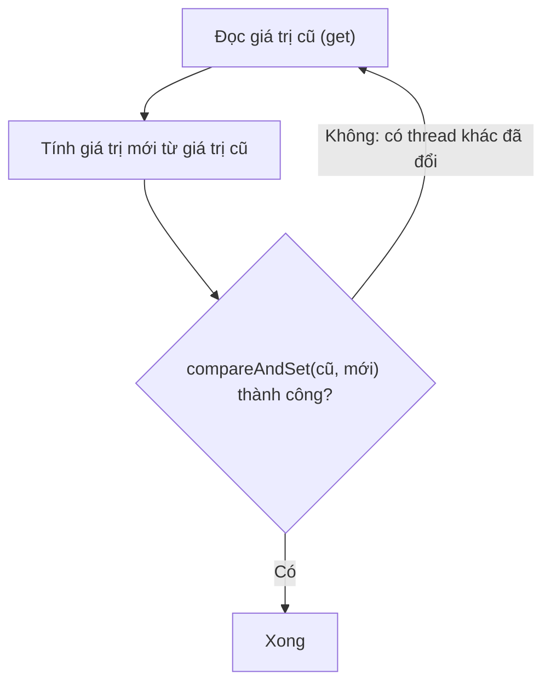
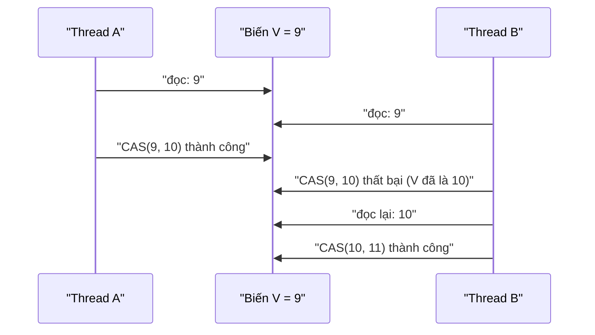
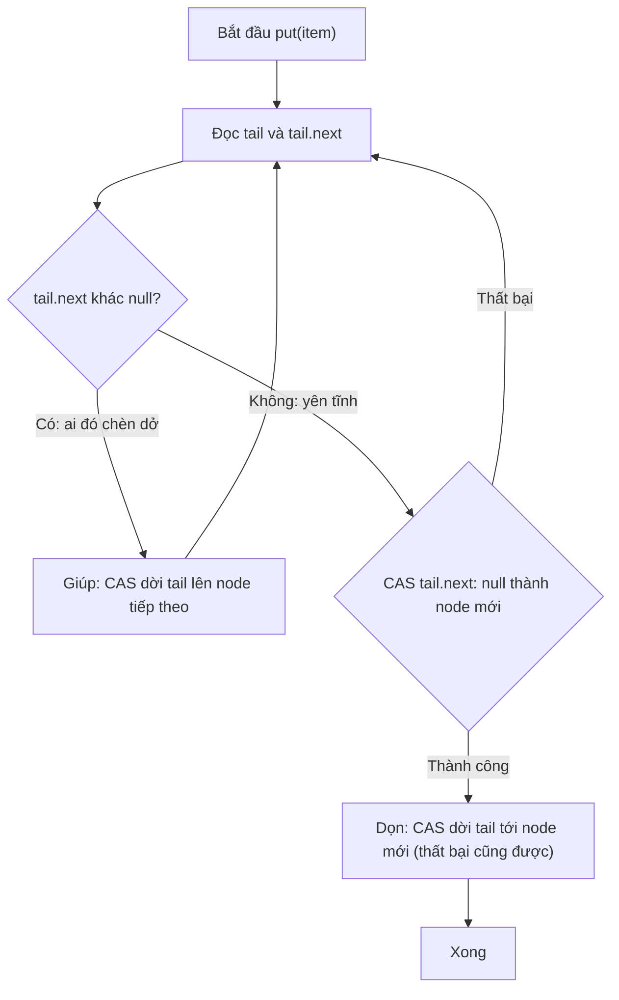
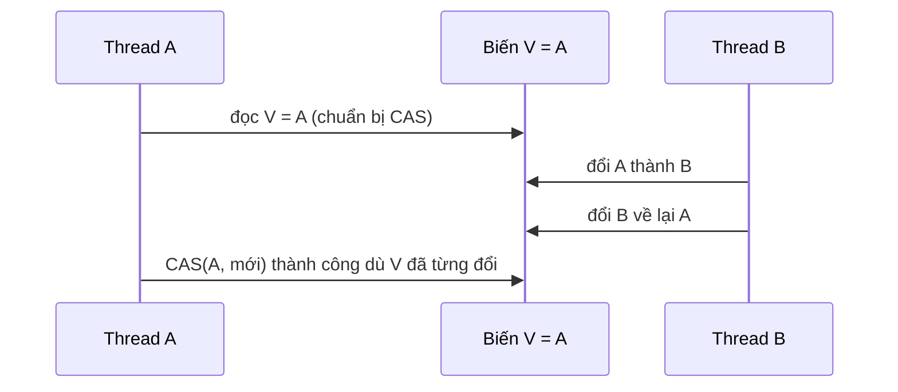

# Lý thuyết 15: Atomic variables và thuật toán nonblocking

## Atomic variable và nonblocking là gì?

Hãy tưởng tượng nhiều người cùng sửa một con số trên bảng trắng. Cách an toàn nhất là phát một cây bút duy nhất: ai cầm bút mới được viết, những người khác đứng chờ. Đó là **lock**. Cách thứ hai là cho mọi người viết thoải mái, nhưng trước khi ghi phải kiểm tra lại "con số vẫn là con số tôi vừa đọc chứ?"; nếu bị ai đó đổi mất thì đọc lại và làm lại. Đó là tinh thần của **atomic variable**.

Atomic variable (`AtomicInteger`, `AtomicReference`...) là biến cho phép cập nhật kiểu "đọc, tính, ghi" một cách atomic mà không cần lock. Nó dựa trên lệnh **CAS** (compare-and-swap) của CPU. **Thuật toán nonblocking** là thuật toán chỉ dùng CAS để phối hợp giữa các thread, nên một thread chậm hoặc bị treo không làm các thread khác kẹt theo.

**Tóm tắt:**

- Atomic variable cập nhật kiểu "đọc, tính, ghi" một cách atomic mà không cần lock, dựa trên CAS của CPU, và có cùng memory semantics với `volatile`.
- CAS là cập nhật optimistic: chỉ ghi khi giá trị vẫn như kỳ vọng; thread thua không bị block mà tự quyết thử lại.
- Hàm tính giá trị mới trong vòng lặp CAS có thể chạy nhiều lần nên không được có side effect.
- Invariant trải trên nhiều biến: gom vào một immutable object và dùng một `AtomicReference`; hai atomic riêng lẻ không giữ được.
- Contention thấp đến vừa: atomic nhanh hơn lock; contention rất cao: lock có thể thắng, nên cân nhắc `LongAdder`; tốt nhất là giảm chia sẻ.
- Thuật toán nonblocking (stack Treiber, queue Michael-Scott) giới hạn thay đổi atomic vào một biến và cho thread khác "giúp việc"; miễn nhiễm deadlock nhưng khó thiết kế, nên dùng class có sẵn.
- ABA: CAS so giá trị chứ không so lịch sử; xử lý bằng số phiên bản (`AtomicStampedReference`).

### Vấn đề nó giải quyết

Lock rất nặng với thao tác nhỏ như tăng một counter: khi tranh chấp, thread bị treo rồi phải đánh thức lại, tốn context switch. Lock còn kéo theo deadlock, priority inversion, và nếu một thread giữ lock bị trễ thì cả nhóm đứng chờ. CAS xử lý tranh chấp ở mức một biến và không treo thread.

### Khi nào nên dùng, khi nào không

Dùng cho counter, sinh số thứ tự, thống kê, cờ trạng thái, hoặc cập nhật một tham chiếu tới immutable object, khi tranh chấp ở mức thấp đến vừa. Không dùng khi invariant của bạn trải trên nhiều biến mà không gom được vào một object, hoặc khi thao tác dài và phức tạp (lock phù hợp hơn). Tự thiết kế cấu trúc dữ liệu lock-free là việc của chuyên gia; thường chỉ nên dùng class có sẵn trong `java.util.concurrent`.

Mẫu chung khi dùng: đọc giá trị cũ, tính giá trị mới từ nó, gọi `compareAndSet(cũ, mới)`; nếu thất bại (có thread khác chen vào) thì đọc lại và thử tiếp.



Đọc sơ đồ: vòng lặp quay lại bước đọc chứ không dừng, nên hàm tính giá trị mới có thể chạy nhiều lần cho một lần cập nhật. Vì vậy nó phải không có side effect.

**Nền tảng:** CAS (compare-and-swap) là lệnh CPU atomic với ba toán hạng (ô nhớ, giá trị kỳ vọng, giá trị mới): chỉ ghi khi ô nhớ vẫn bằng giá trị kỳ vọng. Đây là cách cập nhật **optimistic**: cứ làm, va chạm thì thử lại, và thread thua không bị treo. Mọi atomic class và thuật toán nonblocking đều xây trên cơ chế này, nên hàm tính giá trị mới trong vòng lặp CAS phải không có side effect.

## Các khái niệm cần biết

- **CAS (compare-and-swap)**: lệnh CPU atomic với ba toán hạng (ô nhớ, giá trị kỳ vọng, giá trị mới); chỉ ghi khi ô nhớ đang bằng giá trị kỳ vọng. Chi tiết ở mục 2.
- **Atomic**: thao tác không thể bị chen ngang; thread khác chỉ thấy trước hoặc sau, không thấy giữa chừng.
- **Optimistic và pessimistic**: pessimistic (lock) chặn trước rồi mới làm; optimistic (CAS) cứ làm, va chạm thì làm lại.
- **Nonblocking và lock-free**: nonblocking là sự cố của một thread không làm kẹt thread khác; lock-free là mỗi bước luôn có ít nhất một thread tiến được.
- **Visibility và publish**: visibility là việc thread này thấy được giá trị thread kia ghi; publish là làm một object nhìn thấy được và đầy đủ với thread khác. Atomic có ngữ nghĩa như `volatile` nên làm được cả hai.
- **Priority inversion**: thread ưu tiên cao phải chờ thread ưu tiên thấp đang giữ lock, nên bị hạ xuống mức thấp.
- **Starvation và livelock**: starvation là một thread mãi không được chạy; livelock là các thread vẫn chạy nhưng cứ va chạm và làm lại mà không tiến lên.
- **Backoff**: chờ một chút trước khi thử lại CAS để giảm va chạm khi tranh chấp cao.
- **ABA**: giá trị đi A, B rồi lại A khiến CAS tưởng không có gì đổi; xem mục 6.

## 1. Vì sao lock không phải lúc nào cũng hợp

Lock là kỹ thuật **pessimistic**: giả định sẽ có kẻ phá, nên phải chắc chắn không ai chen vào rồi mới làm. Khi lock không tranh chấp, JVM xử lý khá rẻ. Khi nhiều thread cùng đòi lock, JVM nhờ OS: một thread bị treo, sau đó phải chờ tới lượt được schedule lại. Với thao tác chỉ vài lệnh (tăng biến đếm, push vào stack), thời gian treo và đánh thức lớn hơn nhiều so với công việc thật.

Các nhược điểm khác của lock:

- Thread đang chờ lock không làm được việc gì khác.
- Thread giữ lock bị trễ (page fault, bị OS tạm dừng) thì mọi thread cần lock đó đều đứng yên.
- **Priority inversion**: thread ưu tiên cao phải chờ thread ưu tiên thấp đang giữ lock, nên thực chất bị hạ xuống mức thấp.
- Thread giữ lock bị kẹt vĩnh viễn (vòng lặp vô hạn, deadlock) thì mọi thread chờ cũng kẹt vĩnh viễn.

`volatile` nhẹ hơn lock vì không có context switch, nhưng chỉ đảm bảo **visibility**, không làm được hành động phức hợp. `count++` vẫn gồm ba bước (đọc, cộng, ghi), hai thread có thể cùng đọc 9 và cùng ghi 10, mất một lần đếm. Cần một công cụ có sức mạnh của lock với từng biến đơn nhưng nhẹ như volatile. CPU hiện đại đã có sẵn công cụ đó.

## 2. CAS: optimistic update bằng phần cứng

Cách tiếp cận **optimistic**: cứ làm rồi kiểm tra xem có ai can thiệp không; nếu có thì làm lại. CAS có ba toán hạng: ô nhớ V, giá trị kỳ vọng A, giá trị mới B. CPU thực hiện atomic: nếu V đang bằng A thì ghi B vào, ngược lại không làm gì và báo thất bại. Hiểu nôm na: "Tôi nghĩ V đang là A; nếu đúng thì đổi thành B, sai thì đừng đụng vào và cho tôi biết".

```java
// Mô phỏng NGỮ NGHĨA của CAS (thật ra do một lệnh CPU đảm nhiệm, không cần lock)
final class FakeCas {
    private int value;
    synchronized int get() { return value; }
    synchronized boolean compareAndSet(int expected, int update) {
        if (value != expected) return false;
        value = update;
        return true;
    }
}
```

Điểm khác biệt quan trọng: thread thua trong cuộc đua CAS **không bị treo**. Nó được báo "lần này không thắng" rồi tự quyết định: thử lại, chờ rồi thử lại, làm việc khác, hoặc bỏ cuộc. Khi nhiều thread cùng CAS một biến, luôn có một thread thắng, nên hệ thống luôn tiến lên.

```java
// Counter bằng CAS (viết tay để thấy cơ chế; thực tế dùng AtomicInteger)
class CasCounter {
    private final AtomicInteger value = new AtomicInteger();

    int increment() {
        int old;
        do {
            old = value.get();                       // 1. đọc
        } while (!value.compareAndSet(old, old + 1)); // 2. thử ghi, thua thì lặp
        return old + 1;
    }
}
```



Nhìn bề ngoài, vòng lặp CAS có vẻ dài và chậm hơn `synchronized`. Thực tế thì ngược lại. Ngay cả đường đi nhanh (không tranh chấp) của lock cũng phải dùng ít nhất một CAS cộng thêm việc quản lý của JVM, nên lock chỉ **giấu** CAS đi chứ không tiết kiệm được chi phí nào. Khi dùng CAS trực tiếp, không có lời gọi hệ thống, không có schedule lại thread. Quy tắc ước lượng: đường nhanh của lock tốn khoảng gấp đôi một CAS.

Mặt trái của CAS: **người gọi phải tự xử lý tranh chấp** (thử lại, backoff, từ bỏ), trong khi lock tự xử lý bằng cách chặn. Và cái khó lớn nhất là thiết kế được thuật toán xung quanh CAS cho đúng.

### Java dùng CAS thế nào

Từ Java 5, JVM mở CAS cho `int`, `long` và tham chiếu, biên dịch thành lệnh máy tương ứng của CPU (nếu CPU không có thì rơi về spin lock). Các class `Atomic*` là wrapper class quanh cơ chế đó, và phần lớn `java.util.concurrent` (kể cả `ReentrantLock`, `Semaphore`, `ConcurrentLinkedQueue`) được xây trên chúng.

## 3. Các class atomic

Có 4 nhóm:

| Nhóm | Class | Ghi chú |
|---|---|---|
| Đơn trị | `AtomicInteger`, `AtomicLong`, `AtomicBoolean`, `AtomicReference` | Dùng nhiều nhất; hai class số có thêm `incrementAndGet`, `addAndGet`... |
| Mảng | `AtomicIntegerArray`, `AtomicLongArray`, `AtomicReferenceArray` | Từng phần tử có ngữ nghĩa volatile (mảng `volatile` thường chỉ volatile cho tham chiếu mảng) |
| Field updater | `AtomicIntegerFieldUpdater`, `AtomicLongFieldUpdater`, `AtomicReferenceFieldUpdater` | CAS lên field `volatile` có sẵn bằng reflection |
| Hợp (cặp giá trị) | `AtomicStampedReference`, `AtomicMarkableReference` | Cập nhật atomic cặp tham chiếu + số phiên bản hoặc cờ |

Lưu ý: `AtomicInteger` extends `Number` nhưng **không** thay thế `Integer`; nó có thể thay đổi, không override `equals`/`hashCode`, nên không dùng làm key của map. Với `float`/`double` có thể quy đổi qua `floatToIntBits`/`doubleToLongBits`.

### Atomic là "volatile tốt hơn"

Các thao tác atomic có cùng ngữ nghĩa memory với `volatile`: `get` như đọc volatile, `set` như ghi volatile, `compareAndSet` thành công có tác dụng của cả đọc và ghi volatile. Vì thế một thay đổi bằng CAS cũng **publish** (publish) an toàn cho các thread đọc sau đó.

Khi invariant liên quan đến nhiều biến, cách làm đúng là gom chúng vào **một immutable object** và dùng một `AtomicReference` trỏ tới nó:

```java
// Khoảng giá trị [min, max], invariant: min <= max
class Range {
    private record Bounds(int min, int max) {
        Bounds {
            if (min > max) throw new IllegalArgumentException("min > max");
        }
    }
    private final AtomicReference<Bounds> ref = new AtomicReference<>(new Bounds(0, 0));

    void setMin(int newMin) {
        while (true) {
            Bounds old = ref.get();
            // ném lỗi nếu vi phạm invariant
            Bounds next = new Bounds(newMin, old.max());
            if (ref.compareAndSet(old, next)) return;
        }
    }
    int min() { return ref.get().min(); }
    int max() { return ref.get().max(); }
}
```

Hai biến `AtomicInteger` riêng cho min và max sẽ **không** giữ được invariant, vì không thể đổi cả hai cùng lúc. Gom vào một immutable object biến bài toán nhiều biến thành bài toán một biến. Từ Java 8, `updateAndGet(fn)` và `accumulateAndGet` gói sẵn vòng lặp CAS này (hàm `fn` phải không có side effect vì có thể bị gọi lại nhiều lần).

**Phải thuộc:** Atomic có ngữ nghĩa memory như `volatile` cộng cập nhật atomic có điều kiện. Invariant liên quan nhiều biến thì không dùng nhiều atomic riêng lẻ mà gom vào một immutable object và dùng một `AtomicReference` trỏ tới nó. Tranh chấp thấp đến vừa: atomic nhanh hơn lock; tranh chấp rất cao: lock có thể thắng, nên cân nhắc `LongAdder`.

## 4. Lock hay atomic? Phụ thuộc mức tranh chấp

| Mức tranh chấp | Lock | Atomic (CAS) |
|---|---|---|
| Thấp đến vừa (thực tế) | Chậm hơn | **Nhanh hơn, scale tốt hơn** |
| Rất cao (chỉ toàn tranh nhau một biến) | **Hơn** | Thua |
| Một CPU | Chậm hơn | Nhanh hơn (CAS gần như luôn thành công) |

Lý do ở mức tranh chấp rất cao: lock phản ứng bằng cách **treo bớt thread**, giảm tải cho CPU và bus memory. CAS phản ứng bằng cách thử lại ngay, và dưới tranh chấp dữ dội việc thử lại chỉ tạo thêm tranh chấp. Nhưng mức tranh chấp "chỉ toàn tranh nhau" gần như không có trong chương trình thật, vì chương trình còn phải làm việc riêng của thread giữa các lần chạm vào biến chung. Ở mức thực tế, atomic thắng.

**Suy luận:** Lock và CAS khác nhau ở phản ứng khi thua. Lock cho thread thua đi ngủ, nên số thread thực sự chạy giảm và memory bus ít bị tải; CAS cho thread thua thử lại ngay, nên mỗi lần thua lại sinh thêm một lượt đọc-ghi trên cùng cache line. Ở contention thấp đến vừa, thua hiếm, nên CAS tránh được toàn bộ chi phí treo và đánh thức, và nó thắng. Ở contention cực cao, gần như thread nào cũng thua gần như mọi lần, số lần thử lại tăng theo số thread, nên chính cơ chế "không block" lại trở thành nguồn contention; lúc đó cách "giảm tải bằng cách ngủ bớt" của lock hiệu quả hơn. Điểm dễ nhầm là kết luận "lock-free luôn nhanh hơn": lock-free bảo đảm hệ thống luôn tiến lên chứ không bảo đảm throughput cao nhất. Mức contention cực cao gần như không có trong chương trình thật vì thread còn việc riêng giữa hai lần chạm vào biến chung, nên cách tốt nhất vẫn là giảm chia sẻ (`LongAdder`, state riêng từng thread) thay vì chọn khéo giữa hai cơ chế.

Bài học đi kèm: cách tốt nhất để scale là **không chia sẻ** (ví dụ mỗi thread giữ một trạng thái riêng bằng `ThreadLocal`). Xử lý tranh chấp khéo đến mấy cũng không bằng loại bỏ tranh chấp.

**Liên hệ Java hiện đại.** `LongAdder` / `LongAccumulator` (Java 8) chia counter thành nhiều ô, mỗi thread cập nhật một ô khác nhau và cộng dồn lúc đọc `sum()`; đây chính là ứng dụng ý "giảm tranh chấp" và vượt `AtomicLong` khi ghi nhiều, đọc ít. Từ Java 9, `VarHandle` cho phép CAS và các chế độ truy cập (`getAcquire`, `setRelease`, `compareAndExchange`...) trên field hoặc phần tử mảng mà không cần `Unsafe`; nó là hướng thay thế dần các field updater.

## 5. Thuật toán nonblocking

Phân biệt:

- **Nonblocking**: sự cố hay tạm dừng của một thread không gây sự cố hoặc tạm dừng cho thread khác.
- **Lock-free**: ở mỗi bước, ít nhất một thread tiến được.

Thuật toán chỉ dùng CAS để phối hợp, nếu viết đúng, đạt cả hai. Chúng miễn nhiễm với deadlock và priority inversion; còn có thể bị đói (starvation) hoặc livelock do thử lại liên tục. Mọi thuật toán loại này có chung một đặc điểm: **một phần công việc làm theo kiểu suy đoán và có thể phải làm lại**.

Bí quyết thiết kế: giới hạn phạm vi thay đổi atomic vào **một biến** duy nhất, trong khi dữ liệu vẫn nhất quán.

### 5.1 Stack nonblocking (thuật toán Treiber)

Stack là cấu trúc đơn giản nhất: mỗi phần tử chỉ trỏ tới một phần tử, và chỉ có một chỗ thay đổi là đỉnh stack.

```java
class LockFreeStack<E> {
    private static final class Node<E> {
        final E item;
        Node<E> next;
        Node(E item) { this.item = item; }
    }
    private final AtomicReference<Node<E>> top = new AtomicReference<>();

    void push(E item) {
        Node<E> node = new Node<>(item);
        Node<E> oldTop;
        do {
            oldTop = top.get();
            node.next = oldTop;                         // chuẩn bị theo đỉnh hiện tại
        } while (!top.compareAndSet(oldTop, node));     // đỉnh đổi rồi thì làm lại
    }

    E pop() {
        Node<E> oldTop, newTop;
        do {
            oldTop = top.get();
            if (oldTop == null) return null;
            newTop = oldTop.next;
        } while (!top.compareAndSet(oldTop, newTop));
        return oldTop.item;
    }
}
```

Tính an toàn memory đến từ chính `compareAndSet` (như ghi volatile) và `get` (như đọc volatile): thay đổi của thread này được publish tới thread sau. Dù CAS có thất bại, stack vẫn luôn ở trạng thái nhất quán.

### 5.2 Queue liên kết (Michael-Scott)

Queue khó hơn vì phải truy cập nhanh cả đầu lẫn đuôi, và chèn một phần tử cần cập nhật **hai con trỏ**: `next` của node cuối cùng và con trỏ `tail`. Hai CAS riêng rẽ nghĩa là có khoảng thời gian queue ở trạng thái "giữa chừng". Giải pháp gồm hai mẹo:

1. **Luôn nhất quán, nhận biết được trạng thái giữa chừng.** Ở trạng thái yên tĩnh, `tail.next == null`. Nếu `tail.next != null` nghĩa là có thread đang chèn dở. Mọi thread chỉ cần nhìn `tail.next` là biết.
2. **Giúp việc.** Nếu thread B tới và thấy A đang chèn dở thì B tự dời `tail` tiến lên để hoàn tất việc cho A, rồi mới làm việc của mình. Nhờ vậy B không phải chờ A; nếu A bị treo giữa chừng, hệ thống vẫn chạy.



Điểm tinh tế: CAS gắn node mới vào `tail.next` là thời điểm thao tác **có hiệu lực**. CAS dời `tail` chỉ là dọn dẹp; nếu nó thất bại thì cũng không cần thử lại, vì thread khác đã làm giúp. Đây là thuật toán nằm trong `ConcurrentLinkedQueue`. Việc kiểm chứng correctness cần chứng minh chặt chẽ, nên đừng tự viết lại cho sản phẩm.

### 5.3 Atomic field updater

`ConcurrentLinkedQueue` thực tế không để mỗi node giữ một `AtomicReference` mà dùng một field `volatile Node next` thường kèm `AtomicReferenceFieldUpdater` để CAS lên field đó. Lý do thuần hiệu năng: với các object nhỏ, ngắn hạn, được tạo rất nhiều như node liên kết, bỏ được một object `AtomicReference` cho mỗi node giúp giảm chi phí chèn đáng kể. (Ghi chú phiên bản: từ JDK 9, các cài đặt trong JDK chuyển sang `VarHandle`, là hướng thay thế hiện đại cho field updater.)

```java
class Node<E> {
    final E item;
    volatile Node<E> next;
    Node(E item) { this.item = item; }
}
// Một updater dùng chung cho mọi instance của Node
private static final AtomicReferenceFieldUpdater<Node, Node> NEXT =
        AtomicReferenceFieldUpdater.newUpdater(Node.class, Node.class, "next");

boolean linkAfter(Node<String> tail, Node<String> n) {
    return NEXT.compareAndSet(tail, null, n);
}
```

Updater tạo qua `newUpdater(class, kiểu field, tên field)`. Nó chỉ đảm bảo atomicity đối với các thread **cùng đi qua updater**; ghi trực tiếp vào field có thể phá. Chỉ dùng khi thật sự cần (hầu như mọi trường hợp class atomic thường là đủ). Còn một lý do khác là giữ nguyên dạng serialize của class đã có.

## 6. Bài toán ABA

CAS hỏi: "V **còn là** A không?". Đôi khi ta muốn hỏi: "V **đã từng thay đổi** kể từ lúc tôi thấy nó là A chưa?". Nếu V đi A → B → A thì CAS vẫn thành công dù đã có thay đổi ở giữa. Với ví dụ trong chương này (counter, stack, queue) điều đó vô hại, nhưng sẽ gây lỗi khi thuật toán **tự tái sử dụng node** (thường ở môi trường không có GC): đầu list vẫn là node A, nhưng nội dung phía sau A đã khác.



Đọc sơ đồ: thread A bị tạm dừng sau khi đọc. Trong lúc đó V đã đổi hai lần nhưng trở về giá trị cũ, nên CAS của A vẫn qua. Hậu quả chỉ xảy ra khi "V trở lại như cũ" không có nghĩa là toàn bộ cấu trúc phía sau cũng như cũ.

**Suy luận:** CAS chỉ hỏi "giá trị bây giờ có bằng giá trị tôi đã thấy không", nên nó coi hai lần thấy A là một, dù giữa chúng có thể đã xảy ra A sang B rồi B về A. Điều đó vô hại khi giá trị là toàn bộ state (như counter), nhưng nguy hiểm khi giá trị chỉ là con trỏ tới một cấu trúc: đầu list vẫn là node A, nhưng node phía sau A đã bị đổi trong lúc ta tạm dừng. Java ít gặp ABA vì GC không tái sử dụng node còn được tham chiếu, nên "A lần hai" chắc chắn là một object khác và CAS trên tham chiếu thất bại đúng như mong muốn. ABA quay lại khi ta tự tái sử dụng node (pool, free list) hoặc dùng giá trị nguyên thủy làm định danh. Kèm số phiên bản thành cặp (tham chiếu, stamp) làm hai lần A khác nhau về lịch sử, nên CAS phát hiện được. Hệ quả khi review thuật toán lock-free có tái sử dụng object: hỏi "A trở lại có nghĩa là mọi thứ phía sau A cũng như cũ không?".

Trong Java, GC thường tránh được ABA vì một node còn được tham chiếu thì không thể bị tái sử dụng. Khi vẫn cần, dùng cặp (tham chiếu, số phiên bản):

```java
AtomicStampedReference<Node> head = new AtomicStampedReference<>(initial, 0);

int[] stampHolder = new int[1];
Node cur = head.get(stampHolder);          // lấy cả tham chiếu và stamp
boolean ok = head.compareAndSet(cur, next, stampHolder[0], stampHolder[0] + 1);
```

Dù giá trị đi A → B → A, số phiên bản đã khác nên CAS thất bại. `AtomicMarkableReference` là phiên bản với cờ boolean, hay dùng để đánh dấu "đã xóa" nhưng node vẫn nằm trong danh sách.

**Phải thuộc:** ABA là khi giá trị đi A, B rồi lại A khiến CAS tưởng không có gì đổi vì CAS so giá trị chứ không so lịch sử. Cách xử lý là kèm số phiên bản bằng `AtomicStampedReference` (hoặc cờ bằng `AtomicMarkableReference`). Trong Java có GC thì ABA hiếm hơn nhưng vẫn gặp khi tái sử dụng node hoặc object.

## Bẫy thường gặp

- Hàm biến đổi trong vòng lặp CAS có side effect (ghi log, gửi mail): vòng lặp có thể chạy nhiều lần, side effect lặp theo.
- Dùng hai `AtomicXxx` riêng rẽ cho hai biến có ràng buộc với nhau, rồi nghĩ rằng đã an toàn.
- Dùng CAS cho tranh chấp cực cao mà không backoff; cân nhắc `LongAdder` hoặc giảm chia sẻ.
- Nhầm `AtomicInteger` với `Integer`: dùng làm key hashmap hoặc so sánh bằng `equals`.
- Tự viết cấu trúc lock-free cho sản phẩm khi `ConcurrentLinkedQueue`, `ConcurrentHashMap`... đã có.
- Quên ABA khi tự quản lý node hoặc tái sử dụng object (ví dụ pool).

## Điểm cần nhớ

- Atomic variable là "volatile + cập nhật atomic có điều kiện"; có cùng ngữ nghĩa memory với volatile.
- CAS là optimistic update: thất bại thì không treo thread, người gọi tự quyết định thử lại hay không.
- Dưới tranh chấp thấp đến vừa, atomic scale tốt hơn lock; dưới tranh chấp cực cao, lock có thể thắng; tốt nhất là giảm chia sẻ.
- Invariant nhiều biến: gom vào một immutable object và `AtomicReference` trỏ tới nó.
- Thuật toán nonblocking: giới hạn thay đổi atomic vào một biến, luôn giữ trạng thái nhất quán, và cho thread khác "giúp việc" nếu thấy trạng thái giữa chừng.
- Nonblocking miễn nhiễm deadlock và priority inversion nhưng khó thiết kế và kiểm chứng; ưu tiên dùng class có sẵn.
- ABA giải bằng số phiên bản (`AtomicStampedReference`); nhiều cải tiến hiệu năng giữa các phiên bản JVM đến từ thuật toán nonblocking.

## Câu hỏi tự kiểm tra

1. **CAS gồm những toán hạng nào, và thread thua cuộc đua bị gì?**
   - **Gợi ý suy luận:** Muốn ghi chỉ khi giá trị chưa bị ai đổi thì cần so với cái gì? Nếu so khác thì có nên treo thread không? Thread thua sau đó có những lựa chọn nào?
   - **Lập luận:** Cần ô nhớ, giá trị kỳ vọng (để so) và giá trị mới (để ghi). CAS ghi nếu ô nhớ vẫn bằng giá trị kỳ vọng, nếu không thì chỉ báo thất bại. Thread thua không bị block, nên tự quyết thử lại hoặc làm cách khác.
   - **Đáp án ngắn:** Ô nhớ, giá trị kỳ vọng, giá trị mới; thread thua chỉ nhận thất bại, không bị treo.
   - **Nhớ:** CAS là không chặn: thất bại là thông tin, không phải wait queue.

2. **Vì sao `volatile int count; count++` vẫn sai còn `AtomicInteger.incrementAndGet()` thì đúng?**
   - **Gợi ý suy luận:** `count++` gồm mấy bước máy? `volatile` bảo đảm điều gì và không bảo đảm điều gì? Atomic gộp các bước đó thế nào khi có thread chen vào?
   - **Lập luận:** `count++` là đọc, cộng, ghi: ba bước, hai thread có thể cùng đọc một giá trị rồi cùng ghi, mất một lần cộng. `volatile` chỉ bảo đảm visibility, không làm chuỗi này atomic. Atomic dùng vòng CAS: nếu có ai chen thì CAS thất bại và đọc lại, nên không mất cập nhật.
   - **Đáp án ngắn:** `count++` là ba bước không atomic; atomic gộp chúng thành một CAS thử lại khi thua.
   - **Nhớ:** `volatile` cho visibility, không cho atomic với đọc-sửa-ghi.

3. **Khi nào lock có thể nhanh hơn atomic?**
   - **Gợi ý suy luận:** Khi CAS thất bại, thread làm gì tiếp? Nếu hàng chục thread cùng cạnh tranh một biến thì số lần thử lại thay đổi ra sao? Lock xử lý thread thua thế nào?
   - **Lập luận:** Khi tranh chấp rất cao, nhiều CAS thất bại và thử lại liên tục, làm tăng lưu lượng trên cache và tăng thêm tranh chấp. Lock treo bớt thread, giảm số thread đang chạy tranh nhau nên tải giảm.
   - **Đáp án ngắn:** Khi tranh chấp cực cao, vì lock treo bớt thread còn CAS thử lại liên tục làm tăng tranh chấp.
   - **Nhớ:** Atomic thắng khi tranh chấp thấp đến vừa.

4. **Hai `AtomicInteger` làm hai biên `lower` và `upper` của một khoảng. Vì sao không giữ được invariant `lower <= upper`?**
   - **Gợi ý suy luận:** Mỗi CAS chỉ bảo vệ một biến. Giữa lúc cập nhật biến này và biến kia, thread khác nhìn thấy trạng thái gì? Làm sao cập nhật cả hai trong một thao tác?
   - **Lập luận:** Không có cách atomic cập nhật hai biến độc lập, nên có khoảnh khắc trạng thái vi phạm invariant hoặc hai thread cùng qua kiểm tra rồi cùng ghi. Ta gói hai giá trị vào một immutable object, rồi thay cả object bằng một CAS trên `AtomicReference`.
   - **Đáp án ngắn:** Không thể cập nhật hai biến atomic cùng lúc; cần immutable object chứa cả hai, giữ qua `AtomicReference`.
   - **Nhớ:** Invariant nhiều biến cần một điểm cập nhật duy nhất.

5. **Trong queue Michael-Scott, vì sao CAS dời `tail` sau khi chèn node có thể thất bại mà không cần thử lại?**
   - **Gợi ý suy luận:** Thao tác chèn đã "có hiệu lực" ở bước nào? Nếu một thread khác thấy `tail.next != null` thì nó làm gì?
   - **Lập luận:** Chèn có hiệu lực tại CAS gắn node vào `tail.next`. Bước dời `tail` chỉ là dọn dẹp. Thread khác thấy `tail` đang lạc hậu sẽ dời giúp. Nên nếu CAS dời `tail` thất bại thì tức là có người đã dời rồi.
   - **Đáp án ngắn:** Thao tác đã hiệu lực ở CAS gắn node; thread khác thấy `tail.next != null` sẽ dời `tail` giúp.
   - **Nhớ:** Thuật toán không chặn cho phép thread khác giúp hoàn tất việc dở.

6. **ABA là gì và xử lý thế nào?**
   - **Gợi ý suy luận:** CAS chỉ so giá trị hiện tại với giá trị kỳ vọng. Nếu giá trị đi A, B rồi trở về A trong lúc ta không nhìn thì CAS có biết không? Cần thêm thông tin gì để phân biệt?
   - **Lập luận:** CAS thấy A bằng A nên tin là không đổi, dù trạng thái xung quanh có thể đã đổi, và cập nhật sai. Thêm số phiên bản đi kèm giá trị làm hai lần A khác nhau, nên CAS phát hiện được.
   - **Đáp án ngắn:** Giá trị đổi A, B, A khiến CAS tưởng không đổi; dùng số phiên bản, ví dụ `AtomicStampedReference`.
   - **Nhớ:** CAS so giá trị, không so lịch sử.

Nguồn: Java Concurrency in Practice, Chương 15.

