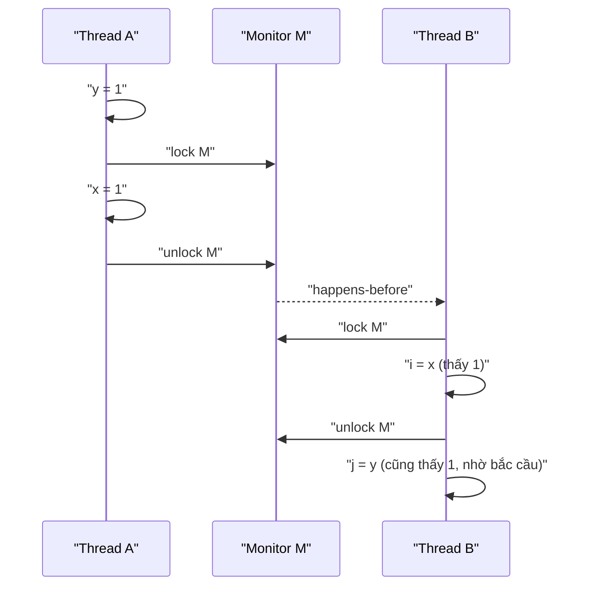
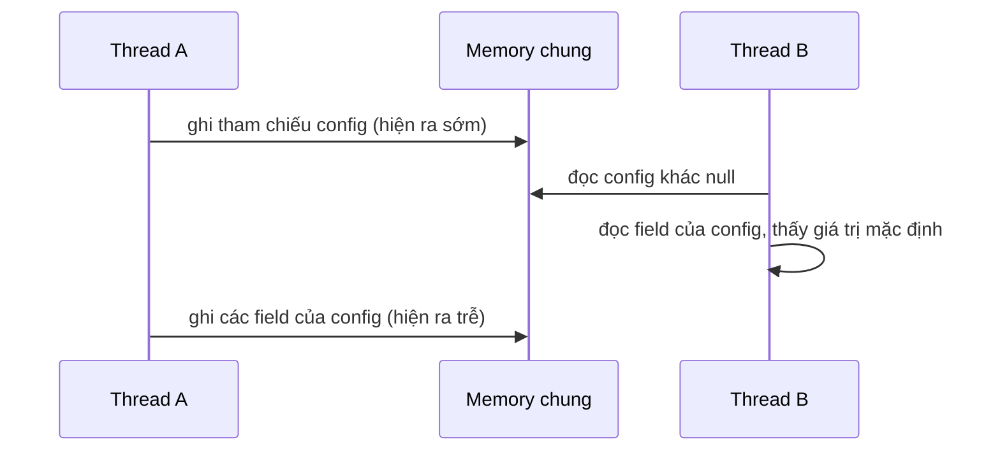
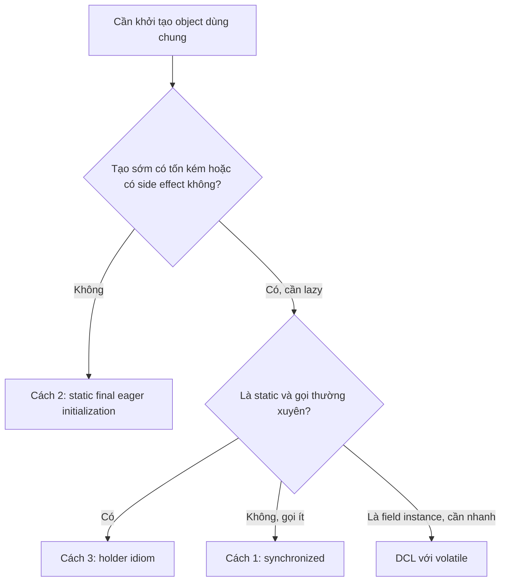
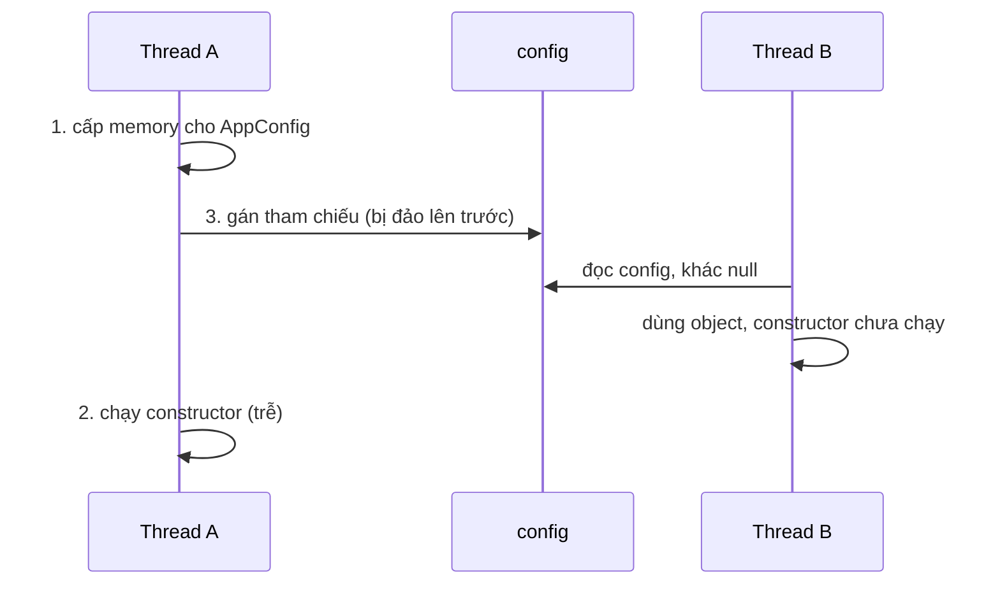
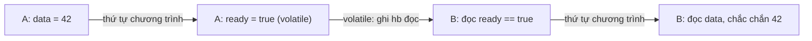

# Lý thuyết 16: Java Memory Model

## Java Memory Model giải quyết chuyện gì?

Khi bạn viết `x = 1` ở thread A, bạn có thể nghĩ rằng thread B đọc `x` ngay sau đó sẽ thấy 1. Thực tế điều này không được bảo đảm. Java Memory Model (JMM) là bản đặc tả nêu rõ **khi nào** một thao tác ghi của thread này chắc chắn được thread khác nhìn thấy, và những thao tác nào được phép bị sắp xếp lại thứ tự. Công cụ trung tâm của nó là quan hệ thứ tự từng phần **happens-before**.

Lý do cần JMM: compiler, CPU và cache đều được phép đảo thứ tự lệnh, giữ giá trị trong register hoặc cache cục bộ để chạy nhanh. Trong một thread, những chiêu này vô hình vì kết quả vẫn như chạy tuần tự. Giữa nhiều thread, chúng gây ra hành vi "kỳ quặc": thấy giá trị cũ, thấy object dựng dở, vòng lặp không bao giờ dừng. JMM là contract giúp lập trình viên biết cần đồng bộ ở đâu mà không phải học từng kiến trúc CPU.

Hãy nghĩ về hai đồng nghiệp làm việc trên cùng tài liệu nhưng mỗi người giữ một bản sao trên máy riêng. Chỉ khi cả hai thực hiện đúng một nghi thức "lưu và đồng bộ" (lock, `volatile`...) thì người này mới chắc chắn thấy sửa đổi của người kia. JMM định nghĩa chính xác các nghi thức đó.

**Tóm tắt:**

- Compiler, CPU và cache được phép reorder và giữ giá trị riêng, miễn kết quả trong một thread không đổi (as-if-serial), nên giữa hai thread không có gì tự bảo đảm visibility hay thứ tự.
- JMM nói khi nào có bảo đảm đó bằng quan hệ happens-before; thiếu nó là data race và hành vi không dự đoán được.
- Nguồn happens-before: thứ tự chương trình, unlock rồi lock cùng monitor, ghi rồi đọc `volatile`, `start`/`join`, interrupt, tính bắc cầu, và cam kết của thư viện concurrent.
- Hai thread dùng hai lock khác nhau thì không có happens-before giữa chúng.
- Unsafe publication cho thread khác thấy object dựng dở; safe publication qua lock, `volatile`, static initializer hoặc `BlockingQueue`.
- Lazy initialization: ưu tiên eager initialization hoặc holder idiom; DCL chỉ đúng khi field là `volatile`.
- Initialization safety: object dựng đúng thì field `final` (và thứ tiếp cận qua chúng) luôn được thấy đúng, kể cả khi publish qua data race; không áp dụng cho field không-final.

### Khi nào cần để ý, khi nào không

Bất cứ khi nào dữ liệu được chia sẻ giữa các thread, bạn đang chịu sự chi phối của JMM: publish object, cờ dừng, lazy initialization, thiết kế immutable class. Hiểu JMM giúp bạn biết **vì sao** các quy tắc ở những bài trước (safe publication, `volatile`, `final`) đúng. Ngược lại, nếu dữ liệu chỉ thuộc về một thread (thread confinement) hoặc đã đi qua các công cụ đồng bộ chuẩn, bạn không cần suy luận từng bước happens-before. Cách dùng là: mỗi cặp thao tác "ghi ở thread A, đọc ở thread B" phải được nối bằng một chuỗi happens-before (qua lock, `volatile`, `start`/`join`, các class trong `java.util.concurrent`). Không có chuỗi này là có **data race**, và hậu quả là hành vi không thể dự đoán, thường chỉ lộ ra trên nền tảng khác hoặc khi JIT tối ưu.

## Các khái niệm cần biết

- **Visibility**: giá trị một thread ghi có được thread khác đọc thấy hay không. Không đồng bộ thì không có bảo đảm.
- **Reordering**: compiler, CPU hoặc cache thực thi hay làm hiển thị các thao tác theo thứ tự khác mã nguồn. Hợp lệ miễn là kết quả trong một thread không đổi.
- **As-if-serial**: bảo đảm trong một thread rằng kết quả giống như chạy tuần tự theo thứ tự chương trình.
- **Happens-before**: quan hệ "A xảy ra trước B" theo nghĩa nhìn thấy: nếu A happens-before B thì mọi kết quả của A đều thấy được khi B chạy. Nó không nói về thời gian đồng hồ mà về bảo đảm thấy dữ liệu.
- **Data race**: có truy cập chung vào một biến, ít nhất một lần ghi, và các truy cập không được sắp thứ tự bằng happens-before.
- **Sequential consistency**: mô hình lý tưởng với một thứ tự toàn cục duy nhất cho mọi thao tác. Chương trình không có data race hành xử như vậy.
- **Memory barrier (fence)**: lệnh ép CPU giữ thứ tự memory; JVM tự chèn, bạn không viết.
- **Safe publication**: publish tham chiếu tới object sao cho thread khác thấy cả tham chiếu lẫn trạng thái đã dựng xong của object.
- **Piggybacking**: đi nhờ một happens-before có sẵn để đảm bảo visibility cho biến khác.
- **Initialization safety**: bảo đảm riêng của JMM cho field `final` của object được dựng đúng.

## 1. Memory model là gì, và tại sao cần

Giả sử một thread gán `aVariable = 3`. Câu hỏi của memory model: "Trong điều kiện nào một thread khác đọc `aVariable` sẽ thấy 3?" Nghe thừa, nhưng khi **không đồng bộ**, thread kia có thể không thấy ngay, thậm chí không bao giờ thấy, vì:

- Compiler sinh lệnh theo thứ tự khác với mã nguồn, hoặc giữ biến trong register thay vì memory.
- CPU thực thi parallel hoặc không theo thứ tự (out-of-order).
- Cache ghi ra memory chính theo thứ tự khác; giá trị nằm trong cache của CPU này có thể vô hình với CPU khác.

Trong một thread, Java chỉ phải giữ **as-if-serial**: kết quả giống như chạy tuần tự theo thứ tự chương trình. Mọi chiêu trò trên được phép miễn là không đổi kết quả ấy, và chính chúng là nguồn gốc của phần lớn tăng tốc phần cứng và compiler trong nhiều năm. Với nhiều thread, giữ ảo giác tuần tự cho mọi truy cập sẽ rất đắt, trong khi phần lớn thời gian các thread chỉ làm việc riêng của chúng. Vì vậy JVM chỉ cung cấp đảm bảo mạnh ở chỗ chương trình **tự khai báo** là có chia sẻ dữ liệu, bằng cơ chế đồng bộ.

**Nền tảng:** Compiler, CPU và cache được phép đảo thứ tự lệnh và giữ giá trị trong register hoặc cache riêng, miễn là kết quả trong **một** thread không đổi (as-if-serial). Vì vậy giữa hai thread không có gì tự bảo đảm visibility hay thứ tự. Java Memory Model là bản đặc tả nói khi nào có bảo đảm đó, và công cụ duy nhất của nó là quan hệ happens-before.

### Memory model của phần cứng và memory barrier

Mỗi kiến trúc CPU có memory model riêng, quy định mức đảm bảo cache coherence và các lệnh **memory barrier (fence)** cần để ép thứ tự khi chia sẻ dữ liệu. JMM đứng giữa: JVM chèn memory barrier đúng chỗ để thỏa JMM trên từng nền tảng. Lập trình viên Java không viết fence; chỉ cần dùng đúng đồng bộ.

Một mô hình "dễ chịu" là **sequential consistency**: có một thứ tự toàn cục duy nhất của mọi thao tác, và mỗi lần đọc thấy lần ghi gần nhất trong thứ tự đó. Không CPU multicore hiện đại nào cung cấp nó, và JMM cũng không. Chỉ **chương trình đồng bộ đúng** mới có hành vi như sequential consistency.

### Reordering: ví dụ kinh điển

```java
class ReorderingDemo {
    static int a = 0, b = 0, x = 0, y = 0;

    public static void main(String[] args) throws InterruptedException {
        Thread t1 = new Thread(() -> { a = 1; x = b; });
        Thread t2 = new Thread(() -> { b = 1; y = a; });
        t1.start(); t2.start();
        t1.join();  t2.join();
        System.out.println("(" + x + ", " + y + ")");
    }
}
```

Có thể in `(1,0)`, `(0,1)`, `(1,1)` theo các cách xen kẽ quen thuộc. Nhưng cũng có thể in **`(0,0)`**: trong mỗi thread, hai lệnh không phụ thuộc dữ liệu vào nhau nên được phép đảo (hoặc ghi chưa kịp ra memory chung), tức `x = b` chạy trước `a = 1`, `y = a` chạy trước `b = 1`. Chương trình mười dòng đã khó dự đoán; không thể suy luận về thứ tự nếu không đồng bộ. Đồng bộ chính là thứ cấm compiler, runtime, CPU đảo thứ tự theo cách vi phạm đảm bảo visibility.

**Suy luận:** Reordering tồn tại vì nó cho tốc độ: CPU xả write buffer muộn, compiler giữ biến trong register, cache không đồng bộ ngay. Trong một thread, as-if-serial che giấu mọi thứ này nên chương trình tuần tự không bao giờ bị ảnh hưởng. Giữa hai thread, che giấu cho mọi truy cập sẽ buộc phải chèn barrier khắp nơi và xóa gần hết lợi ích tốc độ, nên JMM chỉ bảo đảm ở những chỗ chương trình tự khai báo có chia sẻ: lock, `volatile`, start/join. Do đó happens-before không nói về thời gian đồng hồ mà là cạnh trong đồ thị "thấy được"; hai thread không có cạnh nối thì kết quả `(0, 0)` hoàn toàn hợp lệ. Điểm dễ nhầm là "ghi xong rồi thì thread khác thấy" hoặc "chạy thử trên x86 không lỗi nên đúng", vì x86 có memory model mạnh và JIT chưa chắc đã tối ưu mạnh lúc test. Hệ quả: mỗi cặp ghi ở thread A và đọc ở thread B phải được chứng minh bằng một chuỗi happens-before, nếu không thì coi đó là data race.

## 2. JMM trong vài ý chính

JMM mô tả chương trình qua các **hành động**: đọc/ghi biến, lock/unlock monitor, bắt đầu/join thread. Nó định nghĩa quan hệ **happens-before** (một thứ tự từng phần) giữa các hành động:

> Để thread thực hiện hành động B **chắc chắn thấy** kết quả của hành động A, giữa A và B phải có quan hệ happens-before. Nếu không có, JVM được tự do sắp xếp lại.

- **Data race**: một biến được đọc bởi nhiều thread, được ghi bởi ít nhất một thread, và các lần đọc/ghi **không** được sắp thứ tự bằng happens-before.
- **Chương trình đồng bộ đúng** (correctly synchronized) là chương trình không có data race; chương trình như vậy hành xử như sequential consistency.

### Các quy tắc happens-before

| Quy tắc | Nội dung |
|---|---|
| Thứ tự chương trình | Mỗi hành động trong một thread happens-before mọi hành động đứng sau nó trong thread đó. |
| Lock monitor | `unlock` một monitor happens-before mọi `lock` **sau đó** trên cùng monitor (cũng đúng với explicit `Lock`). |
| Biến volatile | Ghi vào field `volatile` happens-before mọi lần đọc **sau đó** của field ấy (cũng đúng với biến atomic). |
| Khởi động thread | Gọi `Thread.start()` happens-before mọi hành động trong thread được khởi động. |
| Kết thúc thread | Mọi hành động trong một thread happens-before việc thread khác phát hiện thread đó kết thúc (`join` trả về, hoặc `isAlive` là `false`). |
| Ngắt | Gọi `interrupt()` lên thread khác happens-before thread bị ngắt phát hiện ngắt (ném `InterruptedException`, hoặc `isInterrupted`/`interrupted`). |
| Finalizer | Kết thúc constructor happens-before bắt đầu finalizer của object (finalizer nay đã bị loại bỏ dần, hiếm khi cần). |
| Bắc cầu | A happens-before B và B happens-before C thì A happens-before C. |

Các hành động đồng bộ (lock/unlock, đọc/ghi volatile) có thứ tự **toàn phần**, nên nói "lock **sau đó**" hay "đọc **sau đó**" là có nghĩa.

**Phải thuộc:** Các nguồn happens-before: thứ tự chương trình trong một thread; `unlock` monitor happens-before `lock` sau đó trên cùng monitor; ghi `volatile` happens-before đọc sau đó của cùng biến; `Thread.start()` happens-before mọi hành động của thread mới; mọi hành động của thread happens-before `join()` trả về; `interrupt()` happens-before thread bị ngắt phát hiện; tính bắc cầu. Hai thread giữ hai lock khác nhau thì không có happens-before.



Điều đáng chú ý: mọi thứ A làm **trước** `unlock M` (kể cả `y = 1` nằm ngoài vùng lock) đều thấy được với B **sau** `lock M`. Nhưng nếu A và B giữ **hai lock khác nhau** thì không có quan hệ nào giữa chúng, và không thể nói gì về thứ tự.

### Piggybacking: đi nhờ đồng bộ có sẵn

Vì happens-before bắc cầu, có thể kết hợp "thứ tự chương trình" với một quy tắc khác (thường là volatile hoặc monitor) để đảm bảo visibility cho biến **không được bảo vệ riêng**. Ví dụ, nếu thread A ghi `result` rồi mới ghi một biến volatile, và thread B đọc biến volatile đó rồi mới đọc `result`, thì B thấy `result` đúng. `FutureTask` làm đúng như vậy qua trạng thái nội bộ của `AbstractQueuedSynchronizer`: `set` ghi kết quả trước khi giải phóng, `get` đọc kết quả sau khi giành được.

Kỹ thuật này **rất mong manh** vì phụ thuộc thứ tự câu lệnh; chỉ nên dùng cho các class tối ưu cực độ như lõi thư viện. Ngược lại, có những happens-before mà thư viện **cam kết** và bạn có thể dựa vào:

| Hành động ở thread A | happens-before | Hành động ở thread B |
|---|---|---|
| Đưa phần tử vào collection thread-safe (ví dụ `BlockingQueue.put`) | → | Lấy phần tử đó ra |
| `CountDownLatch.countDown()` | → | `await()` trả về |
| `Semaphore.release()` | → | `acquire()` kế tiếp |
| Việc của task trong `Future` | → | `Future.get()` trả về |
| Nộp `Runnable`/`Callable` cho `Executor` | → | Task bắt đầu chạy |
| Đến `CyclicBarrier`/`Exchanger` | → | Các thread khác được thả (và barrier action nằm giữa) |

## 3. Publication

### 3.1 Unsafe publication

Vấn đề đặt ra là: tạo object xong rồi gán vào một biến chung, thread khác có thấy object đầy đủ không? Sơ đồ dưới cho thấy điều gì có thể xảy ra khi không có happens-before:



Khởi tạo một object gồm nhiều lần ghi (các field), rồi publish nó là thêm một lần ghi nữa (tham chiếu). Nếu **không có happens-before** giữa lần ghi tham chiếu và lần đọc tham chiếu ở thread khác, thì từ góc nhìn của thread đọc, lần ghi tham chiếu có thể bị sắp xếp **trước** các lần ghi field. Kết quả: thread đọc thấy tham chiếu mới nhưng thấy **giá trị cũ (mặc định)** của một số field: object "dựng dở".

```java
// KHÔNG AN TOÀN: lazy init không đồng bộ
class ConfigHolder {
    private static AppConfig config;

    static AppConfig get() {
        if (config == null)
            config = new AppConfig();   // ghi tham chiếu qua data race
        return config;
    }
}
```

Ngoài race (có thể tạo hai instance), điều nguy hiểm hơn là thread B có thể nhận một `AppConfig` mà một số field vẫn là `null` hoặc `0`. Quy tắc: **trừ immutable object, đừng dùng object do thread khác khởi tạo trừ khi việc publish happens-before việc dùng.**

### 3.2 Safe publication

Các kỹ thuật safe publication ở Bài 3 đều tạo ra happens-before: đặt object vào `BlockingQueue` (put → take), gán vào biến `volatile` hoặc biến được bảo vệ bằng lock, khởi tạo bằng static initializer. Happens-before thực ra **mạnh hơn** safe publication: không những B thấy X như A để lại mà còn thấy **mọi thứ** A đã làm trước lúc bàn giao. Tuy vậy, quy tắc ở mức thiết kế ("bàn giao quyền sở hữu", "safe publication", `@GuardedBy`) dễ áp dụng hơn quy tắc từng lần ghi memory, giống như happens-before là "assembly của concurrency", còn safe publication là mức thiết kế.

### 3.3 Các cách lazy initialization an toàn

```java
// Cách 1: đồng bộ cả method. Đơn giản, đúng; ổn nếu ít gọi.
static synchronized AppConfig getSync() {
    if (config == null) config = new AppConfig();
    return config;
}

// Cách 2: eager initialization bằng static initializer. JVM giữ lock khi khởi tạo class
// nên các thread thấy trạng thái đã dựng xong, không cần đồng bộ thêm.
private static final AppConfig EAGER = new AppConfig();

// Cách 3: lazy initialization holder (nên dùng)
class ConfigFactory {
    private static class Holder {
        static final AppConfig INSTANCE = new AppConfig();
    }
    static AppConfig get() { return Holder.INSTANCE; }
}
```

Chọn cách nào? Sơ đồ sau tóm tắt quyết định:



Đọc sơ đồ: mặc định chọn eager initialization nếu rẻ; cần lazy cho giá trị static thì dùng holder; cần lazy cho field của instance và hot read path thì mới nghĩ đến DCL có `volatile`.

Với cách 3, class `Holder` chỉ được JVM khởi tạo khi lần đầu bị dùng, tức là lazy; và vì khởi tạo qua static initializer nên đã an toàn, không cần đồng bộ ở đường chạy chính. Lưu ý: bảo đảm này chỉ áp cho trạng thái **ngay sau khi dựng xong**; nếu object thay đổi được, các thread vẫn phải đồng bộ khi đọc/ghi sau đó.

**Phải thuộc:** Lazy initialization an toàn: ưu tiên (1) eager initialization bằng `static final`, (2) lazy initialization holder idiom, (3) `synchronized` cả method. Double-checked locking chỉ đúng từ Java 5 khi field khai báo `volatile`, vì thiếu `volatile` thì gán tham chiếu có thể bị đảo lên trước khi constructor chạy xong, và thread khác thấy object dựng dở.

### 3.4 Double-checked locking (DCL)

```java
// Phiên bản SAI (trước Java 5): đọc `config` ngoài lock không có happens-before
if (config == null) {
    synchronized (ConfigFactory.class) {
        if (config == null) config = new AppConfig();
    }
}
return config;
```

DCL sinh ra khi đồng bộ còn chậm, nhằm tránh lock ở đường chạy thường gặp. Sai lầm nằm ở giả định: đọc tham chiếu không đồng bộ chỉ có thể cho giá trị **cũ** (`null`), và khi đó lock lại kiểm tra lần hai. Thực tế còn tệ hơn: có thể thấy tham chiếu **mới** nhưng trạng thái object **cũ** (xem 3.1).

Từ Java 5, DCL chạy đúng nếu khai báo `private static volatile AppConfig config;`, và chi phí volatile read khá nhỏ. Nhưng đây là thủ thuật đã lỗi thời: lý do ra đời (lock chậm, JVM khởi động chậm) không còn; **holder idiom** cho cùng lợi ích và dễ hiểu hơn.

Vì sao thiếu `volatile` lại sinh object dựng dở? Câu lệnh `config = new AppConfig()` gồm ba bước: cấp memory, chạy constructor, gán tham chiếu. Bước chạy constructor và bước gán được phép đảo thứ tự. Sơ đồ dưới cho kịch bản xấu: thread B qua được kiểm tra `config == null` ở ngoài `synchronized`, nên không bị lock chặn, và nhận một object mà constructor chưa chạy xong. `volatile` cấm đảo kiểu này.



**Suy luận:** Lần đọc đầu của DCL nằm ngoài `synchronized`, nên nó không có happens-before với lần ghi tham chiếu trong khối lock. Vì không có cạnh nào, reader được phép thấy tham chiếu mới nhưng các field của object vẫn ở giá trị mặc định, do compiler hoặc CPU có thể đưa lần gán tham chiếu lên trước các lần ghi trong constructor. Khai báo `volatile` thêm đúng cạnh còn thiếu: ghi `volatile` happens-before mọi lần đọc sau đó, và các lần ghi trong constructor đứng trước lần ghi `volatile` theo thứ tự chương trình nên cũng được thấy nhờ tính bắc cầu. Điểm dễ nhầm là nghĩ lock trong khối `synchronized` bảo vệ luôn cả lần đọc ngoài khối; lock chỉ tạo cạnh giữa các thread cùng lấy nó. Holder idiom tránh cả vấn đề này vì JVM khởi tạo class dưới lock khởi tạo class, và kết thúc khởi tạo happens-before mọi truy cập sau đó. Hệ quả: đừng tự viết DCL, hãy dùng holder idiom hoặc eager initialization.

## 4. Initialization safety

JMM cho một đảm bảo riêng: object **immutable, được dựng đúng** có thể chia sẻ giữa các thread không cần đồng bộ, bất kể publish bằng cách nào, kể cả qua data race. (Lý do `String` không thể "đổi giá trị" khi bị publish bừa; nếu không, cả mô hình bảo mật dựa trên immutability của `String` sẽ lung lay.)

> Với object được dựng đúng, mọi thread đều thấy giá trị đúng của các field `final` do constructor gán, và cả những thứ **chỉ tiếp cận được thông qua field final** đó (phần tử của mảng final, nội dung `HashMap` mà field final trỏ tới).

Cơ chế: khi constructor kết thúc, các lần ghi vào field `final` (và vào những gì tiếp cận được qua chúng) bị "đóng băng" và không được sắp xếp lại ra phía sau thao tác đọc tham chiếu tới object.

```java
class CountryCodes {
    private final Map<String, String> codes;      // final

    CountryCodes() {
        Map<String, String> m = new HashMap<>();  // HashMap không thread-safe
        m.put("vn", "VN");
        m.put("kr", "KR");
        codes = m;                                // gán xong, "đóng băng"
    }
    String lookup(String k) { return codes.get(k); }  // chỉ đọc
}
```

Có thể publish `CountryCodes` qua `static` field không đồng bộ, và thread nào nhìn thấy tham chiếu thì cũng thấy map đã điền đủ. Nhưng đảm bảo rất hẹp; phá vỡ nó bởi bất kỳ điều nào sau:

- `codes` không phải `final`.
- Có method khác ngoài constructor sửa nội dung map.
- Có field không-final khác: thread khác có thể thấy giá trị sai của chúng.
- Để `this` rò rỉ ra ngoài trong constructor (ví dụ đăng ký listener).

Tức là initialization safety **chỉ** đảm bảo cho giá trị tiếp cận được qua field `final` tại lúc constructor xong. Với field không-final hoặc dữ liệu có thể đổi sau khi dựng, vẫn phải đồng bộ.

**Phải thuộc:** Initialization safety: object được dựng đúng (không để `this` rò rỉ trong constructor) thì mọi thread thấy giá trị đúng của các field `final` và của những gì tiếp cận được qua chúng, kể cả khi publish qua data race. Không áp dụng cho field không-final hoặc dữ liệu bị sửa sau khi dựng.

**Liên hệ Java hiện đại.** Các thành phần của `record` là field `final`, nên record chứa dữ liệu immutable thật sự thừa hưởng bảo đảm này; immutable collection `List.of`, `Map.of` cũng vậy. Quy tắc "mặc định hãy để `final`" ở cheat sheet Phần I có nền tảng ở đây.

## 5. JMM nằm dưới các quy tắc của các bài trước như thế nào

| Quy tắc thiết kế | Nền tảng JMM |
|---|---|
| Đồng bộ cả đọc lẫn ghi dữ liệu chia sẻ (Bài 2, 3) | Cần happens-before để thread đọc thấy lần ghi; lock/unlock tạo happens-before. |
| `volatile` cho cờ trạng thái (Bài 3) | Quy tắc biến volatile: ghi → đọc sau đó. |
| Safe publication (Bài 3) | Publish tạo happens-before với lần dùng. |
| Immutability, `final` (Bài 3) | Initialization safety. |
| `BlockingQueue`, `Future`, `CountDownLatch`... (Bài 5, 6) | Thư viện cam kết các happens-before ở bảng mục 2. |
| Atomic, CAS (Bài 15) | Cùng ngữ nghĩa memory với `volatile`. |
| `start()`, `join()` (Bài 7) | Quy tắc khởi động và kết thúc thread. |

## Thực hành: tái hiện lỗi visibility và mất lần đếm

Lý thuyết dễ quên, nên hãy tự thấy lỗi một lần. Chương trình sau có thread worker lặp đến khi biến `stop` đổi. Vì không có happens-before giữa lần ghi của `main` và lần đọc của worker, JIT được phép đưa việc đọc `stop` ra ngoài vòng lặp, biến nó thành `if (!stop) while (true) {}`.

```java
// Vis.java, chạy: java Vis.java
public class Vis {
    static boolean stop = false;          // thử đổi thành: static volatile boolean stop
    public static void main(String[] args) throws Exception {
        Thread t = new Thread(() -> {
            long n = 0;
            while (!stop) { n++; }        // vòng nóng
            System.out.println("worker thấy stop");
        });
        t.start();
        Thread.sleep(1000);
        stop = true;                      // thread main ghi
        t.join(3000);
        System.out.println(t.isAlive() ? "KẸT: worker không thấy stop" : "worker đã thoát");
        System.exit(0);
    }
}
```

_Đã chạy thử trên JDK 11 (HotSpot)_:

| Biến thể | Kết quả |
|---|---|
| `boolean stop` thường | `KẸT: worker không thấy stop` |
| `volatile boolean stop` | `worker thấy stop` rồi `worker đã thoát` |

Kết quả phụ thuộc JIT và phiên bản JVM, nên "chạy thử không lỗi" không chứng minh gì; đó là lý do bài này nhấn mạnh quy tắc thay vì thử nghiệm. Cùng cơ chế, ghi `volatile` còn **publish** được dữ liệu ghi trước nó nhờ bắc cầu: thread A ghi `data = 42` rồi `ready = true` (volatile), thread B thấy `ready == true` thì chắc chắn đọc được `data == 42`.



Ngược lại `volatile` không làm `i++` atomic. Bốn thread, mỗi thread 100.000 lần tăng cả hai counter:

```java
static volatile int vol = 0;
static final AtomicInteger atom = new AtomicInteger();
// mỗi thread: for (int k = 0; k < 100_000; k++) { vol++; atom.incrementAndGet(); }
```

_Đã chạy thử trên JDK 11_: `volatile++ = 387653, atomic = 400000` (lần khác ra `387828`). Số của `volatile` đổi mỗi lần chạy và thấp hơn 400000 vì đọc-cộng-ghi vẫn bị xen.

## Hiệu năng liên quan và công cụ hiện đại

- **False sharing**: hai biến độc lập nằm cùng dòng cache (thường 64 byte), hai lõi ghi liên tục làm nhau mất cache. Cách chữa là đệm thủ công hoặc `@Contended` (nội bộ JDK); `LongAdder` dùng kỹ thuật chia ô cùng tinh thần. Xem thêm [Hiệu năng và Scalability](/go?p=08-Java%2FJava-Concurrency%2Fhard%2Flt-11-hieu-nang-scalability.md).
- **`VarHandle`** (Java 9+) cho thao tác atomic và các chế độ truy cập (`getAcquire`, `setRelease`, `compareAndSet`), thay cho `Unsafe`. Chỉ cần khi tự viết cấu trúc lock-free; xem [Atomic và nonblocking](/go?p=08-Java%2FJava-Concurrency%2Fhard%2Flt-15-atomic-nonblocking.md). Đa số trường hợp dùng `java.util.concurrent`.
- Kiểm thử lỗi memory bằng công cụ chuyên dụng (jcstress), không chỉ chạy lại nhiều lần; xem [Kiểm thử concurrency](/go?p=08-Java%2FJava-Concurrency%2Fhard%2Flt-12-kiem-thu-dong-thoi.md).

## Bẫy thường gặp

- Cho rằng "ghi xong thì thread khác thấy ngay": không có đồng bộ, không có bảo đảm nào, thậm chí không bao giờ thấy.
- Đồng bộ chỉ ở phía ghi hoặc chỉ ở phía đọc; cả hai phía phải dùng cùng cơ chế (cùng lock, cùng biến volatile).
- Hai thread giữ hai lock khác nhau rồi mong được thứ tự: không có happens-before.
- Tin "`volatile` làm `i++` an toàn": không, đọc-cộng-ghi vẫn bị xen, dùng `AtomicInteger`.
- Dùng DCL mà không có `volatile`; hoặc publish qua `static` field thường rồi dùng object không immutable.
- Dựa vào piggybacking ngoài các cam kết của thư viện; mong manh và dễ vỡ khi sắp xếp lại câu lệnh.
- Tin `final` là đủ cho object có thêm field không-final, hoặc để `this` rò rỉ trong constructor.
- "Chạy thử thấy đúng" trên máy của mình: memory model của x86 mạnh hơn nhiều CPU khác, lỗi có thể chỉ xuất hiện ở nền tảng khác hoặc khi JIT tối ưu.

## Điểm cần nhớ

- JMM chỉ cam kết visibility và thứ tự qua **happens-before**; ngoài đó JVM được tự do đảo thứ tự.
- Có data race (đọc/ghi chung biến, ít nhất một ghi, không có happens-before) là chương trình sai.
- Các nguồn happens-before cần thuộc: thứ tự chương trình, lock, volatile, `start`/`join`, interrupt, bắc cầu, và cam kết của thư viện concurrency.
- Chương trình đồng bộ đúng hành xử như sequential consistency; bạn không cần tự nghĩ tới memory barrier.
- Immutable object dựng đúng được chia sẻ an toàn nhờ initialization safety; phần còn lại cần safe publication.
- Lazy init: ưu tiên holder idiom hoặc eager initialization; DCL chỉ đúng khi có `volatile` và hầu như không cần nữa.
- Làm theo các quy tắc mức cao (`@GuardedBy`, safe publication, immutability) là đủ để an toàn mà không phải dùng happens-before thủ công.

## Câu hỏi tự kiểm tra

1. **Vì sao chương trình `ReorderingDemo` có thể in `(0, 0)`?**
   - **Gợi ý suy luận:** Trong mỗi thread, hai lệnh có phụ thuộc dữ liệu nhau không? Compiler, CPU và buffer có được đổi thứ tự hay hoãn ghi không? Có quy tắc happens-before nào buộc thứ tự giữa hai thread không?
   - **Lập luận:** Hai lệnh của mỗi thread độc lập dữ liệu nên được phép đảo thứ tự hoặc ghi chưa ra memory chung. Giữa hai thread không có happens-before nào, nên thread này có thể không thấy ghi của thread kia, và cả hai cùng đọc giá trị ban đầu.
   - **Đáp án ngắn:** Vì không có happens-before nên JMM cho phép đảo hoặc hoãn ghi, đưa tới `(0, 0)`.
   - **Nhớ:** Không có happens-before thì không có đảm bảo thứ tự hay visibility.

2. **Data race là gì, và vì sao chương trình có data race bị coi là hỏng?**
   - **Gợi ý suy luận:** Hai thread truy cập cùng biến, ít nhất một ghi: điều gì còn thiếu để chúng có thứ tự? Khi thiếu thứ tự đó, JMM có hứa giá trị đọc được không?
   - **Lập luận:** Data race là truy cập chung có ghi mà không được sắp thứ tự bằng happens-before. Khi đó JMM không xác định đọc thấy giá trị nào, mà compiler và CPU còn được tối ưu như thể không có race. Kết quả không có nghĩa xác định nên chương trình coi là hỏng.
   - **Đáp án ngắn:** Truy cập chung có ghi mà không có happens-before; kết quả không được JMM đảm bảo.
   - **Nhớ:** Đồng bộ đúng nghĩa là loại bỏ data race.

3. **Thread A `unlock` monitor M1 còn thread B `lock` monitor M2 khác. B có chắc thấy dữ liệu A đã ghi không?**
   - **Gợi ý suy luận:** Quy tắc monitor của happens-before áp dụng cho cặp unlock-lock trên object nào? M1 và M2 có phải cùng một monitor không?
   - **Lập luận:** Quy tắc nói: unlock một monitor happens-before lock sau đó của cùng monitor đó. Khác monitor thì không có cạnh happens-before nào giữa A và B, nên không có đảm bảo.
   - **Đáp án ngắn:** Không, vì quy tắc monitor chỉ áp với cùng một monitor.
   - **Nhớ:** Đồng bộ phải dùng chung một lock trên cùng dữ liệu.

4. **Vì sao double-checked locking cũ sai, và sửa thế nào?**
   - **Gợi ý suy luận:** Lần kiểm tra đầu tiên đọc tham chiếu không có lock, vậy có happens-before với việc ghi tham chiếu không? Việc khởi tạo object và gán tham chiếu có thể bị đảo thứ tự không?
   - **Lập luận:** Gán tham chiếu có thể xảy ra trước khi constructor xong, và đọc không đồng bộ không có happens-before nên thread khác thấy tham chiếu khác null trỏ tới object dựng dở. Với `volatile`, ghi tham chiếu happens-before đọc nó, và ghi `volatile` không bị đảo trước các ghi trong constructor.
   - **Đáp án ngắn:** Đọc tham chiếu không đồng bộ có thể thấy object dựng dở; khai báo field `volatile` hoặc dùng holder idiom.
   - **Nhớ:** `volatile` tạo cạnh happens-before giữa ghi và đọc.

5. **Holder idiom thread-safe nhờ cơ chế nào?**
   - **Gợi ý suy luận:** Khi nào JVM khởi tạo một nested class? Việc khởi tạo class được JVM bảo vệ thế nào khi nhiều thread cùng cần? Sau khi khởi tạo xong, đường đọc còn cần lock không?
   - **Lập luận:** JVM chỉ khởi tạo class khi lần đầu dùng, đúng một lần, dưới lock khởi tạo class. Kết thúc khởi tạo happens-before mọi truy cập sau đó. Nên static initializer an toàn mà đường chạy chính không cần đồng bộ.
   - **Đáp án ngắn:** JVM khởi tạo class lazy, đúng một lần, dưới lock khởi tạo class.
   - **Nhớ:** Lazy miễn phí nhờ cơ chế nạp class.

6. **Initialization safety đảm bảo gì và không đảm bảo gì?**
   - **Gợi ý suy luận:** Field `final` được xử lý đặc biệt ở cuối constructor thế nào? Còn field không-final thì sao? Nếu `this` bị rò ra ngoài trong constructor thì thread khác thấy gì?
   - **Lập luận:** Cuối constructor có "freeze" cho field `final`: thread khác thấy giá trị của chúng, và dữ liệu tiếp cận qua chúng, đúng như lúc constructor xong. Field không-final không có đảm bảo đó, cũng như dữ liệu đổi về sau. Nếu `this` rò ra sớm thì thread khác thấy object dựng dở.
   - **Đáp án ngắn:** Đảm bảo thấy giá trị field `final` (và dữ liệu tiếp cận qua chúng) sau constructor; không đảm bảo cho field không-final, dữ liệu đổi về sau, hay khi `this` rò rỉ.
   - **Nhớ:** Immutable object với field `final` an toàn khi publish.

Nguồn: Java Concurrency in Practice, Chương 16.

