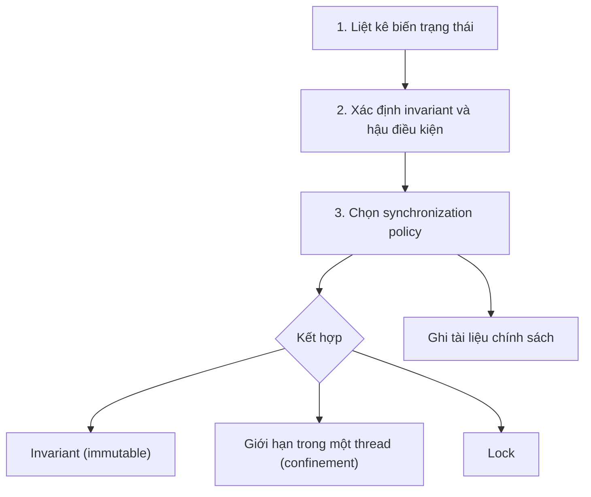
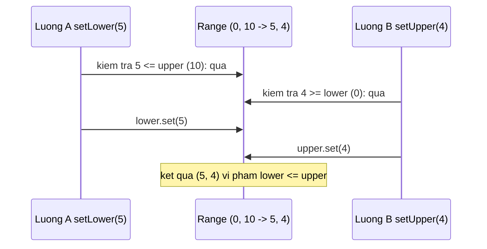
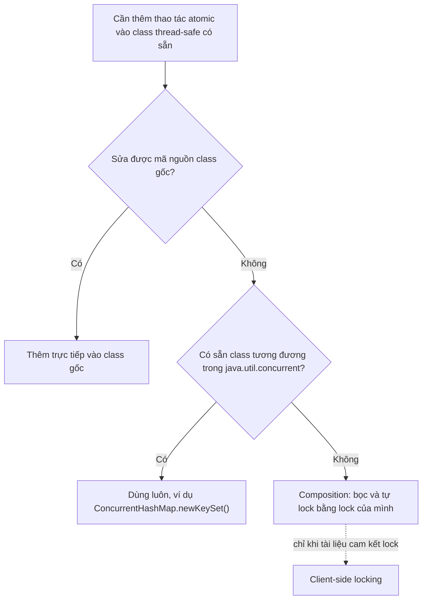

# Lý thuyết 04: Thiết kế class thread-safe

## Thiết kế class thread-safe là gì?

Bài này hướng dẫn cách dựng một class thread-safe từ đầu, hoặc ghép nó từ những thành phần có sẵn. Bạn sẽ gặp các kỹ thuật: xác định trạng thái, invariant, synchronization policy, đóng gói để giới hạn truy cập, ủy quyền cho thành phần thread-safe, và mở rộng một class thread-safe sẵn có mà không phá vỡ an toàn của nó.

Vấn đề cần giải quyết: không ai muốn phân tích từng lần truy cập memory của cả chương trình để chứng minh nó đúng. Nếu mỗi class tự đảm bảo an toàn nhờ đóng gói, bạn chỉ cần xem **một class** để biết nó đúng hay sai, rồi ghép các class đúng thành hệ thống đúng. Cũng như một chiếc ví tự lock kín: bạn không cần canh từng người chạm vào ví, chỉ cần biết cách ví tự bảo vệ nội dung.

Bạn dùng các kỹ thuật này mỗi khi viết class có trạng thái thay đổi và được nhiều thread dùng chung: counter, cache, data model của GUI, registry, tracker. Ngược lại, class không có trạng thái (stateless) hoặc object immutable thì không cần phần lớn những gì ở dưới, vì chúng đã an toàn tự nhiên.

Quy trình gồm ba bước: (1) liệt kê biến tạo nên trạng thái, (2) xác định invariant và hậu điều kiện ràng buộc chúng, (3) chọn và **ghi lại** synchronization policy. Sau đó chọn mẫu phù hợp: monitor, confinement, delegation hay composition.

**Tóm tắt:**

- Thiết kế class thread-safe theo ba bước: liệt kê biến trạng thái, xác định invariant và hậu điều kiện, rồi chọn và ghi lại synchronization policy.
- Invariant liên quan nhiều biến thì mọi thao tác chạm tới các biến đó phải giữ cùng một lock trong suốt thao tác.
- Instance confinement (Java monitor): đóng gói toàn bộ trạng thái mutable, bảo vệ bằng một lock duy nhất, nên dùng lock `private` thay vì `this`.
- Delegation chỉ đúng khi các biến thread-safe độc lập, không có invariant nào nối chúng; hai `AtomicInteger` cho `lower <= upper` vẫn sai.
- Chỉ publish biến nền khi nó thread-safe, không tham gia invariant nào và không có chuyển trạng thái bị cấm.
- Thêm thao tác atomic vào class có sẵn: sửa class gốc nếu được, nếu không thì dùng composition; client-side locking và inheritance mong manh hơn.
- Ghi tài liệu synchronization policy (và `@GuardedBy`) để người sau không vô tình phá.

## Các khái niệm cần biết

- **Trạng thái (state)**: dữ liệu của object mà các thao tác có thể đọc hoặc làm đổi, gồm các field và dữ liệu của những object mà class sở hữu.
- **Invariant**: điều kiện luôn phải đúng với trạng thái hợp lệ, ví dụ `lower <= upper` hay "counter không âm". Thread-safe nghĩa là giữ được các invariant này dưới truy cập đồng thời.
- **Hậu điều kiện (postcondition)**: điều phải đúng sau một thao tác, ví dụ sau khi tăng thì giá trị mới bằng giá trị cũ cộng 1.
- **Chính sách đồng bộ (synchronization policy)**: quy định biến nào immutable, biến nào chỉ một thread chạm tới, biến nào do lock nào bảo vệ.
- **Check-then-act**: kiểm tra một điều kiện rồi hành động dựa trên kết quả. Nếu giữa hai bước có thread khác chen vào, kết quả kiểm tra đã lỗi thời.
- **Instance confinement**: giới hạn object không thread-safe trong một class để mọi đường truy cập đều qua lock của class đó.
- **Delegation (ủy quyền)**: class giao việc thread-safe cho các thành phần thread-safe sẵn có thay vì tự lock.
- **Composition (ghép)**: bọc một object bên trong class của mình thay vì extend nó.
- **Publish (công bố)**: làm một object nhìn thấy được từ ngoài phạm vi hiện tại (trả ra từ getter, lưu vào field công khai).
- **Snapshot và live view**: snapshot là bản sao cố định tại một thời điểm; live view là cửa sổ nhìn thẳng vào dữ liệu thật, thay đổi hiện ra ngay.
- **Client-side locking**: client tự lock vào lock mà object đang dùng để ghép nhiều thao tác thành một thao tác atomic.

## 1. Ba bước thiết kế



**Trạng thái (state)** của object bắt đầu từ các field. Nếu field là tham chiếu, trạng thái còn gồm cả phần dữ liệu của object được tham chiếu mà class **sở hữu** (ví dụ trạng thái của `LinkedList` bao gồm mọi node bên trong).

**Chính sách đồng bộ** trả lời: biến nào là immutable, biến nào chỉ một thread chạm tới, biến nào được lock nào bảo vệ, thao tác nào phải atomic.

### 1.1 Thu thập yêu cầu đồng bộ

Không hiểu invariant thì không thể đảm bảo an toàn. Không gian trạng thái càng nhỏ càng dễ lập luận, nên dùng `final` ở bất cứ đâu có thể (trường hợp cực đoan: object immutable chỉ có đúng một trạng thái).

**Nền tảng:** Muốn class thread-safe, trước hết phải biết **invariant** của nó. Invariant liên quan nhiều biến thì mọi thao tác chạm tới các biến đó phải giữ cùng một lock trong suốt thao tác. Không xác định được invariant thì không thể chứng minh class đúng, và mọi quyết định lock sau đó chỉ là đoán.

| Ràng buộc | Hệ quả thiết kế |
|---|---|
| Có trạng thái không hợp lệ (ví dụ counter không âm) | Biến trạng thái phải được **đóng gói**, nếu không client ghi giá trị sai được |
| Có chuyển trạng thái không hợp lệ (ví dụ 17 chỉ được sang 18) | Thao tác phải **atomic** (đọc-tính-ghi trong cùng một lock) |
| Invariant liên quan **nhiều biến** (`lower <= upper`) | Mọi thao tác chạm tới các biến đó phải giữ **cùng một lock** trong suốt thao tác |
| Không có ràng buộc (nhiệt độ hiện tại) | Có thể nới lỏng đóng gói để đạt hiệu năng hoặc linh hoạt hơn |

Ví dụ ràng buộc nhiều biến: cập nhật `lower`, nhả lock, rồi mới cập nhật `upper` là sai, vì giữa hai bước object ở trạng thái không hợp lệ mà thread khác nhìn thấy được.

### 1.2 Thao tác phụ thuộc trạng thái (state-dependent)

Một số thao tác có **tiền điều kiện** theo trạng thái: không thể lấy phần tử từ queue rỗng, không thể rút tiền khi số dư không đủ. Ở chương trình tuần tự, tiền điều kiện sai thì chỉ còn cách báo lỗi. Ở chương trình đồng thời, thread khác có thể làm tiền điều kiện đúng trở lại, nên ta có thêm lựa chọn **chờ rồi tiếp tục**.

`wait/notify` gắn chặt với intrinsic lock và rất dễ dùng sai. Nên ưu tiên class có sẵn như `BlockingQueue`, `Semaphore` (xem bài 05). Tự viết class chờ điều kiện là chủ đề của chương 14.

### 1.3 Quyền sở hữu (ownership)

Java không có khái niệm ownership trong ngôn ngữ, đó là quyết định **thiết kế**. Chủ sở hữu trạng thái là bên quyết định giao thức lock cho trạng thái đó. Khi bạn công bố (publish) tham chiếu tới object mutable, bạn không còn độc quyền kiểm soát, nhiều nhất chỉ còn "sở hữu chung".

Collection thường **chia đôi quyền sở hữu**: collection sở hữu hạ tầng nội bộ, còn client sở hữu các object bỏ vào trong. Ví dụ `ServletContext` tự thread-safe, nhưng object bạn `setAttribute` vào đó vẫn phải được chia sẻ an toàn (thread-safe, effectively immutable, hoặc có lock bảo vệ).

## 2. Instance confinement (đóng gói để giới hạn truy cập)

Object không thread-safe vẫn dùng an toàn được nếu **mọi đường truy cập tới nó đều biết trước và đều qua lock**. Object có thể bị giới hạn trong: một instance của class (field `private`), một phạm vi cú pháp (biến cục bộ) hoặc một thread.

```java
@ThreadSafe
public class UserRegistry {
    @GuardedBy("this")
    // HashSet không thread-safe
    private final Set<String> usernames = new HashSet<>();

    public synchronized boolean register(String name) {
        return usernames.add(name);
    }

    public synchronized boolean isTaken(String name) {
        return usernames.contains(name);
    }
}
```

`HashSet` bị giới hạn trong `UserRegistry`: field `private`, không có getter trả nó ra, mọi đường vào đều `synchronized`. Class này thread-safe dù thành phần bên trong thì không. Lưu ý class chưa nói gì về `String` (immutable nên an toàn); nếu phần tử là kiểu mutable thì chính phần tử cũng cần được bảo vệ.

Thư viện chuẩn dùng đúng ý tưởng này: `Collections.synchronizedList(...)` là một **Decorator** bao `ArrayList`, mọi method là `synchronized` rồi chuyển tiếp. Điều kiện an toàn: wrapper nắm tham chiếu duy nhất tới list bên trong.

Cách object "thoát" khỏi giới hạn: trả thẳng field ra, trả iterator hoặc inner class lộ tham chiếu, hoặc truyền `this` ra ngoài trong constructor.

### 2.1 Mẫu Java monitor

Đẩy confinement đến cùng: object đóng gói **toàn bộ** trạng thái mutable và bảo vệ bằng **intrinsic lock của chính nó**.

```java
@ThreadSafe
public final class BoundedCounter {
    @GuardedBy("this") private long value;
    private final long max;

    public BoundedCounter(long max) { this.max = max; }

    public synchronized long get() { return value; }

    public synchronized long increment() {
        if (value == max) throw new IllegalStateException("đã đạt giới hạn");
        return ++value;
    }
}
```

`Vector` và `Hashtable` theo mẫu này. Ưu điểm lớn nhất là **đơn giản**. Nhược điểm là mọi thao tác tranh nhau một lock (cải thiện ở bài về hiệu năng).

**Lock riêng (private lock)** là biến thể tốt hơn: dùng một `Object` private làm lock.

```java
public class Inventory {
    private final Object lock = new Object();
    @GuardedBy("lock") private int stock;

    public void add(int n) {
        synchronized (lock) { stock += n; }
    }
}
```

Lý do: lock công khai (như `this`) cho phép client tự `synchronized (inventory)` và tham gia vào chính sách lock của bạn, đúng hoặc sai. Client giữ lock lâu hoặc lấy lock theo thứ tự sai có thể gây vấn đề liveness, và để kiểm tra bạn phải đọc toàn bộ chương trình thay vì một class. Lock riêng còn cho phép mỗi nhóm biến dùng lock khác nhau.

**Phải thuộc:** Mẫu Java monitor: đóng gói toàn bộ trạng thái mutable, bảo vệ bằng một lock duy nhất. Nên dùng lock riêng (`private final Object lock`) thay vì `this` để client không can thiệp được vào chính sách lock.

### 2.2 Ví dụ: theo dõi vị trí đội xe (bản monitor)

Bài toán: nhiều thread cập nhật tọa độ xe từ GPS, một UI thread đọc để vẽ. Bản monitor giữ `Map<String, MutablePoint>` bên trong, `MutablePoint` không thread-safe. Các điểm mấu chốt:

- Map và các điểm **không bao giờ được công bố**. Khi cần trả dữ liệu, **sao chép sâu** (deep copy) từng điểm.
- Sao chép sâu là bắt buộc. Bọc `unmodifiableMap` chỉ chặn sửa map, không chặn sửa các `MutablePoint` bên trong. Copy constructor của `HashMap` chỉ chép tham chiếu.
- Hệ quả: client nhận **ảnh chụp (snapshot)** không đổi dù vị trí thật đã thay đổi. Tốt nếu cần nhất quán nội bộ, xấu nếu cần dữ liệu mới nhất.
- Giá phải trả: copy trong `synchronized` giữ lock lâu khi có nhiều xe, có thể làm UI chậm.

**Suy luận:** Việc nên dùng lock `private` thay vì `this` bắt nguồn từ câu hỏi ai có thể lấy lock. Khi `synchronized` method dùng lock của `this`, lock đó nằm trong tay bất kỳ code nào có tham chiếu tới object, vì `synchronized (obj)` ở ngoài class cũng lấy đúng lock ấy. Nghĩa là chính sách khóa của class lúc này phụ thuộc vào cách mọi client xử sự, nên để chứng minh class đúng bạn phải đọc cả chương trình, đúng điều mà đóng gói sinh ra để tránh. Lock `private final` đảo ngược tình thế: chỉ code trong class chạm tới được, nên đọc một file là đủ kiểm chứng, và client không thể giữ lock lâu hay tạo thứ tự lock gây deadlock. Điểm dễ nhầm là cho rằng `synchronized` method "gọn hơn nên tốt hơn"; về hành vi nó đúng, nhưng nó công khai chính sách khóa ra ngoài và đóng băng chính sách đó thành một phần của API. Khi thiết kế class có thể được dùng bởi code của người khác, hãy mặc định lock private và chỉ công khai lock khi bạn chủ ý cho phép client-side locking.

## 3. Ủy quyền thread-safe (delegation)

Nếu các thành phần **đã thread-safe**, class ghép có cần thêm lớp bảo vệ nữa không? Tùy thuộc vào invariant.

### 3.1 Ủy quyền cho một biến

```java
public class RequestStats {
    private final AtomicLong total = new AtomicLong();   // final, thread-safe

    public long record() { return total.incrementAndGet(); }
}
```

Trạng thái của class chính là trạng thái của `AtomicLong`, class không thêm ràng buộc nào, nên thread-safe nhờ ủy quyền. Nếu `total` không phải `final` thì phải phân tích thêm về tính hiển thị và race của chính tham chiếu: thêm một lý do để dùng `final`.

**Phải thuộc:** Delegation chỉ đúng khi các biến thread-safe **độc lập**, tức không có invariant nào nối chúng. Hai `AtomicInteger` với invariant `lower <= upper` vẫn sai vì check-then-act giữa hai biến không atomic.

### 3.2 Bản vehicle tracker dùng delegation

```java
public record Position(int x, int y) {}     // invariant, chia sẻ tự do

public class FleetTracker {
    private final ConcurrentMap<String, Position> locations;
    private final Map<String, Position> view;

    public FleetTracker(Map<String, Position> init) {
        locations = new ConcurrentHashMap<>(init);
        view = Collections.unmodifiableMap(locations);
    }

    // "live view"
    public Map<String, Position> getLocations() { return view; }
    public Position getLocation(String id) { return locations.get(id); }

    public void setLocation(String id, int x, int y) {
        if (locations.replace(id, new Position(x, y)) == null)
            throw new IllegalArgumentException("không có xe: " + id);
    }
}
```

Không có `synchronized` nào: `ConcurrentHashMap` lo cấu trúc map, `Position` immutable nên không cần copy. Khác bản monitor ở chỗ `getLocations` trả về một **view sống**: thay đổi sau đó hiện ra ngay trong map mà thread khác đang giữ. Muốn ảnh chụp thì trả `unmodifiableMap(new HashMap<>(locations))`; chỉ cần sao chép cấu trúc vì giá trị đã immutable.

| | Monitor + copy | Delegation + immutable |
|---|---|---|
| Đồng bộ | `synchronized` toàn class | Do `ConcurrentHashMap` đảm nhiệm |
| Dữ liệu trả về | Snapshot (sao chép sâu) | View sống (hoặc snapshot nếu tự copy) |
| Chi phí | Copy sâu khi đọc, giữ lock lâu | Rẻ, ít contention |

### 3.3 Nhiều biến độc lập

Có thể ủy quyền cho **nhiều** biến thread-safe miễn là chúng **độc lập**, tức là class không có invariant nào nối chúng. Ví dụ component UI giữ danh sách listener chuột và danh sách listener phím trong hai `CopyOnWriteArrayList`: hai danh sách không liên quan nên mỗi cái tự lo.

### 3.4 Khi ủy quyền thất bại

```java
// SAI: hai AtomicInteger thread-safe nhưng invariant lower <= upper thì không
public class Range {
    private final AtomicInteger lower = new AtomicInteger(0);
    private final AtomicInteger upper = new AtomicInteger(0);

    public void setLower(int v) {
        if (v > upper.get()) throw new IllegalArgumentException();  // check
        lower.set(v);                                               // then act
    }
    public void setUpper(int v) {
        if (v < lower.get()) throw new IllegalArgumentException();
        upper.set(v);
    }
}
```



Với khoảng (0, 10), thread A gọi `setLower(5)` và thread B gọi `setUpper(4)` cùng lúc: cả hai qua bước kiểm tra, cả hai ghi, kết quả (5, 4), một trạng thái sai. Thành phần thread-safe không làm class ghép thread-safe khi giữa chúng có ràng buộc. Sửa bằng cách bảo vệ cả hai biến bằng **cùng một lock** và không công bố chúng. (Đây là cùng lý do `volatile` chỉ hợp cho biến không tham gia invariant với biến khác.)

### 3.5 Công bố biến trạng thái nền

Chỉ nên công bố một biến nền khi thỏa **cả ba**: bản thân nó thread-safe, nó không tham gia invariant nào của class, và không có chuyển trạng thái bị cấm. Ví dụ danh sách listener ở trên công bố được. `value` của counter không âm thì không.

Ví dụ class điểm mutable nhưng thread-safe để công bố:

```java
@ThreadSafe
public class SafePoint {
    @GuardedBy("this") private int x, y;

    public SafePoint(int x, int y) { this.x = x; this.y = y; }
    // private constructor capture
    public SafePoint(SafePoint p) { this(p.snapshot()); }
    private SafePoint(int[] a) { this(a[0], a[1]); }

    public synchronized int[] snapshot() { return new int[] { x, y }; }
    public synchronized void set(int x, int y) { this.x = x; this.y = y; }
}
```

Điểm tinh tế: getter trả cả `x` lẫn `y` trong **một** thao tác (mảng), vì hai getter rời nhau cho phép thread khác chen vào, khiến caller thấy một tọa độ mà xe chưa từng ở đó. Constructor sao chép viết `this(p.x, p.y)` sẽ bị race, nên dùng constructor private nhận mảng (idiom "private constructor capture"). Tracker dùng `ConcurrentHashMap<String, SafePoint>` an toàn, nhưng sẽ hết an toàn nếu cần "phủ quyết" hoặc phản ứng khi vị trí đổi.

## 4. Thêm chức năng vào class thread-safe có sẵn

Ví dụ: cần `putIfAbsent` atomic cho `List`. Tách thành check-then-act nên phải atomic, nếu không hai thread cùng thấy "chưa có" rồi cùng thêm.

| Cách | Mô tả | Độ mong manh |
|---|---|---|
| Sửa trực tiếp class gốc | Thêm method, giữ mọi mã đồng bộ trong một file | Thấp nhất, nhưng không phải lúc nào cũng sửa được |
| Kế thừa (extend) | Class con thêm `synchronized putIfAbsent` (như mở rộng `Vector`) | Chính sách lock nằm ở nhiều file; superclass đổi lock là subclass hỏng ngầm |
| Client-side locking | Helper bên ngoài lock **cùng lock mà object dùng** | Cao: mã lock của class C nằm trong class không liên quan C |
| Composition | Bọc object, tự lock bằng lock của mình | Thấp, nên ưu tiên |

Để chọn nhanh, hãy trả lời lần lượt các câu hỏi dưới đây:

**Phải thuộc:** Thêm thao tác atomic vào class thread-safe có sẵn: sửa trực tiếp class gốc (nếu được) hoặc composition (bọc và lock bằng lock của mình, ưu tiên); client-side locking và inheritance mong manh hơn vì phụ thuộc lock nội bộ của class khác.



Đọc sơ đồ: composition là lựa chọn mặc định khi không sửa được class gốc. Client-side locking chỉ là phương án phụ, và chỉ an toàn khi tài liệu của class cam kết rõ lock nào được dùng.

### 4.1 Client-side locking: sai và đúng

```java
// SAI: synchronized trên "this" của helper, trong khi list dùng lock khác
public synchronized boolean putIfAbsent(E x) {
    boolean absent = !list.contains(x);
    if (absent) list.add(x);
    return absent;
}
```

Ở đây chỉ có ảo giác đồng bộ: các thao tác của `list` dùng lock của wrapper `list`, còn `putIfAbsent` dùng lock của helper, hai lock khác nhau nên không loại trừ nhau. Cách đúng là lock chính object `list`:

```java
public boolean putIfAbsent(E x) {
    synchronized (list) {                // đúng lock mà synchronizedList dùng
        boolean absent = !list.contains(x);
        if (absent) list.add(x);
        return absent;
    }
}
```

Cách này chỉ chạy được vì tài liệu của `Vector` và các wrapper `synchronizedXxx` cam kết (hơi kín đáo) rằng lock chính là object wrapper. Với class không cam kết, client-side locking phá vỡ đóng gói synchronization policy, giống như inheritance phá đóng gói cài đặt.

### 4.2 Composition: giải pháp ít mong manh nhất

```java
@ThreadSafe
public class UniqueList<T> {
    private final List<T> list;                 // chỉ truy cập qua UniqueList

    public UniqueList(List<T> list) { this.list = list; }

    public synchronized boolean addIfAbsent(T x) {
        if (list.contains(x)) return false;
        list.add(x);
        return true;
    }
    public synchronized int size() { return list.size(); }
    // ...ủy quyền các method còn lại, cũng synchronized
}
```

Class bọc dùng **lock của chính nó** cho mọi thao tác nên thread-safe dù `list` bên dưới có thread-safe hay không, và không bị ảnh hưởng nếu `list` đổi cách lock. Giá phải trả là một lớp lock thừa (rất rẻ vì lock bên dưới không contention). Điều kiện: không ai khác giữ tham chiếu tới `list` gốc. (Lưu ý: ví dụ minh họa trong sách có lỗi logic ở `putIfAbsent`, đảo điều kiện `contains`; code ở trên đã viết đúng.)

Trong thực tế, nếu chỉ cần "thêm nếu chưa có", `CopyOnWriteArraySet`, `ConcurrentHashMap.newKeySet()` hay `ConcurrentMap.putIfAbsent` có sẵn thao tác atomic.

**Suy luận:** Client-side locking mong manh vì nó gắn code của client vào một giả định ẩn về class bên dưới. Để ghép `contains` và `add` thành một thao tác atomic, client phải lock đúng cái lock mà class dùng nội bộ; nếu đoán sai lock (ví dụ lock `this` của wrapper trong khi class dùng lock khác) thì hai bên khóa hai lock khác nhau, không loại trừ nhau, và code trông đúng nhưng vẫn race. Giả định đó còn có thể đổi ở phiên bản sau mà không ai báo, nên lỗi xuất hiện xa chỗ sửa. Composition tránh được cả hai vấn đề vì class bọc tự lấy lock của chính nó cho mọi thao tác, kể cả thao tác ghép, nên không phụ thuộc cách class bên trong khóa, miễn không ai khác giữ tham chiếu tới object gốc. Inheritance yếu theo cách tương tự: subclass phụ thuộc chi tiết cài đặt của superclass, thứ có thể đổi. Khi cần thêm thao tác atomic, thứ tự ưu tiên là sửa class gốc, rồi composition, và client-side locking chỉ khi tài liệu cam kết rõ lock nào được dùng.

## 5. Ghi tài liệu synchronization policy

> Ghi tài liệu về đảm bảo thread-safety cho **client**, ghi synchronization policy cho **người bảo trì**.

- Tối thiểu phải nói rõ: class có thread-safe không? Có gọi callback khi đang giữ lock không? Lock nào ảnh hưởng hành vi? Có cho phép client-side locking không (và lock vào lock nào)?
- Dùng annotation `@ThreadSafe`, `@NotThreadSafe`, `@Immutable`, `@GuardedBy("lock")` (nằm trong `javax.annotation.concurrent` của JSR-305 hoặc `net.jcip.annotations`). Công cụ phân tích tĩnh có thể kiểm tra chúng.
- Viết khi thiết kế, vì vài tuần sau chi tiết đã mờ.

Nếu tài liệu của một thư viện mơ hồ (servlet, JDBC) thì làm gì? Hãy đọc đặc tả **từ góc nhìn của bên cài đặt**: container tự tạo nhiều thread và gọi `service()` từ đó, nên `ServletContext` hay `HttpSession` phải được dùng đồng thời và hẳn đã thread-safe; nếu cần client-side locking thì client sẽ lock vào cái gì? Tuy vậy, đừng mặc định "chắc nó thread-safe". Ví dụ kinh điển: `SimpleDateFormat` không thread-safe, và Javadoc từng không hề nói. (Java 8+ dùng `DateTimeFormatter`, immutable và thread-safe.)

## Bẫy thường gặp

| Bẫy | Hậu quả | Cách tránh |
|---|---|---|
| Trả field mutable ra ngoài (getter, iterator) | Phá confinement, client sửa trạng thái không qua lock | Trả bản sao, view không đổi hoặc object immutable |
| `unmodifiableMap` mà giá trị bên trong mutable | Giá trị vẫn sửa được | Dùng giá trị immutable hoặc deep copy |
| Ủy quyền cho nhiều biến có ràng buộc | Check-then-act chen ngang, vi phạm invariant | Một lock chung bảo vệ các biến liên quan |
| `synchronized` sai lock trong helper | Chỉ có ảo giác an toàn | Dùng cùng lock với object hoặc composition |
| Lock công khai (`this`) | Client tham gia chính sách lock, khó kiểm chứng, rủi ro liveness | Lock riêng `private final Object` |
| Không ghi tài liệu | Người sau phá chính sách mà không biết | `@GuardedBy`, Javadoc nêu cam kết thread-safety |

## Điểm cần nhớ

- Thiết kế class thread-safe: **biến trạng thái, invariant, synchronization policy**; invariant nhiều biến buộc dùng chung một lock cho cả thao tác.
- Đóng gói giúp phân tích an toàn của class mà không cần xem toàn chương trình; object bị confine không được thoát ra.
- Mẫu monitor: gói mọi trạng thái mutable và bảo vệ bằng một lock; ưu tiên lock riêng thay vì lock công khai.
- Ủy quyền chỉ hợp khi các biến nền thread-safe, độc lập và class không có thao tác cần atomic qua nhiều biến.
- Muốn thêm thao tác atomic vào class có sẵn, ưu tiên composition; client-side locking và inheritance đều gắn chặt vào chi tiết class gốc.
- Object immutable và `final` làm mọi phân tích dễ hơn rất nhiều.
- Luôn ghi tài liệu cam kết thread-safety và synchronization policy.

## Câu hỏi tự kiểm tra

1. Một class thread-safe cần xác định những gì trước khi viết code?
   - **Gợi ý suy luận:** Class giữ dữ liệu gì (biến nào tạo nên trạng thái)? Có quy tắc nào luôn đúng giữa các biến đó? Ai quyết định thread nào được đụng vào?
   - **Lập luận:** Không biết biến nào là trạng thái thì không biết cần bảo vệ gì; không biết invariant thì không biết thao tác nào phải atomic; không có chính sách truy cập thì mỗi người tự lock một kiểu. Nên cần cả ba.
   - **Đáp án ngắn:** Biến tạo nên trạng thái, các invariant ràng buộc chúng, và chính sách quản lý truy cập đồng thời.
2. Bạn viết helper có `synchronized putIfAbsent` bọc ngoài một `synchronizedList` mà vẫn bị race. Vì sao?
   - **Gợi ý suy luận:** `synchronized` trên `this` lock object nào? Các method của `synchronizedList` lock object nào? Hai lock khác nhau thì có loại trừ nhau không?
   - **Lập luận:** Helper giữ lock của chính helper, còn `add`/`contains` của danh sách giữ lock của wrapper. Hai lock khác nhau nên thread khác vẫn gọi `add` xen vào giữa "kiểm tra" và "thêm" của helper, nên thao tác ghép không atomic.
   - **Đáp án ngắn:** Hai bên dùng hai lock khác nhau; phải lock đúng lock mà danh sách dùng (chính wrapper) hoặc tự quản lý lock.
3. Khi nào được phép giao thread-safety cho hai `AtomicInteger` (ví dụ `lower`, `upper`)?
   - **Gợi ý suy luận:** Mỗi `AtomicInteger` chỉ đảm bảo gì (một biến, một thao tác)? Nếu có quy tắc `lower <= upper` thì cập nhật hai biến phải thế nào?
   - **Lập luận:** Mỗi biến atomic chỉ atomic riêng lẻ. Nếu invariant liên quan cả hai biến, có khoảng giữa hai lần ghi mà thread khác thấy trạng thái vi phạm. Vậy chỉ ủy quyền được khi các biến độc lập, không có invariant chung.
   - **Đáp án ngắn:** Khi hai biến độc lập và không có invariant liên quan cả hai; có `lower <= upper` thì phải lock chung.
4. Vì sao nên lock bằng `private final Object` thay vì `synchronized(this)`?
   - **Gợi ý suy luận:** Ai khác có thể lấy được tham chiếu tới `this`? Nếu họ cũng lock `this` thì chuyện gì xảy ra với chính sách lock của class?
   - **Lập luận:** `this` là object công khai, client có thể lock nó, gây contention hoặc deadlock ngoài ý muốn. Lock private thì chỉ code trong class chạm được, nên chỉ cần đọc một class để chứng minh đúng.
   - **Đáp án ngắn:** Để client không tham gia hoặc phá chính sách lock, và phân tích chỉ cần xem một class.
5. `Collections.unmodifiableMap` có đủ để công bố an toàn một map chứa object mutable không?
   - **Gợi ý suy luận:** Wrapper chặn thao tác nào (sửa cấu trúc map hay sửa object bên trong)? Ai còn giữ tham chiếu tới phần tử?
   - **Lập luận:** Wrapper chỉ chặn `put/remove` trên map. Phần tử mutable vẫn bị sửa qua tham chiếu lấy từ `get`, và sửa đồng thời gây race. Muốn an toàn thì giá trị phải immutable, thread-safe, hoặc phải copy sâu.
   - **Đáp án ngắn:** Không; nó chỉ chặn sửa cấu trúc map, giá trị bên trong phải tự an toàn.
6. Vì sao getter trả cả `x`, `y` trong một thao tác (mảng/record) tốt hơn hai getter riêng?
   - **Gợi ý suy luận:** Giữa hai lần gọi getter, thread khác có thể làm gì? Caller ghép hai giá trị đó thành gì?
   - **Lập luận:** Hai lần gọi là hai thời điểm; giữa chúng một thread khác đổi vị trí, nên caller ghép `x` cũ với `y` mới thành tọa độ chưa từng tồn tại. Lấy cả hai trong một thao tác dưới một lock thì được ảnh chụp nhất quán.
   - **Đáp án ngắn:** Vì hai getter cho phép thread khác chen vào giữa, caller có thể thấy tọa độ chưa từng tồn tại.

Nguồn: Java Concurrency in Practice, Chương 4.

