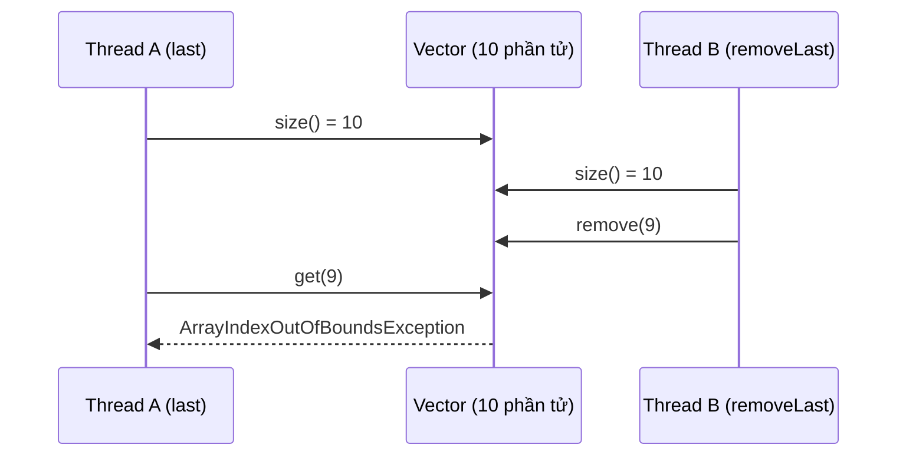
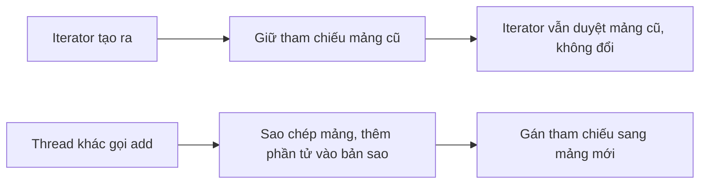
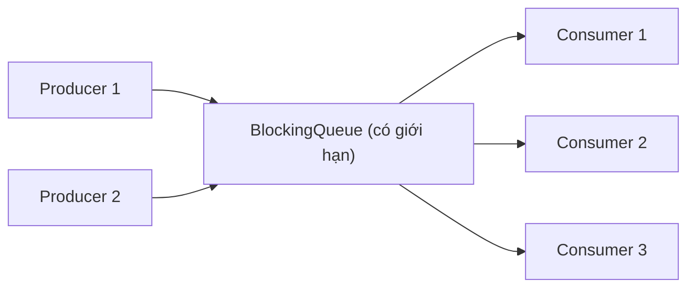
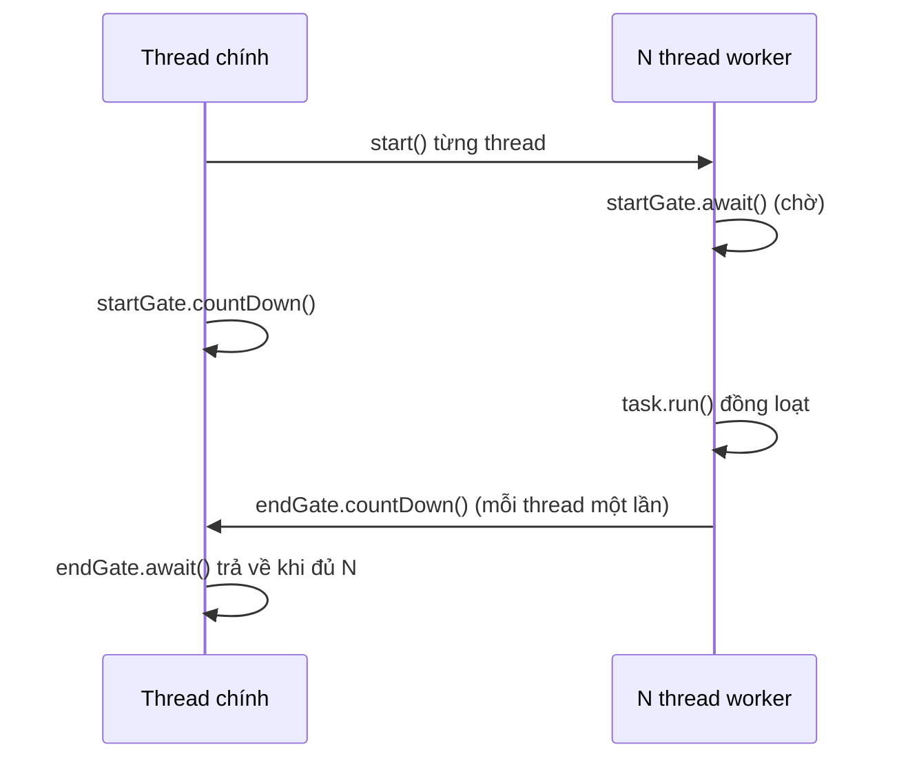
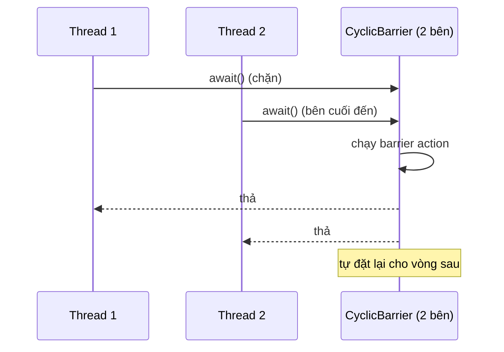
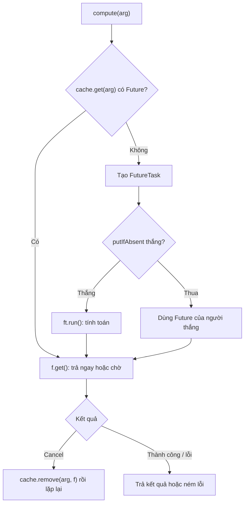

# Lý thuyết 05: Building blocks: collection đồng thời và synchronizer

## Building blocks là gì và vì sao nên dùng chúng?

Khi nhiều thread cùng làm việc, bạn luôn gặp ba nhu cầu: chia sẻ dữ liệu an toàn, chia việc cho nhau, và điều phối thứ tự ("đợi A xong rồi B mới chạy"). Thư viện chuẩn của Java đã có sẵn các "khối xây dựng" cho cả ba nhu cầu. Nhóm thứ nhất là **synchronized collection** (`Vector`, `Collections.synchronizedXxx`) và **collection đồng thời** (`ConcurrentHashMap`, `CopyOnWriteArrayList`, `BlockingQueue`, `Deque`). Nhóm thứ hai là các **synchronizer** (`CountDownLatch`, `FutureTask`, `Semaphore`, `CyclicBarrier`, `Exchanger`), tức các object giúp điều phối thread.

Vấn đề chúng giải quyết: nếu tự viết bằng `wait/notify` hay lock thô, rất dễ sai và rất khó kiểm thử. Các class có sẵn đã được kiểm chứng nhiều năm, nên ủy quyền thread-safety cho chúng là cách rẻ và an toàn nhất (xem bài 04).

Cách chọn nhanh: nhiều thread chia sẻ dữ liệu thì dùng collection đồng thời; cần chia việc giữa thread thì dùng `BlockingQueue`; cần điều phối thứ tự (đợi khởi tạo xong, giới hạn số thread, cùng đến một điểm hẹn) thì dùng synchronizer. Khi chọn, hãy xét mẫu truy cập (đọc nhiều hay ghi nhiều, có cần chặn hay không), dùng thao tác atomic có sẵn thay vì tự ghép check-then-act, và xử lý `InterruptedException` đúng cách. Chọn sai thì hậu quả là lỗi hiếm gặp khó tái hiện, hoặc chương trình chậm hơn cả bản single-threaded.

**Tóm tắt:**

- Nên ủy quyền thread safety cho class có sẵn của JDK thay vì tự viết bằng `wait/notify` hay lock thô.
- Synchronized collection chỉ atomic từng thao tác; chuỗi check-then-act hay duyệt phải lock cả chuỗi bằng cùng lock của collection.
- `ConcurrentHashMap` có iterator weakly consistent, `size()` chỉ là ước lượng; dùng `putIfAbsent`, `computeIfAbsent`, `merge` thay cho check-then-act.
- `CopyOnWriteArrayList` chỉ hợp khi đọc nhiều, ghi rất ít, vì mỗi lần ghi copy cả mảng.
- `BlockingQueue` tách producer khỏi consumer và tự điều tiết tốc độ; bounded queue tạo backpressure, unbounded queue chỉ che giấu vấn đề tới khi hết memory.
- Synchronizer: `CountDownLatch` chờ event một lần, `CyclicBarrier` dùng lại được, `Semaphore` giới hạn số thread, `FutureTask` chờ kết quả.
- Khi bắt `InterruptedException`, hoặc ném tiếp hoặc khôi phục cờ interrupt, không nuốt im lặng.
- Memoizer cho thấy lộ trình sửa: `HashMap` + lock, rồi `ConcurrentHashMap`, rồi lưu `Future<V>`, cuối cùng `putIfAbsent` atomic.

### Các khái niệm cần biết

- **Thread-safe**: class vẫn đúng đặc tả dù nhiều thread gọi đồng thời mà caller không cần đồng bộ thêm.
- **Thao tác atomic**: thao tác diễn ra trọn vẹn, thread khác không thấy trạng thái dở dang. Ví dụ `putIfAbsent` kiểm tra và thêm trong một bước.
- **Check-then-act**: kiểm tra điều kiện rồi hành động dựa trên kết quả (ví dụ `if (!map.containsKey(k)) map.put(k, v)`). Giữa hai bước, thread khác có thể đổi điều kiện, nên đây là nguồn lỗi race condition kinh điển.
- **Client-side locking**: caller tự lock trên chính object collection để gộp nhiều lời gọi thành một thao tác atomic (mục 1.1).
- **Fail-fast và weakly consistent**: hai cách iterator phản ứng khi collection bị sửa lúc đang duyệt (mục 1.2 và 2.1).
- **Lock striping**: chia dữ liệu thành nhiều phần, mỗi phần một lock riêng để nhiều thread ghi song song (mục 2.1).
- **Backpressure**: cơ chế làm bên sản xuất chậm lại khi bên tiêu thụ không theo kịp (mục 3).
- **Synchronizer**: object có trạng thái nội bộ quyết định thread nào được đi tiếp, thread nào phải chờ (mục 5).
- **Công bố an toàn (safe publication)**: cách đưa một object ra cho thread khác sao cho họ thấy trạng thái đầy đủ, không thấy dở dang. Các class trong bài này đều đảm bảo điều đó cho phần tử chuyển qua chúng.

## 1. Collection đồng bộ (synchronized collections)

Gồm `Vector`, `Hashtable` và các wrapper `Collections.synchronizedList/Map/Set`. Chúng thread-safe bằng cách đóng gói trạng thái và đặt `synchronized` trên **mọi** method công khai, tức là mỗi lúc chỉ một thread được vào.

### 1.1 Vấn đề: thao tác phức hợp

Từng lời gọi riêng lẻ là atomic, nhưng **chuỗi** lời gọi thì không.

```java
// Không bao giờ làm hỏng Vector, nhưng có thể ném ArrayIndexOutOfBoundsException
static Object last(Vector<Object> v) {
    int i = v.size() - 1;     // thread khác có thể remove ở đây
    return v.get(i);
}
```



Vector không hỏng, exception vẫn đúng đặc tả, nhưng caller không mong chuyện này xảy ra khi chỉ lấy phần tử cuối. Các thao tác phức hợp hay gặp: **duyệt (iteration)**, **điều hướng** (tìm phần tử kế tiếp), và **thao tác có điều kiện** (put-if-absent).

Vì synchronized collection cam kết dùng lock là chính object collection nên dùng client-side locking được:

**Phải thuộc:** Từng thao tác của `Vector`, `Hashtable`, `synchronizedList` là atomic, nhưng một chuỗi thao tác (check-then-act, duyệt, `size` rồi `get`) thì không. Muốn atomic phải lock cả chuỗi bằng cùng lock của collection (client-side locking).

```java
static Object last(Vector<Object> v) {
    synchronized (v) {                 // cùng lock mà Vector dùng
        return v.get(v.size() - 1);
    }
}
```

### 1.2 Iterator và ConcurrentModificationException

Iterator của synchronized collection là **fail-fast**: nếu thấy collection bị đổi trong lúc duyệt (qua counter `modCount`) thì ném `ConcurrentModificationException`. Vài điểm cần hiểu:

- Cơ chế này chỉ là "cố gắng hết sức" để báo sớm lỗi đồng thời, **không** phải bảo đảm. Việc đọc `modCount` không đồng bộ nên có thể thấy giá trị cũ mà không phát hiện thay đổi.
- Vòng `for-each` thực chất dùng `Iterator`, nên vẫn dính lỗi này.
- Ngoại lệ này cũng xảy ra ở mã single-threaded, nếu xóa phần tử trực tiếp thay vì qua `Iterator.remove()`.

Hai cách tránh khi duyệt collection dùng chung:

| Cách | Ưu | Nhược |
|---|---|---|
| Giữ lock collection trong cả vòng lặp | Duyệt nhất quán | Chặn mọi thread khác, gọi mã lạ khi đang giữ lock (rủi ro deadlock), giảm scalability |
| Clone collection rồi duyệt bản sao | Không giữ lock lâu (chỉ khi clone) | Tốn memory và CPU, dữ liệu có thể cũ |

### 1.3 Iterator ẩn (hidden iterators)

Iterator đôi khi nằm ngầm trong mã không có vòng lặp nào:

```java
public class EventLog {
    @GuardedBy("this") private final Set<Integer> ids = new HashSet<>();

    public synchronized void add(int id) { ids.add(id); }

    public void addBatch(int[] values) {
        for (int v : values) add(v);
        System.out.println("DEBUG: " + ids);   // nối chuỗi gọi ids.toString() -> duyệt!
    }
}
```

Dòng `println` gọi `toString()` của set, mà `toString()` duyệt qua tất cả phần tử, nhưng **không giữ lock**. Thread khác `add` đồng thời có thể gây `ConcurrentModificationException`.

Các chỗ duyệt ngầm khác: `hashCode`, `equals` khi collection nằm trong collection khác, `containsAll`, `removeAll`, `retainAll`, constructor nhận collection.

Bài học: khoảng cách giữa trạng thái và nơi đồng bộ càng xa thì càng dễ quên. Nếu bọc set bằng `synchronizedSet` (đóng gói cả cơ chế đồng bộ) thì lỗi kiểu này bớt hẳn. Đóng gói đồng bộ giúp thực thi synchronization policy dễ như đóng gói trạng thái giúp giữ immutable.

## 2. Collection đồng thời (concurrent collections)

Collection đồng bộ **tuần tự hóa** mọi truy cập nên scalability kém. Collection đồng thời được thiết kế cho nhiều thread cùng truy cập. Thay synchronized collection bằng collection đồng thời thường cho cải thiện lớn với rất ít rủi ro.

| Cần | Collection đồng bộ | Thay bằng |
|---|---|---|
| Map băm | `Hashtable`, `synchronizedMap` | `ConcurrentHashMap` |
| Map có thứ tự | `synchronizedSortedMap` | `ConcurrentSkipListMap` (Set: `ConcurrentSkipListSet`) |
| List, đọc nhiều hơn ghi | `synchronizedList` | `CopyOnWriteArrayList` (Set: `CopyOnWriteArraySet`) |
| Queue tạm | `LinkedList` bọc lock | `ConcurrentLinkedQueue`, `BlockingQueue` |

### 2.1 ConcurrentHashMap

- Dùng **lock striping** (lock theo từng phần nhỏ, ý tưởng gốc của bản Java 5 đến 7 với các segment; từ Java 8 cài đặt đổi sang CAS cộng `synchronized` trên nút đầu của từng bucket nhưng tinh thần "lock mịn" vẫn giữ nguyên) thay vì một lock cho cả map: nhiều thread đọc cùng lúc, đọc song song với ghi, và một số thread ghi đồng thời. Chi phí cho mã single-threaded gần như không đổi.
- Iterator **weakly consistent**: không ném `ConcurrentModificationException`, duyệt các phần tử như lúc iterator được tạo, và có thể (không bắt buộc) phản ánh thay đổi sau đó. Vì vậy **không cần lock khi duyệt**.
- `size()` và `isEmpty()` chỉ mang tính **ước lượng**, vì giá trị này đã lỗi thời ngay khi tính xong. Ở môi trường đồng thời chúng ít hữu ích hơn nhiều.
- Mất một thứ: **không lock độc quyền toàn map được**, nên không dùng client-side locking để tạo thao tác atomic mới. Chỉ khi thật sự cần lock cả map thì `ConcurrentHashMap` mới không thay thế trực tiếp được.

**Phải thuộc:** `ConcurrentHashMap` thay `Hashtable`/`synchronizedMap`: iterator weakly consistent (không ném `ConcurrentModificationException`, không cần lock khi duyệt), `size()` chỉ là ước lượng, không lock được cả map. Dùng `putIfAbsent`, `computeIfAbsent`, `merge` thay cho check-then-act; `CopyOnWriteArrayList` chỉ hợp khi đọc nhiều và ghi rất ít.

### 2.2 Thao tác atomic của ConcurrentMap

Vì không lock được toàn map, giao diện `ConcurrentMap` cung cấp sẵn các thao tác phức hợp phổ biến:

| Method | Ý nghĩa |
|---|---|
| `putIfAbsent(k, v)` | Chỉ thêm nếu chưa có ánh xạ cho `k` |
| `remove(k, v)` | Chỉ xóa nếu `k` đang ánh xạ tới `v` |
| `replace(k, old, new)` | Chỉ thay nếu `k` đang ánh xạ tới `old` |
| `replace(k, v)` | Chỉ thay nếu `k` đã có ánh xạ |

Dùng `ConcurrentHashMap` khi nhiều thread đọc/ghi map dùng chung (cache, counter, registry). Không dùng khi bạn cần một ảnh chụp nhất quán của toàn map tại một thời điểm, hoặc cần lock cả map để thực hiện chuỗi thao tác; lúc đó hãy cân nhắc một immutable object được thay thế nguyên khối, hoặc lock riêng.

Nếu bạn đang tự thêm kiểu thao tác này vào một Map đồng bộ, đó là dấu hiệu nên chuyển sang `ConcurrentMap`. (Java 8+ có thêm `computeIfAbsent`, `merge`, `compute`: atomic theo từng lock, tiện cho cache và counter, nhưng hàm truyền vào phải ngắn và không đụng tới map.)

```java
// Bộ đếm từ khóa an toàn
ConcurrentMap<String, LongAdder> freq = new ConcurrentHashMap<>();
freq.computeIfAbsent(word, k -> new LongAdder()).increment();
```

### 2.3 CopyOnWriteArrayList

Thread-safe nhờ ý tưởng: một object **effectively immutable** được công bố đúng thì không cần đồng bộ thêm. Mỗi lần sửa, collection **tạo một bản sao mới** của mảng nền rồi công bố lại. Iterator giữ tham chiếu mảng tại thời điểm tạo, mảng này không bao giờ đổi nên iterator:

- không ném `ConcurrentModificationException`,
- trả đúng nội dung lúc tạo iterator, không thấy thay đổi sau đó,
- không cần lock hay clone khi duyệt.



Đọc sơ đồ: iterator luôn nhìn vào "ảnh chụp" mảng lúc nó được tạo, còn mỗi lần ghi tạo ra một mảng mới. Vì mảng cũ không bao giờ bị sửa nên không cần lock khi duyệt.

Giá phải trả: mỗi lần sửa là một lần sao chép cả mảng. Chỉ nên dùng khi **duyệt nhiều hơn sửa rất nhiều**, điển hình là danh sách listener của hệ thống event (đăng ký/cancel hiếm, phát event thường xuyên). Không dùng cho danh sách ghi nhiều hoặc rất lớn, vì sẽ chậm và tốn memory.

```java
class EventBus {
    private final List<Consumer<String>> listeners = new CopyOnWriteArrayList<>();

    void subscribe(Consumer<String> l) { listeners.add(l); }

    void publish(String msg) {
        // an toàn kể cả khi listener tự đăng ký thêm
        for (var l : listeners) l.accept(msg);
    }
}
```

**Suy luận:** `ConcurrentHashMap` đổi tính nhất quán toàn cục lấy khả năng mở rộng. `Hashtable` và `synchronizedMap` dùng một lock cho cả map, nên mọi thread xếp hàng và thêm core không giúp được gì. Concurrent map chia dữ liệu thành các phần độc lập (trước đây là segment, nay là khóa theo bucket kết hợp CAS), nên hai thread chạm key khác nhau gần như không chờ nhau. Cái giá nằm ở chỗ không còn một khoảnh khắc nào đóng băng cả map: iterator chỉ weakly consistent, `size()` chỉ là ước lượng, vì muốn đếm chính xác phải lock cả map, đúng thứ ta vừa bỏ. Từ đó suy ra hai điều. Thứ nhất, thao tác ghép như check-then-act phải dùng method atomic của map (`putIfAbsent`, `compute`) chứ không thể tự lock vì không còn lock toàn map để lấy. Thứ hai, đừng dùng `size()` để ra quyết định. Điểm dễ nhầm là nghĩ `ConcurrentHashMap` tự làm mọi chuỗi thao tác thread-safe; thật ra chỉ từng thao tác riêng lẻ là atomic. Khi review, tìm mọi cặp `get` rồi `put` trên map concurrent và thay bằng thao tác atomic.

## 3. Blocking queue và mẫu producer-consumer

`BlockingQueue` có `put` (chặn khi đầy), `take` (chặn khi rỗng) và các bản có thời hạn `offer(e, timeout)`, `poll(timeout)`. Queue có thể **có giới hạn** (bounded) hoặc không; không giới hạn thì `put` không bao giờ chặn.

Mẫu producer-consumer tách "xác định việc cần làm" khỏi "thực hiện việc". Producer không biết có bao nhiêu consumer hay họ là ai, ngược lại cũng vậy; hai bên chạy ở tốc độ khác nhau mà không phụ thuộc mã của nhau. Thread pool + work queue của `Executor` chính là mẫu này.



**Queue có giới hạn là công cụ quản lý tài nguyên.** Nếu producer nhanh hơn consumer lâu dài, unbounded queue sẽ ăn hết memory. Queue có giới hạn khiến producer **tự bị chặn** khi đầy, đó là cơ chế *backpressure* tự nhiên. `offer` trả về thất bại thay vì chặn, để chọn chính sách quá tải linh hoạt: bỏ bớt việc (shed load), ghi ra đĩa, giảm số producer.

**Nền tảng:** Producer-consumer qua `BlockingQueue` tách "việc cần làm" khỏi "người làm" và tự điều tiết tốc độ: `put` chặn khi đầy, `take` chặn khi rỗng. Queue có giới hạn tạo ra backpressure, còn unbounded queue chỉ che giấu vấn đề cho tới khi hết memory.

| Cài đặt | Đặc điểm |
|---|---|
| `ArrayBlockingQueue` | FIFO, mảng, có giới hạn |
| `LinkedBlockingQueue` | FIFO, danh sách liên kết, mặc định không giới hạn (nên truyền capacity) |
| `PriorityBlockingQueue` | Theo thứ tự ưu tiên (`Comparable`/`Comparator`), không giới hạn |
| `SynchronousQueue` | **Không lưu phần tử**; mỗi `put` phải gặp một `take` (bàn giao trực tiếp), latency thấp, hợp khi luôn có sẵn consumer (như `newCachedThreadPool`) |
| `LinkedBlockingDeque` | Queue hai đầu, có chặn |

### 3.1 Ví dụ: tìm kiếm tệp trên máy

```java
class Crawler implements Runnable {
    private final BlockingQueue<Path> out;
    private final Path root;
    Crawler(BlockingQueue<Path> out, Path root) { this.out = out; this.root = root; }

    public void run() {
        try (var files = Files.walk(root)) {
            for (Path p : (Iterable<Path>) files.filter(Files::isRegularFile)::iterator)
                out.put(p);                         // chặn khi queue đầy
        } catch (IOException e) {
            // ghi log
        } catch (InterruptedException e) {
            Thread.currentThread().interrupt();     // khôi phục cờ interrupt
        }
    }
}

class Indexer implements Runnable {
    private final BlockingQueue<Path> in;
    Indexer(BlockingQueue<Path> in) { this.in = in; }

    public void run() {
        try {
            while (true) index(in.take());          // chặn khi rỗng
        } catch (InterruptedException e) {
            Thread.currentThread().interrupt();
        }
    }
    private void index(Path p) { /* ... */ }
}
```

Duyệt thư mục (nặng I/O) và lập chỉ mục (nặng CPU) chạy song song, mỗi phần chỉ lo việc của mình; queue lo điều tiết. Tách như vậy cũng cho phép điều chỉnh tỉ lệ số producer và consumer cho cân bằng. Lưu ý: consumer ở trên không bao giờ tự thoát, cách dừng đúng được bàn ở bài về cancellation.

### 3.2 Serial thread confinement

Object mutable có thể được "chuyển quyền sở hữu" từ thread này sang thread khác nếu: công bố an toàn (blocking queue đã đảm bảo) và thread giao **không chạm lại** sau khi giao. Tại mọi thời điểm chỉ một thread sở hữu nên không cần đồng bộ thêm khi sửa. Object pool dùng chính cơ chế này.

### 3.3 Deque và work stealing

`Deque` (`ArrayDeque`, `LinkedBlockingDeque`) cho phép thêm/lấy ở cả hai đầu. Nó phục vụ mẫu **work stealing**: mỗi consumer có deque riêng, tự lấy việc từ đầu deque của mình; khi hết việc thì lấy trộm từ **đuôi** deque của thread khác. Ít contention hơn một queue chung, hợp với bài toán consumer cũng là producer (duyệt đồ thị, crawler, chia nhỏ đệ quy). `ForkJoinPool` dùng mô hình này.

## 4. Blocking method và khả năng interrupt

Thread bị chặn khi chờ I/O, chờ lock, `sleep`, hay chờ kết quả của thread khác (trạng thái `BLOCKED`, `WAITING`, `TIMED_WAITING`). Method khai báo `throws InterruptedException` là method chặn và sẵn sàng thoát sớm khi bị interrupt.

**Ngắt (interrupt) là cơ chế hợp tác**: thread này không thể ép thread khác dừng, chỉ **yêu cầu** nó dừng ở chỗ thích hợp. Cách dùng hợp lý nhất là cancel task.

Khi mã của bạn gọi hàm ném `InterruptedException`, mã của bạn cũng thành hàm chặn và phải có phương án:

| Cách | Khi nào |
|---|---|
| **Truyền exception lên** (không bắt, hoặc bắt dọn dẹp ngắn rồi ném lại) | Mặc định nên chọn, nếu chữ ký method cho phép |
| **Khôi phục cờ interrupt**: `Thread.currentThread().interrupt()` | Khi không thể ném (ví dụ trong `Runnable.run`), để mã tầng trên còn thấy yêu cầu interrupt |
| **Nuốt im lặng** (`catch` rồi bỏ qua) | **Không làm.** Chỉ chấp nhận khi bạn là subclass của `Thread` và kiểm soát toàn bộ ngăn xếp phía trên |

## 5. Synchronizer

Synchronizer là object điều phối luồng điều khiển của các thread dựa trên **trạng thái** của nó. `BlockingQueue` cũng là một synchronizer. Chúng giống nhau ở cấu trúc: có trạng thái quyết định thread đến được đi tiếp hay phải chờ, có method đổi trạng thái, và có method chờ hiệu quả để trạng thái đạt điều kiện.

| Synchronizer | Ý tưởng | Dùng lại được? |
|---|---|---|
| `CountDownLatch` | Cổng đóng đến khi đếm ngược về 0 | Không (một lần) |
| `FutureTask` | Chờ kết quả của một phép tính | Không (một lần) |
| `Semaphore` | Số "giấy phép" giới hạn đồng thời | Có |
| `CyclicBarrier` | N thread chờ nhau tại điểm hẹn | Có |
| `Exchanger` | Hai thread trao đổi dữ liệu tại điểm hẹn | Có |

**Phải thuộc:** Chọn synchronizer: `CountDownLatch` chờ một event, dùng một lần; `CyclicBarrier` các thread chờ nhau, dùng lại được; `Semaphore` giới hạn số thread đồng thời bằng permit; `FutureTask` chờ kết quả một lần. Khi bắt `InterruptedException`: truyền lên hoặc khôi phục cờ bằng `Thread.currentThread().interrupt()`, không nuốt im lặng.

### 5.1 Latch: `CountDownLatch`

Latch là cái cổng: khi chưa đạt trạng thái cuối thì không thread nào qua, đạt rồi thì cổng mở **mãi mãi**. Dùng để đảm bảo một số hoạt động chỉ bắt đầu sau khi việc khác (làm một lần) xong: đợi tài nguyên khởi tạo, đợi dịch vụ phụ thuộc khởi động, đợi mọi người chơi sẵn sàng.

`await()` chặn đến khi counter về 0 (hoặc bị interrupt, hoặc hết thời gian); `countDown()` giảm counter. Không dùng latch khi cần tái sử dụng (đã về 0 thì không đặt lại được) hoặc khi các thread phải chờ nhau (dùng barrier). Quên gọi `countDown()` (ví dụ do exception, nên đặt trong `finally`) khiến `await()` treo mãi.

Ví dụ kinh điển: đo thời gian chạy một task trên N thread, dùng hai latch.

```java
long timeConcurrently(int n, Runnable task) throws InterruptedException {
    var startGate = new CountDownLatch(1);   // cổng xuất phát
    var endGate   = new CountDownLatch(n);   // cổng về đích

    for (int i = 0; i < n; i++) {
        new Thread(() -> {
            try {
                startGate.await();           // tất cả chờ hiệu lệnh
                try { task.run(); }
                finally { endGate.countDown(); }
            } catch (InterruptedException e) {
                Thread.currentThread().interrupt();
            }
        }).start();
    }
    long t0 = System.nanoTime();
    startGate.countDown();                   // mở cổng: tất cả cùng chạy
    endGate.await();                         // chờ thread cuối về đích
    return System.nanoTime() - t0;
}
```



Nếu không dùng `startGate`, thread khởi động trước sẽ có lợi thế "chạy trước", mức contention thay đổi theo thời gian. `endGate` giúp chờ thread cuối cùng thay vì `join` tuần tự.

### 5.2 `FutureTask`

`FutureTask` cũng hoạt động như latch. Nó bọc một `Callable` (Runnable có trả kết quả) và có ba trạng thái: chờ chạy, đang chạy, hoàn tất (gồm thành công, bị cancel, lỗi). `get()` trả ngay nếu đã xong, ngược lại chặn đến khi xong. Đặc tả bảo đảm việc truyền kết quả giữa thread tính và thread lấy là **công bố an toàn**.

Dùng để bắt đầu sớm một phép tính tốn kém mà sau mới cần kết quả (preload):

```java
class ProfilePreloader {
    private final FutureTask<Profile> task = new FutureTask<>(this::loadFromDb);
    void start() { new Thread(task).start(); }   // không start thread trong constructor

    Profile get() throws InterruptedException, ExecutionException {
        return task.get();                       // trả ngay nếu đã tải xong
    }
}
```

Lỗi trong task bị bọc vào `ExecutionException` (cause là một trong ba loại: exception kiểm tra của `Callable`, `RuntimeException`, hay `Error`). Nên xử lý riêng: ném lại exception kiểm tra đã biết, ném lại `RuntimeException`/`Error`, còn loại khác coi là lỗi logic.

### 5.3 `Semaphore`

Semaphore quản lý một tập "giấy phép" (permit): `acquire()` lấy một (chặn nếu hết), `release()` trả lại. Không gắn permit với thread, nên thread này lấy thread khác trả được. Với số permit là 1 ta có mutex không reentrant. Dùng để: giới hạn số hoạt động đồng thời vào một tài nguyên, làm pool tài nguyên (connection pool), hoặc biến collection thành collection có giới hạn.

```java
class BoundedSet<T> {
    private final Set<T> set = Collections.synchronizedSet(new HashSet<>());
    private final Semaphore slots;

    BoundedSet(int bound) { slots = new Semaphore(bound); }

    boolean add(T x) throws InterruptedException {
        slots.acquire();                       // chặn khi đầy
        boolean added = false;
        try {
            added = set.add(x);
            return added;
        } finally {
            if (!added) slots.release();       // không thêm được thì trả permit
        }
    }

    boolean remove(Object x) {
        boolean removed = set.remove(x);
        if (removed) slots.release();
        return removed;
    }
}
```

Tập hợp bên dưới không biết gì về giới hạn; `Semaphore` lo hết. (Muốn pool tài nguyên chặn khi rỗng, dùng `BlockingQueue` chứa các tài nguyên còn đơn giản hơn.)

### 5.4 Barrier: `CyclicBarrier` và `Exchanger`

Latch **chờ event**; barrier **chờ các thread khác**: tất cả phải cùng đến điểm hẹn mới đi tiếp, rồi barrier tự đặt lại để dùng tiếp.

- `await()` chặn đến khi đủ số bên. Nếu có thread bị interrupt hoặc hết giờ, barrier **vỡ (broken)** và mọi `await()` đang chờ nhận `BrokenBarrierException`.
- Có thể truyền **barrier action** (một `Runnable`) chạy một lần mỗi vòng, sau khi đủ bên và trước khi thả các thread.
- Hợp với thuật toán lặp song song, mô phỏng theo bước: tính bước k xong hết rồi mới sang bước k+1.

```java
int parts = Runtime.getRuntime().availableProcessors();
var barrier = new CyclicBarrier(parts, board::commitNewValues);   // chạy giữa mỗi bước

Runnable worker = () -> {
    while (!board.converged()) {
        computeMyPartitionIntoNextState();
        try { barrier.await(); }                // đợi mọi thread xong bước này
        catch (InterruptedException | BrokenBarrierException e) { return; }
    }
};
```



Số thread nên bằng khoảng số CPU (hoặc +1) với bài toán tính toán thuần, không I/O, không chia sẻ dữ liệu; nhiều hơn chỉ tăng contention. Không nên mỗi ô một thread.

`Exchanger` là barrier hai bên trao đổi dữ liệu tại điểm hẹn, ví dụ một thread điền đầy buffer và thread kia tiêu thụ, hai thread đổi buffer đầy lấy buffer rỗng. Việc trao đổi là công bố an toàn cho cả hai.

| | Latch | Barrier |
|---|---|---|
| Chờ cái gì | Event (`countDown`) | Các thread khác đến điểm hẹn |
| Tái sử dụng | Không | Có |
| Ai gọi giảm | Bất kỳ thread nào, kể cả không `await` | Chính các thread `await` |

**Suy luận:** Bounded `BlockingQueue` giải quyết bài toán tốc độ lệch nhau giữa producer và consumer bằng cách để chính queue làm cơ chế phản hồi. Nếu producer nhanh hơn consumer, một queue không giới hạn sẽ nhận hết việc và phình dần tới `OutOfMemoryError`, nên vấn đề chỉ hiện ra khi đã quá muộn. Khi queue có giới hạn, `put` chặn producer lúc đầy, nghĩa là tốc độ của producer bị kéo xuống bằng tốc độ consumer mà không cần code điều phối nào; đó là backpressure. Hệ quả là kích thước queue trở thành một tham số thiết kế có ý nghĩa: quá nhỏ thì producer chờ vô ích, quá lớn thì độ trễ trong queue tăng và memory tốn. Điểm dễ nhầm là chọn `LinkedBlockingQueue` mặc định không giới hạn cho tiện, hoặc xem `put` chặn là bug. Còn với synchronizer, cần nhớ latch dùng một lần còn barrier dùng lại được, và mọi method chờ đều ném `InterruptedException`, nên xử lý interrupt đúng chỗ là một phần của thiết kế.

## 6. Xây cache kết quả hiệu quả và mở rộng được (Memoizer)

Cache nhìn đơn giản nhưng cache ngây thơ biến nút cổ chai hiệu năng thành nút cổ chai **scalability**. Mục tiêu: bọc một hàm tính toán tốn kém `Computable<A, V>` để nhớ kết quả (memoization). Ta đi qua bốn phiên bản, mỗi phiên bản sửa một khuyết điểm của bản trước.

```java
interface Computable<A, V> {
    V compute(A arg) throws InterruptedException;
}
```

### Phiên bản 1: `HashMap` + `synchronized`

```java
class Memo1<A, V> implements Computable<A, V> {
    @GuardedBy("this") private final Map<A, V> cache = new HashMap<>();
    private final Computable<A, V> fn;
    Memo1(Computable<A, V> fn) { this.fn = fn; }

    public synchronized V compute(A arg) throws InterruptedException {
        V r = cache.get(arg);
        if (r == null) { r = fn.compute(arg); cache.put(arg, r); }
        return r;
    }
}
```

Đúng nhưng **mọi lời gọi xếp hàng**, kể cả khi kết quả đã có và kể cả khi thread khác đang tính một lock hoàn toàn khác. Có thể chậm hơn không cache.

### Phiên bản 2: `ConcurrentHashMap`

Bỏ `synchronized`, dùng `ConcurrentHashMap<A, V>`. Đã song song được, nhưng còn lỗ hổng: hai thread cùng hỏi lock `x` chưa có, **cả hai cùng tính**. Thread thứ hai không biết thread đầu "đang tính" `f(x)`. Với memoization chỉ là lãng phí; với cache object cần khởi tạo "đúng một lần" thì là lỗi an toàn.

### Phiên bản 3: lưu `Future<V>` thay vì `V`

Ý tưởng: ghi vào map *"việc tính f(x) đã bắt đầu"* thay vì *"kết quả f(x)"*. `FutureTask` là đúng thứ đó: thread tới sau thấy `Future` đang chạy thì chỉ cần `get()` chờ kết quả.

```java
Future<V> f = cache.get(arg);
if (f == null) {
    FutureTask<V> ft = new FutureTask<>(() -> fn.compute(arg));
    f = ft;
    cache.put(arg, ft);      // vẫn là check-then-act!
    ft.run();
}
return f.get();
```

Cửa sổ lỗ hổng nhỏ hơn rất nhiều, nhưng vẫn còn: `get` rồi `put` là hai bước rời nhau, hai thread vẫn có thể cùng thấy "chưa có" và cùng tạo `FutureTask`.

### Phiên bản 4 (cuối): `putIfAbsent` atomic

```java
class Memo<A, V> implements Computable<A, V> {
    private final ConcurrentMap<A, Future<V>> cache = new ConcurrentHashMap<>();
    private final Computable<A, V> fn;
    Memo(Computable<A, V> fn) { this.fn = fn; }

    public V compute(A arg) throws InterruptedException {
        while (true) {
            Future<V> f = cache.get(arg);
            if (f == null) {
                FutureTask<V> ft = new FutureTask<>(() -> fn.compute(arg));
                f = cache.putIfAbsent(arg, ft);   // atomic: chỉ một thread thắng
                if (f == null) { f = ft; ft.run(); }
            }
            try {
                return f.get();
            } catch (CancellationException e) {
                cache.remove(arg, f);             // tránh "ô nhiễm cache", rồi thử lại
            } catch (ExecutionException e) {
                throw launder(e.getCause());
            }
        }
    }
}
```

`putIfAbsent` đóng lỗ hổng: đúng một thread thắng và chạy phép tính, những thread còn lại nhận về `Future` của người thắng.



Những vấn đề còn lại cần nhớ (bản này chưa xử lý):

- **Ô nhiễm cache**: lưu `Future` nghĩa là nếu phép tính bị cancel hoặc lỗi thì các lần sau cũng nhận cancel/lỗi. Bản cuối xóa `Future` khi bị cancel; tùy bài toán có thể xóa cả khi gặp `RuntimeException` nếu lần sau có thể thành công. Dùng `remove(key, value)` hai tham số để chỉ xóa đúng `Future` đó.
- **Hết hạn (expiration)** và **loại bỏ (eviction)** chưa có. Hết hạn có thể làm bằng `FutureTask` gắn thời điểm hết hạn và quét định kỳ; còn eviction để cache không phình memory.

Hiện nay Java 8+ có thể rút gọn thành `cache.computeIfAbsent(arg, k -> fn.compute(k))` trên `ConcurrentHashMap<A, V>`, tính một lần cho mỗi lock. Lưu ý: hàm tính chạy trong lúc map giữ lock phần bucket, nên nếu tính rất lâu sẽ chặn cập nhật các lock cùng bucket, và hàm đó không được sửa chính map. Với phép tính rất nặng hoặc cần cancel/timeout thì mẫu `Future` ở trên vẫn đáng dùng. Thư viện thực tế như Caffeine đã xử lý trọn vẹn expiration và eviction.

## Bẫy thường gặp

| Bẫy | Hậu quả | Cách tránh |
|---|---|---|
| Duyệt `synchronizedList` mà không lock | `ConcurrentModificationException` | Lock cả vòng duyệt, hoặc clone, hoặc dùng collection đồng thời |
| `toString`, `println(collection)` | Duyệt ngầm không lock | Bọc synchronized collection, hoặc lock khi log |
| `containsKey` rồi `put` trên `ConcurrentHashMap` | Check-then-act, hai thread cùng ghi | `putIfAbsent`, `computeIfAbsent`, `merge` |
| Dựa vào `size()` của `ConcurrentHashMap` | Số liệu chỉ là ước lượng | Dùng cho thống kê, không dùng để ra quyết định logic |
| `CopyOnWriteArrayList` cho dữ liệu ghi nhiều | Sao chép mảng liên tục, chậm, tốn memory | Chỉ dùng khi đọc áp đảo ghi |
| `BlockingQueue` không giới hạn | Producer vượt consumer, tràn memory | Đặt capacity, chọn chính sách khi đầy |
| `catch (InterruptedException) {}` rỗng | Mất tín hiệu cancel | Ném lại hoặc `Thread.currentThread().interrupt()` |
| Dùng `CountDownLatch` hai lần | Latch mở rồi thì mãi mở | Dùng `CyclicBarrier` hoặc tạo latch mới |
| `acquire()` mà không `release()` trong `finally` | Rò permit, nghẽn dần | Luôn bọc trong `try/finally` |
| Cache lưu `Future` lỗi/cancel | Mọi lần sau đều lỗi | Xóa `Future` hỏng khỏi cache |

## Điểm cần nhớ

- Ủy quyền thread-safety cho class có sẵn là chiến lược hiệu quả nhất.
- Collection đồng bộ chỉ đảm bảo từng thao tác atomic; thao tác phức hợp (duyệt, put-if-absent) vẫn cần lock phía client, kể cả khi duyệt ngầm qua `toString`, `hashCode`, `containsAll`...
- Thay synchronized collection bằng collection đồng thời thường tăng scalability mạnh mà ít rủi ro; `ConcurrentHashMap` có iterator weakly consistent, `size()` ước lượng và các thao tác atomic qua `ConcurrentMap`.
- `CopyOnWriteArrayList` chỉ hợp khi đọc/duyệt nhiều hơn ghi rất nhiều (listener).
- `BlockingQueue` có giới hạn là công cụ quản lý tài nguyên và backpressure; xây ngay từ thiết kế.
- Ngắt là cơ chế hợp tác: truyền `InterruptedException` hoặc khôi phục cờ interrupt, đừng nuốt.
- Latch chờ event (một lần), barrier chờ các thread (dùng lại), semaphore giới hạn đồng thời, `FutureTask` chờ kết quả.
- Cache hiệu quả: `ConcurrentMap<K, Future<V>>` + `putIfAbsent` + xóa `Future` hỏng.

## Câu hỏi tự kiểm tra

1. `Vector` là thread-safe nhưng `v.get(v.size() - 1)` vẫn có thể ném exception. Vì sao?
   - **Gợi ý suy luận:** Thao tác ghép "đọc size rồi get" là một hay hai lời gọi? Giữa chúng thread khác có thể làm gì? Muốn atomic phải lock ở đâu?
   - **Lập luận:** Mỗi method của `Vector` atomic riêng lẻ, nhưng ghép hai lời gọi thì không. Thread khác xóa phần tử giữa `size()` và `get()` khiến chỉ số vượt biên. Phải lock chính `Vector` quanh cả hai.
   - **Đáp án ngắn:** Vì `size()` và `get()` là hai lời gọi riêng; cần lock chính Vector bao cả hai.
2. Iterator weakly consistent của `ConcurrentHashMap` khác iterator fail-fast ở điểm nào?
   - **Gợi ý suy luận:** Khi collection bị sửa lúc đang duyệt, fail-fast phản ứng ra sao? Nếu muốn không ném lỗi thì iterator phải chấp nhận điều gì?
   - **Lập luận:** Fail-fast phát hiện sửa đổi rồi ném `ConcurrentModificationException` (cố gắng, không đảm bảo). Weakly consistent chọn dung thứ: không ném, nhưng có thể không thấy thay đổi mới.
   - **Đáp án ngắn:** Weakly consistent không ném CME và chịu được sửa đồng thời nhưng có thể bỏ lỡ cập nhật; fail-fast cố báo lỗi khi phát hiện sửa.
3. Khi nào chọn `CopyOnWriteArrayList`?
   - **Gợi ý suy luận:** Mỗi lần sửa nó làm gì với mảng? Duyệt có cần lock không? Tỷ lệ đọc/ghi nào thì chi phí sao chép chấp nhận được?
   - **Lập luận:** Sửa thì sao chép cả mảng, tốn kém; duyệt thì trên bản chụp immutable nên không cần lock. Vậy lợi khi duyệt nhiều hơn sửa rất nhiều.
   - **Đáp án ngắn:** Khi duyệt nhiều hơn sửa rất nhiều (ví dụ danh sách listener); không hợp dữ liệu ghi nhiều.
4. Vì sao bounded queue tốt hơn không giới hạn trong producer-consumer?
   - **Gợi ý suy luận:** Nếu producer nhanh hơn consumer lâu dài thì unbounded queue ra sao? Queue đầy thì `put` làm gì?
   - **Lập luận:** Không giới hạn thì queue phình mãi đến hết memory. Có giới hạn thì khi đầy `put` chặn producer, tự làm chậm nó theo tốc độ consumer.
   - **Đáp án ngắn:** Nó tạo backpressure: chặn producer khi đầy, tránh tràn memory.
5. Khác biệt `CountDownLatch` và `CyclicBarrier`?
   - **Gợi ý suy luận:** Ai chờ ai: chờ một event hay chờ nhau? Sau khi mở cổng, có dùng lại được không?
   - **Lập luận:** Latch: thread chờ event (đếm về 0), khi mở thì mở mãi, nên một lần. Barrier: các thread đều phải đến điểm hẹn mới đi tiếp, rồi tự reset cho vòng sau.
   - **Đáp án ngắn:** Latch chờ event, dùng một lần; barrier bắt các thread chờ nhau tại điểm hẹn và dùng lại được.
6. Vì sao Memoizer lưu `Future` thay vì giá trị, và vì sao cần `putIfAbsent`?
   - **Gợi ý suy luận:** Nếu chỉ lưu giá trị, hai thread cùng hỏi khi chưa tính xong thì sao? Bước "kiểm tra rồi đăng ký" nếu không atomic thì sao?
   - **Lập luận:** Lưu giá trị thì thread thứ hai không thấy gì và tính lại. Lưu `Future` đăng ký việc đang chạy, thread sau chờ `get()`. Nhưng kiểm tra rồi `put` là check-then-act, cần `putIfAbsent` atomic để chỉ một thread tạo việc.
   - **Đáp án ngắn:** Future cho thread sau chờ phép tính đang chạy; `putIfAbsent` làm bước đăng ký atomic nên chỉ một thread tính.

Nguồn: Java Concurrency in Practice, Chương 5.

