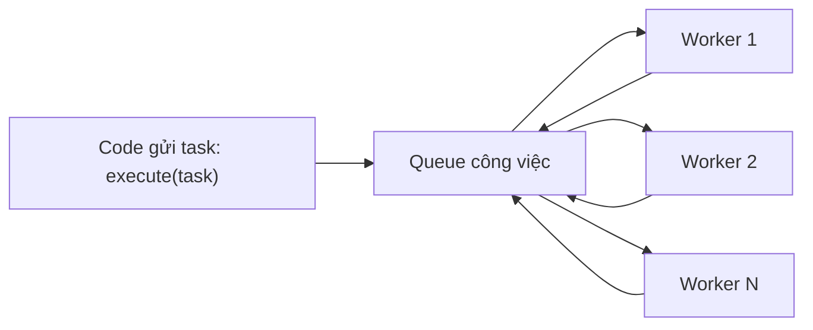
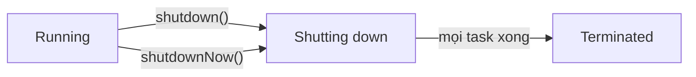
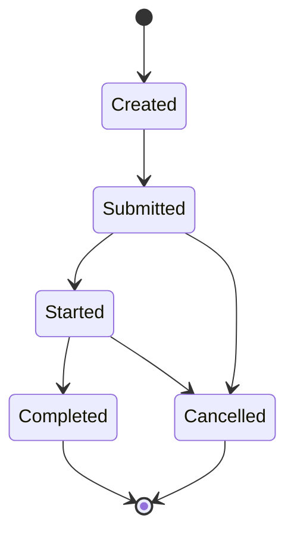
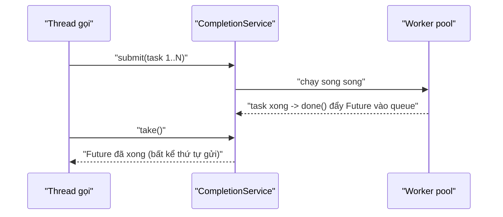

# Lý thuyết 06: Thực thi task (Task Execution)

## Thực thi task là gì?

Hãy hình dung một nhà hàng. Nếu mỗi khách đến lại thuê một đầu bếp mới, bạn sẽ sớm hết bếp, hết tiền lương và các đầu bếp giẫm chân nhau. Nếu chỉ có một đầu bếp phục vụ lần lượt từng khách, khách phía sau chờ rất lâu mỗi khi món trước phải chờ nguyên liệu. Lập trình đồng thời cũng vậy. Cách tổ chức tốt là chia công việc thành các **task**: những đơn vị công việc rời rạc, lý tưởng là độc lập nhau. Thread chỉ là phương tiện để chạy task. Thứ cần thiết kế là **chính sách thực thi** (execution policy): chạy task ở thread nào, tối đa mấy task cùng lúc, xếp hàng ra sao.

Vấn đề cần giải quyết: chạy tuần tự thì chậm và lãng phí CPU lúc chờ I/O. Tạo một thread cho mỗi task thì không có giới hạn: tốn tài nguyên, latency khởi tạo cao và có thể sập server khi tải tăng đột biến. Cách giải quyết là tách việc "gửi task" khỏi việc "chạy task" nhờ interface `Executor`, để đổi chính sách mà không phải sửa nơi gửi task.

Nên dùng khi nào? Gần như mọi ứng dụng server (mỗi request là một task), xử lý nền, gọi nhiều dịch vụ song song, hoặc bất cứ nơi nào bạn định viết `new Thread(r).start()`. Không cần khi chương trình chỉ có một việc ngắn, hoặc khi mô hình single-threaded có chủ đích (như UI thread GUI). Bài này đi từ cách chia task, ba cách chạy task, `ExecutorService` có giới hạn, `Callable`/`Future` để lấy kết quả, `CompletionService` để lấy kết quả theo thứ tự hoàn thành, và `invokeAll`/`get` có timeout để khống chế thời gian chờ.

**Tóm tắt:**

- Chia công việc thành task độc lập; thread chỉ là phương tiện chạy task, còn thứ cần thiết kế là execution policy.
- Chạy tuần tự thì chậm và lãng phí CPU lúc chờ I/O; thread-per-task không giới hạn thì tốn tài nguyên và sập khi tải tăng đột biến.
- `Executor` tách việc gửi task khỏi chính sách thực thi, nên đổi chính sách không phải sửa nơi gửi.
- Mặc định đúng là thread pool có giới hạn; `newFixedThreadPool` dùng unbounded queue và `newCachedThreadPool` không giới hạn số thread, nên ở production nên tự cấu hình `ThreadPoolExecutor`.
- `ExecutorService` có lifecycle: Running, Shutting down, Terminated; quên `shutdown` thì thread không-daemon giữ JVM không thoát.
- `Callable` và `Future` lấy kết quả; luôn đặt timeout khi `get()` trong đường xử lý request.
- `CompletionService` trả kết quả theo thứ tự hoàn thành; `ScheduledExecutorService` thay cho `Timer`.

### Các khái niệm cần biết

- **Throughput và responsiveness**: throughput là số task xong trong một đơn vị thời gian; responsiveness là độ nhanh phản hồi cho từng task. Server tốt cần cả hai.
- **Graceful degradation**: khi quá tải, hệ thống chậm dần hoặc từ chối bớt việc thay vì sập hẳn.
- **Thread pool**: tập thread được tạo sẵn và tái sử dụng; các thread lấy task từ một queue chung.
- **`Callable<V>`**: giống `Runnable` nhưng trả về giá trị và được ném checked exception.
- **`Future<V>`**: "biên lai" của một task đã gửi; dùng để chờ kết quả, cancel, hoặc kiểm tra đã xong chưa.
- **Daemon thread**: thread nền không ngăn JVM thoát; ngược lại thread không-daemon giữ JVM sống cho đến khi chúng kết thúc.
- **Rejected execution handler**: đoạn xử lý khi executor không nhận thêm task (đã tắt hoặc quá tải).
- **Safe publication**: đưa object sang thread khác sao cho thread đó thấy trạng thái đầy đủ (xem bài 03).

## Ranh giới task

Bước đầu tiên là cắt công việc thành các task có nghĩa. Một task tốt có hai tính chất:

- **Độc lập**: không phụ thuộc vào trạng thái, kết quả hay tác dụng phụ của task khác. Nhờ vậy chúng chạy song song được.
- **Nhỏ vừa phải**: mỗi task chỉ chiếm một phần nhỏ năng lực xử lý, để scheduler dễ chia đều tải.

Với server, ranh giới tự nhiên là **một request của client**. Request mail, request HTTP, câu truy vấn DB đều độc lập với nhau và đủ nhỏ. Server tốt cần có throughput và độ phản hồi (responsiveness) ổn dưới tải bình thường, và **suy giảm từ từ** (graceful degradation) khi quá tải thay vì gục ngay.

## Ba cách chạy task

### 1. Tuần tự trong một thread

```java
// Một thread vừa nhận kết nối vừa xử lý
while (true) {
    Socket conn = server.accept();
    handle(conn);          // chặn ở đây thì mọi kết nối khác phải chờ
}
```

Đơn giản và đúng, nhưng một request bị chặn I/O (đọc socket, truy vấn DB) sẽ làm cả server đứng, đồng thời CPU nhàn rỗi. Chỉ chấp nhận được khi task ít và dài, hoặc chỉ có một client. GUI dùng mô hình này có chủ đích (xem bài 09).

### 2. Một thread cho mỗi task

```java
while (true) {
    Socket conn = server.accept();
    new Thread(() -> handle(conn)).start();   // thread mới cho mỗi kết nối
}
```

Ba hệ quả tích cực: vòng lặp `accept` quay lại ngay (phản hồi tốt), các task chạy song song (tận dụng nhiều CPU và che giấu thời gian chờ I/O), nhưng code xử lý bây giờ **phải thread-safe**. Dưới tải nhẹ đến vừa cách này tốt hơn tuần tự.

### Vì sao tạo thread không giới hạn là nguy hiểm

| Vấn đề | Giải thích |
|---|---|
| Chi phí lifecycle | Tạo và hủy thread tốn thời gian và tài nguyên JVM/OS; với request nhẹ và dày, chi phí này lớn hơn cả công việc thật. |
| Tiêu thụ tài nguyên | Mỗi thread giữ một stack (thường vài trăm KB tới 1 MB). Số thread chạy được nhiều hơn số core chỉ làm tăng contention, giữ memory và gây áp lực cho GC. |
| Mất ổn định | Hệ điều hành và JVM có giới hạn số thread; vượt giới hạn thường ra `OutOfMemoryError`, rất khó phục hồi. |

Nguy hiểm nhất là lỗi này **không lộ lúc phát triển**: với ít người dùng mọi thứ đều chạy ổn. Chỉ khi tải thật tăng thì số thread mới tăng theo tốc độ request đến, và không có gì chặn lại.

### 3. Thread pool qua Executor

Cách đúng: đặt một **giới hạn** lên số thread, tái sử dụng thread đã có.

```java
private static final ExecutorService POOL = Executors.newFixedThreadPool(100);

while (true) {
    Socket conn = server.accept();
    POOL.execute(() -> handle(conn));
}
```

**Suy luận:** Thread-per-task nguy hiểm vì chi phí và tài nguyên không tăng tỷ lệ thuận mà tăng theo số thread, trong khi lợi ích thì chạm trần. Tạo thread tốn thời gian và mỗi thread giữ một stack, nên khi tải tăng, chi phí khởi tạo có thể vượt cả công việc thật của task nhẹ. Khi số thread vượt số core, thêm thread không thêm throughput mà chỉ thêm context switch và tranh chấp CPU, memory và scheduler. Đến giới hạn của hệ điều hành thì `OutOfMemoryError` xuất hiện, và nguy hiểm hơn, nó thường xuất hiện đúng lúc tải cao nhất, khi hệ thống cần ổn định nhất. Thứ nhất, bản thử với tải thấp chạy hoàn toàn tốt; thứ hai, lỗi chỉ lộ khi có đột biến, nên dễ lọt qua test. Điểm dễ nhầm là coi thread như tài nguyên rẻ miễn phí. Pool có giới hạn biến hành vi quá tải thành thứ bạn kiểm soát được (xếp hàng, từ chối, chạy bù), thay vì thứ bạn phải hứng chịu. Hệ quả là gặp `new Thread(r).start()` trong code server, hãy thay bằng `Executor` có cấu hình rõ ràng.

## Executor framework

```java
public interface Executor {
    void execute(Runnable command);
}
```

Chỉ một method, nhưng nó **tách việc gửi task khỏi việc thực thi**, và dựa trên mô hình producer-consumer: nơi gọi `execute` là producer, các worker thread là consumer.

**Nền tảng:** `Executor` tách "việc gửi task" khỏi "chính sách thực thi" (chạy ở thread nào, bao nhiêu thread, xếp hàng ra sao, từ chối thế nào). Nhờ vậy đổi chính sách không phải sửa nơi gửi. Thread-per-task không giới hạn sập khi tải cao; tuần tự thì phản hồi kém; thread pool có giới hạn là mặc định đúng.



Đọc sơ đồ: code gửi chỉ biết `execute`, còn việc worker nào chạy, bao nhiêu worker, đều do executor quyết định. Mỗi worker chạy xong một task lại quay về queue lấy task kế. Cấu hình `Executor` thường chỉ làm một lần (và có thể đưa ra file cấu hình), còn code gửi task thì rải rác khắp chương trình. Vì thế đổi chính sách bằng cách đổi `Executor` là ít xâm lấn nhất.

Chứng minh tính linh hoạt: ba executor sau đây cho ba hành vi hoàn toàn khác mà code gửi task không đổi.

```java
// Mỗi task một thread mới
Executor perTask = r -> new Thread(r).start();

// Chạy luôn trong thread của người gọi => tuần tự
Executor inCaller = Runnable::run;

// Pool có giới hạn
Executor pooled = Executors.newFixedThreadPool(32);
```

### Execution policy

Chính sách thực thi trả lời các câu hỏi:

- Task chạy trong **thread nào**?
- Chạy theo **thứ tự** nào (FIFO, LIFO, ưu tiên)?
- Tối đa bao nhiêu task chạy **đồng thời**?
- Bao nhiêu task được **xếp hàng** chờ?
- Khi quá tải thì **từ chối task nào** và báo cho ứng dụng thế nào?
- Cần làm gì **trước/sau** mỗi task?

Đây là công cụ quản lý tài nguyên. Giới hạn số task đồng thời giúp tránh cạn tài nguyên và contention quá mức; giống vai trò của transaction monitor trong hệ thống doanh nghiệp. Quy tắc thực dụng của sách: thấy `new Thread(runnable).start()` mà có thể cần chính sách linh hoạt hơn thì nên thay bằng `Executor`.

### Thread pool và các factory trong `Executors`

Một thread pool gắn chặt với một **queue công việc**. Worker có đời sống đơn giản: lấy task từ queue, chạy, rồi quay lại chờ. Lợi ích: chi phí tạo thread được chia đều cho nhiều task, thread thường đã sẵn khi task tới nên latency thấp, và điều chỉnh được kích thước pool.

| Factory | Hành vi | Lưu ý |
|---|---|---|
| `newFixedThreadPool(n)` | Tạo dần tới `n` thread rồi giữ cố định; thread chết thì thay mới. | Queue **không giới hạn** => có thể cạn memory nếu task đến nhanh hơn xử lý. |
| `newCachedThreadPool()` | Thừa thì thu hồi thread rảnh, thiếu thì tạo thêm. | Số thread **không giới hạn**, giống thread-per-task khi tải cao. |
| `newSingleThreadExecutor()` | Một worker, task chạy tuần tự theo thứ tự queue. | Thread có thể được thay nhưng executor vẫn đảm bảo ghi của task trước nhìn thấy được ở task sau, nên có thể "nhốt" (confine) object vào "thread task". |
| `newScheduledThreadPool(n)` | Pool cố định hỗ trợ trì hoãn và lặp lại. | Thay thế `Timer`. |

Hai factory đầu trả về `ThreadPoolExecutor`; chương 8 nói về cách tự cấu hình trực tiếp (xem [bài 08](/go?p=08-Java%2FJava-Concurrency%2Fmedium%2Flt-08-thread-pool.md)).

**Phải thuộc:** `newFixedThreadPool(n)` dùng unbounded queue (có thể cạn memory); `newCachedThreadPool()` không giới hạn số thread; `newSingleThreadExecutor()` một worker, chạy tuần tự; `newScheduledThreadPool(n)` thay cho `Timer`. Ở production nên tự cấu hình `ThreadPoolExecutor` với bounded queue.

### Vòng đời Executor

JVM chỉ thoát khi mọi thread không-daemon đã kết thúc, nên quên tắt executor có thể làm chương trình không thoát. `ExecutorService` thêm các method quản lý lifecycle và có ba trạng thái.



| Method | Ý nghĩa |
|---|---|
| `shutdown()` | Tắt **êm**: không nhận task mới, nhưng task đã gửi (kể cả đang xếp hàng) vẫn được chạy hết. |
| `shutdownNow()` | Tắt **gấp**: cố cancel task đang chạy (bằng interrupt), không bắt đầu task đang chờ, và trả về danh sách các task chưa chạy. |
| `awaitTermination(t, unit)` | Chờ tới khi xuống trạng thái `Terminated` hoặc hết thời gian. |
| `isShutdown()` / `isTerminated()` | Kiểm tra trạng thái. |

Thông lệ: gọi `shutdown()` rồi `awaitTermination(...)` ngay sau để có hiệu ứng tắt đồng bộ. Task gửi sau khi đã `shutdown` sẽ bị xử lý bởi *rejected execution handler*: hoặc bỏ lặng lẽ, hoặc ném `RejectedExecutionException`.

**Phải thuộc:** `shutdown()` tắt êm (không nhận việc mới, chạy nốt việc đã nhận); `shutdownNow()` tắt gấp (interrupt task đang chạy, trả danh sách task chưa chạy). Ba trạng thái: Running, Shutting down, Terminated. Quên tắt executor thì thread không-daemon giữ JVM không thoát.

```java
public class MiniServer {
    private final ExecutorService pool = Executors.newFixedThreadPool(50);
    private volatile ServerSocket server;

    public void start() throws IOException {
        server = new ServerSocket(8080);
        while (!pool.isShutdown()) {
            try {
                Socket conn = server.accept();
                pool.execute(() -> handle(conn));
            } catch (RejectedExecutionException e) {
                if (!pool.isShutdown()) log.warn("Từ chối tác vụ", e);
            } catch (SocketException e) {
                if (pool.isShutdown()) break;    // socket bị đóng khi dừng
                throw e;
            }
        }
    }

    public void stop() throws IOException {
        pool.shutdown();
        server.close();      // đánh thức accept() đang chặn
    }
}
```

### Task trì hoãn và định kỳ: bỏ `Timer`

`Timer` dùng **một thread duy nhất**, nên có hai nhược điểm:

1. Task chạy lâu làm lệch thời điểm của các task khác: task định kỳ 10 ms gặp một task 40 ms thì hoặc chạy dồn bốn lần liên tiếp, hoặc mất bốn lần (tùy fixed-rate hay fixed-delay).
2. Nếu một `TimerTask` ném unchecked exception thì thread của timer **chết**, và `Timer` coi như bị cancel hoàn toàn: các task đã lên lịch không chạy nữa và `schedule` mới ném `IllegalStateException: Timer already cancelled`.

`ScheduledThreadPoolExecutor` có nhiều thread nên xử lý tốt cả hai tình huống. Cần tự xây dịch vụ lập lịch thì có thể dùng `DelayQueue` (một `BlockingQueue` chỉ cho `take` phần tử đã hết thời gian trễ).

```java
ScheduledExecutorService sched = Executors.newScheduledThreadPool(2);

// giữ nhịp cố định
sched.scheduleAtFixedRate(this::syncCache, 0, 30, TimeUnit.SECONDS);
// chờ 10s sau MỖI lần xong
sched.scheduleWithFixedDelay(this::cleanup, 5, 10, TimeUnit.SECONDS);
sched.schedule(this::sendReminder, 1, TimeUnit.HOURS);                 // chạy một lần

// Task định kỳ mà ném exception thì lần chạy sau bị cancel lặng lẽ => tự bắt lỗi:
sched.scheduleAtFixedRate(() -> {
    try { syncCache(); } catch (Exception e) { log.error("sync lỗi", e); }
}, 0, 30, TimeUnit.SECONDS);
```

**Suy luận:** `Timer` bị bỏ vì nó dồn mọi `TimerTask` vào đúng một thread, và thiết kế đó kéo theo hai điểm yếu. Thứ nhất, một task chạy lâu sẽ làm trễ mọi task sau nó, nên thời điểm chạy chỉ gần đúng. Thứ hai, nếu một task ném exception không bắt được thì thread của `Timer` chết, và `Timer` coi như hỏng: các task đã lên lịch không bao giờ chạy, task mới bị từ chối, nhưng không có cảnh báo rõ ràng. Hai điều này gộp lại thành một lỗi im lặng, vì việc định kỳ ngưng chạy mà tiến trình vẫn sống, nên chỉ phát hiện khi dữ liệu quá cũ. `ScheduledThreadPoolExecutor` sửa cả hai bằng cách có nhiều thread và bắt exception của từng task. Điểm dễ nhầm là một exception lọt khỏi task định kỳ trong `ScheduledExecutorService` cũng làm lần chạy kế tiếp bị hủy mà không báo, nên task định kỳ vẫn phải tự bao `try/catch`. Khi review, kiểm tra mọi task định kỳ có xử lý ngoại lệ và có giám sát.

## Tìm parallelism có thể khai thác

Có ranh giới task rõ ràng ở request thì dễ. Nhưng khi chỉ có một task lớn (hiển thị một trang HTML, tính một báo cáo), ta phải tự tìm chỗ có thể song song. Sách dùng ví dụ **bộ hiển thị trang web** (text + ảnh) và lần lượt cải tiến.

### Bước 1: tuần tự

Hiển thị chữ trước, để lại ô trống cho ảnh, rồi tải từng ảnh lần lượt. Tải ảnh phần lớn là chờ mạng nên CPU rảnh, người dùng chờ lâu hơn cần thiết.

### Bước 2: `Callable` và `Future`

`Runnable` không trả được giá trị và không ném được checked exception. Nhiều task thực chất là phép tính trì hoãn (truy vấn DB, gọi HTTP), nên `Callable<V>` phù hợp hơn: `call()` trả `V` và được phép ném `Exception`. (Task không có kết quả: `Callable<Void>`.)

Vòng đời một task:



Cancel được task chưa bắt đầu bất cứ lúc nào; task đang chạy chỉ cancel được nếu nó đáp ứng interrupt; cancel task đã xong thì không có tác dụng.

**Phải thuộc:** `Future.get()` có thể ném `ExecutionException` (lấy lỗi gốc bằng `getCause()`), `CancellationException`, `InterruptedException`, và `TimeoutException` với bản có timeout. Luôn đặt timeout khi gọi `get()` trong đường xử lý request.

`Future<V>` biểu diễn lifecycle đó:

| Method | Ý nghĩa |
|---|---|
| `get()` | Chặn tới khi xong rồi trả kết quả; nếu task ném lỗi thì ném `ExecutionException` (lấy lỗi gốc bằng `getCause()`); nếu bị cancel thì `CancellationException`. |
| `get(timeout, unit)` | Như trên nhưng có thể ném `TimeoutException`. |
| `cancel(mayInterruptIfRunning)` | Xin cancel task. |
| `isDone()`, `isCancelled()` | Kiểm tra trạng thái (trạng thái chỉ đi tới, không quay lại). |

Gửi task cho executor và lấy kết quả qua `Future` đều là **safe publication** (xem [bài 03](/go?p=08-Java%2FJava-Concurrency%2Feasy%2Flt-03-chia-se-doi-tuong.md)): object task được công bố an toàn sang thread chạy, và kết quả được công bố an toàn sang thread gọi `get`, nên không cần đồng bộ thêm.

```java
public class PageRenderer {
    private final ExecutorService pool;
    PageRenderer(ExecutorService pool) { this.pool = pool; }

    void render(String html) throws Exception {
        List<ImageRef> refs = findImages(html);

        // Việc I/O nặng (tải ảnh) chạy nền
        Future<List<Bitmap>> downloads = pool.submit(() -> {
            List<Bitmap> out = new ArrayList<>();
            for (ImageRef r : refs) out.add(r.download());
            return out;
        });

        drawText(html);                      // việc CPU chạy song song ở thread này

        try {
            for (Bitmap b : downloads.get()) draw(b);
        } catch (InterruptedException e) {
            Thread.currentThread().interrupt();   // giữ lại cờ interrupt
            downloads.cancel(true);               // kết quả không còn cần
        } catch (ExecutionException e) {
            throw new RuntimeException(e.getCause());
        }
    }
}
```

### Giới hạn của việc song song hóa task khác loại

Cách trên chỉ có hai task (vẽ chữ và tải ảnh) nên **tối đa nhanh gấp 2**, và nếu vẽ chữ nhanh hơn rất nhiều so với tải ảnh thì kết quả gần như không khác bản tuần tự, trong khi code phức tạp hơn. Ví von của sách: hai người rửa bát, một rửa một lau, ổn; thêm người thứ ba thì không biết xếp vào đâu. Ba trở ngại:

- Khó mở rộng khi thêm tài nguyên, vì số loại việc là cố định.
- Các task có kích thước chênh lệch: nếu A lâu gấp mười lần B, tổng tốc độ chỉ tăng khoảng 9%.
- Luôn có chi phí điều phối.

**Lợi ích thật sự** chỉ đến khi có *nhiều task độc lập và cùng loại* chạy đồng thời.

### Bước 3: `CompletionService`

Muốn xử lý kết quả **ngay khi từng task xong** thay vì đợi tất cả, `CompletionService` kết hợp `Executor` và `BlockingQueue`: gửi `Callable` vào, lấy `Future` đã hoàn thành ra bằng `take()`/`poll()`.



Cơ chế: `ExecutorCompletionService` bọc mỗi task trong một `FutureTask` con có hook `done()`; khi task xong, `done()` đẩy chính `Future` vào queue kết quả.

```java
void render(String html) throws InterruptedException {
    List<ImageRef> refs = findImages(html);
    CompletionService<Bitmap> cs = new ExecutorCompletionService<>(pool);

    for (ImageRef r : refs) cs.submit(r::download);   // mỗi ảnh một task

    drawText(html);

    try {
        for (int i = 0; i < refs.size(); i++) {
            Future<Bitmap> f = cs.take();             // ảnh nào xong trước vẽ trước
            draw(f.get());
        }
    } catch (ExecutionException e) {
        throw new RuntimeException(e.getCause());
    }
}
```

Hai cải tiến cùng lúc: tổng thời gian ngắn hơn (tải ảnh song song) và UI sinh động hơn (vẽ dần).

### Giới hạn thời gian cho task

Thường ta muốn "lấy được gì thì lấy trong X giây". Với một task, dùng `get(timeout)` và tính phần ngân sách thời gian còn lại; nếu hết giờ thì cancel task và dùng giá trị mặc định.

```java
Future<Ad> f = pool.submit(() -> adService.fetch(user));
Ad ad;
try {
    ad = f.get(300, TimeUnit.MILLISECONDS);
} catch (TimeoutException e) {
    f.cancel(true);              // đừng để task chạy phí tài nguyên
    ad = Ad.DEFAULT;
} catch (ExecutionException e) {
    ad = Ad.DEFAULT;
}
```

Với **nhiều task độc lập cùng ngân sách thời gian**, dùng `invokeAll(tasks, time, unit)`: trả về danh sách `Future` theo thứ tự task đầu vào, chờ đến khi mọi task xong, thread bị interrupt, hoặc hết giờ; task chưa xong khi hết giờ **bị cancel**. Sau đó duyệt từng `Future`: `get()` bình thường nếu hoàn thành, `CancellationException` nếu bị cancel do hết giờ, `ExecutionException` nếu lỗi.

```java
List<Callable<Quote>> tasks = suppliers.stream()
        .map(s -> (Callable<Quote>) () -> s.requestQuote(req))
        .toList();

List<Future<Quote>> futures = pool.invokeAll(tasks, 2, TimeUnit.SECONDS);

List<Quote> quotes = new ArrayList<>();
for (int i = 0; i < futures.size(); i++) {
    try {
        quotes.add(futures.get(i).get());
    } catch (CancellationException e) {
        quotes.add(Quote.timeout(suppliers.get(i)));         // "không kịp phản hồi"
    } catch (ExecutionException e) {
        quotes.add(Quote.failed(suppliers.get(i), e.getCause()));
    }
}
```

## Bẫy thường gặp

| Bẫy | Hệ quả / cách tránh |
|---|---|
| Dùng `Executors.newFixedThreadPool` hay `newCachedThreadPool` mặc định ở production | Queue hoặc số thread không giới hạn. Tự cấu hình `ThreadPoolExecutor` với bounded queue (bài 08). |
| Quên `shutdown()` | Thread không-daemon giữ JVM không thoát; leak thread. |
| Gọi `future.get()` không timeout trong đường xử lý request | Một dịch vụ chậm kéo sập cả thread pool. Luôn có ngân sách thời gian. |
| Nuốt `InterruptedException` | Mất tín hiệu cancel; phải đặt lại cờ bằng `Thread.currentThread().interrupt()` hoặc ném tiếp. |
| Dùng `submit` rồi không đọc `Future` | Exception bị giữ trong `Future` mà không ai thấy. Dùng `execute` hoặc luôn xử lý `get`. |
| Song song hóa chỉ hai việc khác loại | Hệ số tăng tốc nhỏ, code rối. Tìm nhiều task độc lập cùng loại. |
| Task phụ thuộc nhau trong cùng pool nhỏ | Có thể deadlock (bài 08). |
| Dùng `Timer` | Một exception là chết cả timer. Dùng `ScheduledThreadPoolExecutor`. |

Ghi chú Java hiện đại: từ Java 21 có thể dùng `Executors.newVirtualThreadPerTaskExecutor()` để quay lại mô hình "mỗi task một thread" mà không lo cạn tài nguyên vì virtual thread rất nhẹ; vẫn nên giới hạn tải trên tài nguyên phía sau (kết nối DB, API ngoài) bằng `Semaphore` hay connection pool. `CompletableFuture` (Java 8+) là phiên bản có thể ghép nối của `Future`, xem [java.util.concurrent](/go?p=08-Java%2FJava-Core%2Fmedium%2Flt-13-java-util-concurrent.md).

## Điểm cần nhớ

- Thiết kế quanh **task độc lập, kích thước vừa phải**; với server, một request là một task.
- Tuần tự: phản hồi kém. Thread-per-task không giới hạn: sập khi tải cao. **Thread pool có giới hạn** mới là mặc định đúng.
- `Executor` tách "gửi task" khỏi "chính sách thực thi": đổi chính sách mà không sửa nơi gửi.
- `ExecutorService` có lifecycle: `shutdown` (êm) vs `shutdownNow` (gấp); luôn tắt executor.
- Thay `Timer` bằng `ScheduledThreadPoolExecutor`.
- `Callable` + `Future` cho task có kết quả; `get` có thể ném `ExecutionException`, `CancellationException`, `InterruptedException`.
- Lợi ích song song hóa lớn nhất đến từ **nhiều task cùng loại, độc lập**, không phải từ việc chia hai loại việc khác nhau.
- `CompletionService` xử lý kết quả theo thứ tự hoàn thành; `invokeAll` có timeout để giới hạn tổng thời gian.

## Câu hỏi tự kiểm tra

1. Ba nhược điểm chính của cách "mỗi task một thread mới" là gì?
   - **Gợi ý suy luận:** Tạo một thread tốn gì? Có hàng nghìn thread sống cùng lúc thì memory và CPU ra sao? HĐH có giới hạn gì?
   - **Lập luận:** Tạo/hủy thread có chi phí, mỗi thread giữ stack nên tốn memory, nhiều thread hơn core thì tranh CPU; đến giới hạn của hệ thống thì `OutOfMemoryError`.
   - **Đáp án ngắn:** Chi phí tạo/hủy, tốn memory và contention CPU, và không giới hạn số thread dẫn tới `OutOfMemoryError`.
2. Vì sao `newFixedThreadPool` vẫn có thể gây cạn memory?
   - **Gợi ý suy luận:** Số thread cố định, vậy task thừa chờ ở đâu? Queue đó có trần không?
   - **Lập luận:** Task thừa vào queue mặc định không giới hạn. Nếu đến nhanh hơn xử lý, queue lớn mãi và ăn hết heap.
   - **Đáp án ngắn:** Queue không giới hạn nên phình ra khi task đến nhanh hơn xử lý.
3. Khác nhau giữa `shutdown()` và `shutdownNow()`?
   - **Gợi ý suy luận:** Task đang chạy và task đang chờ trong queue, mỗi loại được xử lý thế nào? Cách duy nhất để dừng task đang chạy là gì?
   - **Lập luận:** Dừng êm thì không nhận thêm nhưng chạy nốt việc đã nhận. Dừng gấp thì phải interrupt task đang chạy (interrupt) và trả lại phần chưa chạy để caller xử lý.
   - **Đáp án ngắn:** `shutdown` chạy nốt task đã nhận; `shutdownNow` interrupt task đang chạy và trả danh sách task chưa chạy.
4. Vì sao không nên dùng `Timer`?
   - **Gợi ý suy luận:** `Timer` có mấy thread? Task chạy lâu thì task sau ra sao? Exception không bắt thoát ra khỏi thread thì chuyện gì xảy ra?
   - **Lập luận:** Một thread chạy mọi task nên task lâu làm lệch lịch các task sau; exception không bắt làm thread chết, các task còn lại bị cancel.
   - **Đáp án ngắn:** Chỉ một thread nên lệch lịch, và một exception không bắt làm chết cả `Timer`; dùng `ScheduledThreadPoolExecutor`.
5. Khi nào dùng `CompletionService` thay vì giữ danh sách `Future`?
   - **Gợi ý suy luận:** Duyệt `Future` theo thứ tự gửi mà task đầu chậm thì các kết quả đã xong làm gì? Ai cần có queue kết quả?
   - **Lập luận:** `get()` theo thứ tự chặn ở task chậm dù task sau đã xong. `CompletionService` đẩy kết quả vào queue theo thứ tự hoàn thành nên lấy được ngay.
   - **Đáp án ngắn:** Khi muốn xử lý kết quả ngay khi mỗi task xong thay vì chờ theo thứ tự gửi.
6. `invokeAll` có timeout xử lý task chưa xong như thế nào?
   - **Gợi ý suy luận:** Hết thời gian thì còn task nào đang chạy? Gọi `get()` trên Future của task bị bỏ thì thấy trạng thái gì?
   - **Lập luận:** Hết hạn thì các task chưa xong bị cancel, nên Future ở trạng thái cancelled và `get()` ném `CancellationException`.
   - **Đáp án ngắn:** Cancel chúng; `get()` trên Future đó ném `CancellationException`.

Nguồn: Java Concurrency in Practice, Chương 6.

