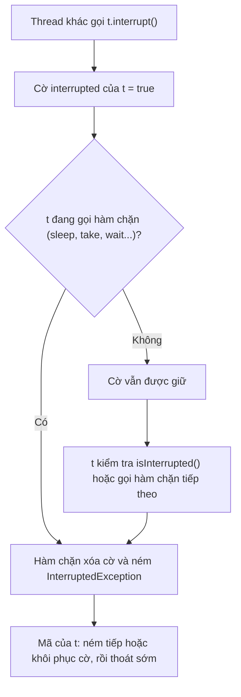
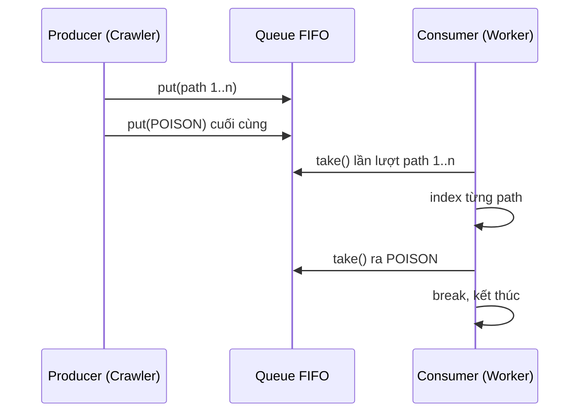
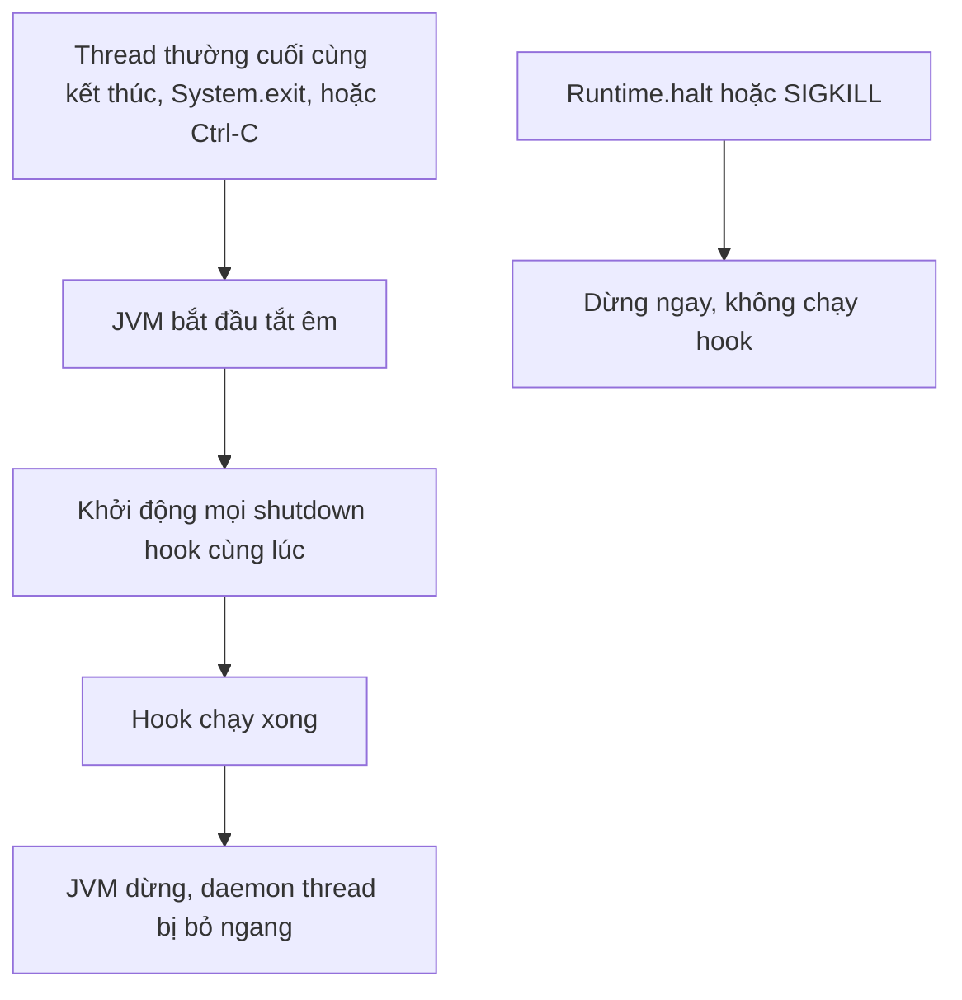

# Lý thuyết 07: Cancel task và Shutdown

## Vì sao dừng một thread lại khó?

Bắt đầu một task thì dễ, dừng nó đúng lúc mới khó. Người dùng bấm cancel, task quá hạn, một lỗi nghiêm trọng xảy ra, hoặc cả ứng dụng sắp tắt: trong mọi trường hợp đó bạn cần task, thread và dịch vụ **dừng đúng lúc, an toàn và đáng tin cậy**. Nếu dừng cưỡng bức, thread có thể đang ghi dở dữ liệu dùng chung, để lại trạng thái hỏng. Cách xử lý cancel và tắt là một trong những điểm phân biệt ứng dụng bền vững với ứng dụng "chỉ chạy được".

Java không có cách ép một thread dừng. Thứ duy nhất có là cơ chế **hợp tác** gọi là *interruption* (interrupt): bên muốn cancel gửi một yêu cầu, bên đang chạy tự kiểm tra và dừng ở chỗ an toàn. Giống như bạn nhắn đồng nghiệp "dừng giúp mình khi tiện", thay vì giật phích điện máy của họ. Quanh cơ chế này, ta tự định nghĩa các giao thức: task coi interrupt là yêu cầu cancel; mã chặn xử lý `InterruptedException` đúng quy tắc (ném tiếp hoặc khôi phục cờ); dịch vụ sở hữu thread cung cấp method `stop`/`shutdown`; cancel qua `Future.cancel`; dùng shutdown hook để dọn dẹp cuối cùng.

Cần dùng khi nào? Với mọi task chạy lâu, mọi dịch vụ có thread riêng (logging, indexing, crawler, pool), và mọi lúc ứng dụng cần thoát êm. Nếu bỏ qua, hệ quả thường gặp là ứng dụng không tắt được, thread treo mãi, mất log cuối hoặc dữ liệu ghi dở.

**Tóm tắt:**

- Java không có cách ép thread dừng; cancel là cơ chế hợp tác: bên muốn dừng gửi yêu cầu, bên đang chạy tự dừng ở chỗ an toàn.
- Hai cách gửi yêu cầu: cờ cancel `volatile` (chỉ hợp khi task không bị block) và interrupt (đáng tin hơn vì đánh thức được hàm chặn).
- `interrupt()` chỉ đặt cờ; `isInterrupted()` đọc không xóa, `Thread.interrupted()` đọc và xóa; hàm chặn phát hiện interrupt thì xóa cờ rồi ném `InterruptedException`.
- Khi bắt `InterruptedException` chỉ có hai lựa chọn đúng: ném tiếp, hoặc khôi phục cờ; chỉ chủ sở hữu thread mới được nuốt yêu cầu.
- Cancel qua `Future.cancel` và đừng interrupt trực tiếp thread của pool, vì bạn không biết nó đang chạy task nào.
- Dịch vụ có thread riêng phải có method `stop`/`shutdown`; dùng `ExecutorService.shutdown`, poison pill hoặc cờ để tắt êm; `shutdownNow` chỉ là best effort.
- Exception của task chỉ tới `UncaughtExceptionHandler` khi dùng `execute`; với `submit` nó nằm trong `Future` và bị nuốt nếu không `get()`.
- Cuối cùng JVM shutdown chạy shutdown hook; daemon thread bị bỏ ngay, và nên tránh finalizer.

### Các khái niệm cần biết

- **Cancellation (cancel)**: yêu cầu một task dừng trước khi tự hoàn thành.
- **Interruption (interrupt)**: cờ boolean trên mỗi thread, đặt bằng `interrupt()`. Hàm chặn như `sleep`, `wait`, `take` thấy cờ sẽ thoát bằng `InterruptedException`.
- **Cancellation policy / interruption policy**: quy ước của task/thread về cách yêu cầu cancel được gửi, được kiểm tra ở đâu và phản ứng ra sao.
- **Poison pill**: phần tử đặc biệt đặt vào queue, nghĩa là "nhận được thì dừng" (mục riêng bên dưới).
- **Shutdown hook**: thread chạy khi JVM tắt êm, dùng để dọn dẹp cuối.
- **Daemon thread**: thread nền không giữ JVM sống; bị bỏ ngang khi JVM thoát.
- **`UncaughtExceptionHandler`**: callback nhận exception khi thread chết vì lỗi không bắt.
- **Idempotent**: thao tác chạy hai lần cho kết quả như chạy một lần (ví dụ crawl một URL), nên an toàn khi bị thử lại.
- **Check-then-act**: kiểm tra điều kiện rồi hành động, giữa hai bước điều kiện có thể đã đổi.

`Thread.stop` và `suspend` đã bị deprecated từ lâu (từ Java 20 `Thread.stop` ném `UnsupportedOperationException`; kiểm tra lại theo phiên bản JDK đang dùng cho `suspend`/`resume`) vì không an toàn: chúng chấm dứt thread ở điểm bất kỳ, giữa lúc đang cập nhật dữ liệu dùng chung, và nhả lock theo cách làm hỏng invariant. Mọi thứ trong bài này là phương án thay thế an toàn.

**Nền tảng:** Java không có cách ép một thread dừng; cancel là cơ chế **hợp tác**. Bên muốn cancel chỉ gửi yêu cầu (cờ cancel hoặc interrupt), bên đang chạy tự kiểm tra và dừng ở chỗ an toàn, nhờ đó giữ được các invariant của dữ liệu. Mọi kỹ thuật trong bài (interrupt, `Future.cancel`, poison pill, shutdown) đều xoay quanh nguyên tắc này.

## Cancel task

Lý do cần cancel: người dùng yêu cầu, giới hạn thời gian, event ứng dụng (một task đã tìm được lời giải thì các task khác dừng), lỗi (đĩa đầy thì các task crawler khác dừng), shutdown.

Một task muốn cancel được cần có **chính sách cancel** (cancellation policy), trả lời ba câu hỏi:

- **Thế nào**: mã bên ngoài yêu cầu cancel ra sao?
- **Khi nào**: task kiểm tra yêu cầu cancel ở đâu?
- **Làm gì**: task phản ứng thế nào khi nhận yêu cầu (dọn dẹp, báo lại)?

### Cách 1: cờ cancel

```java
public class PrimeScanner implements Runnable {
    private volatile boolean cancelled;                 // BẮT BUỘC volatile
    private final List<BigInteger> found = new ArrayList<>();

    @Override public void run() {
        BigInteger p = BigInteger.ONE;
        while (!cancelled) {
            p = p.nextProbablePrime();
            synchronized (this) { found.add(p); }
        }
    }
    public void cancel() { cancelled = true; }
    public synchronized List<BigInteger> snapshot() { return new ArrayList<>(found); }
}

// Dùng: chạy 1 giây rồi cancel, nhớ cancel trong finally
List<BigInteger> oneSecond() throws InterruptedException {
    PrimeScanner s = new PrimeScanner();
    new Thread(s).start();
    try { TimeUnit.SECONDS.sleep(1); }
    finally { s.cancel(); }
    return s.snapshot();
}
```

Điểm yếu: nếu vòng lặp gọi một hàm **chặn** (ví dụ `BlockingQueue.put` khi hàng đầy), task không bao giờ quay lại kiểm tra cờ. Producer đang kẹt ở `put` vì consumer đã ngừng lấy, trong khi consumer chính là bên gọi `cancel()`: kẹt vĩnh viễn.

### Cách 2: interruption

Mỗi thread có một **cờ interrupted** (boolean). Ba method:

| Method | Tác dụng |
|---|---|
| `thread.interrupt()` | Đặt cờ interrupted của thread đó. |
| `thread.isInterrupted()` | Đọc cờ, **không xóa**. |
| `Thread.interrupted()` (static) | Đọc cờ của thread hiện tại **và xóa nó**. Tên dễ gây hiểu nhầm; cần cẩn trọng. |

Hành vi:

- Các hàm chặn "nghiêm túc" (`sleep`, `wait`, `join`, `BlockingQueue.put/take`, ...) phát hiện interrupt, **xóa cờ** rồi ném `InterruptedException`. Nếu cờ đã được đặt sẵn khi vào hàm thì chúng ném ngay.
- Nếu thread không đang chặn, `interrupt()` chỉ đặt cờ và nó **tồn tại** (sticky) cho tới khi có ai chủ động xóa.
- `interrupt()` **không dừng** thread. Nó chỉ gửi message "có yêu cầu interrupt", và thread tự interrupt mình ở "điểm cancel" tiện nhất.

**Phải thuộc:** `interrupt()` chỉ đặt cờ, không dừng thread. `isInterrupted()` đọc cờ không xóa; `Thread.interrupted()` (static) đọc và xóa cờ của thread hiện tại. Hàm chặn (`sleep`, `wait`, `join`, `take`, `put`) phát hiện interrupt thì xóa cờ rồi ném `InterruptedException`.

Flow của một lần interrupt, tùy thread đang ở đâu:



Đọc sơ đồ: interrupt không bao giờ dừng thread ngay. Nó hoặc đánh thức hàm chặn bằng exception, hoặc nằm lại dưới dạng cờ chờ thread tự kiểm tra.

Sách khẳng định: *interrupt thường là cách hợp lý nhất để hiện thực hóa cancellation*. Dùng interrupt cho mục đích khác (ngoài cancel) là mong manh, khó duy trì trong ứng dụng lớn.

```java
class PrimeProducer extends Thread {
    private final BlockingQueue<BigInteger> queue;
    PrimeProducer(BlockingQueue<BigInteger> q) { this.queue = q; }

    @Override public void run() {
        try {
            BigInteger p = BigInteger.ONE;
            // Kiểm tra cờ ở đầu vòng lặp (phản hồi nhanh trước việc tính toán dài)
            while (!Thread.currentThread().isInterrupted()) {
                queue.put(p = p.nextProbablePrime());   // put cũng là điểm cancel
            }
        } catch (InterruptedException e) {
            // Thread sắp kết thúc và đây là chủ sở hữu => được phép "nuốt"
        }
    }
    public void cancel() { interrupt(); }
}
```

Hai chỗ có thể phát hiện interrupt: ở `put` đang chặn và ở đầu vòng lặp. Kiểm tra tường minh không bắt buộc nhưng làm task phản hồi tốt hơn khi các lần gọi hàm chặn thưa.

**Suy luận:** Interrupt được thiết kế là yêu cầu chứ không phải lệnh vì thread bị ngắt có thể đang giữ dữ liệu ở trạng thái dở dang. Nếu JVM buộc dừng ngay (như `Thread.stop` đã bị loại bỏ), nó sẽ bỏ lock giữa chừng và để lại object hỏng mà không ai biết, nên Java chọn cách chỉ đặt một cờ và để chính thread đó quyết định thời điểm dừng. Từ đó suy ra vì sao hàm chặn như `sleep` hay `take` kiểm tra cờ và ném `InterruptedException`: để thread đang ngủ thoát ra ngay thay vì đợi hết giờ. Việc ném exception cũng xóa cờ, vì cờ đã được "giao" qua exception và nếu giữ lại thì lần chặn kế tiếp sẽ bị ngắt lần nữa. Thứ nhất, nếu bạn bắt exception và nuốt đi, yêu cầu cancel biến mất, và tầng trên không bao giờ biết để dừng. Thứ hai, vì vậy bạn phải ném tiếp hoặc đặt lại cờ bằng `Thread.currentThread().interrupt()` để mã gọi phía trên còn thấy. Điểm dễ nhầm là coi `catch (InterruptedException e) {}` là vô hại; thực tế nó làm task không còn cancel được. Chỉ chủ sở hữu thread mới biết ngắt nghĩa là dừng hẳn hay chỉ dừng task hiện tại.

### Interruption policy

Cũng như task có chính sách cancel, **thread có interruption policy**: thread diễn giải yêu cầu interrupt thế nào, phần việc nào được coi là atomic với interrupt, phản ứng nhanh cỡ nào. Chính sách hợp lý nhất là: thoát sớm nhất có thể, dọn dẹp nếu cần, báo cho bên sở hữu.

Điểm then chốt: **task không sở hữu thread chạy nó, chỉ mượn từ pool**. Mã không sở hữu thread phải **giữ nguyên cờ interrupt** để bên chủ sở hữu còn xử lý (như người trông nhà: thư đến thì cất lại cho chủ, không vứt). Vì thế hầu hết hàm chặn trong thư viện chỉ ném `InterruptedException` rồi nhường chỗ.

Quy tắc:

- Không interrupt thread trừ khi bạn **biết nó coi interrupt nghĩa là gì**; chỉ chủ sở hữu mới nên interrupt thread, thường qua method như `shutdown`/`cancel`.
- Task không giả định gì về interruption policy của thread đang chạy nó (trừ khi được thiết kế cho một dịch vụ có chính sách cụ thể).
- Task có thể **trì hoãn** phản ứng với interrupt: ghi nhớ đã bị interrupt, hoàn tất bước đang làm rồi mới ném `InterruptedException`. Cách này bảo vệ cấu trúc dữ liệu khỏi hỏng giữa chừng.

### Xử lý `InterruptedException`

Khi gọi hàm chặn ném `InterruptedException`, có hai chiến lược thực tế:

1. **Ném tiếp** (có thể sau khi dọn dẹp), để method của bạn cũng là hàm chặn có thể interrupt.
2. **Khôi phục cờ** bằng `Thread.currentThread().interrupt()` để mã phía trên stack xử lý.

```java
// 1. Ném tiếp: chỉ cần khai báo throws
public Job nextJob() throws InterruptedException {
    return jobs.take();
}

// 2. Không thể ném (ví dụ trong Runnable.run): khôi phục cờ
public void run() {
    try {
        process(jobs.take());
    } catch (InterruptedException e) {
        Thread.currentThread().interrupt();     // không được nuốt im lặng
    }
}
```

**Phải thuộc:** Khi bắt `InterruptedException` chỉ có hai lựa chọn đúng: ném tiếp, hoặc khôi phục cờ bằng `Thread.currentThread().interrupt()`. Chỉ mã hiện thực interruption policy của thread (chủ sở hữu thread) mới được nuốt yêu cầu interrupt; mã task và thư viện dùng chung thì không bao giờ được nuốt.

Trường hợp đặc biệt: hoạt động **không cancel được** nhưng vẫn gọi hàm chặn interrupt được thì phải gọi trong vòng lặp, thử lại khi bị interrupt, ghi nhận cục bộ rằng đã bị interrupt và **khôi phục cờ ngay trước khi return** (không phải ngay khi bắt exception, vì đặt cờ quá sớm làm lần gọi kế tiếp ném lại ngay, tạo vòng lặp vô hạn).

```java
public Job nextJobUninterruptibly(BlockingQueue<Job> q) {
    boolean interrupted = false;
    try {
        while (true) {
            try {
                return q.take();
            } catch (InterruptedException e) {
                interrupted = true;          // nhớ rồi thử lại
            }
        }
    } finally {
        if (interrupted) Thread.currentThread().interrupt();   // trả lại cho chủ
    }
}
```

Nếu mã không gọi hàm chặn interrupt được thì vẫn làm nó phản hồi interrupt bằng cách **thăm dò** `isInterrupted()` rải rác trong vòng lặp. Tần suất thăm dò là sự đánh đổi giữa hiệu quả và độ phản hồi.

### Ví dụ: chạy có giới hạn thời gian (timed run)

Mục tiêu: chạy một `Runnable` tối đa N giây, và nếu nó ném exception thì người gọi nhận được.

Cách ngây thơ: chạy task ngay trong thread của người gọi, lập lịch một task khác interrupt thread đó sau N giây. **Sai**: người gọi có thể là thread bất kỳ với interruption policy không biết. Nếu task xong trước hạn, lệnh interrupt vẫn nổ **sau khi `timedRun` đã trả về**, đánh trúng đoạn mã vô can. Nếu task không đáp ứng interrupt, `timedRun` không trả về đúng hạn.

Cách đúng: dùng `Future` và Executor.

```java
public static void timedRun(ExecutorService pool, Runnable r,
                            long timeout, TimeUnit unit) throws InterruptedException {
    Future<?> task = pool.submit(r);
    try {
        task.get(timeout, unit);
    } catch (TimeoutException e) {
        // sẽ cancel ở finally
    } catch (ExecutionException e) {
        throw new RuntimeException(e.getCause());   // lỗi của task chuyển cho người gọi
    } finally {
        task.cancel(true);        // vô hại nếu task đã xong
    }
}
```

Nguyên tắc rút ra: **khi `get` ném `InterruptedException` hoặc `TimeoutException` mà bạn biết kết quả không còn cần nữa, hãy `cancel` task.**

### Cancel qua `Future`

`Future.cancel(mayInterruptIfRunning)`:

- `true`: nếu task đang chạy thì thread của nó bị interrupt.
- `false`: "đừng chạy nếu chưa bắt đầu"; dùng cho task không được thiết kế để xử lý interrupt.
- Giá trị trả về chỉ cho biết có **chuyển được** yêu cầu cancel không, không cho biết task đã phản ứng chưa.

Cancel bằng `true` an toàn với các thread của `Executor` chuẩn vì chúng có interruption policy dành cho cancel task. Nhưng **đừng interrupt trực tiếp thread của pool**: bạn không biết lúc đó nó đang chạy task nào; chỉ cancel qua `Future` của task.

### Chặn không interrupt được

| Nguồn chặn | Ngắt có tác dụng? | Cách "đánh thức" |
|---|---|---|
| Socket I/O đồng bộ (`java.io`: `InputStream.read`) | Không | **Đóng socket** thì `read/write` ném `SocketException`. |
| NIO channel (`InterruptibleChannel`) | Có: ném `ClosedByInterruptException` và đóng channel | Hoặc đóng channel: `AsynchronousCloseException`. |
| `Selector.select` | Không đủ | `close()` hoặc `wakeup()`. |
| Chờ lock nội tại (`synchronized`) | Không | Không có cách; chỉ có lock tường minh với `lockInterruptibly()` (bài 13). |

Kỹ thuật đóng gói cách cancel riêng: ghi đè `interrupt()` của thread, hoặc ghi đè `Future.cancel` qua hook `newTaskFor` của executor.

```java
// Thread đọc socket: interrupt = đóng socket + interrupt chuẩn
class SocketReader extends Thread {
    private final Socket socket;
    SocketReader(Socket s) { this.socket = s; }

    @Override public void interrupt() {
        try { socket.close(); }          // làm read() đang chặn ném exception
        catch (IOException ignored) { }
        finally { super.interrupt(); }   // vẫn gửi interrupt chuẩn
    }

    @Override public void run() {
        byte[] buf = new byte[4096];
        try (InputStream in = socket.getInputStream()) {
            int n;
            while ((n = in.read(buf)) >= 0) handle(buf, n);
        } catch (IOException e) { /* socket đóng => thoát */ }
    }
}
```

Với task trong pool, tạo `Callable` có method `cancel()` riêng, rồi cho executor ghi đè `newTaskFor` để `Future.cancel` gọi nó (đóng socket) trước khi gọi `super.cancel`. Khi đó task vừa dùng được hàm chặn interrupt được, vừa dùng được socket I/O mà vẫn cancel tốt.

## Dừng dịch vụ có thread riêng

Dịch vụ sở hữu thread (pool, logger, crawler) thường sống lâu hơn method tạo ra nó. Vì không thể cưỡng bức dừng thread, dịch vụ phải **thuyết phục** chúng tự dừng.

**Quyền sở hữu thread không bắc cầu**: ứng dụng sở hữu dịch vụ, dịch vụ sở hữu worker; ứng dụng không được tự ý interrupt worker. Thay vào đó dịch vụ cung cấp lifecycle method (`stop`, `shutdown`), và ứng dụng chỉ gọi những method đó. `ExecutorService` làm đúng điều này với `shutdown` / `shutdownNow`.

> Cung cấp lifecycle method bất cứ khi nào dịch vụ sở hữu thread sống lâu hơn method đã tạo ra nó.

### Ví dụ: dịch vụ ghi log

Đặt việc ghi log vào một thread nền: nhiều producer (mọi nơi gọi `log`) và một consumer (thread logger), nối với nhau bằng `BlockingQueue` có giới hạn. Nếu logger chậm, producer bị chặn (tự có backpressure).

Dừng nó cho đúng thì không đơn giản:

- Chỉ interrupt thread logger: mất các tin nhắn còn trong queue, và các producer đang kẹt ở `put` (hàng đầy) **không bao giờ** được đánh thức.
- Đặt cờ `shutdownRequested` rồi `log()` kiểm tra cờ trước khi `put`: đây là **check-then-act**, producer vẫn có thể thấy "chưa tắt", rồi đưa tin vào sau khi consumer đã thoát, và kẹt mãi. Các mẹo kiểu "consumer chờ vài giây rồi mới coi như hết" chỉ giảm xác suất, không sửa nguyên nhân.

Cách sửa đúng: làm cho **việc nhận tin mới thành atomic**. Không giữ lock trong lúc `put` (vì `put` có thể chặn), mà dùng counter "đặt chỗ" (reservation): trong khối đồng bộ ngắn, kiểm tra cờ tắt và tăng counter; logger chỉ thoát khi đã tắt **và** counter bằng 0.

```java
public class SafeLogService {
    private final BlockingQueue<String> queue = new LinkedBlockingQueue<>(1000);
    private final Thread worker = new Thread(this::drain, "log-writer");
    private final PrintWriter out;

    private boolean shutdown;          // @GuardedBy("this")
    private int reservations;          // @GuardedBy("this")

    public SafeLogService(PrintWriter out) { this.out = out; }

    public void start() { worker.start(); }

    public void stop() {
        synchronized (this) { shutdown = true; }
        worker.interrupt();            // đánh thức consumer đang chờ take()
    }

    public void log(String msg) throws InterruptedException {
        synchronized (this) {
            if (shutdown) throw new IllegalStateException("logger đã tắt");
            ++reservations;            // đặt chỗ atomic với kiểm tra cờ
        }
        queue.put(msg);                // chặn ngoài lock
    }

    private void drain() {
        try {
            while (true) {
                try {
                    synchronized (this) {
                        if (shutdown && reservations == 0) break;   // hết việc thật sự
                    }
                    String m = queue.take();
                    synchronized (this) { --reservations; }
                    out.println(m);
                } catch (InterruptedException e) {
                    // thử lại: vòng lặp sẽ kiểm tra điều kiện thoát
                }
            }
        } finally {
            out.close();
        }
    }
}
```

### Shutdown với `ExecutorService`

Cách đơn giản hơn nhiều: để dịch vụ ủy quyền cho một `ExecutorService` single-thread, rồi `stop()` gọi `shutdown()` + `awaitTermination()`.

```java
public class ExecutorLogService {
    private final ExecutorService exec = Executors.newSingleThreadExecutor();
    private final PrintWriter out;
    ExecutorLogService(PrintWriter out) { this.out = out; }

    public void log(String msg) {
        try { exec.execute(() -> out.println(msg)); }
        catch (RejectedExecutionException ignored) { /* đã tắt */ }
    }
    public void stop() throws InterruptedException {
        try {
            exec.shutdown();                                  // tắt êm
            exec.awaitTermination(10, TimeUnit.SECONDS);
        } finally {
            out.close();
        }
    }
}
```

Hai kiểu tắt là sự đánh đổi giữa **an toàn** và **tốc độ**: `shutdownNow` nhanh nhưng có thể interrupt task giữa chừng; `shutdown` chậm nhưng xử lý hết queue. Dịch vụ tự viết nên cân nhắc cung cấp cả hai chế độ.

Đóng gói `ExecutorService` thêm một mắt xích vào chuỗi sở hữu (ứng dụng -> dịch vụ -> executor -> thread); mỗi mắt xích quản lý lifecycle của thứ nó sở hữu.

### Poison pill (viên thuốc độc)

Một object đặc biệt được đặt vào queue, nghĩa là "nhận được cái này thì dừng". Với queue **FIFO**, mọi việc gửi trước viên thuốc sẽ được xử lý xong rồi consumer mới gặp nó; producer **không được gửi gì sau** viên thuốc.

```java
class Indexer {
    // giá trị đánh dấu duy nhất
    private static final Path POISON = Paths.get("");
    private final BlockingQueue<Path> queue = new LinkedBlockingQueue<>();

    class Crawler extends Thread {                            // producer
        public void run() {
            try { crawl(root); }
            catch (InterruptedException e) { /* thoát */ }
            finally {
                // luôn đặt viên thuốc, kể cả bị interrupt
                while (true) {
                    try { queue.put(POISON); break; }
                    catch (InterruptedException retry) { }
                }
            }
        }
    }

    class Worker extends Thread {                             // consumer
        public void run() {
            try {
                while (true) {
                    Path p = queue.take();
                    if (p == POISON) break;
                    index(p);
                }
            } catch (InterruptedException consumed) { }
        }
    }
}
```



Vì queue FIFO nên mọi việc gửi trước viên thuốc đều được xử lý xong rồi consumer mới thấy nó.

Giới hạn: chỉ đáng tin khi **biết chính xác số producer và consumer** (N producer thì consumer chờ đủ N viên; N consumer thì mỗi producer gửi N viên, và sẽ cồng kềnh khi số lượng lớn), và chỉ hoạt động tin cậy với **unbounded queue** (queue đầy sẽ làm `put` viên thuốc bị chặn).

### Dịch vụ "một lần" (one-shot)

Method cần xử lý một lô task rồi mới trả về có thể dùng một executor **riêng, lifecycle gói gọn trong method**. Dùng `shutdown()` + `awaitTermination()` để biết mọi task đã xong. Tiện hơn nữa là `invokeAll`/`invokeAny`.

```java
boolean anyHostHasMail(Set<String> hosts, long timeout, TimeUnit unit)
        throws InterruptedException {
    ExecutorService exec = Executors.newCachedThreadPool();
    // cần "biến có thể sửa" trong lambda
    AtomicBoolean found = new AtomicBoolean(false);
    try {
        for (String h : hosts)
            exec.execute(() -> { if (hasMail(h)) found.set(true); });
    } finally {
        exec.shutdown();
        exec.awaitTermination(timeout, unit);
    }
    return found.get();
}
```

### Giới hạn của `shutdownNow`

`shutdownNow()` cố cancel task đang chạy và trả danh sách task **chưa bắt đầu**. Nhưng không có cách chung để biết task nào **đã bắt đầu mà chưa xong** (trừ khi task tự checkpoint). Cách bù: bọc executor, sau khi tắt thì task nào kết thúc mà thread bị interrupt thì ghi vào danh sách "bị cancel lúc tắt" (cần task giữ nguyên cờ interrupt khi trả về, mà task tốt vốn làm vậy).

```java
class TrackingExecutor extends AbstractExecutorService {
    private final ExecutorService delegate;
    private final Set<Runnable> cancelledAtShutdown = ConcurrentHashMap.newKeySet();
    TrackingExecutor(ExecutorService delegate) { this.delegate = delegate; }

    @Override public void execute(Runnable task) {
        delegate.execute(() -> {
            try { task.run(); }
            finally {
                if (isShutdown() && Thread.currentThread().isInterrupted())
                    cancelledAtShutdown.add(task);
            }
        });
    }
    public List<Runnable> cancelledTasks() {
        if (!delegate.isTerminated()) throw new IllegalStateException();
        return new ArrayList<>(cancelledAtShutdown);
    }
    // các method còn lại (shutdown, shutdownNow, awaitTermination...) ủy quyền cho delegate
}
```

Có một điều kiện đua không tránh được: task vừa chạy xong lệnh cuối nhưng pool bị tắt trước khi ghi nhận hoàn thành, nên có thể **dương tính giả** (task được báo là bị cancel dù đã xong). Với task **idempotent** (chạy hai lần như chạy một lần, như crawl một URL) thì không sao; còn không, bên nhận danh sách phải chịu được chuyện này.

**Suy luận:** Tắt dịch vụ khó vì có ba mục tiêu mâu thuẫn nhau: dừng nhanh, không mất việc đã nhận, và không bỏ lại tài nguyên. `shutdown()` ưu tiên hai mục tiêu sau (chạy nốt việc đã nhận), còn `shutdownNow()` ưu tiên mục tiêu đầu bằng cách interrupt task đang chạy, nhưng vì interrupt chỉ là yêu cầu hợp tác, task không đáp ứng sẽ vẫn chạy, và danh sách task chưa chạy trả về không gồm task đang dở. Poison pill giải quyết bài toán tắt consumer qua queue: producer đặt một item đặc biệt vào cuối queue, và consumer thấy nó thì dừng, nên các item trước nó chắc chắn đã được xử lý theo thứ tự. Điều kiện để đúng là FIFO và số producer, consumer biết trước. Điểm dễ nhầm là dùng cờ `volatile` để dừng consumer đang block ở `take()`, vì consumer ngủ ở đó không bao giờ thấy cờ. Khi thiết kế dịch vụ, hãy ghi rõ nó dừng bằng cách nào, việc đang dở được xử lý ra sao, và thread nào sở hữu việc tắt.

## Xử lý thread chết bất thường

Thread chết vì exception không bắt (nguyên nhân hàng đầu là `RuntimeException`) có thể **không ai biết**: stack trace in ra console chẳng ai xem, ứng dụng vẫn "có vẻ chạy". Hậu quả từ nhẹ (pool 50 thread còn 49) tới nặng (mất event thread của GUI thì UI đóng băng; mất thread của `Timer` thì dịch vụ chết).

### Phòng thủ chủ động

Thread chạy mã lạ qua một abstract class (`Runnable`) nên nghi ngờ mã đó, bọc trong `try/catch` hoặc `try/finally` để **báo cho framework** khi chết. Đây là một trong số ít lúc đáng bắt `Throwable`/`RuntimeException`.

```java
// Cấu trúc điển hình của worker trong thread pool
public void run() {
    Throwable thrown = null;
    try {
        while (!isInterrupted()) runTask(nextTask());
    } catch (Throwable t) {
        thrown = t;
    } finally {
        onWorkerExit(this, thrown);   // pool có thể thay thread mới hoặc không
    }
}
```

### `UncaughtExceptionHandler`

Cơ chế phát hiện: khi thread chết vì exception không bắt, JVM gọi handler (nếu không có thì in stack trace ra `System.err`). Hai cách đặt: `thread.setUncaughtExceptionHandler(...)` cho từng thread, hoặc `Thread.setDefaultUncaughtExceptionHandler(...)` mặc định toàn cục. Cho thread của pool thì đặt qua `ThreadFactory`.

```java
Thread.UncaughtExceptionHandler logger = (t, e) ->
        log.error("Thread {} chết vì exception", t.getName(), e);

ThreadFactory tf = r -> {
    Thread t = new Thread(r);
    t.setUncaughtExceptionHandler(logger);
    t.setName("worker-" + counter.incrementAndGet());
    return t;
};
ExecutorService pool = new ThreadPoolExecutor(4, 4, 0L, TimeUnit.SECONDS,
        new ArrayBlockingQueue<>(100), tf);
```

Chi tiết dễ nhầm: exception của task chỉ tới handler khi gửi bằng **`execute`**. Với **`submit`**, mọi exception (checked hay không) được coi là một phần kết quả và nằm chờ trong `Future`, ném ra khi `get()` dưới dạng `ExecutionException`. Nếu không bao giờ gọi `get`, lỗi biến mất. Muốn được báo khi task lỗi, bọc task bắt exception hoặc ghi đè `afterExecute` của `ThreadPoolExecutor`.

**Phải thuộc:** Exception của task chỉ tới `UncaughtExceptionHandler` khi gửi bằng `execute`; với `submit` nó nằm trong `Future` và chỉ lộ ra khi gọi `get()` (bọc trong `ExecutionException`). Quên đọc `Future` nghĩa là lỗi bị nuốt.

> Với ứng dụng chạy lâu, luôn đặt handler cho mọi thread, tối thiểu là ghi log exception.

## JVM shutdown

JVM tắt **êm** khi thread thường (non-daemon) cuối cùng kết thúc, khi có `System.exit`, hoặc khi nhận SIGINT/Ctrl-C. Tắt **đột ngột** bằng `Runtime.halt` hoặc bị OS kill (SIGKILL): khi đó không có shutdown hook nào được chạy.



### Shutdown hook

Là các `Thread` chưa khởi động, đăng ký bằng `Runtime.addShutdownHook`. Khi tắt êm, JVM khởi động **tất cả hook cùng lúc, thứ tự không đảm bảo**. Thread ứng dụng còn chạy vẫn chạy song song; JVM không interrupt chúng và sẽ bị chấm dứt đột ngột khi JVM dừng. Nếu hook không xong thì quá trình tắt "treo".

Quy tắc viết hook:

- Thread-safe (đồng bộ khi chạm dữ liệu chung, tránh deadlock).
- **Không giả định** trạng thái ứng dụng (dịch vụ khác đã tắt chưa, tại sao JVM tắt).
- Xong **thật nhanh** (nó làm trễ việc tắt).
- Dùng để dọn dẹp: xóa file tạm, đóng tài nguyên mà OS không tự dọn.

Vì hook chạy song song, một hook đóng file log có thể làm hook khác đang dùng logger bị lỗi. Giải pháp: **một hook duy nhất** gọi tuần tự các hành động tắt theo đúng thứ tự phụ thuộc, tránh race và deadlock giữa chúng.

```java
Runtime.getRuntime().addShutdownHook(new Thread(() -> {
    // tuần tự, theo thứ tự phụ thuộc ngược chiều khởi động
    httpServer.stop();
    workerPool.shutdown();
    awaitQuietly(workerPool, 10, TimeUnit.SECONDS);
    logService.stop();
    db.close();
}, "shutdown-hook"));
```

### Daemon thread

Thread có hai loại, khác nhau **chỉ ở chuyện gì xảy ra khi thoát**: JVM tắt êm khi chỉ còn daemon thread; khi JVM dừng, daemon thread bị bỏ ngang (khối `finally` không chạy, stack không được unwinding). Thread tạo ra thừa hưởng trạng thái daemon từ thread cha. Dùng dè dặt: ít hoạt động nào bỏ ngang được mà không dọn dẹp, đặc biệt **nguy hiểm với task I/O**. Hợp cho việc "dọn dẹp nền" như dọn mục hết hạn trong cache. Daemon thread **không thay thế** việc quản lý lifecycle dịch vụ.

### Finalizer

`finalize()` được GC gọi sau khi thu hồi, để nhả tài nguyên như file/socket handle. Không đảm bảo **khi nào hoặc có chạy hay không**, tốn hiệu năng cho object có finalizer, rất khó viết đúng, và chạy trên thread do JVM quản lý nên mọi trạng thái nó chạm tới phải đồng bộ. Thay bằng `try/finally` và method `close` tường minh; exception duy nhất là object giữ tài nguyên cấp phát bởi native code. Quy tắc: **tránh finalizer**.

Ghi chú Java hiện đại: `finalize()` đã bị đánh dấu deprecated for removal (từ Java 18), thay bằng `try-with-resources` và `java.lang.ref.Cleaner`. Virtual thread (Java 21) hỗ trợ interrupt như thread thường; `Executors.newVirtualThreadPerTaskExecutor()` là `AutoCloseable`, `close()` sẽ chờ mọi task xong (tương đương `shutdown` + `awaitTermination`).

## Bẫy thường gặp

| Bẫy | Hệ quả / cách tránh |
|---|---|
| `catch (InterruptedException e) {}` rỗng | Mất tín hiệu cancel; tầng trên không biết. Ném tiếp hoặc `Thread.currentThread().interrupt()`. |
| Cờ cancel không `volatile` | Thread khác có thể không bao giờ thấy giá trị mới (bài 03). |
| Dùng cờ cancel trong vòng lặp có gọi hàm chặn | Kẹt vĩnh viễn ở hàm chặn. Dùng interrupt. |
| Ngắt thread không do mình sở hữu | Phá interruption policy của chủ. Chỉ interrupt qua `Future.cancel`/`stop`. |
| Gọi `Thread.interrupted()` rồi quên khôi phục | Cờ bị xóa, tầng trên không thấy. |
| Đặt lại cờ interrupt quá sớm trong vòng lặp thử lại | Hàm chặn ném ngay lần nữa => vòng lặp vô hạn. Khôi phục ở `finally` trước khi return. |
| `shutdown` rồi không `awaitTermination` | Không biết task đã xong chưa. |
| Poison pill với bounded queue | `put` viên thuốc có thể chặn mãi. |
| Nhiều shutdown hook độc lập phụ thuộc nhau | Race/deadlock. Dùng một hook tuần tự. |
| Dùng `submit` mà không đọc `Future` | Exception biến mất. |

## Điểm cần nhớ

- Java **không** có dừng cưỡng bức an toàn; chỉ có cancel **hợp tác** bằng giao thức. Ngắt (interruption) thường là cách cancel hợp lý nhất.
- `interrupt()` chỉ đặt cờ và gửi yêu cầu; thread tự quyết thời điểm xử lý.
- Chỉ mã hiện thực interruption policy của thread mới được nuốt interrupt; mọi mã khác phải **ném tiếp** hoặc **khôi phục cờ**.
- Chỉ interrupt thread khi biết ý nghĩa interrupt đối với nó; chỉ chủ sở hữu mới nên interrupt.
- Dùng `Future.cancel` để cancel task; khi `get` bị timeout/interrupt và không cần kết quả nữa thì cancel.
- Chặn không interrupt được (socket `java.io`, `synchronized`) cần cách cancel riêng (đóng socket, ghi đè `interrupt`/`newTaskFor`).
- Dịch vụ sở hữu thread phải có lifecycle method; sở hữu thread không bắc cầu.
- Tắt producer-consumer đúng nghĩa phải xử lý cả producer lẫn consumer; kiểm tra-rồi-hành động trên cờ tắt là race condition.
- Luôn đặt `UncaughtExceptionHandler` cho thread chạy lâu; nhớ `submit` giấu exception trong `Future`.
- Shutdown hook: thread-safe, nhanh, không giả định gì; gom thành một hook tuần tự. Dùng daemon thread dè dặt. **Tránh finalizer.**

## Câu hỏi tự kiểm tra

1. Vì sao cờ `volatile boolean` không đủ để cancel producer đang chặn ở `queue.put`?
   - **Gợi ý suy luận:** Khi thread đang chặn trong `put`, nó có chạy lại dòng kiểm tra cờ không? Cơ chế nào đánh thức được hàm chặn?
   - **Lập luận:** Producer kẹt trong `put` (hàng đầy) nên không bao giờ quay lại đọc cờ. Interrupt thì làm hàm chặn ném `InterruptedException`, nên thoát được.
   - **Đáp án ngắn:** Producer kẹt trong hàm chặn nên không kiểm tra cờ; interrupt mới đánh thức được.
2. Khác nhau giữa `Thread.interrupted()` và `isInterrupted()`?
   - **Gợi ý suy luận:** Cái nào là static? Sau khi gọi, cờ interrupt còn hay mất?
   - **Lập luận:** `interrupted()` static, đọc cờ của thread hiện tại rồi xóa nó; `isInterrupted()` là method thể hiện, chỉ đọc. Xóa cờ vô ý làm mất tín hiệu cho code phía trên.
   - **Đáp án ngắn:** Cái trước đọc và xóa cờ của thread hiện tại, cái sau chỉ đọc.
3. Khi nào được phép "nuốt" `InterruptedException`?
   - **Gợi ý suy luận:** Ai sở hữu interruption policy của thread? Nếu code phía trên cần biết thread bị interrupt thì sao?
   - **Lập luận:** Ngắt là tín hiệu cho chủ thread. Code không phải chủ mà nuốt thì làm mất tín hiệu; nên hoặc ném lại, hoặc đặt lại cờ. Chỉ chủ (hiện thực interruption policy) mới được tiêu thụ nó.
   - **Đáp án ngắn:** Chỉ khi chính mã đó hiện thực interruption policy của thread (ví dụ thread sắp kết thúc và nó là chủ).
4. Vì sao `timedRun` interrupt thread của người gọi là sai?
   - **Gợi ý suy luận:** Thread của người gọi thuộc về ai, interruption policy của nó là gì? Lệnh interrupt hẹn giờ nổ lúc nào so với khi hàm trả về?
   - **Lập luận:** Ta không biết thread đó phản ứng với interrupt thế nào. Nếu task xong trước hạn mà lệnh interrupt vẫn nổ sau khi hàm đã trả về thì interrupt nhầm code khác trên thread đó.
   - **Đáp án ngắn:** Không biết interruption policy của thread đó, và lệnh interrupt có thể nổ sau khi hàm đã trả về; nên chạy task trong thread riêng.
5. Làm sao cancel thread đang chặn ở `InputStream.read` trên socket?
   - **Gợi ý suy luận:** `read` chặn kiểu I/O có phản ứng với interrupt không? Cách nào làm `read` ném lỗi?
   - **Lập luận:** I/O socket chặn không nhận interrupt. Đóng socket làm `read` ném `SocketException`, nên thread thoát. Gói việc đó trong `interrupt()` ghi đè để vẫn giữ ngữ nghĩa interrupt.
   - **Đáp án ngắn:** Đóng socket (ghi đè `interrupt()` để đóng socket rồi gọi `super.interrupt()`).
6. Vì sao poison pill chỉ hợp với unbounded queue và số producer/consumer đã biết?
   - **Gợi ý suy luận:** Queue đầy thì `put` viên thuốc làm gì? Mỗi consumer cần nhận đủ bao nhiêu viên?
   - **Lập luận:** Hàng đầy thì `put` viên thuốc bị chặn, nên không dừng được. Mỗi consumer dừng khi nhận một viên, nên phải biết số consumer (và số producer) mới gửi/đếm đủ.
   - **Đáp án ngắn:** Hàng đầy làm `put` viên thuốc bị chặn; cần biết số lượng để gửi/nhận đủ viên.
7. Exception ném từ task gửi bằng `submit` đi đâu?
   - **Gợi ý suy luận:** `submit` bọc task trong gì? Ai là người cần biết kết quả/lỗi?
   - **Lập luận:** `submit` bọc task vào `FutureTask`, nó bắt exception và lưu lại. Vì vậy exception không thoát ra thread nên không tới `UncaughtExceptionHandler`; nó nằm trong Future.
   - **Đáp án ngắn:** Vào Future, được ném lại khi `get()` dưới dạng `ExecutionException`.
8. Vì sao nên dùng một shutdown hook duy nhất?
   - **Gợi ý suy luận:** Nhiều hook thì JVM chạy chúng theo thứ tự nào? Nếu hook B phụ thuộc hook A thì sao?
   - **Lập luận:** Các hook chạy song song, không có thứ tự, nên có thể race hoặc deadlock khi chia sẻ tài nguyên. Một hook chạy tuần tự các bước cho thứ tự phụ thuộc rõ ràng.
   - **Đáp án ngắn:** Hook chạy song song không có thứ tự; một hook tuần tự tránh race/deadlock và đảm bảo thứ tự phụ thuộc.

Nguồn: Java Concurrency in Practice, Chương 7.

