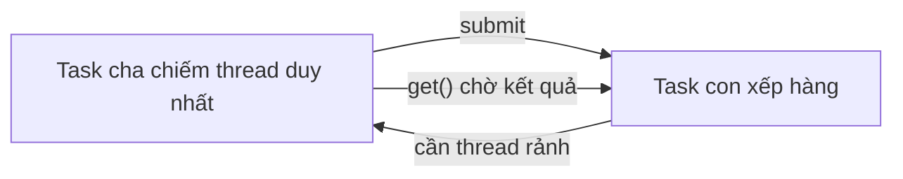
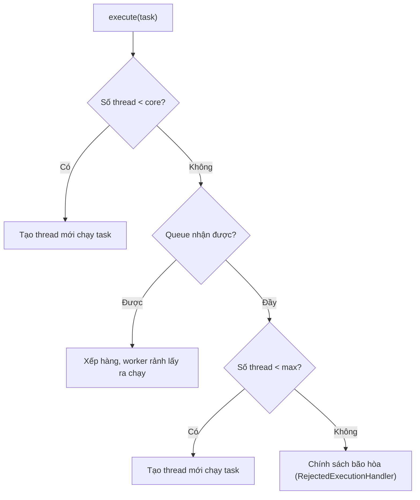
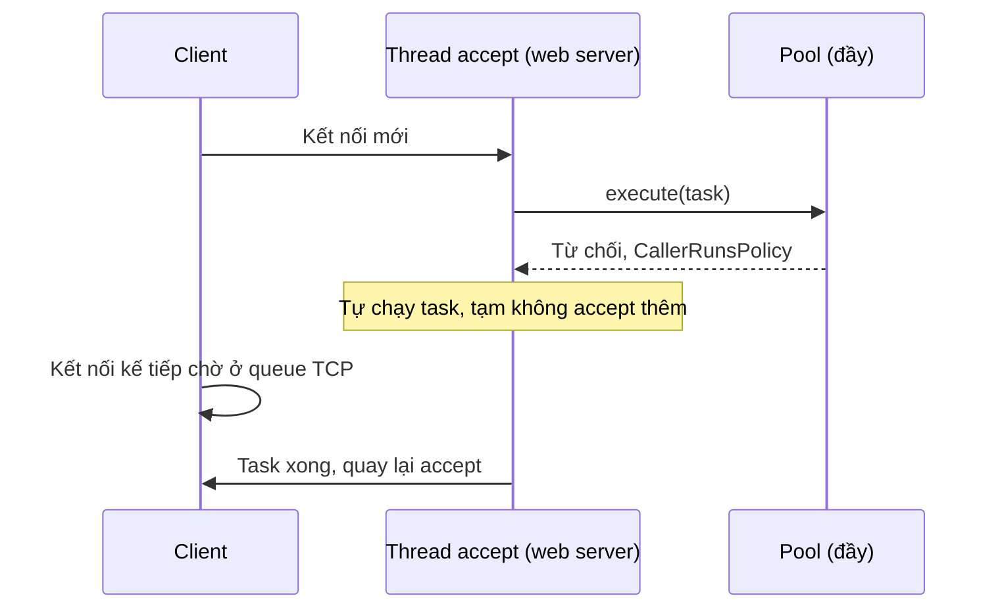

# Lý thuyết 08: Thread pool trong thực tế

## Thread pool là gì và vì sao phải cấu hình cẩn thận?

Thread pool là một nhóm thread được tạo sẵn và tái sử dụng: thay vì mỗi task tự tạo một thread rồi bỏ đi, ta ném task vào một queue, và các thread trong nhóm lần lượt lấy ra chạy. Trong Java, class hiện thực chính là `ThreadPoolExecutor`; các hàm `Executors.newFixedThreadPool(...)`, `newCachedThreadPool()`... chỉ là những cấu hình dựng sẵn của nó. Bài này nói về việc đưa nó vào thực tế: chọn kích thước pool, chọn queue, quyết định làm gì khi quá tải, đặt tên thread, và gắn hook để đo đạc.

Chương trước từng nói Executor "tách" việc gửi task khỏi chính sách thực thi (chạy ở thread nào, bao nhiêu thread, thứ tự ra sao). Câu đó đúng nhưng hơi lạc quan: không phải task nào cũng chạy đúng trên mọi chính sách. Một task chờ task khác thì cần pool đủ lớn; một task dựa vào việc "chỉ một thread chạy tại một thời điểm" sẽ hỏng nếu bạn đổi sang pool nhiều thread. Vì thế cấu hình sai không chỉ làm chậm mà còn gây ra ba loại sự cố điển hình: pool **treo** (deadlock do đói thread), pool **nghẽn** (vài task dài chiếm hết thread, task ngắn đứng chờ), hoặc **tràn memory** (unbounded queue phình mãi).

Hãy đọc bài này khi bạn chuẩn bị đưa Executor lên production, khi cần đo và tinh chỉnh hiệu năng, hoặc khi thiết kế task có phụ thuộc lẫn nhau hay dựa vào thread confinement. Cách làm gói gọn trong năm việc: chọn kích thước pool theo bản chất task (CPU hay I/O), dùng queue **có giới hạn** kèm chính sách bão hòa phù hợp, đặt tên thread và bộ xử lý lỗi qua `ThreadFactory`, đo đạc qua `beforeExecute`/`afterExecute`, và ghi tài liệu các ràng buộc cấu hình để người sau không phá vỡ chúng.

**Tóm tắt:**

- Không phải task nào cũng chạy đúng trên mọi execution policy: task phụ thuộc nhau, hoặc dựa vào "chỉ một thread" đều có thể hỏng khi đổi pool.
- Thread starvation deadlock: mọi thread của pool chờ kết quả của task còn nằm trong queue của chính pool, không có exception nào báo ra, chỉ thấy request treo.
- Kích thước pool: CPU-bound khoảng `N_cpu + 1`; I/O-bound dùng `N_cpu * U_cpu * (1 + W/C)`; và còn bị giới hạn bởi tài nguyên khác như connection pool DB.
- `ThreadPoolExecutor` ưu tiên xếp queue trước, tạo thread thêm sau, nên unbounded queue làm `maximumPoolSize` vô nghĩa.
- Dùng bounded queue kèm saturation policy (`Abort`, `Discard`, `DiscardOldest`, `CallerRuns`); `CallerRunsPolicy` tạo backpressure.
- Đặt tên thread và xử lý exception qua `ThreadFactory` để debug được trên production.
- Hook `beforeExecute`, `afterExecute`, `terminated` dùng để log và đo; task dài hạn nên tách pool riêng.
- Song song hóa đệ quy cần pool đủ chỗ cho task con hoặc cơ chế chờ có kiểm soát.

## Các khái niệm cần biết

| Thuật ngữ | Nghĩa là gì | Vì sao quan trọng |
|---|---|---|
| Thread confinement | Kỹ thuật "nhốt" một object không thread-safe vào đúng một thread, nên không cần lock. | Executor single-thread đảm bảo task không chạy đồng thời, nhiều mã dựa vào đó; đổi pool là mất an toàn. |
| Liveness | Tính "sống": chương trình rồi cũng tiến triển được, không treo. | Task phụ thuộc nhau làm pool có thể mất liveness (deadlock). |
| Thread starvation deadlock | Mọi thread của pool đều đang chờ kết quả của task còn nằm trong queue, nên không ai chạy được task đó. | Pool treo vĩnh viễn mà không có lỗi nào báo ra. |
| CPU-bound / I/O-bound | Task chủ yếu tính toán (tốn CPU) hay chủ yếu chờ mạng, đĩa, DB. | Quyết định kích thước pool: CPU-bound cần ít thread, I/O-bound cần nhiều hơn. |
| Saturation policy (chính sách bão hòa) | Quy tắc xử lý task mới khi pool đầy và queue đầy. | Chọn sai thì mất việc âm thầm hoặc làm sập dịch vụ. |
| Backpressure | Cơ chế làm bên gửi chậm lại khi bên nhận quá tải, thay vì cứ nhận vào rồi dồn ứ. | `CallerRunsPolicy` và `Semaphore` là hai cách làm backpressure trong bài này. |
| Thread dump | Ảnh chụp trạng thái mọi thread (tên, trạng thái, stack) tại một thời điểm, dùng `jstack` hoặc `jcmd Thread.print`. | Dùng để tìm deadlock; thread không có tên thì rất khó đọc. |
| Hook | Method rỗng trong superclass mà subclass ghi đè để chen mã vào một thời điểm cố định (`beforeExecute`...). | Cách chuẩn để đo thời gian, log, thống kê trên pool. |

## Ràng buộc ngầm giữa task và chính sách thực thi

Có những loại task **đòi hỏi** hoặc **cấm** một chính sách cụ thể:

| Loại task | Ràng buộc ngầm |
|---|---|
| **Task phụ thuộc nhau** | Task độc lập thì đổi kích thước pool tùy ý chỉ ảnh hưởng hiệu năng. Task này chờ task kia thì tạo ra ràng buộc về liveness: pool phải đủ lớn, nếu không có nguy cơ deadlock. |
| **Task dựa vào thread confinement** | Executor single-thread đảm bảo các task không chạy đồng thời, nên task được phép dùng object không thread-safe "nhốt" trong thread đó mà không đồng bộ. Đổi sang pool nhiều thread là mất an toàn. (Chỉ cần đảm bảo "không chạy đồng thời" cộng với visibility giữa các task, đúng thứ mà `newSingleThreadExecutor` cung cấp.) |
| **Task nhạy thời gian phản hồi** | Đẩy task dài vào executor single-thread, hoặc vài task dài vào pool nhỏ, làm hỏng độ phản hồi. |
| **Task dùng `ThreadLocal`** | Executor tự do thu hồi thread rảnh, tạo thêm, thay worker khi task ném exception... nên giá trị `ThreadLocal` chỉ hợp lý nếu **lifecycle giới hạn trong một task**; đừng dùng để truyền giá trị giữa các task. |

Pool hoạt động tốt nhất khi task **đồng nhất và độc lập**. Trộn task dài lẫn ngắn dễ gây "tắc"; task phụ thuộc nhau dễ deadlock trừ khi pool vô hạn. May là request server thường thỏa các điều kiện này.

> Hãy **ghi tài liệu** (trong code hoặc file cấu hình) mọi yêu cầu về executor: "pool phải >= N", "phải single-thread", để người bảo trì sau không thay bằng chính sách không tương thích.

### Thread starvation deadlock

Task trong pool gửi task khác vào **cùng pool** rồi chờ kết quả. Với pool single-thread điều này **luôn** deadlock: task con nằm trong queue chờ task cha xong, còn task cha chờ task con. Với pool nhiều thread, khi mọi thread đều đang chạy task "cha" bị chặn chờ "con" còn nằm trong queue, ta có cùng tình huống.

```java
// KHÔNG LÀM: executor single-thread + task chờ task con cùng executor
ExecutorService exec = Executors.newSingleThreadExecutor();

Callable<String> renderPage = () -> {
    Future<String> header = exec.submit(() -> load("header.html"));
    Future<String> footer = exec.submit(() -> load("footer.html"));
    String body = renderBody();
    // chờ mãi: không còn thread để chạy header/footer
    return header.get() + body + footer.get();
};
exec.submit(renderPage);
```



Cách đọc sơ đồ: task cha giữ thread duy nhất và gọi `get()` để chờ task con; task con lại cần chính thread đó để chạy. Hai bên chờ nhau mãi, không có exception nào được ném, chỉ thấy request treo; thread dump sẽ cho thấy thread worker ở trạng thái `WAITING` tại `Future.get`.

**Nền tảng:** Thread starvation deadlock xảy ra khi mọi thread của pool đều đang chờ kết quả của task còn nằm trong queue của chính pool đó. Không có exception nào báo ra, chỉ thấy request treo. Quy tắc: task chạy trong pool không nên chờ (`get()`) task con gửi vào cùng pool, trừ khi pool đủ lớn hoặc không giới hạn.

Nguyên tắc: bất cứ khi nào gửi vào executor những task **không độc lập**, hãy ý thức nguy cơ này và ghi lại ràng buộc kích thước. Ngoài giới hạn tường minh còn có giới hạn **ngầm** từ tài nguyên khác: connection pool JDBC 10 kết nối thì thực chất pool chỉ có 10 thread dùng DB hữu hiệu, task thứ 11 chặn chờ kết nối.

Cách tránh: task cha không chờ bằng `get()` mà dùng pool khác cho task con, dùng `CompletableFuture` ghép nối không chặn, hoặc cấu hình pool không giới hạn (cached pool) khi có phụ thuộc.

### Task chạy lâu

Dù không deadlock, task chặn lâu cũng có thể **làm tắc** pool và làm xấu thời gian phục vụ của cả task ngắn. Giảm nhẹ bằng cách dùng các hàm chờ **có thời hạn** (`join(t)`, `offer(e, t, unit)`, `await(t, unit)`, `select(t)`); hết hạn thì đánh dấu task lỗi hoặc xếp hàng lại. Nếu pool thường xuyên đầy task bị chặn, đó là dấu hiệu pool quá nhỏ.

**Suy luận:** Thread starvation deadlock không cần lock nào mà vẫn xảy ra, vì thứ bị "giữ" ở đây là thread chứ không phải lock. Giả sử pool có N thread và task cha submit task con vào chính pool rồi gọi `get()`. Khi N task cha cùng chạy, cả N thread đều đứng chờ, trong khi các task con nằm trong queue chờ một thread rảnh; nhưng thread chỉ rảnh khi task cha xong, và task cha chỉ xong khi task con xong. Đó là một vòng chờ giống deadlock nhưng chu trình đi qua queue thay vì qua lock, nên công cụ phát hiện deadlock của JVM không báo. Điều kiện xảy ra phụ thuộc tải: ít request thì còn thread rảnh cho task con và mọi thứ ổn, nên lỗi chỉ hiện khi tải cao, đúng lúc khó chẩn đoán nhất. Thứ nhất, `newSingleThreadExecutor` bị ngay với một task chờ task khác; thứ hai, pool lớn chỉ làm lỗi hiếm hơn chứ không loại bỏ nó. Cách sửa là dùng pool riêng cho task con, hoặc pool không giới hạn, hoặc thiết kế lại để không chờ đồng bộ. Khi review, tìm mọi `get()` và `join()` bên trong task chạy trong pool.

## Chọn kích thước thread pool

Hiếm khi nên **hard-code** kích thước pool; lấy từ cấu hình hoặc tính theo `Runtime.getRuntime().availableProcessors()`. Không cần chính xác tuyệt đối, chỉ cần tránh hai thái cực:

- **Quá lớn**: các thread tranh nhau CPU và memory, tốn RAM, có thể cạn tài nguyên.
- **Quá nhỏ**: CPU nhàn rỗi dù còn việc, throughput thấp.

| Loại task | Kích thước gợi ý |
|---|---|
| Thuần tính toán (CPU-bound) | `N_cpu + 1`: thread "dư" giúp lấp khoảng trống khi một thread tạm dừng (page fault...). |
| Có I/O hoặc chặn | Lớn hơn, tùy tỷ lệ chờ/tính. |

Công thức tổng quát, với `N_cpu` là số CPU, `U_cpu` là mức sử dụng CPU mong muốn (0..1) và `W/C` là tỷ lệ thời gian chờ trên thời gian tính toán:

```text
N_threads = N_cpu * U_cpu * (1 + W/C)
```

Ví dụ: máy 8 core, muốn CPU dùng 100%, task chờ DB 90 ms rồi tính 10 ms: `W/C = 9`, `N = 8 * 1 * (1 + 9) = 80` thread. Nếu pool này dùng chung 20 kết nối DB thì **giới hạn thực tế là 20**.

**Phải thuộc:** Kích thước pool: CPU-bound khoảng `N_cpu + 1`; I/O-bound dùng `N_threads = N_cpu * U_cpu * (1 + W/C)` (W/C là tỷ lệ chờ trên tính toán). Kích thước thực tế còn bị chặn bởi tài nguyên khác như connection pool DB. Con số chỉ là điểm xuất phát, phải đo để chỉnh.

```java
int cores = Runtime.getRuntime().availableProcessors();

int cpuBoundPool = cores + 1;

double targetUtil = 0.8;
double waitToCompute = 9.0;                       // đo bằng profiling/instrumentation
int ioBoundPool = (int) (cores * targetUtil * (1 + waitToCompute));
```

**Định luật Little** cho một cách tính cỡ theo tải thay vì theo CPU: số việc đang xử lý đồng thời bằng tốc độ đến nhân thời gian xử lý mỗi việc. Ví dụ 500 request/s với mỗi request mất 0,2 s thì có khoảng 100 request cùng lúc; nếu pool kết nối DB chỉ có 10 thì 90 thread sẽ đứng chờ kết nối, nên cỡ pool thread phải xét cùng cỡ pool kết nối.

Với các tài nguyên khác (memory, file handle, socket, kết nối DB) cách tính đơn giản hơn: **tổng lượng tài nguyên chia cho lượng mỗi task cần** cho ra cận trên của kích thước pool. Hai pool tác động lẫn nhau: nếu mỗi task cần một kết nối thì thread pool bị giới hạn bởi connection pool và ngược lại. Các loại task có đặc tính khác hẳn nhau nên dùng **nhiều pool riêng**, mỗi pool được tinh chỉnh theo tải của nó.

## Cấu hình `ThreadPoolExecutor`

```java
public ThreadPoolExecutor(int corePoolSize,
                          int maximumPoolSize,
                          long keepAliveTime, TimeUnit unit,
                          BlockingQueue<Runnable> workQueue,
                          ThreadFactory threadFactory,
                          RejectedExecutionHandler handler)
```

### Tạo và hủy thread

- **core size**: kích thước mục tiêu; pool cố giữ mức này kể cả khi rảnh, và không tạo thêm quá core trừ khi **queue đầy**. Thread core được tạo lười khi có task (trừ khi gọi `prestartAllCoreThreads()`).
- **max size**: số thread tối đa cùng hoạt động.
- **keep-alive**: thread rảnh quá thời gian này mà pool đang lớn hơn core thì bị thu hồi.

Các factory chỉ là cấu hình sẵn: `newFixedThreadPool(n)` đặt core = max = n; `newCachedThreadPool()` đặt core = 0, max = `Integer.MAX_VALUE`, keep-alive 1 phút, queue `SynchronousQueue`.

Bẫy: đặt core = 0 hoặc core quá nhỏ với queue có dung lượng (không phải `SynchronousQueue`) thì pool **không tăng thêm thread cho tới khi queue đầy**. Sách gốc (viết cho Java 5) nói task thậm chí không chạy; ở JDK hiện đại, `ThreadPoolExecutor` luôn bảo đảm có ít nhất một worker khi có task trong hàng, nên task vẫn chạy, nhưng chỉ tuần tự trên một thread và `maximumPoolSize` thực tế không bao giờ được dùng cho đến khi hàng đầy. Hệ quả: bạn tưởng đã cấu hình "tối đa 50 thread" nhưng pool chạy như single-thread. Nếu muốn mọi thread (kể cả core) hết hạn khi rảnh, dùng `allowCoreThreadTimeOut(true)`.

Sơ đồ dưới cho thấy thứ tự pool quyết định khi nhận một task. Điểm dễ nhầm nhất là: pool **ưu tiên xếp hàng trước, tạo thêm thread sau**.



Để thấy tận mắt thứ tự đó, hãy dựng pool nhỏ (core 1, max 2, queue 1 chỗ, `AbortPolicy`) và cho mọi task bị chặn lại bằng một `CountDownLatch`, rồi gửi bốn task liên tiếp.

```java
ThreadPoolExecutor pool = new ThreadPoolExecutor(1, 2, 60, TimeUnit.SECONDS,
        new ArrayBlockingQueue<>(1), new ThreadPoolExecutor.AbortPolicy());
CountDownLatch gate = new CountDownLatch(1);
Runnable blocker = () -> { try { gate.await(); } catch (InterruptedException e) { } };
for (int i = 1; i <= 4; i++) {
    try {
        pool.execute(blocker);
        System.out.println("tác vụ " + i + ": pool=" + pool.getPoolSize() + ", hàng đợi=" + pool.getQueue().size());
    } catch (RejectedExecutionException e) {
        System.out.println("tác vụ " + i + ": RejectedExecutionException");
    }
}
```

_Đã chạy thử trên JDK 11_:

```text
tác vụ 1: pool=1, hàng đợi=0
tác vụ 2: pool=1, hàng đợi=1
tác vụ 3: pool=2, hàng đợi=1
tác vụ 4: RejectedExecutionException
```

Task 1 tạo thread core; task 2 vào queue vì core đã bận; chỉ khi queue đầy thì task 3 mới mở thread thứ hai; task 4 gặp pool đã max và hàng đầy nên bị từ chối. Hệ quả: với unbounded queue, `max` không bao giờ có tác dụng.

**Phải thuộc:** Thứ tự `ThreadPoolExecutor` xử lý một task mới: (1) số thread dưới core thì tạo thread mới; (2) ngược lại xếp vào queue; (3) queue đầy mà số thread dưới max thì tạo thêm thread; (4) đã đạt max thì áp chính sách bão hòa. Pool ưu tiên xếp hàng trước, tạo thread sau, nên unbounded queue làm `maximumPoolSize` vô nghĩa.

**Suy luận:** Thứ tự "xếp queue trước, thêm thread sau" của `ThreadPoolExecutor` có vẻ ngược trực giác nhưng có lý do. Tạo thread là việc đắt, và pool tồn tại để tránh việc đó, nên khi đã đủ số thread core, nó ưu tiên đẩy task vào queue và chỉ nở thêm thread khi queue đã đầy, coi đó là dấu hiệu quá tải thật sự. Hệ quả logic là với queue không giới hạn, queue không bao giờ đầy, nên pool không bao giờ vượt quá core và `maximumPoolSize` trở thành con số trang trí. Ngược lại, với `SynchronousQueue` (không có chỗ chứa), mọi task đều cần một thread rảnh hoặc thread mới, nên pool nở tới max rồi mới từ chối. Điểm dễ nhầm là chỉnh `maximumPoolSize` lên cao để xử lý tải mà quên rằng queue chưa đầy nên không có tác dụng. Hệ quả thiết kế là chọn queue trước, vì nó quyết định hành vi khi quá tải: bounded cùng saturation policy cho hành vi rõ ràng, còn unbounded thì thường chỉ che giấu vấn đề tới khi hết memory.

### Quản lý queue: ba hướng

Pool có giới hạn chỉ giải được nửa bài toán: nếu tốc độ đến lớn hơn tốc độ xử lý lâu dài, queue các `Runnable` vẫn phình. Việc xếp hàng `Runnable` rẻ hơn nhiều so với xếp hàng thread, nhưng rủi ro cạn memory vẫn còn; thời gian phản hồi cũng tăng dần khi hàng dài. Queue giúp hấp thụ cú đột biến ngắn; còn tải kéo dài thì phải **giảm tốc độ nhận** (throttle).

| Kiểu queue | Đặc điểm | Dùng khi |
|---|---|---|
| **Không giới hạn** (`LinkedBlockingQueue` mặc định, dùng trong `newFixedThreadPool`, `newSingleThreadExecutor`) | Không bao giờ từ chối; có thể cạn memory nếu task đến nhanh hơn xử lý. | Tải có chặn trên đã biết. |
| **Có giới hạn** (`ArrayBlockingQueue`, `LinkedBlockingQueue(n)`, `PriorityBlockingQueue`) | Bảo vệ tài nguyên nhưng phải quyết định xử lý task thừa ra sao (chính sách bão hòa). Kích thước hàng và pool phải tinh chỉnh **cùng nhau**: hàng lớn + pool nhỏ tiết kiệm CPU/memory/chuyển ngữ cảnh nhưng hạn chế throughput. | Mặc định cho server production. |
| **Bàn giao trực tiếp** (`SynchronousQueue`) | Không thực sự là queue: đưa task thẳng cho thread đang chờ; nếu không có thread nào chờ và chưa đạt max thì tạo thread mới, không thì áp dụng chính sách bão hòa. Hiệu quả hơn vì bỏ qua bước xếp hàng. | Pool không giới hạn, hoặc chấp nhận từ chối task thừa (đúng như `newCachedThreadPool`). |

Với hàng FIFO, task bắt đầu theo thứ tự đến. Muốn điều khiển thứ tự, dùng `PriorityBlockingQueue` (ưu tiên theo `Comparable` hoặc `Comparator`).

Hướng dẫn của sách: `newCachedThreadPool` là mặc định tốt (hiệu năng xếp hàng tốt hơn), còn pool cố định hợp khi cần **giới hạn số task đồng thời** để quản lý tài nguyên, ví dụ server nhận request từ mạng dễ bị quá tải. Chỉ giới hạn pool hoặc queue khi task **độc lập**; task phụ thuộc nhau thì pool/bounded queue gây thread starvation deadlock, hãy dùng cấu hình không giới hạn (hoặc pool giới hạn + `SynchronousQueue` + `CallerRunsPolicy`).

### Chính sách bão hòa (saturation policy)

Khi bounded queue đầy (hoặc executor đã bị shutdown), `RejectedExecutionHandler` quyết định số phận task mới. Đặt bằng constructor hoặc `setRejectedExecutionHandler`.

| Chính sách | Hành vi | Lưu ý |
|---|---|---|
| `AbortPolicy` (mặc định) | Ném `RejectedExecutionException`; người gọi tự xử lý. | Rõ ràng, nên bắt và báo lỗi/thử lại. |
| `DiscardPolicy` | Lặng lẽ bỏ task mới. | Mất việc mà không ai biết. |
| `DiscardOldestPolicy` | Bỏ task sắp được chạy và thử gửi lại task mới. | Tệ với priority queue (bỏ task ưu tiên cao nhất). |
| `CallerRunsPolicy` | Chạy task ngay trong thread gọi `execute`. | **Điều tiết** tự nhiên, xem dưới. |

**Phải thuộc:** Bốn chính sách bão hòa: `AbortPolicy` (mặc định, ném `RejectedExecutionException`), `DiscardPolicy` (bỏ lặng lẽ), `DiscardOldestPolicy` (bỏ task cũ nhất trong hàng), `CallerRunsPolicy` (thread gọi tự chạy, tạo backpressure). Chỉ có tác dụng khi bounded queue hoặc pool đã shutdown.

**Caller-runs** là một dạng backpressure: không bỏ task cũng không ném lỗi, mà đẩy việc ngược lại cho thread gửi. Thread `accept` của web server bận chạy task nên một lúc không nhận kết nối mới, các kết nối chờ ở tầng TCP thay vì trong ứng dụng; nếu quá tải kéo dài, chính tầng TCP cũng bắt đầu từ chối. Quá tải được **đẩy dần ra ngoài**: pool thread -> queue -> ứng dụng -> TCP -> client, nhờ đó suy giảm êm.



Đọc sơ đồ: khi pool đầy, chính thread `accept` phải làm việc nên tự nhiên nhận chậm lại. Áp lực dồn ngược về client mà ứng dụng không cần viết thêm dòng điều tiết nào. Đừng dùng cách này khi thread gọi `execute` là thread không được phép bị chặn (ví dụ event loop, thread giao diện), vì nó sẽ bị kẹt theo task.

```java
ThreadPoolExecutor pool = new ThreadPoolExecutor(
        8, 8, 0L, TimeUnit.MILLISECONDS,
        new LinkedBlockingQueue<>(500),                       // queue CÓ giới hạn
        // thừa thì người gửi tự chạy
        new ThreadPoolExecutor.CallerRunsPolicy());
```

Không có chính sách dựng sẵn nào làm `execute` **chặn** khi hàng đầy. Nhưng đạt được hiệu quả đó bằng `Semaphore` giới hạn tốc độ tiêm task, với unbounded queue, và đặt số permit bằng *kích thước pool + số task chờ muốn cho phép*:

```java
public class BoundedExecutor {
    private final Executor exec;
    private final Semaphore permits;

    public BoundedExecutor(Executor exec, int bound) {
        this.exec = exec;
        // = pool size + số task được xếp hàng
        this.permits = new Semaphore(bound);
    }

    public void submit(Runnable task) throws InterruptedException {
        permits.acquire();                          // chặn người gửi khi đã đầy
        try {
            exec.execute(() -> {
                try { task.run(); }
                finally { permits.release(); }      // nhả khi task xong
            });
        } catch (RejectedExecutionException e) {
            permits.release();                      // gửi thất bại thì trả lại permit
            throw e;
        }
    }
}
```

### `ThreadFactory`

Mỗi lần pool cần thread, nó gọi `ThreadFactory.newThread(Runnable)`. Mặc định tạo thread thường (non-daemon), tên chung chung. Lý do tùy biến:

- đặt `UncaughtExceptionHandler` cho worker (xem [bài 07](/go?p=08-Java%2FJava-Concurrency%2Fmedium%2Flt-07-huy-va-shutdown.md));
- **đặt tên có ý nghĩa** để đọc thread dump và log; rất đáng làm;
- dùng class `Thread` riêng (ví dụ để ghi log lifecycle, thống kê số thread đã tạo/còn sống);
- (không khuyến khích) chỉnh priority hoặc daemon.

Nếu ứng dụng dùng security policy, dùng `Executors.privilegedThreadFactory()` để worker có cùng quyền/`AccessControlContext`/`contextClassLoader` với thread tạo factory, thay vì thừa hưởng từ client tình cờ gọi `execute` lúc cần tạo thread.

```java
public class NamedThreadFactory implements ThreadFactory {
    private final String prefix;
    private final AtomicInteger seq = new AtomicInteger();
    private final Thread.UncaughtExceptionHandler handler;

    public NamedThreadFactory(String prefix, Thread.UncaughtExceptionHandler handler) {
        this.prefix = prefix;
        this.handler = handler;
    }

    @Override public Thread newThread(Runnable r) {
        Thread t = new Thread(r, prefix + "-" + seq.incrementAndGet());
        t.setUncaughtExceptionHandler(handler);
        return t;
    }
}

ExecutorService pool = Executors.newFixedThreadPool(16,
        new NamedThreadFactory("order-worker",
                (t, e) -> log.error("Thread {} chết", t.getName(), e)));
```

### Tùy chỉnh sau khi tạo

Hầu hết tham số đổi được qua setter (core, max, keep-alive, thread factory, rejected handler). Với executor tạo từ factory (trừ `newSingleThreadExecutor`) có thể ép kiểu về `ThreadPoolExecutor` để gọi setter. Để **lock** cấu hình khi đưa executor cho mã không tin cậy, bọc bằng `Executors.unconfigurableExecutorService(...)`. Chính `newSingleThreadExecutor` làm vậy: nếu ai đó tăng kích thước pool của nó thì phá vỡ lời hứa "không chạy đồng thời".

## Mở rộng `ThreadPoolExecutor`: các hook

| Hook | Khi nào chạy | Ghi chú |
|---|---|---|
| `beforeExecute(Thread, Runnable)` | Trong thread chạy task, trước khi chạy. | Nếu ném `RuntimeException` thì task **không** chạy và `afterExecute` cũng không chạy. |
| `afterExecute(Runnable, Throwable)` | Sau khi chạy, dù thành công hay ném exception. | Sách gốc nói không gọi khi task kết thúc bằng `Error`; theo Javadoc JDK hiện đại, nó vẫn được gọi và `Throwable` nhận được có thể là `Error`. Chỉ không gọi khi `beforeExecute` ném exception. Chỗ tốt để bắt lỗi task gửi bằng `execute`; với `submit`, lỗi bị `FutureTask` giữ lại nên `Throwable` là `null`. |
| `terminated()` | Khi pool đã tắt hẳn (mọi task xong, mọi worker dừng). | Giải phóng tài nguyên, thông báo, chốt thống kê. |

Vì `beforeExecute`/`afterExecute` chạy trong cùng thread với task nên có thể truyền giá trị giữa chúng qua `ThreadLocal`.

```java
public class TimingPool extends ThreadPoolExecutor {
    private final ThreadLocal<Long> startNanos = new ThreadLocal<>();
    private final AtomicLong taskCount = new AtomicLong();
    private final AtomicLong totalNanos = new AtomicLong();

    public TimingPool(int n) {
        super(n, n, 0L, TimeUnit.MILLISECONDS, new LinkedBlockingQueue<>(1000));
    }

    @Override protected void beforeExecute(Thread t, Runnable r) {
        super.beforeExecute(t, r);
        startNanos.set(System.nanoTime());
    }

    @Override protected void afterExecute(Runnable r, Throwable t) {
        try {
            totalNanos.addAndGet(System.nanoTime() - startNanos.get());
            taskCount.incrementAndGet();
            if (t != null) log.warn("Tác vụ {} lỗi", r, t);
        } finally {
            super.afterExecute(r, t);
        }
    }

    @Override protected void terminated() {
        try {
            long n = Math.max(1, taskCount.get());
            log.info("Pool tắt: {} tác vụ, trung bình {} ns", n, totalNanos.get() / n);
        } finally {
            super.terminated();
        }
    }
}
```

## Song song hóa thuật toán đệ quy

### Biến vòng lặp tuần tự thành song song

Vòng lặp mà các lần lặp **độc lập** và phần việc mỗi lần **đáng kể** (đủ lớn để bù chi phí quản lý task) là ứng viên tốt.

```java
void processSequentially(List<Item> items) {
    for (Item i : items) process(i);
}

void processInParallel(Executor exec, List<Item> items) {
    // trả về ngay khi đã xếp hàng xong
    for (Item i : items) exec.execute(() -> process(i));
}
```

`processInParallel` trả về nhanh hơn vì không chờ xong. Muốn chờ hết dùng `invokeAll`; muốn lấy kết quả theo thứ tự xong dùng `CompletionService`.

Áp dụng với đệ quy: nếu mỗi lần lặp không cần kết quả của các lần đệ quy con, bước tính toán có thể gửi đi trong khi duyệt vẫn tuần tự.

```java
<T> void parallelWalk(Executor exec, List<Node<T>> nodes, Collection<T> results) {
    for (Node<T> n : nodes) {
        exec.execute(() -> results.add(n.compute()));          // tính node song song
        parallelWalk(exec, n.children(), results);             // duyệt cây vẫn tuần tự
    }
}

<T> Collection<T> collect(List<Node<T>> roots) throws InterruptedException {
    // executor riêng cho lần duyệt
    ExecutorService exec = Executors.newCachedThreadPool();
    // collection thread-safe
    Queue<T> results = new ConcurrentLinkedQueue<>();
    parallelWalk(exec, roots, results);
    exec.shutdown();
    // chờ mọi tính toán xong
    exec.awaitTermination(Long.MAX_VALUE, TimeUnit.SECONDS);
    return results;
}
```

### Ví dụ: framework giải đố (puzzle solver)

Một "câu đố" gồm vị trí ban đầu, vị trí đích, và luật: liệt kê nước đi hợp lệ từ một vị trí, và áp một nước đi để ra vị trí mới (ví dụ xếp hình trượt, Hi-Q).

```java
public interface Puzzle<P, M> {
    P initialPosition();
    boolean isGoal(P position);
    Set<M> legalMoves(P position);
    P move(P position, M move);
}
```

Mỗi `Node` immutable lưu vị trí, nước vừa đi và nút trước, để truy ngược ra chuỗi nước đi.

**Bản tuần tự**: tìm kiếm theo chiều sâu (DFS), dùng tập `seen` để tránh vòng lặp, dừng khi thấy lời giải đầu tiên (không nhất thiết ngắn nhất). Bị giới hạn bởi kích thước stack.

**Bản đồng thời**: mỗi vị trí cần xét là một task gửi vào executor, nên **queue của pool thay cho call stack** để giữ trạng thái tìm kiếm, và việc tìm trở thành theo chiều rộng (BFS), không bị giới hạn stack (vẫn có thể cạn memory). Điểm cần chú ý:

- Tập `seen` phải thread-safe và kiểm tra-rồi-thêm phải **atomic**: dùng `ConcurrentHashMap.putIfAbsent`.
- Cần một "chốt chặn mang giá trị" (**result-bearing latch**): chỉ lời giải đầu tiên được ghi, các task khác thấy là dừng, thread chính chờ tới khi có giá trị. Dựng bằng `CountDownLatch` + lock, thay vì tự viết bằng cơ chế cấp thấp.

```java
public class ValueLatch<T> {
    private T value;                                              // guarded by this
    private final CountDownLatch done = new CountDownLatch(1);

    public boolean isSet() { return done.getCount() == 0; }

    public synchronized void setValue(T v) {
        // chỉ lần gọi đầu tiên có tác dụng
        if (!isSet()) {
            value = v;
            done.countDown();
        }
    }

    public T getValue() throws InterruptedException {
        // chặn tới khi ai đó set
        done.await();
        synchronized (this) { return value; }
    }
}
```

```java
class ConcurrentSolver<P, M> {
    private final Puzzle<P, M> puzzle;
    private final ExecutorService exec;
    private final ConcurrentMap<P, Boolean> seen = new ConcurrentHashMap<>();
    final ValueLatch<Node<P, M>> solution = new ValueLatch<>();

    public List<M> solve() throws InterruptedException {
        try {
            exec.execute(task(puzzle.initialPosition(), null, null));
            Node<P, M> found = solution.getValue();               // chờ lời giải
            return found == null ? null : found.asMoveList();
        } finally {
            // người đầu tiên tìm ra cũng tắt pool
            exec.shutdown();
        }
    }

    Runnable task(P pos, M move, Node<P, M> prev) {
        return new SolverTask(pos, move, prev);
    }

    class SolverTask extends Node<P, M> implements Runnable {
        SolverTask(P p, M m, Node<P, M> prev) { super(p, m, prev); }

        public void run() {
            if (solution.isSet() || seen.putIfAbsent(pos, true) != null)
                // đã giải xong hoặc đã duyệt vị trí này
                return;
            if (puzzle.isGoal(pos)) {
                solution.setValue(this);
            } else {
                for (M m : puzzle.legalMoves(pos))
                    exec.execute(task(puzzle.move(pos, m), m, this));
            }
        }
    }
}
```

Chi tiết xử lý thoát (rất bài học về việc làm chương trình đồng thời **kết thúc đúng**):

- Sau khi tìm xong, pool bị `shutdown()`; các task còn lại chạy nốt rồi dừng. Để task gửi sau khi tắt không ném `RejectedExecutionException`, đặt rejected handler là **discard**.
- **Vô nghiệm**: khi đã duyệt hết mà không có lời giải thì `getValue()` chờ mãi, khác bản tuần tự tự dừng khi hết không gian tìm kiếm. Cách sửa: đếm số task đang hoạt động bằng `AtomicInteger`, tăng khi tạo task và giảm trong `finally` của `run`; khi về 0 thì `setValue(null)`.
- Điều kiện dừng khác: giới hạn thời gian (làm `getValue` có timeout rồi tắt executor), giới hạn số vị trí, hoặc cho client cơ chế cancel.

```java
class CountingSolver<P, M> extends ConcurrentSolver<P, M> {
    private final AtomicInteger active = new AtomicInteger();

    @Override Runnable task(P p, M m, Node<P, M> prev) {
        // đếm ngay khi tạo, TRƯỚC khi gửi
        active.incrementAndGet();
        Runnable inner = super.task(p, m, prev);
        return () -> {
            try { inner.run(); }
            finally {
                // task cuối cùng xong mà chưa có nghiệm
                if (active.decrementAndGet() == 0)
                    solution.setValue(null);
            }
        };
    }
}
```

## Bẫy thường gặp

| Bẫy | Cách tránh |
|---|---|
| Task cha chờ `get()` task con trong cùng pool nhỏ | Dùng pool tách biệt, hoặc `CompletableFuture`, hoặc pool không giới hạn; ghi rõ ràng buộc. |
| Dùng `Executors.newFixedThreadPool` mà tin là đã an toàn memory | Queue vẫn vô hạn; tự dựng `ThreadPoolExecutor` với bounded queue. |
| Hard-code kích thước pool | Lấy từ cấu hình / `availableProcessors()`, đo `W/C`. |
| Một pool chung cho mọi loại task | Tách pool theo loại tải (CPU/I-O, ngắn/dài). |
| Thread không đặt tên | Thread dump và log khó đọc; luôn đặt qua `ThreadFactory`. |
| `ThreadLocal` truyền dữ liệu giữa các task | Thread được tái sử dụng/thay thế; chỉ dùng trong phạm vi một task, và nhớ dọn. |
| `DiscardPolicy` ở nơi mất việc là không chấp nhận được | Dùng abort + xử lý, hoặc caller-runs. |
| Core = 0 (hoặc quá nhỏ) + queue có dung lượng | Pool không tăng thread cho tới khi hàng đầy, thực chất chạy gần như single-thread; đặt core hợp lý hoặc dùng `allowCoreThreadTimeOut`. |
| Giả định `afterExecute` luôn chạy | Không chạy khi `beforeExecute` ném exception; viết nó theo kiểu `try/finally` gọi `super`. |
| Chương trình đồng thời không có điều kiện kết thúc cho trường hợp "không có kết quả" | Đếm task đang hoạt động, hoặc đặt timeout. |

Ghi chú Java hiện đại: Java 21 có virtual thread, nên với task nặng I/O không cần chọn `N_threads` theo công thức `W/C`; dùng `newVirtualThreadPerTaskExecutor()` và giới hạn tải bằng `Semaphore` trên tài nguyên phía sau. Với task CPU-bound vẫn dùng pool có kích thước cỡ số core. `ForkJoinPool` và parallel stream phù hợp cho việc chia để trị kiểu đệ quy (xem [Java Core: ThreadLocal, Fork/Join](/go?p=08-Java%2FJava-Core%2Fhard%2Flt-31-threadlocal-forkjoin-reference.md)).

## Điểm cần nhớ

- Executor **không** tách bạch hoàn toàn: task phụ thuộc, task dựa vào thread confinement, task nhạy thời gian, task dùng `ThreadLocal` đều có ràng buộc về chính sách; **hãy ghi tài liệu** chúng.
- Pool hợp nhất với task **đồng nhất, độc lập**; tránh gửi task chờ task khác vào cùng pool có giới hạn (thread starvation deadlock).
- Kích thước pool: CPU-bound ~ `N_cpu + 1`; có chờ: `N_cpu * U_cpu * (1 + W/C)`, và bị chặn trên bởi tài nguyên khác (kết nối DB, memory...).
- Dùng **bounded queue** + chính sách bão hòa phù hợp; `CallerRunsPolicy` cho backpressure tự nhiên; `Semaphore` để chặn người gửi.
- Dùng `ThreadFactory` để đặt tên thread và `UncaughtExceptionHandler`.
- Dùng `beforeExecute`/`afterExecute`/`terminated` để đo đạc, giám sát.
- Vòng lặp độc lập, việc đủ lớn thì song song hóa được; đệ quy có thể gửi phần tính toán đi trong khi duyệt vẫn tuần tự.
- Chương trình đồng thời phải có **điều kiện kết thúc** cho mọi trường hợp (có nghiệm, vô nghiệm, quá hạn).

## Câu hỏi tự kiểm tra

1. Vì sao task chờ task con trong pool single-thread luôn deadlock?
   - **Gợi ý suy luận:** Chỉ có một thread: task cha đang giữ nó để làm gì? Task con nằm ở đâu? Ai chạy nó?
   - **Lập luận:** Cha giữ thread duy nhất và chờ kết quả con. Con nằm trong queue chờ đúng thread đó. Hai bên chờ nhau, nên deadlock (thread starvation deadlock).
   - **Đáp án ngắn:** Con chờ thread duy nhất mà thread đó đang bị cha giữ để chờ chính con.
2. Tính kích thước pool cho task chờ DB 90 ms, tính 10 ms trên máy 8 core, mục tiêu 100% CPU?
   - **Gợi ý suy luận:** Tỷ lệ chờ/tính là bao nhiêu? Công thức N_cpu * U * (1 + W/C)? Còn tài nguyên nào có thể chặn trên?
   - **Lập luận:** W/C = 90/10 = 9, U = 1, nên 8 * 1 * (1 + 9) = 80 thread. Nhưng mỗi thread cần một kết nối DB, nên kết quả bị chặn trên bởi connection pool.
   - **Đáp án ngắn:** 80 thread, nhưng không vượt kích thước connection pool.
3. `newCachedThreadPool` và `newFixedThreadPool` khác nhau về queue và số thread ra sao?
   - **Gợi ý suy luận:** `SynchronousQueue` có chứa được phần tử không? Khi không còn thread rảnh thì cached làm gì?
   - **Lập luận:** Cached dùng `SynchronousQueue` (không chứa), nên không có thread rảnh thì tạo thread mới, không giới hạn. Fixed giữ số thread cố định và xếp task vào unbounded queue.
   - **Đáp án ngắn:** Cached: `SynchronousQueue`, số thread không giới hạn; Fixed: unbounded queue, số thread cố định.
4. `CallerRunsPolicy` làm giảm tải bằng cách nào?
   - **Gợi ý suy luận:** Khi pool đầy, thread gửi task làm gì? Trong lúc đó nó còn nhận thêm việc không? Việc dồn lại ở đâu?
   - **Lập luận:** Thread gửi tự chạy task nên tạm không nhận việc mới. Yêu cầu dồn lại ở tầng thấp hơn, qua TCP tới client, nên quá tải đẩy ngược ra ngoài.
   - **Đáp án ngắn:** Thread gửi tự chạy task nên tạm dừng nhận thêm, đẩy áp lực ngược về TCP và client.
5. Vì sao đặt `corePoolSize = 0` với queue có dung lượng lại gây chậm?
   - **Gợi ý suy luận:** Pool tạo thread mới khi nào: khi queue đầy hay khi có task đến? Vậy khi core = 0, task đầu đi đâu?
   - **Lập luận:** Pool chỉ tạo thêm thread vượt core khi queue đầy. Nên task xếp hàng và chỉ một thread chạy chúng (ở Java 5 thậm chí không chạy).
   - **Đáp án ngắn:** Thread chỉ thêm khi queue đầy, nên task xếp chờ một thread duy nhất.
6. Hook nào chạy trong thread thực thi task và có thể chia sẻ dữ liệu qua `ThreadLocal`?
   - **Gợi ý suy luận:** Hook nào chạy trước/sau task trong cùng thread? `ThreadLocal` chỉ thấy được ở thread nào?
   - **Lập luận:** `ThreadLocal` chỉ chung trong một thread, nên hook phải chạy trên thread worker đang chạy task; đó là `beforeExecute` và `afterExecute`.
   - **Đáp án ngắn:** `beforeExecute` và `afterExecute`.
7. Vì sao `ConcurrentPuzzleSolver` có thể treo khi vô nghiệm, và sửa thế nào?
   - **Gợi ý suy luận:** Ai đặt kết quả vào `ValueLatch`? Nếu không có lời giải thì lúc nào `getValue` được đánh thức?
   - **Lập luận:** Chỉ khi tìm thấy nghiệm mới `setValue`; vô nghiệm thì không ai gọi nên `getValue` chờ mãi. Đếm số task đang hoạt động, về 0 thì đặt giá trị `null`.
   - **Đáp án ngắn:** Không ai gọi `setValue`; đếm task đang hoạt động và đặt `null` khi về 0.

Nguồn: Java Concurrency in Practice, Chương 8.

