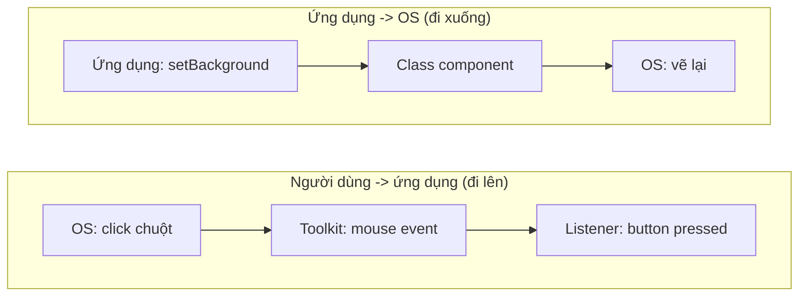
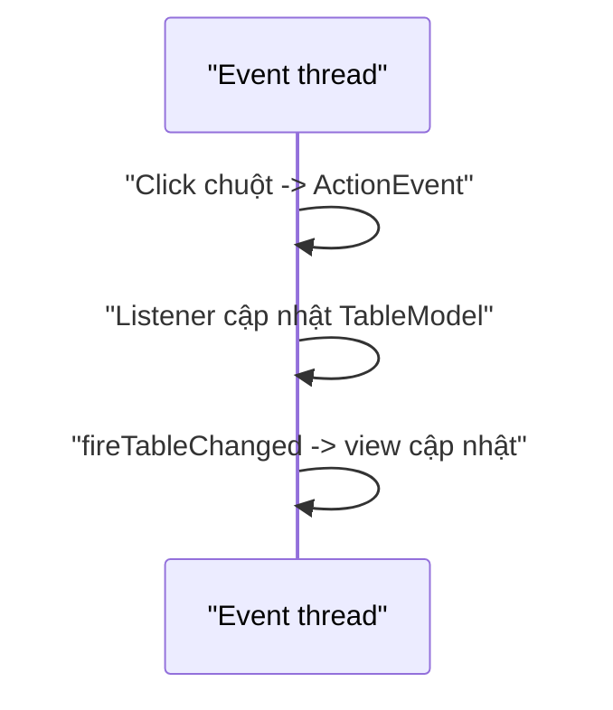
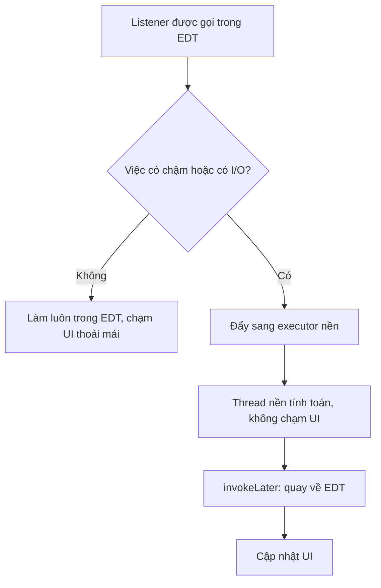
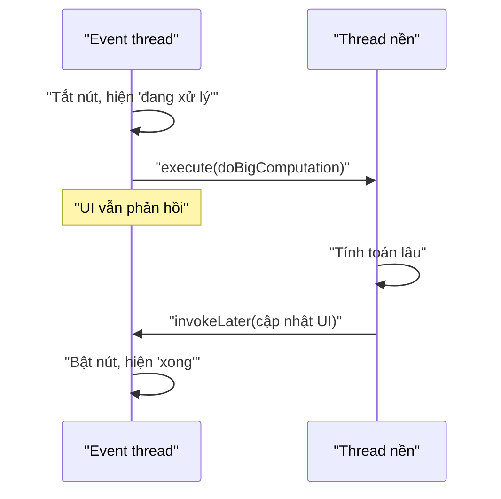

# Lý thuyết 09: Ứng dụng GUI và hệ thống single-thread

> Tùy chọn: dành cho ứng dụng GUI, có thể bỏ qua khi học backend.

## GUI chạy multithreaded như thế nào?

Hãy tưởng tượng một quầy lễ tân chỉ có một nhân viên. Khách (event click, phím, timer) xếp hàng, nhân viên phục vụ từng người một. Nếu một khách hỏi chuyện mất 10 phút thì cả hàng đứng chờ, kể cả người chỉ muốn nói "tôi cancel". Các framework GUI (Swing, AWT, SWT, JavaFX, Android...) đều hoạt động như vậy: **toàn bộ** mã liên quan giao diện chạy trong **một thread event duy nhất** (event dispatch thread, viết tắt EDT trong Swing). Thread-safe ở đây đạt được bằng **thread confinement** (nhốt object vào đúng một thread) chứ không bằng lock hay synchronization.

Lý do là mọi nỗ lực xây GUI toolkit multithreaded đều vướng race condition và deadlock vì thứ tự lock không nhất quán, nên cuối cùng đều quay về mô hình một thread xử lý event queue. Hệ quả thực tế mà bạn phải sống chung: mọi task chạy lâu phải rời khỏi thread này, nếu không giao diện đóng băng. Ngược lại, việc ở lại trong event thread rất dễ: không cần lock, không cần `volatile`.

Mô hình này không riêng GUI. Hãy dùng ý tưởng của bài này bất cứ khi nào viết mã GUI, và rộng hơn là bất cứ khi nào có hệ thống buộc mọi truy cập vào một tài nguyên phải đi qua một thread (thư viện native, event loop của server, actor). Công thức làm việc gói trong năm bước: mã nhanh chạy ngay trong event thread; việc chậm đẩy sang executor nền; kết quả hoặc tiến độ **quay lại** event thread để cập nhật UI (`invokeLater`); hỗ trợ cancel bằng `Future`; chia sẻ dữ liệu bằng mô hình dữ liệu thread-safe hoặc **mô hình tách đôi** (split model).

Cần lưu ý: dù framework là single-thread, **ứng dụng của bạn thì không**. Chương trình thường có phần chạy ở thread ứng dụng, phần ở event thread; chia sai ranh giới này hiếm khi làm sập ngay mà chỉ làm chương trình hoạt động lạ trong điều kiện khó tái hiện.

**Tóm tắt:**

- Framework GUI chạy toàn bộ mã giao diện trên một event thread duy nhất; thread safety đạt được bằng thread confinement, không bằng lock.
- Mọi nỗ lực làm GUI toolkit multithreaded đều vướng race condition và deadlock vì thứ tự lock không nhất quán.
- Quy tắc vàng: việc nhanh chạy ngay trên event thread, việc chậm hoặc có I/O đẩy sang executor nền, kết quả quay lại event thread qua `invokeLater`.
- Chặn event thread thì giao diện đóng băng, kể cả nút Cancel, vì event sau phải chờ event trước xong.
- `invokeAndWait` chặn thread gọi và không được gọi từ chính event thread.
- Cancel task dài bằng `Future.cancel(true)`; tiến độ và hoàn tất dùng `SwingWorker` hoặc class tương tự dựa trên `FutureTask.done()`.
- Dữ liệu dùng chung dùng data model thread-safe hoặc split model (tách model hiển thị khỏi model ứng dụng).
- Mô hình single-thread còn gặp ở event loop, actor và native library; ứng dụng của bạn vẫn là đa thread dù framework thì không.

## Các khái niệm cần biết

| Thuật ngữ | Nghĩa là gì | Dùng khi nào / vì sao quan trọng |
|---|---|---|
| Event dispatch thread (EDT) | Thread duy nhất của Swing/AWT lấy event từ queue và gọi listener, đồng thời vẽ giao diện. | Mọi chạm vào component phải ở đây; chặn nó là làm đơ giao diện. |
| Listener | Object hay lambda đăng ký để được gọi khi có event (ví dụ `ActionListener` của nút). | Là nơi mã ứng dụng của bạn chạy, luôn trong EDT. |
| Event loop | Vòng lặp lấy event từ queue và xử lý tuần tự trên một thread. | Là dạng chung của EDT, Node.js, Netty, Android main thread. |
| MVC (Model, View, Controller) | Tách dữ liệu (model), hiển thị (view) và điều phối (controller). | Các thành phần gọi qua lại nhau, là nguồn gây thứ tự lock không nhất quán nếu dùng nhiều thread. |
| `SwingWorker` | Class có sẵn của Swing chạy việc nặng ở nền, có hook về EDT để cập nhật tiến độ và kết quả. | Dùng cho task nền cần báo tiến độ, hoàn tất, cancel. |
| Snapshot | Bản sao immutable của trạng thái tại một thời điểm. | Gửi từ thread nền sang EDT mà không phải chia sẻ object mutable. |
| Split data model | Hai mô hình: một thread-safe dùng chung, một bị nhốt trong EDT để hiển thị. | Khi dữ liệu do nhiều thread cập nhật nhưng UI cần mô hình single-threaded. |
| Proxy | Object đứng thay object thật và chuyển mọi lời gọi sang thread sở hữu. | Dùng để nhốt thư viện native vào một thread. |

## Vì sao GUI là single-thread?

Ngày xưa GUI chạy trong một event loop chính. Framework hiện đại chỉ khác chút: dựng một thread riêng (EDT) xử lý các event. Không riêng Java: Qt, Cocoa, X Windows... đều như vậy. Đây không phải vì thiếu cố gắng: nhiều nỗ lực làm GUI multithreaded (AWT ban đầu hỗ trợ truy cập multithreaded rộng hơn, và quyết định làm Swing single-thread dựa nhiều vào kinh nghiệm đó) đều gặp race condition và deadlock dai dẳng.

Hai nguyên nhân chính khiến toolkit multithreaded dễ deadlock:

1. **Hai chiều tác động đi ngược nhau.** Hành động của người dùng **nổi lên** (bubble up) từ OS: click chuột -> event chuột -> "nút được bấm" tới listener ứng dụng. Hành động của ứng dụng **đi xuống** (bubble down): đổi màu nền một component -> class component -> OS để vẽ. Hai luồng việc chạm vào cùng các object GUI theo **thứ tự ngược nhau**; nếu mỗi object đều thread-safe bằng lock thì thứ tự lock không nhất quán, và đó là công thức của deadlock (xem [bài 10](/go?p=08-Java%2FJava-Concurrency%2Fhard%2Flt-10-liveness-hazards.md)).
2. **Mô hình MVC.** Controller gọi model, model thông báo view; nhưng controller cũng có thể gọi view, view lại gọi ngược model để đọc trạng thái. Lại thứ tự lock không nhất quán.



Nhận xét của Graham Hamilton (trích trong sách) tóm lại: lập trình thành công với toolkit multithreaded là có thể, nếu toolkit được thiết kế cực kỳ cẩn thận, phơi bày chi tiết chiến lược lock, và bạn rất giỏi và hiểu toàn bộ cấu trúc; nếu sai một chút thì hầu như vẫn chạy, nhưng thỉnh thoảng treo (deadlock) hoặc lỗi (race). Cách đó không mở rộng ra cho lập trình viên đại trà.

Vì vậy các toolkit chọn **thread confinement**: mọi object GUI (component và cả mô hình dữ liệu hiển thị) chỉ được truy cập từ event thread. Điều đó đẩy trách nhiệm cho lập trình viên: phải đảm bảo thật sự nhốt đúng chỗ.

**Nền tảng:** GUI toolkit là single-thread vì mọi thử nghiệm multithreaded đều vướng deadlock do thứ tự lock không nhất quán (event đi lên từ OS, lệnh vẽ đi xuống, cộng với MVC gọi chéo). Giải pháp là thread confinement: mọi object GUI chỉ được chạm từ event thread, nên không cần lock.

### Xử lý event tuần tự

Event (click, phím, hết giờ timer) là một dạng task; bộ máy xử lý event của AWT/Swing có cấu trúc giống một `Executor` (queue + worker duy nhất). Hệ quả:

- **Lợi**: task chạy lần lượt, không chồng nhau, nên mã xử lý khỏi lo nhiễu từ task khác.
- **Hại**: một task chậm chặn mọi event sau nó. Nếu các event đó là phản hồi người dùng hay vẽ lại thì ứng dụng "đứng". Tệ hơn, nút "Cancel" cũng không phản ứng vì listener của nó phải đợi task dài kết thúc.

Quy tắc: task trong event thread phải trả quyền điều khiển **nhanh**. Việc dài (kiểm tra chính tả tài liệu lớn, tìm file, tải dữ liệu mạng) phải đẩy sang thread khác; và cập nhật tiến độ, kết quả lại phải quay về event thread, nên dễ trở nên phức tạp.

### Thread confinement trong Swing

> **Quy tắc single-thread của Swing**: component và model của Swing chỉ nên được tạo, sửa và truy vấn từ event-dispatching thread.

Object GUI nhất quán nhờ **bị nhốt vào thread** chứ không nhờ lock. Mặt tích cực: task trong event thread không cần đồng bộ khi chạm vào object giao diện. Mặt tiêu cực: ngoài event thread thì **không được chạm** vào chúng.

Ngoại lệ (các method an toàn từ thread bất kỳ):

| Method | Ý nghĩa |
|---|---|
| `SwingUtilities.isEventDispatchThread()` | Kiểm tra thread hiện tại có phải EDT không. |
| `SwingUtilities.invokeLater(Runnable)` | Xếp một task chạy ở EDT; gọi từ thread nào cũng được. |
| `SwingUtilities.invokeAndWait(Runnable)` | Như trên nhưng **chặn** thread gọi tới khi xong; chỉ gọi từ thread **không phải** EDT. |
| Yêu cầu `repaint`/`revalidate` | Đưa vào event queue; gọi từ thread bất kỳ. |
| Thêm/gỡ listener | Gọi từ thread bất kỳ, nhưng listener luôn được gọi ở EDT. |

`invokeLater` và `invokeAndWait` hoạt động như một `Executor`. Thật vậy có thể hiện thực chúng bằng executor single-thread, và EDT có thể coi là một executor single-thread xử lý event queue. Chính sách thực thi tuần tự đơn thread hợp lý khi task ngắn, không cần dự đoán lịch chạy chính xác, hoặc bắt buộc không chạy đồng thời.

```java
// Một Executor "chạy trong UI thread": nếu đang ở UI thread thì chạy ngay, ngược lại xếp hàng
public final class UiExecutor implements Executor {
    public static final UiExecutor INSTANCE = new UiExecutor();
    private UiExecutor() { }

    @Override public void execute(Runnable r) {
        if (SwingUtilities.isEventDispatchThread()) r.run();
        else SwingUtilities.invokeLater(r);
    }
}
// Với SWT: Display.asyncExec; JavaFX: Platform.runLater; Android: Handler/runOnUiThread
```

**Suy luận:** GUI chọn single-thread vì cấu trúc của nó đi theo hai chiều ngược nhau. Event từ hệ điều hành (click, phím) đi từ dưới lên: OS đưa tới component rồi tới listener của bạn. Lệnh vẽ lại thì đi từ trên xuống: ứng dụng thay đổi model, rồi component, rồi tới tầng vẽ. Nếu mỗi chiều có thread riêng và dùng lock để bảo vệ, một chiều lấy lock theo thứ tự A rồi B còn chiều kia lấy B rồi A, nên deadlock gần như chắc chắn xảy ra. Thêm vào đó mô hình MVC gọi chéo giữa view và model, làm thứ tự lock càng khó nhất quán. Giải pháp thực dụng của các toolkit là bỏ hẳn lock: chỉ một thread được chạm vào object giao diện, nên không có tranh chấp để bảo vệ. Hệ quả cho bạn là thread confinement kéo theo một quy tắc cứng: mọi chỗ chạm vào component từ thread khác đều sai, kể cả chỉ đọc. Điểm dễ nhầm là nghĩ mô hình này tự đảm bảo ứng dụng an toàn; thật ra dữ liệu bạn chia sẻ giữa event thread và thread nền vẫn cần đồng bộ như thường.

## Task GUI ngắn

Event sinh ra ở event thread, nổi lên tới listener ứng dụng. Nếu task ngắn và chỉ chạm vào object GUI (hoặc object đã được nhốt/thread-safe khác) thì **toàn bộ** xử lý nằm trong event thread và không cần nghĩ tới threading.

```java
JButton button = new JButton("Đổi màu");
Random random = new Random();

button.addActionListener(e ->
        // chạy hoàn toàn trong EDT
        button.setBackground(new Color(random.nextInt())));
```

Với dữ liệu hiển thị kiểu **model và view** (`TableModel`, `TreeModel`): listener cập nhật model rồi gọi `fireXxx`, các `fireXxx` gọi **trực tiếp** listener của view (không đẩy vào queue), nên chỉ được gọi từ event thread. Kiểm soát vẫn không rời khỏi event thread.



## Task GUI dài

Nếu mọi task đều ngắn thì cả ứng dụng nằm gọn trong event thread. Thực tế có việc dài: kiểm tra chính tả, biên dịch nền, tải tài nguyên từ xa. Những việc này phải chạy ở thread khác. Sơ đồ sau là cách quyết định chạy ở đâu khi viết một listener.



Đọc sơ đồ: ranh giới duy nhất cần nhớ là "chậm thì rời EDT, đụng UI thì về EDT". Nếu bỏ qua nhánh "Có" bạn thấy giao diện đơ; nếu bỏ qua bước `invokeLater` bạn thấy lỗi giao diện chập chờn khó tái hiện.

**Phải thuộc:** Quy tắc vàng của GUI: việc chậm hoặc có I/O thì rời event thread (đẩy sang executor nền); việc chạm vào component thì quay về event thread bằng `SwingUtilities.invokeLater`. `invokeAndWait` chặn thread gọi và không được gọi từ chính EDT. Chặn EDT thì giao diện đóng băng, kể cả nút Cancel.

Dùng một executor riêng. Cached thread pool thích hợp, vì GUI hiếm khi phát sinh số lượng lớn task dài nên pool khó phình vô hạn.

### Lửa và quên, rồi trả kết quả về UI

```java
ExecutorService background = Executors.newCachedThreadPool();

button.addActionListener(e -> {
    button.setEnabled(false);                 // (1) ở EDT: báo đang bận
    label.setText("đang xử lý...");

    background.execute(() -> {                // (2) ở thread nền: việc nặng
        try {
            doBigComputation();
        } finally {
            UiExecutor.INSTANCE.execute(() -> {   // (3) quay lại EDT: cập nhật kết quả
                button.setEnabled(true);
                label.setText("xong");
            });
        }
    });
});
```

Việc "bấm nút" được tạo bởi **ba task con** nối tiếp nhau, luân phiên giữa event thread và thread nền (1: EDT, 2: nền, 3: EDT). Kiểu "nhảy thread" này đặc trưng cho xử lý việc dài trong GUI. Thread nền **không được** chạm vào object giao diện, mà phải gửi một task cho EDT.



### Cancel

Task chạy đủ lâu để phải đẩy ra nền thì thường cũng đủ lâu để người dùng muốn cancel. Dùng `Future`: `cancel(true)` interrupt thread đang chạy task; task viết theo kiểu phản hồi interrupt thì thoát sớm (xem [bài 07](/go?p=08-Java%2FJava-Concurrency%2Fmedium%2Flt-07-huy-va-shutdown.md)).

```java
// chỉ truy cập ở EDT => bị nhốt, không cần đồng bộ
Future<?> running;

startButton.addActionListener(e -> {
    if (running != null) return;        // mỗi lần chỉ một task
    running = background.submit(() -> {
        while (hasMoreWork()) {
            if (Thread.currentThread().isInterrupted()) {
                cleanUpPartialWork();
                break;
            }
            doSomeWork();
        }
    });
});

cancelButton.addActionListener(e -> {
    if (running != null) running.cancel(true);
});
```

Biến `running` nhốt trong event thread nên không cần đồng bộ. Còn thiếu: biết khi nào task xong để vô hiệu hóa nút Cancel.

### Tiến độ và hoàn tất: `SwingWorker`

`FutureTask` có hook `done()` được gọi khi tính toán xong. Bọc `done()` để chạy một task ở event thread, ta có class "task nền" với `onCompletion` (chạy ở EDT), và cũng thêm `setProgress` -> `onProgress` (chạy ở EDT). Trong Swing, class có sẵn làm đúng việc này là **`SwingWorker`** (có từ Java 6): chạy `doInBackground()` ở thread nền; `publish()`/`process()` để gửi dữ liệu trung gian; `setProgress()` + `PropertyChangeListener`; `done()` chạy ở EDT; `cancel(true)` để cancel.

```java
class ReportWorker extends SwingWorker<Report, Integer> {
    @Override protected Report doInBackground() throws Exception {   // thread nền
        int total = rows();
        for (int i = 0; i < total && !isCancelled(); i++) {
            computeRow(i);
            // gửi dữ liệu trung gian
            publish(i);
            setProgress(100 * (i + 1) / total);
        }
        return buildReport();
    }

    @Override protected void process(List<Integer> chunks) {         // ở EDT
        table.rowsReady(chunks);
    }

    @Override protected void done() {                                // ở EDT
        cancelButton.setEnabled(false);
        try {
            if (!isCancelled()) show(get());
        } catch (InterruptedException | ExecutionException ex) {
            showError(ex);
        }
    }
}

ReportWorker worker = new ReportWorker();
worker.addPropertyChangeListener(ev -> {
    if ("progress".equals(ev.getPropertyName()))
        progressBar.setValue((Integer) ev.getNewValue());
});
cancelButton.addActionListener(e -> worker.cancel(true));
worker.execute();
```

Kỹ thuật này áp dụng được cho **mọi** framework GUI single-threaded, không riêng Swing: chỉ cần thay `SwingUtilities.invokeLater` bằng cơ chế tương ứng.

Khi nào dùng `SwingWorker`: task nền có kết quả cuối, cần báo tiến độ hoặc cho phép cancel, như ví dụ báo cáo ở trên. Khi nào không cần: việc nền "bắn rồi quên" không đụng UI thì một executor thường là đủ. Lưu ý `get()` chỉ nên gọi trong `done()` (khi đã chắc chắn xong), vì gọi sớm trong EDT sẽ chặn giao diện.

**Suy luận:** Quy tắc "việc chậm rời event thread, kết quả quay lại event thread" là hệ quả trực tiếp của hai sự thật: event thread xử lý tuần tự và là nơi duy nhất được chạm vào component. Vì tuần tự, một task dài chiếm thread thì mọi event sau (vẽ lại, bấm Cancel) phải chờ, nên giao diện đóng băng. Vì thế task dài phải sang thread khác. Nhưng khi task xong và cần cập nhật giao diện, nó lại không được tự chạm vào component, nên phải gửi việc cập nhật quay về event thread bằng `invokeLater`. Hai chiều chuyển đổi này đều có thể sai: quên chiều đi thì UI đơ, quên chiều về thì có race condition với việc vẽ, và lỗi sau này chỉ lộ ngẫu nhiên. Điểm dễ nhầm là `invokeAndWait` từ event thread sẽ tự chờ chính mình và deadlock, và cập nhật tiến độ quá dày cũng làm event queue đầy. Khi review, kiểm tra mỗi listener có việc chậm không, và mỗi callback từ thread nền có quay về event thread trước khi chạm component không.

## Mô hình dữ liệu dùng chung

Object giao diện và mô hình dữ liệu hiển thị (`TableModel`, `TreeModel`) bị nhốt trong event thread. Chương trình đơn giản chỉ có event thread và main thread nên dễ tuân thủ. Phức tạp hơn: có thread khác chuyển dữ liệu từ/ra kho lưu trữ (file, DB). Ví dụ cây thư mục từ xa: điền cây theo kiểu **lười** (khi người dùng mở nút), vì liệt kê một thư mục từ xa có thể rất lâu nên phải làm ở nền; xong cần đưa dữ liệu vào cây bằng một trong ba cách: dùng mô hình thread-safe, "đẩy" từ thread nền sang event thread bằng `invokeLater`, hoặc để event thread thăm dò.

### Mô hình dữ liệu thread-safe

Nếu việc bị chặn không ảnh hưởng đáng kể tới độ phản hồi, mô hình thread-safe giải quyết bài toán. Mô hình hỗ trợ đồng thời mịn (như `ConcurrentHashMap`) thì event thread và thread nền cùng dùng tốt, nhưng **không có snapshot nhất quán**, và mô hình vẫn phải **phát event** khi thay đổi để view cập nhật. Mô hình có phiên bản (`CopyOnWriteArrayList`: iterator duyệt đúng bản tại thời điểm tạo) chỉ hợp khi duyệt nhiều hơn sửa rất nhiều. Cấu trúc có phiên bản chuyên biệt khó làm đúng, chỉ cân nhắc khi các cách khác bất khả thi.

### Mô hình tách đôi (split data model)

Vấn đề đặt ra là: mô hình thread-safe đơn thuần không phải lúc nào cũng dùng được, vì lock có thể chặn event thread hoặc không cho ta một góc nhìn nhất quán. Cách giải quyết là tách làm hai: một mô hình để UI đọc (bị nhốt) và một mô hình để các thread khác ghi (thread-safe), nối với nhau bằng message.

Thường mô hình trình bày (`TableModel`) chỉ là "view" của một mô hình khác do ứng dụng quản lý. Có hai mô hình thì gọi là **split-model**:

- **Mô hình trình bày**: bị nhốt trong event thread.
- **Mô hình dùng chung (shared model)**: thread-safe, cả event thread và thread ứng dụng truy cập được.

Mô hình trình bày đăng ký listener ở mô hình chung để nhận thông báo, rồi cập nhật bằng cách nhúng **snapshot** trạng thái liên quan vào message, hoặc truy vấn lại mô hình chung khi nhận event.

| Cách cập nhật | Hợp khi | Lý do |
|---|---|---|
| **Snapshot** (gửi cả trạng thái) | Dữ liệu nhỏ, cập nhật thưa, hai mô hình cấu trúc giống nhau | Đơn giản. |
| **Cập nhật gia tăng** (incremental) | Dữ liệu lớn, cập nhật dày, hoặc một bên có thông tin bên kia không thấy | Tuần tự hóa các thay đổi ở mô hình chung rồi tái tạo ở event thread. Còn cho phép vẽ lại đúng vùng thay đổi: một xe di chuyển thì không cần vẽ lại cả bản đồ. |

```java
// Mô hình chung: thread-safe; thread nền cập nhật vị trí xe
class VehicleStore {
    private final ConcurrentMap<String, Point> positions = new ConcurrentHashMap<>();
    private final List<Consumer<VehicleMoved>> listeners = new CopyOnWriteArrayList<>();

    void update(String id, Point p) {
        positions.put(id, p);
        // record immutable => an toàn khi chuyển thread
        VehicleMoved ev = new VehicleMoved(id, p);
        listeners.forEach(l -> l.accept(ev));
    }
    void addListener(Consumer<VehicleMoved> l) { listeners.add(l); }
}
record VehicleMoved(String id, Point position) { }

// Mô hình trình bày: bị nhốt trong EDT; nhận message gia tăng qua invokeLater
store.addListener(ev -> SwingUtilities.invokeLater(() -> {
    tableModel.setPosition(ev.id(), ev.position());       // chạy ở EDT, chạm UI an toàn
    tableModel.fireTableDataChanged();
}));
```

> Cân nhắc split-model khi mô hình dữ liệu phải được nhiều thread chia sẻ mà làm nó thread-safe là không nên vì lý do chặn, nhất quán, hay độ phức tạp.

## Các hệ thống single-thread khác

Thread confinement không chỉ cho GUI; áp dụng cho bất cứ cơ sở nào hiện thực như một **hệ thống single-threaded**. Đôi khi việc nhốt bị áp đặt vì lý do chẳng liên quan tránh lock: ví dụ thư viện native yêu cầu mọi truy cập (kể cả `System.loadLibrary`) từ cùng một thread.

Cách làm lấy cảm hứng từ GUI: tạo thread riêng hoặc **executor single-thread** để truy cập thư viện, kèm một **proxy** chặn mọi lời gọi tới object bị nhốt và gửi chúng như task cho thread đó. `Future` + `newSingleThreadExecutor` làm việc này dễ: method proxy gửi task rồi gọi `Future.get()` để chờ kết quả. Nếu class cần nhốt có interface thì có thể tự động hóa bằng dynamic proxy.

```java
public final class NativeEngineProxy implements Engine {
    private final ExecutorService single =
            Executors.newSingleThreadExecutor(r -> new Thread(r, "native-engine"));
    // chỉ chạm tới ở thread trên
    private final NativeEngine delegate;

    public NativeEngineProxy() throws Exception {
        // tạo ngay trong thread nhốt
        this.delegate = single.submit(NativeEngine::new).get();
    }

    @Override public Result analyze(Input in) {
        try {
            // mọi lời gọi qua thread này
            return single.submit(() -> delegate.analyze(in)).get();
        } catch (InterruptedException e) {
            Thread.currentThread().interrupt();
            throw new IllegalStateException(e);
        } catch (ExecutionException e) {
            throw new RuntimeException(e.getCause());
        }
    }
}
```

### Liên hệ hiện đại

Cùng một ý tưởng "một thread sở hữu trạng thái, người khác gửi tin nhắn" xuất hiện khắp nơi:

| Hệ thống | Cơ chế tương ứng | Quy tắc |
|---|---|---|
| **JavaFX** | JavaFX Application Thread; `Platform.runLater`, class `Task`/`Service` | Không chạm node UI ngoài FX thread. |
| **Android** | Main (UI) thread; `Handler`, `runOnUiThread`, coroutine `Dispatchers.Main` | Chạm UI từ nền gây `CalledFromWrongThreadException`; I/O mạng trên main thread bị cấm. |
| **Netty / reactor** | Mỗi `Channel` gắn với một `EventLoop` (một thread) | Không chặn event loop; việc nặng đẩy sang `EventExecutorGroup`/pool riêng. |
| **Node.js, JS trong trình duyệt** | Event loop single-threaded | Task CPU dài làm treo mọi request/UI; dùng worker. |
| **Actor (Akka, Erlang)** | Mỗi actor xử lý hộp thư tuần tự | Trạng thái chỉ chạm trong actor; giao tiếp bằng tin nhắn immutable. |
| **Redis (lệnh)** | Thực thi lệnh single-threaded | Atomic hóa cho từng lệnh; lệnh chậm chặn tất cả. |

Hai bài học chung: (1) **không bao giờ chặn** thread sở hữu; (2) chuyển giao giữa các thread bằng **message/immutable object**. Java 21 ghi chú thêm: virtual thread không thay thế EDT, vì UI vẫn đòi hỏi mọi thao tác trên một thread.

## Bẫy thường gặp

| Bẫy | Hệ quả / cách tránh |
|---|---|
| Làm việc nặng (I/O, truy vấn DB, tính toán) trong listener | Giao diện đơ, nút Cancel vô dụng. Đẩy sang executor nền. |
| Cập nhật UI trực tiếp từ thread nền | Trạng thái hỏng, lỗi chập chờn. Luôn qua `invokeLater`/`Platform.runLater`/`runOnUiThread`. |
| Dùng `invokeAndWait` từ chính EDT | Tự deadlock/exception; chỉ gọi từ thread không phải EDT. |
| Gọi `get()` của `Future` hay `join()` ngay trong event thread | Chặn UI. Dùng `done()`/callback. |
| Gọi `fireXxx` của model từ thread nền | Listener của view chạy sai thread. Chỉ gọi ở event thread. |
| Chia sẻ cùng một object mutable giữa EDT và thread nền không đồng bộ | Race. Dùng mô hình thread-safe hoặc split-model với immutable snapshot. |
| Quên chuyển lại UI sau khi nền xong, hoặc quên xử lý exception ở nền | UI bị lock ở trạng thái "đang bận". Dùng `finally`. |
| Cho phép bấm "Start" nhiều lần | Nhiều task nền chồng nhau; vô hiệu hóa nút hoặc theo dõi `Future`. |

## Điểm cần nhớ

- Mọi GUI toolkit chính đều là **hệ thống single-thread**: toàn bộ mã trình bày chạy như task trong **event thread**; thread-safe = thread confinement.
- Toolkit multithreaded thất bại vì thứ tự lock không nhất quán (event thread lên vs hành động xuống, MVC).
- **Luật Swing**: chỉ tạo/sửa/đọc component và model trong EDT; exception chính là `invokeLater`, `invokeAndWait`, `repaint`/`revalidate`, thêm/gỡ listener.
- Task trong event thread phải **ngắn**; task dài đưa sang executor nền và "nhảy thread" để cập nhật UI.
- Cancel bằng `Future.cancel(true)`; tiến độ và hoàn tất bằng `SwingWorker` hoặc class tương tự dựa trên `FutureTask.done()`.
- Dữ liệu chia sẻ: mô hình thread-safe (nhưng mất snapshot nhất quán), hoặc **split-model** với mô hình trình bày bị nhốt, đồng bộ qua snapshot/cập nhật gia tăng.
- Thread confinement dùng được cho mọi hệ thống single-thread (thư viện native, event loop, actor) qua executor single-thread và proxy.

## Câu hỏi tự kiểm tra

1. Vì sao GUI toolkit multithreaded dễ deadlock?
   - **Gợi ý suy luận:** Event người dùng đi theo hướng nào qua các class, còn thao tác ứng dụng đi hướng nào? Hai hướng đi ngược nhau mà cùng lock thì thứ tự lock ra sao?
   - **Lập luận:** Event đi từ dưới lên, ứng dụng thao tác từ trên xuống, và MVC làm các object gọi nhau lung tung. Thứ tự lock không nhất quán, nên dễ hình thành chu trình chờ lock.
   - **Đáp án ngắn:** Vì thứ tự lock trên các object GUI không nhất quán giữa event thread và thread ứng dụng.
2. Hậu quả của việc chạy task dài trong event thread?
   - **Gợi ý suy luận:** Event thread xử lý các event theo kiểu gì (queue, tuần tự)? Listener của nút Cancel chạy ở thread nào?
   - **Lập luận:** Chỉ có một thread, xử lý tuần tự. Task dài chiếm nó thì event sau (vẽ lại, bấm nút) phải chờ, UI đóng băng, và listener của nút Cancel cũng chưa chạy được.
   - **Đáp án ngắn:** Mọi event đợi sau nó; UI đóng băng, kể cả nút Cancel.
3. Khác nhau giữa `invokeLater` và `invokeAndWait`?
   - **Gợi ý suy luận:** Thread gọi có chờ không? Nếu gọi `invokeAndWait` từ chính EDT, EDT chờ ai?
   - **Lập luận:** `invokeLater` xếp hàng rồi trả về ngay. `invokeAndWait` chặn tới khi chạy xong; gọi từ EDT thì EDT chờ chính mình xử lý, nên bị cấm.
   - **Đáp án ngắn:** `invokeLater` không chặn; `invokeAndWait` chặn tới khi xong và không được gọi từ EDT.
4. Vì sao biến `Future<?> running` ở ví dụ cancel không cần `volatile` hay lock?
   - **Gợi ý suy luận:** Những thread nào đọc/ghi biến đó? Khi chỉ một thread truy cập thì cần đồng bộ để làm gì?
   - **Lập luận:** Nó chỉ được truy cập trong event thread. Một thread duy nhất thì không có chia sẻ giữa các thread, nên không cần đồng bộ (thread confinement).
   - **Đáp án ngắn:** Vì nó bị nhốt trong event thread.
5. Thread nền làm xong việc muốn cập nhật nhãn trạng thái thì làm thế nào?
   - **Gợi ý suy luận:** Thread nền có được chạm vào component không? Ai là thread duy nhất được phép?
   - **Lập luận:** Component chỉ an toàn trong event thread, nên thread nền phải nhờ event thread làm: đóng gói cập nhật trong `Runnable` và gửi qua cơ chế của toolkit.
   - **Đáp án ngắn:** Gửi `Runnable` cập nhật nhãn qua `invokeLater`/`Platform.runLater`/`runOnUiThread`.
6. Khi nào nên dùng split data model?
   - **Gợi ý suy luận:** Dữ liệu cần chia sẻ giữa nhiều thread, nhưng làm model hiển thị thread-safe có vấn đề gì (chặn UI, nhất quán, phức tạp)?
   - **Lập luận:** Khi model hiển thị thread-safe là bất tiện, tách thành hai: model chung thread-safe cho các thread, model trình bày nhốt trong event thread, và đồng bộ hai bên bằng event.
   - **Đáp án ngắn:** Khi dữ liệu phải chia sẻ giữa nhiều thread mà làm model hiển thị thread-safe không phù hợp; dùng model chung thread-safe cùng model trình bày bị nhốt.
7. Ví dụ ngoài GUI mà thread confinement bị áp đặt?
   - **Gợi ý suy luận:** Thư viện nào đòi mọi lời gọi từ cùng một thread? Làm sao các thread khác dùng được nó?
   - **Lập luận:** Thư viện native đòi một thread duy nhất, nên mọi truy cập phải đi qua executor single-thread; các thread khác dùng proxy gửi việc vào đó.
   - **Đáp án ngắn:** Thư viện native đòi mọi truy cập từ cùng một thread; dùng executor single-thread và proxy.

Nguồn: Java Concurrency in Practice, Chương 9.

