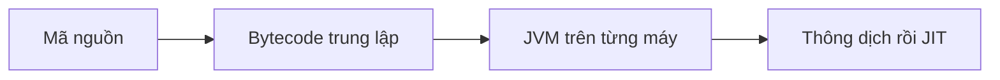
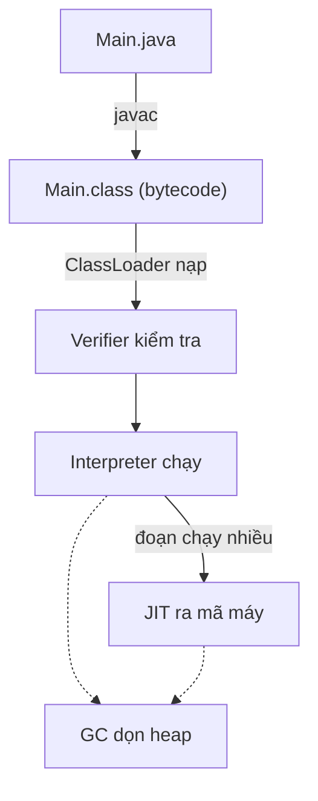
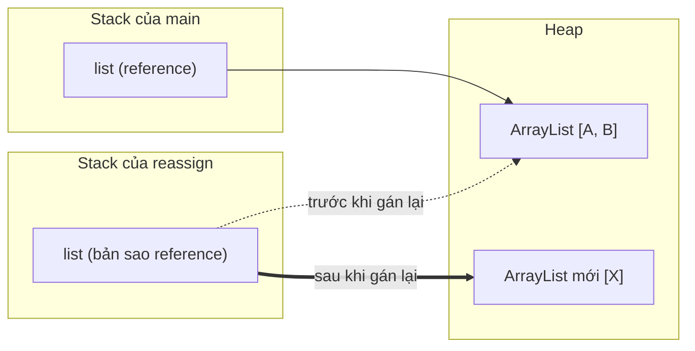
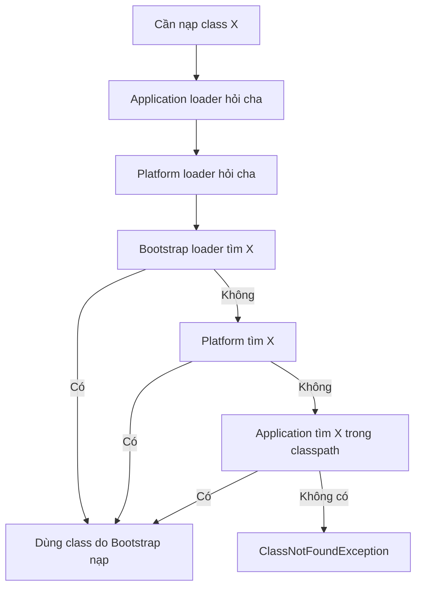

# Lý thuyết 1: Tư duy Java và JVM tổng quan (đọc đầu tiên)

## Code Java chạy như thế nào?

Khi bạn viết code C hay C++, trình biên dịch biến mã nguồn thành **mã máy** dành riêng cho một hệ điều hành và một loại CPU. Muốn chạy trên Windows lẫn Linux thì phải build hai lần. Java chọn con đường khác: mã nguồn `.java` được biên dịch thành **bytecode**, một dạng mã trung gian không gắn với máy nào, và bytecode đó do **JVM** (Java Virtual Machine) chạy. Mỗi hệ điều hành có một JVM riêng, nên bạn build một lần, máy nào có JVM đều chạy được. Đó là ý nghĩa của câu "write once, run anywhere".

JVM không chỉ là bộ chạy bytecode. Nó còn cấp phát memory cho object, tự dọn những object không còn ai dùng (garbage collection) và tối ưu code ngay trong lúc chạy. Cái giá phải trả là chương trình Java cần thời gian khởi động và "làm nóng" trước khi đạt tốc độ tối đa.

Về công cụ, **JDK** là bộ đồ nghề để viết và build (có trình biên dịch `javac`), còn **JRE/JVM** là phần chỉ để chạy. Bạn nên đọc bài này đầu tiên: khi hiểu code chạy thế nào, sau này bạn mới debug được lỗi memory, tìm được chỗ chậm hay chỉnh được tham số JVM thay vì đoán mò. Tóm lược đường đi: viết file `.java`, `javac` biên dịch ra `.class`, JVM nạp class vào rồi thông dịch; đoạn nào chạy nhiều thì JIT biên dịch tiếp thành mã máy cho nhanh.

**Nền tảng:** Java không biên dịch thẳng ra mã máy mà qua hai bước: `javac` biên dịch `.java` thành bytecode (lúc build), rồi JVM nạp, thông dịch và dùng JIT biên dịch đoạn nóng thành mã máy (lúc chạy). Mọi chủ đề sau (class loading, GC, JIT, memory) đều là chi tiết của đường đi này.

**Cốt lõi:** Java không dịch thẳng ra mã máy mà dịch ra bytecode trung lập, rồi JVM trên từng máy chạy bytecode đó và lo luôn memory, dọn rác, tối ưu lúc chạy. Hiểu đường đi này là hiểu vì sao Java chạy khắp nơi, vì sao cần warm-up, và lỗi memory hay class đều có chỗ để lần ra.

- Vì bytecode không gắn với máy nào nên build một lần, máy nào có JVM đều chạy được.
- Vì JVM thông dịch trước rồi JIT mới biên dịch đoạn chạy nhiều, nên chương trình khởi động nhanh nhưng chỉ đạt tốc độ tối đa sau khi warm-up.
- Vì object nằm trên heap còn variable chỉ giữ reference được sao chép theo giá trị, nên sửa nội dung object thì bên ngoài thấy, gán lại tham số thì không.



Mô hình tư duy: một bytecode dùng chung, mỗi máy có một JVM làm người phiên dịch, và mọi chủ đề sau đều là chi tiết của chặng JVM này.

**Tóm tắt:**

- Java biên dịch `.java` thành bytecode trung lập, rồi JVM trên từng hệ điều hành mới chạy bytecode đó; vì vậy chạy được khắp nơi.
- JDK gồm JRE, JRE gồm JVM; từ Java 11 thường chỉ cài JDK.
- JVM thông dịch lúc đầu để khởi động nhanh, rồi JIT biên dịch đoạn chạy nhiều thành mã máy, nên chương trình cần warm-up.
- Mỗi thread có stack riêng chứa variable cục bộ và reference; mọi object nằm trên heap chung và do GC dọn.
- Java luôn truyền theo giá trị: với object, giá trị được sao chép là reference, nên sửa nội dung thì bên ngoài thấy còn gán lại tham số thì không.
- `==` trên chuỗi và `Integer` ngoài khoảng cache -128 đến 127 so sánh reference, nên luôn dùng `equals`.
- ClassLoader hỏi loader cha trước (parent delegation) để class lõi như `String` không bị thay thế.

## Các khái niệm cần biết

| Thuật ngữ | Nghĩa là gì | Dùng khi nào / vì sao quan trọng |
|---|---|---|
| Bytecode | Tập lệnh trung gian trong file `.class`, do `javac` sinh ra. | Là "ngôn ngữ chung" để cùng một file chạy trên nhiều hệ điều hành. Xem bằng `javap -c`. |
| ClassLoader | Thành phần của JVM tìm và nạp file `.class` vào memory khi cần. | Hiểu nó thì mới giải thích được `ClassNotFoundException`, `NoClassDefFoundError`, xung đột phiên bản thư viện. |
| Verifier | Bước kiểm tra bytecode vừa nạp có hợp lệ và an toàn không trước khi chạy. | Ngăn bytecode bị sửa hoặc sai làm hỏng memory JVM. |
| Interpreter (thông dịch) | Đọc từng lệnh bytecode và thực hiện ngay. | Khởi động nhanh nhưng chạy chậm hơn mã máy. |
| JIT (Just-In-Time compiler) | Biên dịch những đoạn code chạy nhiều ("nóng") thành mã máy ngay lúc chạy. | Là lý do chương trình Java chậm lúc đầu rồi nhanh dần (warm-up). Khi benchmark phải cho nó chạy nóng trước. |
| Garbage collection (GC) | Tự động giải phóng object trên heap mà không còn reference nào tới được. | Bạn không cần `free`, nhưng vẫn rò rỉ nếu giữ reference thừa. |
| Stack, heap | Hai vùng nhớ chính: stack chứa variable cục bộ, heap chứa object (chi tiết bên dưới). | Quyết định lifecycle dữ liệu và nguyên nhân `StackOverflowError`, `OutOfMemoryError`. |
| String pool | Vùng lưu các chuỗi literal để dùng chung thay vì tạo trùng. | Giải thích vì sao `==` trên chuỗi đôi khi đúng, đôi khi sai. |
| Autoboxing | Tự chuyển giữa primitive (`int`) và wrapper (`Integer`). | Nguồn của bẫy cache `Integer` khi so sánh bằng `==`. |

## Từ mã nguồn đến chạy

Hãy xem đường đi của một file `Main.java`, từ lúc bạn lưu đến lúc nó chạy.



Đọc sơ đồ: `javac` chạy lúc build, phần còn lại chạy lúc chạy chương trình. ClassLoader nạp class khi lần đầu cần đến, Verifier kiểm tra, rồi interpreter bắt đầu chạy ngay. JVM đếm xem method nào được gọi nhiều và giao cho JIT biên dịch thành mã máy. GC chạy parallel suốt quá trình (nét đứt), dọn heap.

## JDK, JRE, JVM

| Thành phần | Gồm | Dùng để |
|---|---|---|
| **JVM** | Bộ nạp class, bộ thực thi, GC | Chạy bytecode |
| **JRE** | JVM + thư viện chuẩn | Chạy ứng dụng |
| **JDK** | JRE + `javac`, `jar`, `jcmd`, `jshell`... | Phát triển |

Từ Java 11 trở đi thường chỉ cài JDK.

## Hello World và các quy ước

```java
public class Main {
    public static void main(String[] args) {
        System.out.println("Xin chào");
    }
}
```

- Tên file `.java` trùng tên class `public`.
- Quy ước tên: `PascalCase` cho class, `camelCase` cho variable và method, `UPPER_SNAKE` cho hằng.
- Chạy nhanh: `java Main.java` (Java 11+), thử code: `jshell`.

## Memory: stack, heap và truyền theo giá trị

| Vùng | Chứa | Lifecycle |
|---|---|---|
| **Stack** (mỗi thread một stack) | Variable cục bộ, tham số, reference | Mất khi method kết thúc |
| **Heap** (chung mọi thread) | Object, array | Tới khi GC thấy không còn reference tới được |
| **Metaspace** | Thông tin class, bytecode đã nạp | Theo lifecycle ClassLoader |

Variable reference nằm trên stack, object nằm trên heap. Truyền tham số là **sao chép giá trị của variable**: với object, giá trị đó là địa chỉ.

**Phải thuộc:** Java luôn truyền tham số theo giá trị. Với object, giá trị được sao chép là reference (địa chỉ), nên sửa nội dung object thì bên ngoài thấy, còn gán lại tham số thì bên ngoài không đổi. Stack: mỗi thread một stack, chứa variable cục bộ; heap: dùng chung, chứa object.

Hãy hình dung variable reference như tờ giấy ghi địa chỉ nhà, còn object là ngôi nhà. Truyền tham số là photo tờ giấy đó đưa cho hàm. Hàm có thể đến nhà và dọn đồ (sửa nội dung), nhưng nếu nó viết địa chỉ khác lên bản photo (gán lại tham số) thì tờ giấy gốc của bạn vẫn như cũ.



Đọc sơ đồ: trong `reassign`, bản sao `list` ban đầu trỏ cùng object với `list` của `main`, nên `add` sửa được nội dung. Sau khi gán `list = new ArrayList<>()`, chỉ bản sao đổi hướng sang object mới; `list` trong `main` vẫn trỏ về `[A, B]`.

```java
import java.util.ArrayList;
import java.util.List;

public class PassByValue {
    // sửa nội dung: thấy bên ngoài
    static void add(List<String> list) { list.add("B"); }
    // gán lại bản sao
    static void reassign(List<String> list) { list = new ArrayList<>(); list.add("X"); }
    // primitive: sao chép giá trị
    static void increment(int n) { n++; }

    public static void main(String[] args) {
        List<String> list = new ArrayList<>(List.of("A"));
        add(list);
        System.out.println(list);   // [A, B]
        reassign(list);
        System.out.println(list);   // [A, B]  (không đổi)
        int n = 5; increment(n);
        System.out.println(n);    // 5

        String a = "java", b = "java", c = new String("java");
        System.out.println((a == b) + " " + (a == c) + " " + a.equals(c) + " " + (a == c.intern()));
        // true false true true

        Integer x = 127, y = 127, p = 128, q = 128;
        System.out.println((x == y) + " " + (p == q));   // true false
    }
}
```

**Suy luận:** Java truyền theo giá trị vì method nhận một bản sao của mọi thứ nằm trong ô nhớ của variable ở nơi gọi. Với primitive, ô nhớ đó chứa chính con số nên sửa bản sao không ảnh hưởng gì bên ngoài. Với object, ô nhớ trên stack chỉ chứa reference tới object trên heap, nên bản sao reference vẫn trỏ về cùng một object và việc `add` vào list hiện ra ở cả hai phía. Nhưng gán `list = new ArrayList<>()` chỉ đổi bản sao reference cục bộ sang object khác, còn reference ở nơi gọi không hề bị chạm tới. Chính chỗ này hay bị nhầm thành "Java truyền object theo reference", vì hành vi sửa nội dung trông giống hệt, trong khi việc không hoán đổi được hai variable mới là bằng chứng ngược lại. Vì vậy khi viết hàm, nếu muốn trả kết quả mới ra ngoài thì phải return nó, và khi review phải tự hỏi hàm đang sửa nội dung hay chỉ gán lại tham số.

Hai bẫy hay hỏi trong đoạn trên:

- Chuỗi literal được dùng chung trong **string pool**, còn `new String(...)` luôn tạo object mới. Vì vậy `==` trên chuỗi chỉ đúng tình cờ.
- `Integer` được cache cho giá trị -128 đến 127 khi autoboxing, ngoài khoảng đó `==` so sánh hai object khác nhau. Luôn dùng `equals` cho wrapper.

**Phải thuộc:** `Integer` cache trong khoảng -128 đến 127 (mặc định), nên `Integer.valueOf(127) == Integer.valueOf(127)` là `true` còn 128 thì `false`. So sánh chuỗi và wrapper luôn dùng `equals`.

## Nạp class: ủy quyền cho cha

`ClassLoader` nạp class theo mô hình **parent delegation**: trước khi tự nạp, nó hỏi loader cha. Chuỗi mặc định: Bootstrap (class lõi như `String`), Platform, rồi Application (class của bạn).

Vấn đề mà cơ chế này giải quyết là an toàn và nhất quán: nếu ai cũng nạp class theo ý mình thì bạn có thể vô tình (hoặc cố ý) thay `java.lang.String` bằng bản giả. Bằng cách luôn hỏi cha trước, class lõi của JDK được bảo vệ.



Đọc sơ đồ: yêu cầu đi lên trên cùng trước, rồi mới đi xuống dần. Chỉ khi cả chuỗi cha đều không tìm thấy thì loader của bạn mới tự nạp; nếu vẫn không có thì throw `ClassNotFoundException`.

| Hệ quả | Giải thích |
|---|---|
| Bạn không thể "thay" `java.lang.String` bằng bản của mình | Bootstrap nạp trước |
| `String.class.getClassLoader()` trả `null` | Bootstrap không hiện ra như một object Java |
| Cùng tên class nhưng hai loader khác nhau là **hai class khác nhau** | Nguồn của `ClassCastException` lạ trong server ứng dụng, plugin |

Class chỉ được nạp **lần đầu cần đến** (lazy), nên lỗi `NoClassDefFoundError` có thể xuất hiện muộn, lúc chạy đến đoạn code đó chứ không phải lúc khởi động.

**Suy luận:** Nếu mỗi loader được tự nạp class theo ý mình thì một ứng dụng có thể đưa vào classpath bản `java.lang.String` giả và mọi code còn lại sẽ tin tưởng nó. Parent delegation chặn điều đó bằng cách luôn đẩy yêu cầu lên Bootstrap trước, nên class lõi chỉ có thể đến từ JDK. Hệ quả thứ hai là mỗi class được nhận diện bằng cặp (tên, loader nạp nó), nên cùng một tên nạp bởi hai loader là hai class khác nhau, và đây là nguồn của `ClassCastException` khó hiểu trong server ứng dụng hay plugin. Thứ ba, vì class chỉ nạp khi cần lần đầu, `NoClassDefFoundError` có thể nổ muộn tại đúng dòng dùng class, không phải lúc khởi động. Điểm dễ nhầm là coi `ClassNotFoundException` và `NoClassDefFoundError` là một: cái đầu là không tìm thấy khi nạp tường minh, cái sau là class từng có lúc biên dịch nhưng thiếu lúc chạy. Khi gặp lỗi lạ về class, hãy kiểm tra classpath, phiên bản thư viện trùng và loader đang nạp class đó.

## 8 nguyên tắc tư duy Java

| # | Nguyên tắc | Hệ quả |
|---|---|---|
| 1 | Kiểu tĩnh, kiểm tra lúc biên dịch | Lỗi lộ sớm, IDE hỗ trợ mạnh |
| 2 | Mọi thứ (trừ primitive) là object | Variable reference trỏ tới object trên heap |
| 3 | **Truyền theo giá trị** (cả với object: giá trị là reference) | Sửa nội dung object được, gán lại reference thì không ảnh hưởng ngoài |
| 4 | Memory tự quản lý | Không `free`, nhưng vẫn có thể rò rỉ nếu giữ reference thừa |
| 5 | Ưu tiên immutable | `String`, `record`, `final` cho thread-safe |
| 6 | Lập trình theo interface | Dễ thay thế, dễ test |
| 7 | Exception là một phần contract | Phân biệt checked và unchecked |
| 8 | Backward compatibility rất cao | Code cũ vẫn chạy; đổi phiên bản ít đau |

## Bảng tra: triệu chứng, nghĩ tới đâu

| Triệu chứng | Hãy nghĩ tới |
|---|---|
| `NullPointerException` | Reference không trỏ tới object nào; ai gán, ai trả `null`? |
| So sánh chuỗi sai | Dùng `==` thay vì `equals` |
| Sửa tham số trong hàm mà bên ngoài không đổi | Truyền theo giá trị: bạn chỉ đổi bản sao reference |
| `OutOfMemoryError` | Giữ reference thừa, heap quá nhỏ |
| Chạy chậm lúc đầu rồi nhanh dần | JIT đang khởi động (warm-up) |

## Cách học

Với mỗi khái niệm, tự hỏi: (1) nó nằm ở đâu trong memory (stack, heap)? (2) ai quyết định hành vi: trình biên dịch hay JVM lúc chạy? (3) nó hỏng khi nào?

## Phỏng vấn khó: chuỗi hỏi xoáy

Người phỏng vấn senior thường mở bằng câu dễ rồi xoáy xuống cơ chế, đánh đổi và sự cố thật. Câu trả lời tốt luôn đi từ cốt lõi xuống.

### Chuỗi 1: Truyền tham số theo giá trị

1. **Câu mở:** Java truyền tham số theo giá trị hay theo reference?
2. **Xoáy 1:** Vậy vì sao hàm `add(list)` sửa được list của người gọi, còn `list = new ArrayList<>()` trong hàm thì không? Stack và heap nằm ở đâu trong chuyện này?
3. **Xoáy 2:** Viết được hàm `swap(a, b)` cho hai object không? Còn nếu tham số là `String` hay `int[]` thì người gọi thấy gì?

**Đáp án ngắn:** Java luôn truyền theo giá trị. Method nhận một bản sao của giá trị nằm trong variable ở nơi gọi. Với primitive đó là con số, với object đó là reference, tức địa chỉ trỏ tới object trên heap. Bản sao reference vẫn trỏ cùng object nên `add` hiện ra ở cả hai phía. Gán lại tham số chỉ đổi bản sao nằm trên stack của method, variable của người gọi không bị chạm tới, và đó cũng là lý do không viết được `swap` cho hai variable. `String` immutable nên mọi phép "sửa" tạo chuỗi mới, người gọi không thấy gì; `int[]` là object trên heap nên `arr[0] = 9` thì người gọi thấy. Khi review tôi luôn hỏi hàm đang sửa nội dung hay chỉ gán lại tham số, và muốn trả kết quả mới ra ngoài thì phải `return`.

**Sai lầm hay gặp:**

- Nói "object truyền theo reference" vì hành vi sửa nội dung trông giống, trong khi không hoán đổi được hai variable mới là bằng chứng ngược lại.
- Chỉ thuộc câu "pass by value" mà không giải thích được giá trị được sao chép là gì.
- Không phân biệt sửa nội dung object với gán lại tham số.

### Chuỗi 2: Nạp class và lỗi class lúc chạy

1. **Câu mở:** `ClassNotFoundException` và `NoClassDefFoundError` khác nhau thế nào?
2. **Xoáy 1:** ClassLoader tìm class theo thứ tự nào? Vì sao ứng dụng không thể thay `java.lang.String` bằng bản của mình?
3. **Xoáy 2:** Trên server ứng dụng, một `ClassCastException` báo ép giữa hai class trùng tên đầy đủ. Chuyện gì đang xảy ra và bạn lần ra bằng cách nào?

**Đáp án ngắn:** Cả hai đều là chuyện JVM không có class lúc cần. `ClassNotFoundException` là exception khi nạp tường minh không tìm thấy; `NoClassDefFoundError` là `Error`, nghĩa là class có lúc biên dịch nhưng thiếu hoặc hỏng lúc chạy. Cơ chế nạp là parent delegation: Application loader hỏi Platform, Platform hỏi Bootstrap, chỉ khi cả chuỗi cha không có thì loader của bạn mới tự nạp. Nhờ đó class lõi như `String` luôn đến từ JDK và không bị giả mạo. Hệ quả là một class được nhận diện bằng cặp tên và loader nạp nó, nên cùng tên nhưng hai loader là hai class khác nhau, và đó là nguồn của `ClassCastException` lạ trong server ứng dụng hay plugin. Vì class chỉ nạp lần đầu cần tới, lỗi có thể nổ muộn tại đúng dòng dùng class. Tôi sẽ kiểm tra classpath thực tế, JAR trùng phiên bản và loader đang nạp class đó.

**Sai lầm hay gặp:**

- Coi hai lỗi class là một, hoặc nghĩ lỗi luôn xảy ra lúc khởi động.
- Không biết vì sao cần delegation, chỉ nhớ tên ba loader.
- Nghĩ cùng tên class là cùng một class bất kể loader.

