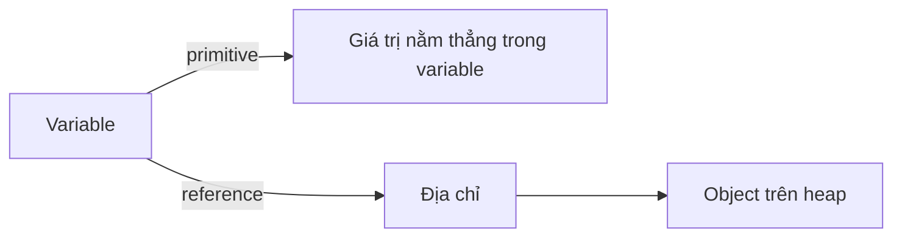
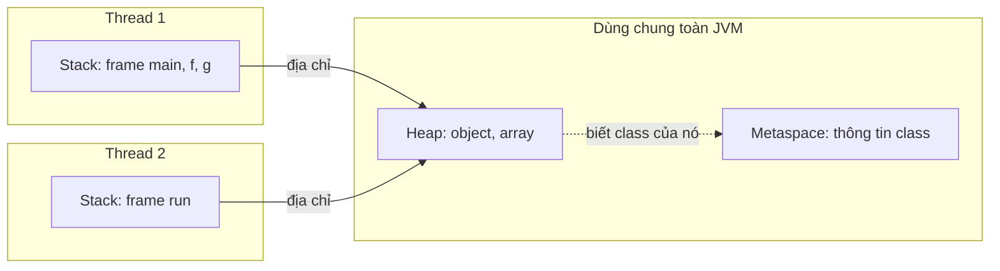
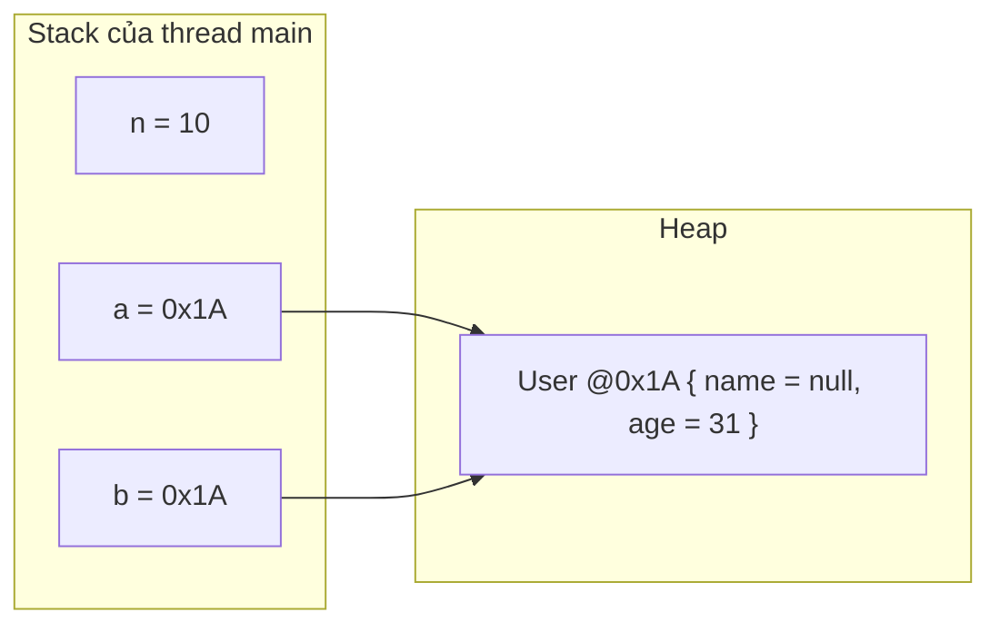
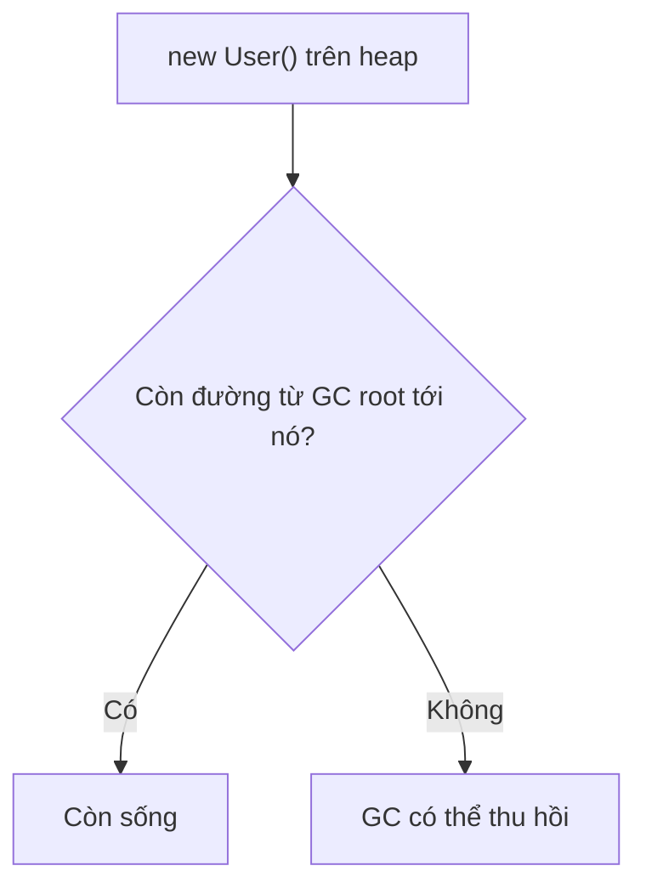

# Lý thuyết 2: Data type, reference và String

## Hai loại data type trong Java

Mọi variable trong Java thuộc một trong hai nhóm. Nhóm thứ nhất là **8 kiểu primitive** (`int`, `double`, `boolean`...): variable chứa thẳng giá trị, giống một chiếc hộp có số bên trong. Nhóm thứ hai là **kiểu reference** (mọi thứ còn lại: `String`, `List`, class của bạn, array): variable chỉ chứa **địa chỉ** trỏ tới một object nằm ở nơi khác, giống tờ giấy ghi địa chỉ nhà chứ không phải ngôi nhà. Bài này đi qua vị trí chúng nằm trong memory, wrapper (`Integer`...), `String` và cách so sánh chúng.

Vì sao phải học kỹ phần này? Các lỗi người mới hay dính như `==` khác `equals`, `NullPointerException`, tràn số, sửa tham số trong hàm mà bên ngoài đổi (hoặc không đổi) đều xuất phát từ việc chưa rõ dữ liệu nằm ở đâu trong memory và mỗi kiểu hành xử ra sao. Kiến thức này dùng ở mọi dòng code nên cần nắm chắc ngay từ đầu; khi so sánh chuỗi hoặc nối chuỗi trong vòng lặp lớn, hãy nhớ đến `equals` và `StringBuilder`.

Cách học gợi ý: với mỗi variable, hãy tự hỏi nó là primitive hay reference, nằm ở stack hay heap, rồi mới dự đoán hành vi. Hãy nhớ `String` là immutable (mỗi lần "sửa" là tạo chuỗi mới) và cẩn thận khi ép kiểu từ rộng sang hẹp, vì Java không báo lỗi khi mất dữ liệu.

**Cốt lõi:** Mỗi variable chỉ giữ một trong hai thứ: chính giá trị (primitive) hoặc địa chỉ trỏ tới object trên heap (reference). Phần lớn hành vi lạ như `==`, `NullPointerException`, sửa tham số đều suy ra từ sự khác biệt này.

- Vì `b = a` chỉ chép địa chỉ nên hai variable cùng trỏ một object, và `==` so địa chỉ chứ không so nội dung.
- Vì object phải sống lâu hơn method, được nhiều thread dùng chung và có kích thước chỉ biết lúc chạy, nên nó nằm trên heap còn stack chỉ giữ reference.
- Vì `String` immutable nên chia sẻ qua string pool và làm key `HashMap` an toàn, nhưng nối trong vòng lặp tạo nhiều chuỗi mới.



Mô hình tư duy: trước mỗi variable hãy hỏi nó giữ giá trị hay giữ địa chỉ, rồi mới dự đoán hành vi.

**Tóm tắt:**

- Mọi variable là primitive (giữ thẳng giá trị) hoặc reference (giữ địa chỉ tới object trên heap hoặc `null`); gần như mọi hành vi lạ đều suy ra từ đây.
- Stack riêng cho từng thread chứa variable cục bộ và tham số, heap chung chứa object và array, nên field primitive của object cũng nằm trên heap.
- `b = a` chỉ sao chép địa chỉ; `==` so địa chỉ, `equals` so nội dung, và Java luôn truyền theo giá trị.
- Object chỉ bị GC thu khi không còn đường reference từ GC root; memory leak trong Java là giữ reference thừa.
- Wrapper cache -128 đến 127 và unboxing `null` throw `NullPointerException`, nên so sánh wrapper luôn dùng `equals`.
- `String` immutable và có string pool, nên an toàn để chia sẻ và làm key của `HashMap`; nối trong vòng lặp dùng `StringBuilder`.
- `int` tràn thì quay vòng không báo lỗi, tiền dùng `BigDecimal`, và ép kiểu thu hẹp có thể mất dữ liệu.

## Các khái niệm cần biết

| Thuật ngữ | Nghĩa là gì | Dùng khi nào / vì sao quan trọng |
|---|---|---|
| Primitive | Kiểu giá trị đơn giản có sẵn (`int`, `long`, `double`, `boolean`, `char`...), không phải object, không thể là `null`. | Nhanh và nhẹ; dùng làm mặc định cho số, cờ đúng/sai. |
| Reference | Giá trị là địa chỉ của một object trên heap, hoặc `null`. | Gốc của `NullPointerException` và của việc hai variable cùng trỏ một object. |
| Frame | Khối nhớ trên stack tạo ra cho mỗi lần gọi method, chứa variable cục bộ và tham số. | Hết method là frame bị bỏ; đệ quy quá sâu gây `StackOverflowError`. |
| GC root | Điểm xuất phát mà GC lần theo để biết object còn sống: variable cục bộ của thread đang chạy, field `static`... | Object không còn đường từ GC root thì bị thu hồi; giữ đường thừa thì memory leak. |
| Wrapper và autoboxing | Wrapper (`Integer`, `Long`...) là bản object của primitive; autoboxing là tự chuyển qua lại. | Cần khi dùng với generic (`List<Integer>`) hoặc cần `null`; nhưng có bẫy cache và `NullPointerException` khi unboxing. |
| Immutable | Object không thể đổi sau khi tạo. `String` là ví dụ. | Chia sẻ giữa thread an toàn, dùng làm key `HashMap`. |
| String pool | Vùng nhớ lưu các chuỗi literal để dùng chung. | Tiết kiệm memory, và giải thích vì sao `==` trên chuỗi không đáng tin. |
| Escape analysis | Tối ưu của JIT: nếu object không "thoát" khỏi method thì có thể không cấp phát trên heap. | Chỉ là tối ưu ngầm, không đổi ngữ nghĩa. |
| Copy nông / copy sâu | Nông: chỉ sao chép reference, phần tử bên trong vẫn chung; sâu: sao chép cả object bên trong. | Sao chép `List` rồi sửa phần tử mà hai bên cùng đổi là lỗi copy nông. |
| Widening / narrowing | Ép kiểu mở rộng (an toàn, tự động) và thu hẹp (phải ép tay, có thể mất dữ liệu). | Ép `long` sang `int` không báo lỗi khi tràn. |
| BMP, code point | BMP là tập ký tự vừa trong 16 bit; ký tự ngoài đó (emoji) cần 2 `char`, gọi là cặp surrogate. Code point là số định danh ký tự trong Unicode. | `length()` và `charAt` tính theo `char`, nên với emoji dùng `codePoints()`. |

## Memory: stack và heap

Đây là phần nền tảng nhất: hiểu nó là hiểu `==` vs `equals`, truyền tham số, `NullPointerException`, memory leak, `StackOverflowError`, race condition.

### Bức tranh tổng thể



| | Stack | Heap |
|---|---|---|
| Phạm vi | **Riêng** từng thread | **Chung** mọi thread |
| Chứa gì | Variable cục bộ, tham số, địa chỉ trả về (mỗi lần gọi method là một **frame**) | Mọi **object** và **array** (kể cả `int[]`) |
| Cấp phát, giải phóng | Vào method thì đẩy frame, ra thì bỏ (LIFO), gần như miễn phí | `new` cấp phát; **GC** thu hồi khi không còn ai reference |
| Sống bao lâu | Đến hết method | Đến khi không còn đường reference tới |
| Kích thước | Nhỏ (khoảng 512KB-1MB mỗi thread, `-Xss`) | Lớn (GB, `-Xms/-Xmx`) |
| Hết memory | `StackOverflowError` (đệ quy quá sâu) | `OutOfMemoryError: Java heap space` |
| Thread-safe | Mặc định an toàn (không ai khác thấy) | Cần đồng bộ khi nhiều thread cùng sửa |

### Vì sao cần heap

Stack là vùng của **từng lần gọi method**: gọi vào thì có, ra khỏi thì mất. Nhưng object thường phải:

1. **Sống lâu hơn method tạo ra nó** (trả về, lưu vào `List`, giữ trong cache).
2. **Dùng chung giữa các thread** (stack của thread này không ai khác đọc được).
3. **Có kích thước chỉ biết lúc chạy** (`ArrayList`, array, chuỗi).

Vì thế object ở heap, còn stack chỉ giữ **reference** (một địa chỉ vài byte) trỏ tới nó. Cái giá: heap cần **GC** để dọn và cần **đồng bộ** khi nhiều thread cùng sửa.

### Quy tắc xác định dữ liệu nằm đâu

| Dữ liệu | Nằm ở | Ghi chú |
|---|---|---|
| Variable cục bộ/tham số **primitive** | Stack | Giá trị nằm trực tiếp trong frame |
| Variable cục bộ/tham số **reference** | Stack | Chỉ là địa chỉ; object thật ở heap |
| **Object** (`new`) | Heap | Gồm header, các field, kể cả field primitive |
| **Field primitive** của object | **Heap** | Nằm bên trong object, không phải stack |
| **Array** (`int[]`, `String[]`) | Heap | Array là object; `int[]` giữ giá trị, `String[]` giữ reference |
| Field `static` | Gắn với class (trong HotSpot từ Java 8, nằm trong object `Class` trên heap) | Object nó trỏ tới cũng ở heap; field static là GC root nên dễ gây rò rỉ |
| `String` literal | String pool (nằm trong heap) | Dùng chung, xem phần String |
| Class, bytecode, constant pool | Metaspace | Ngoài heap, memory native |

Nên nhớ ngắn gọn: **object và array ở heap; variable cục bộ và tham số ở stack (primitive giữ giá trị, reference giữ địa chỉ)**.

**Nền tảng:** Variable chỉ có hai dạng giá trị: primitive (giá trị nằm thẳng trong variable) hoặc reference (địa chỉ tới object trên heap). Hầu hết hành vi "lạ" của Java (`==`, `NullPointerException`, sửa tham số, memory leak) đều suy ra từ sự khác biệt này.

**Suy luận:** Object phải nằm trên heap vì stack gắn với một lần gọi method và biến mất khi method kết thúc, trong khi object thường phải sống lâu hơn nơi tạo ra nó, được nhiều thread dùng chung và có kích thước chỉ biết lúc chạy. Stack vì thế chỉ giữ reference nhỏ trỏ tới heap, và từ đó suy ra mọi hệ quả. Gán `b = a` chỉ chép địa chỉ nên hai variable cùng trỏ một object, và đây là gốc của lỗi "sửa chỗ này, chỗ kia đổi". `==` so địa chỉ nên hai object cùng nội dung vẫn khác nhau, trong khi variable cục bộ thread-safe vì stack không chia sẻ còn object trên heap thì không. Chỗ dễ nhầm là cho rằng `int age` trong object nằm trên stack, trong khi nó là field nên nằm cùng object trên heap, và gán `x = null` không giải phóng gì ngay, chỉ cắt một đường reference. Hệ quả hành động: khi gặp lỗi lạ, hãy vẽ ra variable nào trên stack trỏ tới object nào trên heap, và coi mọi field static hay cache giữ reference là ứng viên gây memory leak.

### Theo dõi từng bước

```java
class User { String name; int age; }

void main() {
    int n = 10;                      // (1)
    User a = new User();             // (2)
    a.age = 30;                      // (3)
    User b = a;                      // (4)
    b.age = 31;
    change(a, n);                    // (5)
}
void change(User u, int x) { u.age = 99; x = 0; u = null; }
```



1. `n` là primitive cục bộ: giá trị 10 nằm trên stack.
2. `new User()` cấp phát trên heap (`name = null`, `age = 0` mặc định); `a` giữ địa chỉ.
3. `age` là field primitive nhưng thuộc object, nên **nằm trên heap**.
4. `b = a` **sao chép địa chỉ**, không sao chép object: hai variable cùng trỏ một object, nên `b.age = 31` làm `a.age` cũng thành 31.
5. `change` nhận **bản sao** của giá trị mỗi tham số: `x = 0` chỉ sửa bản sao (không ảnh hưởng `n`); `u.age = 99` sửa object dùng chung nên `a.age` thành 99; `u = null` chỉ làm bản sao reference trỏ về null, `a` vẫn nguyên. Đó là **truyền theo giá trị** (với object, giá trị là địa chỉ).

**Phải thuộc:** Java chỉ truyền theo giá trị. `b = a` sao chép địa chỉ chứ không sao chép object. `==` trên reference so địa chỉ, `equals` so nội dung (khi class đã override).

### Lifecycle và GC



- Object không "chết" khi method kết thúc; nó chỉ **đủ điều kiện thu hồi** khi không còn reference tới từ **GC root** (variable cục bộ trên stack của thread đang sống, field static, ...).
- Gán `x = null` không giải phóng memory ngay; chỉ cắt một đường reference.
- **Memory leak** trong Java không phải quên `free`, mà là **còn reference không cần thiết** (static map, cache không giới hạn, listener, ThreadLocal), khiến GC không dọn được. Xem [GC chuyên sâu](/go?p=08-Java%2FJava-Core%2Fhard%2Flt-18-gc-chuyen-sau.md).

### Stack, heap và multithreading

- Variable cục bộ **thread-safe** vì mỗi thread có stack riêng.
- Object ở heap mà nhiều thread cùng đọc/ghi thì **không an toàn** nếu không đồng bộ: đây là gốc của race condition, `synchronized`, `volatile` ([Java Memory Model](/go?p=08-Java%2FJava-Core%2Fhard%2Flt-17-java-memory-model-sau.md)).
- Object **immutable** (`String`, `record` có field immutable) chia sẻ giữa thread an toàn mà không cần lock.
- Lambda/inner class chỉ bắt variable cục bộ **effectively final**: giá trị được sao chép vào object lambda trên heap, vì frame có thể đã biến mất khi lambda chạy sau đó.

### Lỗi thường gặp và nguyên nhân

| Hiện tượng | Nguyên nhân memory |
|---|---|
| `==` trên object cho `false` dù nội dung giống | `==` so **địa chỉ**; hai object khác nhau trên heap. Dùng `equals` |
| Sửa tham số trong hàm làm đổi object của người gọi | Hai reference cùng trỏ **một** object; gán lại tham số thì không ảnh hưởng |
| `NullPointerException` | Reference trên stack không trỏ tới object nào (`null`); gọi method qua nó |
| `StackOverflowError` | Đệ quy sâu quá, đầy stack của thread; thêm điều kiện dừng hoặc chuyển sang vòng lặp |
| `OutOfMemoryError: Java heap space` | Heap đầy do dữ liệu quá lớn hoặc rò rỉ; phân tích heap dump ([công cụ chẩn đoán](/go?p=08-Java%2FJava-Core%2Fhard%2Flt-32-cong-cu-chan-doan-jvm.md)) |
| `List<Integer>` tốn hơn `int[]` | Mỗi `Integer` là một object trên heap (header + giá trị) cộng một reference |
| Hai `List` "sao chép" lại cùng đổi | Chỉ sao chép reference (copy nông), phần tử vẫn chung. Cần copy sâu |

### Điểm tinh tế

- **Escape analysis** (JIT): nếu chứng minh được object không thoát khỏi method, JVM có thể **không cấp phát trên heap** mà tách các field vào thanh ghi/stack (scalar replacement). Về ngữ nghĩa vẫn coi như ở heap; đây chỉ là tối ưu. Xem [JIT và Benchmark](/go?p=08-Java%2FJava-Core%2Fhard%2Flt-19-jit-benchmark.md).
- **Memory ngoài heap**: Metaspace, stack thread, code cache, `DirectByteBuffer`. Vì thế process dùng RAM nhiều hơn `-Xmx`; cần chừa chỗ khi cấu hình container.
- Mỗi object có **header** (khoảng 12-16 byte) cộng căn chỉnh 8 byte, nên object nhỏ vẫn tốn memory.
- Heap chia thế hệ (young/old) để GC hiệu quả: xem [Kiến trúc JVM](/go?p=08-Java%2FJava-Core%2Fhard%2Flt-16-jvm-architecture-classloading.md).

## 8 kiểu nguyên thủy

Vấn đề đặt ra là chọn kiểu nào cho đúng. Quy tắc thực dụng: số nguyên thì `int` (dùng `long` khi vượt khoảng 2,1 tỷ, ví dụ id, timestamp), số thực thì `double`, cờ thì `boolean`. Đừng dùng `float`/`double` cho tiền, vì chúng lưu số theo hệ nhị phân nên không biểu diễn chính xác nhiều số thập phân. Hậu quả là sai số nhỏ tích lũy, đối soát tiền lệch từng xu.

| Kiểu | Kích thước | Ghi chú |
|---|---|---|
| `byte`, `short`, `int`, `long` | 8, 16, 32, 64 bit | `int` mặc định; `long` thêm hậu tố `L` |
| `float`, `double` | 32, 64 bit | Số thực nhị phân, **không chính xác** cho tiền |
| `char` | 16 bit | Đơn vị UTF-16 |
| `boolean` | | `true`/`false` |

```java
System.out.println(0.1 + 0.2);                 // 0.30000000000000004
System.out.println(Integer.MAX_VALUE + 1);     // -2147483648 (tràn số, không báo lỗi)
BigDecimal price = new BigDecimal("0.10").add(new BigDecimal("0.20")); // 0.30
```

Tiền và số cần chính xác: dùng `BigDecimal` (khởi tạo từ chuỗi), hoặc lưu số nguyên đơn vị nhỏ nhất.

**Phải thuộc:** 8 kiểu primitive: `byte` 8, `short` 16, `int` 32, `long` 64, `float` 32, `double` 64, `char` 16 (UTF-16), `boolean`. `int` tràn thì quay vòng không báo lỗi (`Integer.MAX_VALUE + 1` ra `-2147483648`). Tiền dùng `BigDecimal` khởi tạo từ chuỗi.

## Wrapper và autoboxing

Wrapper tồn tại vì generic và collection chỉ làm việc với object: `List<int>` không hợp lệ, phải dùng `List<Integer>`. Java tự chuyển qua lại giữa `int` và `Integer` (autoboxing/unboxing) cho tiện. Khi nào dùng wrapper: trong collection, hoặc khi cần biểu diễn "không có giá trị" bằng `null`. Khi nào không: trong vòng lặp tính toán nặng, vì mỗi lần boxing có thể tạo object mới và chậm hơn nhiều. Cạm bẫy:

```java
Integer a = 127, b = 127;   System.out.println(a == b);   // true  (cache -128..127)
Integer c = 1000, d = 1000; System.out.println(c == d);   // false (đối tượng khác nhau)
// NullPointerException khi unboxing
Integer x = null; int y = x;
```

Luôn so sánh wrapper bằng `equals`.

**Phải thuộc:** `Integer` cache -128 đến 127; unboxing `null` throw `NullPointerException`. `String` immutable; literal dùng chung trong string pool, `new String(...)` luôn tạo object mới; nối chuỗi trong vòng lặp dùng `StringBuilder`.

## String

`String` là kiểu được dùng nhiều nhất, và hai đặc điểm của nó giải thích hầu hết hành vi lạ:

- **Immutable**: mọi phép "sửa" (`toUpperCase`, `replace`, `+`) tạo chuỗi mới, chuỗi cũ giữ nguyên. Đổi lại, `String` an toàn khi chia sẻ giữa thread và làm key `HashMap` (hash không đổi).
- **String pool**: literal `"abc"` dùng chung một object; `new String("abc")` luôn tạo object mới. Có thể ép vào pool bằng `intern()`, nhưng hiếm khi cần.

```java
String s1 = "java", s2 = "java", s3 = new String("java");
s1 == s2          // true
s1 == s3          // false
s1.equals(s3)     // true: luôn dùng equals để so nội dung
```

| Cần | Dùng |
|---|---|
| Nối vài chuỗi | `+` hoặc `String.format`, `formatted` |
| Nối trong vòng lặp | `StringBuilder` (không đồng bộ, nhanh); dùng `+` trong vòng lặp sẽ tạo nhiều chuỗi trung gian, chậm dần khi chuỗi dài |
| Nối nhiều phần tử có phân cách | `String.join`, `Collectors.joining` |
| Chuỗi nhiều dòng | Text block `"""..."""` |

**Suy luận:** `String` được thiết kế immutable để chuỗi dùng chung an toàn: vì nội dung không bao giờ đổi, string pool mới có thể cho nhiều variable cùng trỏ một object mà không ai bị ảnh hưởng. Cũng vì không đổi nên `hashCode` tính một lần rồi nhớ được, nên `String` làm key `HashMap` an toàn và không bị "lạc" bucket sau khi sửa. Thứ ba, không thread nào sửa được nội dung nên chia sẻ giữa các thread không cần lock, và các giá trị đã kiểm tra như đường dẫn hay URL không bị đổi sau đó. Cái giá phải trả là mỗi phép `+` hay `replace` tạo chuỗi mới, nên nối trong vòng lặp tạo hàng loạt object trung gian và phải dùng `StringBuilder`. Điểm dễ nhầm là `new String("a") == "a"` cho `false` vì `new` luôn tạo object mới ngoài pool, nên so sánh nội dung phải dùng `equals`. Khi review, hãy tìm `==` giữa chuỗi và `+` trong vòng lặp.

## Chuyển kiểu

Chuyển kiểu là chuyện biến giá trị của kiểu này thành kiểu khác, và Java chia theo chiều có mất thông tin hay không:

- **Mở rộng** (`int` sang `long`): tự động, an toàn.
- **Thu hẹp** (`long` sang `int`): phải ép `(int)`, có thể mất dữ liệu. Dùng `Math.toIntExact` để báo lỗi khi tràn.
- Phép chia hai `int` là chia nguyên: `5 / 2 == 2`.

## Điều cần nhớ

- Java **truyền theo giá trị**; với object, giá trị đó là bản sao của reference.
- `String` immutable nên an toàn để làm key `HashMap` và chia sẻ giữa thread.
- `char` và `String` với ký tự ngoài BMP (emoji) cần `codePoints()`.
- Dùng `Objects.equals(a, b)` để so sánh an toàn khi có thể `null`.

## Phỏng vấn khó: chuỗi hỏi xoáy

Người phỏng vấn senior thường mở bằng câu dễ rồi xoáy xuống cơ chế, đánh đổi và sự cố thật. Câu trả lời tốt luôn đi từ cốt lõi xuống.

### Chuỗi 1: So sánh String và wrapper

1. **Câu mở:** `new String("java") == "java"` cho ra gì? `equals` thì sao?
2. **Xoáy 1:** String pool là gì, `intern()` làm gì, và vì sao pool chỉ tồn tại được khi `String` immutable?
3. **Xoáy 2:** Vì sao `Integer a = 127, b = 127` thì `a == b` đúng còn với 1000 thì sai? Có nên dựa vào ranh giới đó không?

**Đáp án ngắn:** `==` trên reference so địa chỉ, `equals` so nội dung khi class đã override. Literal `"java"` dùng chung một object trong string pool, còn `new String(...)` luôn tạo object mới ngoài pool, nên `==` cho `false` và `equals` cho `true`. Pool chia sẻ được vì `String` immutable: không ai sửa được nội dung nên nhiều variable cùng trỏ một object là an toàn. `intern()` ép chuỗi vào pool nhưng hiếm khi cần. Autoboxing dùng cache cho khoảng -128 đến 127, nên hai `Integer` trong khoảng đó là cùng một object, ngoài khoảng là hai object khác nhau. Khoảng này chỉ là mặc định, nên `==` đúng chỉ là tình cờ. Wrapper còn bẫy thứ hai: unboxing `null` throw `NullPointerException`. Vì vậy so sánh chuỗi và wrapper luôn dùng `equals` hoặc `Objects.equals`.

**Sai lầm hay gặp:**

- Giải thích `==` đúng với số nhỏ như một quy tắc để dùng, thay vì coi đó là hiệu ứng phụ của cache.
- Nói `String` immutable chỉ vì "thread-safe" mà bỏ qua việc nó là điều kiện để pool chia sẻ được.
- Quên rằng unboxing `null` gây `NullPointerException`.

### Chuỗi 2: Memory leak trong Java

1. **Câu mở:** Java có GC thì còn memory leak không?
2. **Xoáy 1:** GC quyết định một object còn sống hay không bằng cách nào? Gán `x = null` có giải phóng memory ngay không?
3. **Xoáy 2:** Production báo `OutOfMemoryError: Java heap space` sau vài giờ chạy. Bạn nghi gì và kiểm tra thế nào? Khác gì `StackOverflowError`?

**Đáp án ngắn:** Còn, vì leak trong Java không phải quên `free` mà là còn giữ reference không cần thiết. GC lần theo đường reference từ GC root như variable cục bộ của thread đang chạy hay field `static`; object nào không còn đường tới thì mới đủ điều kiện thu hồi. Vì vậy `x = null` chỉ cắt một đường, không giải phóng ngay, và object vẫn sống nếu còn đường khác. Thủ phạm hay gặp là `static` map, cache không giới hạn, listener không gỡ và `ThreadLocal`. Khi gặp `OutOfMemoryError` theo thời gian, tôi lấy heap dump và xem loại object nào chiếm nhiều nhất, ai đang giữ chúng. Hai lỗi này khác nguồn: `StackOverflowError` là đệ quy quá sâu làm đầy stack của một thread, còn lỗi heap là heap đầy vì dữ liệu quá lớn hoặc rò rỉ. Cũng cần nhớ process dùng RAM nhiều hơn `-Xmx` vì còn Metaspace và stack thread.

**Sai lầm hay gặp:**

- Nói "có GC nên không bao giờ leak".
- Nhầm `OutOfMemoryError` với `StackOverflowError`, hoặc nghĩ `x = null` giải phóng memory tức thì.
- Chỉ nói "tăng `-Xmx`" mà không tìm ai giữ reference.

