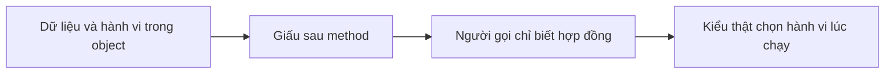
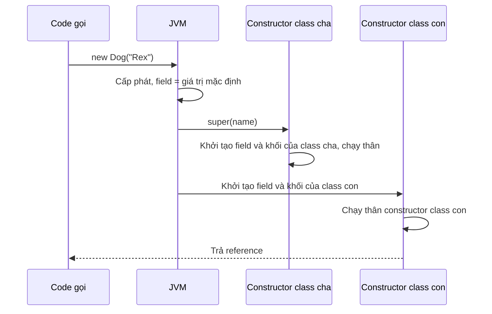
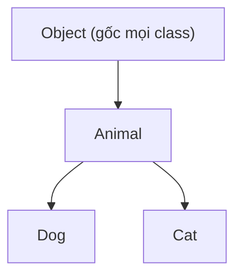
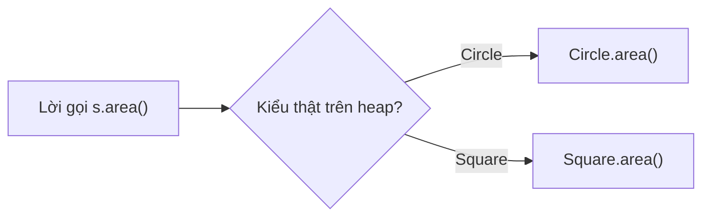
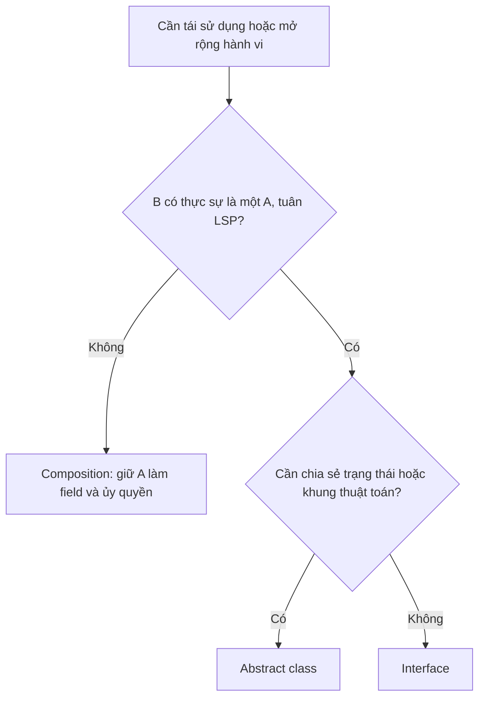

# Lý thuyết 3: Lập trình hướng object (OOP)

## OOP giải quyết vấn đề gì?

Hãy tưởng tượng một chương trình quản lý đơn hàng viết toàn bằng hàm và variable rời rạc: danh sách món nằm ở variable này, tổng tiền ở variable kia, mười hàm khác nhau cùng sửa chúng. Khi dự án lớn lên, sửa một chỗ làm hỏng chỗ khác, và ai cũng chạm được vào dữ liệu của nhau mà không ai chịu trách nhiệm giữ cho nó đúng. Lập trình hướng object (OOP) giải quyết bằng cách gom dữ liệu và các hành vi làm việc với dữ liệu đó vào cùng một **object**. Ví dụ `Order` giữ danh sách món và có method tính tổng; muốn thay đổi cách tính, bạn chỉ sửa trong `Order` mà không kéo theo cả hệ thống.

OOP có bốn ý chính. **Encapsulation**: giấu dữ liệu bên trong, chỉ mở những method cần thiết. **Kế thừa**: class con tái sử dụng và mở rộng class cha. **Polymorphism**: cùng một lời gọi, các object khác nhau xử lý theo cách riêng. **Trừu tượng**: chỉ nói "làm gì", che "làm thế nào". Bốn ý này sẽ lần lượt được giải thích kèm ví dụ bên dưới.

Hãy dùng OOP khi mô hình hóa nghiệp vụ hoặc viết thư viện. Bạn cũng nên nắm chắc nó trước khi học Spring, vì IoC, proxy, AOP đều dựa trên polymorphism và interface. Ngược lại, với việc nhỏ chỉ xử lý dữ liệu một chiều (đọc file, biến đổi, ghi ra) thì không cần ép mọi thứ thành class. Về cách làm: để field `private`, chỉ mở method `public` cần thiết, cho các phần giao tiếp với nhau qua interface. Muốn tái sử dụng code thì ưu tiên **composition** (chứa object khác) hơn inheritance, vì kế thừa ràng buộc rất chặt.

**Cốt lõi:** OOP gom dữ liệu và hành vi vào một object để chính object đó chịu trách nhiệm giữ dữ liệu luôn hợp lệ. Bên ngoài chỉ giao tiếp qua hợp đồng, còn cách thực hiện cụ thể do kiểu thật của object quyết định lúc chạy.

- Vì ai cũng sửa được dữ liệu thì không ai giữ nó đúng, nên field `private` và trạng thái chỉ đổi qua method tự kiểm tra ràng buộc (invariant).
- Vì object trên heap mang theo kiểu thật của nó, nên method instance được chọn lúc chạy, còn overload, field và `static` chọn theo kiểu khai báo lúc biên dịch.
- Vì kế thừa gắn chặt class con vào cài đặt class cha, nên chỉ dùng khi đúng quan hệ "là-một" (Liskov), còn lại dùng composition và interface.



Mô hình tư duy: object giữ dữ liệu của mình, người ngoài chỉ thấy hợp đồng, và thêm kiểu mới không buộc nơi gọi phải đổi.

**Tóm tắt:**

- OOP gom dữ liệu và hành vi vào object để mỗi object tự chịu trách nhiệm giữ cho dữ liệu của nó đúng.
- Encapsulation giữ invariant: field `private`, trạng thái chỉ đổi qua method tự kiểm tra ràng buộc.
- Inheritance chỉ hợp khi quan hệ "là-một" thật sự và class con tuân Liskov; còn lại dùng composition.
- Polymorphism chọn method instance theo kiểu thật lúc chạy; overload, field và `static` chọn theo kiểu khai báo lúc biên dịch.
- Abstraction định nghĩa "làm gì" bằng interface hoặc abstract class; mặc định chọn interface, abstract class khi cần chia sẻ state hay khung thuật toán.
- Thứ tự khởi tạo là class cha trước class con, nên gọi method có thể bị override trong constructor là cái bẫy kinh điển.
- Java hiện đại thêm `record` cho dữ liệu immutable và `sealed` cho tập class con đóng, giúp `switch` kiểm tra đủ trường hợp.

## Các khái niệm cần biết

| Thuật ngữ | Nghĩa là gì | Dùng khi nào / vì sao quan trọng |
|---|---|---|
| Invariant | Điều kiện luôn phải đúng với object, ví dụ "số dư không âm". | Encapsulation tồn tại để giữ invariant; setter công khai tùy tiện sẽ phá nó. |
| Delegation (ủy quyền) | Object A giữ object B và chuyển lời gọi cho B làm. | Nền của composition; thay cho kế thừa khi chỉ muốn dùng lại hành vi. |
| Dispatch động / vtable | Cách JVM chọn đúng method theo kiểu thật của object lúc chạy, thường qua bảng method ảo (vtable). | Là cơ chế đằng sau polymorphism. |
| Covariant return | Method override được trả về kiểu con của kiểu trả về gốc. | Giúp class con trả về kiểu cụ thể hơn mà không cần ép kiểu. |
| Template method | Class cha định khung thuật toán bằng một method `final`, gọi các bước trừu tượng để class con điền vào. | Dùng khi quy trình cố định nhưng một vài bước thay đổi. |
| Open/Closed | Mở để thêm hành vi mới, đóng để không phải sửa code cũ. | Polymorphism giúp thêm kiểu mới mà nơi dùng không đổi. |
| Sealed | Class/interface chỉ cho phép một danh sách class con cố định. | Cho `switch` kiểm tra đầy đủ các trường hợp lúc biên dịch. |

## Bản đồ nội dung

Bài đi lần lượt qua: nền (class, object, constructor), encapsulation, kế thừa, polymorphism, trừu tượng (abstract class, interface) và thiết kế (composition, record, sealed).

## Class và object

- **Class** là bản thiết kế (kiểu): khai báo thuộc tính và hành vi. **Object** là một thể hiện cụ thể tạo bằng `new`, nằm trên **heap** ([Stack và Heap](/go?p=08-Java%2FJava-Core%2Feasy%2Flt-02-kieu-du-lieu-string.md)).
- Variable kiểu class chỉ giữ **reference** tới object.

```java
public class Account {
    private final String id;          // thuộc tính (field), mỗi đối tượng một bản
    private long balance;
    private static int created = 0;   // thuộc về lớp, dùng chung mọi đối tượng

    // constructor: không có kiểu trả về, tên trùng lớp
    public Account(String id) {
        this.id = id;
        created++;
    }
    public long balance() { return balance; }   // phương thức (hành vi)
}
```

### Constructor

| Quy tắc | Ghi chú |
|---|---|
| Không khai báo constructor | Trình biên dịch tự thêm constructor mặc định không tham số |
| Đã khai báo bất kỳ constructor nào | Constructor mặc định **không** còn được thêm |
| `this(...)` | Gọi constructor khác trong cùng class (phải ở dòng đầu) |
| `super(...)` | Gọi constructor class cha (mặc định ngầm gọi `super()`) |
| Constructor private | Chặn tạo từ ngoài: singleton, factory, class tiện ích |

Khi có nhiều tham số tùy chọn, dùng **static factory** (`Money.of(...)`) hoặc **Builder** thay vì nhiều constructor (xem [Thiết kế API](/go?p=08-Java%2FJava-Core%2Fhard%2Flt-23-api-design-effective-java.md)).

### Thứ tự khởi tạo và lifecycle

`new` cấp phát memory với giá trị mặc định → constructor cha → khởi tạo field và khối `{}` của class con → thân constructor. Object "chết" khi không còn reference tới nó và GC thu hồi. Chi tiết xem [Enum, class Object, class lồng, thứ tự khởi tạo](/go?p=08-Java%2FJava-Core%2Feasy%2Flt-25-enum-object-inner-class.md).



Đọc sơ đồ: class cha luôn xong trước class con. Đó là lý do gọi một method có thể bị override trong constructor cha là nguy hiểm: lúc đó field của class con vẫn còn giá trị mặc định (`null`, `0`).

**Phải thuộc:** Thứ tự khởi tạo khi `new`: giá trị mặc định cho field, constructor class cha (kèm field và khối khởi tạo của cha), field và khối khởi tạo của class con, rồi thân constructor class con. Không khai báo constructor thì có constructor mặc định; đã khai báo bất kỳ constructor nào thì mất.

## Access modifier (phạm vi truy cập)

| Modifier | Cùng class | Cùng package | Class con (khác package) | Mọi nơi |
|---|---|---|---|---|
| `private` | Có | Không | Không | Không |
| *(mặc định, package-private)* | Có | Có | Không | Không |
| `protected` | Có | Có | Có | Không |
| `public` | Có | Có | Có | Có |

Nguyên tắc: **mở ít nhất có thể**. Mặc định `private`, chỉ nới khi có lý do. Với module (Java 9+), `public` còn phải được `exports` mới thấy từ ngoài module.

**Phải thuộc:** Bốn mức truy cập từ hẹp đến rộng: `private`, package-private (mặc định), `protected` (cùng package và class con), `public`.

## Encapsulation

Giấu trạng thái, chỉ lộ hành vi; ràng buộc nằm **trong** class để bảo vệ **invariant** của object.

```java
public class Account {
    private long balance;

    public void withdraw(long amount) {
        if (amount <= 0) throw new IllegalArgumentException("amount phải > 0");
        if (amount > balance) throw new IllegalStateException("không đủ số dư");
        balance -= amount;
    }
}
```

- Không có `setBalance` công khai: không ai đặt được trạng thái sai.
- **Đừng sinh getter/setter cho mọi field**; điều đó chỉ là public field trá hình. Hãy lộ **hành vi** (`withdraw`, `deposit`) thay vì dữ liệu.
- Trả về collection nội bộ phải sao chép hoặc bọc không sửa được (`List.copyOf`, `Collections.unmodifiableList`), nếu không bên ngoài phá được invariant.
- **Object immutable** (không sửa sau khi tạo: field `final`, không setter, không lộ reference sửa được, class `final`) thread-safe và dễ suy luận (`String`, `LocalDate`, `record`).

**Nền tảng:** Encapsulation tồn tại để bảo vệ invariant: trạng thái chỉ đổi qua các method tự kiểm tra ràng buộc, không qua field hay setter tùy tiện. Mọi nguyên tắc thiết kế sau (immutable, composition, interface) đều phục vụ mục tiêu giảm ràng buộc và giữ object luôn hợp lệ.

## Inheritance

```java
class Animal {
    protected final String name;
    Animal(String name) { this.name = name; }
    String speak() { return "..."; }
}
class Dog extends Animal {
    Dog(String name) { super(name); }          // gọi constructor cha trước
    @Override String speak() { return "Gâu"; }
}
```



- Quan hệ **"là-một"** (Dog is-an Animal). Class con thừa hưởng field và method không `private`.
- Java chỉ có **đơn kế thừa class** (tránh nhập nhằng "kim cương"); đa kế thừa **kiểu** qua interface.
- Mọi class ngầm kế thừa `Object`.
- `final class` không cho kế thừa; `final` method không cho override; constructor **không** được kế thừa.
- `super.method()` gọi bản của class cha.

### Quy tắc ghi đè (override)

| Điều kiện | Chi tiết |
|---|---|
| Cùng tên và danh sách tham số | Nếu khác tham số là overload, không phải override |
| Quyền truy cập | Không được **hẹp hơn** class cha |
| Kiểu trả về | Cùng kiểu hoặc **kiểu con** (covariant) |
| Checked exception | Không throw thêm/rộng hơn |
| `static`, `private`, `final` | Không override được (static chỉ bị **che**) |
| `@Override` | Luôn dùng để trình biên dịch catch lỗi chữ ký |

**Phải thuộc:** Quy tắc override: cùng tên và tham số; quyền truy cập không hẹp hơn; kiểu trả về cùng hoặc kiểu con; không throw thêm checked exception rộng hơn. `static`, `private`, `final` không override được.

### Nguyên tắc thay thế Liskov (LSP)

Object class con phải dùng được **ở bất cứ đâu** dùng class cha mà không phá hành vi mong đợi. Ví dụ kinh điển vi phạm: `Square extends Rectangle` (đặt chiều rộng làm đổi chiều cao). Khi class con phải throw `UnsupportedOperationException` hoặc làm yếu contract, kế thừa đang sai chỗ. Xem [SOLID](/go?p=08-Java%2FJava-Core%2Fmedium%2Flt-14-solid-design-patterns.md).

## Polymorphism

```java
interface Shape { double area(); }
record Circle(double r) implements Shape { public double area() { return Math.PI * r * r; } }
record Square(double a) implements Shape { public double area() { return a * a; } }

Shape s = new Circle(2);     // kiểu tĩnh (khai báo): Shape; kiểu thật: Circle
s.area();                    // JVM chọn Circle.area lúc chạy
```



- **Upcast** (con → cha) tự động và an toàn: `Animal a = new Dog("Rex")`.
- **Downcast** (cha → con) phải tường minh, có thể throw `ClassCastException`; kiểm tra trước bằng pattern matching: `if (a instanceof Dog d) d.fetch();`.
- **Dispatch động**: method instance được chọn theo **kiểu thật** lúc chạy (bảng method ảo, vtable).
- **Không polymorphism**: field, method `static`, `private`, và việc chọn **overload** (chọn lúc biên dịch theo kiểu khai báo).

| | Overload | Override |
|---|---|---|
| Chọn lúc | **Biên dịch** (static binding) | **Chạy** (dynamic binding) |
| Dựa vào | Kiểu khai báo của tham số | Kiểu thật của object |

Giá trị lớn nhất của polymorphism: **thêm kiểu mới mà không sửa nơi dùng** (nguyên tắc Open/Closed). Code gọi `Shape.area()` không cần biết có bao nhiêu hình.

**Suy luận:** Polymorphism hoạt động được vì một variable kiểu khai báo `Shape` chỉ là reference, còn object thật trên heap luôn mang theo thông tin class thật của nó. Khi gặp `s.area()`, JVM không quyết định lúc biên dịch mà tra bảng method ảo của object thật, nên cùng một dòng code chạy ra hành vi khác nhau. Từ đó suy ra hệ quả đầu tiên: thêm một class mới implement `Shape` thì nơi gọi không phải sửa, đây chính là Open/Closed. Hệ quả thứ hai là chỉ những thứ nằm trong bảng method ảo mới polymorphic. Field, method `static` và `private` không nằm trong đó nên chúng được chọn theo kiểu khai báo, và overload được chọn lúc biên dịch theo kiểu của tham số. Chỗ dễ nhầm nhất là `Animal a = new Dog(); a.name` đọc field của `Animal`, hay `equals(Dog d)` tưởng là override nhưng thực ra là overload, nên `HashSet` vẫn gọi `equals(Object)` cũ. Vì vậy khi review phải luôn có `@Override`, và đừng trông chờ field hay `static` "ghi đè" được.

**Nền tảng:** Polymorphism lúc chạy: method instance được chọn theo kiểu thật của object (dynamic dispatch), còn overload, field, `static` được chọn theo kiểu khai báo lúc biên dịch. Spring (proxy, IoC, AOP) hoạt động dựa trên cơ chế này.

## Abstraction

Tập trung vào **"làm gì"** (contract), che **"làm thế nào"** (cài đặt). Bạn lái xe bằng vô lăng và bàn đạp mà không cần biết động cơ bên trong là xăng hay điện. Trong code, người gọi `Notifier.send(...)` không cần biết đó là email hay SMS, nên bạn đổi cách gửi mà không sửa nơi gọi. Java có hai công cụ:

```java
// abstract class: gốc chung có sẵn trạng thái
abstract class Report {
    private final String title;
    Report(String title) { this.title = title; }
    public final String render() { return title + "\n" + body(); }   // template method
    protected abstract String body();      // lớp con bắt buộc cài
}

interface Notifier {                       // interface: hợp đồng, khả năng
    void send(String to, String msg);
    default void sendAll(List<String> tos, String msg) { tos.forEach(t -> send(t, msg)); }
    static Notifier noop() { return (to, msg) -> {}; }
}
```

| | Interface | Abstract class |
|---|---|---|
| Mục đích | Contract, khả năng ("có thể làm gì") | Gốc chung có sẵn trạng thái/cài đặt dở |
| Kế thừa | Cài **nhiều** interface | Kế thừa **một** class |
| Field | Chỉ hằng `public static final` | Có field thường |
| Constructor | Không | Có (gọi qua `super`) |
| Method | trừu tượng, `default`, `static`, `private` (Java 9+) | Trừu tượng và cụ thể, mọi mức truy cập |
| Khi dùng | Mặc định chọn; tách rời, dễ thay/giả lập | Cần chia sẻ trạng thái hoặc khung thuật toán |

- Không `new` được interface hay abstract class (chỉ `new` class cụ thể hoặc class ẩn danh).
- **Functional interface**: đúng một abstract method (`@FunctionalInterface`), dùng với lambda ([Lambda và Stream](/go?p=08-Java%2FJava-Core%2Fmedium%2Flt-09-lambda-stream.md)).
- **Default method** cho phép thêm method vào interface mà không phá các class cài sẵn. Nếu hai interface có `default` trùng tên, class phải ghi đè và chọn bằng `A.super.m()`.
- **Marker interface** (không method, như `Serializable`) đánh dấu khả năng; ngày nay thường dùng annotation.
- Lập trình **theo interface**: khai báo `List<String> xs = new ArrayList<>()`, nhận `Notifier` thay vì class cụ thể. Đây cũng là nền cho DI và mock khi test.

**Phải thuộc:** Interface: cài nhiều, chỉ có hằng và method (abstract, `default`, `static`, `private`), không constructor. Abstract class: kế thừa một, có field và constructor. Mặc định chọn interface; abstract class khi cần chia sẻ trạng thái hoặc khung thuật toán. Ưu tiên composition hơn inheritance.

Khi cần tái sử dụng hoặc mô hình hóa, hãy chọn theo flow sau.



Đọc sơ đồ: kế thừa chỉ là lựa chọn khi quan hệ "là-một" đúng thật sự; ngay cả khi đúng, interface vẫn là mặc định, abstract class dành cho khi có trạng thái hay khung thuật toán dùng chung. Mọi trường hợp còn lại là composition.

## Composition hơn inheritance

Kế thừa tạo ràng buộc chặt (class con phụ thuộc chi tiết cài đặt class cha, dễ gãy khi class cha đổi). **Composition**: giữ object khác làm thành phần và **ủy quyền**.

```java
// Thay vì "class Stack extends ArrayList" (lộ cả get(i), add(i, x)... phá hợp đồng ngăn xếp)
class Stack<T> {
    private final List<T> items = new ArrayList<>();
    void push(T t) { items.add(t); }
    T pop() { return items.remove(items.size() - 1); }
}
```

| | Kế thừa | Composition |
|---|---|---|
| Quan hệ | "là-một" | "có-một" / "dùng" |
| Ràng buộc | Chặt, tĩnh (lúc biên dịch) | Lỏng, đổi được lúc chạy |
| Lộ API | Lộ cả API class cha | Chỉ lộ cái bạn chọn |
| Dùng khi | Quan hệ phân loại thật sự, tuân LSP | Mặc định |

Spring cũng vậy: ghép các bean qua interface thay vì dựng cây inheritance.

**Suy luận:** Inheritance gắn class con vào cài đặt của class cha ngay lúc biên dịch: con thừa hưởng mọi method public, và hành vi của nó phụ thuộc vào cách cha gọi nội bộ các method khác. Vì vậy chỉ cần cha đổi một chi tiết cài đặt, mọi class con có thể vỡ mà không ai sửa gì, đây là vấn đề "base class mong manh". Thứ hai, con lộ ra toàn bộ API của cha: `Stack extends ArrayList` cho phép `add(0, x)` và phá hẳn contract của stack. Composition tránh cả hai điều đó vì class chỉ giữ object khác làm field và chỉ mở những method nó chọn, lại thay được thành phần lúc chạy. Điểm dễ nhầm là nghĩ kế thừa là cách tái sử dụng code mặc định, trong khi nó chỉ đúng khi mọi chỗ dùng cha đều dùng con được (Liskov). Khi thiết kế, hãy hỏi "B có thực sự là một A không" trước, nếu không chắc thì chọn composition cộng interface.

## Record, enum, sealed

| Công cụ | Dùng cho |
|---|---|
| `record Point(int x, int y)` | Object dữ liệu **immutable**: tự sinh constructor, getter (`x()`), `equals`, `hashCode`, `toString`; không kế thừa class khác nhưng cài được interface |
| `enum` | Tập giá trị cố định, có thể có field và hành vi ([Enum](/go?p=08-Java%2FJava-Core%2Feasy%2Flt-25-enum-object-inner-class.md)) |
| `sealed` | Giới hạn các class con được phép, dùng cùng `switch` pattern để duyệt **đầy đủ** các trường hợp (Java 17+) |

```java
sealed interface Payment permits Card, Cash {}
record Card(String no) implements Payment {}
record Cash(long amount) implements Payment {}

String describe(Payment p) {
    return switch (p) {                 // trình biên dịch kiểm tra đủ trường hợp
        case Card c -> "thẻ " + c.no();
        case Cash c -> "tiền mặt " + c.amount();
    };
}
```

## Các quy tắc thiết kế cần nhớ

- **Tell, don't ask**: bảo object làm việc thay vì lấy dữ liệu ra rồi xử lý bên ngoài.
- **Một trách nhiệm** cho mỗi class; tránh class "thần thánh" ôm mọi việc ([SOLID](/go?p=08-Java%2FJava-Core%2Fmedium%2Flt-14-solid-design-patterns.md)).
- **Mô hình thiếu máu (anemic)**: class chỉ có getter/setter còn logic dồn hết vào service. Không sai tuyệt đối (JPA entity, DTO), nhưng đừng để nghiệp vụ cốt lõi rơi vào trạng thái rải rác.
- **Contract `equals/hashCode/toString/compareTo`** phải nhất quán ([Collections](/go?p=08-Java%2FJava-Core%2Feasy%2Flt-05-collections-co-ban.md), [Iterator, Comparator](/go?p=08-Java%2FJava-Core%2Fmedium%2Flt-26-iterator-comparator-bigdecimal.md)).
- **Method chaining** (fluent API): method trả `this` hoặc object mới để gọi nối tiếp (Builder, `StringBuilder`, `Stream`).

## Từ khóa quan trọng

| Từ khóa | Ý nghĩa |
|---|---|
| `final` | Variable không gán lại; method không override; class không kế thừa |
| `static` | Thuộc về class, không thuộc object; không có `this` |
| `this`, `super` | Object hiện tại, class cha |
| `abstract` | Class/method chưa hoàn chỉnh, buộc class con cài |
| `instanceof` | Kiểm tra kiểu thật (kèm pattern matching từ Java 16) |
| `sealed` / `permits` | Giới hạn class con (Java 17) |

## Bẫy hay gặp

- Gọi method **có thể bị override** trong constructor: class con chạy khi chưa khởi tạo xong.
- `equals` mà không có `hashCode`.
- Kế thừa chỉ để dùng lại code dù không có quan hệ "là-một".
- Trả về reference tới danh sách nội bộ có thể sửa.
- Nhầm field với method: `Animal a = new Dog(); a.name` đọc field của **kiểu khai báo** (field không polymorphism).
- Ghi đè `equals` bằng `equals(Dog d)` (overload thay vì override `equals(Object)`); luôn thêm `@Override`.
- Lạm dụng `protected` và kế thừa sâu nhiều tầng: khó hiểu và dễ gãy.

## Điều cần nhớ

- Encapsulation bảo vệ **invariant**; mặc định `private`, object immutable khi có thể.
- Kế thừa = "là-một" và phải tuân LSP; còn lại dùng **composition**.
- Polymorphism dựa trên **kiểu thật lúc chạy**; overload chọn lúc biên dịch.
- Phụ thuộc vào **interface**, không phụ thuộc cài đặt cụ thể.
- Hiện đại: ưu tiên `record` cho dữ liệu, `sealed` + `switch` cho kiểu tổng.

## Phỏng vấn khó: chuỗi hỏi xoáy

Người phỏng vấn senior thường mở bằng câu dễ rồi xoáy xuống cơ chế, đánh đổi và sự cố thật. Câu trả lời tốt luôn đi từ cốt lõi xuống.

### Chuỗi 1: Thứ tự khởi tạo và constructor

1. **Câu mở:** Khi `new Dog("Rex")` thì mọi thứ chạy theo thứ tự nào?
2. **Xoáy 1:** Constructor của `Animal` gọi một method mà `Dog` override. Method của `Dog` sẽ thấy field của `Dog` ra sao, và vì sao?
3. **Xoáy 2:** Template method gọi `body()` trừu tượng trong `render()` thì an toàn, còn gọi trong constructor thì không. Khác nhau ở đâu? Bạn thiết kế lại thế nào?

**Đáp án ngắn:** `new` cấp phát memory và đặt mọi field về giá trị mặc định, rồi chạy constructor cha cùng field và khối khởi tạo của cha, sau đó mới tới field và khối khởi tạo của class con, cuối cùng là thân constructor con. Vì cha luôn xong trước con, nên nếu constructor cha gọi một method bị override, bản của con chạy khi field của con còn là `null` hoặc `0`. Lỗi này không báo gì lúc biên dịch, chỉ ra `NullPointerException` hoặc logic sai khó hiểu. `render()` chạy sau khi object đã dựng xong nên mọi field đã có giá trị, còn constructor chạy giữa chừng khi object chưa hoàn chỉnh. Cách tránh: constructor chỉ gán field, không gọi method có thể bị override; hoặc đánh dấu method đó `private`, `final`; hoặc dùng static factory để gọi bước khởi tạo sau khi dựng xong.

**Sai lầm hay gặp:**

- Đảo thứ tự, nói field của con được gán trước constructor cha.
- Chỉ kể bẫy mà không giải thích vì sao field con còn mặc định.
- Quên rằng đăng ký listener hay start thread trong constructor cũng để `this` thoát ra khi object chưa xong.

### Chuỗi 2: Overload, override và `equals`

1. **Câu mở:** Overload và override khác nhau thế nào?
2. **Xoáy 1:** Với `Animal a = new Dog()`, lời gọi `a.speak()`, `print(a)` và `a.name` mỗi cái được chọn lúc nào, theo kiểu nào? JVM chọn method thật ra sao?
3. **Xoáy 2:** Một class viết `equals(Dog d)` rồi bỏ vào `HashSet`. Điều gì xảy ra và bạn phát hiện bằng cách nào?

**Đáp án ngắn:** Overload chọn lúc biên dịch theo kiểu khai báo của tham số; override chọn lúc chạy theo kiểu thật của object. `a.speak()` là dynamic dispatch: JVM tra bảng method ảo của object thật nên gọi `Dog.speak()`. `print(a)` chọn `print(Animal)` ngay lúc biên dịch dù object thật là `Dog`. `a.name` đọc field của kiểu khai báo, vì field, `static` và `private` không nằm trong bảng method ảo nên không polymorphic. `equals(Dog d)` có tham số khác `Object` nên là overload chứ không override. `HashSet` và `HashMap` gọi `equals(Object)` của `Object`, vốn so địa chỉ, nên hai object cùng nội dung vẫn bị coi là khác nhau, và không có lỗi nào được báo. `@Override` bắt lỗi này ngay lúc biên dịch, nên tôi luôn thêm nó.

**Sai lầm hay gặp:**

- Định nghĩa overload và override đúng nhưng không nói được ai chọn và lúc nào.
- Cho rằng field cũng "ghi đè" được như method.
- Nghĩ `equals(Dog)` là override hợp lệ.

