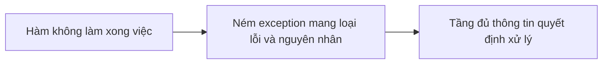
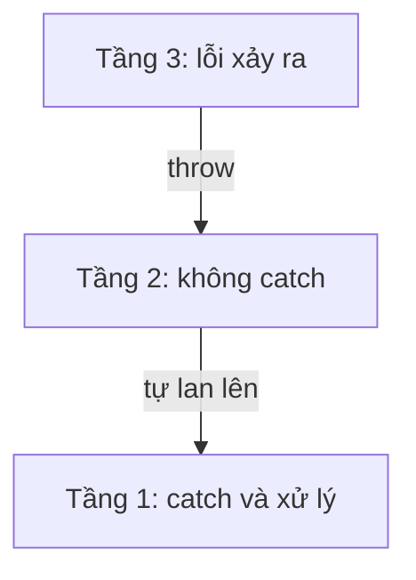
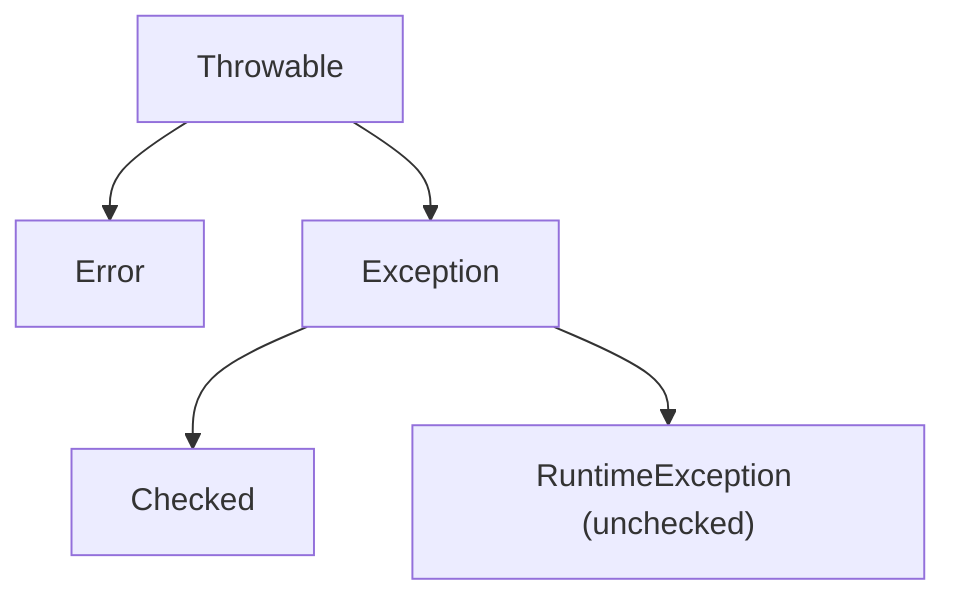
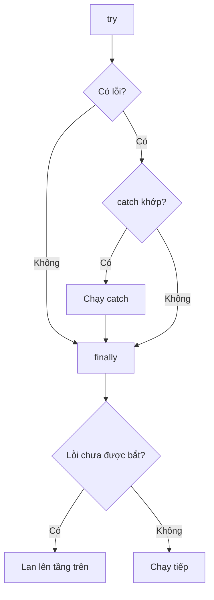

# Lý thuyết 4: Exception

## Exception là gì?

Exception là cách Java báo "có chuyện không ổn": file không tồn tại, gặp `null`, chia cho 0, mất kết nối DB. Khi lỗi xảy ra, dòng chạy bình thường dừng lại và nhảy tới chỗ `catch` phù hợp; nếu không có ai xử lý thì thread chạy chết và in ra stack trace. Nói đơn giản: thay vì để hàm lặng lẽ trả về kết quả sai, hàm "kéo chuông báo động" và buộc ai đó phải để ý.

Vấn đề cũ là hàm trả `-1` hoặc `null` để báo lỗi. Người gọi quên kiểm tra thì chương trình cứ chạy tiếp với dữ liệu sai, tới lúc hỏng ở một chỗ xa mới biết, rất khó lần ngược về nguyên nhân. Exception giải quyết bằng cách catch lỗi phải được nhìn thấy: không xử lý thì nó nổi lên và dừng chương trình.

Hãy throw exception khi hàm không thể làm xong việc nó hứa: đọc file không có, tham số sai, mất kết nối DB. Đừng dùng nó để điều khiển control flow bình thường (ví dụ thoát vòng lặp, hay báo "không tìm thấy" xảy ra thường xuyên), vì vừa khó đọc vừa tốn chi phí. Cách làm gói trong bốn việc: throw bằng `throw`, bắt bằng `try/catch`, dọn tài nguyên bằng try-with-resources, và luôn bắt đúng loại lỗi, không nuốt lỗi, giữ nguyên nhân gốc khi bọc lại.

**Cốt lõi:** Exception ra đời để lỗi không thể bị lờ đi: thay vì trả `-1` hay `null` cho người gọi tự nhớ kiểm tra, hàm ném lỗi lên và lỗi tự đi ngược call stack tới nơi đủ thông tin để xử lý. Hiểu vậy là suy ra được cách chọn checked hay unchecked và cách dọn dẹp.

- Vì mã trả về dễ bị quên kiểm tra nên exception không bắt thì cứ lan lên và dừng chương trình.
- Vì lỗi môi trường người gọi còn phục hồi được còn lỗi lập trình chỉ có cách sửa code, nên Java tách checked (ép biết qua `throws`) và unchecked.
- Vì `finally` và `close()` có thể che mất lỗi chính nên dùng try-with-resources và luôn giữ `cause` khi bọc.



Mô hình tư duy: tầng dưới chỉ báo lỗi, tầng đủ thông tin mới quyết định thử lại, báo người dùng hay ghi log.

**Tóm tắt:**

- Exception thay mã trả về lỗi: lỗi không thể bị lờ đi, tự lan ngược theo call stack tới `catch` khớp đầu tiên và mang theo loại lỗi, thông điệp, stack trace, cause.
- `Error` là sự cố của JVM thì đừng bắt; checked dành cho lỗi môi trường mà người gọi phục hồi được; unchecked dành cho lỗi lập trình hay vi phạm contract.
- `finally` luôn chạy (trừ `System.exit` hoặc JVM chết), nhưng đừng `return` trong đó vì nó che exception.
- try-with-resources đóng tài nguyên `AutoCloseable` theo thứ tự ngược và gắn lỗi của `close()` vào suppressed.
- Khi bọc exception phải giữ `cause`, và không bao giờ nuốt lỗi bằng `catch` rỗng.
- Log một lần ở ranh giới xử lý (controller, job runner), các tầng dưới chỉ throw hoặc bọc.
- Trong Spring, `@Transactional` mặc định chỉ rollback với unchecked exception, nên checked cần `rollbackFor`.

## Các khái niệm cần biết

| Thuật ngữ | Nghĩa là gì | Dùng khi nào / vì sao quan trọng |
|---|---|---|
| Stack trace | Danh sách các lời gọi method (từ nơi lỗi tới `main`) tại lúc exception được tạo. | Là thứ đầu tiên bạn đọc khi debug; mất nó là mất dấu lỗi. |
| Stack unwinding | Việc JVM tháo dần các frame khỏi call stack khi exception lan lên cho tới khi gặp `catch` khớp. | Giải thích vì sao lỗi ở tầng dưới tự "nổi" lên tầng trên. |
| `cause` | Exception gốc được gắn vào exception mới khi bọc. | Giúp thấy nguyên nhân thật trong log (`Caused by: ...`). |
| Suppressed exception | Exception phụ (thường từ `close()`) được gắn vào exception chính thay vì đè mất nó. | Xem bằng `getSuppressed()`; do try-with-resources tự làm. |
| `AutoCloseable` | Interface có method `close()`, cho phép dùng với try-with-resources. | Mọi tài nguyên cần đóng (file, socket, `Connection`) đều cài nó. |
| Nuốt lỗi (swallow) | `catch` rồi bỏ qua, không log, không throw lại. | Gây lỗi âm thầm, là thói quen tệ nhất khi xử lý exception. |
| Ranh giới xử lý | Chỗ trên cùng chịu trách nhiệm quyết định cuối cùng (controller, job runner). | Nơi duy nhất nên log và chuyển thành phản hồi cho người dùng. |

## Exception sinh ra để làm gì?

Trước khi có exception (C), lỗi được báo bằng **mã trả về** (`-1`, `NULL`, `errno`):

```c
int fd = open(path);          // -1 nếu lỗi
read(fd, buf, n);             // quên kiểm tra fd? vẫn chạy tiếp, lỗi nổ ở chỗ khác
```

| Vấn đề của mã trả về | Exception giải quyết |
|---|---|
| Dễ **quên kiểm tra**, lỗi bị nuốt âm thầm | Không bắt thì lỗi **lan lên** và dừng chương trình, không thể lờ đi |
| Mã nghiệp vụ lẫn lộn với `if (err)` ở mọi dòng | Flow chính gọn, xử lý lỗi gom vào `catch` |
| Lỗi phải trả ngược qua từng tầng thủ công | Exception **tự lan** lên chỗ biết cách xử lý |
| Mất thông tin: chỉ biết "-1" | Object mang **loại lỗi, thông điệp, stack trace, nguyên nhân gốc** |
| Constructor/toán tử không có giá trị trả về để báo lỗi | Constructor vẫn throw được |



Đọc sơ đồ: tầng 3 chỉ cần `throw`; tầng 2 không phải làm gì thêm; tầng 1 là nơi đủ thông tin để quyết định (thử lại, báo người dùng, ghi log).

Exception lan theo **call stack** ngược lên cho tới khi có `catch` phù hợp (gọi là *stack unwinding*); nếu không ai bắt, thread chết và in stack trace.

**Nền tảng:** Exception thay cho mã trả về lỗi: lỗi không thể bị lờ đi, tự lan ngược theo call stack (stack unwinding) tới `catch` khớp đầu tiên, và mang theo loại lỗi, thông điệp, stack trace, nguyên nhân gốc.

## Hệ thống phân cấp



| Loại | Là gì | Ví dụ |
|---|---|---|
| `Error` | Sự cố của JVM/hệ thống, chương trình thường **không phục hồi** được | `OutOfMemoryError`, `StackOverflowError`, `NoClassDefFoundError` |
| **Checked** exception | Con của `Exception` (không phải `RuntimeException`); trình biên dịch **bắt buộc** xử lý hoặc khai báo | `IOException`, `SQLException`, `TimeoutException` |
| **Unchecked** exception | Con của `RuntimeException`; trình biên dịch **không** ép | `NullPointerException`, `IllegalArgumentException`, `IllegalStateException` |

**Phải thuộc:** Cây phân cấp: `Throwable` có hai nhánh `Error` và `Exception`; `RuntimeException` (và con) là unchecked, các con còn lại của `Exception` là checked. Checked: bắt buộc `catch` hoặc `throws`. Unchecked và `Error`: không bắt buộc.

## Checked exception

Checked exception là loại mà **compiler kiểm tra giúp bạn**: method nào có thể throw nó thì bạn phải `catch`, hoặc khai báo `throws`. Không làm thì **không biên dịch được**.

```java
void read(Path p) {
    Files.readString(p);          // LỖI biên dịch: unreported exception IOException
}
// chuyển trách nhiệm cho người gọi
void read(Path p) throws IOException { Files.readString(p); }
// tự xử lý
void read(Path p) { try { Files.readString(p); } catch (IOException e) { /* xử lý */ } }
```

### Vì sao có checked exception?
Java muốn **đưa chuyện "hàm này có thể lỗi" vào luôn chữ ký method**, giống như kiểu trả về:
- Nhìn `readString(Path) throws IOException` là biết hàm này có thể hỏng vì I/O, **khỏi mở tài liệu ra đọc**.
- Compiler **buộc** người gọi phải nghĩ tới trường hợp lỗi, không thể quên như khi dùng mã trả về.
- Dành cho lỗi **do môi trường bên ngoài nhưng còn cách xử lý**: file không tồn tại, mất mạng, hết thời gian chờ. Người gọi có thể làm gì đó (thử lại, báo người dùng, dùng giá trị dự phòng).

### Khi nào dùng checked, khi nào dùng unchecked?
| Dùng checked | Dùng unchecked |
|---|---|
| Lỗi do **môi trường bên ngoài**, người gọi **có thể phục hồi hợp lý** | Lỗi do **lập trình sai** hoặc vi phạm contract (null, tham số sai, trạng thái sai) |
| File, mạng, CSDL, giao tiếp ngoài | Người gọi không làm gì được ngoài sửa code |

Quy tắc thực tế: *"Nếu người gọi có thể làm điều gì có ích khi gặp lỗi này, hãy dùng checked; nếu không, dùng unchecked."*

**Phải thuộc:** Checked cho lỗi môi trường mà người gọi có thể phục hồi (file, mạng, CSDL); unchecked cho lỗi lập trình hoặc vi phạm contract (null, tham số sai, trạng thái sai); `Error` thì đừng bắt.

### Xử lý checked exception thế nào?
Có ba lựa chọn, theo thứ tự cân nhắc:

1. **Tự xử lý** nếu biết làm gì: thử lại, dùng giá trị mặc định, báo người dùng.
2. **Khai báo `throws`** nếu tầng này không đủ thông tin để quyết định, cứ để tầng trên xử lý.
3. **Bọc thành exception khác** (thường là unchecked hoặc exception của nghiệp vụ) nếu không muốn lộ chi tiết tầng dưới ra ngoài:

```java
// giữ cause
catch (SQLException e) { throw new OrderRepositoryException("Lưu đơn thất bại", e); }
```

### Vì sao nhiều người chê checked exception?
- **Gây ồn ào**: chữ ký `throws` lan khắp nơi qua nhiều tầng; nhiều khi tầng giữa chẳng làm gì được.
- Không hợp **lambda/stream**: `Function` không khai báo `throws`, nên gọi hàm throw checked trong lambda phải bọc lại.
- Dễ dẫn tới `catch (Exception e) {}` nuốt lỗi cho "hết đỏ".
- Hệ quả: Spring, nhiều thư viện hiện đại đổi checked thành **unchecked** (ví dụ `DataAccessException` bọc `SQLException`). Ngôn ngữ mới (Kotlin, C#) bỏ hẳn checked.

## Unchecked exception (RuntimeException)

Unchecked exception là loại mà compiler **không bắt** bạn phải xử lý hay khai báo. Lý do: lỗi lập trình (null, chỉ số sai, ép kiểu sai) có thể xuất hiện ở **mọi dòng code**; bắt khai báo hết thì `throws` phủ kín code mà chẳng ích gì. Với loại lỗi này cách đúng là **sửa code**, không phải `catch`.

Hãy throw unchecked khi ai đó vi phạm điều kiện đầu vào, object đang ở trạng thái sai, hoặc lỗi mà tầng hiện tại không thể tự khắc phục. Cách làm: kiểm tra đầu vào sớm, gặp sai thì throw kèm thông điệp rõ ràng. Nếu bạn không kiểm tra, hậu quả thường là một `NullPointerException` nổ ở chỗ rất xa nơi dữ liệu sai thật sự phát sinh.

| Exception | Khi nào throw |
|---|---|
| `NullPointerException` | Dùng reference `null`; `Objects.requireNonNull(x, "x null")` |
| `IllegalArgumentException` | Tham số **không hợp lệ** |
| `IllegalStateException` | Object ở **trạng thái không phù hợp** để gọi method này |
| `IndexOutOfBoundsException` | Chỉ số ngoài biên |
| `ClassCastException` | Ép kiểu sai |
| `ArithmeticException` | Chia cho 0 (số nguyên) |
| `UnsupportedOperationException` | Thao tác không hỗ trợ (vd sửa `List.of`) |
| `ConcurrentModificationException` | Sửa collection khi đang duyệt |

**Suy luận:** Java tách checked và unchecked vì lỗi có hai bản chất khác nhau về việc người gọi làm được gì. Lỗi môi trường như file mất hay mạng đứt xảy ra dù code đúng và người gọi có thể thử lại hoặc dùng giá trị dự phòng, nên Java đưa nó vào chữ ký `throws` để compiler buộc người gọi nghĩ tới. Lỗi lập trình như `null` hay chỉ số sai có thể xuất hiện ở mọi dòng và không có cách "xử lý" nào ngoài sửa code, nên bắt khai báo `throws` ở đâu cũng chỉ gây ồn ào. Từ đó suy ra vì sao `throws` lan qua nhiều tầng khiến checked bị chê, và vì sao Spring bọc `SQLException` thành `DataAccessException` unchecked để tầng giữa không phải biết chi tiết. Hệ quả dễ bỏ sót nhất là `@Transactional` mặc định chỉ rollback khi gặp unchecked, nên một checked exception bay ra khỏi method vẫn commit dữ liệu dở. Khi thiết kế, hãy hỏi người gọi có làm được gì có ích không để chọn loại, và khi bọc luôn giữ `cause`.

## Error

`Error` báo hiệu JVM đang gặp sự cố nặng (hết memory, tràn stack, không nạp được class). Đây không phải lỗi nghiệp vụ. Hầu như **không nên bắt** nó, vì chương trình lúc này không có cách phục hồi đáng tin cậy; bắt rồi chạy tiếp còn nguy hiểm hơn vì trạng thái có thể đã hỏng. Hãy tìm và sửa nguyên nhân gốc (memory leak, đệ quy vô hạn), xem [Công cụ chẩn đoán JVM](/go?p=08-Java%2FJava-Core%2Fhard%2Flt-32-cong-cu-chan-doan-jvm.md).

## try, catch, finally

Ba khối này phối hợp để catch lỗi và dọn dẹp:

| Khối | Vai trò | Cách dùng đúng |
|---|---|---|
| `try` | Bao đoạn mã có thể throw lỗi | Giới hạn phạm vi cần bắt, đừng bao cả hàm dài |
| `catch` | Xử lý một loại lỗi cụ thể | Bắt từ **cụ thể đến chung**; multi-catch `IOException \| SQLException e` |
| `finally` | **Luôn chạy** (trừ `System.exit`, JVM chết) | Dọn dẹp; đừng `return` trong `finally` vì che exception |

Sơ đồ dưới cho thấy thứ tự chạy, nhấn mạnh rằng `finally` chạy cả khi có lỗi lẫn không, kể cả khi lỗi không được bắt.



## try-with-resources

Đây là cú pháp để Java tự đóng tài nguyên (loại `AutoCloseable`) khi chạy ra khỏi khối `try`. Vấn đề nó giải quyết: tự đóng trong `finally` rất dễ sai, quên đóng là **rò rỉ file/kết nối** (hiện tượng: hết file handle, hết connection pool sau vài giờ chạy), và nếu `close()` cũng lỗi thì nó có thể **đè mất lỗi chính**. Hãy dùng cho bất cứ tài nguyên nào cần đóng (file, socket, `Connection`, `Statement`). Cách viết:

```java
try (var in = Files.newBufferedReader(path);
     var out = Files.newBufferedWriter(target)) {
    // dùng in, out
}   // tự đóng theo thứ tự ngược, kể cả khi có lỗi
```

Nếu cả thân khối và `close()` đều lỗi, lỗi từ `close()` được gắn vào `getSuppressed()` thay vì che mất lỗi chính.

**Phải thuộc:** try-with-resources đóng tài nguyên theo thứ tự ngược với lúc mở, kể cả khi có lỗi; lỗi của `close()` được gắn vào `getSuppressed()`. `finally` luôn chạy (trừ `System.exit` hoặc JVM chết) và không nên `return` trong `finally`. Các `catch` phải đi từ class con đến class cha.

**Suy luận:** `finally` được đảm bảo chạy vì JVM sinh bản sao khối `finally` trên mọi đường thoát khỏi `try`, kể cả `return` hay exception, nên nó là chỗ dọn dẹp đáng tin cậy. Chính tính "luôn chạy" đó tạo ra hai cái bẫy: `return` hay `throw` trong `finally` ghi đè kết quả hoặc exception đang bay, làm lỗi thật biến mất. Tương tự, nếu `close()` trong `finally` cũng lỗi thì nó đè mất exception chính, nên try-with-resources ra đời để gắn lỗi phụ vào suppressed thay vì thay thế. Thứ tự đóng ngược với thứ tự mở vì tài nguyên mở sau thường phụ thuộc tài nguyên mở trước. Điểm dễ nhầm là nghĩ `finally` chạy cả khi `System.exit` được gọi hay JVM chết, trong khi hai trường hợp đó không chạy. Vì vậy hãy ưu tiên try-with-resources và không đặt logic trả về trong `finally`.

## Throw và bọc exception

`throw` là câu lệnh phát ra một exception. **Bọc** (wrap) là catch lỗi của tầng thấp, rồi throw exception mới của tầng cao và gắn lỗi gốc vào làm `cause`. Lý do cần bọc: tầng cao không nên biết chi tiết của tầng thấp (SQL, HTTP), nhưng khi debug vẫn cần **thấy nguyên nhân gốc**. Bọc mà quên gắn `cause` thì stack trace mất dấu lỗi thật, và bạn sẽ phải đoán lỗi ở đâu.

```java
public Config load(Path p) {
    try {
        return parse(Files.readString(p));
    } catch (IOException e) {
        // giữ nguyên nhân gốc (cause)
        throw new ConfigException("Không đọc được " + p, e);
    }
}
```

### Tự định nghĩa exception
```java
class InsufficientBalanceException extends RuntimeException {
    InsufficientBalanceException(String msg) { super(msg); }
}
```
Tạo exception riêng khi người gọi cần **phân biệt và xử lý khác nhau** (hết số dư khác với tài khoản không tồn tại). Đừng tạo hàng chục class chỉ khác tên.

## Quy tắc vàng

| Nên | Không nên |
|---|---|
| Catch exception **cụ thể** | `catch (Exception e) {}` nuốt im lặng |
| Giữ `cause` khi bọc | Bọc mà mất stack trace gốc |
| Kiểm tra tham số sớm, throw `IllegalArgumentException`/`NullPointerException` kèm thông điệp | Để lỗi lan sâu rồi mới phát hiện |
| Ghi log **một lần** ở ranh giới xử lý | Vừa log vừa throw lại ở mọi tầng (log trùng) |
| Dùng exception cho tình huống exception | Dùng exception điều khiển control flow thông thường |
| Dọn tài nguyên bằng try-with-resources | `finally` thủ công dễ sai |

## Chi tiết cần biết

- Ghi đè method không được throw checked exception **rộng hơn** class cha (contract chữ ký).
- `Optional` hoặc kết quả có kiểu thường tốt hơn exception cho trường hợp "không tìm thấy" thường xuyên.
- Tạo exception có chi phí (chụp stack trace); đừng throw trong hot loop.
- Exception không bắt được trong thread phụ sẽ làm thread đó chết: cần `UncaughtExceptionHandler` hoặc bắt trong tác vụ.
- Trong Spring: `@ControllerAdvice` gom xử lý exception ở **một nơi** (ranh giới), `@Transactional` mặc định chỉ rollback với **unchecked** (checked không rollback trừ khi cấu hình `rollbackFor`).
- `catch` không thể đặt class con **sau** class cha (không bao giờ tới); `InterruptedException` không nên nuốt, hãy `Thread.currentThread().interrupt()`.

## Điều cần nhớ

- Exception sinh ra để lỗi **không thể bị lờ đi** và để tách xử lý lỗi khỏi flow chính.
- **Checked** = lỗi bên ngoài có thể phục hồi, **ép biết** qua chữ ký; **unchecked** = lỗi lập trình, **sửa code**; **Error** = đừng bắt.
- Bọc exception phải giữ `cause`; log một lần ở ranh giới.
- Dọn tài nguyên bằng try-with-resources.

## Phỏng vấn khó: chuỗi hỏi xoáy

Người phỏng vấn senior thường mở bằng câu dễ rồi xoáy xuống cơ chế, đánh đổi và sự cố thật. Câu trả lời tốt luôn đi từ cốt lõi xuống.

### Chuỗi 1: `finally` và dọn tài nguyên

1. **Câu mở:** `finally` có luôn chạy không?
2. **Xoáy 1:** Nếu trong `finally` có `return` hoặc `throw` thì chuyện gì xảy ra với exception đang bay?
3. **Xoáy 2:** Thân `try` lỗi, rồi `close()` cũng lỗi: exception nào bay ra? Mở hai tài nguyên thì đóng theo thứ tự nào, và vì sao try-with-resources ra đời?

**Đáp án ngắn:** `finally` chạy trên mọi đường thoát khỏi `try`, kể cả `return` hay exception, trừ khi gọi `System.exit` hoặc JVM chết. Chính tính "luôn chạy" tạo bẫy: `return` hay `throw` trong `finally` ghi đè kết quả hoặc exception đang bay, nên lỗi thật biến mất khỏi log. Tương tự, tự đóng tài nguyên trong `finally` mà `close()` cũng lỗi thì lỗi đó đè mất lỗi chính. Try-with-resources giải quyết cả hai: lỗi chính vẫn bay ra, lỗi của `close()` được gắn vào `getSuppressed()`. Tài nguyên đóng theo thứ tự ngược với lúc mở, vì cái mở sau thường phụ thuộc cái mở trước. Ngoài ra, quên đóng gây rò rỉ file handle hay connection, hiện ra là hết connection pool sau vài giờ chạy. Tôi ưu tiên try-with-resources và không đặt logic trả về trong `finally`.

**Sai lầm hay gặp:**

- Nói `finally` "luôn chạy" mà không biết hai ngoại lệ là `System.exit` và JVM chết.
- Không biết lỗi của `close()` có thể che lỗi chính khi dùng `finally` thủ công.
- Đóng thứ tự xuôi, hoặc không nhắc tới suppressed.

### Chuỗi 2: Checked, unchecked và transaction

1. **Câu mở:** Khi nào dùng checked, khi nào dùng unchecked exception?
2. **Xoáy 1:** Vì sao Spring bọc `SQLException` thành `DataAccessException`? Checked exception gây khó gì với lambda và stream?
3. **Xoáy 2:** Method `@Transactional` ném một checked exception ra ngoài thì dữ liệu có rollback không? Và nếu mọi tầng đều vừa log vừa throw lại thì sao?

**Đáp án ngắn:** Tiêu chí là người gọi làm được gì có ích. Lỗi môi trường như file mất hay mạng đứt xảy ra dù code đúng và có thể phục hồi, nên dùng checked để compiler ép người gọi nghĩ tới. Lỗi lập trình như `null` hay tham số sai chỉ có cách sửa code, nên dùng unchecked. Checked bị chê vì `throws` lan qua nhiều tầng mà tầng giữa chẳng làm được gì, và `Function` trong lambda không khai báo `throws` nên phải bọc lại. Vì thế Spring đổi `SQLException` thành unchecked để tầng giữa không phải biết chi tiết. Hệ quả dễ bỏ sót: `@Transactional` mặc định chỉ rollback với unchecked, nên một checked bay ra vẫn commit dữ liệu dở, trừ khi cấu hình `rollbackFor`. Khi bọc phải giữ `cause`, và log đúng một lần ở ranh giới như `@ControllerAdvice`, nếu không log bị trùng lặp ở mọi tầng.

**Sai lầm hay gặp:**

- Trả lời theo cú pháp ("checked thì phải catch") mà không nói tới việc người gọi phục hồi được hay không.
- Không biết quy tắc rollback mặc định của `@Transactional`.
- Bọc exception mà làm mất `cause`, hoặc `catch` rỗng cho "hết đỏ".

