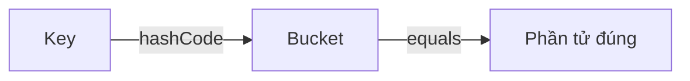
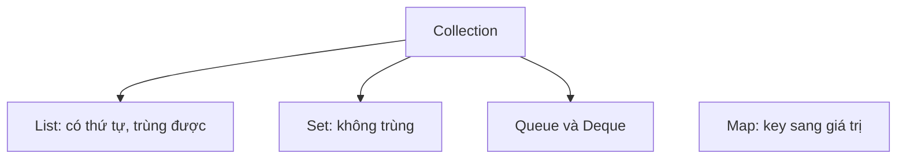
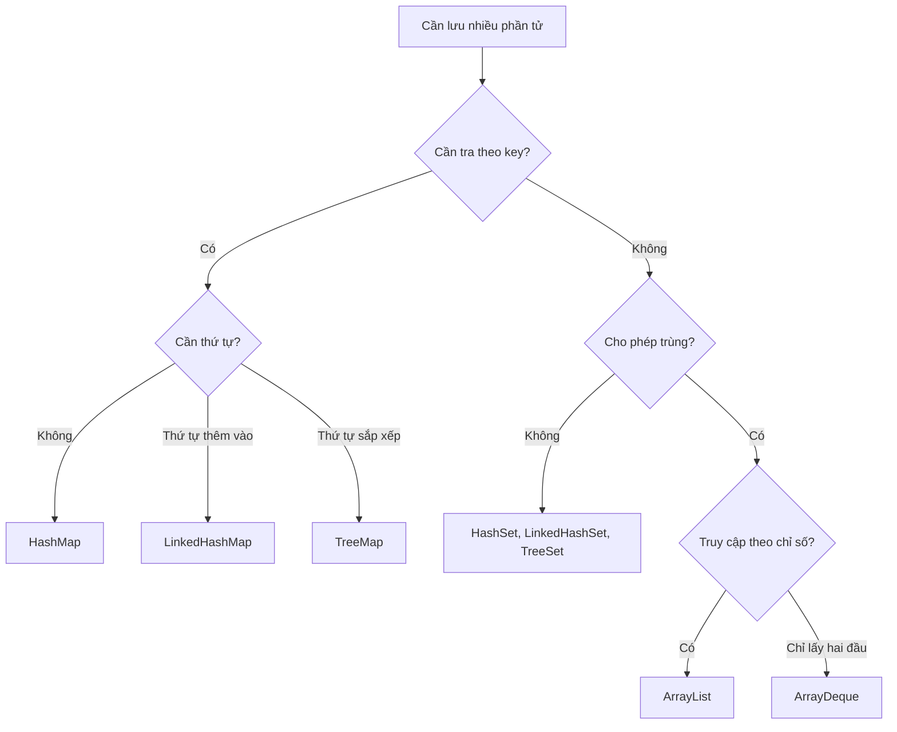
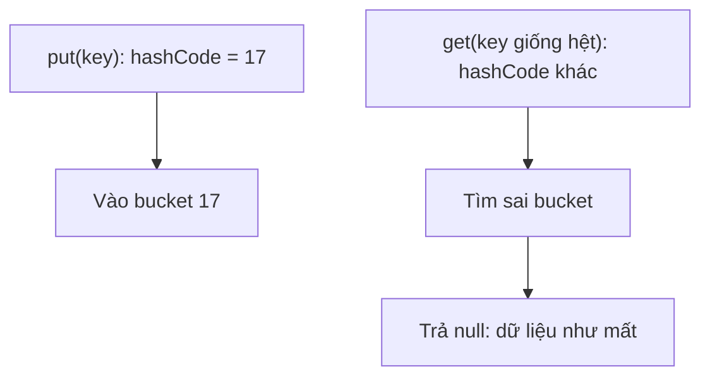
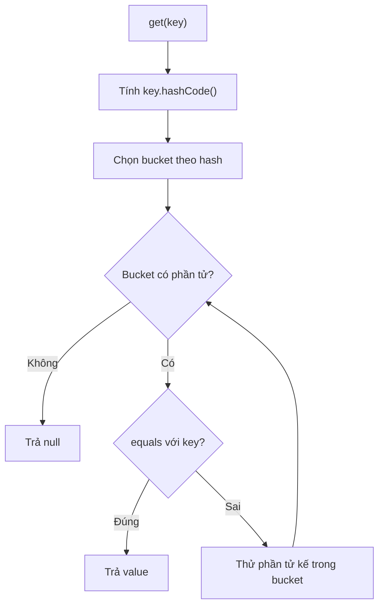

# Lý thuyết 5: Collections cơ bản và contract equals/hashCode

Hầu hết chương trình đều phải giữ nhiều phần tử cùng lúc: danh sách đơn hàng, tập user đã đăng nhập, bảng tra mã lỗi sang thông điệp. Java cung cấp sẵn các "thùng chứa" dữ liệu (gọi chung là Collections Framework) để làm việc đó, nên bạn không phải tự viết array co giãn hay hash table. Bài này giúp bạn chọn đúng thùng cho đúng việc, và hiểu contract `equals`/`hashCode` mà mọi object phải tuân thủ khi được dùng làm key của `Map` hoặc phần tử của `Set`.

## Các thùng chứa và vấn đề chúng giải quyết

Có bốn họ chính. `List` là danh sách có thứ tự, cho phép trùng, truy cập theo chỉ số. `Set` là tập hợp không có phần tử trùng. `Map` lưu cặp key sang giá trị và tra theo key. `Queue`/`Deque` là queue hoặc stack, lấy phần tử theo thứ tự vào ra. (`Map` không kế thừa `Collection` nên được vẽ riêng trong sơ đồ.)

Vì sao phải chọn kỹ? Hãy tưởng tượng bạn cần tìm một khách hàng theo mã trong 1 triệu khách. Nếu giữ trong `List`, mỗi lần tìm phải duyệt tuần tự, chậm dần theo số lượng. Nếu giữ trong `HashMap`, bạn tra gần như tức thì. Chọn sai thùng thì chương trình chậm. Tệ hơn là viết sai `hashCode`: bạn `put` vào `HashMap` xong `get` lại không ra, như thể dữ liệu biến mất mà không có lỗi nào được báo.

Quy tắc chọn rất đơn giản: tự hỏi có cần giữ thứ tự không, có chấp nhận trùng không, có cần tra theo key không. Các collection trong bài này không an toàn khi nhiều thread cùng ghi; trường hợp đó hãy xem bài về collection đồng thời. Class nào làm key thì phải override `equals` và `hashCode` cùng nhau, dựa trên những field không đổi (phần sau giải thích vì sao).

**Nền tảng:** Có bốn họ cấu trúc: `List` (có thứ tự, trùng được), `Set` (không trùng), `Map` (key sang giá trị, không kế thừa `Collection`), `Queue`/`Deque` (queue, stack). Chọn theo ba câu hỏi: cần thứ tự không, chấp nhận trùng không, cần tra theo key không.

**Cốt lõi:** Collections là các cấu trúc dựng sẵn để giữ nhiều phần tử, mỗi loại đánh đổi khác nhau giữa thứ tự, trùng lặp và tốc độ tra cứu. `HashMap` nhanh vì biến key thành một con số để nhảy thẳng tới đúng ngăn, thay vì duyệt cả bảng.

- Vì mỗi cấu trúc tối ưu cho một kiểu truy cập, nên chọn theo ba câu hỏi: cần thứ tự không, chấp nhận trùng không, cần tra theo key không.
- Vì `hashCode` chọn bucket rồi `equals` chọn phần tử trong bucket, nên hai object bằng nhau bắt buộc phải cùng `hashCode`.
- Vì vị trí của entry gắn với hash lúc `put`, nên key phải immutable, nếu không entry vẫn còn đó nhưng `get` không thấy.



Mô hình tư duy: tra cứu là hai bước, hash để nhảy tới đúng ngăn và equals để chọn đúng phần tử, nên hai bước phải nhất quán với nhau.

**Tóm tắt:**

- Bốn họ chính: `List` (có thứ tự, trùng được), `Set` (không trùng), `Map` (key sang giá trị), `Queue`/`Deque`; chọn theo thứ tự, trùng và cách tra cứu.
- Mặc định dùng `ArrayList`, `HashMap`, `HashSet`, `ArrayDeque`; `LinkedList` hầu như không nên dùng.
- `HashMap` tìm hai bước: `hashCode` chọn bucket, `equals` chọn đúng phần tử trong bucket, nên tra cứu O(1) trung bình.
- Contract bắt buộc: hai object `equals` thì phải cùng `hashCode`; override `equals` mà quên `hashCode` làm dữ liệu "biến mất" khỏi `HashMap`/`HashSet`.
- Key của `Map` phải immutable, vì đổi field dùng trong `hashCode` sau khi `put` làm entry nằm sai bucket.
- Sửa collection khi đang `for-each` throw `ConcurrentModificationException`; dùng `Iterator.remove()` hoặc `removeIf`.
- `List.of` và `Map.of` immutable thật và cấm `null`; `Collections.unmodifiableList` chỉ là khung nhìn, `List.copyOf` mới là bản sao.
- Các collection này không thread-safe, nhiều thread cùng ghi phải dùng class concurrent.

## Các khái niệm cần biết

- **O(1), O(log n)**: ký hiệu cho thấy thời gian thao tác tăng thế nào khi số phần tử `n` tăng. O(1) là hằng số (10 hay 10 triệu phần tử đều nhanh như nhau), O(log n) tăng rất chậm (cây cân bằng), O(n) tăng tuyến tính.
- **O(1) khấu hao (amortized)**: phần lớn lần thêm là O(1), nhưng thỉnh thoảng `ArrayList` hết chỗ và phải copy sang array lớn hơn. Tính trung bình trên nhiều lần thêm vẫn là O(1).
- **Bucket và va chạm (collision)**: `HashMap` chia dữ liệu vào nhiều "ngăn" (bucket) dựa trên `hashCode` của key. Hai key khác nhau có thể rơi vào cùng ngăn, gọi là va chạm; lúc đó `HashMap` so tiếp bằng `equals`. Va chạm là bình thường, chỉ quá nhiều va chạm mới làm chậm.
- **Immutable**: object không đổi được sau khi tạo. Rất hợp để làm key và an toàn khi chia sẻ giữa các thread.
- **Khung nhìn (view)**: một object "nhìn vào" dữ liệu của object khác chứ không copy. Sửa bản gốc thì khung nhìn đổi theo.
- **Fail-fast**: iterator phát hiện collection bị sửa trong lúc duyệt và throw `ConcurrentModificationException` (ở mức cố gắng, không đảm bảo).

## Bản đồ



## Chọn cấu trúc nào

Sơ đồ dưới đây tóm tắt cách ra quyết định, bảng phía sau liệt kê lựa chọn cụ thể.



| Nhu cầu | Chọn | Độ phức tạp chính |
|---|---|---|
| Danh sách, truy cập theo chỉ số | `ArrayList` | get O(1), thêm cuối O(1) khấu hao |
| Stack / queue | `ArrayDeque` | thao tác hai đầu O(1) |
| Tập không trùng, nhanh | `HashSet` | O(1) trung bình |
| Giữ thứ tự thêm vào | `LinkedHashSet`/`LinkedHashMap` | O(1) |
| Có thứ tự sắp xếp | `TreeSet`/`TreeMap` | O(log n) |
| Tra cứu theo key | `HashMap` | O(1) trung bình |
| Lấy phần tử nhỏ/lớn nhất | `PriorityQueue` | O(log n) |

`LinkedList` hầu như không nên dùng: nó chậm hơn `ArrayList`/`ArrayDeque` ở đa số tình huống vì các node nằm rải rác trong memory nên cache CPU hoạt động kém. Chỉ cân nhắc khi bạn thật sự cần chèn/xóa liên tục ở giữa thông qua một iterator đang đứng sẵn tại vị trí đó.

**Phải thuộc:** `ArrayList`: get O(1), thêm cuối O(1) khấu hao. `HashMap`/`HashSet`: O(1) trung bình. `TreeMap`/`TreeSet`: O(log n) và có thứ tự sắp xếp. `LinkedHashMap`/`LinkedHashSet`: giữ thứ tự thêm vào. `ArrayDeque` làm stack hoặc queue; `PriorityQueue` lấy phần tử nhỏ nhất O(log n).

## Tạo collection immutable

Khi dữ liệu không cần đổi (hằng số cấu hình, kết quả trả về cho caller), hãy dùng collection immutable để tránh bị sửa nhầm. Java 9 trở lên có các factory method gọn:

```java
List<String> a = List.of("x", "y");                    // bất biến, không cho null
Map<String, Integer> m = Map.of("a", 1, "b", 2);
List<String> copy = List.copyOf(source);               // bản sao bất biến
```

Sửa collection immutable throw `UnsupportedOperationException`. Đừng dùng khi bạn cần thêm/xóa phần tử về sau; lúc đó dùng `new ArrayList<>(...)`.

## Contract equals và hashCode

`HashMap` và `HashSet` tìm phần tử theo hai bước: dùng `hashCode` để nhảy thẳng tới bucket, rồi dùng `equals` để so các phần tử trong bucket đó. Hai bước này chỉ hoạt động nếu `equals` và `hashCode` nhất quán với nhau, nên Java đặt ra một contract:

1. Hai object `equals` thì **bắt buộc** cùng `hashCode`.
2. `equals` phải phản xạ (a bằng a), đối xứng (a bằng b thì b bằng a), bắc cầu, và nhất quán (gọi nhiều lần cho cùng kết quả).
3. Cùng `hashCode` thì **chưa chắc** `equals` (va chạm là bình thường).

```java
public final class Point {
    private final int x, y;
    public Point(int x, int y) { this.x = x; this.y = y; }

    @Override public boolean equals(Object o) {
        return o instanceof Point p && x == p.x && y == p.y;
    }
    @Override public int hashCode() { return Objects.hash(x, y); }
}
// Cách gọn nhất: record Point(int x, int y) {}  -> tự sinh equals, hashCode, toString
```

Luôn override cả hai, và chỉ dựa trên các field định danh. Nếu bạn chỉ override `equals` mà quên `hashCode`, hai object "bằng nhau" sẽ có hash khác nhau (mặc định theo địa chỉ object) và rơi vào bucket khác nhau.

**Phải thuộc:** Contract `equals`/`hashCode`: hai object `equals` thì bắt buộc cùng `hashCode` (ngược lại không cần đúng). `equals` phải phản xạ, đối xứng, bắc cầu, nhất quán. Override cả hai cùng lúc, chỉ dựa trên field immutable; key của `HashMap` nên immutable.

**Suy luận:** `HashMap` đạt O(1) vì nó đổi bài toán tìm kiếm thành phép tính: `hashCode` biến key thành một số, số đó chọn thẳng một bucket, nên không phải duyệt cả bảng. Để cách làm này đúng, hai object coi là bằng nhau bắt buộc phải rơi vào cùng bucket, tức là phải cùng `hashCode`; đây là lý do contract chỉ đòi chiều "equals thì cùng hash" chứ không đòi chiều ngược lại vì va chạm vẫn xảy ra và `equals` sẽ phân xử trong bucket. Nếu chỉ override `equals`, hash mặc định tính theo địa chỉ nên hai object bằng nhau vào hai bucket khác nhau và `get` tìm sai chỗ, entry vẫn còn đó nhưng không bao giờ thấy. Cùng cơ chế giải thích vì sao đổi field tham gia `hashCode` sau khi `put` cũng làm entry "mất", và vì sao key nên immutable. Điểm dễ nhầm là lỗi này không throw exception nào, chỉ trả `null` hoặc cho phép trùng, nên rất khó bắt. Khi review, hãy kiểm tra mọi class dùng làm key có override cả hai method từ cùng tập field bất biến, hoặc dùng `record`.

## Hậu quả khi vi phạm

Sơ đồ sau cho thấy vì sao dữ liệu "biến mất": `get` đi tìm ở sai bucket nên không bao giờ thấy entry đã được `put`.



Thay đổi trường dùng trong `hashCode` **sau khi** đã bỏ vào `HashSet`/làm key `HashMap` cũng làm object "biến mất". Key nên **immutable**. Hãy xem ví dụ chạy được dưới đây.

Quy trình `get` đầy đủ khi contract được tuân thủ:



### Chạy thử: key bị đổi và các bẫy list

```java
import java.util.*;

public class Keys {
    static class P {
        int x;
        P(int x) { this.x = x; }
        @Override public boolean equals(Object o) { return o instanceof P p && x == p.x; }
        @Override public int hashCode() { return Objects.hash(x); }
    }
    public static void main(String[] args) {
        P k = new P(1);
        Map<P, String> m = new HashMap<>();
        m.put(k, "một");
        System.out.println(m.get(new P(1)));  // một
        k.x = 2;                              // đổi trường nằm trong hashCode
        System.out.println(m.get(k));         // null: hash mới trỏ bucket khác
        System.out.println(m.get(new P(1)));  // null: bucket đúng nhưng equals sai
        // 1: entry vẫn nằm đó, thành "rác" không xóa được
        System.out.println(m.size());

        List<Integer> r = new ArrayList<>(List.of(10, 20, 30));
        r.remove(1);                          // remove(int index): bỏ 20
        r.remove(Integer.valueOf(10));        // remove(Object): bỏ giá trị 10
        System.out.println(r);                // [30]

        List<String> f = Arrays.asList("a", "b");
        // được: kích thước cố định nhưng ghi đè được
        f.set(0, "z");
        // UOE [z, b]
        try { f.add("c"); } catch (UnsupportedOperationException e) { System.out.println("UOE " + f); }
        // NPE
        try { List.of("a", null); } catch (NullPointerException e) { System.out.println("NPE"); }
    }
}
```

Mẹo nhớ: `List<Integer>.remove(1)` xóa theo **chỉ số**, không phải giá trị 1. `List.of`, `Map.of` cấm `null`; `HashMap` cho phép một key `null`.

**Nền tảng:** `HashMap` tìm hai bước: `hashCode` chọn bucket, `equals` chọn đúng phần tử trong bucket. Vì vậy `hashCode` sai hoặc đổi sau khi `put` thì `get` tìm sai bucket và dữ liệu "biến mất" mà không có lỗi nào.

## Duyệt và sửa

Vấn đề thường gặp là muốn xóa phần tử trong lúc đang duyệt. Cách đúng và cách sai được liệt kê dưới đây.

- Sửa collection khi đang `for-each` throw `ConcurrentModificationException`. Dùng `Iterator.remove()`, hoặc `removeIf`.
- `Arrays.asList` trả danh sách kích thước cố định, không thêm/xóa được.
- Dùng kiểu khai báo là interface: `List<String> xs = new ArrayList<>();`. Nhờ vậy sau này đổi implementation mà không phải sửa code gọi.
- `ConcurrentModificationException` không đảm bảo luôn ném: xóa phần tử **áp chót** trong `for-each` thì vòng lặp kết thúc êm và bỏ sót phần tử cuối. Đừng dựa vào exception này để phát hiện lỗi; dùng `removeIf`.
- `Collections.unmodifiableList(x)` chỉ là **khung nhìn**: sửa `x` gốc thì khung nhìn đổi theo. `List.copyOf(x)` mới là bản sao thật.

```java
List<Integer> nums = new ArrayList<>(List.of(1, 2, 3, 4));
nums.removeIf(n -> n % 2 == 0);   // an toàn, kết quả [1, 3]
```

## Phỏng vấn khó: chuỗi hỏi xoáy

Người phỏng vấn senior thường mở bằng câu dễ rồi xoáy xuống cơ chế, đánh đổi và sự cố thật. Câu trả lời tốt luôn đi từ cốt lõi xuống.

### Chuỗi 1: `HashMap`, `equals` và `hashCode`

1. **Câu mở:** Vì sao override `equals` thì phải override `hashCode`?
2. **Xoáy 1:** `get(key)` trong `HashMap` chạy qua những bước nào? Vì sao contract chỉ đòi "equals thì cùng hash" mà không đòi chiều ngược lại?
3. **Xoáy 2:** Một key đổi field tham gia `hashCode` sau khi `put`. Chuyện gì xảy ra với entry, `size()` và cách phát hiện trong production?

**Đáp án ngắn:** `HashMap` tìm theo hai bước: `hashCode` chọn bucket, rồi `equals` chọn đúng phần tử trong bucket. Muốn vậy hai object bằng nhau bắt buộc rơi vào cùng bucket, tức phải cùng `hashCode`. Chiều ngược lại không cần vì va chạm là bình thường và `equals` sẽ phân xử; hàm `hashCode` trả hằng số vẫn đúng contract nhưng mọi key dồn vào một bucket nên mất O(1). Chỉ override `equals` thì hash mặc định theo địa chỉ, hai object bằng nhau vào hai bucket khác nhau và `get` trả `null`. Key đổi field sau khi `put` thì entry vẫn nằm ở bucket cũ, `get` tìm sai bucket hoặc `equals` sai, nên `size()` vẫn đếm nó nhưng không lấy ra được. Lỗi này không có exception, chỉ thấy dữ liệu "mất" hoặc trùng trong `HashSet`. Tôi dùng key immutable hoặc `record`, và override cả hai từ cùng tập field bất biến.

**Sai lầm hay gặp:**

- Phát biểu contract ngược: "cùng hash thì equals".
- Không giải thích được vì sao entry mất mà `size()` không giảm.
- Dùng object có field sửa được làm key.

### Chuỗi 2: Sửa collection khi duyệt, view và bản sao

1. **Câu mở:** Xóa phần tử trong `for-each` thì sao? Cách đúng là gì?
2. **Xoáy 1:** `ConcurrentModificationException` có luôn được ném không? Có dựa vào nó để phát hiện lỗi được không?
3. **Xoáy 2:** `Collections.unmodifiableList`, `List.copyOf`, `List.of` và `Arrays.asList` khác nhau thế nào khi bạn sửa danh sách gốc hoặc thêm phần tử?

**Đáp án ngắn:** Sửa collection khi đang `for-each` làm iterator phát hiện bị đổi và throw `ConcurrentModificationException`; cách đúng là `Iterator.remove()` hoặc `removeIf`. Cơ chế fail-fast chỉ ở mức cố gắng, không đảm bảo: xóa phần tử áp chót thì vòng lặp kết thúc êm và bỏ sót phần tử cuối, nên không dùng exception này như công cụ phát hiện lỗi. `unmodifiableList` chỉ là khung nhìn, sửa danh sách gốc thì khung nhìn đổi theo. `List.copyOf` mới là bản sao bất biến thật. `List.of` bất biến và cấm `null`; sửa nó throw `UnsupportedOperationException`. `Arrays.asList` có kích thước cố định: `set` được nhưng `add` thì throw. Với dữ liệu trả ra khỏi class, tôi dùng `List.copyOf`, để bên ngoài không phá được invariant bên trong.

**Sai lầm hay gặp:**

- Tin rằng sửa khi duyệt luôn ra exception.
- Coi `unmodifiableList` như bản sao bất biến.
- Quên `List<Integer>.remove(1)` xóa theo chỉ số chứ không theo giá trị.

