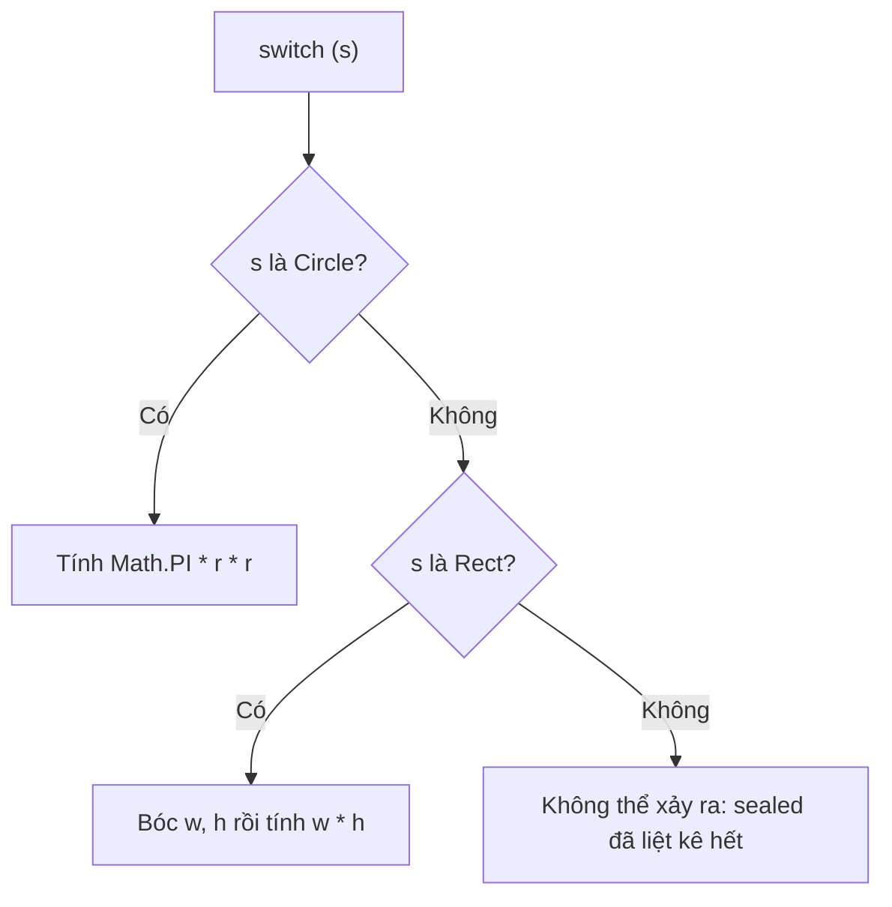
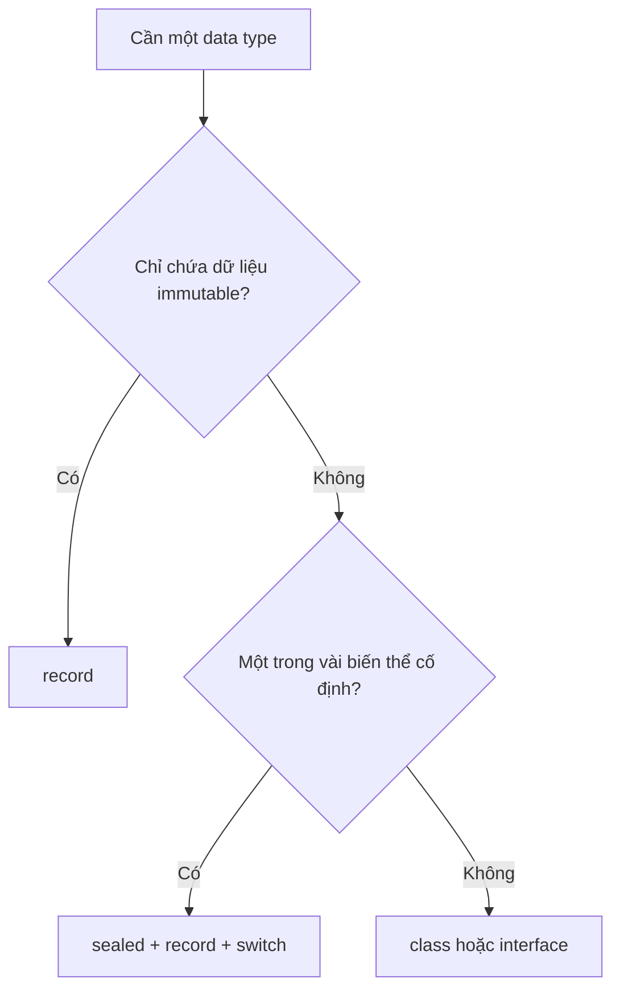

# Lý thuyết 6: Java hiện đại (Java 17 và 21)

Nếu bạn từng đọc code Java 8, chắc bạn đã thấy cảnh một class chỉ để chứa hai trường dữ liệu mà dài cả trăm dòng: constructor, getter, `equals`, `hashCode`, `toString`. Ngoài ra còn lỗi `NullPointerException` gặp hoài, và `switch` kiểu cũ dễ quên `break` khiến chương trình chạy lọt sang nhánh bên dưới. Từ Java 8 trở đi, ngôn ngữ thêm dần các tính năng để xử lý đúng những chỗ đó. Bài này tập trung vào các tính năng từ bản 17 và 21: `record`, `var`, `switch` dạng biểu thức, `sealed`, pattern matching và `Optional`.

## Nên dùng khi nào, không nên dùng khi nào

Dự án mới nên chọn **Java 25** (LTS hiện hành, ra tháng 9/2025); Java 21 vẫn là lựa chọn an toàn, Java 17 là mức tối thiểu (Spring Boot 4 vẫn chạy trên 17). Java 26 (3/2026) và Java 27 (15/9/2026) chỉ là bản ngắn hạn, LTS kế tiếp là Java 29. Các bản 17, 21 và 25 đều là **LTS** (Long-Term Support): được hỗ trợ cập nhật bảo mật nhiều năm, nên là lựa chọn an toàn cho production. Những bản không phải LTS chỉ được hỗ trợ ngắn, hợp để thử nghiệm hơn là triển khai lâu dài.

Những thay đổi đáng biết sau Java 21 (kiểm tra lại JEP tương ứng trước khi dùng):

| Bản | Điểm chính |
|---|---|
| 22 | FFM API (gọi native không cần JNI) chính thức |
| 24 | Stream Gatherers và Class-File API chính thức; `synchronized` không còn ghim virtual thread (JEP 491) |
| **25 (LTS)** | `ScopedValue` chính thức; compact source file và `void main()` chính thức; flexible constructor bodies; compact object headers dùng được như tính năng sản phẩm |
| 26 | `HttpClient` hỗ trợ HTTP/3 (JEP 517); cảnh báo khi deep reflection sửa field `final` (JEP 500) |
| 27 | Compact object headers bật mặc định (JEP 534); G1 là collector mặc định ở mọi môi trường; Structured Concurrency vẫn preview (JEP 533) |

Nếu dự án bị kẹt ở Java 8 hay 11 thì các tính năng này chưa dùng được. Đừng chép code mới sang mà không kiểm tra phiên bản: lỗi sẽ xuất hiện ngay lúc biên dịch, hoặc tệ hơn là bạn vô tình dùng tính năng preview.

Nguyên tắc chọn nhanh: class chỉ chứa dữ liệu thì dùng `record`; `var` cho variable cục bộ khi kiểu đã rõ; `switch` dạng biểu thức thay cho `switch` cũ; `sealed` để giới hạn ai được kế thừa; `Optional` chỉ dùng cho giá trị trả về, không dùng làm field hay tham số.

**Cốt lõi:** Các tính năng Java hiện đại cùng nhắm một việc: nói rõ ý định để trình biên dịch kiểm tra thay cho con người. Dữ liệu thì khai báo gọn, "một trong vài biến thể" thì liệt kê đóng, chỗ có thể vắng mặt thì lộ ra trên chữ ký.

- Vì class dữ liệu chỉ cần mô tả các thành phần nên `record` tự sinh phần còn lại, nhưng chỉ immutable nông.
- Vì `sealed` liệt kê đóng các biến thể nên `switch` pattern kiểm tra được đủ trường hợp, thiếu nhánh thì lỗi ngay lúc biên dịch.
- Vì `Optional` đặt "có thể vắng mặt" lên chữ ký trả về nên chỉ dùng làm kiểu trả về, không làm field hay tham số.


Mô hình tư duy: càng khai báo rõ ý định, trình biên dịch càng bắt được lỗi sớm thay vì để nó nổ lúc chạy.

**Tóm tắt:**

- Dự án mới nên nhắm tối thiểu Java 17, ưu tiên bản LTS mới nhất (25, hoặc 21 nếu framework chưa hỗ trợ); đừng chép code mới sang dự án còn kẹt ở Java 8 hay 11.
- `record` khai báo class dữ liệu immutable trong một dòng, tự sinh constructor, accessor, `equals`, `hashCode`, `toString`; nhưng immutable chỉ ở mức nông.
- `switch` biểu thức dùng `->` không fall-through, trả giá trị và bắt buộc đủ trường hợp.
- `instanceof` pattern gộp kiểm tra và ép kiểu thành một bước.
- `sealed` giới hạn class con, kết hợp `record` và `switch` pattern (Java 21) để compiler kiểm tra đủ trường hợp.
- `Optional` chỉ làm kiểu trả về, không làm field hay tham số; `orElse` luôn tính giá trị mặc định còn `orElseGet` chỉ tính khi rỗng.
- `var` chỉ cho variable cục bộ khi kiểu đã rõ; dùng `--release` để tránh gọi API quá mới.

## Các khái niệm cần biết

- **Boilerplate**: đoạn code lặp đi lặp lại, bắt buộc phải viết nhưng không chứa logic (getter, `equals`...). `record` loại bỏ nó.
- **DTO (Data Transfer Object) và value object**: DTO là object chỉ để chở dữ liệu giữa các tầng hoặc qua mạng. Value object là object đại diện cho một giá trị (tiền, tọa độ), hai object cùng giá trị thì coi là bằng nhau. Cả hai đều hợp với `record`.
- **Fall-through**: ở `switch` cũ, nếu nhánh không có `break` thì chương trình chạy tiếp vào nhánh kế bên. Đây là nguồn lỗi kinh điển.
- **Pattern matching**: viết điều kiện kiểu "nếu giá trị này có dạng X thì lấy ra các phần của nó", thay vì kiểm tra kiểu rồi ép kiểu thủ công.
- **Guard**: điều kiện phụ gắn vào một nhánh `case`, viết bằng `when`, ví dụ `case Circle c when c.r() > 10 -> ...`.
- **Exhaustive (đủ trường hợp)**: `switch` phải bao hết mọi khả năng. Với `sealed` hoặc enum, trình biên dịch tự kiểm tra, thiếu là báo lỗi.
- **Algebraic data type**: cách mô hình hóa "giá trị là một trong vài biến thể cố định", mỗi biến thể có dữ liệu riêng. Trong Java, đó là `sealed` kết hợp `record`.
- **Preview feature**: tính năng đã có trong JDK nhưng chưa chốt, phải bật bằng `--enable-preview` và có thể đổi ở bản sau. Không dùng cho production.

## Bản đồ tính năng

| Tính năng | Từ | Giải quyết |
|---|---|---|
| `var` (suy luận kiểu cục bộ) | 10 | Bớt lặp kiểu: `var list = new ArrayList<String>();` |
| Text block `"""` | 15 | Chuỗi nhiều dòng (JSON, SQL) |
| `record` | 16 | Class dữ liệu immutable |
| `switch` biểu thức, `->` | 14 | Không còn `break`, trả giá trị |
| `instanceof` pattern | 16 | Kiểm tra và ép kiểu một bước |
| `sealed` | 17 | Giới hạn class con, kiểm tra đủ trường hợp |
| Pattern matching cho `switch` | 21 | Rẽ nhánh theo kiểu, có guard |
| Record pattern | 21 | Bóc tách `record` ngay trong pattern |
| Virtual threads | 21 | Thread nhẹ (xem bài multithreading) |

## record

`record` là cách khai báo một class dữ liệu immutable chỉ trong một dòng. Bạn liệt kê các thành phần, trình biên dịch tự sinh phần còn lại. Nếu cần kiểm tra hợp lệ, viết *compact constructor*: constructor không có danh sách tham số, chạy trước khi gán vào các field.

```java
public record Money(BigDecimal amount, String currency) {
    // compact constructor: kiểm tra hợp lệ
    public Money {
        Objects.requireNonNull(amount);
        if (currency.length() != 3) throw new IllegalArgumentException("currency");
    }
}
```

Tự sinh: constructor, getter dạng `amount()`, `equals`, `hashCode`, `toString`. Trường `final`, class `final`. Hợp làm DTO, value object, key của map. Không hợp khi object cần thay đổi trạng thái sau khi tạo (ví dụ entity JPA có setter), lúc đó dùng class thường.

**Phải thuộc:** `record` tự sinh constructor, accessor dạng `x()`, `equals`, `hashCode`, `toString`; các field `final` và class `final`; không `extends` class khác nhưng được `implements` interface. Chỉ immutable nông: field là `List` hay array thì phải defensive copy trong compact constructor.

### Hành vi của record và bẫy

Vấn đề đặt ra là `record` chỉ immutable **nông**: bản thân các field không gán lại được, nhưng nếu một field là `List` thì nội dung list vẫn sửa được từ bên ngoài. Cách xử lý là *defensive copy* (defensive copy) ngay trong compact constructor, như `Team` dưới đây.

```java
record Point(int x, int y) {}
record Team(String name, List<String> members) {
    Team {                                           // compact constructor
        // defensive copy: record chỉ bất biến nông
        members = List.copyOf(members);
    }
}

var p = new Point(1, 2);
System.out.println(p);                               // Point[x=1, y=2]
// true: so sánh theo từng thành phần
System.out.println(p.equals(new Point(1, 2)));
```

| Đặc điểm | Ghi chú |
|---|---|
| Immutable **nông** | Thành phần là `List`/array thì nội dung vẫn sửa được nếu không sao chép |
| Không `extends` được class khác | Nhưng `implements` interface thoải mái |
| Được thêm method, `static`, constructor phụ | Không được thêm field instance |
| Thành phần array: `equals` so sánh reference | Tránh array trong record |

**Suy luận:** `record` là immutable nông vì compiler chỉ biến mọi component thành field `final`, tức là cấm gán lại reference, chứ không can thiệp vào object mà reference trỏ tới. Nếu component là `List` hay array thì nội dung vẫn sửa được từ bên ngoài, và `equals` của array so reference nên hai record "cùng dữ liệu" vẫn khác nhau. Vì `equals`, `hashCode` được sinh từ mọi component, một component có thể đổi sẽ làm `hashCode` đổi theo và entry trong `HashSet` hay `HashMap` lại lạc bucket. Cách xử lý đi từ cơ chế đó: defensive copy trong compact constructor bằng `List.copyOf`, và tránh array làm component. Chỗ dễ nhầm là nghĩ `record` đã đủ an toàn thread hay đủ làm key, trong khi điều đó chỉ đúng khi các component cũng immutable. Khi review, hãy kiểm tra từng component của record có phải kiểu immutable hoặc đã được copy hay chưa.

## switch biểu thức và instanceof pattern (Java 17)

Với `switch` cũ, quên `break` là lỗi khó thấy. `switch` dạng biểu thức dùng mũi tên `->`, tự trả về giá trị và không bao giờ rơi sang nhánh sau. Khi một nhánh cần nhiều lệnh, bạn mở khối `{}` và dùng `yield` để trả giá trị.

```java
int daysIn(String month, boolean leapYear) {
    return switch (month) {
        case "2" -> leapYear ? 29 : 28;
        case "4", "6", "9", "11" -> 30;
        default -> {                                  // khối nhiều lệnh: dùng yield
            if (month.isBlank()) throw new IllegalArgumentException();
            yield 31;
        }
    };
}

Object o = "hello";
// s chỉ nằm trong phạm vi khi điều kiện đúng
if (o instanceof String s && s.length() > 3) {
    System.out.println(s.toUpperCase());
}
```

`switch` dạng `->` **không rơi xuống** (fall-through) nhánh sau; dạng `case X:` cũ vẫn rơi nếu thiếu `break`. Dạng biểu thức bắt buộc đủ trường hợp (có `default` hoặc là enum/sealed đã liệt kê hết); thiếu thì không biên dịch được. Đừng trộn hai kiểu cú pháp trong cùng một `switch`.

**Phải thuộc:** `switch` dạng `->` không fall-through, trả được giá trị, nhánh nhiều lệnh dùng `yield`; dạng biểu thức bắt buộc đủ trường hợp. Mốc phiên bản: `switch` biểu thức 14, `instanceof` pattern 16, `record` 16, `sealed` 17, `switch` pattern và record pattern 21.

`instanceof` pattern (`o instanceof String s`) thay cho đoạn kiểm tra rồi ép kiểu `(String) o`. Variable `s` chỉ tồn tại ở nơi trình biên dịch chắc chắn điều kiện đã đúng, như vế phải của `&&` hoặc thân `if`.

## sealed và switch pattern

Khi bạn mô hình hóa "một hình có thể là hình tròn hoặc hình chữ nhật, không có loại khác", nếu dùng interface thường thì ai cũng có thể thêm class con, và `switch` không thể biết đã xử lý đủ chưa. `sealed` giải quyết bằng cách liệt kê rõ các class con được phép trong `permits`.

```java
sealed interface Shape permits Circle, Rect {}
record Circle(double r) implements Shape {}
record Rect(double w, double h) implements Shape {}

static double area(Shape s) {
    // trình biên dịch kiểm tra đã đủ trường hợp
    return switch (s) {
        case Circle c -> Math.PI * c.r() * c.r();
        case Rect(double w, double h) -> w * h;
    };
}
```

Dòng `case Rect(double w, double h)` là *record pattern*: vừa kiểm tra kiểu `Rect`, vừa bóc hai thành phần ra variable `w`, `h`.



Đọc sơ đồ: JVM thử lần lượt từng `case` từ trên xuống. Nhánh cuối là lưới an toàn: vì `Shape` là `sealed`, trình biên dịch biết chỉ có hai khả năng nên không đòi `default`.

`switch` pattern và record pattern là bản chính thức từ **Java 21**; Java 17 chỉ ở dạng preview (cần `--enable-preview`). Còn `sealed` và `record` dùng bình thường từ 17.

Thêm class con mới mà quên xử lý: **lỗi biên dịch**, không phải lỗi lúc chạy. Đây là cách mô hình hóa kiểu "một trong các khả năng" (algebraic data type). Đừng dùng `sealed` cho API công khai mà bên thứ ba cần mở rộng, vì họ sẽ không kế thừa được.

**Suy luận:** `sealed` ra đời để giải quyết một điểm mù của interface thường: ai cũng có thể thêm class con, nên compiler không bao giờ biết đã liệt kê hết các trường hợp và buộc `switch` phải có `default`. Khi `sealed` khai báo `permits` một danh sách đóng, compiler biết tập đầy đủ, nên `switch` pattern có thể bỏ `default` mà vẫn được kiểm tra đủ nhánh. Hệ quả quan trọng là thêm một biến thể mới sẽ làm mọi `switch` thiếu nhánh lỗi lúc biên dịch thay vì lỗi lúc chạy, đúng cái ta muốn khi mô hình hóa kiểu "một trong các khả năng". Cũng vì vậy `default` trong `switch` trên `sealed` là hại: nó nuốt biến thể mới và mất đi khả năng cảnh báo. Điểm dễ nhầm là dùng `sealed` cho API công khai mà bên thứ ba cần mở rộng, vì khi đó danh sách đóng buộc họ phải sửa thư viện của bạn. Hãy dùng `sealed` cho mô hình nội bộ có tập biến thể ổn định, và tránh `default` để giữ lợi ích kiểm tra của compiler.

**Nền tảng:** `sealed` + `record` + `switch` pattern cho phép mô hình hóa "một trong vài biến thể cố định" mà trình biên dịch kiểm tra đủ trường hợp: thêm biến thể mới thì mọi `switch` thiếu nhánh sẽ lỗi lúc biên dịch thay vì lỗi lúc chạy.

## Optional

`Optional<T>` là một chiếc hộp có thể rỗng hoặc chứa một giá trị. Nó buộc người gọi hàm nhìn thấy rằng "kết quả có thể vắng mặt" ngay trên chữ ký method, thay vì bất ngờ gặp `null` rồi throw `NullPointerException`.

```java
Optional<User> u = repo.findById(id);
String name = u.map(User::name).orElse("ẩn danh");
```

| Nên | Không nên |
|---|---|
| Làm **kiểu trả về** để báo "có thể vắng mặt" | Làm tham số, trường của class |
| `map`, `flatMap`, `orElseThrow` | `if (opt.isPresent()) opt.get()` |
| `orElseGet(() -> ...)` khi giá trị mặc định tốn kém | `orElse(expensive())` luôn bị tính |

**Phải thuộc:** `Optional` chỉ dùng làm kiểu trả về, không làm field hay tham số. `orElse(x)` luôn tính `x` dù Optional có giá trị; `orElseGet(supplier)` chỉ tính khi rỗng.

Lý do của dòng cuối: `orElse(x)` nhận một giá trị đã được tính xong, nên biểu thức `expensive()` chạy dù Optional có giá trị. `orElseGet` nhận một lambda, chỉ chạy khi cần. Chạy thử sự khác nhau này (Java 11 chạy được):

```java
static String expensive() { System.out.println("tính tốn kém"); return "mặc định"; }

Optional<String> present = Optional.of("có");
present.orElse(expensive());          // in "tính tốn kém" dù Optional đã có giá trị
present.orElseGet(() -> expensive());   // không in gì: chỉ gọi khi Optional rỗng
```

## Chọn gì khi



## Lưu ý

- `var` chỉ cho variable cục bộ; đừng dùng khi kiểu không rõ ràng khi đọc. Ví dụ `var x = service.load();` khiến người đọc phải đoán `x` là gì.
- Dùng bản **LTS** (17, 21) cho production.
- Bật cảnh báo và dùng `--release <phiên bản bạn nhắm tới>` (ví dụ 21 hoặc 25) khi biên dịch. Cờ `--release` làm trình biên dịch chỉ cho phép API của đúng phiên bản đó, tránh vô tình gọi API mới khi chạy trên JVM cũ.

## Phỏng vấn khó: chuỗi hỏi xoáy

Người phỏng vấn senior thường mở bằng câu dễ rồi xoáy xuống cơ chế, đánh đổi và sự cố thật. Câu trả lời tốt luôn đi từ cốt lõi xuống.

### Chuỗi 1: `record` và immutable nông

1. **Câu mở:** `record` khác class thường ở điểm nào?
2. **Xoáy 1:** `record Team(String name, List<String> members)` có immutable không? Compiler thực sự làm gì với component?
3. **Xoáy 2:** Dùng record này làm key `HashMap` hoặc làm entity JPA thì gặp vấn đề gì?

**Đáp án ngắn:** `record` là class dữ liệu: compiler sinh constructor, accessor dạng `x()`, `equals`, `hashCode`, `toString`, mọi field `final` và class `final`. Nó không `extends` được class khác nhưng `implements` được interface. Immutable ở đây chỉ là nông: compiler chỉ khóa việc gán lại reference, không đụng tới object mà reference trỏ tới. Nên component là `List` thì nội dung vẫn sửa được từ bên ngoài, còn component là array thì `equals` so reference. Vì `equals` và `hashCode` sinh từ mọi component, một component đổi được sẽ làm `hashCode` đổi và entry trong map lạc bucket. Cách xử lý là defensive copy bằng `List.copyOf` trong compact constructor và tránh array. Entity JPA cần sửa được dữ liệu, nên dùng class thường thay vì record.

**Sai lầm hay gặp:**

- Nói "record là immutable" mà không nói "nông".
- Cho rằng record tự động đủ an toàn làm key hay chia sẻ giữa thread.
- Dùng record cho entity JPA.

### Chuỗi 2: `sealed` và `switch` kiểm tra đủ trường hợp

1. **Câu mở:** `sealed` dùng để làm gì?
2. **Xoáy 1:** Vì sao `switch` trên kiểu `sealed` có thể bỏ `default`, và vì sao thêm `default` ở đó lại có hại?
3. **Xoáy 2:** Thư viện thêm một biến thể mới vào `sealed interface`, còn code của bạn đã biên dịch từ trước. Chuyện gì xảy ra? Có nên dùng `sealed` cho API công khai không?

**Đáp án ngắn:** `sealed` liệt kê đóng các class con được phép trong `permits`. Interface thường thì ai cũng thêm được class con, nên compiler không biết đã xử lý đủ chưa và buộc `switch` phải có `default`. Với `sealed`, compiler biết tập đầy đủ nên kiểm tra được `switch` pattern: thêm biến thể mới mà thiếu nhánh thì lỗi lúc biên dịch thay vì lỗi lúc chạy. `default` làm mất lợi ích đó vì nó nuốt biến thể mới mà không cảnh báo. Nếu code đã biên dịch từ trước mà thư viện thêm biến thể, compiler chưa có dịp báo lỗi; tôi hiểu lúc chạy sẽ phát sinh lỗi do không có nhánh khớp (kiểm tra lại theo phiên bản), nên cần biên dịch lại. Vì danh sách đóng buộc bên thứ ba phải sửa thư viện của bạn, nên chỉ dùng `sealed` cho mô hình nội bộ có tập biến thể ổn định. Switch pattern chính thức từ Java 21, còn Java 17 chỉ preview.

**Sai lầm hay gặp:**

- Thêm `default` vào `switch` trên `sealed` "cho an toàn".
- Dùng `sealed` cho API cần bên ngoài mở rộng.
- Nhầm mốc phiên bản: `sealed` từ 17, `switch` pattern từ 21.

