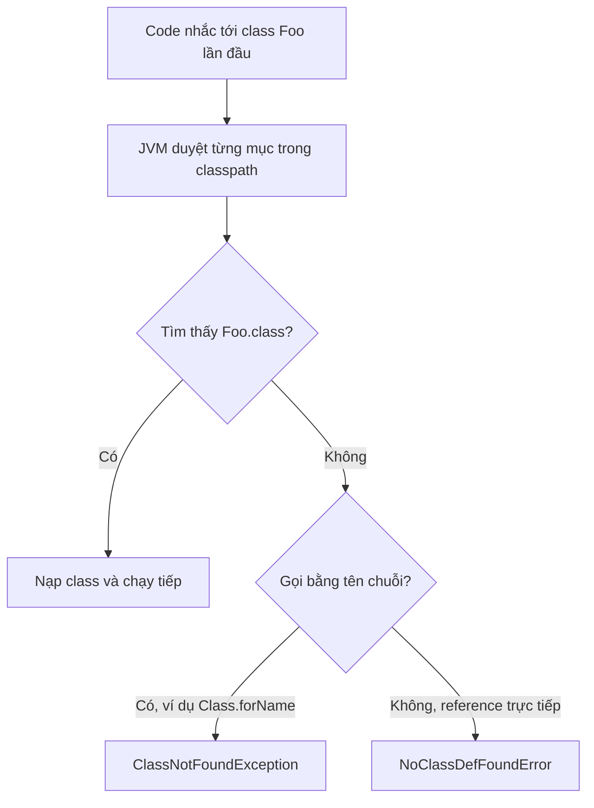

# Cú pháp nền tảng, môi trường và cấu trúc chương trình

Đây là bài đầu tiên bạn nên đọc nếu mới làm quen với Java, và là bài đáng quay lại khi gặp lỗi khó hiểu. Bài trả lời ba câu hỏi: chương trình Java được biên dịch và chạy thế nào (JDK, JRE, JVM, classpath), dữ liệu cơ bản hoạt động ra sao (kiểu, phạm vi, ép kiểu, tràn số, wrapper), và các từ khóa dùng hằng ngày (`static`, `final`, package) có ý nghĩa gì.

## Vì sao phần này quan trọng

OOP, collections, concurrency đều được dựng trên những quy tắc căn bản này. Hiểu sai ở đây thì lỗi nhìn rất nhỏ (ép kiểu làm mất dữ liệu, variable dùng ngoài phạm vi, `ClassNotFoundException`) nhưng lại mất nhiều thời gian mới tìm ra, vì chương trình vẫn chạy, chỉ cho kết quả sai. Ví dụ `1_000_000 * 1_000_000` cho ra số âm mà không có bất kỳ cảnh báo nào.

Cách dùng bài: đọc một lượt khi mới bắt đầu, sau đó quay lại tra khi gặp lỗi biên dịch hay lỗi lúc chạy liên quan tới phạm vi variable, ép kiểu hoặc classpath. Quy trình làm việc cơ bản là cài JDK, dùng `javac` để biên dịch và `java` để chạy, đồng thời nắm quy tắc về kiểu, phạm vi variable và cách JVM tìm class qua classpath.

**Cốt lõi:** Java tách "viết" khỏi "chạy": `javac` dịch mã nguồn thành bytecode, rồi JVM nạp class và chạy với các kiểu có kích thước cố định. Vì vậy phần lớn lỗi nền tảng đến từ hai nơi: phép tính vượt giới hạn của kiểu, và JVM không tìm thấy class lúc chạy.

- Vì `int` có kích thước cố định nên tràn số quay vòng âm thầm, và phép tính được làm theo kiểu rộng nhất của hai vế, tối thiểu là `int`.
- Vì JVM chỉ nạp class khi code nhắc tới lần đầu, qua classpath, nên thiếu JAR lộ ra lúc chạy chứ không phải lúc biên dịch.
- Vì variable giữ giá trị hoặc địa chỉ nên `final` chỉ khóa ô nhớ, không khóa object phía sau.


Mô hình tư duy: biên dịch chỉ bắt lỗi kiểu, còn thiếu class hay tràn số chỉ lộ ra khi chương trình thực sự chạy.

**Tóm tắt:**

- Java biên dịch ra bytecode trung lập, nên cùng một file `.class` chạy được ở mọi nơi có JVM; JDK gồm JRE, JRE gồm JVM, và từ Java 11 không còn JRE riêng.
- Primitive giữ giá trị, reference giữ địa chỉ; Java luôn truyền theo giá trị nên hàm sửa được nội dung object nhưng không đổi được variable của người gọi.
- `int` tràn âm thầm, chia nguyên cắt về 0, `0.1 + 0.2 != 0.3`; muốn báo lỗi dùng `Math.addExact` hoặc `Math.toIntExact`.
- Phạm vi: variable cục bộ phải gán trước khi dùng, còn field có giá trị mặc định.
- `==` so reference, `equals` so nội dung; `&&` và `||` ngắn mạch.
- Classpath quyết định JVM tìm class ở đâu: thiếu JAR thì lỗi lúc chạy (`ClassNotFoundException`, `NoClassDefFoundError`) chứ không phải lúc biên dịch.
- `final` trên variable chỉ cấm gán lại reference chứ không làm object bên trong immutable; `static` thuộc về class và không có `this`.

## Các khái niệm cần biết

- **Bytecode**: mã trung gian trong file `.class`, không gắn với hệ điều hành cụ thể. Nhờ nó mà cùng một file `.class` chạy được trên Windows, Linux, macOS, miễn là có JVM. Đây là ý nghĩa của "viết một lần, chạy mọi nơi".
- **Nguyên thủy (primitive) và reference**: variable nguyên thủy chứa trực tiếp giá trị (`int x = 5`); variable reference chứa "địa chỉ" trỏ tới object trên heap.
- **Autoboxing/unboxing**: Java tự chuyển qua lại giữa `int` và `Integer` (đóng hộp, mở hộp). Tiện, nhưng mở hộp một `null` gây `NullPointerException`.
- **Ngắn mạch (short-circuit)**: `a && b` mà `a` đã sai thì không tính `b`, dùng để viết `x != null && x.isEmpty()` an toàn.
- **Truyền theo giá trị (pass by value)**: khi gọi hàm, Java luôn copy giá trị của tham số. Với object, giá trị được copy là reference, nên hàm sửa được nội dung object nhưng gán lại variable tham số thì không ảnh hưởng bên ngoài.
- **Classpath**: danh sách nơi JVM tìm các file `.class`/JAR khi cần nạp một class.
- **LTS**: bản phát hành được hỗ trợ dài hạn, nên chọn cho sản phẩm thật.

## JDK, JRE, JVM

Ba thuật ngữ này hay bị lẫn. Hãy nhìn theo quy trình: bạn viết mã nguồn, `javac` (có trong JDK) biên dịch thành bytecode, rồi `java` khởi động JVM để chạy bytecode đó.


- **JVM**: máy ảo thực thi bytecode. **JRE**: JVM + thư viện chuẩn. **JDK**: JRE + `javac`, `jar`, `jlink`, `jcmd`...
- Từ Java 11 không còn phát hành JRE riêng; dùng JDK hoặc tạo runtime thu gọn bằng `jlink` (chỉ chứa các module ứng dụng cần, hữu ích khi đóng gói container nhỏ).
- Quản lý nhiều phiên bản JDK: SDKMAN!, jEnv, hoặc toolchain của Maven/Gradle. Dùng bản **LTS** (17, 21, 25) cho sản phẩm.
- Chạy nhanh một file: `java Hello.java` (không cần `javac` riêng). Cách này hợp để thử ý tưởng hoặc script nhỏ, không dùng cho dự án nhiều file.

## Variable, phạm vi, ép kiểu

Phần này có nhiều quy tắc nhỏ, nên bảng dưới tóm tắt trước, sau đó ví dụ minh họa hậu quả khi hiểu sai.

| Khái niệm | Quy tắc |
|---|---|
| Kiểu nguyên thủy | `byte short int long float double boolean char`; không là object, không `null` |
| Phạm vi (scope) | Variable cục bộ sống trong khối `{}`; field sống theo object; variable `static` sống theo class |
| Giá trị mặc định | Field có mặc định (`0`, `false`, `null`); **variable cục bộ không**, phải gán trước khi dùng |
| `var` (Java 10+) | Suy luận kiểu cho variable cục bộ, vẫn là kiểu tĩnh |
| Ép kiểu mở rộng | `int` → `long` tự động; thu hẹp phải ép tường minh `(int) x`, có thể mất dữ liệu |
| Tràn số | `int` tràn **âm thầm** (quay vòng); dùng `Math.addExact` để throw lỗi |

```java
int a = Integer.MAX_VALUE;
a + 1;                      // -2147483648, không báo lỗi
Math.addExact(a, 1);        // ArithmeticException
5 / 2;   // 2   (chia nguyên)
5 / 2.0; // 2.5
0.1 + 0.2 == 0.3; // false: số thực nhị phân, dùng BigDecimal cho tiền
```

Dùng `Math.addExact`/`multiplyExact` khi sai số học gây hậu quả (số tiền, số lượng tồn kho). Không cần dùng trong vòng lặp tính toán nặng nơi tràn số đã được loại trừ, vì bản `Exact` chậm hơn một chút.

**Phải thuộc:** `int` tràn âm thầm (`Integer.MAX_VALUE + 1` ra `-2147483648`); chia nguyên cắt về 0 (`5 / 2 == 2`, `-7 / 2 == -3`, `-7 % 2 == -1`); `(int) 3.99 == 3`; `0.1 + 0.2 != 0.3`. Dùng `Math.addExact`, `Math.toIntExact` để throw lỗi khi tràn.

**Suy luận:** Số học của Java dựa trên kích thước cố định của kiểu, nên mọi kết quả phải nằm vừa trong 32 hay 64 bit. Khi `int` vượt ngưỡng, CPU không báo lỗi mà chỉ giữ lại các bit thấp, nên `Integer.MAX_VALUE + 1` quay vòng thành số âm lặng lẽ. Từ cùng nguyên tắc, biểu thức tính theo kiểu rộng nhất trong hai vế và tối thiểu là `int`, nên `int * int` đã tràn trước khi được gán vào `long`; chuyển sang `long` phải làm trước phép tính chứ không phải sau. Số thực nhị phân không biểu diễn chính xác `0.1`, nên `0.1 + 0.2 != 0.3` và tiền không được lưu bằng `double`. Điểm dễ nhầm là tin rằng gán vào `long` thì phép nhân hai `int` an toàn, và `(int) 3.99` cắt chứ không làm tròn. Hệ quả hành động: ở chỗ tiền hay số lượng, dùng `Math.addExact`, `BigDecimal`, hoặc ít nhất ép một toán hạng sang `long` trước khi tính.

### Chạy thử: các bẫy số học và ép kiểu hay hỏi

```java
byte b = 10;
b += 300;                          // 54: toán tử gộp += có ép kiểu ngầm, cắt bớt bit
// b = b + 300;                    // lỗi biên dịch: int không tự thu hẹp về byte
(int) 3.99;                        // 3  (cắt phần thập phân, không làm tròn)
(int) -3.99;                       // -3
(byte) 200;                        // -56 (lấy 8 bit thấp)
Math.round(-2.5);                  // -2 (làm tròn về phía +vô cực khi hòa)
-7 / 2;                            // -3 (chia nguyên cắt về 0)
-7 % 2;                            // -1 (dấu theo số bị chia)
Math.floorMod(-7, 2);              // 1  (dùng khi cần chỉ số vòng tròn)

char c = 'a'; c++;                 // 'b'
'a' + 1;                           // 98 (char + int ra int)
"" + 'a' + 1;                      // "a1" (nối chuỗi từ trái sang phải)

// -727379968: nhân bằng int, tràn rồi mới đổi sang long
long big = 1_000_000 * 1_000_000;
long ok  = 1_000_000L * 1_000_000; // 1000000000000

int i = 5;
// 5 + 7 = 12 (đừng viết như vậy, chỉ để hiểu quy tắc)
i = i++ + ++i;

Integer n = null;
int x = true ? n : 0;              // NullPointerException: toán tử ba ngôi bị unboxing
```

Quy tắc nhớ: biểu thức số học tính theo kiểu **rộng nhất trong hai vế, tối thiểu là `int`**. Muốn kết quả `long` thì ít nhất một toán hạng phải là `long` **trước** khi phép tính xảy ra.

Hãy tự hỏi mỗi khi ép kiểu thu hẹp: giá trị có chắc nằm trong miền của kiểu đích không? Nếu không chắc, dùng `Math.toIntExact(long)` để được exception thay vì số sai.

## Toán tử và control flow

- `==` với object so **reference**, `equals` so **nội dung**. So sánh hai `String` bằng `==` có thể đúng ngẫu nhiên nhờ string pool, nhưng đừng dựa vào đó.
- `&&`, `||` ngắn mạch (bỏ vế sau nếu đã biết kết quả); `&`, `|` luôn tính cả hai.
- `i++` trả giá trị cũ rồi tăng; `++i` tăng rồi trả giá trị mới.
- `switch` biểu thức (Java 14+): `var r = switch (day) { case MON, TUE -> 1; default -> 0; };` không bị "rơi xuống" (fall-through).
- Vòng lặp: `for`, `for-each`, `while`, `do-while`; `break`/`continue` (có nhãn cho vòng lồng).

## Array

- Kích thước cố định, cùng kiểu, nằm trên heap, chỉ số từ 0; `arr.length` là field.
- Mặc định `0/false/null`. Truy cập ngoài biên → `ArrayIndexOutOfBoundsException`.
- Array nhiều chiều thực chất là **array của array** (có thể so le).
- Tiện ích: `Arrays.toString`, `Arrays.sort`, `Arrays.copyOf`, `Arrays.equals`, `Arrays.asList` (khung nhìn kích thước cố định).

Dùng array khi kích thước biết trước và cần hiệu năng hoặc làm việc với kiểu nguyên thủy; cần thêm/xóa linh hoạt thì dùng `ArrayList`. In thẳng một array bằng `System.out.println(arr)` chỉ ra địa chỉ kiểu `[I@1b6d3586`, nên hãy dùng `Arrays.toString`.

## Wrapper và autoboxing

Collections chỉ chứa object, không chứa `int`. Vì thế Java có các class bọc (wrapper) cho từng kiểu nguyên thủy, và tự động đóng/mở hộp khi cần.

| Nguyên thủy | Wrapper | Lưu ý |
|---|---|---|
| `int` | `Integer` | Cache `-128..127`: `==` đúng với số nhỏ, sai với số lớn |
| `boolean` | `Boolean` | Unboxing `null` → `NullPointerException` |

Autoboxing trong vòng lặp lớn tạo nhiều object; ưu tiên nguyên thủy khi hiệu năng quan trọng. Khi so sánh hai `Integer`, dùng `equals`, không dùng `==`.

## Package, import, classpath

- **Package** nhóm class, tương ứng cấu trúc thư mục, tránh trùng tên (quy ước tên miền đảo ngược `com.example.app`).
- `import` chỉ là rút gọn tên khi biên dịch, không nạp class.
- **Classpath**: danh sách thư mục/JAR mà JVM tìm `.class`; sai classpath gây `ClassNotFoundException`/`NoClassDefFoundError`. Công cụ build (Maven/Gradle) dựng giúp.
- Điểm vào: `public static void main(String[] args)`.

Sơ đồ dưới cho thấy JVM tìm class thế nào khi chương trình nhắc tới một tên class lần đầu. Hiểu nó là hiểu vì sao "thiếu JAR" thành lỗi lúc chạy chứ không phải lúc biên dịch.



Đọc sơ đồ: lỗi `ClassNotFoundException` là exception thường gặp khi nạp class bằng tên chuỗi. `NoClassDefFoundError` là lỗi nặng hơn, thường nghĩa là lúc biên dịch có class đó nhưng lúc chạy classpath thiếu (hoặc static initializer của class từng thất bại).

**Phải thuộc:** `ClassNotFoundException` là exception checked khi nạp class bằng tên chuỗi (`Class.forName`); `NoClassDefFoundError` là `Error`, class có lúc biên dịch nhưng thiếu hoặc khởi tạo thất bại lúc chạy.

**Suy luận:** Thiếu JAR chỉ lộ ra lúc chạy vì lúc biên dịch compiler chỉ cần chữ ký class nên dùng đúng classpath khi build là đủ, còn JVM nạp class lười, chỉ lần đầu code thực sự nhắc tới nó. Vì vậy chương trình có thể khởi động bình thường rồi mới nổ ở nhánh hiếm dùng tới class thiếu. Hai lỗi tương tự phân biệt theo cách nạp: `ClassNotFoundException` xảy ra khi bạn nạp bằng tên chuỗi như `Class.forName` và là checked, còn `NoClassDefFoundError` là `Error` khi class có lúc biên dịch nhưng mất hoặc khởi tạo static thất bại lúc chạy. Điểm dễ nhầm là coi chúng giống nhau, hoặc nghĩ khai báo dependency đúng ở máy dev là đủ trong khi artifact triển khai thiếu JAR. Hãy kiểm tra classpath thực tế của process, phiên bản JAR trùng và lỗi trong static initializer.

## static và final

`static` trả lời câu hỏi "cái này thuộc về class hay thuộc về từng object"; `final` trả lời "cái này có được thay đổi sau khi gán không".

| Từ khóa | Trên variable | Trên method | Trên class |
|---|---|---|---|
| `static` | Một bản cho cả class | Gọi không cần object, không có `this` | Chỉ cho class lồng |
| `final` | Gán đúng một lần (reference immutable, **object bên trong vẫn có thể đổi**) | Không cho ghi đè | Không cho kế thừa (`String`) |

Hệ quả thực tế: `static final List<String> NAMES = new ArrayList<>();` vẫn `add` được, vì `final` chỉ cấm gán lại reference. Variable `static` có thể bị mọi thread cùng sửa, nên dùng trạng thái `static` thay đổi được là nguồn lỗi đồng thời.

**Phải thuộc:** `final` trên variable chỉ cấm gán lại reference, không làm object bên trong immutable. `static` thuộc về class (không có `this`); `final` trên method là cấm override, trên class là cấm kế thừa. Variable cục bộ phải gán trước khi dùng, field có giá trị mặc định.

## I/O cơ bản

`Scanner(System.in)` đọc console; `System.out.printf` định dạng; `String.format("%.2f", x)`. Đọc/ghi file xem [I/O và NIO](/go?p=08-Java%2FJava-Core%2Fmedium%2Flt-10-io-nio.md).

## Điều cần nhớ

- Java **truyền tham số theo giá trị**; với object, giá trị là bản sao của reference.
- Variable cục bộ phải khởi tạo; field có mặc định.
- Số thực không biểu diễn chính xác mọi số thập phân; tiền dùng `BigDecimal` hoặc số nguyên đơn vị nhỏ nhất.
- Nên học tiếp: [Data type và String](/go?p=08-Java%2FJava-Core%2Feasy%2Flt-02-kieu-du-lieu-string.md), [OOP](/go?p=08-Java%2FJava-Core%2Feasy%2Flt-03-oop.md).

## Phỏng vấn khó: chuỗi hỏi xoáy

Người phỏng vấn senior thường mở bằng câu dễ rồi xoáy xuống cơ chế, đánh đổi và sự cố thật. Câu trả lời tốt luôn đi từ cốt lõi xuống.

### Chuỗi 1: Tràn số và ép kiểu

1. **Câu mở:** `Integer.MAX_VALUE + 1` cho ra gì?
2. **Xoáy 1:** `long big = 1_000_000 * 1_000_000;` cho ra số âm dù đã gán vào `long`. Vì sao, và sửa thế nào?
3. **Xoáy 2:** Trong code tính tiền hoặc tồn kho bạn bảo vệ thế nào? `(byte) 200`, `(int) 3.99` và `b += 300` với `byte b` cho ra gì?

**Đáp án ngắn:** Kết quả là `-2147483648`: `int` có kích thước cố định 32 bit, vượt ngưỡng thì CPU chỉ giữ các bit thấp nên quay vòng mà không báo lỗi. Biểu thức số học tính theo kiểu rộng nhất của hai vế, tối thiểu là `int`, nên `1_000_000 * 1_000_000` nhân bằng `int`, tràn rồi mới đổi sang `long`. Sửa bằng cách làm ít nhất một toán hạng là `long` trước phép tính, như `1_000_000L * 1_000_000`. Ở chỗ tiền hay số lượng, tôi dùng `Math.addExact`, `multiplyExact` hoặc `Math.toIntExact` để có exception thay vì số sai; bản `Exact` chậm hơn một chút nên không cần trong vòng lặp nặng nơi đã loại trừ tràn. Ép thu hẹp cắt bit chứ không làm tròn: `(int) 3.99` là 3, `(byte) 200` là -56, và `+=` có ép kiểu ngầm nên `b += 300` ra 54 trong khi `b = b + 300` không biên dịch được. Số thực nhị phân không chính xác nên tiền dùng `BigDecimal`.

**Sai lầm hay gặp:**

- Tin rằng gán vào `long` thì phép nhân hai `int` đã an toàn.
- Nói "tràn thì throw exception" như mặc định của Java.
- Nghĩ `(int)` làm tròn số thực.

### Chuỗi 2: Lỗi class chỉ nổ trên server

1. **Câu mở:** Ứng dụng chạy tốt ở máy dev, lên server báo `NoClassDefFoundError`. Bạn kiểm tra gì đầu tiên?
2. **Xoáy 1:** Vì sao compiler không báo thiếu JAR mà ứng dụng còn khởi động được rồi mới nổ muộn?
3. **Xoáy 2:** Nếu JAR đầy đủ mà vẫn gặp `NoClassDefFoundError`, còn nguyên nhân nào? Phân biệt với `ClassNotFoundException` ra sao?

**Đáp án ngắn:** Tôi kiểm tra classpath thực tế của process và artifact triển khai có đủ JAR đúng phiên bản không, vì khai báo dependency đúng ở máy dev chưa chắc đủ. Compiler chỉ cần chữ ký class lúc build, còn JVM nạp class lười: chỉ lần đầu code nhắc tới class, và tìm theo classpath. Nên chương trình có thể khởi động bình thường rồi mới nổ ở nhánh hiếm chạm tới class thiếu. Nếu JAR đủ mà vẫn gặp lỗi, nguyên nhân thường gặp là static initializer của class đó từng thất bại: lần đầu ra lỗi khởi tạo, các lần sau là `NoClassDefFoundError`, nên phải tìm lỗi gốc trong log. `ClassNotFoundException` là exception checked khi nạp bằng tên chuỗi như `Class.forName`; `NoClassDefFoundError` là `Error`, class có lúc biên dịch nhưng thiếu hoặc khởi tạo thất bại lúc chạy. Tôi cũng kiểm tra JAR trùng phiên bản.

**Sai lầm hay gặp:**

- Coi hai lỗi class là một.
- Chỉ nhìn dependency ở máy dev, không xem artifact đã triển khai.
- Bỏ qua khả năng lỗi nằm ở static initializer.

