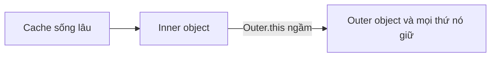
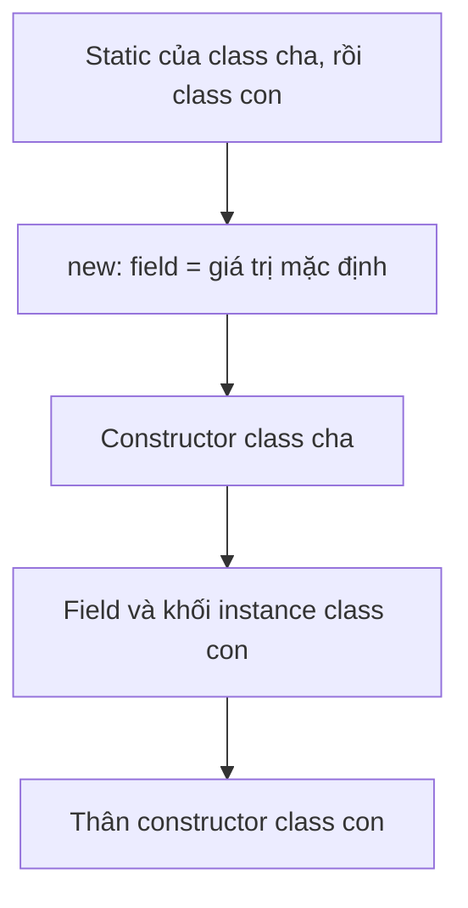
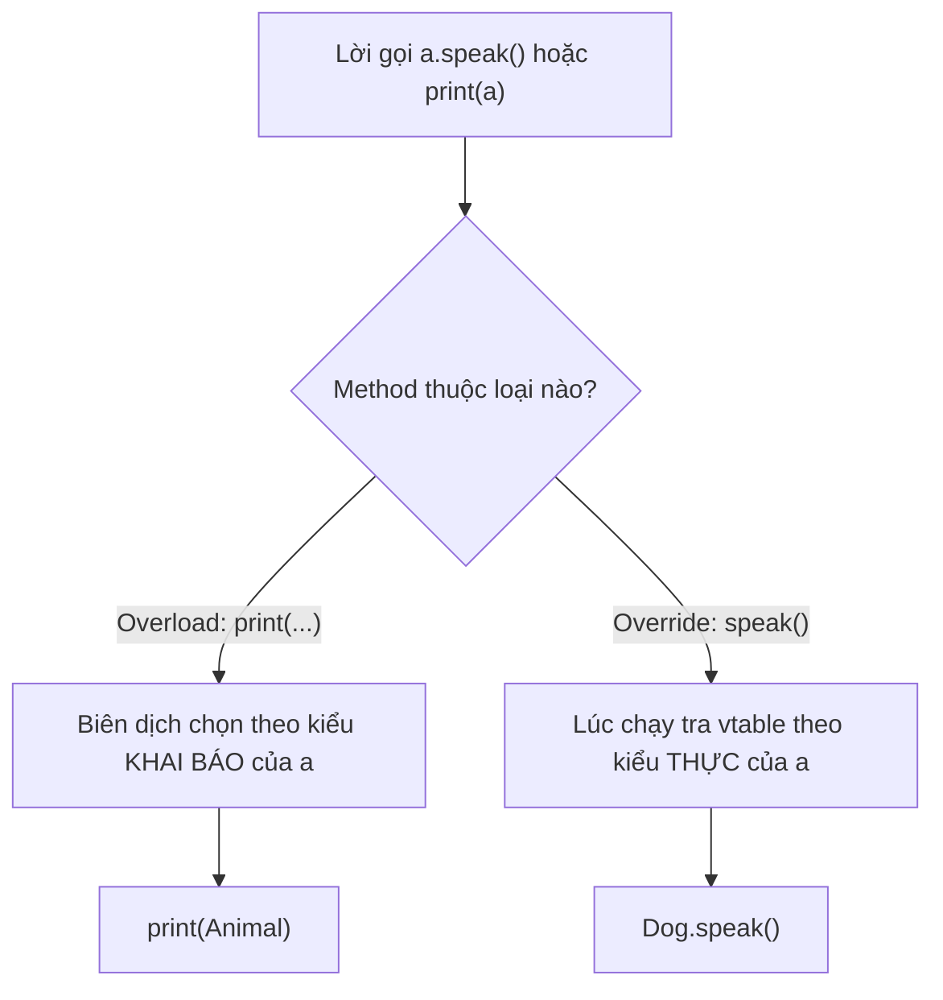

# Enum, class Object, class lồng và thứ tự khởi tạo

Bài này gom bốn chủ đề nhỏ nhưng hay bị hỏi phỏng vấn và hay gây lỗi khó hiểu: `enum`, các method có sẵn của `Object` (`toString`, `clone`...), class lồng (nested class) cùng class ẩn danh, và thứ tự chạy của các khối khởi tạo. Cuối bài có thêm phần overload, override và binding, vì chúng liên quan chặt tới cách object được dựng và gọi.

## Vấn đề mà các phần này giải quyết

Nếu bạn dùng `String` hoặc `int` làm hằng số trạng thái (`"ACTIVE"`, `1`), ai cũng có thể gán một giá trị bậy như `"ACTVIE"` hay `42` và trình biên dịch không phàn nàn. `enum` giải quyết bằng cách giới hạn giá trị vào một tập đóng, đã biết trước. Với `clone`, mặc định nó chỉ copy nông, nên hai object vẫn dùng chung các object bên trong; sửa bản này làm bản kia đổi theo mà không ai hiểu vì sao. Còn nếu không nắm thứ tự khởi tạo, bạn sẽ gặp field `null` bất ngờ hoặc để `this` lọt ra ngoài khi object chưa dựng xong.

Về khi nào dùng: `enum` cho tập giá trị cố định như trạng thái hay loại (loại thanh toán, vai trò). Class lồng và class ẩn danh hợp cho callback và builder. Khi cần copy object, đừng dựa vào `clone`, hãy viết copy constructor. Hãy nhớ bốn loại class lồng (static, inner, local, anonymous) và thứ tự khởi tạo: static block, rồi field và instance block, rồi mới tới thân constructor.

**Cốt lõi:** Các chủ đề trong bài đều xoay quanh việc ai tạo object, tạo lúc nào và trong trạng thái nào: enum cố định tập object, inner class ngầm nối hai object với nhau, và thứ tự khởi tạo quyết định field đã có giá trị hay chưa. Nắm hai thứ này thì các bẫy tự lộ ra.

- Vì mỗi hằng enum do JVM tạo đúng một lần nên `==` so sánh đúng, nhưng `ordinal` chỉ là vị trí khai báo nên không dùng để lưu DB.
- Vì inner class ngầm giữ `Outer.this` nên object ngoài không được GC thu khi inner còn sống, và mặc định nên chọn static nested.
- Vì constructor cha chạy trước khi field của class con được gán nên method bị override gọi từ constructor cha sẽ thấy `null` hoặc `0`.



Mô hình tư duy: một reference ngầm vẫn là một đường để GC không thu hồi, nên inner object nhỏ có thể giữ sống cả object ngoài lớn.

**Tóm tắt:**

- `enum` giới hạn giá trị vào một tập cố định, mỗi hằng là singleton do JVM tạo, so sánh bằng `==`, và có thể có field, constructor, method.
- Lưu enum xuống DB bằng tên, không bằng `ordinal()`, vì thêm hoặc đổi thứ tự hằng sẽ làm lệch dữ liệu cũ.
- `equals`/`hashCode` luôn ghi đè cùng nhau; `clone` mặc định là shallow copy và `finalize` đã lỗi thời, nên dùng copy constructor và try-with-resources.
- Class lồng có bốn loại; inner class ngầm giữ `Outer.this` nên dễ gây memory leak, vì vậy mặc định chọn static nested.
- Thứ tự khởi tạo: static của cha, static của con (một lần khi nạp class), rồi mỗi lần `new` là giá trị mặc định, constructor cha, field và khối instance của con, thân constructor con.
- Gọi method có thể bị override trong constructor cho thấy field của class con còn là mặc định; đừng để `this` thoát ra khỏi constructor.
- Overload chọn lúc biên dịch theo kiểu khai báo, override chọn lúc chạy theo kiểu thật; luôn dùng `@Override`.

## Các khái niệm cần biết

- **Singleton**: class chỉ có đúng một thể hiện. Mỗi hằng enum là một singleton do JVM tạo.
- **Shallow copy và deep copy**: shallow chỉ copy các field của object ngoài cùng, nên các field kiểu reference vẫn trỏ cùng object; deep copy đệ quy mọi object bên trong.
- **Effectively final**: variable cục bộ được gán đúng một lần dù không ghi chữ `final`. Class ẩn danh và lambda chỉ bắt được loại variable này.
- **Static binding và dynamic binding**: chọn method để gọi lúc biên dịch (dựa trên kiểu khai báo) hay lúc chạy (dựa trên kiểu thực của object).
- **vtable**: bảng method ảo mà JVM dùng để tra ra method thật khi gọi một method có thể bị ghi đè.
- **Covariant return type**: method ghi đè được phép trả về kiểu con của kiểu trả về gốc.
- **`this` escape**: để reference `this` lọt ra ngoài (đăng ký listener, start thread) trong constructor, khi object chưa khởi tạo xong.

## Enum

Enum là **class đặc biệt** với số object cố định, mỗi hằng là một singleton do JVM tạo. Vì là class thật nên nó có field, constructor và method, thậm chí mỗi hằng có thể ghi đè hành vi riêng như `ACTIVE` dưới đây.

```java
enum Status {
    ACTIVE("A") { @Override boolean canLogin() { return true; } },
    LOCKED("L");
    private final String code;
    Status(String code) { this.code = code; }
    boolean canLogin() { return false; }
}
```

- Có field, constructor (private), method, cài interface, ghi đè theo từng hằng.
- `values()` trả array mọi hằng, `valueOf(String)` tra hằng theo tên (throw `IllegalArgumentException` nếu không có), `ordinal()` là vị trí khai báo, `name()` là tên. **Không dựa vào `ordinal()` để lưu DB** (đổi thứ tự là hỏng dữ liệu), JPA dùng `@Enumerated(EnumType.STRING)`.
- So sánh bằng `==` an toàn (mỗi hằng chỉ có một thể hiện); dùng `EnumMap`/`EnumSet` thay cho `HashMap`/`HashSet` khi key là enum (array/bitmask bên trong, rất nhanh).
- Singleton an toàn với serialization và reflection: enum một phần tử. Đây là lý do cách này được khuyên dùng khi cần singleton đúng nghĩa.
- Kết hợp `switch` biểu thức và `sealed` để xử lý đầy đủ trường hợp.

**Phải thuộc:** Enum là class có số thể hiện cố định, so sánh bằng `==`, lưu DB bằng tên (`@Enumerated(EnumType.STRING)`) chứ không bằng `ordinal()`; dùng `EnumMap`/`EnumSet` khi key là enum.

Không dùng enum khi tập giá trị thay đổi theo dữ liệu lúc chạy (ví dụ danh mục do admin tạo): lúc đó giá trị phải nằm trong bảng DB chứ không nằm trong code.

**Suy luận:** Enum là singleton an toàn vì JVM, không phải code của bạn, tạo từng hằng đúng một lần khi nạp class, và quá trình nạp class vốn thread-safe. Cũng vì mỗi hằng chỉ có một object nên `==` so sánh đúng và nhanh, còn `EnumMap` có thể dùng chỉ số `ordinal` làm vị trí array bên trong. Chính `ordinal` là chỗ dễ nhầm: nó chỉ là vị trí khai báo, nên lưu nó xuống DB thì thêm một hằng ở giữa hoặc đổi thứ tự sẽ làm toàn bộ dữ liệu cũ trỏ sai ý nghĩa mà không báo lỗi nào. Tên enum cũng đổi được, nhưng đổi tên thì lỗi lộ ngay lúc đọc dữ liệu, an toàn hơn nhiều. Hệ quả hành động: luôn map bằng `EnumType.STRING` hoặc một mã riêng ổn định, và đừng dùng enum cho tập giá trị do người dùng tạo lúc chạy vì chúng phải nằm trong bảng DB chứ không trong code.

## Các method của Object

Mọi class Java đều kế thừa `Object`, nên mọi object có sẵn các method dưới đây. Điều quan trọng là biết cái nào cần ghi đè, cái nào nên tránh.

| Method | Contract/ghi chú |
|---|---|
| `equals` / `hashCode` | Xem [Collections cơ bản](/go?p=08-Java%2FJava-Core%2Feasy%2Flt-05-collections-co-ban.md); luôn ghi đè cùng nhau |
| `toString` | Nên ghi đè để log dễ đọc; không đưa dữ liệu nhạy cảm |
| `getClass` | Class thực lúc chạy (khác `instanceof` ở chỗ không tính class con) |
| `clone` | Cơ chế rườm rà: phải cài `Cloneable`, mặc định sao chép **nông** |
| `finalize` | **Đã lỗi thời** (deprecated for removal từ Java 18), bỏ; dùng `try-with-resources`/`Cleaner` |
| `wait/notify/notifyAll` | Phối hợp thread trong `synchronized`, xem [Multithreading](/go?p=08-Java%2FJava-Core%2Fmedium%2Flt-12-thread-co-ban.md) |

Sao chép object: ưu tiên **copy constructor** hoặc method `copyOf`; với immutable (`record`, `String`) không cần sao chép. Deep copy cần sao chép đệ quy mọi reference thay đổi được. Hậu quả của `clone` nông: object có field `List` thì bản gốc và bản clone cùng trỏ một list, thêm phần tử vào bản này thì bản kia cũng thấy.

## Class lồng (nested class)

Có bốn loại: static nested (không giữ reference class ngoài), inner (giữ ngầm `Outer.this`), local (khai báo trong method) và anonymous (không tên, dùng một lần).

| Loại | Đặc điểm | Rủi ro |
|---|---|---|
| Static nested | Như class thường nhưng gói gọn (vd `Builder`, `Map.Entry`) | Không đáng kể |
| Inner | Truy cập thành viên class ngoài, giữ `Outer.this` | **Memory leak** nếu inner sống lâu hơn outer |
| Local/Anonymous | Bắt variable cục bộ **effectively final** | Lambda thường thay thế được (lambda không có `this` riêng) |

Mặc định chọn **static nested** trừ khi thật sự cần truy cập thể hiện ngoài. Lý do về rò rỉ: một inner class ngầm giữ reference tới object ngoài, nên nếu bạn đưa inner object cho một nơi sống lâu (cache, thread pool), object ngoài và mọi thứ nó chứa cũng không được GC thu hồi.

**Phải thuộc:** Bốn loại class lồng: static nested, inner (giữ ngầm `Outer.this`), local, anonymous. Local và anonymous chỉ bắt variable cục bộ effectively final. Mặc định chọn static nested để tránh memory leak.

**Suy luận:** Inner class truy cập được thành viên của class ngoài vì compiler âm thầm thêm một field chứa `Outer.this` vào mỗi inner object. Reference ngầm đó là một đường từ inner object tới outer object, và GC chỉ thu object khi không còn đường nào tới được. Vì vậy chỉ cần đưa một inner object cho nơi sống lâu như cache, thread pool hay listener đã đăng ký, toàn bộ outer object (kèm mọi thứ nó giữ) cũng bị giữ sống theo. Điểm dễ nhầm là chỉ nhìn thấy inner object nhỏ mà không thấy outer lớn phía sau, nên heap dump mới phát hiện được. Static nested không có field đó nên không gặp vấn đề này, và cũng là lý do `Builder` hay `Map.Entry` là static nested. Khi viết, mặc định khai báo `static` và chỉ bỏ nó khi thật sự cần dùng thành viên instance của class ngoài; với anonymous class cũng cùng lưu ý, lambda không có `this` riêng nên an toàn hơn.

## Khối khởi tạo và thứ tự

Khi bạn `new Child()`, JVM không chạy mọi thứ cùng lúc mà theo một thứ tự cố định. Biết thứ tự này giúp bạn hiểu vì sao có lúc field là `null` dù đã gán giá trị ở dòng khai báo.



Đọc sơ đồ: phần static chỉ chạy một lần khi class được nạp. Mỗi lần `new`, mọi field trước hết mang giá trị mặc định (`0`, `false`, `null`), sau đó constructor cha chạy hoàn tất rồi mới tới phần khởi tạo field của class con. Điểm mấu chốt là constructor cha chạy **trước** khi field class con được gán.

**Phải thuộc:** Thứ tự khởi tạo: static của cha, static của con (một lần khi nạp class); mỗi lần `new`: giá trị mặc định, constructor cha, field và khối instance của con, thân constructor con. Gọi method có thể bị override trong constructor sẽ thấy field của con còn `null` hoặc `0`.

- Khối `static` chạy **một lần** khi class được khởi tạo (dùng lần đầu).
- Gọi **method có thể bị ghi đè** trong constructor là bẫy: class con chưa khởi tạo field xong nên thấy giá trị mặc định.
- Không để `this` thoát ra khỏi constructor (đăng ký listener, bắt đầu thread) khi object chưa dựng xong.

Ví dụ chạy được (Java 11) cho thấy bẫy thứ hai:

```java
public class InitOrder {
    static class Base {
        Base() { System.out.println("Base ctor"); hello(); }
        void hello() { System.out.println("Base.hello"); }
    }
    static class Child extends Base {
        private String name = "child";
        Child() { System.out.println("Child ctor, name=" + name); }
        @Override void hello() { System.out.println("Child.hello, name=" + name); }
    }
    public static void main(String[] args) { new Child(); }
}
// In ra:
// Base ctor
// Child.hello, name=null     <- field của Child chưa được gán
// Child ctor, name=child
```

## Điều cần nhớ

- Enum thay cho "hằng số int"; lưu bằng tên, không bằng `ordinal`.
- `clone` và `finalize` là di sản; tránh.
- Mặc định class lồng là `static`.
- Thứ tự: cha trước con, static trước instance, field trước thân constructor.

## Overload, override, binding và method chaining

Hai khái niệm này tên gần giống nhau nhưng hoạt động rất khác: overload được chốt lúc biên dịch, override được chốt lúc chạy.

| | Overloading (nạp chồng) | Overriding (ghi đè) |
|---|---|---|
| Là gì | Cùng tên, khác danh sách tham số, trong cùng class (hoặc kế thừa) | Class con định nghĩa lại method class cha, cùng chữ ký |
| Chọn lúc nào | **Lúc biên dịch** theo kiểu khai báo của tham số (static binding) | **Lúc chạy** theo kiểu thực của object (dynamic binding, vtable) |
| Ràng buộc | Kiểu trả về không đủ để phân biệt | Không thu hẹp quyền truy cập, không throw thêm checked exception, trả về cùng kiểu hoặc kiểu con (covariant) |

```java
Animal a = new Dog();
a.speak();        // dynamic: gọi Dog.speak()
print(a);         // static: chọn print(Animal) dù đối tượng thật là Dog
```



- Static binding áp dụng cho `static`, `private`, `final` và **field** (field không polymorphism, bị "che" chứ không ghi đè).

**Nền tảng:** Overload chọn lúc biên dịch theo kiểu khai báo của tham số (static binding); override chọn lúc chạy theo kiểu thực của object (dynamic binding qua vtable). Field, `static`, `private`, `final` không polymorphism.

- Luôn dùng `@Override` để trình biên dịch catch lỗi gõ nhầm chữ ký; nếu không, bạn vô tình tạo một overload mới thay vì ghi đè và code không chạy như mong đợi.
- **Method chaining**: method trả `this` (hoặc object mới) để gọi nối tiếp, như `StringBuilder.append(..).append(..)`, Builder, `Stream`. Với kiểu immutable, mỗi bước trả object mới (`BigDecimal`, `LocalDate`).
- **Lifecycle object**: tạo (`new`, khởi tạo theo thứ tự trên) → dùng → không còn reference đạt tới → GC thu hồi. Java không có hủy tường minh; tài nguyên đóng bằng `AutoCloseable`.

## Phỏng vấn khó: chuỗi hỏi xoáy

Người phỏng vấn senior thường mở bằng câu dễ rồi xoáy xuống cơ chế, đánh đổi và sự cố thật. Câu trả lời tốt luôn đi từ cốt lõi xuống.

### Chuỗi 1: Enum, singleton và lưu xuống DB

1. **Câu mở:** Vì sao enum một phần tử được coi là singleton an toàn?
2. **Xoáy 1:** Ai tạo các hằng enum và lúc nào? Vì sao `==` so sánh đúng và `EnumMap` nhanh?
3. **Xoáy 2:** Team lưu enum xuống DB bằng `ordinal()`. Có người thêm một hằng vào giữa. Chuyện gì xảy ra và nên lưu thế nào?

**Đáp án ngắn:** Mỗi hằng enum do JVM, không phải code của bạn, tạo đúng một lần khi nạp class, và nạp class vốn thread-safe. Nó cũng an toàn với serialization và reflection, nên enum một phần tử là cách singleton đúng nghĩa. Vì mỗi hằng chỉ có một object nên `==` đúng và nhanh; `EnumMap` dùng chỉ số bên trong như vị trí array nên rất nhanh. `ordinal()` chỉ là vị trí khai báo. Lưu nó xuống DB rồi thêm hằng ở giữa hoặc đổi thứ tự thì toàn bộ dữ liệu cũ trỏ sai ý nghĩa mà không báo lỗi nào, và chỉ lộ ra khi báo cáo lệch. Nên lưu bằng tên (`@Enumerated(EnumType.STRING)`) hoặc một mã riêng ổn định. Đổi tên enum cũng làm hỏng dữ liệu cũ, nhưng lỗi lộ ngay lúc đọc nên an toàn hơn. Nếu tập giá trị do admin tạo lúc chạy thì không dùng enum mà để trong bảng DB.

**Sai lầm hay gặp:**

- Nói enum là singleton mà không giải thích JVM tạo và nạp class thread-safe.
- Lưu bằng `ordinal` vì "gọn hơn".
- Dùng enum cho danh mục thay đổi theo dữ liệu.

### Chuỗi 2: Inner class và memory leak

1. **Câu mở:** Static nested và inner class khác nhau thế nào? Mặc định bạn chọn loại nào?
2. **Xoáy 1:** Vì sao inner class truy cập được thành viên của class ngoài, và điều đó ảnh hưởng gì tới GC?
3. **Xoáy 2:** Một inner object được đưa vào cache hoặc thread pool, heap tăng dần. Bạn phát hiện bằng cách nào? Anonymous class và lambda khác nhau ra sao?

**Đáp án ngắn:** Mặc định tôi chọn static nested, chỉ bỏ `static` khi thật sự cần dùng thành viên instance của class ngoài. Inner class truy cập được vì compiler âm thầm thêm một field giữ `Outer.this` vào mỗi inner object. Reference ngầm đó là một đường để GC lần tới, và GC chỉ thu object khi không còn đường nào. Nên đưa inner object cho nơi sống lâu như cache, thread pool hay listener đã đăng ký thì object ngoài, cùng mọi thứ nó giữ, cũng bị giữ sống theo. Phát hiện bằng heap dump: thấy object ngoài lớn vẫn còn, và đường giữ nó đi qua field `this$0` hoặc tương tự của inner. Anonymous class cùng rủi ro; lambda không có `this` riêng nên an toàn hơn. Static nested không có field đó, vì vậy `Builder` và `Map.Entry` là static nested.

**Sai lầm hay gặp:**

- Chỉ nói "inner giữ reference tới outer" mà không nối với GC root và cách phát hiện.
- Dùng inner class vô điều kiện vì tiện.
- Nghĩ lambda và anonymous class giống hệt nhau về `this`.

