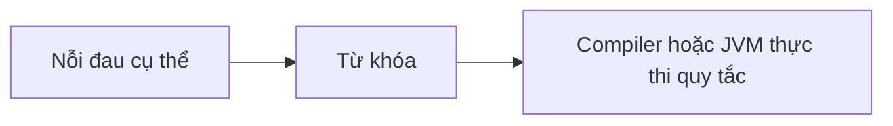
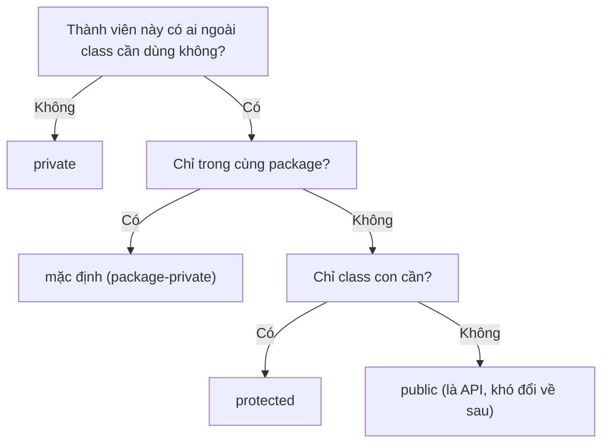
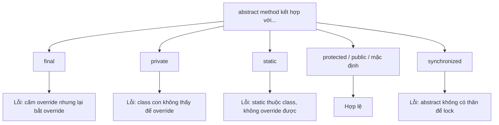

# Lý thuyết 35: Từ khóa Java

Từ khóa là những từ mà ngôn ngữ giữ riêng cho mình: bạn không đặt tên variable hay method trùng với chúng được, vì compiler đã gán cho chúng một ý nghĩa cố định. Mỗi từ khóa tồn tại để giải quyết một vấn đề cụ thể, ví dụ `private` để giấu dữ liệu, `final` để chặn việc gán lại, `synchronized` để các thread không giẫm lên nhau. Học theo kiểu thuộc cú pháp thì rất nhanh quên. Học theo kiểu "nó sinh ra để chữa cái đau nào" thì tự suy ra được cách dùng và cả chỗ dễ sai.

Bài này đi qua từng nhóm từ khóa. Với mỗi từ khóa, đoạn văn nói theo thứ tự: nó là gì, nó giải quyết vấn đề gì, khi nào nên dùng, khi nào nên tránh, dùng sai thì hậu quả ra sao, kèm một ví dụ ngắn. Cuối bài có các bẫy hay gặp và sáu câu phỏng vấn. Bạn có thể đọc lần lượt, hoặc nhảy thẳng tới nhóm đang cần.

| Nhóm | Từ khóa chính | Mục |
|---|---|---|
| Khai báo kiểu | `class`, `interface`, `enum`, `record`, `package`, `import` | 1 |
| Quyền truy cập | `public`, `protected`, `private` | 2 |
| Bổ nghĩa | `static`, `final`, `abstract`, `sealed`, `default` | 3 |
| Tạo object và quan hệ | `new`, `extends`, `implements`, `this`, `super`, `instanceof` | 4 |
| Control flow | `if`, `switch`, `for`, `while`, `break`, `continue`, `return`, `yield` | 5 |
| Xử lý lỗi | `try`, `catch`, `finally`, `throw`, `throws`, `assert` | 6 |
| Đồng thời và serialization | `synchronized`, `volatile`, `transient` | 7 |
| Data type | kiểu nguyên thủy, `void`, `var` | 8 |
| Ít gặp | `native`, `strictfp`, `goto`, `const`, `module` | 9 |

Quy ước nhãn trong bài: ví dụ Java thuần tự chứa chạy được trên JDK 11 được ghi _Đã chạy thử trên JDK 11_ kèm output thật. Ví dụ dùng cú pháp Java 14 trở lên (record, sealed, `yield`, switch mũi tên) được ghi _Minh họa_. Các dòng ví dụ ngắn một câu lệnh không có nhãn là cú pháp cơ bản.

**Cốt lõi:** Mỗi từ khóa là một quy tắc mà compiler hoặc JVM thực thi để chữa một nỗi đau cụ thể: ai được thấy cái gì, cái gì không được đổi, cái gì thuộc về class hay object, thread nào thấy giá trị nào. Hỏi "nó chữa nỗi đau nào" thì suy ra được cách dùng và chỗ dễ sai.

- Vì thứ đã lộ ra ngoài thì khó đổi về sau nên quyền truy cập mặc định là `private`, chỉ nới khi có lý do.
- Vì `final` khóa ô nhớ chứ không khóa object phía sau nên `final List` vẫn `add` được.
- Vì cache CPU và việc sắp xếp lại lệnh làm thread thấy giá trị cũ nên `volatile` bảo đảm hiển thị, còn muốn thao tác không bị xen vào thì cần `synchronized` hoặc atomic.



Mô hình tư duy: đi từ nỗi đau tới từ khóa, đừng đi từ cú pháp tới thuộc lòng.

**Tóm tắt:**

- Mỗi từ khóa sinh ra để chữa một vấn đề cụ thể; học theo "nó chữa cái đau nào" thì suy ra được cách dùng và chỗ dễ sai.
- Quyền truy cập đi từ hẹp đến rộng là `private`, package-private, `protected`, `public`; mặc định chọn `private` và chỉ mở khi có lý do.
- `final` trên variable chỉ cấm gán lại reference chứ không làm object bên trong immutable; trên method cấm override, trên class cấm kế thừa.
- `static` thuộc về class và không có `this`; `abstract` loại trừ `final`, `private` và `static`.
- `interface` là contract, `default` cho thêm method vào interface đã phát hành, `sealed` đóng tập class con, `record` cho dữ liệu immutable.
- `try/catch/finally`, `throw`, `throws` xử lý lỗi; `assert` mặc định tắt, bật bằng `-ea`.
- `synchronized` cho loại trừ lẫn nhau cộng happens-before; `volatile` chỉ bảo đảm hiển thị và thứ tự, không làm `i++` atomic.
- `transient` bỏ field khỏi serialization kiểu Java; `var` chỉ suy kiểu cho variable cục bộ và vẫn là kiểu tĩnh.

## 1. Khai báo kiểu

### `class`

`class` khai báo một kiểu object gồm dữ liệu (field) và hành vi (method). Không có class thì chỉ còn hàm và variable rời rạc, dữ liệu ai cũng sửa được và không biết đoạn code nào liên quan đến nhau; class gom chúng lại một chỗ và giấu chi tiết bên trong. Dùng khi có một khái niệm vừa có dữ liệu vừa có hành vi. Nếu chỉ chứa dữ liệu thì chọn `record`. Dùng sai, tức nhét mọi thứ vào một class khổng lồ, sẽ ra class "thần" khó test và khó sửa.

```java
class Account { private long balance; void deposit(long x) { balance += x; } }
```

### `interface`

`interface` là một bản contract chỉ nói "làm được gì", không nói "làm thế nào". Code gọi thẳng vào class cụ thể thì rất khó thay thế hay test; gọi qua interface thì đổi cài đặt (mock khi test, DI, polymorphism) mà không phải sửa chỗ gọi, và một class còn implement được nhiều interface. Mặc định dùng interface khi định nghĩa một khả năng hoặc ranh giới giữa các tầng. Khi cần chia sẻ trạng thái giữa các class con thì dùng abstract class. Tạo interface cho mọi class dù chỉ có một cài đặt duy nhất sẽ làm code rườm rà mà không được lợi gì.

```java
interface Notifier { void send(String msg); }
class Email implements Notifier { public void send(String msg) { /* ... */ } }
```

### `enum`

`enum` là class có sẵn một số object cố định, mỗi hằng là một singleton. Dùng `int` hay `String` làm hằng số thì gõ sai không báo lỗi, truyền giá trị bậy vẫn biên dịch được; `enum` có kiểu riêng nên compiler chặn được, và còn gắn thêm hành vi cho từng giá trị. Dùng cho tập giá trị hữu hạn như trạng thái, loại, hướng. Nếu tập giá trị đổi theo dữ liệu (lưu trong DB) thì đừng dùng enum. Bẫy lớn nhất: lưu DB bằng `ordinal` thì khi ai đó đổi thứ tự hằng, dữ liệu cũ hiểu sai âm thầm, nên lưu bằng tên.

```java
enum Status { ACTIVE, LOCKED }
```

### `record` (Java 16)

`record` là class chỉ chứa dữ liệu và immutable; Java tự sinh constructor, getter, `equals`, `hashCode`, `toString`. Một class DTO bình thường phải viết cả chục dòng boilerplate, và sửa field là phải nhớ sửa lại `equals`/`hashCode`; `record` bỏ hết phần đó. Dùng cho DTO, key của Map, hàm trả về nhiều giá trị cùng lúc. Không dùng cho entity JPA vì entity cần sửa được dữ liệu và cần proxy. Dùng sai ở chỗ đó sẽ gặp lỗi khởi tạo hoặc lazy loading không chạy.

_Minh họa_ (Java 16 trở lên):

```java
record Point(int x, int y) {
    Point { if (x < 0) throw new IllegalArgumentException(); }
}
```

### `package` và `import`

`package` xếp class vào một "thư mục" có tên riêng, còn `import` cho phép viết tên ngắn thay vì tên đầy đủ. Không có package thì hai class cùng tên đụng nhau, project lớn thì không biết class nào thuộc phần nào; package còn là ranh giới của quyền truy cập package-private. Class nào cũng nằm trong một package. `import` chỉ là cách viết tắt lúc biên dịch, không nạp class. Nên tránh `import x.*` trong code lớn vì không biết class đến từ đâu, và hai package cùng có class `List` sẽ gây lỗi mơ hồ.

```java
package com.example.order;
import java.util.List;
```

## 2. Quyền truy cập

`public`, `protected`, `private` (và mức mặc định package-private khi không ghi gì) quy định ai nhìn thấy được class hoặc thành viên đó. Đây chính là **encapsulation**: cái gì lộ ra ngoài là cái người khác sẽ dựa vào và sau này khó đổi, còn giấu kỹ thì sửa bên trong thoải mái và bảo vệ được dữ liệu khỏi bị sửa bậy. Mặc định để `private`, chỉ mở rộng khi có lý do: `public` cho API thật sự, `protected` cho chỗ class con cần mở rộng. Mở quá rộng thì mọi thay đổi sau này đều có nguy cơ phá code của người khác.

```java
private long balance;
public void withdraw(long x) { balance -= x; }
```

| Modifier | Class | Package | Class con | Mọi nơi |
|---|---|---|---|---|
| `private` | Có | | | |
| (mặc định) | Có | Có | | |
| `protected` | Có | Có | Có | |
| `public` | Có | Có | Có | Có |

**Phải thuộc:** Thứ tự quyền truy cập từ hẹp đến rộng: `private`, package-private (không ghi gì), `protected`, `public`. Mặc định để `private`, chỉ nới khi có lý do.

Sơ đồ dưới giúp chọn mức truy cập nhanh: bắt đầu từ mức hẹp nhất và chỉ nới khi có người dùng thật.



## 3. Bổ nghĩa (modifier)

### `static`

`static` làm thành viên thuộc về **class**, không thuộc từng object, nên bên trong không có `this`. Có những thứ không phụ thuộc object nào (hằng số, hàm tiện ích, factory, bộ đếm dùng chung); không có `static` thì phải `new` một object chỉ để gọi chúng. Dùng cho hằng (`static final`), hàm thuần như `Math.max`, factory, class lồng không cần class ngoài. Tránh `static` mà sửa được, vì khó test và không an toàn khi nhiều thread cùng dùng. Code `static` chỉ gọi trực tiếp được các thành viên `static` khác; gọi thành viên thường sẽ lỗi biên dịch.

```java
static final int MAX = 10;
static int add(int a, int b) { return a + b; }   // gọi: Util.add(1, 2)
```

### `final`

`final` nghĩa là "gán xong là không đổi". Với variable thì chỉ gán một lần, với method thì không override được, với class thì không kế thừa được. Thứ không đổi thì an toàn khi nhiều thread dùng chung và dễ đoán kết quả; `String` là `final` để không ai kế thừa rồi phá tính immutable của nó. Dùng cho field không đổi, tham số và variable cục bộ không gán lại, class không định cho kế thừa. Hiểu lầm hay gặp: với collection thì `final` chỉ cấm gán lại **reference**, nội dung bên trong vẫn sửa được, nên ai tưởng `final List` là immutable sẽ gặp dữ liệu bị đổi ngoài ý muốn.

_Đã chạy thử trên JDK 11_:

```java
final List<String> items = new ArrayList<>();
items.add("x");                 // vẫn được, final chỉ khóa tham chiếu
System.out.println(items);      // [x]
// items = new ArrayList<>();   // lỗi biên dịch
```

Output: `[x]`. Muốn danh sách thật sự immutable thì dùng `List.copyOf(...)` hoặc `List.of(...)`.

**Suy luận:** `final` được thiết kế để chặn việc gán lại một ô nhớ chứ không đóng băng thứ ô nhớ đó trỏ tới. Với primitive, ô nhớ chứa chính giá trị nên `final` là bất biến thật. Với reference, ô nhớ chứa địa chỉ, nên `final` chỉ cấm đổi địa chỉ còn object phía sau vẫn sửa được, vì vậy `final List<String>` vẫn `add` được. Lý do `String` làm gương là cả class bị `final` cộng với các field private `final` và không có method sửa, nên mới thành immutable thật. Điểm dễ nhầm nhất là coi `final` trên collection như immutable, dẫn tới dữ liệu bị sửa từ nơi khác và lỗi chỉ lộ lúc chạy. Hệ quả hành động: muốn không sửa được thì dùng `List.of`, `List.copyOf` hoặc `Collections.unmodifiableList`, và dùng `final` cho field để chắc chắn gán đúng một lần trong constructor.

**Phải thuộc:** `final` trên variable chỉ gán một lần (với reference là cấm gán lại reference, không cấm sửa nội dung); trên method là cấm override; trên class là cấm kế thừa. `abstract` không đi chung với `final`, `private`, `static`.

### `abstract`

`abstract` đánh dấu class chưa hoàn chỉnh nên không `new` được, hoặc method chưa có thân. Mục đích là dựng sẵn khung chung và buộc class con tự cài phần riêng (mẫu Template Method); nếu không, mỗi class con lại chép khung một lần. Dùng khi có phần code hoặc trạng thái chung nhưng một bước phải để class con quyết định. Chỉ cần một contract thì dùng `interface`. Dùng sai thì dễ đụng quy tắc tổ hợp: `abstract` loại trừ `final` (không thể vừa bắt buộc kế thừa vừa cấm kế thừa), `private` (class con không thấy để override) và `static` (static không override được). Sơ đồ dưới tóm tắt các tổ hợp.

```java
abstract class Report {
    abstract String body();
    String render() { return "<" + body() + ">"; }
}
```



### `sealed`, `permits`, `non-sealed` (Java 17)

`sealed` giới hạn chỉ những class con được liệt kê mới được kế thừa. Khi một kiểu chỉ có vài dạng cố định (thành công hoặc lỗi), ai cũng kế thừa được thì `switch` không biết đã xử lý đủ chưa; với `sealed`, compiler kiểm tra được `switch` pattern đã **đủ trường hợp**. Dùng cho kiểu kết quả thành công/lỗi, lệnh, event. Không dùng khi cần cho bên ngoài tự do mở rộng (thư viện công khai), vì mỗi lần thêm dạng mới là phải sửa chỗ khai báo và mọi `switch` liên quan.

_Minh họa_ (Java 17 trở lên):

```java
sealed interface Shape permits Circle, Square {}
record Circle(double r) implements Shape {}
record Square(double side) implements Shape {}
```

### `default` (trong interface)

`default` đánh dấu method trong interface có sẵn phần cài đặt. Thêm method mới vào interface đã phát hành thì mọi class đang implement bị lỗi biên dịch; `default` cho thêm mà không phá code cũ, nhờ vậy mới có `List.sort`, `Collection.stream`. Dùng khi phát triển thêm API hoặc có hành vi chung hợp lý. Bẫy: nếu hai interface có `default` cùng tên thì class phải override, rồi chọn bản nào bằng `A.super.m()`; không override thì lỗi biên dịch.

_Đã chạy thử trên JDK 11_:

```java
interface A { default String hi() { return "A"; } }
interface B { default String hi() { return "B"; } }
class C implements A, B {
    public String hi() { return A.super.hi() + "+" + B.super.hi(); }
}
// new C().hi() trả về "A+B"
```

Output: `A+B`.

**Nền tảng:** `interface` là contract "làm được gì" để code phụ thuộc vào khả năng chứ không vào cài đặt cụ thể; `default` tồn tại để thêm method vào interface đã phát hành mà không phá code cũ. Hai `default` trùng tên thì class phải tự override và chọn bằng `A.super.m()`.

## 4. Tạo object và quan hệ

### `new`

`new` cấp phát một object trên heap, gọi constructor và trả về **reference** tới nó. Object cần sống độc lập, tồn tại lâu hơn method đã tạo ra nó, nên phải nằm trên heap chứ không phải stack. Dùng mỗi khi cần một object mới. Nếu muốn tách phụ thuộc thì cân nhắc factory hoặc DI thay vì `new` khắp nơi, vì `new` cứng trong code làm class gắn chặt vào cài đặt cụ thể và khó thay khi test.

```java
User u = new User("An");
```

### `extends`

`extends` cho class con kế thừa class cha (hoặc interface mở rộng interface khác). Mục đích là dùng lại code của cha và thể hiện quan hệ "là một" (`Dog` là một `Animal`), nhờ đó có polymorphism. Dùng khi quan hệ phân loại là thật và tuân theo Liskov. Chỉ muốn dùng lại code thì dùng composition, đừng kế thừa, vì kế thừa sai chỗ làm class con phụ thuộc chặt vào chi tiết nội bộ của cha và dễ vỡ khi cha thay đổi.

```java
class Dog extends Animal { /* ... */ }
```

### `implements`

`implements` là lời cam kết class cài đặt đầy đủ các method của interface. Nhờ đó một class đóng được nhiều vai trò cùng lúc, và code bên ngoài chỉ phụ thuộc vào contract chứ không phụ thuộc class cụ thể. Dùng bất cứ khi nào class thể hiện một khả năng, như `Comparable`, `Runnable`. Quên cài một method thì lỗi biên dịch, trừ khi class đó là `abstract`.

```java
class Task implements Runnable, Comparable<Task> { /* ... */ }
```

### `this`

`this` là reference tới chính object đang chạy; `this(...)` gọi constructor khác trong cùng class. Dùng để phân biệt field với tham số trùng tên, truyền chính object này cho nơi khác, gọi nối tiếp các constructor, hoặc trả `this` để viết gọi liên tiếp (chaining). Không dùng được trong ngữ cảnh `static` vì ở đó chưa có object nào. Quên `this.` khi tham số trùng tên field là lỗi kinh điển: phép gán thành `name = name` và field không đổi.

```java
this.name = name;
return this;
```

### `super`

`super` là reference tới phần của class cha; `super(...)` gọi constructor của cha. Class con muốn dùng lại hay mở rộng hành vi của cha thì gọi thẳng vào cha, khỏi chép code. Dùng trong constructor class con (bắt buộc phải gọi constructor cha; nếu không viết thì Java tự thêm `super()`, và nếu cha không có constructor không tham số thì lỗi biên dịch), và khi override mà vẫn cần gọi bản gốc.

_Đã chạy thử trên JDK 11_:

```java
class Animal { public String toString() { return "Animal"; } }
class Dog extends Animal {
    public String toString() { return super.toString() + "!"; }
}
// System.out.println(new Dog());
```

Output: `Animal!`.

### `instanceof`

`instanceof` kiểm tra kiểu **thật** của object lúc chạy. Dùng để downcast an toàn, khỏi phải ép kiểu bừa rồi đợi `ClassCastException` nổ. Dùng khi cần xử lý riêng theo kiểu cụ thể; dùng nhiều quá thì thường là dấu hiệu nên dùng polymorphism thay vào.

_Minh họa_ (pattern matching, Java 16 trở lên):

```java
if (shape instanceof Circle c) { System.out.println(c.r()); }
```

## 5. Control flow

### `if`, `else`, `switch`, `case`, `default`

Nhóm này rẽ nhánh theo điều kiện hoặc theo giá trị để chương trình xử lý khác nhau tùy dữ liệu. `if` dùng cho điều kiện bất kỳ, `switch` khi chia nhánh theo một giá trị (enum, chuỗi, kiểu). Với `switch` kiểu cũ (có dấu hai chấm), quên `break` làm chương trình "rơi xuống" nhánh sau và chạy thêm code không mong muốn. Biểu thức switch mũi tên thì không bị rơi.

_Minh họa_ (Java 14 trở lên):

```java
String s = switch (day) { case SAT, SUN -> "nghỉ"; default -> "làm"; };
```

### `for`, `while`, `do`

Đây là các vòng lặp, để xử lý cả dãy dữ liệu hoặc lặp tới khi điều kiện thỏa. `for` dùng khi biết số lần lặp hoặc cần chỉ số, for-each để duyệt `Iterable`, `while` lặp theo điều kiện, `do-while` khi cần chạy ít nhất một lần. Điều kiện dừng sai thì vòng lặp chạy vô hạn hoặc lệch một phần tử (off-by-one).

```java
for (var x : list) { /* ... */ }
while (it.hasNext()) { /* ... */ }
```

### `break`, `continue`, `return`

`break` thoát vòng lặp hoặc `switch`, `continue` bỏ qua lượt lặp hiện tại, `return` thoát method (kèm giá trị nếu có). Chúng giúp thoát sớm để khỏi phải lồng `if` nhiều tầng. Nên `return` sớm (guard clause) để code bớt lồng nhau, và dùng nhãn khi cần thoát nhiều vòng lặp lồng nhau; lạm dụng nhãn làm thread khó theo dõi.

_Đã chạy thử trên JDK 11_:

```java
outer:
for (int i = 0; i < 3; i++)
    for (int j = 0; j < 3; j++)
        if (i * j == 2) { System.out.println("break outer at " + i + "," + j); break outer; }
```

Output: `break outer at 1,2`.

### `yield` (Java 14)

`yield` trả giá trị ra từ một khối `{ }` bên trong biểu thức `switch`. Biểu thức switch phải cho ra một giá trị, nên khi nhánh có nhiều câu lệnh thì cần `yield` để chỉ rõ giá trị nào được trả. Dùng khi một nhánh `case` phải tính toán qua nhiều bước. Thiếu `yield` ở nhánh dạng khối thì lỗi biên dịch.

_Minh họa_ (Java 14 trở lên):

```java
int r = switch (code) {
    case 1 -> 10;
    default -> { int t = compute(); yield t * 2; }
};
```

## 6. Xử lý lỗi

### `try`, `catch`, `finally`

`try` bao đoạn có thể lỗi, `catch` xử lý lỗi, `finally` là khối luôn chạy. Cặp này tách code xử lý lỗi khỏi flow chính và đảm bảo việc dọn dẹp luôn chạy dù có lỗi hay không. Chỉ `catch` khi bạn **xử lý được** lỗi, hoặc cần bọc lại / ghi log. Dọn tài nguyên thì ưu tiên `try-with-resources` thay vì tự viết `finally`. `catch` rồi bỏ trống làm lỗi biến mất không dấu vết, rất khó tìm nguyên nhân sau này.

```java
try (var in = Files.newBufferedReader(p)) {
    /* đọc dữ liệu */
} catch (IOException e) {
    /* xử lý hoặc bọc lại */
}
```

### `throw`, `throws`

`throw` phát ra một exception, còn `throws` khai báo method này có thể throw checked exception. Mục đích là để lỗi không bị lờ đi, và `throws` buộc người gọi biết và phải xử lý. Dùng `throw` khi bị vi phạm contract (tham số sai, trạng thái sai); dùng `throws` cho lỗi từ bên ngoài mà còn khả năng phục hồi (như I/O). Lỗi do lập trình sai thì dùng unchecked. Khai báo `throws Exception` chung chung làm người gọi không biết cần xử lý lỗi gì.

```java
throw new IllegalArgumentException("amount > 0");
```

### `assert`

`assert` khẳng định một điều kiện phải đúng; mặc định **tắt**, bật bằng `-ea`. Dùng để kiểm tra giả định bên trong code lúc phát triển, và khi tắt thì không tốn chi phí gì. Chỉ dùng cho điều kiện nội bộ phải luôn đúng. **Không** dùng để kiểm tra dữ liệu đầu vào, và không để câu lệnh trong `assert` có tác dụng phụ, vì khi tắt nó không chạy và hành vi chương trình sẽ khác giữa môi trường dev và production.

```java
assert size >= 0 : "size âm";
```

## 7. Đồng thời và serialization

### `synchronized`

`synchronized` lock monitor để tại một thời điểm chỉ một thread vào được đoạn code, và đồng thời tạo quan hệ **happens-before**. Khi nhiều thread cùng sửa dữ liệu chung, cần **chỉ một thread vào một lúc** và cần các thread **nhìn thấy giá trị mới nhất**; thiếu cái nào cũng ra dữ liệu sai. Dùng để bảo vệ trạng thái dùng chung đơn giản. Lock phạm vi rộng làm các thread xếp hàng chờ, khi đó cân nhắc `java.util.concurrent`; lock sai object (mỗi thread một lock khác nhau) thì coi như không lock.

_Đã chạy thử trên JDK 11_ (4 thread, mỗi thread tăng 100000 lần trong khối `synchronized`):

```java
synchronized (counter) { counter[0]++; }
```

Output: `synchronized count: 400000`.

### `volatile`

`volatile` đảm bảo thread này ghi thì thread khác **thấy ngay**, và cấm sắp xếp lại thứ tự thao tác quanh nó. Nhưng nó **không** làm các phép gộp như `i++` thành atomic. Lý do tồn tại: do CPU cache và tối ưu hóa, một thread có thể cứ đọc mãi giá trị cũ dù thread khác đã ghi giá trị mới. Dùng cho cờ trạng thái như `running`, hoặc công bố object an toàn. Cần thao tác atomic thì dùng `AtomicInteger` hoặc `synchronized`. Dùng `volatile` cho bộ đếm là lỗi rất phổ biến và cho kết quả sai ngẫu nhiên. Xem thêm [JMM](/go?p=08-Java%2FJava-Core%2Fhard%2Flt-17-java-memory-model-sau.md).

_Đã chạy thử trên JDK 11_ (4 thread, mỗi thread làm `v++` 100000 lần trên `volatile int` và đồng thời `incrementAndGet()` trên `AtomicInteger`):

```java
static volatile int v = 0;
static final AtomicInteger at = new AtomicInteger();
// mỗi thread: v++; at.incrementAndGet();
```

Output lần chạy này: `volatile` mất cập nhật (không đủ 400000), `AtomicInteger` ra đúng `400000`. Số lượng mất thay đổi theo từng lần chạy. Với cờ dừng thì `volatile` hợp lý:

```java
private static volatile boolean running = true;
// worker: while (running) { ... }   main: running = false;
```

Output lần chạy này: `worker stopped`.

**Phải thuộc:** `volatile` bảo đảm tính hiển thị và chống sắp xếp lại nhưng không bảo đảm tính atomic của `i++`; `synchronized` bảo đảm cả loại trừ lẫn nhau lẫn hiển thị (happens-before). Bộ đếm dùng `AtomicInteger` hoặc `synchronized`, cờ dừng dùng `volatile`.

**Suy luận:** `volatile` và `synchronized` tồn tại vì mỗi CPU core có cache riêng và compiler hay CPU được phép sắp xếp lại lệnh, nên một thread có thể ghi giá trị mà thread khác không thấy trong một thời gian không giới hạn. `volatile` giải quyết đúng vấn đề này: mỗi lần ghi được đẩy ra và mỗi lần đọc phải lấy giá trị mới, đồng thời cấm sắp xếp lại quanh nó, nên rất hợp cho cờ như `running`. Nhưng `i++` thực chất là ba bước đọc, cộng, ghi, và `volatile` chỉ bảo đảm từng bước đọc hay ghi riêng lẻ, nên hai thread vẫn có thể cùng đọc giá trị cũ rồi cùng ghi đè nhau, dẫn tới mất cập nhật. Cần loại trừ lẫn nhau thì phải dùng `synchronized` hoặc `AtomicInteger`, vì chỉ chúng biến cả chuỗi thao tác thành một đơn vị không chia cắt. Điểm dễ nhầm là tin rằng `volatile` làm biến "thread-safe" nói chung, trong khi nó chỉ giải quyết hiển thị. Khi review, hãy tìm mọi `volatile` đi kèm phép đọc rồi ghi và thay bằng atomic hoặc lock.

### `transient`

`transient` đánh dấu field bị bỏ qua khi serialization kiểu Java (`Serializable`). Dùng để không lưu ra những thứ không nên lưu: dữ liệu nhạy cảm, dữ liệu tính lại được, hoặc object không serialization được. Điển hình là mật khẩu, cache, kết nối. Hệ quả cần nhớ là sau khi đọc lại, field `transient` mang giá trị mặc định (`null`, `0`, `false`). Với JPA thì `@Transient` là một cơ chế khác.

_Đã chạy thử trên JDK 11_ (ghi rồi đọc lại một `User` có `name` và `transient String password`):

```java
class User implements Serializable {
    String name = "an";
    transient String password = "secret";
}
```

Output: `transient: name=an, password=null`.

## 8. Data type

### Kiểu nguyên thủy (`int`, `long`, `double`, `boolean`, `char`...)

Có 8 kiểu giá trị đơn giản, không phải object. Chúng chạy nhanh và tốn ít memory vì không phải qua reference. Dùng cho tính toán, đếm, cờ. Cần `null`, generics hoặc bỏ vào collection thì dùng wrapper; unbox một wrapper đang `null` sẽ throw `NullPointerException`. Xem [Data type](/go?p=08-Java%2FJava-Core%2Feasy%2Flt-02-kieu-du-lieu-string.md).

```java
int n = 5;
```

### `void`

`void` nghĩa là method không trả về giá trị, dành cho hành động chỉ có tác dụng phụ (ghi file, gửi mail). Dùng cho các lệnh hoặc hành động. Nếu có kết quả thì nên trả về, vì dễ test hơn.

```java
void save(User u) { /* ... */ }
```

### `var` (Java 10)

`var` để compiler tự suy ra kiểu cho **variable cục bộ**; đây vẫn là kiểu tĩnh, không phải kiểu động. Nó giúp đỡ phải viết lặp kiểu dài như `Map<String, List<User>>`. Dùng khi đọc vế phải là biết ngay kiểu gì. Tránh nếu nó làm code khó đọc, và không dùng được cho field hay tham số.

```java
var users = new ArrayList<User>();
```

## 9. Ít gặp nhưng nên biết

Các từ khóa dưới đây hiếm khi xuất hiện trong code ứng dụng, nhưng gặp trong code thư viện hoặc đề thi nên cần nhận ra.

| Từ khóa | Là gì | Ghi chú |
|---|---|---|
| `native` | Method cài bằng C/C++ qua JNI | Gọi mã hệ điều hành hoặc thư viện native; rất hiếm, hướng mới là Foreign Function API |
| `strictfp` | Ép số thực theo chuẩn IEEE | **Không còn tác dụng từ Java 17** (luôn strict) |
| `goto`, `const` | Từ khóa **dành riêng**, không dùng | Giữ chỗ để tránh trùng tên |
| `module`, `requires`, `exports` | Khai báo module (Java 9) | Encapsulation mạnh hơn package, xem [Modules](/go?p=08-Java%2FJava-Core%2Fhard%2Flt-22-modules-version-ecosystem.md) |
| `@interface` | Khai báo annotation | Xem [Annotation](/go?p=08-Java%2FJava-Core%2Fmedium%2Flt-11-reflection-annotation.md) |

## Cách học một từ khóa mới

Khi gặp một từ khóa lạ, đừng tìm cú pháp trước. Hỏi bốn câu theo thứ tự trong sơ đồ: biết vấn đề gốc thì tự suy ra được cách dùng và bẫy.


## Bẫy thường gặp

| Bẫy | Hệ quả | Cách tránh |
|---|---|---|
| Tưởng `final List` là immutable | Nội dung vẫn bị `add`/`remove`, dữ liệu đổi ngoài ý muốn | `List.copyOf` hoặc `List.of` |
| Dùng `volatile` cho bộ đếm (`i++`) | Mất cập nhật, kết quả sai ngẫu nhiên | `AtomicInteger` hoặc `synchronized` |
| Lưu enum bằng `ordinal` | Đổi thứ tự hằng là dữ liệu cũ hiểu sai | Lưu bằng tên |
| Quên `break` trong `switch` kiểu cũ | Chạy rơi sang nhánh sau | Dùng switch mũi tên hoặc thêm `break` |
| `abstract` kết hợp `final`, `private` hoặc `static` | Lỗi biên dịch | Xem sơ đồ ở mục `abstract` |
| Hai interface có `default` trùng tên | Lỗi biên dịch ở class implement | Override và gọi `A.super.m()` |
| `assert` kiểm tra dữ liệu đầu vào | Tắt `assert` (mặc định) là mất kiểm tra | Dùng `if` và throw exception |
| Dùng `record` làm entity JPA | Thiếu constructor rỗng, không sửa được, proxy lỗi | Dùng class thường |
| `catch` rồi bỏ trống | Lỗi mất dấu vết | Ghi log hoặc throw lại |
| Mở `public` quá sớm | Khó đổi API về sau | Mặc định `private`, nới dần |

## Phỏng vấn khó: chuỗi hỏi xoáy

Người phỏng vấn senior thường mở bằng câu dễ rồi xoáy xuống cơ chế, đánh đổi và sự cố thật. Câu trả lời tốt luôn đi từ cốt lõi xuống.

### Chuỗi 1: `synchronized` khóa cái gì

1. **Câu mở:** `synchronized` bảo đảm những gì?
2. **Xoáy 1:** Method ghi `counter` có `synchronized`, nhưng method đọc `counter` thì không. Có sao không? Happens-before nằm ở đâu?
3. **Xoáy 2:** Mỗi lần gọi lại `synchronized (new Object())` hoặc mỗi thread lock một object riêng thì sao? Lock phạm vi rộng thì sao?

**Đáp án ngắn:** `synchronized` lock monitor để mỗi lúc chỉ một thread vào đoạn code, đồng thời tạo quan hệ happens-before để thread sau thấy giá trị thread trước đã ghi. Hai thứ này đi cùng nhau: thiếu loại trừ thì hai thread xen vào giữa thao tác, thiếu hiển thị thì thread đọc thấy giá trị cũ. Quan hệ happens-before chỉ có giữa hai bên cùng lock một monitor, nên nếu method đọc không `synchronized` thì nó có thể thấy giá trị cũ dù method ghi đã đồng bộ. Lock sai object cũng vô hiệu: nếu mỗi thread lock một object khác nhau, hoặc tạo `new Object()` mỗi lần, thì không có gì loại trừ lẫn nhau, như thể không lock. Lock quá rộng thì các thread xếp hàng chờ nhau và mất hiệu năng, lúc đó cân nhắc `java.util.concurrent`. Tôi dùng chung một lock `final` cho mọi chỗ đọc và ghi cùng trạng thái.

**Sai lầm hay gặp:**

- Chỉ đồng bộ phía ghi và để phía đọc không lock.
- Chỉ nói `synchronized` là "loại trừ lẫn nhau", quên phần hiển thị.
- Lock trên object khác nhau và tin rằng đã an toàn.

### Chuỗi 2: `static` và `final` với trạng thái dùng chung

1. **Câu mở:** Vì sao không nên dùng trạng thái `static` có thể sửa được?
2. **Xoáy 1:** `static` thuộc về class nghĩa là gì với thread, với test và với GC? Vì sao code `static` không có `this`?
3. **Xoáy 2:** `public static final List<String> NAMES = new ArrayList<>();` có an toàn không? Làm sao để thật sự không sửa được?

**Đáp án ngắn:** `static` làm thành viên thuộc về class, chỉ có một bản cho cả JVM, nên không có `this` vì chưa có object nào. Trạng thái `static` sửa được bị mọi thread cùng chạm tới nên là nguồn lỗi đồng thời, và khó test vì trạng thái rơi từ test này sang test khác. Field `static` còn là GC root, nên đưa object vào một `static` map không giới hạn là cách rò rỉ memory điển hình. `final` không cứu được chuyện đó: nó chỉ cấm gán lại reference, nên `NAMES.add("x")` vẫn chạy và mọi nơi đều sửa được danh sách chung. Muốn thật sự bất biến thì dùng `List.of` hoặc `List.copyOf`, đồng thời chỉ nên để `static final` cho hằng và hàm thuần như `Math.max`. Cần trạng thái chung thì dùng cấu trúc an toàn thread hoặc truyền qua DI.

**Sai lầm hay gặp:**

- Coi `static final` là hằng thật dù kiểu là collection sửa được.
- Quên rằng `static` là GC root nên dễ gây leak.
- Dùng `static` cho tiện mà không nghĩ tới thread và test.

## Câu hỏi phỏng vấn thường gặp

### 1. Một vòng `while (running)` không bao giờ dừng

**Câu hỏi:** Thread worker chạy `while (running) { ... }`, thread chính đặt `running = false` nhưng worker vẫn chạy mãi. Vì sao, và sửa thế nào?

**Gợi ý suy luận:**
- Mỗi thread có thể giữ bản sao variable trong cache hoặc thanh ghi.
- Compiler/JIT được phép đưa việc đọc `running` ra ngoài vòng lặp nếu thấy không ai trong thread này ghi nó.
- Cần một cơ chế đảm bảo tính hiển thị giữa các thread.

**Lập luận:** Không có quan hệ happens-before giữa lần ghi ở thread chính và lần đọc ở worker, nên worker được phép luôn thấy giá trị cũ `true`. `volatile` buộc mỗi lần đọc phải lấy giá trị mới nhất và mỗi lần ghi phải được công bố ra, nên vòng lặp thấy `false` và dừng.

**Đáp án ngắn:** Vấn đề là tính hiển thị giữa các thread. Khai báo `running` là `volatile` (hoặc đọc/ghi qua `synchronized`).

### 2. `volatile int` mà `i++` vẫn sai

**Câu hỏi:** Bốn thread cùng chạy `v++` 100000 lần trên `volatile int v`, kết quả nhỏ hơn 400000. `volatile` đã có rồi, sao vẫn sai?

**Gợi ý suy luận:**
- `i++` gồm mấy bước thật sự?
- `volatile` đảm bảo điều gì và không đảm bảo điều gì?
- Hai thread có thể xen vào giữa các bước đó không?

**Lập luận:** `i++` là đọc, cộng một, ghi: ba bước. `volatile` chỉ bảo đảm mỗi lần đọc thấy giá trị mới nhất và mỗi lần ghi được công bố, chứ không gộp ba bước thành một. Hai thread cùng đọc giá trị 5, cùng tính 6, cùng ghi 6, mất một lần tăng.

**Đáp án ngắn:** `volatile` không đảm bảo tính atomic của phép gộp. Dùng `AtomicInteger.incrementAndGet()` hoặc `synchronized`.

### 3. `final List` mà vẫn `add` được

**Câu hỏi:** Field `private final List<String> items = new ArrayList<>();` nhưng `items.add("x")` vẫn chạy. `final` có tác dụng gì ở đây?

**Gợi ý suy luận:**
- Variable `items` chứa object hay chứa reference tới object?
- `final` ràng buộc cái nào trong hai thứ đó?
- Muốn nội dung immutable thì phải làm gì thêm?

**Lập luận:** Variable reference trỏ tới một object `ArrayList` trên heap. `final` chỉ cấm gán `items` sang object khác, không cấm gọi method làm đổi trạng thái của object đang trỏ tới. Vì vậy `add` vẫn hợp lệ, còn `items = new ArrayList<>()` mới là lỗi biên dịch.

**Đáp án ngắn:** `final` cấm gán lại reference, không cấm sửa nội dung. Dùng `List.copyOf`, `List.of` hoặc `Collections.unmodifiableList` để immutable.

### 4. Có thể kết hợp `abstract` với `static` hay `final` không?

**Câu hỏi:** Khai báo `abstract static void f();` hoặc `abstract final class X {}` thì compiler báo lỗi. Tại sao?

**Gợi ý suy luận:**
- `abstract` đòi hỏi điều gì từ class con?
- `final` và `static` cấm hoặc làm điều gì liên quan tới override?
- Hai yêu cầu đó có thể cùng đúng không?

**Lập luận:** `abstract` nghĩa là "chưa xong, class con phải override". `final` nghĩa là "không được override hoặc kế thừa", mâu thuẫn trực tiếp. `static` thuộc về class và được chọn lúc biên dịch, không có polymorphism nên không override được, nên method `abstract static` không bao giờ có ai cài. `private abstract` cũng vậy vì class con không thấy method để override.

**Đáp án ngắn:** Không, vì `abstract` cần được override còn `final`, `static`, `private` đều chặn việc đó.

### 5. Hai interface cùng có `default` trùng tên

**Câu hỏi:** Class `C implements A, B`, cả `A` và `B` có `default String hi()`. Biên dịch thì lỗi. Cách xử lý?

**Gợi ý suy luận:**
- Compiler có nên tự chọn một bản không?
- Ai là người biết nên dùng bản nào?
- Có cú pháp nào gọi đích danh bản của một interface không?

**Lập luận:** Nếu compiler tự chọn thì kết quả phụ thuộc thứ tự khai báo, dễ gây hành vi bất ngờ. Java yêu cầu class tự quyết bằng cách override. Trong thân method override, `A.super.hi()` gọi đúng bản của `A`, `B.super.hi()` gọi bản của `B`.

**Đáp án ngắn:** Override `hi()` trong `C` và gọi `A.super.hi()` hoặc `B.super.hi()`, hoặc cài mới hoàn toàn (đã chạy thử, ra `A+B`).

### 6. Field `transient` sau khi đọc lại

**Câu hỏi:** Ghi một object `Serializable` có field `transient String password = "secret"` ra byte rồi đọc lại. Giá trị `password` là gì và tại sao dùng nó?

**Gợi ý suy luận:**
- Serialization lưu những field nào?
- Khi đọc lại, constructor có chạy không?
- Field không được lưu thì nhận giá trị nào?

**Lập luận:** Serialization Java chỉ ghi các field không `transient`. Khi đọc lại, object được dựng từ dữ liệu đã lưu mà không chạy constructor của class đó, nên field `transient` giữ giá trị mặc định của kiểu, tức `null` với `String`. Nhờ vậy dữ liệu nhạy cảm hoặc tính lại được không bị ghi ra.

**Đáp án ngắn:** `password` là `null` (đã chạy thử: `name=an, password=null`). Dùng `transient` để loại field nhạy cảm hoặc không serialization được.

