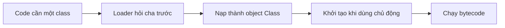
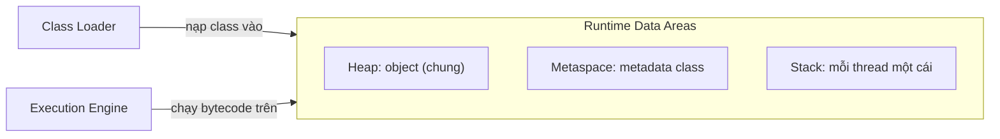
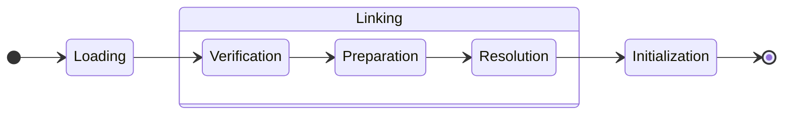
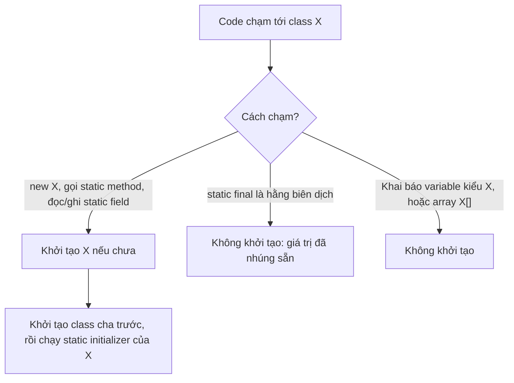
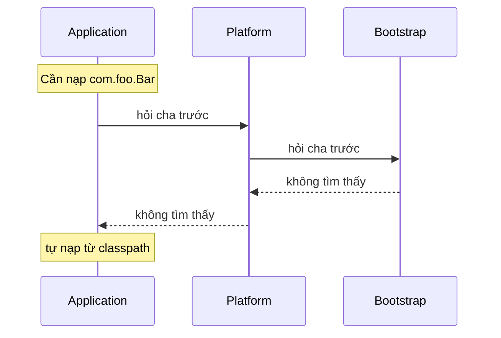
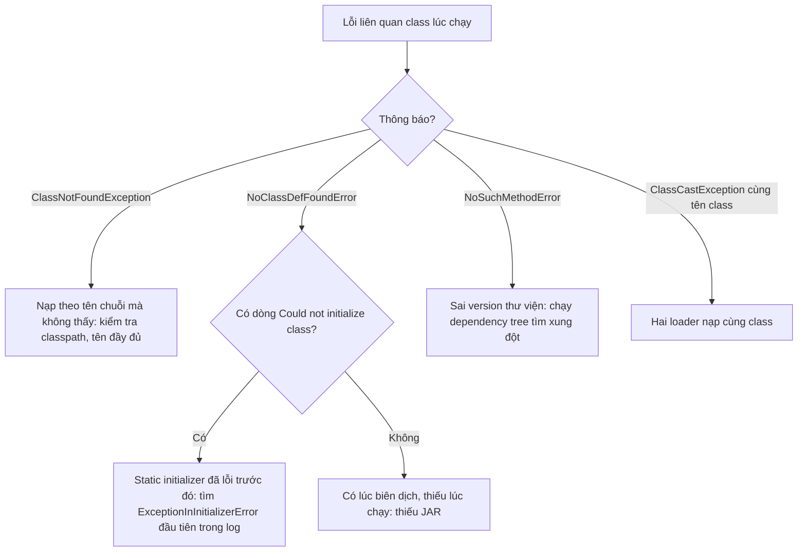

# Lý thuyết 16: Kiến trúc JVM và Class Loading

Khi bạn gõ `java Main`, có một chương trình tên JVM đứng giữa mã của bạn và hệ điều hành. Nó làm ba việc liên tiếp: tìm và nạp các file `.class` vào memory, chia memory thành các vùng có nhiệm vụ riêng (heap, stack, metaspace...), rồi chạy bytecode trong các vùng đó. Bài này đi qua từng việc một, theo thứ tự chúng xảy ra.

## Vì sao cần hiểu JVM ở mức này

Nếu không hiểu phần này, khi gặp `ClassNotFoundException`, `NoClassDefFoundError`, `StackOverflowError` hay lỗi "đúng jar mà sai version" bạn chỉ có thể ngồi đoán và thử ngẫu nhiên. Hiểu cơ chế thì bạn đọc stack trace là biết lỗi nằm ở bước nào: nạp, liên kết hay khởi tạo. Đây cũng là nền để hiểu cách các framework và container nạp plugin, cô lập từng ứng dụng, hay hot reload.

Dev bình thường ít đụng trực tiếp, nhưng cần dùng khi: gỡ lỗi classpath, viết plugin hoặc cơ chế hot reload, tìm hiểu vì sao app khởi động chậm, hay phân tích memory leak sau mỗi lần redeploy. Nếu chỉ viết CRUD bình thường và mọi thứ chạy ổn, bạn chưa cần tự viết ClassLoader; hãy dùng sẵn cơ chế của framework.

**Cốt lõi:** JVM không có sẵn mọi class trong memory. Class được nạp theo nhu cầu bởi một chuỗi loader cha con, rồi mới được liên kết, khởi tạo và chạy trong các vùng nhớ riêng. Hiểu thứ tự nạp, liên kết, khởi tạo và việc loader hỏi cha trước là suy ra được phần lớn lỗi class.

- Vì loader hỏi cha trước nên class lõi như `java.lang.String` luôn là bản của JDK.
- Vì danh tính class là cặp (tên, loader) nên cùng tên khác loader là hai kiểu khác nhau, và đó là cách cô lập plugin, webapp.
- Vì nạp và khởi tạo là hai việc tách rời nên static initializer chỉ chạy ở lần dùng chủ động đầu tiên, và lỗi cũng chỉ lộ ra lúc đó.



Mô hình tư duy: class đi qua một dây chuyền nạp rồi khởi tạo muộn, và mỗi lỗi class thuộc về một khâu của dây chuyền này.

**Tóm tắt:**

- JVM nạp file `.class` vào memory, chia memory thành các vùng (heap, metaspace, stack) rồi để Execution Engine (interpreter, JIT, GC) chạy bytecode.
- Heap và Metaspace dùng chung mọi thread, còn stack cùng PC register là riêng từng thread; Metaspace nằm ngoài heap và thay PermGen từ Java 8.
- Lifecycle class: Loading, Verification, Preparation, Resolution, Initialization; Preparation gán giá trị mặc định cho static, Initialization mới chạy static initializer.
- Nạp và khởi tạo là hai việc khác nhau: class chỉ được khởi tạo khi lần đầu dùng chủ động, và static initializer chạy một lần, thread-safe.
- Parent delegation (hỏi loader cha trước) bảo đảm `java.lang.String` luôn là bản của JDK.
- Danh tính class là cặp (tên, loader), nên cùng tên khác loader là hai class khác nhau và cho `ClassCastException` lạ.
- `ClassNotFoundException` (nạp theo tên không thấy) khác `NoClassDefFoundError` (có lúc biên dịch, thiếu hoặc khởi tạo lỗi lúc chạy); class chỉ bị gỡ khi cả loader không còn reference.

## Các khái niệm cần biết

- **Bytecode**: tập lệnh trung gian trong file `.class`, do `javac` sinh ra và do JVM thực thi.
- **Class Loader**: thành phần đọc byte của một `.class` rồi biến nó thành object `Class` trong JVM. Có nhiều loader xếp thành chuỗi cha con.
- **Parent delegation**: trước khi tự nạp, một loader hỏi loader cha nạp trước. Chỉ khi cha không tìm thấy mới tự nạp. Mục đích: bảo vệ các class lõi như `java.lang.String` khỏi bị thay.
- **Runtime Data Areas**: các vùng nhớ mà JVM quản lý lúc chạy (heap, metaspace, stack...).
- **Metaspace**: vùng nhớ ngoài heap chứa metadata của class (tên, method, hằng số). Từ Java 8 thay cho PermGen.
- **Stack frame**: mỗi lần gọi method, JVM cấp một "khung" trên stack của thread đó chứa variable cục bộ và toán hạng; gọi xong khung bị bỏ. Đệ quy quá sâu làm đầy stack, gây `StackOverflowError`.
- **Static initializer**: khối `static { ... }` và phép gán field `static`, chạy đúng một lần khi class được khởi tạo.
- **Symbolic reference**: trong `.class`, các lời gọi tới class/method khác chỉ được ghi bằng tên. Bước Resolution đổi tên đó thành địa chỉ thật.
- **`invokedynamic`**: lệnh bytecode cho phép quyết định cách gọi lúc chạy; lambda và nối chuỗi dùng nó.

## Bức tranh tổng thể

Sơ đồ dưới cho thấy hai bên: Class Loader đưa class vào các vùng nhớ, Execution Engine chạy bytecode trên các vùng đó.



Heap và Metaspace dùng chung cho mọi thread; Stack (cùng PC Register, Native Method Stack) là riêng từng thread. Execution Engine gồm Interpreter, JIT và GC.

**Phải thuộc:** Heap và Metaspace dùng chung mọi thread; stack (cùng PC register, native method stack) riêng từng thread. Metaspace thay PermGen từ Java 8, nằm ngoài heap (memory native). Đệ quy sâu gây `StackOverflowError`, heap đầy gây `OutOfMemoryError`.

## Lifecycle một class



| Bước | Việc làm |
|---|---|
| Loading | Tìm `.class`, tạo object `Class` |
| Verification | Kiểm tra bytecode hợp lệ, an toàn |
| Preparation | Cấp memory cho static, gán giá trị mặc định |
| Resolution | Giải reference ký hiệu thành reference thật |
| Initialization | Chạy static initializer, gán giá trị static thật |

**Phải thuộc:** Lifecycle class theo thứ tự: Loading, Verification, Preparation, Resolution, Initialization (ba bước giữa gọi là Linking). Preparation gán giá trị mặc định cho static, Initialization mới chạy static initializer và gán giá trị thật. Class chỉ được khởi tạo khi dùng chủ động lần đầu; hằng biên dịch `static final` không kích hoạt khởi tạo.

Class chỉ được **khởi tạo** khi lần đầu dùng chủ động (tạo object, gọi static, truy cập static không phải hằng). Nạp và khởi tạo là hai việc khác nhau: JVM có thể nạp class sớm nhưng hoãn khởi tạo tới khi thật sự cần. Hệ quả: static initializer của một class chưa được dùng sẽ chưa chạy, và nếu nó throw lỗi thì lỗi chỉ lộ ra ở lần dùng đầu tiên.



**Suy luận:** Lifecycle class tách thành nhiều bước vì mỗi bước giải quyết một loại rủi ro khác nhau và có thể hoãn tới khi cần. Verification chạy trước mọi thứ vì bytecode có thể bị sửa hay sai, và JVM không thể tin nó để chạy trực tiếp trên memory thật. Preparation chỉ gán giá trị mặc định (số 0, `null`) cho static vì giá trị thật có thể phụ thuộc code chạy được, và code đó chưa được phép chạy ở bước này. Resolution đổi tên ký hiệu thành địa chỉ thật và có thể hoãn tới lần dùng đầu để giảm chi phí khởi động. Initialization chạy static initializer đúng một lần dưới lock của JVM, đó là lý do holder idiom thread-safe mà không cần `synchronized`. Từ đó có bẫy: `static final int X = 5` là hằng biên dịch, được nhúng thẳng vào nơi dùng nên không kích hoạt khởi tạo, còn `static final Integer X = 5` thì có. Nếu static initializer throw lỗi, lần đầu thấy `ExceptionInInitializerError` và các lần sau chỉ còn `NoClassDefFoundError` khó hiểu, nên khi gặp lỗi này hãy tìm lỗi gốc ở lần đầu trong log.

## Class Loader và ủy quyền cha



- **Parent delegation** đảm bảo `java.lang.String` luôn là bản của JDK, không bị thay thế.
- Hai class cùng tên nạp bởi **hai loader khác nhau là hai kiểu khác nhau** (gây `ClassCastException` kỳ lạ khi hai thư viện cùng nạp cùng class).
- Container như Tomcat, OSGi, Spring Boot fat JAR dùng loader riêng để cô lập ứng dụng/plugin.

**Nền tảng:** Parent delegation: loader hỏi cha trước rồi mới tự nạp, nên `java.lang.String` luôn là bản của JDK. Danh tính một class là cặp (tên, loader): cùng tên nhưng khác loader là hai kiểu khác nhau, nguồn của `ClassCastException` lạ và của việc cô lập plugin, webapp.

**Suy luận:** Danh tính của class là cặp (tên, loader) vì loader định nghĩa không gian tên của những class nó nạp, nên hai loader nạp cùng file `.class` vẫn tạo ra hai object `Class` khác nhau. Điều này cho phép Tomcat chạy nhiều webapp có cùng tên class mà không đụng nhau, vì mỗi app có một loader riêng và thường đảo ngược thứ tự để tìm trong `WEB-INF` trước rồi mới hỏi cha. Nhưng nó cũng là gốc của lỗi kinh điển "class Plugin cannot be cast to class Plugin": hai object cùng tên nhưng khác loader nên JVM không coi là cùng kiểu. Ngoài ra class chỉ được gỡ khi cả loader của nó không còn reference và GC chạy, nên giữ reference tới một class hay loader cũ (thread, `ThreadLocal`, driver) sau redeploy sẽ làm Metaspace phình dần. Điểm dễ nhầm là chỉ tìm leak trên heap, trong khi redeploy nhiều lần có thể kết thúc bằng `OutOfMemoryError: Metaspace`. Khi gặp ClassCastException lạ hay Metaspace tăng, hãy kiểm tra loader nạp class và những thứ còn giữ nó.

## Thực hành: tự viết ClassLoader

Cơ chế cốt lõi: loader đọc byte của `.class` (qua `getResourceAsStream`) rồi gọi `defineClass`. Hai file `Plugin.java` và `Main.java` cùng thư mục, biên dịch bằng `javac`, chạy bằng `java -cp out Main` (đã chạy kiểm chứng trên Java 11, chạy được trên 17).

```java
// Plugin.java
public class Plugin {
    static { System.out.println("Plugin: static init chạy"); }
    public String hello() { return "xin chào từ " + getClass().getClassLoader().getClass().getSimpleName(); }
}
```

```java
// Main.java
import java.io.InputStream;

public class Main {
    // Loader tự viết: riêng Plugin thì tự nạp, còn lại ủy quyền cha
    static class MyLoader extends ClassLoader {
        MyLoader(ClassLoader parent) { super(parent); }

        @Override
        protected Class<?> loadClass(String name, boolean resolve) throws ClassNotFoundException {
            if (!name.equals("Plugin")) return super.loadClass(name, resolve);
            synchronized (getClassLoadingLock(name)) {
                Class<?> c = findLoadedClass(name);
                if (c == null) c = findClass(name);
                return c;
            }
        }

        @Override
        protected Class<?> findClass(String name) throws ClassNotFoundException {
            try (InputStream in = getParent().getResourceAsStream(name.replace('.', '/') + ".class")) {
                if (in == null) throw new ClassNotFoundException(name);
                byte[] b = in.readAllBytes();                 // Java 9+
                return defineClass(name, b, 0, b.length);     // bytecode -> Class
            } catch (java.io.IOException e) {
                throw new ClassNotFoundException(name, e);
            }
        }
    }

    public static void main(String[] args) throws Exception {
        // false: chưa init
        Class<?> a = Class.forName("Plugin", false, Main.class.getClassLoader());
        System.out.println("đã nạp, chưa init");
        Class<?> b = new MyLoader(Main.class.getClassLoader()).loadClass("Plugin");
        System.out.println("cùng tên: " + a.getName().equals(b.getName()));
        System.out.println("cùng Class: " + (a == b));
        Object o = b.getDeclaredConstructor().newInstance();   // static init chạy ở đây
        System.out.println(b.getMethod("hello").invoke(o));
        System.out.println("isInstance: " + a.isInstance(o));
        // ném ClassCastException
        Plugin p = (Plugin) o;
    }
}
```

```text
đã nạp, chưa init
cùng tên: true
cùng Class: false
Plugin: static init chạy
xin chào từ MyLoader
isInstance: false
Exception ... ClassCastException: class Plugin cannot be cast to class Plugin (Plugin is in unnamed module of loader ...)
```

Điều chứng minh được:

- Nạp (`loadClass`/`forName(..., false, ...)`) khác với khởi tạo: static initializer chỉ chạy khi `newInstance`.
- Danh tính một class là cặp (tên, loader). Thông báo "class Plugin cannot be cast to class Plugin" là dấu hiệu kinh điển của hai loader.
- Đây cũng là cách Tomcat cô lập từng webapp: mỗi app một loader, và loader của app thường **đảo ngược** thứ tự (tìm trong WEB-INF trước rồi mới hỏi cha).

## Bẫy hay hỏi

| Câu hỏi | Ý chính |
|---|---|
| `Class.forName` khác `ClassLoader.loadClass` | `forName(name)` nạp **và khởi tạo**; `loadClass` chỉ nạp. JDBC driver cũ dùng `forName` để kích hoạt static initializer |
| `static final int X = 5` có kích hoạt khởi tạo không | Không: hằng biên dịch được nhúng thẳng vào nơi dùng. `static final Integer X = 5` thì có |
| `NoClassDefFoundError` sau lần đầu | Lần đầu static initializer throw lỗi (`ExceptionInInitializerError`); các lần sau class bị đánh dấu hỏng nên chỉ thấy `NoClassDefFoundError: Could not initialize class` |
| Từ Java 9, `ExtClassLoader` đâu rồi | Thay bằng Platform loader; Application loader không còn là `URLClassLoader` nên ép kiểu cũ sẽ hỏng |
| Class có bị gỡ không | Chỉ khi cả loader không còn reference và GC chạy: nguồn gốc rò rỉ Metaspace khi redeploy |

## Các lỗi liên quan

Khi gặp lỗi nạp class, hãy xác định đang ở bước nào trước khi sửa. Sơ đồ sau là cách phân loại nhanh:



| Lỗi | Nguyên nhân thường gặp |
|---|---|
| `ClassNotFoundException` | Nạp theo tên (`Class.forName`) mà không tìm thấy |
| `NoClassDefFoundError` | Class có lúc biên dịch nhưng thiếu lúc chạy, hoặc static initializer đã lỗi |
| `NoSuchMethodError` | Hai phiên bản thư viện khác nhau trên classpath (dependency conflict) |
| `StackOverflowError` | Đệ quy quá sâu, stack đầy |
| `ClassCastException` lạ | Cùng class nhưng khác loader |

## Bytecode

```bash
javap -c -p Main.class            # xem bytecode
```

Máy ảo **dựa trên stack**: lệnh đẩy/lấy toán hạng. Các lệnh gọi: `invokevirtual` (method thường, dispatch động), `invokeinterface`, `invokestatic`, `invokespecial` (constructor, private, super), `invokedynamic` (lambda, string concat, record).

## Điều cần nhớ

- Static initializer chạy **một lần, thread-safe** (JVM giữ lock): nền tảng của singleton kiểu holder.
- Lambda không sinh file `.class` lúc biên dịch mà dùng `invokedynamic` và tạo class lúc chạy.
- Heap, Metaspace, mỗi stack thread, code cache, direct buffer đều tính vào RAM process (xem [Spring: JVM và GC](/go?p=01-Spring-Boot%2Fhard%2Flt-23-jvm-memory-gc.md)).
- Xem class đang nạp: `-Xlog:class+load`, `jcmd <pid> VM.classloader_stats`.

## Phỏng vấn khó: chuỗi hỏi xoáy

Người phỏng vấn senior thường mở bằng câu dễ rồi xoáy xuống cơ chế, đánh đổi và sự cố thật. Câu trả lời tốt luôn đi từ cốt lõi xuống.

### Chuỗi 1: Danh tính class và hai loader

1. **Câu mở:** Parent delegation là gì và nó bảo vệ điều gì?
2. **Xoáy 1:** Hai loader khác nhau cùng nạp một file `Plugin.class`. `a == b` ra gì, `isInstance` ra gì, và vì sao?
3. **Xoáy 2:** Production báo "class Plugin cannot be cast to class Plugin". Bạn chẩn đoán và xử lý thế nào?

**Đáp án ngắn:** Parent delegation nghĩa là loader hỏi loader cha trước, chỉ khi cha không thấy mới tự nạp, nên `java.lang.String` luôn là bản của JDK. Danh tính một class là cặp (tên, loader), không chỉ là tên. Vì vậy hai loader nạp cùng file vẫn cho ra hai object `Class` khác nhau: `a == b` là false và `isInstance` là false, dù `getName()` giống hệt. Ép kiểu giữa chúng sẽ ném `ClassCastException` với thông báo tên giống nhau, đó là dấu hiệu kinh điển của hai loader. Cách làm đúng là xem ai nạp từng bên (`getClassLoader()`), rồi tìm vì sao cùng thư viện bị nạp hai lần, thường do jar nằm cả ở loader cha lẫn trong ứng dụng. Mặt tốt của cơ chế này là Tomcat hay OSGi dùng nó để cô lập webapp và plugin. Cái giá là mọi thứ truyền qua ranh giới loader phải qua một interface do loader cha nạp.

**Sai lầm hay gặp:**
- Nói "cùng tên class là cùng kiểu" mà không nhắc tới loader.
- Chỉ kể parent delegation là "hỏi cha trước" mà không giải thích mục đích bảo vệ class lõi.
- Gặp lỗi ép kiểu lạ thì đi tìm bug logic thay vì kiểm tra loader.

### Chuỗi 2: Khởi tạo class và static initializer

1. **Câu mở:** Nạp class và khởi tạo class khác nhau thế nào?
2. **Xoáy 1:** `static final int X = 5` và `static final Integer X = 5` khác nhau gì về việc kích hoạt khởi tạo? `Class.forName` khác `loadClass` ở đâu?
3. **Xoáy 2:** Static initializer ném lỗi. Lần đầu bạn thấy một lỗi, các lần sau chỉ thấy `NoClassDefFoundError`. Tìm gốc thế nào?

**Đáp án ngắn:** Nạp là tạo object `Class` từ bytecode, còn khởi tạo là chạy static initializer, và JVM hoãn khởi tạo tới lần dùng chủ động đầu tiên như `new`, gọi static, truy cập static không phải hằng. `static final int X = 5` là hằng biên dịch nên được nhúng thẳng vào nơi dùng và không kích hoạt khởi tạo, còn `Integer` thì có. `Class.forName(name)` nạp và khởi tạo, `loadClass` chỉ nạp, đó là lý do driver JDBC cũ dùng `forName`. Static initializer chạy đúng một lần dưới lock của JVM, nên holder idiom thread-safe mà không cần `synchronized`. Nếu nó ném lỗi, lần đầu là `ExceptionInInitializerError`, sau đó class bị đánh dấu hỏng và chỉ còn `NoClassDefFoundError: Could not initialize class`. Vì vậy phải lùi về log đầu tiên để tìm lỗi gốc, vì lỗi chỉ lộ ra ở lần dùng đầu chứ không phải lúc khởi động.

**Sai lầm hay gặp:**
- Nhầm `ClassNotFoundException` với `NoClassDefFoundError` và không nhắc tới trường hợp initializer đã lỗi.
- Nói "class được nạp thì static block đã chạy".
- Quên điều kiện hằng biên dịch khi trả lời về `static final`.

### Chuỗi 3: Class có bị gỡ khỏi memory không

1. **Câu mở:** Class đã nạp có bao giờ bị gỡ không?
2. **Xoáy 1:** Metaspace nằm ở đâu, khác PermGen thế nào, và vì sao class chỉ bị gỡ khi cả loader hết reference?
3. **Xoáy 2:** Redeploy mười lần thì gặp `OutOfMemoryError: Metaspace` trong khi heap vẫn thấp. Cái gì có thể giữ loader cũ, và bạn điều tra bằng gì?

**Đáp án ngắn:** Class chỉ bị gỡ khi toàn bộ loader nạp ra nó không còn reference và GC chạy. Lý do là class thuộc về loader, nên không thể gỡ riêng từng class. Metaspace chứa metadata của class, nằm ngoài heap trong memory native và thay PermGen từ Java 8. Sau mỗi lần redeploy, nếu còn thứ gì giữ reference tới loader cũ hay class của nó thì cả bộ class cũ sống tiếp, Metaspace phình dần. Thủ phạm thường là thread không dừng, `ThreadLocal`, hoặc driver đăng ký ở loader cha. Về cách điều tra: dùng `jcmd <pid> VM.classloader_stats` xem số loader và class, `-Xlog:class+load` xem class nào nạp, rồi truy ngược đường reference từ GC Root tới loader. Chỉ nhìn heap thì bỏ sót lỗi này.

**Sai lầm hay gặp:**
- Cho rằng class bị gỡ ngay khi không còn object nào của nó.
- Chỉ tìm leak trên heap, bỏ qua Metaspace.
- Đề xuất tăng Metaspace mà không tìm thứ giữ loader.

