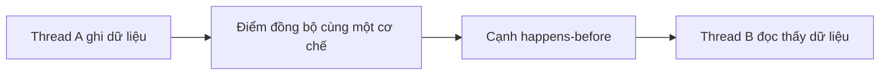
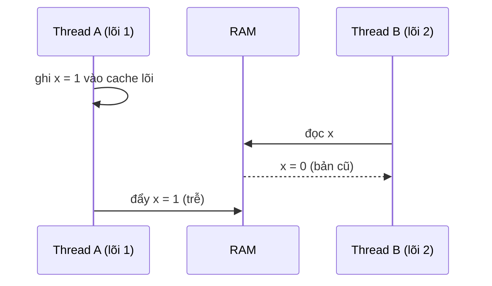
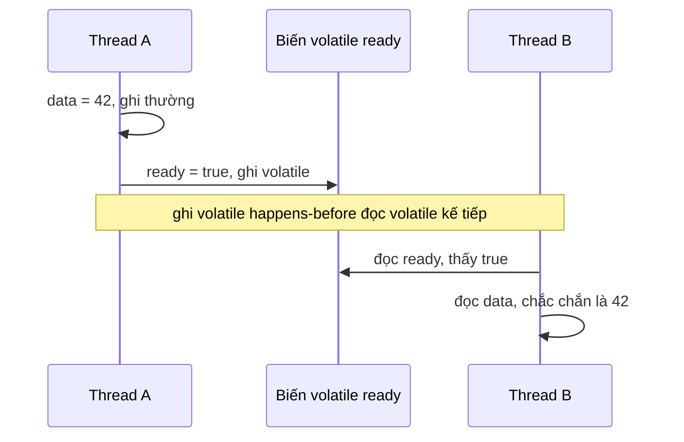
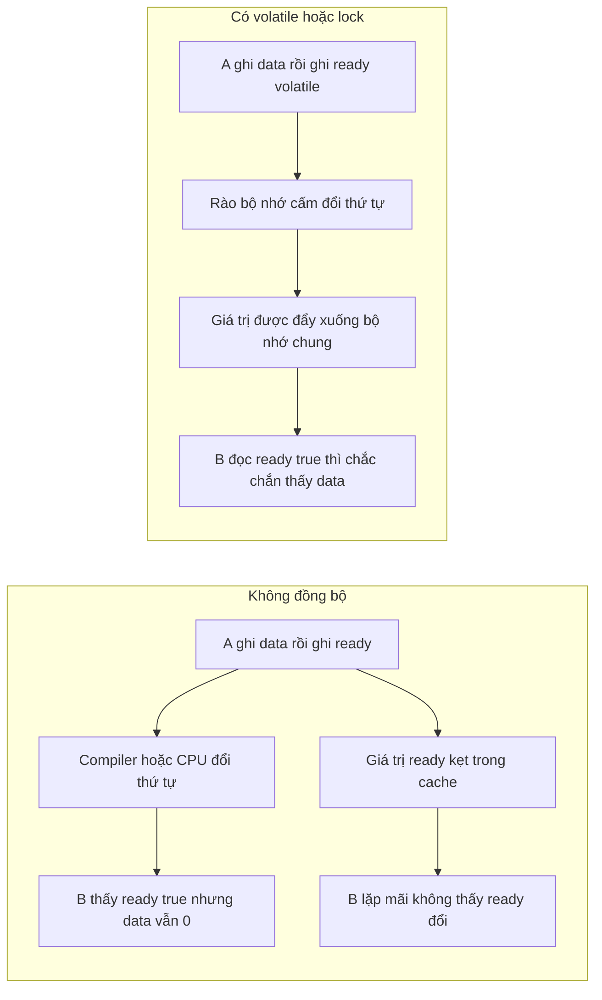
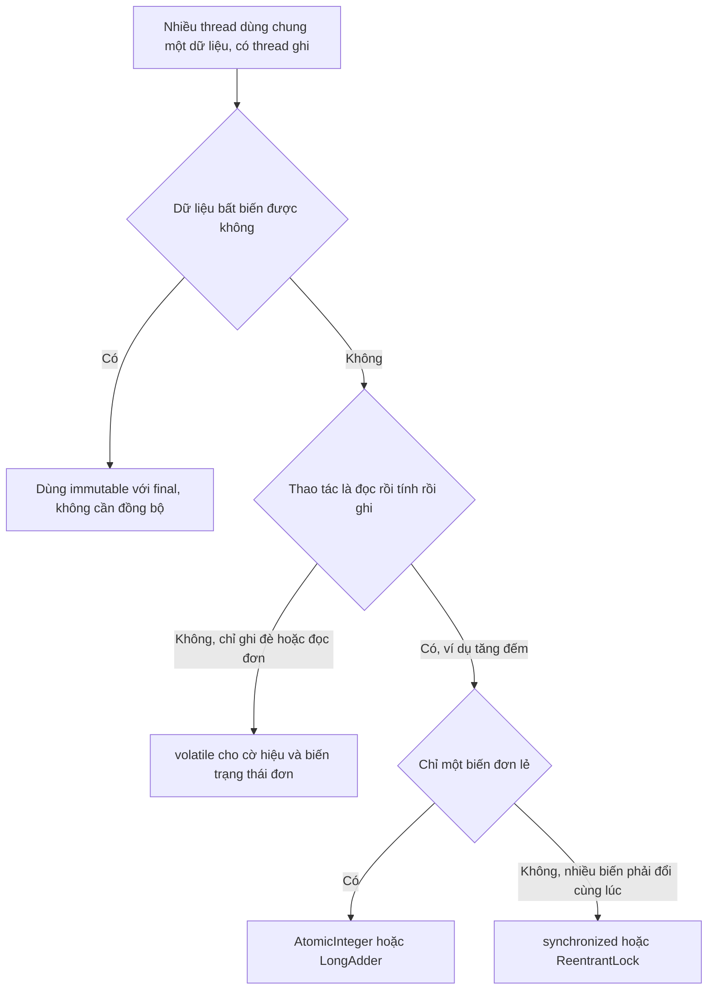

# Lý thuyết 17: Java Memory Model chuyên sâu

Java Memory Model (JMM) là bộ luật trả lời hai câu hỏi: khi nào một thread chắc chắn thấy giá trị mà thread khác vừa ghi, và JVM cùng CPU được phép đảo thứ tự các lệnh tới đâu. Hãy hình dung một văn phòng nơi mỗi nhân viên có sổ nháp riêng và thỉnh thoảng mới chép lên bảng chung. Nếu không có quy ước "khi nào phải chép lên bảng, khi nào phải đọc lại từ bảng", hai người sẽ làm việc với số liệu khác nhau mà không ai biết.

**Cốt lõi:** Để chạy nhanh, compiler, JIT và CPU được giữ giá trị trong cache và đổi thứ tự lệnh, miễn kết quả trong một thread không đổi. Vì vậy thread khác chỉ chắc chắn thấy dữ liệu khi có một cạnh happens-before nối lần ghi với lần đọc.

- Vì tốc độ đến từ việc đảo lệnh và giữ cache nên không có đồng bộ thì không có bảo đảm nào.
- Vì happens-before có tính bắc cầu nên một lần ghi `volatile` kéo theo mọi lần ghi trước nó cùng hiển thị.
- Vì chạy thử không chứng minh được gì nên phải tìm cạnh happens-before cho mọi cặp ghi và đọc dữ liệu chia sẻ.



Mô hình tư duy: dữ liệu chỉ đi từ thread này sang thread kia an toàn qua một điểm đồng bộ chung, ngoài đó mọi thứ đều có thể cũ hoặc lệch thứ tự.

**Tóm tắt:**

- JMM là bộ luật cho biết khi nào một thread chắc chắn thấy giá trị thread khác vừa ghi và JVM cùng CPU được đảo thứ tự lệnh tới đâu.
- Hai nguồn lỗi độc lập: giá trị kẹt trong cache hoặc thanh ghi của core (visibility) và lệnh bị compiler, JIT, CPU sắp xếp lại (reordering).
- Happens-before là cầu nối duy nhất bảo đảm thấy dữ liệu: thứ tự chương trình, unlock rồi lock cùng monitor, ghi rồi đọc cùng `volatile`, `start()`/`join()`, `final` sau constructor, và tính bắc cầu.
- Safe publication: gán vào `volatile` hoặc `final`, qua `synchronized`, collection đồng thời hoặc static initializer; object immutable với field `final` là cách đơn giản nhất.
- Double-checked locking chỉ đúng khi field là `volatile`; thường gọn hơn là holder class hoặc enum singleton.
- `volatile` bảo đảm hiển thị và thứ tự nhưng không làm `i++` atomic; dùng `AtomicInteger` hoặc `LongAdder`.
- Chạy thử không lỗi không chứng minh code đúng; dùng jcstress, và đừng để `this` thoát ra khỏi constructor.

## Vấn đề nó giải quyết

Code multi-thread "chạy đúng trên máy tôi" mà lên máy khác thì sai. Lỗi kiểu này khó tái hiện vì phụ thuộc CPU, JIT và thời điểm chạy: chạy thử một nghìn lần không lỗi vẫn không chứng minh được gì. Không có luật chung thì không ai biết code đó đúng hay chỉ là may. JMM cung cấp luật chung đó, nhờ vậy bạn và người thiết kế JVM cùng hiểu một thứ gọi là "đúng".

Cần đào sâu khi bạn viết thư viện concurrent, cache nội bộ, code lock-free, hoặc điều tra lỗi đồng thời lúc có lúc không. Code ứng dụng bình thường thì dùng lock hoặc collection concurrent có sẵn là đủ, đừng tự đi sâu vào đây. Cách làm đúng là dựa vào quan hệ **happens-before**, công bố (publish) object cho thread khác một cách an toàn, và dùng `volatile`, `final`, lock, `VarHandle` đúng ngữ nghĩa của từng cái.

## Các khái niệm cần biết

- **Visibility**: thread B có nhìn thấy giá trị mà thread A vừa ghi hay không. Giá trị có thể còn nằm trong cache hoặc thanh ghi của lõi CPU của A.
- **Reordering**: trình biên dịch, JIT và CPU được phép đổi thứ tự thực thi nếu kết quả trong **một thread** không đổi. Thread khác có thể thấy thứ tự bị đảo.
- **Atomicity (atomic)**: một thao tác không thể bị xen giữa. `i++` thực ra là ba bước đọc, cộng, ghi nên không atomic.
- **Happens-before (hb)**: quan hệ nói "mọi thay đổi trước hành động A đều hiển thị với người thấy hành động B". Nếu A hb B thì dữ liệu A ghi chắc chắn được B thấy. Không có hb thì không có bảo đảm gì.
- **Race condition và data race**: nhiều thread truy cập dữ liệu chia sẻ mà ít nhất một thread ghi, không có hb sắp xếp chúng. Kết quả phụ thuộc may rủi.
- **Safe publication**: cách đưa reference object cho thread khác sao cho thread đó thấy object ở trạng thái đã dựng xong, không phải dở dang.
- **Memory barrier**: lệnh CPU/JIT chèn vào để cấm đảo lệnh qua một điểm và ép đồng bộ cache. `volatile` và `synchronized` được cài đặt bằng cách này.
- **CAS (compare-and-set)**: lệnh atomic của CPU "nếu giá trị hiện tại bằng X thì đặt thành Y", nền tảng của `AtomicInteger` và code lock-free.
- **Lock-free**: cấu trúc dữ liệu đồng thời không dùng lock, thường dựa trên CAS.

## Vì sao cần JMM



Ngoài việc giá trị bị kẹt trong cache, trình biên dịch, JIT và CPU còn có thể **sắp xếp lại lệnh** nên thứ tự quan sát được có thể khác thứ tự trong mã nguồn. JMM xác định **tối thiểu** những gì được bảo đảm; ngoài đó mọi tối ưu đều hợp lệ.

**Suy luận:** Phần cứng và compiler được tự do sắp xếp lại lệnh và giữ giá trị trong cache vì đó là nguồn tốc độ chính của CPU hiện đại: nếu mỗi lần ghi phải hiện ra cho mọi core ngay, chương trình sẽ chậm đi hàng chục lần. Cái giá là mỗi thread chỉ có ảo giác "chạy tuần tự" của chính nó, còn thread khác có thể thấy thứ tự bị đảo hoặc thấy giá trị cũ. JMM giải quyết bằng cách không hứa gì cả trừ những điểm đồng bộ rõ ràng, tức là quan hệ happens-before: chỉ khi có một cạnh hb từ ghi sang đọc thì dữ liệu mới được bảo đảm hiển thị. Vì vậy cùng một dữ liệu phải được đọc và ghi qua cùng một cơ chế, ví dụ một bên ghi dưới `synchronized` mà bên kia đọc không có lock thì vẫn không có cạnh hb nào. Điểm dễ nhầm là tin kết quả thử nghiệm: code "chạy ổn" trên máy này có thể sai trên CPU khác hay sau khi JIT tối ưu, nên chạy thử không chứng minh gì. Hãy luôn tìm cạnh happens-before giữa mọi cặp ghi và đọc dữ liệu chia sẻ, và đừng để `this` lọt ra khỏi constructor.

**Nền tảng:** Hai nguồn lỗi đồng thời: giá trị ghi bị kẹt trong cache hoặc thanh ghi của lõi CPU (visibility) và lệnh bị sắp xếp lại bởi compiler, JIT, CPU (reordering). JMM chỉ bảo đảm tối thiểu qua quan hệ happens-before; ngoài đó mọi tối ưu đều hợp lệ, nên chạy thử không lỗi không chứng minh code đúng.

## Happens-before qua một biến volatile

Vấn đề: ở sơ đồ trên, B đọc được giá trị cũ vì không có gì nối hai thread. Sơ đồ dưới cho thấy cạnh nối đó khi hai thread cùng dùng một biến `volatile`: thread A ghi dữ liệu thường rồi ghi cờ `ready`, thread B đọc `ready` rồi mới đọc dữ liệu.



Đọc theo thứ tự từ trên xuống. Hai dòng đầu của A là thứ tự chương trình, nên `data = 42` happens-before `ready = true`. Việc B đọc thấy `ready == true` tạo cạnh hb từ lần ghi volatile sang lần đọc. Cộng hai cạnh lại theo tính bắc cầu, mọi thứ A ghi trước `ready` đều hiển thị với B sau khi B đọc `ready`, kể cả `data` không phải `volatile`. Nếu B đọc `ready` mà nhận `false` thì sơ đồ này không bảo đảm gì về `data`, vì chưa có cạnh nào.

## So sánh có và không có đồng bộ



Bên trái là hai lỗi độc lập đã nêu ở phần "Vì sao cần JMM": reordering (nhánh K2, K3) và visibility (nhánh K4, K5). Bên phải là cùng đoạn code nhưng có điểm đồng bộ: rào bộ nhớ vừa cấm đảo lệnh, vừa ép giá trị ra bộ nhớ chung nên cả hai lỗi biến mất. Đọc hai cột song song để thấy đồng bộ chặn đúng hai chỗ đó chứ không "làm code chạy chậm cho vui".

## Chọn volatile, synchronized hay atomic



Đọc từ trên xuống, trả lời từng câu hỏi. Nếu dữ liệu bất biến thì dừng ngay, không cần đồng bộ. Nếu chỉ là cờ hoặc một giá trị được ghi đè (không phụ thuộc giá trị cũ) thì `volatile` đủ. Nếu có bước "đọc, tính, ghi" trên một biến thì dùng atomic (`LongAdder` khi tranh chấp cao). Khi một bất biến liên quan nhiều biến phải đổi cùng lúc thì cần lock, vì atomic trên từng biến không làm cả nhóm atomic.

## Thực hành: vòng lặp cờ không volatile

Chương trình dưới có worker lặp `while (!stop)`, main ngủ 1 giây rồi đặt `stop = true`. Đã chạy thử trên Java 11 (OpenJDK 11.0.32, JIT mặc định).

```java
// FlagDemo.java, chạy: java FlagDemo.java
public class FlagDemo {
    static boolean stop = false;            // thử đổi thành: static volatile boolean stop = false;

    public static void main(String[] args) throws Exception {
        Thread worker = new Thread(() -> {
            long n = 0;
            while (!stop) { n++; }          // có thể không bao giờ thấy stop = true
            System.out.println("worker thoát, n = " + n);
        });
        worker.setDaemon(true);             // để JVM vẫn thoát được nếu worker kẹt
        worker.start();

        Thread.sleep(1000);
        stop = true;
        System.out.println("main đã đặt stop = true");

        worker.join(2000);
        System.out.println("worker còn sống sau 2 giây? " + worker.isAlive());
    }
}
```

```text
# Không volatile (chạy thật, Java 11)
main đã đặt stop = true
worker còn sống sau 2 giây? true

# Có volatile (chạy thật, Java 11; con số n thay đổi mỗi lần chạy)
main đã đặt stop = true
worker thoát, n = 1836260010
worker còn sống sau 2 giây? false
```

Giải thích: JIT thấy vòng lặp không có điểm đồng bộ nào nên được phép đọc `stop` một lần rồi giữ trong thanh ghi, vòng lặp trở thành `while (true)`. Không có cạnh happens-before từ lần ghi của main sang lần đọc của worker, nên JMM cho phép worker không bao giờ thấy thay đổi. Thêm `volatile` tạo cạnh hb, JIT buộc phải đọc lại từ bộ nhớ mỗi vòng, worker thoát sau khoảng 1 giây. Lưu ý đây là hành vi được phép chứ không được bảo đảm: trên JVM hoặc CPU khác, bản không `volatile` có thể vẫn thoát, và đó chính là lý do chạy thử không chứng minh code đúng.

## Bản đầy đủ nằm ở Java Concurrency

Để tránh chép hai nơi, phần giải thích chi tiết JMM nằm ở bài gốc [Java Memory Model](/go?p=08-Java%2FJava-Concurrency%2Fhard%2Flt-16-java-memory-model.md) (theo sách Java Concurrency in Practice). Bài đó gồm: bảng các quy tắc happens-before và piggybacking, công bố an toàn và lazy initialization, double-checked locking (kèm sơ đồ vì sao thiếu `volatile` thì thấy object dựng dở), initialization safety của `final`, và mục thực hành tái hiện lỗi visibility (`stop` không `volatile` làm worker kẹt) cùng thí nghiệm `volatile++` mất lần đếm, đều có kết quả chạy thật.

**Phải thuộc:** Happens-before đến từ: thứ tự chương trình, unlock rồi lock cùng monitor, ghi rồi đọc cùng variable `volatile`, `start()`/`join()`, `final` sau constructor, và tính bắc cầu. `volatile` bảo đảm hiển thị và thứ tự nhưng không làm `i++` atomic; double-checked locking chỉ đúng khi field là `volatile`.

## Những hiểu lầm hay gặp

| Hiểu lầm | Sự thật |
|---|---|
| "`volatile` làm `i++` an toàn" | Không: đọc-cộng-ghi vẫn có thể bị xen |
| "Đọc `long`/`double` luôn atomic" | Không đảm bảo với kiểu không `volatile` trên một số nền tảng |
| "`synchronized` chỉ để loại trừ lẫn nhau" | Còn đảm bảo **hiển thị** và thứ tự |
| "Chạy thử không lỗi là đúng" | Lỗi JMM có thể chỉ xuất hiện trên CPU khác hoặc sau khi JIT tối ưu |
| "Variable cục bộ cần đồng bộ" | Variable cục bộ riêng từng thread; vấn đề là dữ liệu **chia sẻ** |

## Quy tắc vàng

1. Immutable trước, rồi đến `java.util.concurrent`, rồi `synchronized`; tự dựng lock-free là phương án cuối.
2. Mọi truy cập đến dữ liệu chia sẻ có thể thay đổi phải **cùng một cơ chế đồng bộ** (cả đọc lẫn ghi).
3. Đừng để `this` thoát ra khỏi constructor.
4. Kiểm thử đồng thời bằng công cụ chuyên dụng (jcstress), không chỉ chạy lại nhiều lần.

## Phỏng vấn khó: chuỗi hỏi xoáy

Người phỏng vấn senior thường mở bằng câu dễ rồi xoáy xuống cơ chế, đánh đổi và sự cố thật. Câu trả lời tốt luôn đi từ cốt lõi xuống.

### Chuỗi 1: Cờ `stop` không volatile

1. **Câu mở:** Worker lặp `while (!stop)`, main đặt `stop = true`. Điều gì có thể xảy ra nếu `stop` không `volatile`?
2. **Xoáy 1:** JIT làm gì ở đây, và JMM cho phép điều đó dựa trên quy tắc nào?
3. **Xoáy 2:** Bạn chạy thử trên máy khác và worker thoát bình thường. Có kết luận code đúng được không?

**Đáp án ngắn:** Worker có thể không bao giờ thoát. Vòng lặp không có điểm đồng bộ nào, nên JIT được phép đọc `stop` một lần, giữ trong thanh ghi và biến vòng lặp thành `while (true)`. JMM cho phép vì không có cạnh happens-before từ lần ghi của main sang lần đọc của worker, và khi không có cạnh đó thì không có bảo đảm gì về việc thấy giá trị mới. Thêm `volatile` tạo cạnh hb, buộc đọc lại từ bộ nhớ mỗi vòng, nên worker thoát. Chú ý đây là hành vi được phép chứ không phải được bảo đảm. Trên JVM hay CPU khác, bản không `volatile` vẫn có thể thoát, và đó chính là lý do chạy thử không chứng minh gì. Cách đúng là chỉ ra cạnh hb cho cặp ghi và đọc đó, và kiểm thử đồng thời bằng jcstress.

**Sai lầm hay gặp:**
- Nói "volatile làm giá trị nhanh được ghi ra RAM" mà không nhắc happens-before.
- Kết luận "chạy ổn nên đúng".
- Trộn visibility với atomicity.

### Chuỗi 2: Happens-before và tính bắc cầu

1. **Câu mở:** `volatile` bảo đảm điều gì?
2. **Xoáy 1:** A ghi `data = 42` (biến thường) rồi `ready = true` (volatile). B đọc `ready` thấy true. Vì sao B chắc chắn thấy `data = 42`?
3. **Xoáy 2:** Nếu A ghi dưới `synchronized` còn B đọc không lock thì sao? Còn `volatile int count` với `count++` thì sao?

**Đáp án ngắn:** `volatile` bảo đảm hiển thị và thứ tự, tức là ghi volatile happens-before đọc volatile kế tiếp của cùng biến. Với `data`, có hai cạnh: thứ tự chương trình nối `data = 42` tới `ready = true`, và cạnh volatile nối lần ghi `ready` tới lần đọc của B. Cộng hai cạnh bằng tính bắc cầu thì mọi thứ A ghi trước `ready` đều hiển thị với B, kể cả biến không volatile. Điều kiện là B phải thực sự đọc thấy `true`; nếu thấy `false` thì chưa có cạnh nào. Với `synchronized`, hb chỉ có khi cả hai bên dùng cùng một monitor, nên bên đọc không lock thì không có cạnh. Còn `count++` là đọc, cộng, ghi nên vẫn bị xen dù `volatile`; cần `AtomicInteger` hoặc `LongAdder`.

**Sai lầm hay gặp:**
- Nghĩ chỉ biến volatile mới được hiển thị, bỏ sót tính bắc cầu.
- Dùng lock ở bên ghi mà quên bên đọc.
- Nói "volatile làm `i++` an toàn".

### Chuỗi 3: Double-checked locking và công bố an toàn

1. **Câu mở:** Viết singleton lazy bằng double-checked locking.
2. **Xoáy 1:** Bỏ `volatile` khỏi field thì sai ở đâu?
3. **Xoáy 2:** Có cách nào gọn hơn không, và vì sao để `this` thoát khỏi constructor lại nguy hiểm?

**Đáp án ngắn:** DCL kiểm tra null ngoài lock, rồi trong `synchronized` kiểm tra lại và tạo object. Field phải là `volatile`. Nếu không, việc gán reference có thể bị đảo thứ tự so với việc dựng object, nên thread khác thấy reference khác null nhưng object còn dựng dở. Lần kiểm tra đầu không có lock nên không có cạnh hb nào cứu được. `volatile` tạo cạnh từ lần ghi reference sang lần đọc, nên object đã dựng xong khi được thấy. Gọn hơn thì dùng holder class hoặc enum singleton; static initializer chạy một lần dưới lock của JVM nên an toàn mà không cần `volatile`. Object immutable với field `final` cũng được công bố an toàn sau constructor. Còn để `this` thoát ra khi constructor chưa xong thì thread khác có thể thấy object ở trạng thái dở, vì lúc đó chưa có điểm công bố an toàn nào.

**Sai lầm hay gặp:**
- Viết DCL không có `volatile` rồi nói "đã có hai lần kiểm tra là đủ".
- Không biết lựa chọn holder hoặc enum.
- Không nói được vì sao lỗi hiếm gặp và khó tái hiện.

