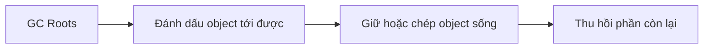
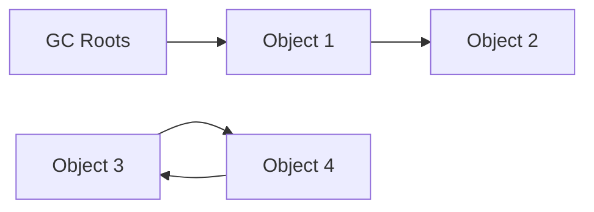
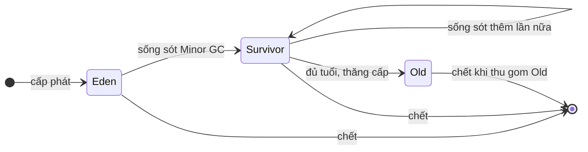
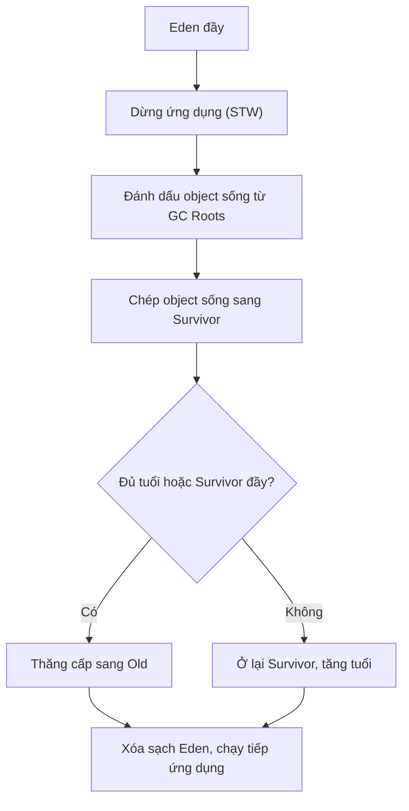
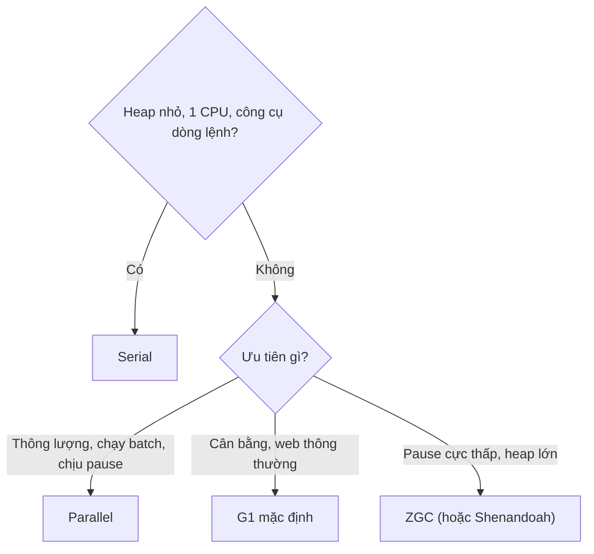

# Lý thuyết 18: Garbage Collection chuyên sâu

Trong Java bạn tạo object bằng `new` nhưng không bao giờ phải gọi "xóa". Việc dọn dẹp do Garbage Collector (GC) đảm nhiệm: nó xác định object nào đã "chết" (không còn ai dùng tới), giải phóng chỗ đó, và thường dồn memory lại cho gọn. Có nhiều collector (G1, ZGC...), mỗi loại một kiểu đánh đổi giữa độ trễ, thông lượng và RAM. Ẩn dụ dễ nhớ: GC giống nhân viên dọn bàn trong quán ăn; dọn khi khách còn ngồi thì khách bị làm phiền (pause), dọn ít thì bàn hết chỗ (OOM).

## Vì sao phải hiểu GC

GC quyết định app có bị khựng hay không (độ trễ p99, nghĩa là 99% request nhanh hơn mốc này), xử lý được bao nhiêu request và ăn bao nhiêu RAM. Không hiểu thì khi gặp pause dài hay `OutOfMemoryError` bạn chỉ biết tăng heap cho đỡ, mà thường không hết, vì nguyên nhân có thể là rò rỉ hoặc cấp phát quá tay.

Cần đào sâu khi app cần độ trễ thấp, heap lớn, chạy trong container bị giới hạn RAM, hoặc thấy pause lạ trong log. Nếu app chạy ổn thì cứ để cấu hình mặc định, đừng chỉnh "cho chắc". Cách làm đúng: đọc log GC trước, chọn collector theo mục tiêu (ít pause hay throughput cao), giảm lượng object tạo ra, và chỉ chỉnh tham số khi có số liệu, càng ít càng tốt.

**Cốt lõi:** Lập trình viên không tự giải phóng object, nên GC phải tự biết cái nào còn dùng: object đi được từ GC Roots là sống, phần còn lại là rác. Vì đa số object chết sớm, GC chia heap theo tuổi để dọn thường xuyên vùng nhỏ nơi rác dày đặc.

- Vì "sống" nghĩa là tới được từ root nên rò rỉ là reference thừa, còn các object trỏ vòng vào nhau vẫn bị thu hồi.
- Vì Minor GC chỉ chép object sống nên chi phí tỷ lệ với số object sống, không phải số rác.
- Vì mọi collector phải dừng ứng dụng ở một số pha nên chọn collector là đánh đổi giữa pause, thông lượng và RAM.



Mô hình tư duy: GC không đi tìm rác mà đi tìm cái còn sống từ các root, và mọi thứ không được đánh dấu là rác.

**Tóm tắt:**

- GC không đếm reference mà đi từ GC Roots (variable cục bộ trên stack, static, thread đang chạy, JNI) đánh dấu mọi object tới được; phần còn lại là rác, kể cả object trỏ vòng vào nhau.
- Memory leak trong Java là còn reference thừa từ một root, không phải quên `free`; mức đáy heap sau mỗi lần GC tăng dần là dấu hiệu rò rỉ.
- Giả thuyết thế hệ: đa số object chết sớm nên heap chia Young (Eden và hai Survivor, Minor GC rẻ, thường xuyên) và Old (thu gom hiếm, đắt).
- Mọi pha stop-the-world đều dừng ứng dụng, và Full GC xuất hiện thường xuyên là dấu hiệu xấu.
- G1 là mặc định từ Java 9 với mục tiêu mềm `-XX:MaxGCPauseMillis`; Parallel cho thông lượng, ZGC và Shenandoah cho pause rất thấp.
- Chỉnh GC theo thứ tự: đo trước, giảm cấp phát, chọn collector hợp mục tiêu, rồi mới chỉnh từng tham số, mỗi lần một thay đổi.
- Tăng heap không luôn giảm pause, và trong container tổng process vẫn vượt heap vì Metaspace, stack, buffer ngoài heap.

## Các khái niệm cần biết

- **Heap**: vùng nhớ chứa object do GC quản lý. Kích thước đặt bằng `-Xms` (đầu) và `-Xmx` (tối đa).
- **GC Roots**: các "điểm xuất phát" mà GC coi chắc chắn còn sống (variable cục bộ trên stack, static, thread). Object nào đi từ root tới được thì sống.
- **Minor GC và Full GC**: Minor GC chỉ dọn vùng Young, nhanh và thường xuyên. Full GC dọn cả heap, chậm, nên xuất hiện thường xuyên là dấu hiệu xấu.
- **Stop-the-world (STW)**: lúc GC cần làm việc an toàn, mọi thread ứng dụng bị dừng. Đây chính là "pause" bạn thấy trong log.
- **Throughput và latency**: throughput là lượng việc làm được mỗi giây (tỷ lệ thời gian không bị GC chiếm); latency là thời gian một request phải chờ, trong đó có cả pause.
- **Promotion**: object sống đủ lâu ở Young được chuyển sang Old.
- **Fragmentation**: memory trống bị chia lẻ thành nhiều mảnh nhỏ, đủ tổng nhưng không có khoảng liền kề đủ lớn. Compact (nén) giải quyết.
- **Barrier**: đoạn mã nhỏ chèn quanh việc đọc/ghi reference để GC chạy đồng thời với ứng dụng mà vẫn đúng.
- **Humongous object (G1)**: object chiếm từ nửa region trở lên, cấp phát riêng, tốn kém.

## Object "còn sống" là gì

Vấn đề đặt ra: GC làm sao biết object nào còn dùng? Nó đi từ các GC Roots, theo từng reference để đánh dấu mọi thứ tới được. Phần còn lại là rác.



GC Roots gồm variable cục bộ trên stack, variable static, thread đang chạy, reference JNI. Object 1 và 2 tới được từ root nên sống; 3 và 4 không tới được nên bị thu hồi (dù chúng trỏ lẫn nhau).

**Nền tảng:** GC không đếm reference mà đi từ GC Roots (variable cục bộ trên stack, static, thread đang chạy, JNI) theo từng reference để đánh dấu mọi object tới được; phần còn lại là rác, kể cả các object trỏ vòng vào nhau. Vì vậy memory leak trong Java là còn reference thừa từ một root, không phải quên `free`.

Không dùng đếm reference (không xử lý được vòng). Reference yếu: `WeakReference`, `SoftReference`, `PhantomReference` cho cache và dọn dẹp tài nguyên (thay cho `finalize` đã lỗi thời).

## Giả thuyết thế hệ

Đa số object chết rất sớm; một số ít sống lâu. Vì vậy heap chia **Young** (thu gom thường xuyên, rẻ) và **Old** (thu gom hiếm, đắt).



Object lớn đi thẳng vào Old (G1 gọi là *humongous*); cấp phát object lớn liên tục là nguồn áp lực GC.

Sơ đồ sau mô tả một lần Minor GC từ lúc Eden đầy. Đọc kèm để thấy vì sao Young GC rẻ: nó chỉ làm việc trên object **sống**, còn rác thì không phải chạm tới.



Lý do cần Survivor: nếu thăng cấp mọi object sống sót lần đầu sang Old thì Old đầy rác tạm thời rất nhanh, buộc phải Full GC. Hệ quả của việc cấp phát nhiều object trung hạn (sống vài giây, ví dụ cache ngắn hạn): chúng bị thăng cấp sớm rồi chết ở Old, gây Full GC sớm.

**Phải thuộc:** Giả thuyết thế hệ: đa số object chết sớm, nên heap chia Young (Eden và hai Survivor, Minor GC thường xuyên, rẻ) và Old (thu gom hiếm, đắt). Object sống đủ tuổi sau nhiều lần Minor GC được thăng cấp sang Old. Minor GC và mọi pha STW đều dừng ứng dụng; Full GC thường xuyên là dấu hiệu xấu.

**Suy luận:** Giả thuyết thế hệ dựa trên quan sát rằng đa số object chết ngay sau khi tạo, nên chia heap thành Young và Old để GC chỉ thường xuyên dọn vùng nhỏ nơi rác dày đặc. Chi phí của Minor GC tỷ lệ với số object còn sống chứ không phải số rác, vì nó chỉ chép object sống sang Survivor và coi cả Eden là trống; vì vậy dọn Young rất rẻ. Survivor tồn tại để object mới sống sót lần đầu có thêm vài lần cơ hội chết trước khi bị thăng cấp, nếu không Old sẽ đầy rác tạm thời rất nhanh và buộc Full GC. Hệ quả là đoạn code tạo nhiều object sống vài giây, như cache ngắn hạn hay danh sách tạm lớn, là kẻ thù: chúng sống đủ lâu để bị thăng cấp, rồi chết ở Old và gây Full GC sớm. Điểm dễ nhầm là tưởng tăng heap luôn giảm pause, trong khi với rò rỉ nó chỉ trì hoãn `OutOfMemoryError`, và với Parallel Full GC có thể dừng lâu hơn. Vì vậy hãy giảm cấp phát và đọc log GC trước khi chỉnh tham số.

## Các collector

| GC | Cách làm | Đặc điểm |
|---|---|---|
| **Serial** | Một thread, dừng toàn bộ | Heap nhỏ, ứng dụng đơn giản |
| **Parallel** | Nhiều thread, dừng toàn bộ | Thông lượng cao, tạm dừng dài hơn |
| **G1** (mặc định) | Chia heap thành vùng (region), thu gom ưu tiên vùng nhiều rác, một phần đồng thời | Cân bằng; mục tiêu `-XX:MaxGCPauseMillis`. Java 27: mặc định ở mọi môi trường (kể cả máy ít CPU, ít RAM) |
| **ZGC** | Gần như hoàn toàn đồng thời, dùng con trỏ có màu và barrier | Tạm dừng dưới vài mili giây kể cả heap rất lớn; từ Java 21 có chế độ phân thế hệ (mặc định từ Java 23, Java 24 chỉ còn chế độ này) |
| **Shenandoah** | Đồng thời cả khâu nén | Tương tự ZGC, từ Red Hat |

Chọn theo nhu cầu: web thông thường cứ để G1 mặc định; batch cần thông lượng và chịu được pause dài thì Parallel; yêu cầu pause cực thấp trên heap lớn thì ZGC. Không nên chọn ZGC chỉ vì "nghe hiện đại": nó dùng thêm CPU và memory cho barrier, và với app nhỏ lợi ích không đáng kể.

**Phải thuộc:** G1 là GC mặc định từ Java 9 (chia heap thành region, mục tiêu mềm `-XX:MaxGCPauseMillis`, mặc định 200 ms). Parallel cho thông lượng cao, Serial cho heap nhỏ, ZGC và Shenandoah cho pause rất thấp. Cờ cơ bản: `-Xms`, `-Xmx`, `-XX:+UseG1GC`/`UseZGC`, `-XX:+HeapDumpOnOutOfMemoryError`.

**Suy luận:** Collector nào cũng phải dừng ứng dụng ở một số pha vì nếu thread vẫn đang sửa reference trong lúc GC đánh dấu và di chuyển object thì GC có thể thu nhầm object còn sống hoặc để lại reference trỏ vào chỗ cũ. Các collector hiện đại như G1 và ZGC giảm pause bằng cách làm phần lớn việc đồng thời, đổi lấy việc chèn barrier quanh mọi lần đọc hoặc ghi reference, nên chúng tốn thêm CPU và memory. Đây là đánh đổi giữa độ trễ, thông lượng và RAM: Parallel dừng lâu nhưng ít overhead, nên hợp batch; ZGC dừng rất ngắn nhưng trả giá bằng barrier, nên hợp heap lớn cần p99 thấp. Điểm dễ nhầm là chọn ZGC vì "nghe hiện đại" cho ứng dụng nhỏ, hoặc nghĩ mục tiêu `MaxGCPauseMillis` là cam kết trong khi nó chỉ là mục tiêu mềm. Chỉ nên đổi collector khi log cho thấy pause vi phạm SLA, và đo lại sau mỗi thay đổi.

## Pha chính

Một chu kỳ thu gom dù ở bộ nào cũng gồm các pha dưới đây; khác biệt giữa các bộ là pha nào chạy đồng thời với ứng dụng và pha nào phải dừng.

- **Mark:** tìm object sống.
- **Sweep/Compact:** thu hồi, và **nén** để chống phân mảnh.
- **Stop-the-world (STW):** mọi thread ứng dụng dừng để GC làm việc an toàn; mục tiêu của GC hiện đại là rút ngắn các đoạn này.

## Đọc log GC

```bash
java -Xlog:gc*:file=gc.log:time,uptime,level,tags -jar app.jar
```

| Dấu hiệu | Ý nghĩa |
|---|---|
| Tạm dừng dài lặp lại | Heap quá nhỏ hoặc nhiều object sống lâu bị thăng cấp sớm |
| Full GC thường xuyên | Old đầy: rò rỉ hoặc heap thiếu |
| `Allocation Failure` liên tục | Tốc độ cấp phát vượt khả năng thu gom |
| CPU phần lớn dành cho GC | Cần giảm cấp phát hoặc tăng heap |
| Mức "sau" của mỗi lần GC **tăng dần** (ví dụ 210M, 380M, 905M) | Có thứ giữ memory: rò rỉ hoặc cache không giới hạn |
| `Pause Full (G1 Compaction Pause)` | G1 thất bại trong việc dọn từng phần nên phải dọn toàn heap; dừng cả giây. Nguyên nhân thường là heap quá nhỏ hoặc rò rỉ |
| `Pause Young` xuất hiện vài lần mỗi giây | Tốc độ tạo object quá cao (tải lớn hay mapping thừa), hoặc Young quá nhỏ |

Ví dụ ba dòng log G1 cho thấy các dấu hiệu trên (minh họa, chưa đo), định dạng `trước->sau(tổng đã cấp phát) thời gian dừng`:

```text
[12.345s][info][gc] GC(41) Pause Young (Normal) (G1 Evacuation Pause) 612M->210M(1024M) 18.456ms
[95.800s][info][gc] GC(57) Pause Young (Normal) (G1 Evacuation Pause) 640M->380M(1024M) 31.201ms
[210.10s][info][gc] GC(90) Pause Full (G1 Compaction Pause) 1020M->905M(1024M) 1840.000ms
```

Phép tính nhanh theo SLA: mục tiêu độ trễ p99 là 200 ms mà pause thỉnh thoảng lên 300 ms thì GC đã làm hỏng SLA; thử ZGC trước khi vặn từng tham số G1.

### Thực hành: đọc một dòng log GC

```java
// Gc.java, chạy: java -Xmx64m -Xlog:gc Gc.java   (đã chạy trên Java 11, G1)
static final List<byte[]> keep = new ArrayList<>();
for (int i = 0; i < 200_000; i++) {
    byte[] tmp = new byte[10_000];                    // chết ngay: rác Young
    if (i % 1000 == 0) keep.add(new byte[10_000]);    // sống lâu: được giữ
}
```

```text
[1.087s] GC(0) Pause Young (Normal) (G1 Evacuation Pause) 7M->3M(64M) 14.691ms
[1.926s] GC(6) Pause Young (Normal) (G1 Evacuation Pause) 36M->5M(64M) 5.512ms
[2.014s] GC(12) Pause Young (Normal) (G1 Evacuation Pause) 41M->5M(64M) 4.238ms
```

| Đoạn | Ý nghĩa |
|---|---|
| `GC(6)` | Lần GC thứ 6 kể từ lúc JVM chạy |
| `Pause Young (Normal)` | Thu gom Young, có dừng (STW); `(Normal)` là bình thường |
| `G1 Evacuation Pause` | Lý do: Eden đầy, G1 chép object sống sang vùng khác |
| `36M->5M(64M)` | Heap dùng trước sau GC (tổng cấp phát hiện tại 64M) |
| `5.512ms` | Thời gian dừng |

Đọc ra: sau mỗi Minor GC heap chỉ còn khoảng 5M dù trước đó 41M, tức phần lớn là rác chết sớm; mức "đáy" 5M không tăng nhanh nghĩa là không rò rỉ. Nếu đáy tăng đều qua nhiều chu kỳ thì xem [công cụ chẩn đoán](/go?p=08-Java%2FJava-Core%2Fhard%2Flt-32-cong-cu-chan-doan-jvm.md). Lý do khác thường thấy trong ngoặc: `G1 Humongous Allocation` (cấp phát object lớn, từ nửa kích thước một region trở lên), `Allocation Failure` ở các GC khác, `System.gc()`.

## Chọn collector



| Cờ | Tác dụng |
|---|---|
| `-XX:+UseSerialGC`, `-XX:+UseParallelGC`, `-XX:+UseG1GC`, `-XX:+UseZGC` | Chọn collector (ZGC phân thế hệ: thêm `-XX:+ZGenerational` ở Java 21 và 22; từ Java 23 là mặc định) |
| `-Xms` bằng `-Xmx` | Tránh co giãn heap lúc chạy, dễ dự đoán trong container |
| `-XX:MaxGCPauseMillis=200` | Mục tiêu mềm của G1, không phải cam kết |
| `-XX:+HeapDumpOnOutOfMemoryError` | Có dữ liệu sau sự cố |

Bẫy hay hỏi: "Tăng heap có luôn giảm pause?" Không. Heap lớn hơn thì Minor GC thưa hơn nhưng Full GC (với Parallel) có thể dừng lâu hơn; còn nếu rò rỉ thì chỉ trì hoãn OOM. Container mà không đặt heap thì JVM tự lấy một phần RAM (mặc định 1/4 giới hạn), và tổng process vẫn vượt heap vì Metaspace, stack, buffer ngoài heap.

## Chỉnh GC: nguyên tắc

1. **Đo trước**, đặt mục tiêu rõ (p99 dưới X ms hay thông lượng tối đa).
2. Cách rẻ nhất là **giảm cấp phát**: tránh boxing, tránh tạo chuỗi/danh sách tạm trong hot loop, dùng stream nguyên thủy, tái sử dụng bộ đệm.
3. Chọn GC phù hợp mục tiêu trước khi chỉnh từng tham số.
4. Trong container: `-XX:MaxRAMPercentage` khoảng 65 đến 75 (container nhỏ nên 65, heap từ khoảng 8 GiB trở lên mới 75), để chừa chỗ cho phần ngoài heap; cách tính ngân sách memory ở [Memory JVM và GC](/go?p=01-Spring-Boot%2Fhard%2Flt-23-jvm-memory-gc.md).
5. Mỗi thay đổi một lần và đo lại.

## Công cụ

Lệnh và quy trình chi tiết ở [Công cụ chẩn đoán JVM](/go?p=08-Java%2FJava-Core%2Fhard%2Flt-32-cong-cu-chan-doan-jvm.md). Nói gọn: JDK Flight Recorder (`jcmd <pid> JFR.start`), JMC, GCeasy/GCViewer đọc log, `jstat -gcutil <pid> 1s`, `jmap -histo`, Eclipse MAT cho heap dump.

## Phỏng vấn khó: chuỗi hỏi xoáy

Người phỏng vấn senior thường mở bằng câu dễ rồi xoáy xuống cơ chế, đánh đổi và sự cố thật. Câu trả lời tốt luôn đi từ cốt lõi xuống.

### Chuỗi 1: GC Roots và memory leak

1. **Câu mở:** GC xác định object nào là rác bằng cách nào?
2. **Xoáy 1:** Hai object trỏ vòng vào nhau thì sao? Java có dùng đếm reference không?
3. **Xoáy 2:** Java có memory leak không? Nếu có, bạn phát hiện trong production bằng dấu hiệu nào?

**Đáp án ngắn:** GC không đi tìm rác mà đi tìm cái còn sống: từ GC Roots (variable cục bộ trên stack, static, thread đang chạy, JNI) nó theo reference đánh dấu mọi object tới được, phần còn lại là rác. Vì không đếm reference nên hai object trỏ vòng vào nhau mà không tới được từ root vẫn bị thu hồi. Memory leak trong Java vì thế là còn reference thừa từ một root, như static collection, listener không hủy đăng ký, `ThreadLocal` hay cache không giới hạn, chứ không phải quên `free`. Dấu hiệu rõ nhất trong log GC là mức heap sau mỗi lần GC tăng dần, ví dụ 210M rồi 380M rồi 905M, kèm Full GC ngày càng thường xuyên. Khi đó bật `-XX:+HeapDumpOnOutOfMemoryError`, mở dump bằng Eclipse MAT và truy ngược đường reference từ root. Tăng heap chỉ trì hoãn `OutOfMemoryError`.

**Sai lầm hay gặp:**
- Nói GC dùng đếm reference.
- Cho rằng object trỏ vòng thì không thu hồi được.
- Phản ứng với OOM bằng cách tăng `-Xmx` mà không tìm nguyên nhân.

### Chuỗi 2: Young, Old và chi phí Minor GC

1. **Câu mở:** Vì sao heap chia Young và Old?
2. **Xoáy 1:** Chi phí một lần Minor GC tỷ lệ với cái gì? Survivor để làm gì?
3. **Xoáy 2:** App có nhiều object sống vài giây, như cache ngắn hạn. Điều gì xảy ra, và log GC cho bạn thấy gì?

**Đáp án ngắn:** Giả thuyết thế hệ nói đa số object chết rất sớm, nên chia heap để dọn thường xuyên vùng Young nhỏ nơi rác dày đặc, còn Old thì thu gom hiếm vì đắt. Minor GC chỉ chép object sống sang Survivor rồi coi cả Eden là trống, nên chi phí tỷ lệ với số object sống chứ không phải số rác. Survivor cho object mới sống sót thêm vài lần cơ hội chết trước khi thăng cấp; thiếu nó thì Old đầy rác tạm thời rất nhanh. Object sống vài giây là kẻ thù vì chúng sống đủ lâu để bị thăng cấp rồi chết ở Old, gây Full GC sớm. Trong log sẽ thấy `Pause Full` xuất hiện thường, hoặc Old tăng nhanh rồi tụt. Cách xử lý là giảm cấp phát và vòng đời object trước, chỉnh tham số sau.

**Sai lầm hay gặp:**
- Nói Minor GC "chậm vì phải quét rác".
- Không giải thích được vai trò của Survivor.
- Nói tăng heap luôn giảm pause.

### Chuỗi 3: Chọn collector và đánh đổi

1. **Câu mở:** Khi nào chọn G1, Parallel hay ZGC?
2. **Xoáy 1:** `-XX:MaxGCPauseMillis` có phải cam kết không? ZGC trả giá bằng gì để pause thấp?
3. **Xoáy 2:** p99 của dịch vụ vượt SLA vì pause 300 ms, chạy trong container. Bạn làm gì, theo thứ tự nào?

**Đáp án ngắn:** Web thông thường cứ để G1 mặc định vì cân bằng. Batch cần thông lượng và chịu pause dài thì Parallel, còn pause cực thấp trên heap lớn thì ZGC. `MaxGCPauseMillis` chỉ là mục tiêu mềm, G1 cố đạt chứ không cam kết. ZGC làm phần lớn việc đồng thời, đổi lại phải chèn barrier quanh việc đọc và ghi reference, nên tốn thêm CPU và memory; app nhỏ thì lợi ích không đáng kể. Với p99 vi phạm, trước hết bật log GC và đọc, xác định pause đến từ đâu. Sau đó giảm cấp phát, rồi mới cân nhắc đổi collector (thử ZGC trước khi vặn từng tham số G1), mỗi lần chỉ đổi một thứ và đo lại. Trong container, JVM mặc định lấy khoảng 1/4 RAM cho heap, và tổng process vẫn vượt heap vì Metaspace, stack, buffer; nên đặt `-XX:MaxRAMPercentage` hợp lý để chừa chỗ.

**Sai lầm hay gặp:**
- Chọn ZGC vì "nghe hiện đại".
- Coi `MaxGCPauseMillis` là bảo đảm.
- Chỉnh nhiều tham số cùng lúc khi chưa có số liệu.

