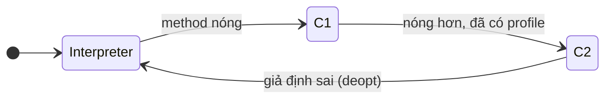
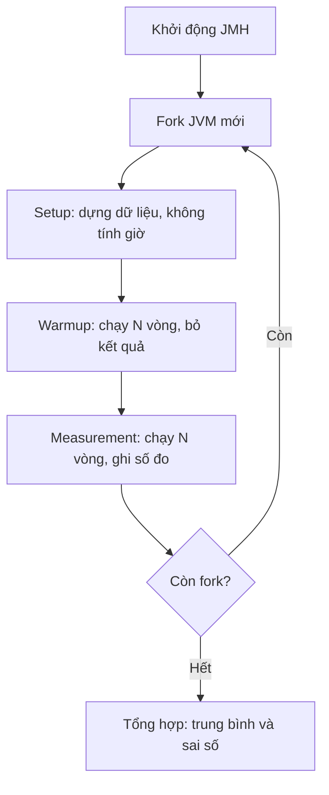
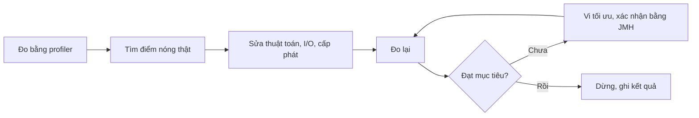

# Lý thuyết 19: JIT, Hiệu năng và Benchmark đúng cách

Một chương trình Java không chạy nhanh ngay từ giây đầu. Lúc mới khởi động, JVM đọc từng lệnh bytecode và thực thi (chế độ interpreter), khá chậm. Trong khi chạy, nó theo dõi đoạn nào được gọi nhiều ("nóng"), và biên dịch ngay đoạn đó thành mã máy đã tối ưu. Phần làm việc này gọi là JIT (Just-In-Time compiler). Bài này giải thích JIT hoạt động ra sao, và hệ quả quan trọng nhất của nó: muốn đo hiệu năng Java cho đáng tin phải làm khác so với ngôn ngữ biên dịch sẵn.

## Vì sao tự bấm giờ thường ra số sai

Vì Java chạy chậm lúc đầu rồi nhanh dần, tự bấm giờ bằng `System.nanoTime` rất dễ ra số sai: bạn đo trúng lúc chưa warm-up (JIT chưa kịp biên dịch), hoặc JIT bỏ luôn đoạn code vô dụng bạn định đo vì kết quả không được dùng tới. Kết luận "cách A nhanh hơn cách B" khi đó là sai, và bạn có thể quyết định thiết kế dựa trên con số sai.

Hiểu JIT và benchmark cần thiết khi tối ưu hot path, so sánh hai cách cài đặt, hoặc cần số liệu để quyết định thiết kế. Ngược lại, nếu bạn chưa profile ra chỗ nghẽn thật thì đừng vội benchmark vi mô: phần lớn thời gian của ứng dụng thường nằm ở I/O, truy vấn DB, mạng, chứ không phải ở một phép nối chuỗi. Cách làm: hiểu warm-up và các tối ưu của JIT (inlining, loại bỏ code thừa...), rồi dùng JMH thay vì tự đo bằng `System.nanoTime`.

**Cốt lõi:** JVM không biên dịch sẵn mọi thứ. Nó chạy bằng interpreter, theo dõi đoạn nào nóng rồi biên dịch đoạn đó dựa trên số liệu thật lúc chạy. Vì vậy tốc độ thay đổi theo thời gian, và phép đo chỉ đáng tin khi đã qua warm-up.

- Vì biên dịch tốn công nên JIT chỉ nâng mức (interpreter, C1, C2) cho method được gọi nhiều.
- Vì C2 tối ưu dựa trên giả định rút từ profile nên giả định bị phá thì deopt quay về interpreter.
- Vì JIT xóa code không ai dùng kết quả và tính trước hằng số nên tự bấm giờ dễ đo sai, cần JMH.


Mô hình tư duy: hiệu năng là đường dốc theo thời gian chứ không phải một con số cố định, nên phải đo sau khi đường đó phẳng lại.

**Tóm tắt:**

- Java chạy chậm lúc đầu rồi nhanh dần: interpreter chạy ngay, method nóng được JIT biên dịch qua C1 rồi C2 dựa trên profile, và deopt quay về interpreter khi giả định tối ưu bị phá.
- Hiệu năng đo được phụ thuộc giai đoạn warm-up; code rõ ràng với method nhỏ thường đã được JIT tối ưu rất tốt nhờ inlining, escape analysis, loop unrolling và devirtualization.
- Tự bấm giờ bằng `System.nanoTime` thường ra số sai vì chưa warm-up, kết quả không dùng nên bị loại bỏ (dead code elimination), đầu vào hằng bị constant folding, và chỉ chạy một JVM.
- JMH chạy mỗi benchmark trong JVM riêng (fork), có vòng warm-up không tính điểm, dùng `Blackhole` hoặc trả kết quả để chống loại bỏ code chết.
- Đọc cả cột `Error` chứ không chỉ điểm trung bình; khoảng sai số chồng nhau nghĩa là chưa phân biệt được hai phương án.
- Thứ tự lợi ích khi tối ưu: thuật toán, I/O và truy vấn, đồng thời, cấp phát, rồi mới đến vi tối ưu; chưa profile ra chỗ nghẽn thì đừng benchmark vi mô.
- Dịch vụ ngắn hạn hoặc serverless cần cân nhắc CDS, CRaC hoặc GraalVM native image vì khởi động chậm là vấn đề thật.

## Các khái niệm cần biết

- **Warm-up**: khoảng thời gian đầu chương trình chạy chậm, trước khi JIT biên dịch xong các method nóng. Benchmark phải bỏ qua giai đoạn này.
- **Hot method**: method được gọi nhiều lần hoặc có vòng lặp chạy nhiều, vượt ngưỡng mà JVM đếm.
- **Profile**: số liệu JVM thu thập khi chạy (nhánh `if` nào hay đi, kiểu object nào hay gặp) để JIT tối ưu theo thực tế.
- **Code cache**: vùng nhớ chứa mã máy do JIT sinh ra.
- **OSR (On-Stack Replacement)**: thay mã đã biên dịch ngay giữa một vòng lặp đang chạy, để vòng lặp dài trong một lần gọi cũng được hưởng bản tối ưu.
- **Deoptimization (deopt)**: khi giả định lúc tối ưu bị phá (ví dụ giả định "chỉ có một kiểu" bị vi phạm), JVM bỏ mã máy và quay về interpreter.
- **Dead code elimination**: JIT xóa đoạn code mà kết quả không ai dùng. Nó là lý do benchmark ngây thơ đo ra "0 ns".
- **Constant folding**: JIT tính trước biểu thức có đầu vào là hằng số ngay lúc biên dịch.
- **SIMD**: lệnh CPU xử lý nhiều phần tử dữ liệu trong một lệnh; "vector hóa" là việc JIT tự dùng SIMD cho vòng lặp phù hợp.
- **Microbenchmark**: phép đo một đoạn code rất nhỏ, tách khỏi ứng dụng. Dễ sai nên cần công cụ chuyên dụng như JMH.

## JIT hoạt động thế nào

Mỗi method đi qua các mức biên dịch, từ chậm nhưng sẵn sàng ngay, tới nhanh nhưng tốn công biên dịch. Sơ đồ cho thấy đường đi, kể cả đường quay lại khi giả định sai.



| Giai đoạn | Đặc điểm |
|---|---|
| Interpreter | Chạy ngay, khởi động nhanh nhưng chậm |
| C1 | Biên dịch nhanh, tối ưu vừa, thu thập profile |
| C2 | Biên dịch kỹ, tối ưu mạnh dựa trên profile; mã máy lưu trong code cache |
| Deoptimization | Giả định lúc tối ưu bị phá vỡ: quay lại interpreter rồi biên dịch lại |

**Nền tảng:** Java chạy chậm lúc đầu rồi nhanh dần: interpreter chạy ngay, method nóng được JIT biên dịch qua C1 rồi C2 dựa trên profile, và deopt quay về interpreter khi giả định bị phá. Do đó hiệu năng đo được phụ thuộc giai đoạn warm-up, và code rõ ràng với method nhỏ thường đã được JIT tối ưu rất tốt.

**Suy luận:** JIT có nhiều mức vì biên dịch là đánh đổi giữa thời gian bỏ ra và tốc độ thu về: biên dịch kỹ một method chỉ gọi vài lần là lãng phí, còn để một method gọi hàng triệu lần chạy chậm cũng là lãng phí. Vì thế JVM bắt đầu bằng interpreter chạy ngay, chuyển method nóng sang C1 để biên dịch nhanh và thu profile, rồi mới đưa method thật sự nóng sang C2 tối ưu mạnh dựa trên profile đó. C2 tối ưu mạnh nhờ đặt giả định như "chỉ thấy một cài đặt" để gọi thẳng thay vì dispatch động, nên khi giả định bị phá, JVM phải deopt, bỏ mã máy và quay về interpreter. Hệ quả là hiệu năng không phải một con số cố định mà thay đổi theo thời gian và theo dữ liệu mà profile đã thấy. Điểm dễ nhầm là cho rằng code nên viết "thủ công tối ưu"; thực tế method nhỏ và rõ ràng được inline và tối ưu tốt hơn code rối. Khi đo hay so sánh, phải để chương trình warm-up xong, và đừng tối ưu vi mô trước khi profile ra chỗ nghẽn thật.

## Các tối ưu quan trọng

| Tối ưu | Ý nghĩa |
|---|---|
| **Inlining** | Chèn thân method nhỏ vào nơi gọi, mở đường cho tối ưu khác |
| **Escape analysis** | Object không thoát khỏi method thì có thể không cấp phát trên heap (HotSpot tách field thành variable cục bộ, gọi là scalar replacement) hoặc loại bỏ hẳn |
| **Loop unrolling, vector hóa** | Khai triển vòng lặp, dùng lệnh SIMD |
| **Loại bỏ code chết, hằng số hóa** | Bỏ phần không ảnh hưởng kết quả |
| **Dự đoán kiểu (devirtualization)** | Chỉ thấy một cài đặt thì gọi trực tiếp, bỏ dispatch động |

Hệ quả: code viết rõ ràng, method nhỏ thường **được tối ưu rất tốt**. Đừng "tối ưu vi mô" bằng tay trước khi đo.

## Vì sao benchmark ngây thơ sai

```java
long t = System.nanoTime();
for (int i = 0; i < 1_000_000; i++) compute(i);       // kết quả bị bỏ đi
System.out.println(System.nanoTime() - t);
```

| Lỗi | Hậu quả |
|---|---|
| Không warm-up | Đo cả pha interpreter và biên dịch |
| Kết quả không dùng | JIT **loại bỏ** toàn bộ phép tính (dead code elimination) |
| Giá trị hằng | JIT tính trước lúc biên dịch |
| Một lần chạy, một JVM | Nhiễu: GC, CPU, chế độ tiết kiệm điện |
| So sánh trên máy đang bận | Số liệu vô nghĩa |

**Suy luận:** Benchmark ngây thơ sai vì JIT đủ thông minh để loại bỏ đúng thứ bạn định đo. Nếu kết quả phép tính không được dùng, dead code elimination xóa cả phép tính và bạn đo ra gần 0 ns; nếu đầu vào là hằng, constant folding tính sẵn lúc biên dịch; nếu đo ngay từ đầu, bạn đo cả pha interpreter và biên dịch chứ không phải tốc độ ổn định. Lại thêm nhiễu từ GC, CPU và chế độ tiết kiệm điện làm một lần chạy một JVM không đại diện. JMH khắc phục từng nguyên nhân: fork JVM riêng để profile không bị lần chạy trước làm lệch, chạy vòng warm-up không tính điểm, dùng `Blackhole` hoặc trả kết quả để chặn loại bỏ code chết, và báo sai số. Điểm dễ nhầm là tin con số trung bình khi khoảng sai số chồng nhau, hoặc tin một method nhanh khi cô lập mà không kiểm chứng trong app thật, nơi cache CPU và profile bị trộn. Hãy xác nhận kết quả vi mô bằng profiler trên hệ thống thật trước khi quyết định thiết kế.

**Phải thuộc:** Benchmark ngây thơ sai vì: không warm-up, kết quả không dùng nên JIT loại bỏ code chết, đầu vào hằng bị constant folding, chỉ chạy một JVM. Dùng JMH (fork JVM riêng, warm-up không tính điểm, trả kết quả hoặc `Blackhole`), và đọc cả sai số chứ không chỉ giá trị trung bình.

## Quan sát JIT tận mắt

```java
// Hot.java, chạy: java -XX:+PrintCompilation Hot.java   (đã chạy trên Java 11)
public class Hot {
    static int square(int x) { return x * x; }
    static long run(int n) {
        long s = 0;
        for (int i = 0; i < n; i++) s += square(i);
        return s;
    }
    public static void main(String[] args) {
        for (int round = 1; round <= 5; round++) {
            long t = System.nanoTime();
            long r = run(50_000_000);
            System.out.println("vòng " + round + ": " + (System.nanoTime() - t) / 1_000_000 + " ms (kq=" + r + ")");
        }
    }
}
```

Chạy chương trình trên và bạn sẽ thấy thời gian mỗi vòng giảm mạnh sau vài vòng đầu. Kết quả minh họa:

```text
# Ví dụ kết quả (số ms thay đổi theo máy; dòng log đã lọc bớt)
   2001 1018       3       Hot::square (4 bytes)
   2006 1020 %     3       Hot::run @ 4 (25 bytes)
vòng 1: 179 ms
   2479 1022 %     4       Hot::run @ 4 (25 bytes)
   2484 1020 %     3       Hot::run @ 4 (25 bytes)   made not entrant
vòng 2: 165 ms
   2497 1129       4       Hot::run (25 bytes)
vòng 3: 30 ms
vòng 4: 31 ms
vòng 5: 28 ms
```

Cách đọc một dòng `PrintCompilation`: `thời điểm (ms)  id  cờ  mức  tên (kích thước bytecode)`.

| Thành phần | Ý nghĩa |
|---|---|
| Mức 3 | C1 có đầy đủ profile |
| Mức 4 | C2, mã tối ưu nhất |
| `%` | OSR: thay mã **ngay giữa vòng lặp đang chạy** (vòng lặp dài trong một lần gọi) |
| `made not entrant` | Bản mã cũ bị thay, không cho gọi mới nữa (do lên mức cao hơn hoặc deopt) |

Cùng một đoạn code, vòng 1 chậm hơn vòng 3 khoảng 6 lần chỉ vì chưa biên dịch xong. Đây là lý do `System.nanoTime` ngây thơ cho số sai.

## JMH (Java Microbenchmark Harness)

```java
@State(Scope.Benchmark)
@BenchmarkMode(Mode.AverageTime)
@OutputTimeUnit(TimeUnit.NANOSECONDS)
@Warmup(iterations = 5, time = 1)
@Measurement(iterations = 5, time = 1)
@Fork(2)
public class ConcatBench {
    String a = "xin", b = "chào";

    @Benchmark public String plus()    { return a + b; }
    @Benchmark public String builder() { return new StringBuilder().append(a).append(b).toString(); }
}
```

JMH tự lo phần việc dễ sai: nó chạy từng benchmark trong JVM riêng (fork), cho chạy các vòng warm-up không tính điểm, rồi mới đo các vòng measurement. Dùng JMH khi so sánh hai cách cài đặt nhỏ; không dùng nó để đo cả một request qua nhiều tầng (lúc đó dùng profiler hoặc load test).



- `Blackhole` hoặc trả về kết quả để chống loại bỏ code chết.
- `@Fork` chạy nhiều JVM riêng; `@State` quản lý dữ liệu đầu vào.
- Chạy qua `mvn` hoặc plugin; đọc cả **độ lệch chuẩn** (error), không chỉ giá trị trung bình.

### Skeleton đúng cách và các bẫy

Tạo dự án (JMH không có sẵn trong JDK): `mvn archetype:generate -DarchetypeGroupId=org.openjdk.jmh -DarchetypeArtifactId=jmh-java-benchmark-archetype`, build rồi chạy `java -jar target/benchmarks.jar`. Ví dụ dưới chưa chạy được trong môi trường kiểm tra vì thiếu thư viện, đã rà bằng mắt.

```java
import org.openjdk.jmh.annotations.*;
import org.openjdk.jmh.infra.Blackhole;
import java.util.concurrent.TimeUnit;

@State(Scope.Thread)
@BenchmarkMode(Mode.AverageTime)
@OutputTimeUnit(TimeUnit.NANOSECONDS)
@Warmup(iterations = 5, time = 1)
@Measurement(iterations = 5, time = 1)
@Fork(2)
public class SumBench {
    @Param({"100", "10000"})      // chạy với từng kích thước đầu vào
    int n;
    int[] data;

    @Setup                        // dựng dữ liệu NGOÀI vùng đo
    public void setup() {
        data = new int[n];
        for (int i = 0; i < n; i++) data[i] = i;
    }

    @Benchmark
    public long sum() {           // trả về kết quả: chống loại bỏ code chết
        long s = 0;
        for (int x : data) s += x;
        return s;
    }

    @Benchmark
    public void each(Blackhole bh) {   // nhiều kết quả thì đẩy vào Blackhole
        for (int x : data) bh.consume(x);
    }
}
```

| Bẫy | Cách tránh |
|---|---|
| Đầu vào là hằng `static final` hoặc literal | Constant folding: để đầu vào là trường của `@State` (không `final`), dùng `@Param` |
| Vòng lặp tự viết trong `@Benchmark` | JMH đã lặp; vòng thủ công dễ bị unroll/loại bỏ. Một lần gọi = một thao tác |
| Dựng dữ liệu trong `@Benchmark` | Chuyển sang `@Setup` |
| Một `@Fork` | Profile bị lệch bởi lần chạy trước; dùng `@Fork(2)` trở lên |
| Chỉ nhìn điểm trung bình | Đọc cột `Error`; khoảng sai số chồng lên nhau nghĩa là chưa phân biệt được hai phương án |
| Benchmark nhỏ khác môi trường thật | Một method nhanh khi cô lập chưa chắc nhanh trong app (cache CPU, profile bị trộn, GC): xác nhận lại bằng profiler |
| Gọi qua interface có nhiều cài đặt | Đo một kiểu duy nhất sẽ ra số đẹp giả (devirtualization); đo cả trường hợp polymorphism nếu app có |

## Tối ưu hiệu năng có kỷ luật



Thứ tự lợi ích: **thuật toán, I/O và truy vấn, đồng thời, cấp phát**, rồi mới đến vi tối ưu.

## Công cụ

JFR + JMC, async-profiler (flame graph), `-XX:+PrintCompilation`, `-XX:+UnlockDiagnosticVMOptions -XX:+PrintInlining`, JITWatch.

## Lưu ý khởi động

- Dịch vụ ngắn hạn/serverless: khởi động chậm là vấn đề thật; cân nhắc CDS/AppCDS, CRaC, hoặc GraalVM native image (đổi lại: không có JIT động, tối ưu theo profile hạn chế).

## Phỏng vấn khó: chuỗi hỏi xoáy

Người phỏng vấn senior thường mở bằng câu dễ rồi xoáy xuống cơ chế, đánh đổi và sự cố thật. Câu trả lời tốt luôn đi từ cốt lõi xuống.

### Chuỗi 1: Các mức JIT và deoptimization

1. **Câu mở:** Vì sao một chương trình Java chạy chậm lúc đầu rồi nhanh dần?
2. **Xoáy 1:** Vì sao JVM cần cả C1 lẫn C2 thay vì biên dịch kỹ ngay từ đầu?
3. **Xoáy 2:** Deopt là gì, khi nào xảy ra, và bạn thấy dấu vết của nó ở đâu?

**Đáp án ngắn:** JVM bắt đầu bằng interpreter để chạy ngay, theo dõi method nào nóng rồi biên dịch chúng. Biên dịch là đánh đổi giữa công bỏ ra và tốc độ thu về: biên dịch kỹ method chỉ gọi vài lần là lãng phí. Vì vậy method nóng lên C1 trước, biên dịch nhanh và thu profile; method thật sự nóng mới lên C2, tối ưu mạnh dựa trên profile đó. C2 đặt giả định rút từ profile, ví dụ chỉ thấy một cài đặt nên gọi thẳng, bỏ dispatch động. Khi giả định bị phá, JVM bỏ mã máy và quay về interpreter, đó là deopt, rồi biên dịch lại. Dấu vết thấy bằng `-XX:+PrintCompilation`, ví dụ dòng `made not entrant`, và bằng độ trễ tăng tạm thời. Hệ quả là hiệu năng là đường dốc theo thời gian và theo dữ liệu, nên chỉ đo sau warm-up.

**Sai lầm hay gặp:**
- Nói "JIT biên dịch mọi thứ lúc khởi động".
- Không giải thích được vì sao cần nhiều mức.
- Nhầm deopt với lỗi hay crash.

### Chuỗi 2: Benchmark ngây thơ và JMH

1. **Câu mở:** Tự đo bằng `System.nanoTime` quanh một vòng lặp thì sai ở đâu?
2. **Xoáy 1:** JMH khắc phục từng lỗi đó bằng cơ chế nào?
3. **Xoáy 2:** Kết quả JMH cho hai phương án khác nhau 3%, cột `Error` lớn hơn thế. Hoặc bạn đo interface chỉ có một cài đặt. Bạn kết luận gì?

**Đáp án ngắn:** Có nhiều lỗi cùng lúc. Không warm-up thì bạn đo cả pha interpreter và biên dịch. Kết quả không dùng thì JIT loại bỏ cả phép tính (dead code elimination) và bạn đo ra gần 0 ns. Đầu vào hằng bị constant folding, và một lần chạy một JVM còn dính nhiễu GC, CPU. JMH chạy mỗi benchmark trong JVM riêng (fork) để profile không bị lần trước làm lệch, có vòng warm-up không tính điểm, và bắt trả kết quả hoặc dùng `Blackhole` để chặn loại bỏ code chết. Nếu khoảng sai số chồng nhau thì chưa phân biệt được hai phương án, không được nói "A nhanh hơn B". Đo interface chỉ một cài đặt cho số đẹp giả vì devirtualization, nên phải đo cả polymorphism nếu app có. Cuối cùng xác nhận bằng profiler trên hệ thống thật.

**Sai lầm hay gặp:**
- Chỉ đọc điểm trung bình, bỏ qua `Error`.
- Dựng dữ liệu hoặc tự viết vòng lặp trong `@Benchmark`.
- Tin một method nhanh khi cô lập là nhanh trong app.

### Chuỗi 3: Escape analysis và kỷ luật tối ưu

1. **Câu mở:** `new` một object trong method thì có luôn nằm trên heap không?
2. **Xoáy 1:** Điều kiện nào để escape analysis bỏ được việc cấp phát, và nó liên quan gì tới inlining?
3. **Xoáy 2:** Bạn muốn tối ưu một dịch vụ chậm. Thứ tự làm là gì, và có nên tối ưu vi mô bằng tay không?

**Đáp án ngắn:** Không nhất thiết. Nếu object không thoát khỏi method, HotSpot có thể không cấp phát nó trên heap mà tách field thành variable cục bộ (scalar replacement), hoặc bỏ hẳn. Điều kiện là JIT chứng minh được object không bị lưu hay truyền ra ngoài; inlining giúp vì chèn thân method nhỏ vào nơi gọi mở đường cho phân tích này. Vì thế code rõ ràng với method nhỏ thường đã được JIT tối ưu rất tốt, và tối ưu vi mô bằng tay thường phản tác dụng. Thứ tự lợi ích là thuật toán, rồi I/O và truy vấn, đồng thời, cấp phát, cuối cùng mới vi tối ưu; bắt đầu bằng profiler để tìm điểm nóng thật, vì phần lớn thời gian thường nằm ở I/O và DB. Nếu khởi động chậm là vấn đề thật, như serverless, cân nhắc CDS, CRaC hoặc native image, đổi lại không có JIT động.

**Sai lầm hay gặp:**
- Nói "object luôn ở heap".
- Benchmark vi mô khi chưa profile.
- Không nêu cái giá của native image.

