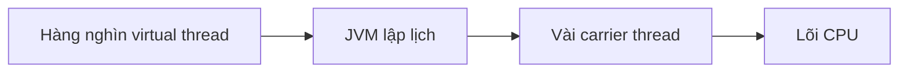
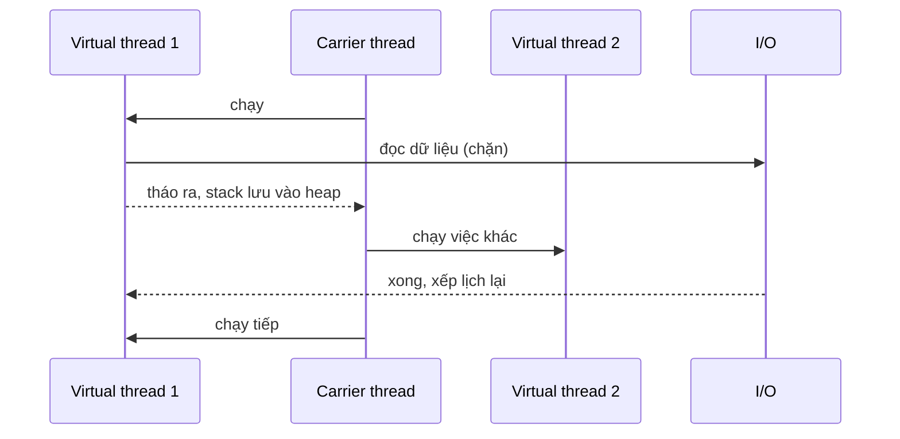
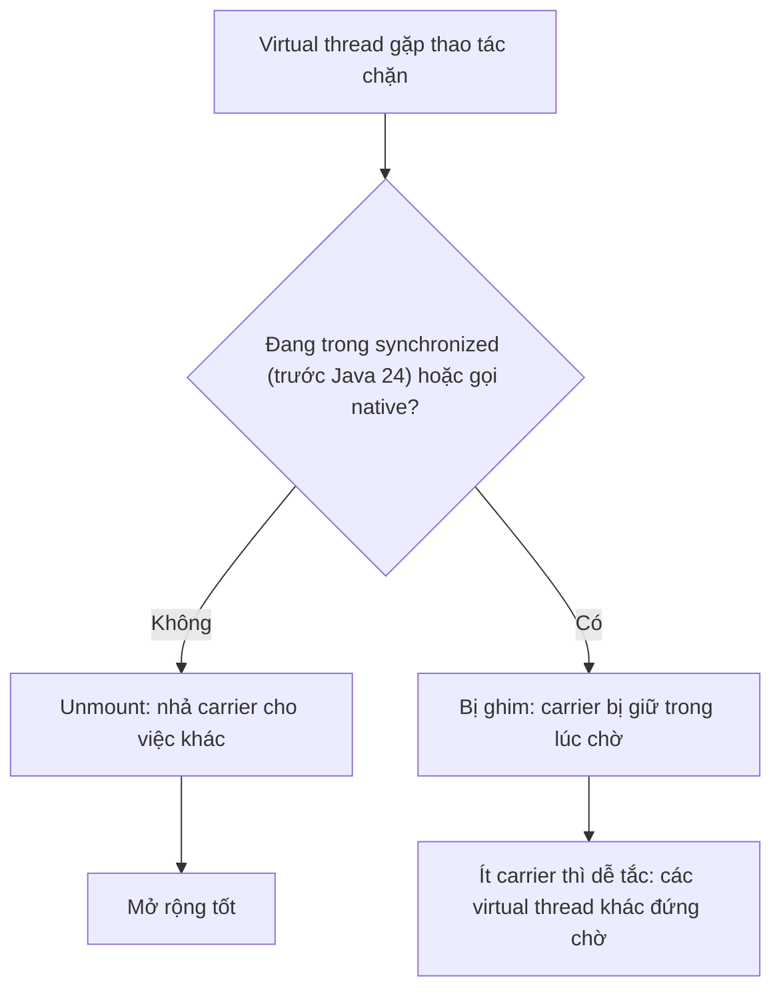
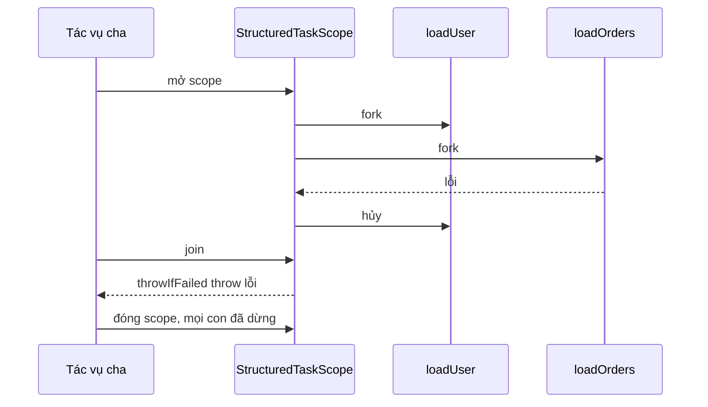

# Lý thuyết 20: Virtual Threads và Structured Concurrency

Virtual thread là loại thread siêu nhẹ do JVM quản lý: hàng nghìn, thậm chí hàng triệu virtual thread có thể chạy chung trên vài thread thật của hệ điều hành. Đi kèm là structured concurrency, một cách tổ chức đồng thời trong đó các tác vụ con được coi là một khối với tác vụ cha: cùng bắt đầu, cùng kết thúc, một cái lỗi thì hủy chung. Bài này giải thích cả hai, vì chúng thường được dùng cùng nhau.

## Vấn đề nó giải quyết

Thread thông thường (gọi là platform thread) ánh xạ 1-1 với thread của hệ điều hành, tốn khoảng 1 MB stack và chỉ tạo được vài nghìn cái. Giả sử server của bạn cần xử lý 10.000 request cùng lúc, mỗi request phần lớn thời gian chỉ chờ DB hay HTTP trả lời. Với mô hình mỗi request một thread, bạn hết thread rất sớm. Cách né trước đây là viết async kiểu callback hoặc reactive: hiệu quả nhưng code khó đọc, stack trace đứt đoạn và khó gỡ lỗi.

Virtual thread cho phép giữ lại cách viết đơn giản (mỗi request một thread, code chặn tuần tự) mà vẫn phục vụ được số lượng cực lớn, vì khi virtual thread chờ I/O, JVM nhả thread thật ra cho việc khác.

Khi nào dùng: app chủ yếu chờ I/O như web server hay gọi nhiều service khác. Khi nào không: việc tính toán nặng CPU thì virtual thread không giúp gì (số lõi vẫn là giới hạn), hãy dùng pool thread thường. Cách dùng: mỗi tác vụ một virtual thread, cứ viết code blocking bình thường, và gom các tác vụ con bằng `StructuredTaskScope` để chúng không bị "mồ côi" khi tác vụ cha xong hoặc lỗi.

**Cốt lõi:** Thread hệ điều hành đắt, nên mô hình mỗi request một thread hết thread rất sớm khi tác vụ chủ yếu chờ I/O. Virtual thread tách thread của code khỏi thread hệ điều hành: khi chặn, JVM chép stack vào heap và nhả carrier cho việc khác.

- Vì stack nằm trên heap và co giãn nên tạo hàng triệu virtual thread chỉ tốn memory theo mức dùng thật.
- Vì số carrier chỉ cỡ số lõi nên tác vụ nặng CPU không nhanh hơn, và code ghim carrier làm mất lợi thế.
- Vì tác vụ con không được sống lâu hơn khối cha nên structured concurrency hủy phần còn lại khi một cái lỗi.



Mô hình tư duy: nhiều tác vụ nhẹ dồn qua ít thread thật, nên chỉ cần chờ I/O là thread thật được trả cho tác vụ khác.

**Tóm tắt:**

- Virtual thread do JVM lập lịch chứ không ánh xạ 1-1 với thread hệ điều hành; khi chặn I/O hay `sleep`, stack được chép vào heap và carrier thread được nhả cho virtual thread khác.
- Nhờ đó giữ được mô hình thread-per-request với code chặn tuần tự mà vẫn phục vụ hàng chục nghìn tác vụ đang chờ; chính thức từ Java 21.
- Mỗi tác vụ một virtual thread, không đặt vào pool; chỉ có lợi cho tác vụ chờ I/O, không giúp tác vụ nặng CPU.
- Tài nguyên hữu hạn (kết nối DB, rate limit) vẫn là giới hạn thật nên phải giới hạn bằng `Semaphore`; virtual thread không có backpressure sẵn.
- Trước Java 24, `synchronized` quanh I/O gây pinning (ghim carrier), nên dùng `ReentrantLock`; phát hiện bằng `-Djdk.tracePinnedThreads=full` hoặc JFR `jdk.VirtualThreadPinned`.
- `ThreadLocal` hoạt động nhưng mỗi virtual thread có bản riêng, tốn memory khi có hàng triệu thread; cân nhắc `ScopedValue`.
- Structured concurrency (`StructuredTaskScope`, preview) buộc lifecycle tác vụ con nằm trong khối cha: một cái lỗi thì hủy các cái còn lại, không có tác vụ mồ côi.

## Các khái niệm cần biết

- **Platform thread**: thread truyền thống, đại diện 1-1 cho thread của hệ điều hành.
- **Virtual thread**: thread do JVM lập lịch, rất rẻ (stack nằm trên heap và co giãn theo nhu cầu).
- **Carrier thread**: platform thread đang "mang" một virtual thread lên chạy. Số carrier mặc định xấp xỉ số lõi CPU.
- **Mount/unmount**: virtual thread được gắn (mount) vào carrier khi chạy và tháo (unmount) khi gặp thao tác chặn như I/O hay `sleep`, nhường carrier cho virtual thread khác.
- **Pinning**: tình huống virtual thread không tháo được khỏi carrier (ví dụ đang trong `synchronized` ở bản trước 24), nên khi chặn I/O nó giữ luôn carrier.
- **Thread-per-request**: mô hình mỗi request một thread, đơn giản nhất nhưng tốn thread.
- **Backpressure**: cơ chế để bên nhận báo cho bên gửi "chậm lại", tránh bên gửi tràn bên nhận. Reactive có sẵn, virtual thread thì phải tự thiết kế (như `Semaphore`).
- **Structured concurrency**: nguyên tắc tác vụ con không sống lâu hơn khối code đã tạo ra chúng.
- **Preview feature**: tính năng đã có nhưng chưa chốt API, phải bật `--enable-preview`.
- **`ScopedValue`**: cách chia sẻ dữ liệu immutable cho tác vụ con, nhẹ hơn `ThreadLocal`.

## Mô hình

Sơ đồ dưới theo dõi một virtual thread từ lúc chạy, bị chặn vì I/O, đến lúc được lập lịch lại.



Hàng trăm nghìn virtual thread chia sẻ một ít **carrier thread** (thread hệ điều hành, xấp xỉ số lõi) do bộ lập lịch ForkJoinPool của JVM quản lý.

Đọc sơ đồ: khi V1 gọi thao tác chặn, JVM chép stack của V1 vào heap rồi trả carrier ra. Carrier không ngồi chờ mà chạy ngay V2. Khi I/O xong, V1 được đưa lại queue và gắn vào một carrier rảnh (không nhất thiết là carrier cũ). Chính cái "nhả carrier khi chờ" này là nguồn gốc khả năng mở rộng.

**Nền tảng:** Virtual thread rẻ vì do JVM lập lịch chứ không ánh xạ 1-1 với thread hệ điều hành: khi chặn I/O hoặc `sleep`, stack được chép vào heap và carrier thread được nhả cho virtual thread khác (unmount). Nhờ đó giữ được mô hình thread-per-request, code chặn tuần tự mà vẫn phục vụ hàng chục nghìn tác vụ đang chờ.

**Suy luận:** Platform thread đắt vì mỗi cái gắn với một thread hệ điều hành và giữ khoảng 1 MB stack, nên một server hết thread trước khi hết CPU khi phần lớn request chỉ chờ DB hay HTTP. Virtual thread bỏ chi phí đó bằng cách tách thread của code khỏi thread của hệ điều hành: stack của nó nằm trên heap và co giãn, nên tạo hàng triệu cái chỉ tốn memory theo mức dùng thật. Khi nó chặn I/O, JVM chép stack vào heap rồi nhả carrier cho virtual thread khác, nên số thread hệ điều hành chỉ cỡ số core. Từ cơ chế đó suy ra hai giới hạn: tác vụ nặng CPU không nhanh hơn vì carrier vẫn là số core, và code nào giữ carrier trong lúc chặn (ghim) làm mất lợi thế. Điểm dễ nhầm là tưởng nhiều thread hơn nghĩa là nhiều DB connection hơn, trong khi pool kết nối vẫn là nút thắt và cần `Semaphore`; hoặc đặt virtual thread vào pool dù chúng rẻ và không cần tái sử dụng. Hãy dùng chúng cho tác vụ chờ I/O, mỗi tác vụ một thread, và giới hạn tài nguyên khan hiếm một cách tường minh.

## Tạo virtual thread (Java 21)

```java
Thread.startVirtualThread(() -> work());

try (var executor = Executors.newVirtualThreadPerTaskExecutor()) {
    List<Future<String>> fs = urls.stream()
        .map(u -> executor.submit(() -> fetch(u)))
        .toList();
    for (var f : fs) System.out.println(f.get());
}
```

## Thực hành: 10.000 tác vụ chờ I/O (cần Java 21)

Mỗi tác vụ giả lập I/O bằng `sleep(1s)`. Chương trình chưa chạy được trong môi trường kiểm tra (chỉ có Java 11), con số bên dưới là **ví dụ minh họa** theo cơ chế, không phải đo thật.

```java
// Bench.java, chạy: java Bench.java   (Java 21)
import java.time.Duration;
import java.util.concurrent.*;
import java.util.stream.IntStream;

public class Bench {
    static void run(String name, ExecutorService ex) throws Exception {
        long t = System.nanoTime();
        // close() chờ mọi tác vụ xong
        try (ex) {
            IntStream.range(0, 10_000).forEach(i -> ex.submit(() -> {
                Thread.sleep(Duration.ofSeconds(1));         // giả lập chờ I/O
                return i;
            }));
        }
        System.out.println(name + ": " + (System.nanoTime() - t) / 1_000_000 + " ms");
    }

    public static void main(String[] args) throws Exception {
        run("platform pool 200 luồng", Executors.newFixedThreadPool(200));
        run("virtual thread        ", Executors.newVirtualThreadPerTaskExecutor());
    }
}
```

```text
# Ví dụ minh họa (chưa đo)
platform pool 200 luồng: ~50000 ms     # 10.000 / 200 = 50 đợt x 1 giây
virtual thread        : ~1100 ms       # cả 10.000 tác vụ chờ song song
```

Phép tính cần nhớ: thời gian của pool cố định = (số tác vụ / kích thước pool) x thời gian chờ. Virtual thread bỏ giới hạn đó vì khi `sleep` hay I/O chặn, nó nhả carrier.

### Thấy pinning bằng mắt

Ép chỉ có 1 carrier để hiệu ứng rõ. Hai tác vụ, mỗi tác vụ ngủ 1 giây trong `synchronized` (lock riêng):

```java
// Pin.java, chạy (Java 21, chưa chạy kiểm chứng):
// java -Djdk.virtualThreadScheduler.parallelism=1 -Djdk.virtualThreadScheduler.maxPoolSize=1 \
//      -Djdk.tracePinnedThreads=full Pin.java
import java.util.concurrent.locks.ReentrantLock;

public class Pin {
    static void synchronizedTask() {
        // ngủ khi đang giữ monitor: GHIM carrier
        synchronized (new Object()) { sleep(); }
    }
    static void lockTask() {
        var l = new ReentrantLock();
        l.lock();
        try { sleep(); } finally { l.unlock(); }   // không ghim: carrier được nhả
    }
    static void sleep() { try { Thread.sleep(1000); } catch (InterruptedException e) { } }

    static void measure(String name, Runnable r) throws Exception {
        long t = System.nanoTime();
        var a = Thread.ofVirtual().start(r);
        var b = Thread.ofVirtual().start(r);
        a.join(); b.join();
        System.out.println(name + ": " + (System.nanoTime() - t) / 1_000_000 + " ms");
    }

    public static void main(String[] args) throws Exception {
        // dự kiến ~2000 ms: nối tiếp trên 1 carrier
        measure("synchronized", Pin::synchronizedTask);
        // dự kiến ~1000 ms: chạy song song
        measure("ReentrantLock", Pin::lockTask);
    }
}
```

Với `tracePinnedThreads=full`, JVM in stack trace có dòng đánh dấu `<== monitors:1` tại frame đang giữ monitor. Từ Java 24 (JEP 491) `synchronized` không còn ghim trong trường hợp này; ghim do gọi native/foreign vẫn còn.

## Quy tắc dùng đúng

| Nên | Không nên |
|---|---|
| **Một virtual thread cho mỗi tác vụ**, tạo thoải mái | Đặt virtual thread vào **pool** (chúng rẻ, không cần tái sử dụng) |
| Viết code chặn tuần tự đơn giản | Dùng cho tác vụ **tính toán CPU nặng** (không nhanh hơn) |
| Giới hạn tài nguyên bằng `Semaphore` | Giả định "nhiều thread hơn" nghĩa là "nhiều DB connection hơn" |
| Dùng lock `ReentrantLock` quanh I/O | `synchronized` quanh I/O (có thể **ghim** thread) ở bản cũ |

**Phải thuộc:** Mỗi tác vụ một virtual thread, không đặt vào pool; chỉ có lợi cho tác vụ chờ I/O, không giúp tác vụ nặng CPU. Giới hạn tài nguyên hữu hạn (kết nối DB, rate limit) bằng `Semaphore`. Virtual thread chính thức từ Java 21; trước Java 24 `synchronized` quanh I/O gây ghim carrier, nên dùng `ReentrantLock`.

## Pinning và giới hạn



Hệ quả thực tế của ghim: nếu mọi carrier đều bị ghim thì mọi virtual thread khác phải chờ, và ứng dụng trông như treo dù CPU rảnh. Cách xử lý ở bản trước 24 là thay `synchronized` quanh đoạn I/O bằng `ReentrantLock`.

- Virtual thread bị **ghim** vào carrier khi đang trong khối `synchronized` (ở các bản trước 24) hoặc gọi native; lúc đó I/O chặn giữ luôn carrier.
- Phát hiện: `-Djdk.tracePinnedThreads=full`; event JFR `jdk.VirtualThreadPinned`.
- Thread dump thường không liệt kê virtual thread; dùng `jcmd <pid> Thread.dump_to_file -format=json dump.json`.
- `ThreadLocal` hoạt động nhưng mỗi virtual thread có bản riêng: với hàng triệu thread sẽ tốn memory; cân nhắc `ScopedValue`.
- Tài nguyên hữu hạn (pool kết nối, rate limit bên ngoài) vẫn là giới hạn thật: dùng `Semaphore`.

## Structured Concurrency (preview, vẫn chưa chính thức ở Java 27)

Tác vụ con **không thể sống lâu hơn** khối cha; lỗi và hủy lan truyền đúng. Vấn đề của cách cũ: bạn `submit` hai tác vụ lên executor, một cái lỗi nhưng cái kia vẫn chạy tiếp tốn tài nguyên, và nếu tác vụ cha kết thúc sớm thì tác vụ con thành "mồ côi" không ai quản. `StructuredTaskScope` buộc lifecycle con nằm gọn trong khối `try`. Chỉ dùng khi bạn cần chạy nhiều tác vụ con parallel rồi gộp kết quả; một lời gọi đơn lẻ thì không cần.



Lưu ý: ở Java 21 API này là preview (cần `--enable-preview`), và hình dạng API có thể thay đổi ở các bản sau, nên kiểm tra tài liệu của đúng phiên bản JDK bạn dùng (ở các bản sau, kể cả Java 25, API vẫn là preview và đã được thiết kế lại với `StructuredTaskScope.open` và `Joiner`, nên đoạn mã dưới đây đúng cho Java 21; kiểm tra lại theo phiên bản).

```java
try (var scope = new StructuredTaskScope.ShutdownOnFailure()) {
    var user  = scope.fork(() -> loadUser(id));
    var order = scope.fork(() -> loadOrders(id));
    // chờ hết; một cái lỗi thì hủy cái còn lại
    scope.join().throwIfFailed();
    return new Dashboard(user.get(), order.get());
}
```

Từ Java 25 API đổi hình dạng: không còn `new ShutdownOnFailure()`, thay bằng factory `open()` kèm chính sách (Joiner). _Minh họa_ (Java 25 trở lên, cần `--enable-preview`, chưa chạy thử):

```java
try (var scope = StructuredTaskScope.open()) {      // mặc định: một tác vụ lỗi thì hủy các tác vụ còn lại
    var user  = scope.fork(() -> loadUser(id));
    var order = scope.fork(() -> loadOrders(id));
    scope.join();                                     // ném lỗi nếu có tác vụ con thất bại
    return new Dashboard(user.get(), order.get());
}
```

**Suy luận:** Structured concurrency áp dụng cho thread cùng nguyên tắc mà khối `try` áp dụng cho tài nguyên: thứ gì được mở trong một phạm vi phải đóng trước khi phạm vi đó kết thúc. Với `submit` lên executor, tác vụ con có lifecycle độc lập với nơi gọi, nên một tác vụ lỗi không làm tác vụ kia dừng và tác vụ cha kết thúc sớm để lại tác vụ mồ côi tốn tài nguyên mà không ai quản. `StructuredTaskScope` buộc mọi tác vụ con nằm trong khối cha, nên khi một cái lỗi hoặc đủ kết quả, scope hủy phần còn lại và chỉ thoát khối khi tất cả đã dừng. Hệ quả là lỗi và hủy lan truyền đúng, stack trace có ý nghĩa vì quan hệ cha con còn nguyên, và không rò thread. Điểm dễ nhầm là coi nó chỉ là `CompletableFuture` viết gọn, trong khi bản chất là ràng buộc về phạm vi sống; API cũng vẫn là preview và đã đổi hình dạng giữa các bản, nên kiểm tra đúng phiên bản JDK trước khi dùng.

Lợi ích so với `CompletableFuture`: không rò thread, stack trace có ý nghĩa, hủy tự động, đọc như code tuần tự.

## ScopedValue: truyền dữ liệu theo phạm vi (chính thức từ Java 25)

`ScopedValue` là bản thay thế cho `ThreadLocal` khi truyền ngữ cảnh (user, trace id) xuống các lời gọi bên dưới: giá trị immutable, chỉ sống trong khối `run`/`call`, tự biến mất khi khối kết thúc nên không cần `remove()` và không rò sang request sau. Rẻ hơn `ThreadLocal` khi có rất nhiều virtual thread. _Minh họa_ (Java 25, chưa chạy thử):

```java
static final ScopedValue<String> USER = ScopedValue.newInstance();

ScopedValue.where(USER, "alice").run(() -> handle());   // trong handle(): USER.get()
```

Không dùng khi cần ghi đè giá trị từ bên trong (nó immutable); lúc đó vẫn là `ThreadLocal` hoặc truyền tham số. Xem thêm [ThreadLocal, Fork/Join và Reference](/go?p=08-Java%2FJava-Core%2Fhard%2Flt-31-threadlocal-forkjoin-reference.md).

## So sánh các mô hình

| | Thread nền tảng | Reactive (WebFlux) | Virtual threads |
|---|---|---|---|
| Phong cách code | Tuần tự | Chuỗi toán tử, callback | **Tuần tự** |
| Số tác vụ đồng thời | Vài nghìn | Rất lớn | Rất lớn |
| Gỡ lỗi, stack trace | Tốt | Khó | **Tốt** |
| Backpressure tích hợp | Không | **Có** | Tự thiết kế |
| Hệ sinh thái | Rộng | Cần thư viện reactive | Dùng lại thư viện chặn |

## Spring Boot

`spring.threads.virtual.enabled=true` (Spring Boot 3.2+) cho Tomcat và các executor dùng virtual threads. Phần đặc thù Spring (Tomcat, Hikari, `@Async`, giới hạn bằng `Semaphore` cho tài nguyên khan hiếm) nằm ở [Spring: Đồng thời và Virtual Threads](/go?p=01-Spring-Boot%2Fhard%2Flt-22-concurrency-virtual-threads.md); bài này là bài gốc về cơ chế virtual thread.

## Phỏng vấn khó: chuỗi hỏi xoáy

Người phỏng vấn senior thường mở bằng câu dễ rồi xoáy xuống cơ chế, đánh đổi và sự cố thật. Câu trả lời tốt luôn đi từ cốt lõi xuống.

### Chuỗi 1: Virtual thread rẻ vì đâu

1. **Câu mở:** Virtual thread khác platform thread ở điểm nào?
2. **Xoáy 1:** Khi virtual thread gọi I/O chặn, chính xác chuyện gì xảy ra với stack và với carrier?
3. **Xoáy 2:** Nếu tác vụ nặng CPU thì sao? Và 10.000 tác vụ `sleep(1s)` chạy trên pool 200 thread mất bao lâu?

**Đáp án ngắn:** Platform thread ánh xạ 1-1 với thread hệ điều hành, tốn khoảng 1 MB stack, nên server hết thread trước khi hết CPU khi phần lớn request chỉ chờ I/O. Virtual thread do JVM lập lịch, stack nằm trên heap và co giãn, nên tạo hàng triệu cái chỉ tốn memory theo mức dùng. Khi gọi I/O chặn, JVM chép stack vào heap (unmount) rồi nhả carrier cho virtual thread khác; I/O xong thì nó được xếp lịch lại và gắn vào một carrier rảnh, không nhất thiết là carrier cũ. Số carrier chỉ cỡ số lõi, nên tác vụ nặng CPU không nhanh hơn. Phép tính pool 200 thread: 10.000 chia 200 được 50 đợt, mỗi đợt 1 giây, tức khoảng 50 giây, còn virtual thread khoảng 1 giây vì cả nhóm chờ song song. Con số trong bài là minh họa, chưa đo thật.

**Sai lầm hay gặp:**
- Nói virtual thread "chạy nhanh hơn" nói chung.
- Đặt virtual thread vào pool.
- Quên rằng chúng chỉ có lợi khi tác vụ chờ I/O.

### Chuỗi 2: Pinning

1. **Câu mở:** Pinning là gì?
2. **Xoáy 1:** Vì sao `synchronized` quanh I/O ghim carrier ở bản trước Java 24, còn `ReentrantLock` thì không?
3. **Xoáy 2:** Ứng dụng trông như treo dù CPU rảnh. Bạn phát hiện và xử lý thế nào, và Java 24 thay đổi gì?

**Đáp án ngắn:** Pinning là khi virtual thread không tháo được khỏi carrier lúc bị chặn, nên nó giữ luôn carrier trong lúc chờ. Ở bản trước Java 24, virtual thread đang trong khối `synchronized` không unmount được, còn `ReentrantLock` thì cho phép nhả carrier. Vì carrier chỉ cỡ số lõi, nếu nhiều virtual thread cùng bị ghim khi chặn I/O thì mọi carrier bị giữ và các virtual thread khác đứng chờ, nên app như treo trong khi CPU rảnh. Phát hiện bằng `-Djdk.tracePinnedThreads=full`, stack trace sẽ có dòng `<== monitors:1`, hoặc event JFR `jdk.VirtualThreadPinned`. Cách sửa là thay `synchronized` quanh đoạn I/O bằng `ReentrantLock`. Từ Java 24 (JEP 491) `synchronized` không còn ghim trong trường hợp này, nhưng ghim do gọi native vẫn còn.

**Sai lầm hay gặp:**
- Nói "synchronized luôn tệ với virtual thread" mà không nêu điều kiện phiên bản.
- Không biết cách phát hiện ghim.
- Quên rằng ghim do native vẫn còn sau Java 24.

### Chuỗi 3: Tài nguyên hữu hạn và structured concurrency

1. **Câu mở:** Bật virtual thread thì ứng dụng có phục vụ được nhiều DB connection hơn không?
2. **Xoáy 1:** Backpressure khác nhau thế nào giữa reactive và virtual thread? Bạn giới hạn tải ra sao?
3. **Xoáy 2:** Structured concurrency giải quyết gì mà `submit` lên executor không giải quyết được?

**Đáp án ngắn:** Không. Pool kết nối DB và rate limit bên ngoài vẫn là giới hạn thật; nhiều thread hơn chỉ nghĩa là nhiều tác vụ cùng xếp hàng chờ chúng. Reactive có backpressure tích hợp, còn virtual thread thì không, nên phải tự thiết kế, thường bằng `Semaphore` quanh tài nguyên khan hiếm. Về structured concurrency: với `submit` lên executor, tác vụ con có vòng đời độc lập, nên một cái lỗi thì cái kia vẫn chạy tốn tài nguyên, và nếu tác vụ cha kết thúc sớm thì tác vụ con thành mồ côi. `StructuredTaskScope` buộc tác vụ con nằm trong khối `try` của cha, một cái lỗi thì hủy phần còn lại, và chỉ thoát khối khi tất cả đã dừng. Lưu ý API vẫn là preview và đã đổi hình dạng giữa các bản, nên kiểm tra lại theo phiên bản JDK.

**Sai lầm hay gặp:**
- Nghĩ nhiều thread hơn thì tự có thêm connection.
- Coi `StructuredTaskScope` chỉ là `CompletableFuture` viết gọn.
- Dùng API preview trong thư viện công khai.

