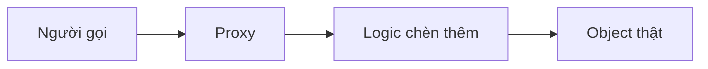
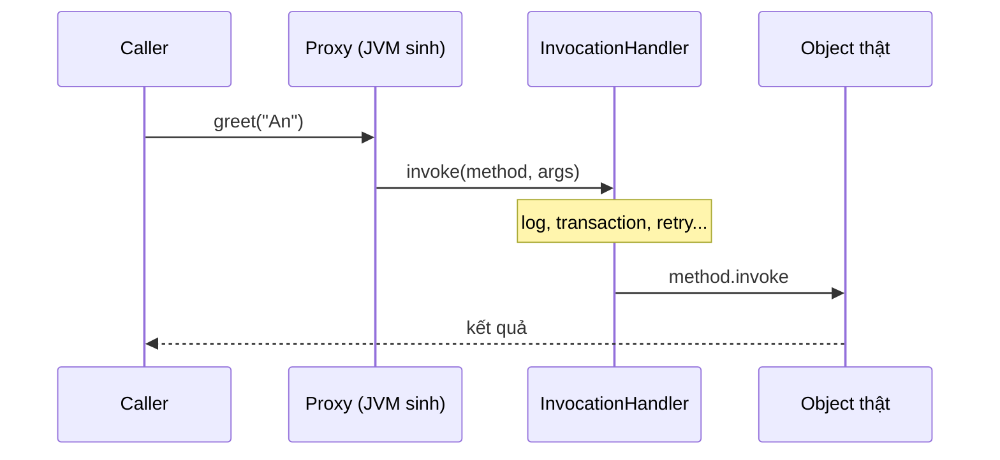
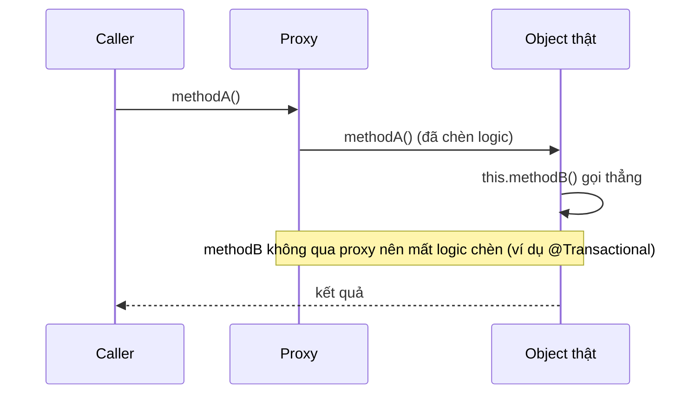
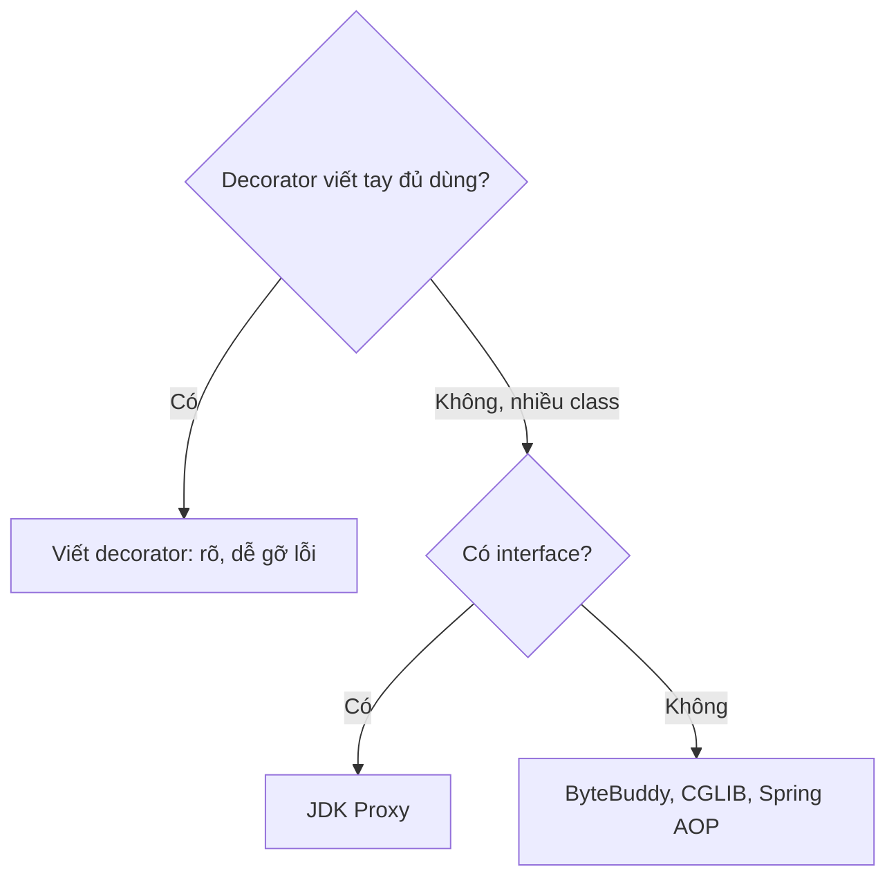

# Lý thuyết 21: Proxy động, MethodHandle và Bytecode

Bài này nói về ba kỹ thuật cho phép code làm việc với chính code: tạo một object "đại diện" (proxy) ngay lúc chạy để chặn các lời gọi method, gọi method qua `MethodHandle`, và sinh hoặc sửa bytecode. Nghe có vẻ xa vời, nhưng bạn đang dùng chúng mỗi ngày mà không hay.

## Vì sao cần những kỹ thuật này

Khi bạn gắn `@Transactional` lên một method, không có dòng code nào của bạn mở và đóng transaction. Việc đó do một proxy làm: Spring tạo ra một object bọc quanh object thật, mở transaction, gọi method thật, rồi commit hoặc rollback. Cùng cơ chế nằm sau AOP, Mockito (tạo mock), Hibernate lazy loading (object chỉ tải dữ liệu khi được hỏi). Nếu không có nó, logging, retry, cache, transaction phải copy-paste vào từng method.

Biết cơ chế cũng giúp hiểu vì sao proxy hay gây lỗi: self-invocation (gọi method trong cùng class mà annotation không có tác dụng), class hoặc method `final` không bọc được, hay exception bị bọc bất ngờ.

Khi nào dùng: khi viết framework, công cụ test, hoặc thư viện xử lý việc cắt ngang (logging, retry, cache). Khi nào không: code nghiệp vụ bình thường không cần tự làm, chỉ cần hiểu để dùng đúng. Lựa chọn theo tình huống: `java.lang.reflect.Proxy` cho trường hợp có interface; class thường thì dùng thư viện sinh bytecode (ByteBuddy, ASM); `MethodHandle` thay reflection khi cần gọi nhanh hơn.

**Cốt lõi:** Để chèn logic cắt ngang như transaction, log, cache mà không sửa từng method, framework đặt một object đại diện cùng kiểu đứng giữa người gọi và object thật. Lời gọi nào đi qua proxy thì được chèn thêm việc, lời gọi nào đi vòng qua nó thì không.

- Vì proxy chỉ chạy khi lời gọi đi qua nó nên gọi nội bộ bằng `this` làm annotation mất tác dụng mà không báo lỗi.
- Vì CGLIB sinh class con còn JDK Proxy chỉ cài interface nên class hay method `final` không bọc được, và JDK Proxy chỉ bắt method của interface.
- Vì `MethodHandle` kiểm tra quyền một lần lúc tạo nên JIT tối ưu được, khác với reflection kiểm tra mỗi lần gọi.



Mô hình tư duy: proxy là cửa duy nhất để logic chèn thêm chạy, nên mọi thứ đi ngoài cửa này đều không được bọc.

**Tóm tắt:**

- Proxy là object đứng giữa người gọi và object thật, cùng interface, nên chèn được logic trước và sau mỗi lời gọi mà không sửa code nghiệp vụ; đây là cơ chế sau `@Transactional`, AOP, mock và lazy loading.
- JDK Proxy cần interface và chỉ bắt method của interface; CGLIB hoặc ByteBuddy sinh class con nên không bọc được class hay method `final` hoặc `private`; Spring Boot mặc định dùng CGLIB.
- Self-invocation (gọi qua `this`) không đi qua proxy nên `@Transactional` mất tác dụng mà không báo lỗi; khắc phục bằng cách tách sang bean khác.
- `Method.invoke` bọc exception của method đích vào `InvocationTargetException`; handler không throw lại `getCause()` thì checked exception thành `UndeclaredThrowableException`.
- `MethodHandle` kiểm tra quyền một lần lúc tạo và JIT inline được khi là hằng, nên nhanh hơn reflection; `invokedynamic` dùng nó cho lambda và nối chuỗi.
- Bytecode có thể sinh hoặc sửa bằng ASM, ByteBuddy, Java Agent hoặc Class-File API; trong sản phẩm hãy dùng Spring AOP hoặc thư viện đã kiểm chứng thay vì tự viết proxy.

## Các khái niệm cần biết

- **Proxy**: object đứng giữa người gọi và object thật, có cùng interface. Mọi lời gọi đi qua nó, nên nó có thể chèn thêm việc trước và sau.
- **Cross-cutting concern**: logic lặp ở nhiều nơi nhưng không thuộc nghiệp vụ chính: log, transaction, bảo mật, cache, retry.
- **AOP (Aspect-Oriented Programming)**: kỹ thuật gom các việc cắt ngang vào một chỗ rồi tự động áp lên nhiều method, thường cài bằng proxy.
- **Reflection**: API (`java.lang.reflect`) để xem và gọi class, method, field lúc chạy. `Method.invoke` thuộc nhóm này.
- **InvocationHandler**: interface có một method `invoke`, nhận mọi lời gọi tới proxy. Đây là nơi bạn viết logic chèn thêm.
- **`MethodHandle`**: reference có kiểu tới một method, gọi nhanh hơn reflection vì kiểm tra quyền một lần và JIT hiểu được.
- **Bytecode manipulation**: sinh hoặc sửa file `.class` lúc chạy hoặc lúc nạp.
- **Java Agent**: JAR chạy trước `main` (qua `-javaagent`) và được can thiệp vào việc nạp class.
- **Self-invocation**: một method gọi method khác của chính object đó qua `this`, nên không đi qua proxy.

## Proxy động của JDK

Vấn đề đặt ra: bạn muốn mọi lời gọi tới một interface đều được đo thời gian, nhưng không muốn sửa từng cài đặt. Cách giải quyết là để JVM sinh một class cài interface đó, mọi method của nó đều chuyển lời gọi vào một `InvocationHandler` duy nhất.

```java
interface Greeter { String greet(String name); }

Greeter real = name -> "Xin chào " + name;

Greeter proxy = (Greeter) Proxy.newProxyInstance(
    Greeter.class.getClassLoader(),
    new Class<?>[]{ Greeter.class },
    (p, method, args) -> {
        long t = System.nanoTime();
        try {
            return method.invoke(real, args);                 // gọi đối tượng thật
        } finally {
            System.out.println(method.getName() + " mất " + (System.nanoTime() - t) + " ns");
        }
    });

proxy.greet("An");
```



## Thực hành: chứng minh self-invocation và bẫy exception

```java
// Px.java, chạy: java Px.java   (đã chạy kiểm chứng trên Java 11)
interface Greeter { String greet(String n); String twice(String n); }

static class Real implements Greeter {
    public String greet(String n) { return "Xin chào " + n; }
    // gọi nội bộ qua this
    public String twice(String n) { return greet(n) + " " + greet(n); }
}
static class Boom implements Greeter {
    public String greet(String n) { throw new IllegalStateException("lỗi thật"); }
    public String twice(String n) { return n; }
}

static Greeter wrap(Greeter real, boolean unwrap) {
    return (Greeter) Proxy.newProxyInstance(Greeter.class.getClassLoader(), new Class<?>[]{Greeter.class},
        (p, m, a) -> {
            System.out.println("  [proxy] -> " + m.getName());
            try { return m.invoke(real, a); }
            catch (InvocationTargetException e) {
                if (unwrap) throw e.getCause();   // đúng: ném lại ngoại lệ gốc
                // sai: người gọi nhận UndeclaredThrowableException
                throw e;
            }
        });
}

// main:
System.out.println(wrap(new Real(), true).twice("An"));
for (boolean unwrap : new boolean[]{false, true}) {
    try { wrap(new Boom(), unwrap).greet("x"); }
    catch (Throwable t) { System.out.println("unwrap=" + unwrap + " -> " + t.getClass().getSimpleName()); }
}
```

```text
  [proxy] -> twice                     # chỉ MỘT dòng log dù twice gọi greet hai lần
Xin chào An Xin chào An
  [proxy] -> greet
unwrap=false -> UndeclaredThrowableException
  [proxy] -> greet
unwrap=true -> IllegalStateException
```

- Handler thấy `twice` mà **không thấy** hai lần `greet` bên trong vì chúng gọi qua `this` (object thật), không qua proxy. Đó chính là self-invocation của `@Transactional`.
- `Method.invoke` luôn bọc exception của method đích vào `InvocationTargetException`. Handler không throw lại `getCause()` thì exception checked không khai báo sẽ thành `UndeclaredThrowableException`: lỗi hay gặp khi tự viết proxy.
- Proxy cũng chặn `toString`/`equals`/`hashCode` của `Object`; handler cần xử lý chúng cẩn thận.

**Nền tảng:** Proxy là object đứng giữa người gọi và object thật, cùng interface, nên chèn được logic trước và sau mỗi lời gọi mà không sửa code nghiệp vụ. Đây là cơ chế sau `@Transactional`, AOP, mock và lazy loading; hệ quả là gọi nội bộ qua `this` không đi qua proxy (self-invocation).

**Suy luận:** Self-invocation làm `@Transactional` mất tác dụng vì annotation chỉ là nhãn, còn việc mở transaction do proxy làm, và proxy chỉ chạy khi lời gọi đi qua nó. Khi code bên ngoài gọi `methodA`, lời gọi đi qua proxy rồi tới object thật; nhưng bên trong object thật, `this` là chính object thật chứ không phải proxy, nên `methodA` gọi `methodB` là lời gọi thẳng và proxy hoàn toàn không thấy. Hệ quả là mọi thứ proxy thêm vào (transaction, cache, retry, bảo mật) biến mất trong lời gọi nội bộ mà không có lỗi hay cảnh báo nào, nên bug này rất khó thấy. Điểm dễ nhầm là cho rằng đặt annotation lên method là đủ, và nó hay bị bỏ sót khi test vì test đơn vị gọi thẳng vào object thật. Cách khắc phục đi từ cơ chế: tách method cần proxy sang bean khác để lời gọi đi qua proxy, hoặc đặt annotation lên method được gọi từ ngoài, và viết một test tích hợp để xác nhận hành vi.

## Giới hạn và lựa chọn

| | JDK Proxy | CGLIB / ByteBuddy |
|---|---|---|
| Yêu cầu | Phải có **interface** | Class không `final` |
| Cách làm | Sinh class cài interface | Sinh **class con** của class đích |
| Hạn chế | Chỉ bắt method của interface | Không bắt method `final`/`private` |
| Dùng bởi | Spring (khi có interface và cấu hình), Retrofit | Spring Boot mặc định, Hibernate, Mockito |

Gọi nội bộ (`this.method()`) **không** đi qua proxy: gốc rễ của bẫy self-invocation trong Spring.



Hệ quả thực tế: `@Transactional` đặt trên `methodB` sẽ không có tác dụng khi `methodB` được gọi từ `methodA` cùng class, và không báo lỗi nào. Cách khắc phục: tách `methodB` sang bean khác và inject vào, hoặc đưa annotation lên `methodA`.

Về lựa chọn: chọn JDK Proxy khi có sẵn interface và bạn kiểm soát được nơi inject theo kiểu interface; chọn CGLIB/ByteBuddy khi class không có interface, nhưng class và method cần bắt không được `final`.

**Phải thuộc:** JDK Proxy cần interface và chỉ bắt method của interface; CGLIB/ByteBuddy sinh class con nên không bọc được class hoặc method `final`/`private`. Spring Boot mặc định dùng CGLIB. Self-invocation làm `@Transactional` mất tác dụng: tách sang bean khác hoặc đưa annotation lên method được gọi từ ngoài.

## MethodHandle

Reflection (`Method.invoke`) kiểm tra quyền truy cập mỗi lần gọi và khó để JIT tối ưu. `MethodHandle` tìm method qua một object `Lookup` (kiểm tra quyền ngay lúc tạo), sau đó gọi được rất nhanh. Dùng khi bạn xây thư viện cần gọi động với hiệu năng cao (serialization, mapping); với code ứng dụng bình thường thì gọi trực tiếp hoặc reflection là đủ.

```java
MethodHandles.Lookup lookup = MethodHandles.lookup();
MethodHandle mh = lookup.findVirtual(String.class, "length", MethodType.methodType(int.class));
int n = (int) mh.invokeExact("xin chào");
```

```java
// Đã chạy kiểm chứng. bindTo gắn sẵn receiver; invokeExact đòi kiểu khớp CHÍNH XÁC
MethodHandle cc = lookup.findVirtual(String.class, "concat", MethodType.methodType(String.class, String.class));
String s = (String) cc.bindTo("xin ").invokeExact("chào");   // "xin chào"
// WrongMethodTypeException: mh trả int, ở đây nhận Object
Object o = mh.invokeExact("abc");
// Dùng invoke() thay invokeExact() nếu muốn JVM tự ép kiểu (chậm hơn một chút)
```

- Kiểm tra quyền **một lần lúc tạo**, không phải mỗi lần gọi như `Method.invoke`.
- JIT có thể inline nếu `MethodHandle` là hằng (`static final`): gần nhanh bằng gọi trực tiếp.
- `invokedynamic` dùng `MethodHandle` để liên kết lúc chạy: nền tảng của lambda và nối chuỗi.

**Suy luận:** `MethodHandle` nhanh hơn `Method.invoke` vì chi phí được chuyển từ mỗi lần gọi sang một lần lúc tạo. Reflection kiểm tra quyền, đóng gói tham số thành array và bọc exception ở mỗi lần gọi, nên JIT khó nhìn xuyên qua để tối ưu. `MethodHandle` thì tìm method qua `Lookup`, kiểm tra quyền ngay lúc tạo, và là object có kiểu đủ rõ để JIT inline khi nó được giữ trong `static final`, gần như nhanh bằng gọi trực tiếp. Đó cũng là lý do `invokedynamic` dùng `MethodHandle` để nối lambda và nối chuỗi lúc chạy. Điểm dễ nhầm là cầm một `MethodHandle` ở biến thường rồi kỳ vọng nhanh: lúc đó JIT không coi nó là hằng nên mất lợi thế. Hãy cache handle trong `static final`, chỉ dùng khi xây thư viện cần gọi động hiệu năng cao, và với code ứng dụng thì gọi trực tiếp.

## Sinh và sửa bytecode

| Công cụ | Mức |
|---|---|
| **ASM** | Thấp, thao tác từng lệnh bytecode |
| **ByteBuddy** | Cao, API thuận tiện (Mockito, nhiều agent) |
| **Java Agent** (`-javaagent`) | Can thiệp lúc nạp class: APM, profiler, coverage |
| **Class-File API** (chính thức từ Java 24, preview ở 22 và 23) | API chuẩn của JDK để đọc/ghi class file |

## Khi nào nên dùng



## Cảnh báo

- Proxy khiến stack trace dài và khó đọc; `getClass()` trả class proxy, `equals`/`hashCode`/`toString` cũng đi qua handler.
- Mã sinh động khó phân tích tĩnh, khó với native image: cần cấu hình đăng ký.
- Tự viết proxy chỉ để hiểu cơ chế; trong sản phẩm dùng Spring AOP hoặc thư viện đã kiểm chứng.

## Phỏng vấn khó: chuỗi hỏi xoáy

Người phỏng vấn senior thường mở bằng câu dễ rồi xoáy xuống cơ chế, đánh đổi và sự cố thật. Câu trả lời tốt luôn đi từ cốt lõi xuống.

### Chuỗi 1: Self-invocation và `@Transactional`

1. **Câu mở:** `@Transactional` hoạt động nhờ cơ chế gì?
2. **Xoáy 1:** `methodA` gọi `methodB` cùng class, `@Transactional` đặt trên `methodB`. Vì sao nó không có tác dụng?
3. **Xoáy 2:** Không có lỗi hay cảnh báo nào, và test đơn vị vẫn xanh. Vì sao, và bạn sửa thế nào?

**Đáp án ngắn:** Annotation chỉ là nhãn, việc mở và đóng transaction do một proxy làm: proxy bọc quanh object thật, mở transaction, gọi method thật rồi commit hoặc rollback. Proxy chỉ chạy khi lời gọi đi qua nó. Bên ngoài gọi `methodA` thì đi qua proxy tới object thật, nhưng trong object thật `this` là chính object thật chứ không phải proxy, nên `methodA` gọi `methodB` là lời gọi thẳng và proxy không thấy. Bài thực hành trong file cho thấy handler chỉ log `twice` một lần dù nó gọi `greet` hai lần. Mọi thứ proxy thêm, như transaction, cache, retry, biến mất mà không có lỗi nào. Test đơn vị hay gọi thẳng vào object thật nên không bắt được. Cách sửa: tách `methodB` sang bean khác để lời gọi đi qua proxy, hoặc đặt annotation lên `methodA`, và viết một test tích hợp để xác nhận.

**Sai lầm hay gặp:**
- Nói "annotation đặt trên method là đủ".
- Không giải thích được `this` khác proxy ở chỗ nào.
- Không nhắc tới việc test đơn vị che mất lỗi.

### Chuỗi 2: JDK Proxy và CGLIB

1. **Câu mở:** JDK Proxy khác CGLIB ở đâu?
2. **Xoáy 1:** Vì sao class hoặc method `final` không bọc được, còn method `private` thì sao?
3. **Xoáy 2:** Proxy ảnh hưởng gì tới `getClass()`, `equals`, `hashCode` và stack trace?

**Đáp án ngắn:** JDK Proxy sinh một class cài interface, nên cần interface và chỉ bắt method của interface. CGLIB hay ByteBuddy sinh class con của class đích, nên không cần interface nhưng class phải không `final`. Cơ chế quyết định giới hạn: class con không thể override method `final` hay `private`, nên lời gọi tới chúng đi thẳng vào code gốc và không được bọc; class `final` thì không kế thừa được. Spring Boot mặc định dùng CGLIB. Về tác dụng phụ, `getClass()` trả về class proxy chứ không phải class gốc, `equals`, `hashCode`, `toString` cũng đi qua handler nên handler phải xử lý cẩn thận, và stack trace dài khó đọc. Mã sinh động còn khó phân tích tĩnh và cần cấu hình đăng ký với native image. Nếu một decorator viết tay là đủ thì nên viết tay vì rõ ràng và dễ gỡ lỗi.

**Sai lầm hay gặp:**
- Nhầm "CGLIB cần interface".
- Không nhắc giới hạn `final` và `private`.
- Tự viết proxy trong sản phẩm thay vì dùng Spring AOP hoặc thư viện đã kiểm chứng.

### Chuỗi 3: Reflection, MethodHandle và exception

1. **Câu mở:** `MethodHandle` khác `Method.invoke` ở điểm nào?
2. **Xoáy 1:** Vì sao nó nhanh hơn, và điều kiện nào để JIT inline được?
3. **Xoáy 2:** Trong handler tự viết, bạn gọi `method.invoke` và đối tượng thật ném exception. Người gọi nhận gì, và `invokeExact` hay làm sai ở đâu?

**Đáp án ngắn:** `MethodHandle` chuyển chi phí từ mỗi lần gọi sang một lần lúc tạo. Reflection kiểm tra quyền, đóng gói tham số thành array và bọc exception ở mỗi lần gọi, nên JIT khó nhìn xuyên qua. `MethodHandle` tìm method qua `Lookup`, kiểm tra quyền lúc tạo, và khi được giữ trong `static final` thì JIT inline được, gần bằng gọi trực tiếp; để ở biến thường thì mất lợi thế. Về exception, `Method.invoke` luôn bọc lỗi của method đích vào `InvocationTargetException`. Handler không throw lại `getCause()` thì checked exception không khai báo biến thành `UndeclaredThrowableException` ở phía người gọi, như bài thực hành đã chạy. `invokeExact` đòi kiểu khớp chính xác, nhận `int` vào `Object` sẽ ra `WrongMethodTypeException`; dùng `invoke` nếu muốn tự ép kiểu, chậm hơn một chút.

**Sai lầm hay gặp:**
- Nói "MethodHandle nhanh hơn" mà không nêu `static final`.
- Quên `InvocationTargetException` và `getCause()`.
- Dùng `MethodHandle` cho code ứng dụng thường, nơi gọi trực tiếp là đủ.

