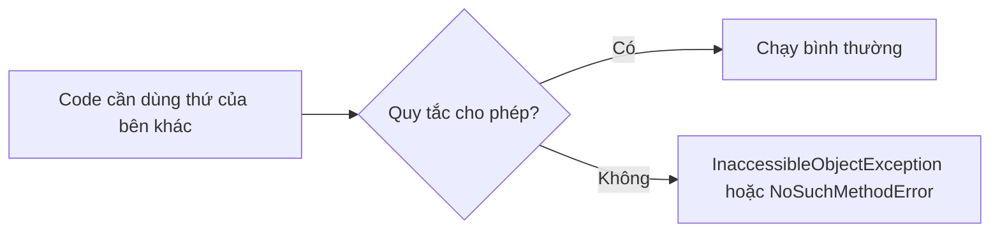
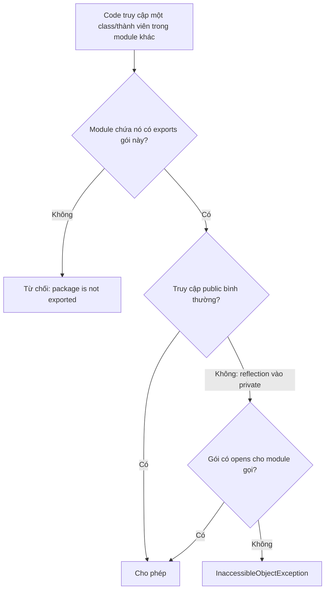
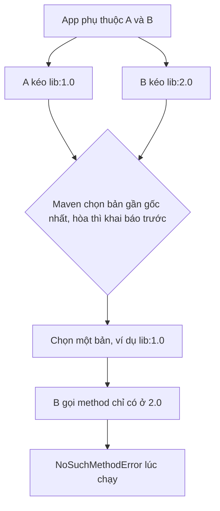

# Lý thuyết 22: Module, Phiên bản Java và Hệ sinh thái build

Làm một project Java thật, bạn sẽ luôn đụng tới ba thứ đi chung với nhau: hệ thống module của Java (JPMS), lộ trình phiên bản cùng khái niệm bản LTS, và build tool cùng việc quản lý dependency. Bài này giải thích từng thứ là gì và khi nào chúng gây rắc rối.

## Vì sao ba thứ này hay gây đau đầu

Nâng lên Java 17 trở lên là gặp ngay lỗi reflection kiểu "module does not open package", vì JDK đã đóng chặt phần ruột bên trong. Chọn sai phiên bản thì mất hỗ trợ cập nhật bảo mật hoặc kẹt ở thư viện không chạy được trên bản mới. Dependency không được quản lý tốt thì mỗi thư viện kéo về một version khác nhau của cùng thư viện con, sinh ra "dependency hell" và các lỗi lúc chạy như `NoSuchMethodError`.

Bạn cần nắm khi nâng cấp phiên bản Java, đóng gói thư viện, hoặc xử lý xung đột dependency. App thường không cần tự viết `module-info.java`, nhưng vẫn phải đọc hiểu được các lỗi liên quan. Nguyên tắc làm việc: đọc `module-info.java` khi gặp, chỉ dùng `--add-opens` khi hiểu rõ lý do, quản lý version bằng BOM và xem dependency tree để tìm chỗ xung đột.

**Cốt lõi:** Module, phiên bản và build tool đều là các quy tắc quyết định thứ gì được dùng và bản nào được chọn. Khi nâng cấp mà vỡ, thường là một trong các quy tắc này đang chặn bạn chứ không phải lỗi ngẫu nhiên.

- Vì JPMS giấu mọi gói không `exports` nên reflection vào `private` chỉ được khi gói `opens`, và Java 17 từ chối reflection vào ruột JDK.
- Vì Maven chỉ giữ một bản cho mỗi thư viện, chọn bản gần gốc nhất chứ không phải mới nhất, nên có thể gặp `NoSuchMethodError` lúc chạy.
- Vì chỉ bản LTS được hỗ trợ dài hạn nên production chọn LTS và nâng từng bậc.



Mô hình tư duy: mọi truy cập đều qua một cổng quy tắc, và lỗi lúc nâng cấp là dấu hiệu bị cổng này từ chối.

**Tóm tắt:**

- Bản Java mới ra mỗi 6 tháng, LTS từ Java 17 trở đi cứ 2 năm một lần (17, 21, 25; trước đó là 8 và 11, cách nhau 3 năm); production chọn LTS và nâng từng bậc, đọc kỹ ghi chú loại bỏ.
- Tính năng preview cần `--enable-preview` và API có thể đổi, nên không dùng cho thư viện công khai.
- JPMS giấu mọi gói không `exports`, và chỉ cho reflection vào `private` với gói được `opens`; vì vậy từ Java 17 reflection vào ruột JDK bị từ chối (`InaccessibleObjectException`).
- `--add-opens` chỉ là biện pháp tạm; cách đúng là nâng cấp thư viện, đừng rải khắp nơi cho "hết lỗi".
- Phần lớn ứng dụng Spring chạy trên classpath (module không tên) và không cần `module-info`; JPMS hữu ích cho thư viện lớn và `jlink`.
- Khi hai nhánh kéo hai phiên bản của cùng thư viện, Maven chọn bản gần gốc nhất theo độ sâu chứ không phải bản mới nhất, nên có thể gặp `NoSuchMethodError` lúc chạy; sửa bằng `dependencyManagement` hoặc BOM.
- `ServiceLoader` cho phép cắm cài đặt vào sau mà không sửa code gọi (JDBC driver, SLF4J, plugin).

## Các khái niệm cần biết

- **LTS (Long-Term Support)**: bản Java được vá lỗi và bảo mật nhiều năm. Các bản còn lại chỉ được hỗ trợ khoảng 6 tháng.
- **JPMS (Java Platform Module System)**: hệ thống module từ Java 9. Mỗi module khai báo nó cần module nào và công khai gói nào, nên các gói còn lại bị ẩn khỏi bên ngoài (strong encapsulation).
- **Module path và classpath**: hai cách JVM tìm code. Module path tuân thủ luật module; classpath là cách cũ, mọi thứ vào chung "module không tên".
- **Reflection sâu**: dùng `setAccessible(true)` để đọc/ghi thành viên `private`. Thư viện như Jackson, Hibernate cần nó; module phải `opens` mới cho phép.
- **Automatic module**: JAR không có `module-info` nhưng nằm trên module path, JVM tự coi nó là module với tên suy ra từ tên file.
- **Transitive dependency**: thư viện A dùng B, bạn dùng A thì B tự được kéo vào dù bạn không khai báo.
- **BOM (Bill of Materials)**: một POM chỉ để liệt kê version đồng bộ cho cả bộ thư viện, bạn import vào là khỏi tự ghi version từng cái.
- **SBOM (Software Bill of Materials)**: danh sách thành phần phần mềm của sản phẩm, dùng để truy vết lỗ hổng.
- **ServiceLoader**: cơ chế JDK tìm cài đặt của một interface lúc chạy mà không cần `new` trực tiếp.

## Phiên bản và LTS

| Bản LTS | Tính năng tiêu biểu |
|---|---|
| 8 | LTS cũ: lambda, Stream |
| 11 | HTTP client chuẩn (`var` đã có từ 10) |
| 17 | record, sealed, text block |
| 21 | virtual threads, pattern matching cho `switch` |
| 25 | LTS kế tiếp |

- Bản mới ra mỗi 6 tháng; **LTS** (hỗ trợ dài hạn) cứ 2 năm một lần (17, 21, 25).
- Production chọn LTS; nâng cấp từng bậc LTS và đọc ghi chú **loại bỏ** (removed/deprecated).
- Tính năng **preview** cần cờ `--enable-preview`, API có thể thay đổi: không dùng cho thư viện công khai.

**Phải thuộc:** Bản Java mới ra mỗi 6 tháng; LTS từ Java 17 trở đi cứ 2 năm một lần (17, 21, 25; trước đó là 8 và 11, cách nhau 3 năm). Production chọn LTS. Tính năng preview cần `--enable-preview` và API có thể đổi.

## JPMS (module)

```java
module com.example.app {
    requires java.sql;
    requires com.example.core;
    exports com.example.app.api;                 // chỉ gói này công khai
    // cho phép reflection
    opens com.example.app.model to com.fasterxml.jackson.databind;
}
```

| Từ khóa | Ý nghĩa |
|---|---|
| `requires` | Phụ thuộc module khác |
| `exports` | Công khai gói cho module khác dùng |
| `opens` | Cho phép reflection sâu vào gói (kể cả `private`) |
| `provides ... with` / `uses` | Cơ chế dịch vụ (ServiceLoader) |

Mỗi lần code (hoặc thư viện) truy cập một thành viên của module khác, JVM kiểm tra theo flow sau:



Từ Java 26, dùng deep reflection để sửa field `final` còn bị cảnh báo (JEP 500); nên bỏ thói quen đó trước khi bản sau chặn hẳn.

Lỗi hay gặp từ Java 17: `InaccessibleObjectException: ... module java.base does not "opens java.lang"`. Cách xử lý tạm: `--add-opens java.base/java.lang=ALL-UNNAMED`; cách đúng là nâng cấp thư viện. Không nên rải `--add-opens` khắp nơi cho tới khi "hết lỗi", vì bạn đang tắt chính cơ chế bảo vệ của JDK và có thể vỡ lại khi nâng bản sau.

**Nền tảng:** JPMS encapsulation mạnh: module chỉ lộ các gói được `exports`, và chỉ cho reflection vào `private` với gói được `opens`. Vì vậy từ Java 17 reflection vào phần ruột của JDK bị từ chối (`InaccessibleObjectException`); `--add-opens` chỉ là biện pháp tạm, cách đúng là nâng cấp thư viện.

**Suy luận:** JDK đóng chặt phần ruột từ Java 9 vì trước đó mọi thư viện đều có thể dùng `setAccessible(true)` để đọc hay sửa thành viên `private` của JDK, nên JDK không thể đổi cài đặt nội bộ mà không làm vỡ ai đó. JPMS đảo ngược mặc định: một module chỉ lộ các gói nó `exports`, còn reflection vào `private` chỉ được nếu gói đó `opens`. Java 9 đến 16 còn nới bằng `--illegal-access` để mọi người kịp chuyển, và Java 17 bỏ cờ này nên mặc định thành từ chối, đó là lý do nâng lên 17 thì thư viện cũ như Jackson hay Hibernate bắt đầu ném `InaccessibleObjectException`. Từ đó suy ra `--add-opens` là mở lại một lỗ hổng cố ý, và nên là biện pháp tạm; cách đúng là nâng thư viện lên bản đã tương thích. Điểm dễ nhầm là rải `--add-opens` cho tới khi hết lỗi, vì bạn tắt đi chính cơ chế bảo vệ và có thể vỡ lại ở lần nâng cấp sau. Hãy liệt kê chính xác cặp (module, gói) cần mở và ghi chú lý do, đồng thời lập kế hoạch nâng thư viện.

### Thực hành: tái hiện lỗi `opens` và module có ServiceLoader

```java
// Ref.java, chạy: java --illegal-access=deny Ref.java   (Java 11; từ Java 17 mặc định đã là deny, cờ này bị bỏ)
Field f = String.class.getDeclaredField("value");
f.setAccessible(true);      // phá đóng gói của java.base
```

```text
# Không cờ gì (Java 17) hoặc --illegal-access=deny (Java 11), đã chạy:
InaccessibleObjectException: Unable to make field private final byte[] java.lang.String.value accessible: module java.base does not "opens java.lang" to unnamed module @5e955596
# Thêm --add-opens java.base/java.lang=ALL-UNNAMED: setAccessible thành công
```

Module hoàn chỉnh nhỏ nhất dùng `provides`/`uses` (đã biên dịch và chạy trên Java 11 qua `--module-source-path`):

```text
src/app/module-info.java      src/app/demo/Greeter.java
src/app/demo/Main.java        src/app/impl/Hi.java
```

```java
// module-info.java
module app {
    exports demo;                       // impl KHÔNG được export: ẩn với module khác
    uses demo.Greeter;
    provides demo.Greeter with impl.Hi;
}
// Main.java: for (Greeter g : ServiceLoader.load(Greeter.class)) System.out.println(g.greet());
```

```bash
javac -d out --module-source-path src -m app
java -p out -m app/demo.Main          # in: hi từ ServiceLoader
```

Điểm cần nhớ: người dùng chỉ phụ thuộc interface được `exports`, cài đặt `impl.Hi` ẩn hoàn toàn nhưng vẫn được tìm thấy qua `provides`. Trên classpath thì thay `provides` bằng file `META-INF/services/demo.Greeter` chứa tên class cài đặt.

Phần lớn ứng dụng Spring chạy ở **classpath** (module không tên), không cần `module-info`. JPMS hữu ích cho thư viện lớn và đóng gói runtime nhỏ bằng `jlink`.

## Build và phụ thuộc

| Chủ đề | Điều cần nắm |
|---|---|
| Maven / Gradle | Lifecycle build, plugin, scope (`compile`, `runtime`, `test`, `provided`) |
| Transitive dependency | Thư viện kéo theo thư viện khác; xem `mvn dependency:tree` |
| Xung đột phiên bản | Maven chọn bản "gần nhất"; dùng `dependencyManagement`/**BOM** để cố định đồng bộ |
| Tái lập build | Ghim phiên bản, không dùng `LATEST`/khoảng phiên bản lỏng |
| Bảo mật chuỗi cung ứng | Quét lỗ hổng (OWASP Dependency-Check), SBOM |

Sơ đồ dưới cho thấy Maven xử lý xung đột phiên bản và vì sao có thể ra `NoSuchMethodError`:



Cách chữa: ép bản đúng qua `dependencyManagement` hoặc import BOM, rồi chạy lại `mvn dependency:tree` để xác nhận.

**Suy luận:** Maven chọn bản "gần gốc nhất" vì nó cần một quy tắc xác định để giải quyết mâu thuẫn mà không bắt bạn lựa chọn thủ công, và nó coi dependency khai báo gần dự án của bạn là có chủ đích hơn dependency bắc cầu ở sâu. Quy tắc này đơn giản và ổn định, nhưng không đảm bảo bản được chọn đủ mới cho mọi thư viện kéo nó: nếu thư viện X cần method có ở bản 2.0 mà Maven chọn 1.5 vì gần gốc hơn, code compile được nhưng lúc chạy sẽ nổ `NoSuchMethodError`. Vì lỗi nằm ở lúc chạy và chỉ ở nhánh gọi method thiếu, nó rất dễ lọt qua test. Điểm dễ nhầm là tin Maven luôn lấy bản mới nhất. Muốn kiểm soát, hãy ép bản đúng qua `dependencyManagement` hoặc import BOM, rồi chạy `mvn dependency:tree` để xác nhận ai kéo bản nào, và ghim phiên bản để build tái lập được.

**Phải thuộc:** Khi hai nhánh kéo hai phiên bản của cùng một thư viện, Maven chọn bản gần gốc nhất theo độ sâu (hòa thì khai báo trước thắng), không phải bản mới nhất; bản được chọn có thể thiếu method gây `NoSuchMethodError` lúc chạy. `exports` cho truy cập `public`; `opens` cho reflection vào cả `private`.

## ServiceLoader

Cơ chế tìm cài đặt interface lúc chạy qua `META-INF/services` hoặc `provides`; nền tảng của JDBC driver, SLF4J binding, nhiều plugin. Lý do cần: mã gọi chỉ biết interface, còn cài đặt cụ thể (driver nào, provider nào) được cắm vào sau mà không phải sửa code gọi. Dùng khi bạn xây hệ thống plugin; nếu app đã dùng Spring thì dependency injection thường đủ.

```java
ServiceLoader<PaymentProvider> loader = ServiceLoader.load(PaymentProvider.class);
for (PaymentProvider p : loader) register(p);
```

## Bẫy hay hỏi

| Câu hỏi | Ý chính |
|---|---|
| Xung đột version: Maven chọn bản nào | "Gần nhất" theo độ sâu trong cây, hòa thì khai báo trước thắng; **không** phải bản mới nhất. Bản được chọn có thể thiếu method mà thư viện khác cần: `NoSuchMethodError` lúc chạy |
| Tìm ai kéo bản nào | `mvn dependency:tree -Dverbose -Dincludes=group:artifact` |
| `opens` khác `exports` | `exports` chỉ cho truy cập `public` lúc biên dịch và chạy; `opens` cho reflection vào cả thành viên `private` lúc chạy |
| Classpath và module path trộn | Jar trên module path không có `module-info` thành *automatic module*, tên suy ra từ tên file: dễ vỡ |
| Kiểm tra module đang có | `java --list-modules`, `java --describe-module java.sql`, `jdeps --print-module-deps app.jar` (liệt kê module JDK cần cho `jlink`) |

## Checklist nâng cấp phiên bản Java

1. Chạy test trên bản mới và đọc kỹ cảnh báo. Lưu ý cờ `--illegal-access` (từng cho phép reflection vào JDK ở Java 9 đến 16) đã bị bỏ từ Java 17, nay mặc định là từ chối.
2. Nâng cấp thư viện dùng reflection/bytecode (ASM, ByteBuddy, Lombok, Mockito).
3. Kiểm tra flag JVM đã bị loại.
4. Đo lại hiệu năng và GC.
5. Cập nhật CI và image container.

## Phỏng vấn khó: chuỗi hỏi xoáy

Người phỏng vấn senior thường mở bằng câu dễ rồi xoáy xuống cơ chế, đánh đổi và sự cố thật. Câu trả lời tốt luôn đi từ cốt lõi xuống.

### Chuỗi 1: Xung đột version và `NoSuchMethodError`

1. **Câu mở:** App phụ thuộc A và B, A kéo `lib:1.0`, B kéo `lib:2.0`. Maven chọn bản nào?
2. **Xoáy 1:** Vì sao code compile được mà lúc chạy mới nổ `NoSuchMethodError`?
3. **Xoáy 2:** Bạn tìm ai kéo bản nào và sửa ra sao? Nếu hai nhánh sâu bằng nhau thì sao?

**Đáp án ngắn:** Maven không lấy bản mới nhất mà chọn bản gần gốc nhất theo độ sâu trong cây dependency. Nếu hòa độ sâu thì khai báo trước thắng. Nó cần một quy tắc xác định để giải mâu thuẫn mà không bắt bạn chọn tay, và coi dependency gần dự án là có chủ đích hơn. Cái giá là bản được chọn có thể thiếu method mà thư viện khác cần: B được biên dịch với `lib:2.0` nên gọi method chỉ có ở 2.0, nhưng lúc chạy classpath chỉ có `lib:1.0`, nên `NoSuchMethodError` chỉ nổ ở nhánh code gọi tới method đó và dễ lọt qua test. Để điều tra dùng `mvn dependency:tree -Dverbose -Dincludes=group:artifact` xem ai kéo bản nào. Sửa bằng cách ép bản đúng qua `dependencyManagement` hoặc import BOM, chạy lại tree để xác nhận, và ghim version để build tái lập được.

**Sai lầm hay gặp:**
- Nói "Maven luôn lấy bản mới nhất".
- Đổi version lung tung cho tới khi hết lỗi mà không xem cây dependency.
- Không giải thích được vì sao lỗi chỉ lộ lúc chạy.

### Chuỗi 2: `opens`, `exports` và nâng lên Java 17

1. **Câu mở:** Nâng ứng dụng lên Java 17 thì thư viện cũ ném `InaccessibleObjectException`. Vì sao?
2. **Xoáy 1:** `exports` khác `opens` thế nào, và vì sao Jackson hay Hibernate cần `opens`?
3. **Xoáy 2:** Đồng nghiệp rải `--add-opens` khắp nơi cho hết lỗi. Bạn nghĩ gì?

**Đáp án ngắn:** Trước Java 9 mọi thư viện đều dùng `setAccessible(true)` đọc hay sửa được thành viên `private` của JDK, nên JDK không đổi được cài đặt nội bộ mà không làm vỡ ai đó. JPMS đảo mặc định: module chỉ lộ gói nó `exports`, và chỉ cho reflection vào `private` nếu gói được `opens`. Java 9 đến 16 còn nới bằng `--illegal-access` cho người dùng kịp chuyển; Java 17 bỏ cờ này nên mặc định là từ chối. `exports` cho truy cập `public` lúc biên dịch và chạy; `opens` cho reflection sâu, thứ mà Jackson hay Hibernate cần để đọc field `private`. `--add-opens` là mở lại một lỗ hổng cố ý, chỉ nên là biện pháp tạm. Cách đúng là nâng thư viện lên bản tương thích, và nếu phải mở thì liệt kê chính xác cặp (module, gói) kèm lý do, vì rải khắp nơi là tắt cơ chế bảo vệ và có thể vỡ lại ở lần nâng sau.

**Sai lầm hay gặp:**
- Coi `opens` và `exports` là một.
- Dùng `--add-opens` như thuốc chữa mọi lỗi.
- Không biết lý do lịch sử của `--illegal-access`.

### Chuỗi 3: Chọn phiên bản và `ServiceLoader`

1. **Câu mở:** Production nên chọn bản Java nào và nâng cấp ra sao?
2. **Xoáy 1:** Preview là gì và vì sao không dùng cho thư viện công khai?
3. **Xoáy 2:** App Spring của bạn có cần `module-info` không? `ServiceLoader` tìm cài đặt bằng cách nào?

**Đáp án ngắn:** Production chọn bản LTS, vì chỉ LTS được vá lỗi và bảo mật nhiều năm; các bản còn lại chỉ hỗ trợ khoảng 6 tháng. LTS từ 17 trở đi cứ 2 năm một lần (17, 21, 25), và nên nâng từng bậc, đọc ghi chú loại bỏ, nâng thư viện dùng reflection hoặc bytecode, kiểm tra flag JVM đã bị bỏ, đo lại hiệu năng và GC. Tính năng preview cần `--enable-preview` và API có thể đổi giữa các bản, nên dùng trong thư viện công khai sẽ làm người dùng vỡ. Phần lớn app Spring chạy ở classpath (module không tên) nên không cần `module-info`; JPMS hữu ích cho thư viện lớn và `jlink`. `ServiceLoader` cho phép cắm cài đặt vào sau mà code gọi chỉ biết interface: tìm qua `provides ... with` trong module hoặc file `META-INF/services` trên classpath. JDBC driver và SLF4J dùng cách này.

**Sai lầm hay gặp:**
- Chọn bản không phải LTS cho production mà không có lý do.
- Nhảy nhiều bậc LTS một lần.
- Nói mọi app đều phải viết `module-info`.

