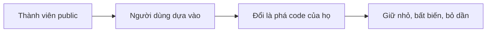
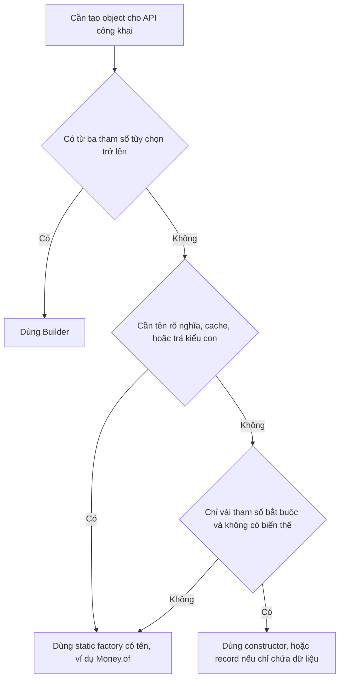
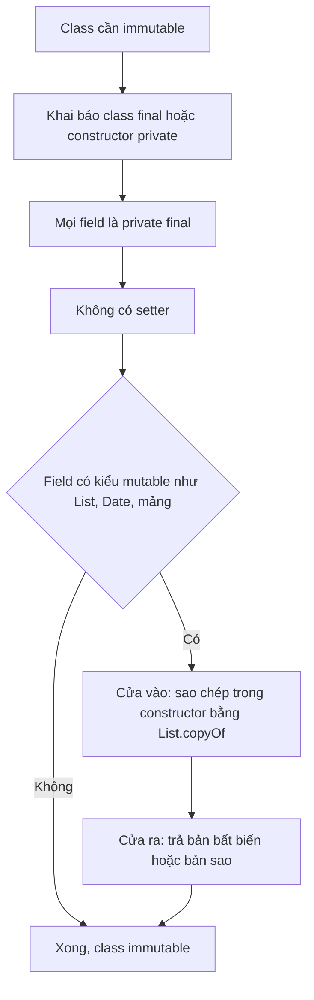
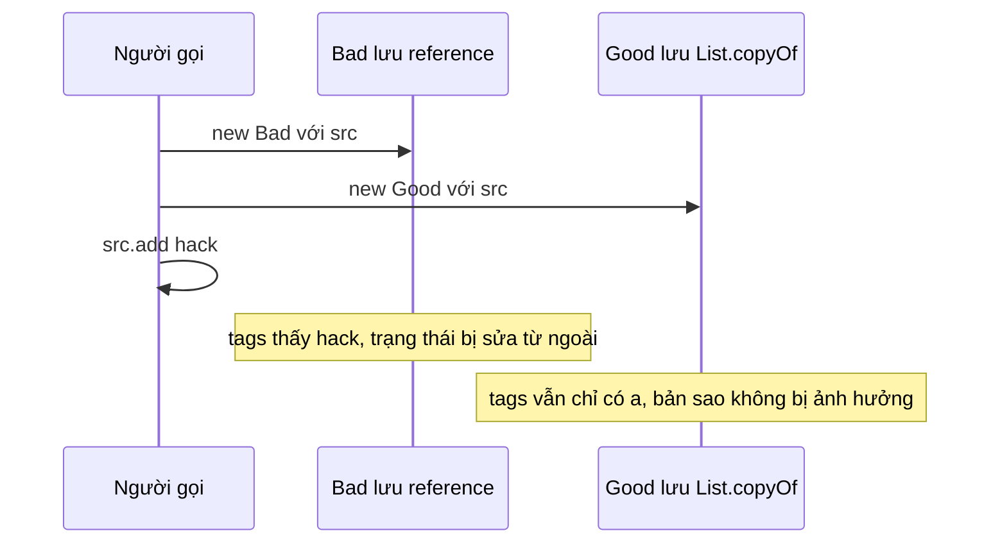
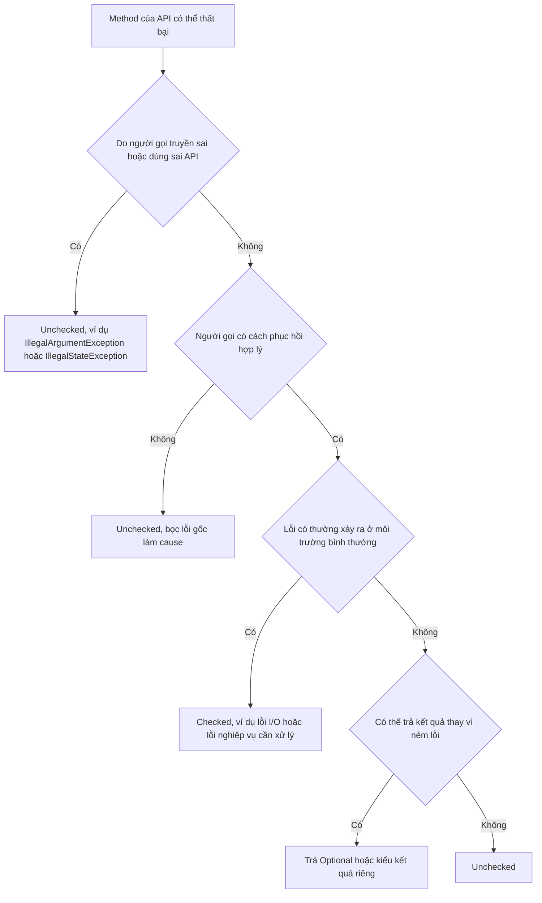
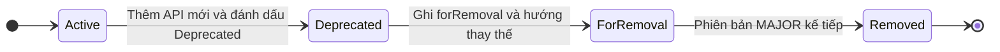

# Lý thuyết 23: Thiết kế API và nguyên tắc Effective Java

API (interface lập trình) là phần mà người khác nhìn thấy và gọi tới: các class, interface, method công khai của thư viện hay module bạn viết. Thiết kế API tốt nghĩa là người dùng dùng đúng thì dễ, dùng sai thì khó, và sau này bạn sửa được thư viện mà không làm hỏng code của họ. Bài này tóm tắt những nguyên tắc cốt lõi, phần lớn rút ra từ sách Effective Java của Joshua Bloch.

## Vì sao thiết kế API cần cẩn thận

Một khi API đã công khai và có người dùng thì rất khó sửa. Đặt tên sai, để lộ quá nhiều thành viên công khai, hay trả về object mutable (sửa được) là những lỗi sẽ theo bạn nhiều năm, vì mỗi lần đổi là phá code của người khác. Hãy hình dung API như ổ cắm điện: đổi hình dạng ổ cắm sau khi cả tòa nhà đã cắm thiết bị vào là không thể.

Cần cầu kỳ khi viết thư viện, module dùng chung, hoặc API nội bộ giữa các team. Class chỉ dùng trong một module nhỏ thì không cần cầu kỳ đến vậy, vì bạn sửa được mọi chỗ gọi cùng lúc. Cách làm: ưu tiên object immutable, kiểm tra tham số ngay đầu method, chỉ `public` những gì thật sự cần, ghi rõ contract (Javadoc), và cẩn thận giữ tương thích khi thay đổi.

**Cốt lõi:** Khi API đã có người dùng, mỗi thành viên `public` trở thành một giao ước khó rút lại. Vì vậy thiết kế API là giữ bề mặt nhỏ, làm cho dùng sai khó, và chừa đường thay đổi mà không phá code người khác.

- Vì mỗi thành viên public là một giao ước nên mặc định `private` và chỉ mở cái thật cần.
- Vì người gọi vẫn giữ reference vào dữ liệu mutable nên phải defensive copy để trạng thái bên trong không bị sửa từ ngoài.
- Vì đổi chữ ký hay thêm method trừu tượng phá code cũ nên phải deprecate dần rồi mới xóa ở bản MAJOR.



Mô hình tư duy: mỗi thứ bạn công khai là một khoản nợ phải giữ ổn định, nên mở càng ít càng dễ tiến hóa.

**Tóm tắt:**

- API công khai là contract gần như không đổi được: mỗi thành viên `public` là thứ người khác sẽ dựa vào, nên phải giảm public surface và chừa đường tiến hóa ngay từ đầu.
- Năm nguyên tắc gốc: dùng đúng thì dễ và dùng sai thì khó; tối thiểu hóa public surface; immutable và kiểm tra sớm; contract rõ và có test; tiến hóa backward compatibility.
- Khởi tạo bằng static factory có tên hoặc Builder thay cho constructor nhiều tham số; kiểm tra sớm bằng `Objects.requireNonNull`.
- Nhận hoặc trả dữ liệu mutable thì phải defensive copy (`List.copyOf`), không thì người ngoài sửa được trạng thái bên trong.
- Trả collection rỗng thay vì `null`, `Optional` chỉ làm kiểu trả về, tham số `boolean` mơ hồ nên thay bằng `enum`.
- Thêm method trừu tượng, đổi chữ ký hay kiểu trả về, xóa thành viên công khai đều phá tương thích; loại bỏ dần bằng `@Deprecated(forRemoval = true)` rồi mới xóa ở bản MAJOR.
- Dùng semantic versioning `MAJOR.MINOR.PATCH` và công cụ kiểm tra tương thích nhị phân như japicmp trong CI.

## Các khái niệm cần biết

- **Public surface**: toàn bộ những gì bên ngoài có thể gọi. Càng nhỏ càng ít thứ phải giữ ổn định.
- **Backward compatibility**: bản mới của thư viện vẫn chạy được code viết cho bản cũ. Có hai mức: tương thích mã nguồn (biên dịch lại được) và tương thích nhị phân (JAR cũ chạy được không cần biên dịch lại).
- **Static factory method**: method `static` trả về instance, có tên rõ nghĩa (`Money.of(...)`, `List.of(...)`), thay cho constructor.
- **Builder**: object phụ giúp dựng object có nhiều tham số tùy chọn bằng cách gọi nối tiếp từng bước rồi `build()`.
- **Defensive copy**: sao chép dữ liệu mutable nhận vào hoặc trả ra để người ngoài không sửa được trạng thái nội bộ.
- **Fail-fast**: phát hiện đầu vào sai ở ngay đầu method và throw lỗi, thay vì để lỗi phát sinh sâu bên trong.
- **PECS (Producer Extends, Consumer Super)**: quy tắc chọn wildcard của generics: tham số chỉ để đọc ra thì `? extends T`, chỉ để ghi vào thì `? super T`.
- **Composition và inheritance**: composition là chứa một object khác và ủy quyền; thường linh hoạt và ít vỡ hơn inheritance.
- **Semantic versioning (SemVer)**: quy ước `MAJOR.MINOR.PATCH`: tăng MAJOR khi phá tương thích, MINOR khi thêm tính năng tương thích, PATCH khi sửa lỗi.
- **`default` method**: method có thân trong interface (Java 8), cho phép thêm hành vi mà không bắt các class cài đặt cũ phải sửa.

## Nguyên tắc tư duy

Năm nguyên tắc gốc: **dùng đúng thì dễ, dùng sai thì khó**; tối thiểu hóa public surface; immutable và kiểm tra ngay từ đầu; contract ghi rõ và có test; tiến hóa backward compatibility.

**Nền tảng:** API công khai là contract gần như không đổi được: mỗi thành viên `public` là thứ người khác sẽ dựa vào. Vì vậy thiết kế API là giảm public surface, làm cho dùng sai khó, và chừa đường tiến hóa backward compatibility ngay từ đầu.

## Thực hành quan trọng

Bảng dưới liệt kê các thói quen cụ thể. Đọc cột "Nên làm" như một checklist khi review thiết kế.

| Chủ đề | Nên làm |
|---|---|
| Khởi tạo | Static factory có tên (`Money.of`, `List.of`) thay vì nhiều constructor; **Builder** khi nhiều tham số tùy chọn |
| Immutable | `final` field, không setter, defensive copy cho collection/ngày giờ có thể sửa |
| Kiểm tra | `Objects.requireNonNull(x, "x")`; kiểm tra sớm, thông báo rõ |
| Bề mặt | Mặc định `private`/package-private; công khai chỉ cái cần thiết |
| Trả về | Trả collection rỗng thay vì `null`; dùng `Optional` cho "có thể vắng mặt" |
| Kiểu | Dùng kiểu có ý nghĩa (`record UserId`, `enum`) thay vì `String`/`int` trần; tránh tham số `boolean` mơ hồ |
| Exception | Unchecked cho lỗi lập trình; checked thưa, khi người gọi thật sự phục hồi được |
| Kế thừa | "Thiết kế cho kế thừa hoặc cấm": mặc định `final`; ưu tiên composition |
| Generics | Dùng wildcard theo PECS ở tham số API |
| `equals`/`hashCode`/`toString` | Cài đặt đúng, hoặc dùng `record` |

**Phải thuộc:** Quy tắc thực hành: static factory có tên và Builder thay cho constructor nhiều tham số; defensive copy (`List.copyOf`) cho dữ liệu mutable nhận vào và trả ra; `Objects.requireNonNull` kiểm tra sớm; trả collection rỗng thay vì `null`; `Optional` chỉ làm kiểu trả về; mặc định `final` hoặc `private`, ưu tiên composition hơn inheritance.

### Chọn cách tạo object

Trước khi viết code khởi tạo, hãy trả lời vài câu hỏi theo thứ tự. Sơ đồ đọc từ trên xuống, dừng ở lá đầu tiên bạn tới.



Lý do của từng nhánh: static factory có tên giúp phân biệt `Money.ofCents(500)` với `Money.ofUnits(5)` mà constructor không làm được vì trùng chữ ký, và cho phép trả instance đã cache hoặc kiểu con. Builder trả lời vấn đề "telescoping constructor": nhiều tham số tùy chọn khiến lời gọi khó đọc. Constructor vẫn đúng với class nhỏ, chỉ có tham số bắt buộc. Cả ba có thể kết hợp: builder gọi constructor private bên trong, như ví dụ dưới.

### Builder khi có nhiều tham số tùy chọn

Vấn đề: constructor có sáu bảy tham số, nhiều cái tùy chọn, khiến lời gọi như `new Pizza("L", true, false, null, 2)` không ai đọc nổi. Builder giải quyết bằng cách đặt tên cho từng bước và kiểm tra tham số bắt buộc ở một chỗ. Không cần dùng khi class chỉ có hai ba tham số bắt buộc, lúc đó constructor hoặc static factory là đủ.

```java
final class Pizza {
    private final String size;
    private final boolean cheese;
    private Pizza(Builder b) { this.size = b.size; this.cheese = b.cheese; }
    static Builder builder(String size) { return new Builder(size); }

    static final class Builder {
        private final String size;           // bắt buộc
        private boolean cheese;              // tùy chọn, mặc định false
        private Builder(String size) { this.size = Objects.requireNonNull(size, "size"); }
        Builder cheese(boolean c) { this.cheese = c; return this; }
        Pizza build() { return new Pizza(this); }
    }
}
// Pizza.builder("L").cheese(true).build();
```

## Defensive copy

Vấn đề: nếu constructor chỉ lưu reference của `List` mà người gọi truyền vào, người gọi vẫn giữ reference đó và sửa được trạng thái bên trong object của bạn từ bên ngoài, phá vỡ tính immutable. Cách xử lý là sao chép khi nhận vào (và khi trả ra nếu kiểu có thể sửa).

```java
public final class Event {
    private final Instant at;
    private final List<String> tags;

    public Event(Instant at, List<String> tags) {
        this.at = Objects.requireNonNull(at);
        // sao chép, bất biến, và từ chối null
        this.tags = List.copyOf(tags);
    }
    public List<String> tags() { return tags; }     // an toàn trả ra vì đã bất biến
}
```

### Sơ đồ một class immutable

Class immutable không có trạng thái nào đổi được sau khi dựng xong, nên thread nào cũng dùng an toàn và key trong `HashMap` không bị "mất". Sơ đồ dưới liệt kê các bước biến một class thành immutable và chỉ ra hai cửa mà dữ liệu mutable có thể lọt vào hoặc rò ra.



Đọc theo thứ tự: ba bước đầu loại bỏ cách sửa trực tiếp (kế thừa để thêm setter, gán lại field, gọi setter). Nếu field chỉ là `String`, `int`, `Instant` thì xong. Gặp kiểu mutable thì phải chặn cả hai đường: sao chép khi nhận vào để người gọi không giữ được reference bên trong, và không trả reference nội bộ ra ngoài. Sơ đồ tuần tự dưới cho thấy chuyện gì xảy ra khi thiếu "cửa vào".



Đây chính là kịch bản trong đoạn code chạy thật ngay bên dưới: sau khi người gọi thêm `"hack"` vào `src`, `Bad` in ra `[a, hack]` còn `Good` vẫn là `[a]`.

### Chứng minh bằng code: vì sao phải sao chép và vì sao key phải immutable

```java
// Api.java (đã chạy trên Java 11 với List.copyOf là Java 10+)
static final class Bad  { final List<String> tags; Bad(List<String> t)  { this.tags = t; } }
static final class Good { final List<String> tags; Good(List<String> t) { this.tags = List.copyOf(t); } }

List<String> src = new ArrayList<>(List.of("a"));
Bad bad = new Bad(src); Good good = new Good(src);
src.add("hack");                          // người gọi sửa list SAU khi truyền vào
System.out.println("Bad: " + bad.tags + ", Good: " + good.tags);

// Khóa mutable trong HashSet: equals/hashCode dựa vào trường id
Set<P> set = new HashSet<>();
P p = new P(1); set.add(p);
p.id = 2;                                 // đổi khóa sau khi add
System.out.println("contains = " + set.contains(p) + ", size = " + set.size());
```

```text
Bad: [a, hack], Good: [a]
contains = false, size = 1        # phần tử còn trong set nhưng không tìm lại được (rò rỉ)
```

**Suy luận:** API khó sửa vì mỗi thành viên công khai biến thành một giao ước ngầm với mọi người đã dùng nó, và bạn không thể biết hết những ai đang dùng. Mỗi lần đổi chữ ký hay xóa là phá code của người khác, nên chi phí của một quyết định thiết kế tệ kéo dài nhiều năm, và đó là lý do ưu tiên `private` mặc định và chỉ mở những gì thật cần. Từ đó suy ra defensive copy: nếu constructor chỉ lưu reference của `List` người gọi truyền vào thì người gọi vẫn giữ reference đó và sửa được trạng thái bên trong bất cứ lúc nào, phá luôn tính immutable bạn đã hứa. Tương tự trả về `ArrayList` trong chữ ký ràng buộc bạn vào cài đặt đó, còn trả `List` thì giữ tự do đổi sau. Điểm dễ nhầm là cho rằng thêm method vào interface luôn an toàn, trong khi thêm method trừu tượng làm mọi class cài đặt hiện có không biên dịch được, còn `default` method thì không. Khi thiết kế, hãy tự hỏi người dùng có thể vô tình đưa object vào trạng thái sai không và việc thêm tính năng sau này có buộc phá API cũ không.

## Chọn checked hay unchecked exception

Dòng "Exception" trong bảng thực hành nói ngắn gọn "unchecked cho lỗi lập trình, checked thưa". Sơ đồ dưới biến câu đó thành các câu hỏi cụ thể mỗi khi bạn khai báo một lỗi trong API.



Đọc từ trên xuống. Lỗi do người gọi dùng sai (tham số null, trạng thái không hợp lệ) là lỗi lập trình, nên unchecked để không ép ai phải bắt thứ không thể sửa lúc chạy. Nếu người gọi chẳng làm gì được thì bắt buộc khai báo chỉ thêm `try/catch` rỗng vô nghĩa. Checked chỉ đáng dùng khi lỗi là một kết quả thường gặp mà người gọi có thể xử lý có ý nghĩa, như thử lại hoặc đổi sang nguồn khác. Khi "không tìm thấy" là bình thường, trả `Optional` rõ ràng hơn ném exception. Lưu ý một cái giá của checked: nó lan vào chữ ký của mọi method gọi tới, và không dùng được trực tiếp trong lambda của `Stream`, nên đừng thêm checked exception vào API chỉ cho có.

## Bẫy thiết kế hay bị hỏi

| Bẫy | Cách xử lý |
|---|---|
| `Optional` làm tham số hoặc field | Chỉ dùng cho **kiểu trả về**; tham số thì nạp chồng method hoặc cho phép `null` có ghi tài liệu |
| Tham số `boolean` (`render(true, false)`) | Dùng `enum` hoặc hai method có tên rõ nghĩa |
| `equals` đổi theo trường có thể đổi | Phần tử "mất" khỏi `HashSet`/`HashMap` như trên; dùng trường immutable cho `equals`/`hashCode` |
| Overload gây nhầm (`remove(int)` và `remove(Object)` của `List`) | Tránh nạp chồng cùng số tham số khác kiểu gần nhau; đặt tên khác nhau |
| Trả về `null` cho array/collection | Trả rỗng; `Optional` cho giá trị đơn |
| Enum thêm giá trị mới | Người dùng `switch` không có `default` có thể hỏng ở bản sau: ghi rõ trong tài liệu nếu enum là một phần API |
| `public static final` array hoặc collection | Vẫn sửa được nội dung: bọc `List.of`/`Collections.unmodifiableList` |
| Lộ kiểu cài đặt (`ArrayList` ở chữ ký) | Trả interface (`List`), ràng buộc ít để sau đổi |

## Tiến hóa tương thích

| Thay đổi | Tương thích? |
|---|---|
| Thêm method vào class, thêm `default` method vào interface | Thường có |
| Thêm method trừu tượng vào interface | **Không** (phá cài đặt hiện có) |
| Đổi chữ ký, đổi kiểu trả về, xóa thành viên công khai | **Không** |
| Siết điều kiện (throw exception mới, từ chối giá trị trước đây nhận) | Có thể phá hành vi |

**Phải thuộc:** Thêm method trừu tượng vào interface, đổi chữ ký, đổi kiểu trả về, xóa thành viên công khai đều phá tương thích. Dùng SemVer `MAJOR.MINOR.PATCH` (MAJOR khi phá tương thích); loại bỏ dần bằng `@Deprecated(forRemoval = true)` rồi mới xóa ở bản MAJOR kế tiếp.

Quy trình loại bỏ: `@Deprecated(since = "..", forRemoval = true)`, ghi hướng thay thế, giữ ít nhất một phiên bản chính trước khi xóa. Dùng **semantic versioning** (`MAJOR.MINOR.PATCH`) và công cụ kiểm tra tương thích nhị phân (japicmp, Revapi) trong CI.

Khi cần đổi một API đã công khai, hãy đi theo lifecycle dưới đây thay vì xóa thẳng. Mục đích là cho người dùng thời gian và cảnh báo rõ trước khi code của họ vỡ.



Đọc sơ đồ: ở mỗi bước, người dùng thấy cảnh báo biên dịch (từ bước Deprecated) trước khi mất API ở bước Removed. Nếu thay đổi của bạn rơi vào cột "Không" trong bảng trên, đó là lúc phải tăng MAJOR.

## Contract và tài liệu

- Javadoc nêu **điều kiện tiên quyết, hậu điều kiện, exception, thread-safe** (`@implSpec`, "thread-safe", "not thread-safe").
- Ghi rõ API có **immutable** và **thread-safe** không.
- Ví dụ trong tài liệu phải biên dịch được (dùng test làm ví dụ).

## Ba quy tắc kiểm tra thiết kế

1. Người dùng có thể **vô tình** đưa object vào trạng thái sai không? Nếu có, sửa API.
2. Thêm tính năng sau này có buộc phải phá API cũ không? Nếu có, chừa chỗ mở rộng từ giờ.
3. Một người mới đọc chữ ký có đoán được cách dùng đúng không?

Tham khảo thêm: [SOLID và Design Pattern](/go?p=08-Java%2FJava-Core%2Fmedium%2Flt-14-solid-design-patterns.md), [Java hiện đại](/go?p=08-Java%2FJava-Core%2Feasy%2Flt-06-java-hien-dai.md).

## Phỏng vấn khó: chuỗi hỏi xoáy

Người phỏng vấn senior thường mở bằng câu dễ rồi xoáy xuống cơ chế, đánh đổi và sự cố thật. Câu trả lời tốt luôn đi từ cốt lõi xuống.

### Chuỗi 1: Immutable và defensive copy

1. **Câu mở:** Làm thế nào để một class thật sự immutable?
2. **Xoáy 1:** Class có field `List<String>`, constructor chỉ gán `this.tags = tags`. Vì sao vẫn chưa immutable?
3. **Xoáy 2:** Nếu dùng một object có `equals` theo field có thể đổi làm key của `HashSet`, chuyện gì xảy ra?

**Đáp án ngắn:** Class cần `final` hoặc constructor private, mọi field `private final`, không có setter. Nhưng chừng đó chưa đủ khi field là kiểu mutable như `List`, `Date`, mảng. Người gọi vẫn giữ reference mình truyền vào, nên họ sửa được trạng thái bên trong bất cứ lúc nào; trong bài thực hành, sau khi `src.add("hack")` thì bản `Bad` in ra `[a, hack]` còn bản `Good` dùng `List.copyOf` vẫn là `[a]`. Phải chặn cả hai cửa: sao chép khi nhận vào và không trả reference nội bộ ra ngoài. Với key mutable, đổi trường dùng cho `hashCode` sau khi `add` làm phần tử nằm sai bucket: `contains` ra false nhưng `size` vẫn là 1, tức là phần tử còn đó mà không tìm lại được, một kiểu rò rỉ. Vì vậy `equals` và `hashCode` nên dựa trên trường immutable.

**Sai lầm hay gặp:**
- Nghĩ `final` field là đủ để immutable.
- Chỉ copy khi nhận vào mà quên trả ra.
- Dùng object mutable làm key mà không thấy rủi ro.

### Chuỗi 2: Tương thích ngược

1. **Câu mở:** Thêm một method vào interface công khai có an toàn không?
2. **Xoáy 1:** Khác nhau thế nào giữa thêm method trừu tượng và thêm `default` method? Tương thích mã nguồn khác tương thích nhị phân ra sao?
3. **Xoáy 2:** Bạn cần bỏ một API đã công khai. Quy trình và công cụ nào bạn dùng?

**Đáp án ngắn:** Mỗi thành viên `public` là một giao ước ngầm với mọi người đã dùng nó, và bạn không biết hết ai đang dùng. Thêm method trừu tượng vào interface phá mọi class cài đặt hiện có vì chúng không còn biên dịch được, còn `default` method thì không, vì cài đặt cũ không phải sửa. Tương thích mã nguồn là biên dịch lại được; tương thích nhị phân là jar cũ chạy được mà không cần biên dịch lại, và đổi chữ ký, đổi kiểu trả về, xóa thành viên công khai đều phá. Siết điều kiện, như ném exception mới, cũng có thể phá hành vi. Quy trình bỏ API: thêm API mới, đánh dấu `@Deprecated(since, forRemoval = true)` kèm hướng thay thế, giữ ít nhất một phiên bản chính, rồi xóa ở bản MAJOR kế tiếp theo SemVer. Dùng japicmp hoặc Revapi trong CI để kiểm tra tương thích nhị phân. Enum thêm giá trị mới cũng có thể làm `switch` không có `default` của người dùng hỏng.

**Sai lầm hay gặp:**
- Nói "thêm method vào interface luôn an toàn".
- Xóa API thẳng mà không qua giai đoạn deprecated.
- Chỉ nghĩ tới tương thích mã nguồn, quên nhị phân.

### Chuỗi 3: Khởi tạo, `Optional` và exception trong API

1. **Câu mở:** Khi nào dùng Builder, khi nào dùng static factory?
2. **Xoáy 1:** Vì sao `Optional` không nên làm tham số hay field, và tham số `boolean` mơ hồ xử lý thế nào?
3. **Xoáy 2:** Bạn khai báo lỗi trong API: chọn checked hay unchecked, theo tiêu chí nào?

**Đáp án ngắn:** Builder dùng khi có nhiều tham số tùy chọn, để tránh telescoping constructor như `new Pizza("L", true, false, null, 2)`. Static factory có tên dùng khi cần tên rõ nghĩa, cache hoặc trả kiểu con, ví dụ `Money.ofCents` khác `Money.ofUnits` mà constructor trùng chữ ký không làm được. Class nhỏ chỉ có vài tham số bắt buộc thì constructor hoặc `record` là đủ. `Optional` chỉ nên làm kiểu trả về cho "có thể vắng mặt"; làm tham số thì thêm nạp chồng hoặc cho phép `null` có ghi tài liệu. Tham số `boolean` thay bằng `enum` hoặc hai method có tên rõ nghĩa. Về exception: lỗi do người gọi dùng sai là lỗi lập trình nên unchecked; checked chỉ khi lỗi thường gặp và người gọi phục hồi được có ý nghĩa. Checked còn lan vào chữ ký mọi method gọi tới và không dùng thẳng được trong lambda của `Stream`. Khi "không tìm thấy" là bình thường, trả `Optional`.

**Sai lầm hay gặp:**
- Dùng Builder cho class chỉ có hai ba tham số.
- Dùng `Optional` làm field hoặc tham số.
- Thêm checked exception vào API chỉ cho có.

