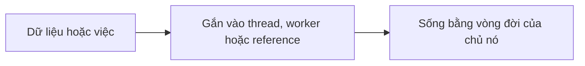
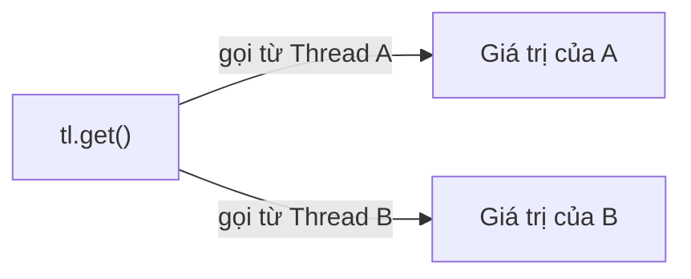
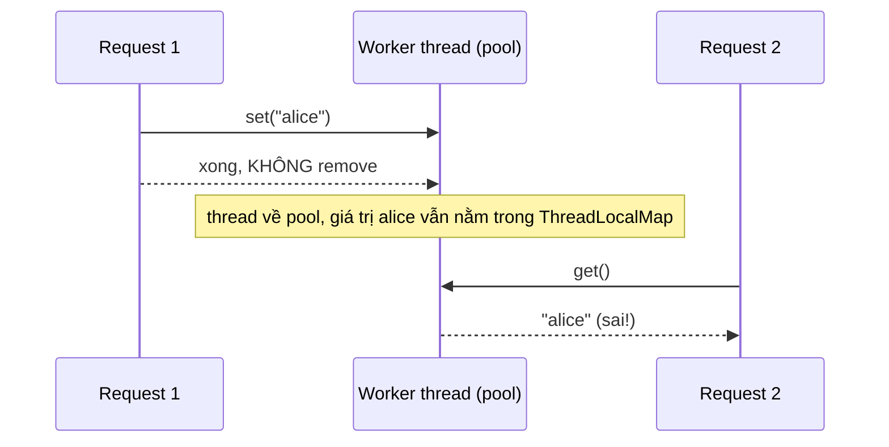
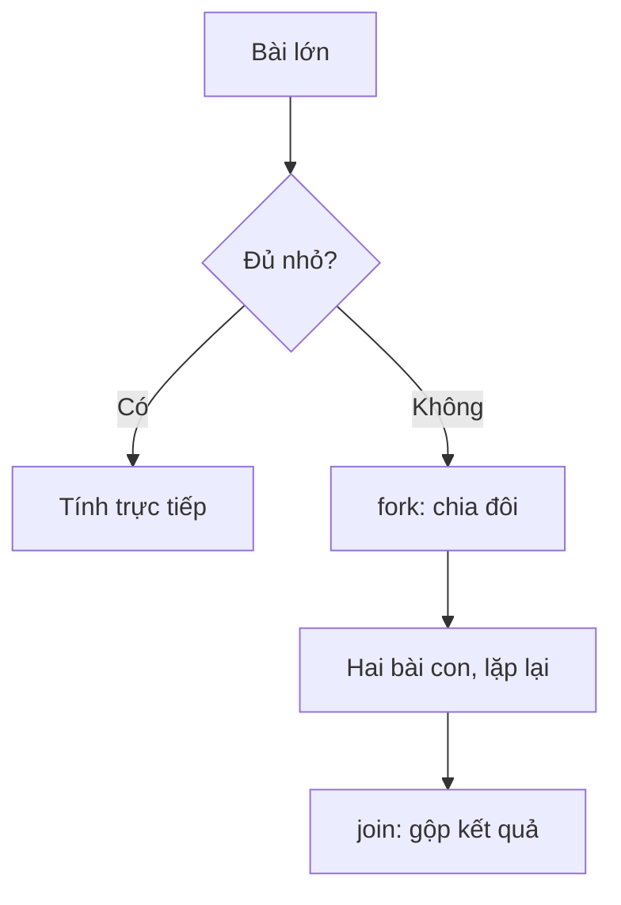
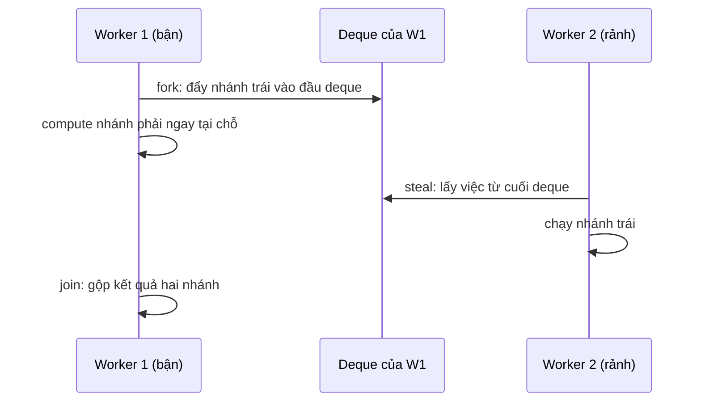

# ThreadLocal, Fork/Join và các loại reference

Bài này gom ba chủ đề riêng lẻ nhưng đều liên quan tới "dữ liệu thuộc về ai và sống bao lâu" trong chương trình multithreading. Thứ nhất là `ThreadLocal` (và `ScopedValue` thay thế): giữ dữ liệu riêng cho từng thread. Thứ hai là `ForkJoinPool`: chia việc lớn thành việc nhỏ, thread nào rảnh sẽ "ăn trộm" việc của thread bận (work-stealing). Thứ ba là bốn loại reference `Strong`, `Soft`, `Weak`, `Phantom`, quyết định GC được thu hồi object khi nào.

## Vì sao ba chủ đề này đáng bận tâm

Spring giữ transaction và security context trong `ThreadLocal`. Vì thread trong pool được tái sử dụng, quên `remove()` nghĩa là dữ liệu của request trước lọt sang request sau (người dùng A thấy dữ liệu của B), hoặc memory leak. Parallel stream chạy trên ForkJoin, nên dùng bừa cho việc chờ I/O sẽ làm nghẽn cả ứng dụng. Cache hay listener giữ reference mạnh thì object không bao giờ được thu hồi, memory tăng dần cho tới `OutOfMemoryError`.

Khi nào dùng: `ThreadLocal` để truyền context theo request; ForkJoin cho tính toán parallel nặng CPU; reference yếu cho cache theo memory. Khi nào không: task chờ I/O đừng nhét vào ForkJoin chung; với virtual thread dùng nhiều thì cân nhắc `ScopedValue` thay `ThreadLocal`; cache nghiêm túc đừng tự xây bằng Soft/Weak. Quy tắc ngắn: luôn `remove()` ThreadLocal trong `finally`, dùng common pool có chừng mực, chọn loại reference theo nhu cầu (weak cho map/listener, soft cho cache đơn giản).

**Cốt lõi:** Ba chủ đề cùng hỏi một câu: dữ liệu hay việc này thuộc về ai và sống bao lâu. `ThreadLocal` gắn dữ liệu vào thread, Fork/Join gắn việc vào hàng đợi của từng worker, còn loại reference quyết định object được GC thu khi nào.

- Vì thread trong pool sống lâu hơn request nên `ThreadLocal` không `remove()` sẽ lọt dữ liệu sang request sau và gây leak.
- Vì mỗi worker có deque riêng và worker rảnh lấy việc từ đuôi deque của worker bận nên việc chia không đều vẫn cân bằng tải, ít tranh chấp.
- Vì reference càng yếu thì GC càng dễ thu nên chọn loại reference là chọn lúc object được phép chết.



Mô hình tư duy: dữ liệu sống bao lâu tùy vào chủ đang giữ nó, nên lỗi thường nằm ở chủ sống lâu hơn dự định.

**Tóm tắt:**

- `ThreadLocal` giữ dữ liệu riêng cho từng thread nên không cần đồng bộ; Spring giữ transaction và security context trong đó, và MDC của log cũng dựa trên nó.
- Thread trong pool được tái sử dụng, nên quên `remove()` trong `finally` làm dữ liệu của request trước lọt sang request sau (lộ dữ liệu người dùng khác) hoặc gây memory leak; `@Async` và thread mới không thừa hưởng giá trị.
- Với virtual thread dùng nhiều, ThreadLocal tốn memory; hướng mới là `ScopedValue` (immutable, phạm vi rõ ràng).
- Fork/Join là chia để trị cho tính toán nặng CPU: mỗi worker có deque riêng và worker rảnh "ăn cắp" việc từ cuối deque của worker bận (work-stealing).
- `commonPool()` dùng chung cả JVM, là nền của parallel stream và `CompletableFuture`; tác vụ chặn I/O ở đó làm đói mọi nơi khác; số thread khoảng số nhân trừ 1.
- Bốn mức reference từ mạnh đến yếu: Strong, Soft (thu khi gần hết memory), Weak (thu ở lần GC kế tiếp), Phantom (sau khi object bị hủy, qua `ReferenceQueue`).
- `WeakHashMap` yếu ở key; nếu giá trị reference ngược key thì không bao giờ thu hồi; cache nghiêm túc dùng Caffeine thay vì tự xây bằng Soft hoặc Weak.

## Các khái niệm cần biết

- **Thread pool**: tập thread tạo sẵn để tái sử dụng cho nhiều tác vụ. "Tái sử dụng" chính là gốc của lỗi rò rỉ ThreadLocal.
- **MDC (Mapped Diagnostic Context)**: nơi log framework giữ thông tin theo từng thread (ví dụ `requestId`) để in vào mọi dòng log, thường dựa trên `ThreadLocal`.
- **Work-stealing**: mỗi worker có queue riêng; worker rảnh lấy bớt việc từ cuối queue của worker bận, giúp load balancing mà ít tranh chấp.
- **Divide and conquer**: chia bài lớn thành bài con độc lập, giải xong rồi gộp. Fork/Join là khung cho mô hình này.
- **Threshold**: kích thước mà dưới đó không chia nữa mà tính trực tiếp.
- **Common pool**: `ForkJoinPool` dùng chung cả JVM, là nền của `parallelStream()` và `CompletableFuture` khi không chỉ định executor.
- **Strong/Soft/Weak/Phantom reference**: bốn mức "độ bám" của reference vào object, quyết định GC được thu hồi khi nào.
- **`ReferenceQueue`**: queue nhận thông báo khi GC đã xử lý một reference đặc biệt, để bạn dọn dẹp tiếp.
- **Memory leak trong Java**: object không còn dùng nhưng vẫn có đường reference từ GC Root nên không được thu hồi.

## ThreadLocal

Về vị trí của `ThreadLocal` trong các kỹ thuật nhốt dữ liệu vào một thread (ad-hoc, stack, `ThreadLocal`), xem [Chia sẻ object](/go?p=08-Java%2FJava-Concurrency%2Feasy%2Flt-03-chia-se-doi-tuong.md); phần dưới tập trung vào rò rỉ khi dùng pool, là bài gốc cho chủ đề này.

`ThreadLocal<T>` là một variable mà mỗi thread thấy một giá trị riêng. Cùng một object `tl`, thread A gọi `get()` nhận giá trị của A, thread B nhận giá trị của B, không cần đồng bộ hóa vì không ai chia sẻ.



Mỗi thread giữ một bản đồ riêng; `tl.get()` đọc giá trị của **thread hiện tại**. Dùng cho `SecurityContextHolder`, `TransactionSynchronizationManager`, MDC của log, `SimpleDateFormat` (cũ).

Bẫy:
- **Rò rỉ trong thread pool**: thread được tái sử dụng, giá trị còn lại sang request sau (lộ dữ liệu người dùng khác). Luôn `try { ... } finally { tl.remove(); }`.
- Giữ object lớn trên thread sống lâu → memory leak (key yếu nhưng giá trị mạnh).
- `@Async`/thread mới không thừa hưởng; `InheritableThreadLocal` sao chép lúc tạo thread (không hợp với pool).
- Với virtual threads dùng nhiều, ThreadLocal tốn memory; hướng mới là **ScopedValue** (chính thức từ Java 25; immutable, phạm vi rõ ràng, xem [Virtual Threads](/go?p=08-Java%2FJava-Core%2Fhard%2Flt-20-virtual-threads-structured-concurrency.md)).

**Phải thuộc:** `ThreadLocal` kết hợp thread pool thì luôn `remove()` trong `finally`, nếu không giá trị của request trước lọt sang request sau và gây memory leak. `@Async` và thread mới không thừa hưởng giá trị; MDC của log dựa trên `ThreadLocal`.

**Suy luận:** `ThreadLocal` rò rỉ trong thread pool vì giá trị của nó không thuộc về request mà thuộc về thread, và thread trong pool sống lâu hơn nhiều request. Mỗi thread giữ một map riêng trỏ tới giá trị, nên khi request A kết thúc mà không `remove()`, thread đó vẫn giữ nguyên giá trị đó và request B tình cờ chạy trên cùng thread sẽ đọc thấy dữ liệu của A, tức là lộ dữ liệu người dùng khác. Cũng vì thread không chết, giá trị lớn nằm trong map của thread thì GC không thu được, nên thành memory leak; map dùng key yếu nhưng giá trị là reference mạnh, nên giá trị vẫn bị giữ. Từ cơ chế đó, cách an toàn duy nhất là dọn đúng chỗ: `set` ở đầu request và `remove` trong `finally` ở cuối, tốt nhất gói vào filter hay interceptor để không ai phải nhớ. Điểm dễ nhầm là cho rằng `@Async` hay thread mới thừa hưởng giá trị, trong khi chúng bắt đầu với `ThreadLocal` rỗng và `InheritableThreadLocal` chỉ sao chép lúc tạo thread nên không hợp với pool. Với virtual thread dùng nhiều, hãy cân nhắc `ScopedValue`.

### Tái hiện rò rỉ giữa hai request

```java
// TL.java (đã chạy). Pool 1 luồng để chắc chắn luồng bị tái sử dụng
static final ThreadLocal<String> USER = new ThreadLocal<>();
ExecutorService pool = Executors.newFixedThreadPool(1);
// request 1: quên remove
pool.submit(() -> USER.set("alice")).get();
pool.submit(() -> System.out.println("request 2 thấy: " + USER.get())).get();
pool.submit(() -> { try { USER.set("bob"); } finally { USER.remove(); } }).get();
pool.submit(() -> System.out.println("sau remove thấy: " + USER.get())).get();
```

```text
request 2 thấy: alice        # dữ liệu request 1 lọt sang request 2
sau remove thấy: null
```

Nên gói thành filter/interceptor: `set` ở đầu request, `remove` trong `finally` ở cuối, để không ai phải nhớ.



## Fork/Join



Sơ đồ trên là ý tưởng chia để trị. Với work-stealing, hình dung hai thread như sau: thread 1 nhận bài lớn rồi chia nhỏ, đẩy các bài con vào queue của mình; thread 2 rảnh nên lấy bớt bài con từ cuối queue của thread 1.



- `ForkJoinPool` có mỗi thread một deque; thread rảnh **ăn cắp việc** (work-stealing) từ đuôi deque của thread bận: load balancing tốt cho tác vụ đệ quy.
- `RecursiveTask<V>` (có kết quả), `RecursiveAction` (không).
- **`ForkJoinPool.commonPool()`** là nền cho `parallelStream()` và `CompletableFuture` (không chỉ định executor). Số thread ≈ số nhân − 1.
- Cảnh báo: tác vụ **blocking** (I/O) trong common pool làm đói cả JVM; dùng pool riêng hoặc executor phù hợp. Parallel stream chỉ có lợi với dữ liệu lớn, tính toán thuần CPU, thao tác độc lập, nguồn dễ chia (`ArrayList`, array); không với `LinkedList`, I/O.
- Threshold chia quá nhỏ làm chi phí chia lớn hơn lợi.

**Nền tảng:** Fork/Join là chia để trị cho tính toán nặng CPU: mỗi worker có deque riêng và worker rảnh "ăn cắp" việc từ cuối deque của worker bận (work-stealing). `commonPool()` dùng chung cả JVM (nền của parallel stream, khoảng số nhân trừ 1 thread), nên tác vụ chặn I/O ở đó làm đói mọi nơi.

**Suy luận:** Work-stealing cân bằng tải tốt cho tác vụ đệ quy vì việc chia nhỏ không đoán trước được: một nhánh có thể tính nhanh còn nhánh khác chia tiếp rất sâu, nên chia đều ngay từ đầu cho các thread sẽ để một số thread nghỉ trong khi thread khác còn quá nhiều việc. Mỗi worker giữ deque riêng, tự lấy việc từ đầu deque của mình (mới nhất, còn nóng trong cache) còn worker rảnh lấy từ đuôi deque của worker bận (việc lớn nhất, ít khi tranh với chủ), nên ít tranh chấp. Từ đó suy ra quy tắc `fork` một nhánh, `compute` nhánh còn lại trong thread hiện tại rồi mới `join`: nếu `fork` cả hai rồi `join` ngay thì thread hiện tại chỉ ngồi chờ. Cũng vì `commonPool()` có khoảng số nhân trừ 1 thread và dùng chung cả JVM, một tác vụ chặn I/O trong đó làm đói parallel stream và `CompletableFuture` ở mọi nơi khác. Điểm dễ nhầm là tưởng parallel stream luôn nhanh hơn, trong khi nó chỉ có lợi với dữ liệu lớn, tính toán thuần CPU, thao tác độc lập và nguồn dễ chia như `ArrayList` hay array.

### RecursiveTask: tổng array

```java
// Sum.java (đã chạy, kết quả đúng 50000005000000)
public class Sum extends RecursiveTask<Long> {
    static final int THRESHOLD = 100_000;
    final long[] arr; final int lo, hi;
    Sum(long[] arr, int lo, int hi) { this.arr = arr; this.lo = lo; this.hi = hi; }

    @Override protected Long compute() {
        if (hi - lo <= THRESHOLD) {                       // đủ nhỏ: tính trực tiếp
            long s = 0; for (int i = lo; i < hi; i++) s += arr[i];
            return s;
        }
        int mid = (lo + hi) >>> 1;
        Sum left = new Sum(arr, lo, mid), right = new Sum(arr, mid, hi);
        // đẩy nhánh trái cho luồng khác ăn cắp
        left.fork();
        // nhánh phải chạy ngay tại chỗ
        long r = right.compute();
        // join SAU khi làm phần của mình
        return left.join() + r;
    }
}
// new ForkJoinPool(4).invoke(new Sum(arr, 0, arr.length));
```

Quy tắc nhớ: `fork` một nhánh, `compute` nhánh còn lại trong thread hiện tại, rồi mới `join`; không `fork` cả hai rồi `join` ngay (lãng phí thread). `ForkJoinPool.commonPool().getParallelism()` thường là số nhân trừ 1 (máy thử 2 nhân cho kết quả 1), nên trên máy ít nhân hoặc container giới hạn CPU, parallel stream gần như tuần tự.

## Các loại reference

Bình thường, chỉ cần một variable trỏ tới object là GC không thu hồi nó. Đôi khi bạn muốn nói "giữ object này nếu còn chỗ, nhưng đừng vì tôi mà ngăn GC dọn". Đó là lúc dùng reference yếu hơn. Bảng dưới xếp từ mạnh tới yếu, kèm thời điểm GC được phép thu hồi object.

| Loại | GC thu khi | Dùng cho |
|---|---|---|
| **Strong** (mặc định) | Không còn reference mạnh nào | Hầu hết mã |
| **SoftReference** | Gần hết memory (trước `OutOfMemoryError`) | Cache nhạy memory (đơn giản) |
| **WeakReference** | Ở lần GC kế tiếp nếu chỉ còn reference yếu | `WeakHashMap`, canonical map, listener |
| **PhantomReference** | Sau khi object bị hủy, qua `ReferenceQueue` | Dọn tài nguyên (`Cleaner`) thay `finalize` |

**Phải thuộc:** Bốn mức reference từ mạnh đến yếu: Strong (mặc định, không bao giờ bị thu khi còn dùng), Soft (thu khi gần hết memory, trước `OutOfMemoryError`), Weak (thu ở lần GC kế tiếp nếu chỉ còn reference yếu), Phantom (sau khi object bị hủy, qua `ReferenceQueue`). `WeakHashMap` yếu ở key, không phải giá trị.

```java
WeakReference<Big> ref = new WeakReference<>(big);
big = null;
Big b = ref.get();   // có thể null sau GC: luôn kiểm tra
```

`WeakHashMap` yếu ở **key**; nếu giá trị reference ngược key thì không bao giờ thu hồi. Memory leak phổ biến: static collection, listener không hủy đăng ký, ThreadLocal, cache không giới hạn, inner class giữ outer. Xem [GC chuyên sâu](/go?p=08-Java%2FJava-Core%2Fhard%2Flt-18-gc-chuyen-sau.md).

### Quan sát bằng `System.gc()`

```java
// Ref.java, chạy: java -Xmx64m Ref.java   (đã chạy trên Java 11)
Object strong = new Object();
WeakReference<Object> weak = new WeakReference<>(new Object());
WeakReference<Object> viaStrong = new WeakReference<>(strong);
SoftReference<byte[]> soft = new SoftReference<>(new byte[1024 * 1024]);
System.gc(); Thread.sleep(100);

WeakHashMap<Object, String> wm = new WeakHashMap<>();
Object key = new Object();
wm.put(key, "v"); wm.put(new Object(), "mồ côi");
System.gc(); Thread.sleep(100);        // size còn 1
key = null; System.gc(); Thread.sleep(100);   // size còn 0
```

```text
weak (chỉ yếu)   : đã bị thu
weak (còn strong): còn
soft sau gc      : còn          # soft chỉ bị thu khi sắp hết bộ nhớ
WeakHashMap size = 1
sau key = null: 0
```

`System.gc()` chỉ là gợi ý; ví dụ này đủ ổn định để minh họa nhưng đừng dùng làm kiểm tra tự động.

## Điều cần nhớ

- ThreadLocal + thread pool = phải `remove()`.
- Common pool dùng chung cả JVM: đừng chặn nó.
- Cache nghiêm túc dùng Caffeine (giới hạn kích thước/thời gian) thay vì tự xây bằng Soft/Weak.

## Phỏng vấn khó: chuỗi hỏi xoáy

Người phỏng vấn senior thường mở bằng câu dễ rồi xoáy xuống cơ chế, đánh đổi và sự cố thật. Câu trả lời tốt luôn đi từ cốt lõi xuống.

### Chuỗi 1: ThreadLocal trong thread pool

1. **Câu mở:** Vì sao `ThreadLocal` có thể làm lộ dữ liệu người dùng này sang người dùng khác?
2. **Xoáy 1:** Cơ chế bên trong là gì, và vì sao nó còn gây memory leak?
3. **Xoáy 2:** `@Async`, thread mới và virtual thread xử lý giá trị này thế nào?

**Đáp án ngắn:** Giá trị của `ThreadLocal` không thuộc về request mà thuộc về thread, và thread trong pool sống lâu hơn nhiều request. Mỗi thread giữ một map riêng trỏ tới giá trị, nên request A kết thúc mà không `remove()` thì giá trị còn nguyên, và request B chạy tình cờ trên cùng thread sẽ đọc thấy dữ liệu của A. Bài thực hành với pool một luồng in ra `request 2 thấy: alice`. Cũng vì thread không chết, giá trị lớn nằm trong map của thread thì GC không thu được: key yếu nhưng giá trị là reference mạnh. Cách an toàn là `set` ở đầu request và `remove` trong `finally`, gói vào filter hoặc interceptor để không ai phải nhớ. `@Async` và thread mới bắt đầu với `ThreadLocal` rỗng; `InheritableThreadLocal` chỉ sao chép lúc tạo thread nên không hợp với pool. Với virtual thread dùng nhiều, mỗi cái có bản riêng nên tốn memory, hướng mới là `ScopedValue`.

**Sai lầm hay gặp:**
- Cho rằng `@Async` thừa hưởng `ThreadLocal`.
- Gọi `remove()` ngoài `finally` nên bỏ sót khi có exception.
- Không nhắc rằng MDC của log cũng dựa trên `ThreadLocal`.

### Chuỗi 2: Work-stealing và common pool

1. **Câu mở:** Work-stealing trong `ForkJoinPool` là gì?
2. **Xoáy 1:** Vì sao worker rảnh lấy việc từ đuôi deque, và vì sao quy tắc là `fork` một nhánh, `compute` nhánh kia rồi mới `join`?
3. **Xoáy 2:** Một tác vụ chặn I/O chạy trong `parallelStream()` thì sao? Và trên container giới hạn CPU?

**Đáp án ngắn:** Mỗi worker có một deque riêng; worker rảnh lấy bớt việc từ cuối deque của worker bận. Cách này cân bằng tải cho tác vụ đệ quy, vì việc chia nhỏ không đoán trước được: nhánh này tính nhanh, nhánh kia chia tiếp rất sâu. Chủ deque lấy từ đầu (việc mới nhất, còn nóng trong cache) còn kẻ trộm lấy từ đuôi (việc lớn nhất), nên hai bên ít tranh chấp. Vì vậy `fork` một nhánh, `compute` nhánh còn lại ngay tại chỗ, rồi `join`; nếu `fork` cả hai rồi `join` ngay thì thread hiện tại chỉ ngồi chờ. `commonPool()` dùng chung cả JVM, là nền của parallel stream và `CompletableFuture`, số thread khoảng số nhân trừ 1. Tác vụ chặn I/O ở đó làm đói mọi nơi khác, nên dùng pool riêng. Trên máy ít nhân hoặc container giới hạn CPU, parallelism có thể chỉ là 1 nên parallel stream gần như tuần tự.

**Sai lầm hay gặp:**
- Nghĩ parallel stream luôn nhanh hơn.
- Đưa tác vụ chờ I/O vào common pool.
- Dùng parallel stream trên `LinkedList` hay nguồn khó chia.

### Chuỗi 3: Các loại reference và cache

1. **Câu mở:** Phân biệt Strong, Soft, Weak, Phantom reference.
2. **Xoáy 1:** `WeakHashMap` yếu ở đâu, và khi nào nó không bao giờ thu hồi được?
3. **Xoáy 2:** Bạn cần một cache trong app. Có nên tự xây bằng `SoftReference` không?

**Đáp án ngắn:** Bốn mức từ mạnh đến yếu quyết định lúc object được phép chết. Strong là mặc định, không bị thu khi còn dùng. Soft bị thu khi gần hết memory, trước `OutOfMemoryError`. Weak bị thu ở lần GC kế tiếp nếu chỉ còn reference yếu. Phantom dùng sau khi object bị hủy, qua `ReferenceQueue`, để dọn tài nguyên bằng `Cleaner` thay cho `finalize`. `WeakHashMap` yếu ở key chứ không phải giá trị: nếu giá trị lại reference ngược về key thì key luôn còn đường tới từ map, nên entry không bao giờ bị thu. Soft chỉ bị thu khi sắp hết bộ nhớ nên hành vi khó đoán, và cache tự xây dễ phình cho tới khi memory căng; cache nghiêm túc nên dùng Caffeine với giới hạn kích thước hoặc thời gian. Cũng nhớ `System.gc()` chỉ là gợi ý, không dùng làm kiểm tra tự động.

**Sai lầm hay gặp:**
- Nói `WeakHashMap` yếu ở giá trị.
- Nhầm thời điểm thu của Soft và Weak.
- Tự xây cache bằng Soft/Weak cho hệ thống thật.

