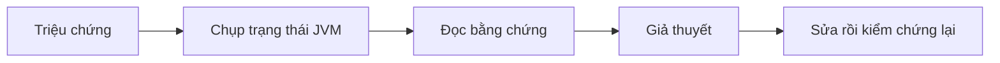
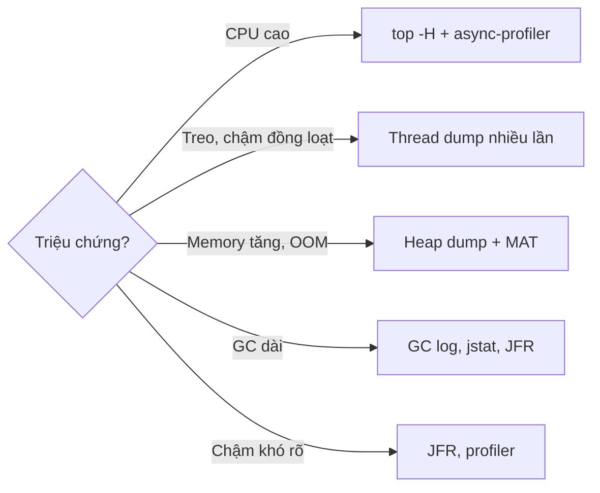
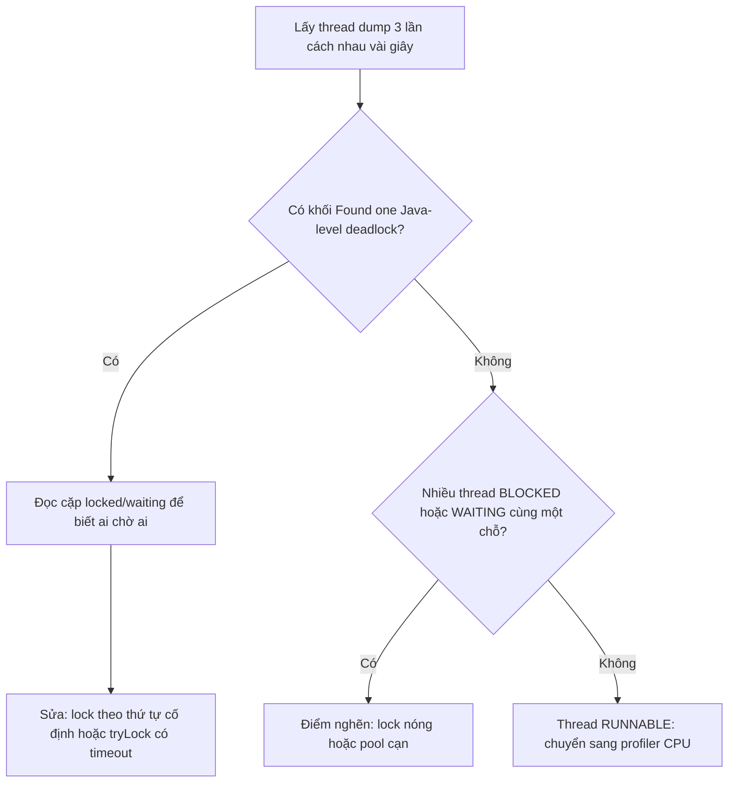
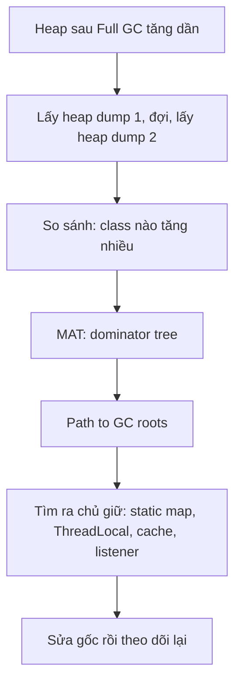

# Công cụ chẩn đoán JVM: thread dump, heap dump, JFR

## Chẩn đoán JVM là gì và vì sao cần

Hãy tưởng tượng bác sĩ gặp một bệnh nhân kêu "tôi thấy mệt". Bác sĩ không đoán bệnh mà đo huyết áp, chụp X-quang, xét nghiệm máu rồi mới kết luận. JVM cũng vậy. Khi production có CPU tăng vọt, app treo, memory cạn hoặc GC kéo dài, ngồi đọc code để đoán rất dễ sửa nhầm chỗ. Bộ công cụ chẩn đoán (`jps`, `jcmd`, `jstack`, `jmap`, `jstat`, JFR, VisualVM, Eclipse MAT, async-profiler) là những "máy đo" cho phép lấy bằng chứng ngay khi hệ thống còn đang sống: ảnh chụp các thread (thread dump), ảnh chụp memory (heap dump), bản ghi event theo thời gian (JFR).

Bạn dùng chúng khi app chậm, treo, memory leak, CPU cao hoặc nghi deadlock. Lưu ý quan trọng: lấy dump trên production không miễn phí. Heap dump có kích thước xấp xỉ lượng heap đang dùng và JVM bị tạm dừng trong lúc ghi, nên với heap vài chục GB app có thể khựng đáng kể. Hãy cân nhắc (rút instance khỏi load balancer trước, hoặc dùng JFR vốn nhẹ hơn nhiều) trước khi chạy.

Quy trình làm việc luôn giống nhau: ghi nhận triệu chứng, chọn công cụ phù hợp, đọc bằng chứng, đặt giả thuyết, rồi kiểm chứng lại sau khi sửa. Sơ đồ ngay bên dưới là bản đồ chọn công cụ theo triệu chứng.

**Cốt lõi:** JVM đang chạy là một hộp kín, nên muốn biết nó hỏng ở đâu phải chụp trạng thái bên trong thay vì đoán từ code. Mỗi triệu chứng cần đúng loại ảnh chụp: thread dump cho biết thread đang làm gì, heap dump cho biết ai giữ object, JFR cho biết chuyện gì xảy ra theo thời gian.

- Vì thread dump chỉ là ảnh tĩnh nên phải lấy vài lần để thấy thread kẹt thật.
- Vì object còn nối tới GC root thì không bị thu gom nên rò rỉ phải lần theo đường reference tới root.
- Vì lấy dump tốn tài nguyên và chứa dữ liệu thật nên phải cân nhắc, và cấu hình sẵn cờ trước khi sự cố xảy ra.



Mô hình tư duy: sơ đồ cho thấy chẩn đoán là vòng đi từ bằng chứng tới giả thuyết, không bắt đầu từ việc đoán.

**Tóm tắt:**

- Chẩn đoán JVM dựa trên bằng chứng chứ không đoán: thread dump (ảnh chụp các thread) cho treo, chậm và deadlock; heap dump (ảnh chụp object) cho rò rỉ và OOM; JFR và profiler cho CPU và hiệu năng.
- Lệnh cốt lõi: `jcmd <pid> Thread.print` (hoặc `jstack`), `jcmd <pid> GC.heap_dump file.hprof`, `jcmd <pid> GC.class_histogram`, `jstat -gcutil <pid> 1s`, `jcmd <pid> JFR.start`.
- Một thread dump chỉ là ảnh tĩnh nên cần lấy vài lần cách nhau vài giây để thấy thread kẹt thật; trạng thái chính là `RUNNABLE`, `BLOCKED`, `WAITING`/`TIMED_WAITING`.
- JVM tự in khối `Found one Java-level deadlock` cho `synchronized`, nhưng deadlock do pool cạn thì không, phải tự thấy nhiều thread `WAITING` ở cùng một chỗ.
- Lấy dump trên production không miễn phí: heap dump bằng cỡ heap và tạm dừng JVM, và chứa dữ liệu thật nên phải giữ ở nơi hạn chế truy cập.
- JFR chi phí thấp nên bật được trên production; async-profiler tránh safepoint bias; cấu hình sẵn `-XX:+HeapDumpOnOutOfMemoryError` và GC log để sau sự cố mới có dữ liệu.
- Điều tra memory leak: quan sát đáy heap tăng dần sau mỗi GC, chụp hai heap dump để so sánh, rồi dùng MAT (dominator tree, path to GC roots) tìm ai giữ.

## Các khái niệm cần biết

- **Thread dump**: danh sách mọi thread của JVM tại một thời điểm, kèm trạng thái, stack trace và lock đang giữ hoặc đang chờ. Dùng khi app treo, chậm đồng loạt, nghi deadlock hay pool cạn. Một dump chỉ là ảnh tĩnh, nên cần lấy vài lần để thấy thread nào kẹt thật.
- **Heap dump** (file `.hprof`): ảnh chụp toàn bộ object đang sống trong heap cùng quan hệ reference giữa chúng. Dùng để trả lời "ai đang giữ memory", tức điều tra rò rỉ và OOM.
- **GC root**: những điểm xuất phát mà GC coi là "chắc chắn còn dùng", ví dụ variable `static`, variable cục bộ trên stack của thread đang chạy, `ThreadLocal` của thread sống. Object còn được nối tới một GC root thì không bị thu gom. Memory leak trong Java chính là object không còn cần nhưng vẫn nối được tới GC root.
- **Dominator tree** (trong MAT): cây thể hiện "nếu object A bị xóa thì những object nào cũng biến mất theo". Object ở đỉnh cây giữ nhiều memory nhất, nên đây là nơi đầu tiên cần nhìn khi tìm thủ phạm.
- **JFR (Java Flight Recorder)**: bộ ghi event tích hợp sẵn trong JVM (GC, lock, I/O, allocation, lấy mẫu method), chi phí thấp nên bật được trên production, giống "hộp đen máy bay".
- **Safepoint bias**: nhiều profiler truyền thống chỉ lấy mẫu stack tại các safepoint (thời điểm JVM cho phép tạm dừng thread an toàn), nên kết quả lệch về những chỗ có safepoint chứ không phải chỗ thực sự tốn CPU. async-profiler tránh được lỗi này.
- **Flame graph**: biểu đồ xếp chồng các stack trace, ô càng rộng nghĩa là càng tốn nhiều thời gian (hoặc allocation). Dùng để thấy ngay hàm nào "ngốn" CPU.
- **Metaspace**: vùng memory ngoài heap chứa metadata của class. Nạp quá nhiều class hoặc rò rỉ class loader sẽ gây `OutOfMemoryError: Metaspace`.

## Từ triệu chứng đến công cụ



Với thread dump, lấy 3 lần cách nhau vài giây để thấy deadlock, chặn lock, pool cạn. Heap dump + MAT trả lời câu hỏi "ai đang giữ object".

**Nền tảng:** Chẩn đoán JVM dựa trên bằng chứng, không đoán: thread dump (ảnh chụp các thread) cho vấn đề treo, chậm, deadlock; heap dump (ảnh chụp object) cho rò rỉ và OOM; JFR và profiler cho CPU và hiệu năng. Một dump chỉ là ảnh tĩnh nên cần lấy vài lần để thấy thread kẹt thật.

## Công cụ chính

| Công cụ | Dùng để |
|---|---|
| `jps`, `jcmd` | Liệt kê process JVM; `jcmd <pid> help` là cửa chung để gửi lệnh chẩn đoán |
| `jstack <pid>` / `jcmd <pid> Thread.print` | **Thread dump**: trạng thái mọi thread, lock giữ/chờ, phát hiện deadlock |
| `jmap -histo`, `jcmd <pid> GC.class_histogram` | Biểu đồ số lượng object theo class |
| `jcmd <pid> GC.heap_dump file.hprof` | **Heap dump** để phân tích (kích thước bằng heap, tạm dừng JVM) |
| `jstat -gcutil <pid> 1s` | Theo dõi vùng nhớ và GC theo thời gian |
| **JFR** (Java Flight Recorder) | Ghi event chi phí thấp (<2%) chạy được trên production: GC, lock, I/O, allocation, method sampling; mở bằng JDK Mission Control |
| **Eclipse MAT** | Phân tích heap dump: dominator tree, "leak suspects", đường GC root |
| **async-profiler** | Flame graph CPU/allocation ít sai lệch (không bị safepoint bias) |
| VisualVM | UI giám sát cục bộ |

Cờ hữu ích: `-XX:+HeapDumpOnOutOfMemoryError -XX:HeapDumpPath=...`, `-Xlog:gc*:file=gc.log` (Java 9+), `-XX:StartFlightRecording`, `-XX:NativeMemoryTracking=summary`.

**Phải thuộc:** Lệnh cơ bản: `jcmd <pid> Thread.print` (hoặc `jstack`), `jcmd <pid> GC.heap_dump file.hprof`, `jcmd <pid> GC.class_histogram`, `jstat -gcutil <pid> 1s`, `jcmd <pid> JFR.start`. Cờ nên bật sẵn: `-XX:+HeapDumpOnOutOfMemoryError`, `-Xlog:gc*:file=gc.log`. Heap dump chứa dữ liệu thật và làm JVM tạm dừng, nên cân nhắc trước khi chạy trên production.

## Đọc thread dump

- Trạng thái thread: `RUNNABLE`, `BLOCKED` (chờ monitor), `WAITING/TIMED_WAITING` (chờ có điều kiện), `NEW`, `TERMINATED`.
- Nhiều thread `BLOCKED` cùng chờ một lock → điểm nghẽn; `jstack` in cả "Found one Java-level deadlock".
- Pool cạn: nhiều thread `WAITING` ở `getConnection` (pool CSDL) hoặc `Future.get`.
- CPU cao: chuyển id thread từ `top -H` sang hex, khớp `nid=0x...` trong dump.
- Lấy nhiều lần cách nhau để thấy thread **kẹt** cùng một chỗ.

**Suy luận:** Cần lấy thread dump vài lần vì một dump chỉ là ảnh tĩnh tại một khoảnh khắc, và nhiều thread trông "đang chờ" ở thời điểm đó vẫn hoàn toàn bình thường. Chỉ khi cùng một nhóm thread dừng ở cùng một dòng qua ba lần dump cách nhau vài giây thì mới có thể kết luận chúng kẹt thật, thay vì chỉ đi qua đó. Từ đó suy ra cách đọc: nếu JVM tự in `Found one Java-level deadlock` thì chỉ việc lần theo vòng chờ lock; nếu không, nhiều thread `BLOCKED` hoặc `WAITING` ở cùng một chỗ là dấu hiệu nghẽn lock hay pool cạn; còn khi các thread đều `RUNNABLE` mà CPU vẫn cao thì vấn đề là tính toán và cần profiler. Điểm dễ nhầm là chờ JVM báo deadlock cho mọi kiểu treo, trong khi deadlock do pool cạn hay do chờ `Future` không nằm trong báo cáo đó. Vì vậy hãy lấy dump đều tay, khớp `nid` của thread ngốn CPU từ `top -H`, và kiểm chứng lại sau khi sửa.

### Lab 1: deadlock và cách đọc thread dump

```java
// Dead.java, chạy: java Dead.java   (đã chạy trên Java 11)
public class Dead {
    static final Object A = new Object(), B = new Object();
    public static void main(String[] args) throws Exception {
        new Thread(() -> lock(A, B), "worker-1").start();
        new Thread(() -> lock(B, A), "worker-2").start();
        Thread.sleep(60000);
    }
    static void lock(Object first, Object second) {
        synchronized (first) {
            try { Thread.sleep(200); } catch (InterruptedException e) { }
            // dòng 11
            synchronized (second) { System.out.println("không bao giờ tới"); }
        }
    }
}
```

Lấy dump: `jcmd <pid> Thread.print` (hoặc `jstack <pid>`). Không có công cụ JDK thì `kill -3 <pid>` trên Linux in dump ra stdout của process. Kết quả (rút gọn, đã chạy):

```text
"worker-1" #10 ... waiting for monitor entry
   java.lang.Thread.State: BLOCKED (on object monitor)
	at Dead.lock(Dead.java:11)
	- waiting to lock <0x...bf48> (a java.lang.Object)     # đang CHỜ khóa bf48
	- locked <0x...bf38> (a java.lang.Object)              # đang GIỮ khóa bf38

Found one Java-level deadlock:
"worker-1": waiting to lock monitor (object ...bf48), which is held by "worker-2"
"worker-2": waiting to lock monitor (object ...bf38), which is held by "worker-1"
```

Cách đọc: tìm cặp `waiting to lock X` và `locked Y`, lần theo ai giữ X. Vòng khép kín là deadlock; JVM tự in khối `Found one Java-level deadlock` cho `synchronized` (lock `ReentrantLock` cũng được phát hiện qua `jcmd Thread.print`, còn deadlock do pool cạn thì **không**: phải tự thấy nhiều thread `WAITING` ở cùng một chỗ). Chống lại: luôn lock theo thứ tự cố định, hoặc dùng `tryLock` có timeout.

**Phải thuộc:** Trạng thái thread: `RUNNABLE`, `BLOCKED` (chờ monitor), `WAITING`/`TIMED_WAITING`. Thread dump in sẵn khối `Found one Java-level deadlock` cho `synchronized`; deadlock do pool cạn thì không, phải tự thấy nhiều thread `WAITING` ở cùng một chỗ. Phòng deadlock bằng lock theo thứ tự cố định hoặc `tryLock` có timeout.

Quy trình đọc dump để xác định deadlock có thể tóm gọn như sau.



Đọc sơ đồ: nếu JVM tự báo deadlock thì bạn chỉ việc lần theo vòng chờ. Nếu không, hiện tượng "nhiều thread dừng ở cùng một dòng qua cả 3 lần dump" mới là dấu hiệu nghẽn lock hoặc cạn pool. Còn khi các thread đều `RUNNABLE` mà CPU vẫn cao thì vấn đề là tính toán, cần profiler.

### Lab 2: OOM, heap dump và log GC

```java
// Leak.java, chạy: java -Xmx32m -XX:+HeapDumpOnOutOfMemoryError -XX:HeapDumpPath=leak.hprof -Xlog:gc Leak.java
public class Leak {
    // static: GC root
    static final java.util.List<byte[]> CACHE = new java.util.ArrayList<>();
    public static void main(String[] args) {
        // 1 MB mỗi vòng
        while (true) CACHE.add(new byte[1024 * 1024]);
    }
}
```

```text
# Đã chạy trên Java 11 (G1), rút gọn
Pause Full (G1 Humongous Allocation) 29M->27M(32M) 23.438ms     # Full GC liên tiếp, gần như không giải phóng được
Pause Full (G1 Humongous Allocation) 29M->29M(32M) 21.825ms
java.lang.OutOfMemoryError: Java heap space
Dumping heap to leak.hprof ...
Heap dump file created [20666775 bytes ...]                      # ~20 MB, bằng lượng đang sống
```

Dấu hiệu rò rỉ trong log: `trước->sau` của Full GC gần bằng nhau (29M->29M), vì mọi thứ vẫn được giữ. Mở `leak.hprof` bằng MAT: dominator tree sẽ cho thấy `Leak.CACHE` giữ gần hết heap, "path to GC roots" chỉ ra đó là variable `static`. Nếu chỉ có heap dump chứ không có MAT, `jcmd <pid> GC.class_histogram` cho thấy `[B` (byte[]) chiếm đa số.

### Lệnh theo tình huống

```bash
jcmd                                          # liệt kê pid JVM
jcmd <pid> Thread.print > t1.txt              # lặp 3 lần cách nhau 5 giây: t2, t3
jcmd <pid> GC.heap_info                       # tóm tắt heap hiện tại
jcmd <pid> GC.class_histogram | head -20      # ai chiếm bộ nhớ
jcmd <pid> VM.flags                           # cờ JVM đang dùng (kiểm tra heap, GC)
jcmd <pid> JFR.start duration=60s filename=rec.jfr settings=profile
jfr summary rec.jfr                           # (Java 12+) thống kê sự kiện trong file
jfr print --events jdk.GCPhasePause rec.jfr   # các pha pause của GC
jstat -gcutil <pid> 1s 10                     # 10 mẫu, mỗi giây
# phần ngoài heap dùng bao nhiêu; cần khởi động với -XX:NativeMemoryTracking=summary
jcmd <pid> VM.native_memory summary
```

Cảnh báo bảo mật: heap dump chứa dữ liệu thật (mật khẩu, token, thông tin cá nhân của người dùng), nên giữ ở nơi hạn chế truy cập và xóa khi xong. Nếu mở endpoint `/actuator/heapdump` của Spring Boot thì phải chặn bằng xác thực, tốt nhất không expose ra ngoài.

Đọc `jstat -gcutil` (cột là % sử dụng): `S0 S1 E O M CCS YGC YGCT FGC FGCT GCT`. Ví dụ minh họa (chưa đo): `O` leo dần 70, 78, 85, 91 mà `FGC` tăng và `O` không tụt xuống sau Full GC nghĩa là Old đầy thật, nghi rò rỉ. `M` gần 100 là Metaspace.

## Điều tra memory leak

Vấn đề đặt ra là heap đầy nhưng bạn không biết object nào chiếm chỗ và vì sao GC không dọn được. Cách giải quyết là quan sát xu hướng, chụp heap hai lần để so sánh, rồi lần theo đường reference tới GC root.



**Suy luận:** Memory leak trong Java không phải quên giải phóng mà là còn đường reference từ một GC root, nên cách điều tra phải lần theo đường đó thay vì chỉ nhìn tổng dung lượng. Heap bình thường có dạng răng cưa: tăng dần khi cấp phát rồi tụt xuống sau mỗi GC; nếu đáy của răng cưa cứ nâng lên sau mỗi Full GC thì có thứ được giữ mãi, và log cho thấy `trước->sau` của Full GC gần bằng nhau. Một heap dump cho thấy ai đang chiếm chỗ, nhưng hai heap dump cách nhau cho thấy class nào tăng, nên phân biệt được rò rỉ thật với một lượng dữ liệu lớn nhưng ổn định. Trong MAT, dominator tree chỉ ra object giữ nhiều memory nhất và "path to GC roots" cho biết vì sao nó chưa bị thu, thường là static map, `ThreadLocal`, cache không giới hạn hay listener chưa hủy đăng ký. Điểm dễ nhầm là tăng `-Xmx` cho đỡ OOM, chỉ trì hoãn sự cố và làm heap dump lớn hơn. Hãy sửa gốc bằng cách giới hạn cache, hủy đăng ký và `remove()`.

Các bước chi tiết:

1. Quan sát heap sau mỗi GC đầy tăng dần (đáy "răng cưa" nâng lên) → nghi rò rỉ.
2. Lấy hai heap dump cách nhau, so sánh class tăng nhiều.
3. Trong MAT: dominator tree và "path to GC roots" xác định ai giữ (static map, ThreadLocal, cache, listener).
4. Sửa gốc: giới hạn cache, hủy đăng ký, `remove()`.

Các loại `OutOfMemoryError` (heap space, Metaspace, native thread, direct buffer, GC overhead) và cách xử lý từng loại có bảng ở [Memory JVM và GC](/go?p=01-Spring-Boot%2Fhard%2Flt-23-jvm-memory-gc.md).

## Điều cần nhớ

- Lấy **bằng chứng trước** (dump, JFR), sửa sau.
- JFR là công cụ mặc định nên bật cho production.
- Cấu hình sẵn heap dump khi OOM và GC log: sau sự cố mới có dữ liệu.
- Metric, log, trace trong Spring Boot xem [Observability](/go?p=01-Spring-Boot%2Fmedium%2Flt-19-observability.md); cảnh báo, SLO và quy trình ứng phó sự cố xem [SRE và sự cố](/go?p=04-DevOps%2Fhard%2Flt-07-su-co-sre-observability.md); GC xem [GC chuyên sâu](/go?p=08-Java%2FJava-Core%2Fhard%2Flt-18-gc-chuyen-sau.md).

## Phỏng vấn khó: chuỗi hỏi xoáy

Người phỏng vấn senior thường mở bằng câu dễ rồi xoáy xuống cơ chế, đánh đổi và sự cố thật. Câu trả lời tốt luôn đi từ cốt lõi xuống: bằng chứng nào, lấy bằng công cụ gì, đọc ra sao.

### Chuỗi 1: CPU cao trên production

1. **Câu mở:** Service Java đang ngốn CPU 100%, bạn làm gì đầu tiên?
2. **Xoáy 1:** Làm sao nối từ một thread ngốn CPU trong `top -H` sang đúng dòng code trong thread dump?
3. **Xoáy 2:** Nếu mọi thread đều `RUNNABLE` và dump không cho thấy gì rõ, tại sao profiler truyền thống vẫn có thể chỉ sai chỗ?

**Đáp án ngắn:** Tôi không đoán từ code mà chụp bằng chứng trước. Chạy `top -H` để biết thread nào ngốn CPU, đổi id thread sang hex rồi khớp với `nid=0x...` trong thread dump lấy bằng `jcmd <pid> Thread.print`. Tôi lấy ba lần cách nhau vài giây, vì một dump chỉ là ảnh tĩnh; chỉ khi cùng thread dừng ở cùng một chỗ qua các lần thì mới kết luận là nóng thật. Nếu thread đều `RUNNABLE` thì vấn đề là tính toán, không phải lock hay pool, nên chuyển sang profiler. Nhiều profiler chỉ lấy mẫu tại safepoint nên lệch về chỗ có safepoint chứ không phải chỗ tốn CPU thật; async-profiler tránh được lỗi này và cho flame graph, ô càng rộng càng tốn. JFR cũng dùng được trên production vì chi phí thấp. Sau khi sửa, tôi đo lại để kiểm chứng.

**Sai lầm hay gặp:**

- Chỉ lấy một thread dump rồi kết luận, bỏ qua việc nó là ảnh tĩnh.
- Quên đổi id thread sang hex nên không khớp được `nid`.
- Tin mọi profiler như nhau, không biết safepoint bias.

### Chuỗi 2: Memory leak và OOM

1. **Câu mở:** Heap tăng dần rồi `OutOfMemoryError`, bạn điều tra thế nào?
2. **Xoáy 1:** Phân biệt rò rỉ thật với một lượng dữ liệu lớn nhưng ổn định bằng cách nào?
3. **Xoáy 2:** Tăng `-Xmx` có giải quyết không, và lấy heap dump trên production có rủi ro gì?

**Đáp án ngắn:** Rò rỉ trong Java không phải quên giải phóng mà là object còn đường reference tới một GC root như `static`, `ThreadLocal` hay cache. Dấu hiệu là đáy của đồ thị răng cưa nâng lên sau mỗi Full GC, và log cho thấy `trước->sau` gần bằng nhau, ví dụ 29M->29M. Để phân biệt với dữ liệu lớn ổn định, tôi lấy hai heap dump cách nhau và so xem class nào tăng. Mở bằng MAT, nhìn dominator tree để thấy ai giữ nhiều nhất, rồi "path to GC roots" để biết vì sao chưa bị thu. Tăng `-Xmx` chỉ trì hoãn sự cố và làm heap dump to hơn. Heap dump bằng cỡ heap đang dùng, tạm dừng JVM trong lúc ghi và chứa dữ liệu thật như mật khẩu, token. Vì vậy tôi rút instance khỏi load balancer trước, giữ file ở nơi hạn chế truy cập, và bật sẵn `-XX:+HeapDumpOnOutOfMemoryError` cùng GC log để sau sự cố mới có dữ liệu.

**Sai lầm hay gặp:**

- Nói "tăng heap cho hết OOM" mà không tìm ai giữ object.
- Chỉ nhìn tổng dung lượng, không lần theo đường tới GC root.
- Quên heap dump chứa dữ liệu nhạy cảm và làm app khựng.

### Chuỗi 3: Treo và deadlock

1. **Câu mở:** Ứng dụng treo, request không trả lời. Bạn xác định có phải deadlock không?
2. **Xoáy 1:** JVM không in `Found one Java-level deadlock` thì có nghĩa là không deadlock không?
3. **Xoáy 2:** Pool kết nối cạn trông thế nào trong thread dump, và phòng deadlock ra sao?

**Đáp án ngắn:** Tôi lấy thread dump vài lần và tìm khối `Found one Java-level deadlock`; nếu có thì lần theo cặp `waiting to lock` và `locked` để thấy vòng chờ. Không có khối đó không có nghĩa là hệ thống khỏe, vì JVM chỉ tự báo deadlock do `synchronized` (và lock kiểu `ReentrantLock` qua `jcmd Thread.print`), không báo cạn pool hay chờ `Future`. Khi đó tôi tìm dấu hiệu nhiều thread `BLOCKED` hoặc `WAITING` cùng một dòng qua cả ba lần dump, ví dụ cùng chờ ở `getConnection` thì là pool cơ sở dữ liệu cạn. Còn nếu thread đều `RUNNABLE` thì là bài toán CPU. Để phòng deadlock, tôi luôn lock theo thứ tự cố định hoặc dùng `tryLock` có timeout, và giữ lock ngắn. Sau khi sửa tôi lấy dump lại để kiểm chứng.

**Sai lầm hay gặp:**

- Chờ JVM báo deadlock cho mọi kiểu treo.
- Nhầm `BLOCKED` (chờ monitor) với `WAITING` (chờ có điều kiện).
- Chỉ nói "dùng jstack" mà không nói đọc gì trong dump.

