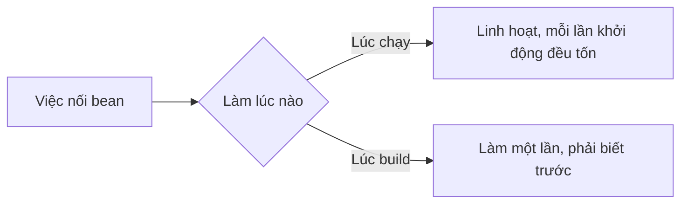
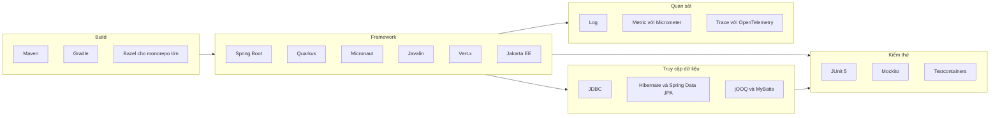
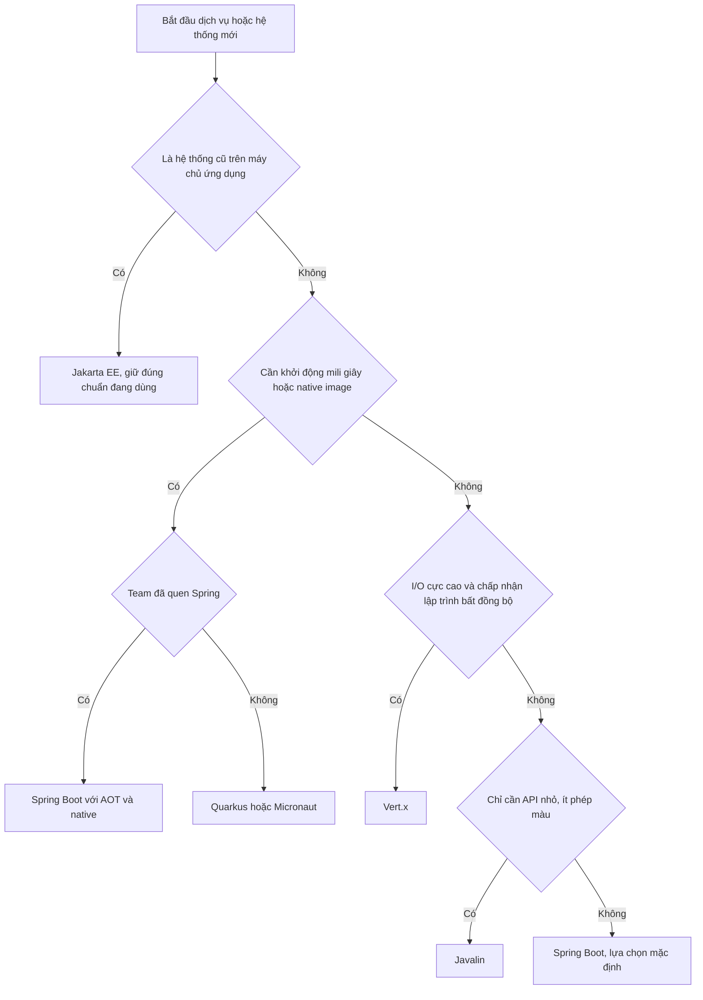
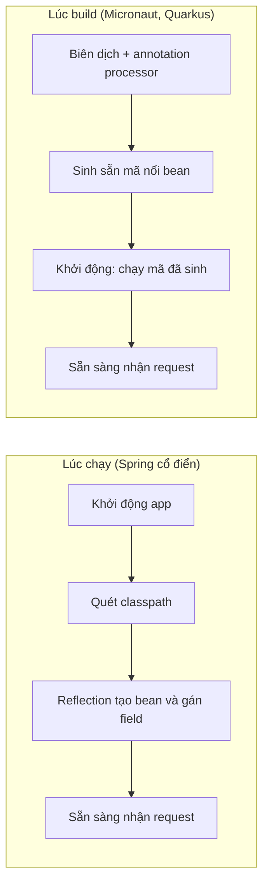
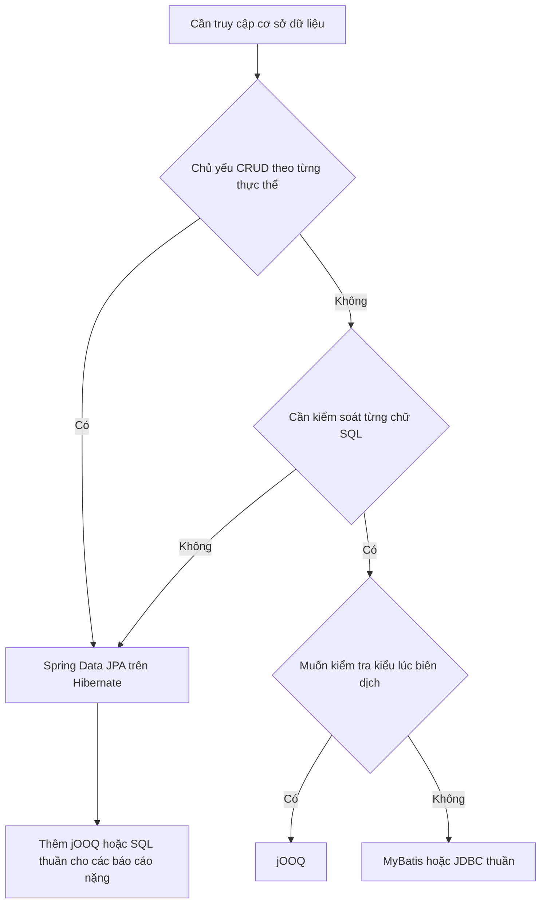
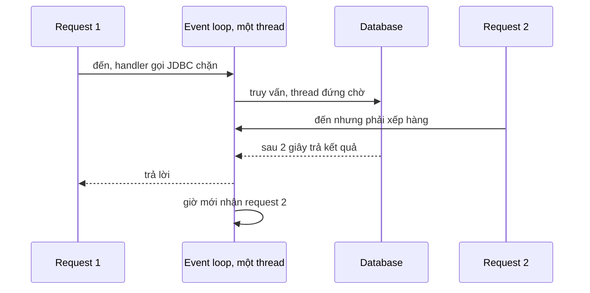

# Hệ sinh thái framework Java và công cụ build khác

## Vì sao cần biết ngoài Spring Boot

Phần lớn lập trình viên Java doanh nghiệp làm việc với Spring Boot, và đó là lựa chọn hợp lý. Nhưng nếu chỉ biết một framework, bạn sẽ gặp hai khó khăn. Thứ nhất, khi yêu cầu là khởi động trong vài chục mili-giây, ăn ít RAM, hoặc build ra native image để chạy trên serverless, bạn không có gì để so sánh và không biết có lựa chọn nào khác. Thứ hai, bạn khó đọc hiểu những dự án không dùng Spring, ví dụ hệ thống cũ chạy trên Jakarta EE hay dịch vụ viết bằng Vert.x.

Bài này là bản đồ các lựa chọn ngoài Spring Boot: Quarkus, Micronaut, Javalin, Play, Jakarta EE, Vert.x; kèm các thư viện truy cập dữ liệu (Hibernate, Ebean, jOOQ) và build tool Bazel. Bạn sẽ cân nhắc chúng khi chọn nền tảng cho service mới, khi làm serverless hoặc container nhỏ, hay khi phải bảo trì hệ thống cũ. Ngược lại, nếu team đã quen Spring Boot và không có áp lực về thời gian khởi động hay RAM thì cứ giữ Spring Boot, đổi framework chỉ vì "đang hot" thường tốn hơn lợi.

Để so sánh có cơ sở, ta không học thuộc tính năng mà nhìn vào ba trục: DI được dựng lúc chạy (reflection) hay lúc biên dịch (AOT), mô hình I/O (một thread mỗi request hay event loop), và mức trừu tượng framework cung cấp.

**Cốt lõi:** Framework nào cũng phải tạo và nối các object cho bạn; điều khác nhau là việc đó làm lúc nào. Làm lúc chạy thì linh hoạt nhưng mỗi lần khởi động đều trả giá, làm lúc build thì trả một lần, đổi lại phải biết trước mọi thứ.

- Vì quét classpath và reflection lặp lại mỗi lần khởi động nên Spring cổ điển khởi động chậm hơn và tốn RAM theo số bean.
- Vì mã nối bean được sinh sẵn lúc build nên lỗi thiếu bean lộ lúc biên dịch và native image hợp tự nhiên.
- Vì native image giả định "thế giới đóng" nên mọi thứ động như `Class.forName` phải khai báo trước.



Mô hình tư duy: sơ đồ cho thấy cùng một việc nối bean được dời sang thời điểm khác, và mỗi thời điểm đánh đổi tốc độ lấy sự linh hoạt.

**Tóm tắt:**

- Khác biệt cốt lõi giữa các framework là làm gì lúc build, làm gì lúc chạy: Spring cổ điển quét classpath và dùng reflection/proxy để dựng DI lúc khởi động; Quarkus và Micronaut dùng AOT, sinh sẵn mã nối bean lúc build.
- AOT cho khởi động nhanh, ít RAM, hợp native image, và lỗi thiếu bean lộ lúc biên dịch; đổi lại kém linh hoạt lúc chạy.
- Native image (GraalVM) dùng giả định "thế giới đóng": mọi class, reflection, proxy phải biết lúc build, nên `Class.forName` động hoặc `ServiceLoader` chưa khai báo sẽ lỗi lúc chạy; build chậm và không có JIT.
- Native image không phải lúc nào cũng tốt hơn: dịch vụ chạy dài, nhiều CPU thì JVM thường đủ hoặc tốt hơn; Spring Boot 3 cũng có AOT nhưng DI cốt lõi vẫn là tư duy lúc chạy.
- Event loop (Vert.x, Netty) dùng rất ít thread, nên một lệnh chặn trên đó làm đứng hàng loạt request.
- ORM hợp CRUD nhiều (N+1 và lazy loading ngoài transaction là bẫy), còn báo cáo phức tạp nên dùng SQL thuần hoặc jOOQ; thường dùng cả hai.
- Jakarta EE 9 đổi `javax.*` thành `jakarta.*`; Spring Boot 3 yêu cầu `jakarta.*`; Bazel dành cho monorepo rất lớn cần build hermetic và tái lập.
- Với đa số hệ thống doanh nghiệp Spring Boot vẫn là mặc định; chọn theo ràng buộc thật chứ không theo công cụ đang "hot".

## Các khái niệm cần biết

- **DI (Dependency Injection)**: thay vì tự `new` các dependency, bạn để framework tạo và "tiêm" chúng vào. Mọi framework trong bài đều có DI; khác nhau ở thời điểm nó được dựng.
- **AOT (Ahead-Of-Time)**: xử lý trước khi chạy, ở bước build. Trái với JIT, vốn biên dịch trong lúc chương trình chạy. Framework AOT sinh sẵn mã nối bean nên lúc chạy không phải quét và dùng reflection.
- **Native image (GraalVM)**: biên dịch ứng dụng Java thành file thực thi gốc của hệ điều hành, khởi động rất nhanh và ít RAM. Đổi lại phải biết trước mọi class sẽ dùng, như đã nói ở phần "thế giới đóng" bên dưới.
- **Event loop**: một vài thread lặp vô hạn lấy event (request, I/O hoàn tất) ra xử lý. Rất ít thread phục vụ rất nhiều kết nối, nhưng bất kỳ lệnh chặn nào trên các thread này đều làm đứng hàng loạt request.
- **Jakarta EE**: đặc tả chuẩn (CDI, JAX-RS, JPA...) mà nhiều nhà cung cấp cùng cài đặt, tiền thân là Java EE.
- **Hermetic build**: build chỉ phụ thuộc vào đầu vào được khai báo rõ, không đọc thứ gì ngầm từ máy đang build, nên cho cùng kết quả ở mọi nơi.
- **ORM (Object-Relational Mapping)**: ánh xạ object Java với bảng quan hệ để bạn thao tác bằng object thay vì viết SQL cho từng thao tác.

## Bản đồ

Bảng dưới so sánh các lựa chọn; ngoài ra còn Spark (tối giản như Javalin) và Play (asynchronous, Scala/Java). Jakarta EE là đặc tả chuẩn (CDI, JAX-RS, JPA). Khác biệt cốt lõi: Spring Boot dựng DI **lúc chạy** (reflection), Quarkus/Micronaut dựng **lúc biên dịch** (AOT).

| Framework | Điểm mạnh | Đánh đổi |
|---|---|---|
| **Spring Boot** | Hệ sinh thái, tài liệu, nhân lực, tích hợp mọi thứ | Khởi động và memory lớn hơn (giảm nhờ AOT/native) |
| **Quarkus** | Khởi động mili-giây, GraalVM native, dev mode hot reload | Cộng đồng nhỏ hơn Spring, tiện ích khác chuẩn |
| **Micronaut** | DI và AOP **lúc biên dịch**, không reflection, ít memory | Ít phổ biến |
| **Javalin** | Rất gọn, dễ học, ít phép màu | Tự lắp nhiều thành phần |
| **Jakarta EE** | Chuẩn, không phụ thuộc nhà cung cấp, máy chủ ứng dụng | Nặng, cấu hình cũ kỹ hơn |
| **Vert.x** | Event loop, hiệu năng cao, đa ngôn ngữ | Mô hình lập trình khó (không block thread event loop) |

Bản đồ dưới đặt các công cụ vào bốn tầng của một dịch vụ backend: build, framework, dữ liệu và kiểm thử, cùng tầng quan sát chạy xuyên suốt. Đọc từ trái sang phải theo vòng đời: code được build, chạy trên framework, truy cập dữ liệu, được kiểm thử, và khi chạy thật thì được quan sát.



Mũi tên chỉ hướng phụ thuộc chính: build đóng gói framework, framework gọi tầng dữ liệu, kiểm thử bám vào cả framework lẫn dữ liệu (Testcontainers chạy DB thật trong container để test), còn quan sát gắn vào framework để thu log, metric và trace. Phần lớn công cụ ở mỗi tầng thay thế được cho nhau, nên khi đổi framework bạn thường vẫn giữ JUnit, Testcontainers và Micrometer. Danh sách này là ví dụ phổ biến chứ không đầy đủ.

Sơ đồ dưới giúp chọn framework theo nhu cầu. Đọc từ trên xuống, trả lời theo ràng buộc thật của dự án; câu đầu tiên quan trọng nhất vì chi phí đổi framework lớn hơn chi phí học.



Cách đọc: nhánh "cần native" chỉ là bước rẽ khi có ràng buộc triển khai như serverless hay container nhỏ; nếu không có ràng buộc đặc biệt nào thì đường cuối cùng dẫn về Spring Boot, đúng với tinh thần "chọn theo ràng buộc thật". Sơ đồ không bao gồm Play và Spark; chúng ít gặp hơn ở doanh nghiệp.

Khi nào chọn gì ở mức nhanh: cần khởi động nhanh và native image thì nhìn Quarkus hoặc Micronaut; cần một API nhỏ, học nhanh thì Javalin; cần hiệu năng I/O rất cao và chấp nhận lập trình asynchronous thì Vert.x; hệ thống doanh nghiệp truyền thống trên máy chủ ứng dụng thì Jakarta EE; còn lại Spring Boot.

Nguyên lý nối với nội dung đã học: Spring quét class và dùng reflection/proxy lúc chạy ([IoC](/go?p=01-Spring-Boot%2Feasy%2Flt-02-ioc-di.md)); Quarkus/Micronaut chuyển phần lớn việc đó sang **lúc build** để native image biết trước mã nào cần. Nhưng native image cần cấu hình reflection tường minh ([Reflection](/go?p=08-Java%2FJava-Core%2Fmedium%2Flt-11-reflection-annotation.md)).

**Nền tảng:** Khác biệt cốt lõi giữa các framework là làm gì lúc build, làm gì lúc chạy: Spring cổ điển quét classpath và dùng reflection/proxy để dựng DI lúc khởi động; Quarkus, Micronaut dùng AOT, annotation processor sinh sẵn mã nối bean lúc build, nên khởi động nhanh, ít RAM và hợp native image.

**Suy luận:** Quarkus và Micronaut khởi động nhanh vì chúng chuyển công việc đắt nhất từ mỗi lần khởi động sang một lần ở lúc build. Spring cổ điển quét classpath, đọc annotation bằng reflection và sinh proxy mỗi lần chạy, nên thời gian khởi động và memory tăng theo số bean. Với AOT, annotation processor sinh sẵn mã nối bean lúc biên dịch, nên lúc chạy chỉ việc thực thi mã thường, không còn quét hay reflection. Hệ quả kéo theo: lỗi thiếu bean lộ ngay lúc biên dịch, và native image phù hợp tự nhiên vì mọi thứ đã biết trước, trong khi Spring phải sinh thêm gợi ý reflection cho native image. Đổi lại, AOT hạn chế sự linh hoạt lúc chạy: đổi bean theo cấu hình hay nạp plugin động phải đoán trước lúc build. Điểm dễ nhầm là cho rằng native image luôn tốt hơn; nó thường cho khởi động và RAM nhỏ hơn nhưng build chậm, không JIT nên đỉnh throughput thường thấp hơn, và `Class.forName` động có thể lỗi. Hãy chọn theo ràng buộc thật như serverless hay container nhỏ, không theo xu hướng.

### Minh họa: DI lúc chạy và DI lúc build

Vấn đề đặt ra là cùng một việc "tạo `Service` và nối `Repo` vào" có thể làm ở hai thời điểm khác nhau. Sơ đồ sau cho thấy dòng thời gian của hai cách.



Đọc sơ đồ: cách bên trái dồn công việc quét và reflection vào lúc khởi động mỗi lần chạy, còn cách bên phải làm một lần ở lúc build nên lúc chạy chỉ việc thực thi. Đó là nguồn gốc của khác biệt về thời gian khởi động.

Hai cách cho cùng một kết quả (đã chạy trên Java 11):

```java
@Retention(RetentionPolicy.RUNTIME) @interface Inject {}
static class Repo { String find() { return "dữ liệu"; } }
static class Service {
    @Inject Repo repo;
    String run() { return "Service dùng " + repo.find(); }
}

// Kiểu Spring: quét field và gán bằng reflection LÚC CHẠY
static final Map<Class<?>, Object> beans = new HashMap<>();
static <T> T get(Class<T> c) throws Exception {
    Object b = beans.get(c);
    if (b != null) return c.cast(b);
    T inst = c.getDeclaredConstructor().newInstance();
    beans.put(c, inst);
    for (Field f : c.getDeclaredFields())
        if (f.isAnnotationPresent(Inject.class)) { f.setAccessible(true); f.set(inst, get(f.getType())); }
    return inst;
}

// Kiểu Micronaut/Quarkus/Dagger: annotation processor SINH sẵn mã này lúc build
static Service generatedFactory() { Service s = new Service(); s.repo = new Repo(); return s; }
```

| | Lúc chạy (Spring cổ điển) | Lúc build (Micronaut, Quarkus, Dagger) |
|---|---|---|
| Lỗi thiếu bean | Phát hiện khi khởi động | Phát hiện khi **biên dịch** |
| Chi phí khởi động | Quét classpath, reflection, sinh proxy | Gần như chỉ chạy mã đã sinh |
| Native image | Cần gợi ý reflection/proxy (Spring AOT sinh sẵn) | Phù hợp tự nhiên: mọi thứ biết trước |
| Linh hoạt lúc chạy (đổi bean theo cấu hình, nạp plugin) | Cao | Hạn chế, phải đoán trước lúc build |

Native image dùng giả định "thế giới đóng": mọi class có thể dùng phải biết ở thời điểm build, nên `Class.forName` động, reflection, proxy và `ServiceLoader` chưa khai báo đều thất bại lúc chạy. Đó là lý do mô hình lúc build dễ chuyển sang native hơn.

**Phải thuộc:** Native image (GraalVM) dùng giả định "thế giới đóng": mọi class, reflection, proxy phải biết lúc build, nên `Class.forName` động hoặc `ServiceLoader` chưa khai báo sẽ lỗi lúc chạy. Đổi lại khởi động nhanh và ít RAM, nhưng build chậm và không có JIT. Jakarta EE 9 đổi `javax.*` thành `jakarta.*` (Spring Boot 3 yêu cầu `jakarta.*`).

## Truy cập dữ liệu

| Công cụ | Cách tiếp cận |
|---|---|
| **JDBC** | Thấp nhất, SQL thuần ([JDBC](/go?p=08-Java%2FJava-Core%2Fmedium%2Flt-28-jdbc-connection-pool-logging.md)) |
| **Hibernate** | ORM cài đặt JPA: ánh xạ object ↔ bảng, cache, lazy loading |
| **Spring Data JPA** | Repository sinh từ interface trên Hibernate |
| **Ebean** | ORM đơn giản hơn, không có `detach/attach` phức tạp như JPA |
| **jOOQ, MyBatis** | SQL kiểm soát chặt (jOOQ: DSL an toàn kiểu; MyBatis: ánh xạ SQL ↔ object) |



Đọc sơ đồ: mặc định CRUD đi vào JPA, còn truy vấn cần kiểm soát đi sang jOOQ, MyBatis hoặc JDBC. Mũi tên cuối từ JPA sang "thêm jOOQ" nhắc rằng hai cách thường cùng tồn tại trong một dự án.

Khi nào dùng ORM: ứng dụng CRUD nhiều, mô hình object khớp với bảng, bạn muốn bớt SQL lặp. Khi nào không: báo cáo, truy vấn nhiều join và tổng hợp, nơi cần kiểm soát câu SQL từng chữ; hậu quả khi dùng sai chỗ là truy vấn N+1 hoặc SQL sinh ra kém hiệu quả. Chọn theo độ phức tạp truy vấn: CRUD nhiều → JPA; báo cáo/SQL phức tạp → jOOQ/SQL thuần; thường kết hợp cả hai.

## Công cụ build: Bazel

Maven và Gradle quản lý build theo từng dự án; khi một repo chứa hàng nghìn module nhiều ngôn ngữ, thời gian build và việc tái lập kết quả trở thành vấn đề, và đó là chỗ Bazel xuất hiện.

- **Bazel** (Google): build **hermetic** và **tái lập**, cache từ xa, build tăng dần chính xác theo đồ thị phụ thuộc, hợp monorepo rất lớn đa ngôn ngữ.
- Đánh đổi: cấu hình (`BUILD`, Starlark) và tích hợp IDE/Spring phức tạp hơn Maven/Gradle; đáng giá khi quy mô lớn. Xem [Maven/Gradle](/go?p=08-Java%2FJava-Core%2Fmedium%2Flt-27-build-tool-maven-gradle.md).

## Vì sao không được chặn event loop

Vert.x và Netty chỉ có vài thread event loop. Sơ đồ dưới so sánh hai request cùng đến khi một handler gọi JDBC chặn 2 giây.



Đọc từ trên xuống: trong lúc thread event loop đứng chờ DB, request 2 không ai xử lý dù CPU đang rảnh. Cách đúng là dùng client bất đồng bộ (reactive SQL client của Vert.x) hoặc đẩy lệnh chặn sang worker pool riêng. Với một thread, độ trễ của request 2 cộng thêm toàn bộ thời gian chặn của request 1; với vài thread thì chỉ cần vài request chậm là cả hệ thống đứng.

## Bẫy hay hỏi

| Câu hỏi | Ý chính |
|---|---|
| Có phải native image luôn tốt hơn | Khởi động và RAM nhỏ hơn, nhưng build chậm, không JIT (đỉnh throughput thường thấp hơn), debug/profile khác. Dịch vụ chạy dài, nhiều CPU thì JVM thường đủ hoặc tốt hơn |
| Spring Boot 3 có AOT không | Có: xử lý AOT sinh sẵn cấu hình bean và gợi ý reflection cho native image, nhưng DI cốt lõi vẫn mang tư duy lúc chạy |
| Event loop (Vert.x, Netty) có gì cần tránh | Block thread event loop bằng lệnh chặn (JDBC, `sleep`, `Future.get`): chỉ vài thread nên một lệnh chặn làm đứng nhiều request |
| ORM hay SQL thuần | N+1, lazy loading ngoài transaction là bẫy của ORM; báo cáo phức tạp thì SQL thuần/jOOQ. Thường dùng cả hai |
| Jakarta EE khác Java EE | Đổi namespace `javax.*` thành `jakarta.*` từ Jakarta EE 9; Spring Boot 3 yêu cầu `jakarta.*`, thư viện cũ dùng `javax` sẽ lỗi khi nâng cấp |

## Tiêu chí chọn

1. Đội đã biết gì, tuyển người dễ không.
2. Ràng buộc môi trường: serverless/container nhỏ ưu tiên khởi động nhanh.
3. Hệ sinh thái tích hợp (bảo mật, dữ liệu, messaging, quan sát).
4. Độ trưởng thành và lifecycle hỗ trợ.

## Điều cần nhớ

- Khác biệt cốt lõi: **làm gì lúc build, làm gì lúc chạy**.
- Với đa số hệ thống doanh nghiệp, Spring Boot vẫn là lựa chọn mặc định; biết các lựa chọn khác để quyết định có cơ sở.
- Khung đúng hơn công cụ "hot": chọn theo ràng buộc thật.

## Phỏng vấn khó: chuỗi hỏi xoáy

Người phỏng vấn senior thường mở bằng câu dễ rồi xoáy xuống cơ chế, đánh đổi và sự cố thật. Câu trả lời tốt luôn đi từ cốt lõi xuống: việc gì làm lúc build, việc gì làm lúc chạy, và cái giá của mỗi lựa chọn.

### Chuỗi 1: DI lúc chạy và DI lúc build

1. **Câu mở:** Vì sao Quarkus hay Micronaut khởi động nhanh hơn Spring cổ điển?
2. **Xoáy 1:** Cụ thể công việc nào được dời đi, và dời đi đâu?
3. **Xoáy 2:** Cái giá phải trả là gì? Spring Boot 3 có AOT thì có còn khác không?

**Đáp án ngắn:** Cùng một việc nối bean, nhưng làm ở hai thời điểm. Spring cổ điển quét classpath, đọc annotation bằng reflection và sinh proxy mỗi lần khởi động, nên thời gian và RAM tăng theo số bean. Quarkus và Micronaut dùng annotation processor sinh sẵn mã nối bean lúc biên dịch, nên lúc chạy chỉ thực thi mã thường. Hệ quả kéo theo là lỗi thiếu bean lộ ngay lúc biên dịch và native image hợp tự nhiên vì mọi thứ biết trước. Đổi lại là kém linh hoạt: đổi bean theo cấu hình hoặc nạp plugin động phải đoán trước lúc build. Spring Boot 3 có xử lý AOT sinh cấu hình bean và gợi ý reflection cho native image, nhưng DI cốt lõi vẫn mang tư duy lúc chạy. Tôi chọn theo ràng buộc thật như serverless hay container nhỏ, không theo xu hướng; team đã quen Spring và không bị áp lực khởi động thì giữ Spring Boot.

**Sai lầm hay gặp:**

- Nói "nhanh hơn vì nhẹ hơn" mà không nêu được việc nào dời sang lúc build.
- Cho rằng AOT chỉ có lợi, bỏ qua mất linh hoạt lúc chạy.
- Nghĩ Spring Boot 3 đã giống hệt Quarkus.

### Chuỗi 2: Native image và thế giới đóng

1. **Câu mở:** Native image có luôn tốt hơn chạy trên JVM không?
2. **Xoáy 1:** "Thế giới đóng" nghĩa là gì và vì sao nó làm hỏng `Class.forName`?
3. **Xoáy 2:** Với một dịch vụ chạy dài, nhiều CPU, bạn chọn gì?

**Đáp án ngắn:** Không luôn tốt hơn. Native image cho khởi động rất nhanh và ít RAM, nhưng build chậm, không có JIT nên đỉnh throughput thường thấp hơn, và debug hay profile khác đi. Nó dựa trên giả định thế giới đóng: mọi class, reflection và proxy phải biết ở thời điểm build, vì file chạy được biên dịch trước chứ không nạp class tùy ý lúc chạy. Do đó `Class.forName` động, `ServiceLoader` hay proxy chưa khai báo sẽ lỗi lúc chạy chứ không lúc biên dịch, nên phải cấu hình gợi ý reflection tường minh. Với dịch vụ chạy dài, nhiều CPU, JVM thường đủ hoặc tốt hơn nhờ JIT, nên tôi chỉ chọn native khi có ràng buộc thật như serverless hoặc container nhỏ. Tôi sẽ đo thời gian khởi động và RAM thực tế trước khi quyết định.

**Sai lầm hay gặp:**

- Trả lời "native luôn nhanh hơn" mà bỏ qua JIT và throughput.
- Không giải thích được vì sao reflection động lại hỏng.
- Quyết định theo xu hướng, không đo.

### Chuỗi 3: Chặn event loop

1. **Câu mở:** Vì sao không được gọi JDBC trực tiếp trong handler của Vert.x?
2. **Xoáy 1:** Hai request đến cùng lúc, request 1 chặn 2 giây, request 2 chịu hậu quả gì?
3. **Xoáy 2:** Bạn sửa thế nào, và tình huống này nhìn thấy ra sao trong production?

**Đáp án ngắn:** Event loop chỉ có vài thread phục vụ rất nhiều kết nối, nên một lệnh chặn trên đó làm đứng cả những request không liên quan. Nếu handler gọi JDBC chặn 2 giây trên một thread event loop thì request 2 phải xếp hàng dù CPU đang rảnh, và độ trễ của nó cộng thêm đúng thời gian chặn. Với vài thread, chỉ cần vài request chậm là cả hệ thống đứng. Cách sửa là dùng client bất đồng bộ, như reactive SQL client của Vert.x, hoặc đẩy lệnh chặn sang worker pool riêng. Lệnh chặn không chỉ là JDBC mà còn `sleep` hay `Future.get`. Trong production, dấu hiệu là độ trễ tăng đồng loạt trong khi CPU thấp; thread dump sẽ cho thấy thread event loop đứng ở lời gọi chặn. Cách phòng là review chặt mọi lời gọi I/O trong handler.

**Sai lầm hay gặp:**

- Nghĩ chỉ request gọi DB bị chậm, không thấy ảnh hưởng lan sang request khác.
- Chỉ nhắc JDBC, quên `sleep` và `Future.get`.
- Đề xuất tăng số thread event loop thay vì bỏ lệnh chặn.

