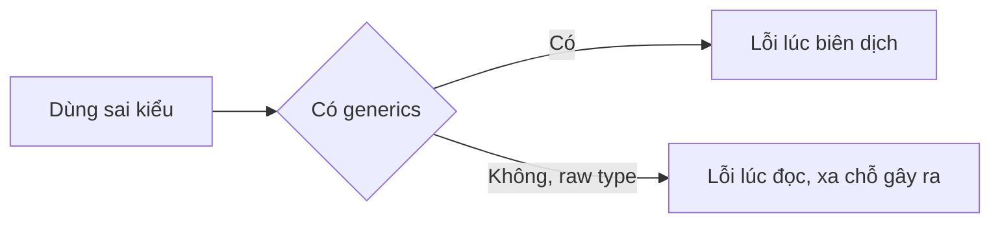
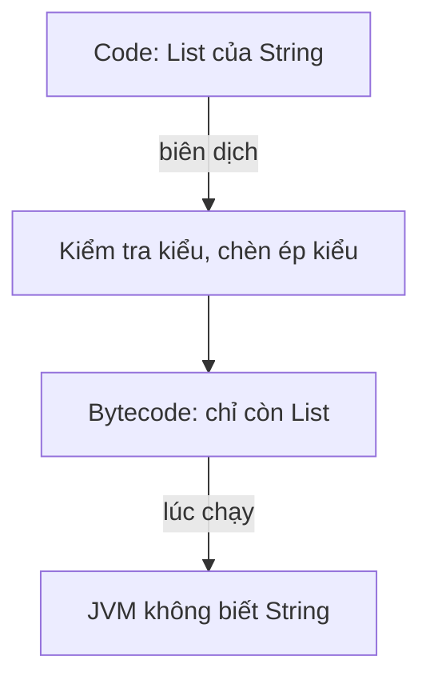
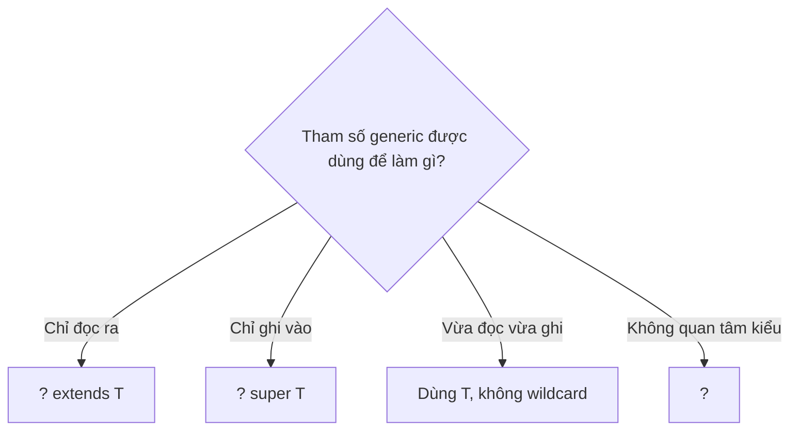

# Lý thuyết 7: Generics

## Generics là gì và vì sao có

Generics cho phép class hoặc method nhận "kiểu" làm tham số, giống như method nhận giá trị làm tham số. `List<String>` nghĩa là "danh sách chỉ chứa String"; `<T> T first(List<T> l)` nghĩa là "hàm lấy phần tử đầu của danh sách kiểu nào cũng được, và trả về đúng kiểu đó". Một đoạn code dùng được cho nhiều kiểu mà compiler vẫn kiểm tra kiểu giúp bạn.

Vấn đề nó giải quyết nằm ở thời Java chưa có generics. Khi đó `List` chứa `Object`, lấy ra phải tự ép kiểu, và ép sai thì `ClassCastException` nổ ở lúc chạy, có khi ở tận production. Cách duy nhất để an toàn là viết lại một class cho mỗi kiểu (`StringList`, `IntList`...). Generics đẩy lỗi đó lên lúc biên dịch: gõ sai kiểu là IDE báo đỏ ngay.

Bạn dùng generics khi viết collection, hàm tiện ích hay API thư viện cần làm việc với nhiều kiểu. Nếu một class chỉ dùng cho đúng một kiểu thì không cần generics, thêm vào chỉ làm chữ ký khó đọc. Ba thứ cần nắm để dùng đúng: cú pháp `<T>` và giới hạn kiểu bằng `extends`, **type erasure** (kiểu bị xóa lúc chạy nên không `new T()` được) và quy tắc **PECS** cho wildcard `?`.

**Cốt lõi:** Generics cho compiler biết kiểu bạn định dùng để nó kiểm tra thay bạn, nên lỗi sai kiểu lộ lúc biên dịch thay vì nổ lúc chạy. Để không phá code cũ, Java xóa thông tin kiểu sau khi kiểm tra, nên JVM không còn thấy tham số kiểu.

- Vì kiểu bị xóa lúc chạy nên `List<String>` và `List<Integer>` là một class, và không thể `new T()`.
- Vì gán `List<String>` cho `List<Object>` cho phép nhét sai kiểu nên generics là invariant.
- Vì `?` là một kiểu chưa biết nên `extends` chỉ đọc an toàn, `super` chỉ ghi an toàn (PECS).



Mô hình tư duy: sơ đồ cho thấy generics không làm code đúng hơn mà dời điểm phát hiện lỗi về sớm nhất có thể.

**Tóm tắt:**

- Generics đưa kiểu vào làm tham số để compiler bắt lỗi kiểu lúc biên dịch, thay vì `ClassCastException` nổ lúc chạy.
- Type erasure: compiler kiểm tra rồi xóa tham số kiểu khỏi bytecode, nên lúc chạy `List<String>` và `List<Integer>` cùng là `List`.
- Hệ quả của erasure: không `new T()`, không `instanceof List<String>`, không overload chỉ khác tham số kiểu, không dùng primitive làm tham số kiểu.
- Generics là invariant: `List<String>` không phải `List<Object>`, vì nếu được thì có thể nhét sai kiểu qua tham chiếu cha; array thì hiệp biến nên lỗi lộ lúc chạy.
- PECS: tham số chỉ đọc ra thì `? extends T`, chỉ ghi vào thì `? super T`, vừa đọc vừa ghi thì dùng `T`.
- Raw type tắt kiểm tra kiểu và gây heap pollution; lỗi nổ muộn và xa chỗ gây ra.
- Cần kiểu lúc chạy thì truyền `Class<T>` hoặc dùng super type token.

## Các khái niệm cần biết

- **Type parameter** (tham số kiểu): chữ cái như `T`, `E`, `K`, `V` đứng trong `<>` làm "chỗ trống" cho kiểu thật. Khi dùng, bạn điền vào: `Box<String>`.
- **Bounded type** (kiểu bị chặn): `<T extends Comparable<T>>` buộc `T` phải so sánh được, nhờ vậy trong thân method bạn gọi được `compareTo`. Không có ràng buộc thì `T` chỉ được coi là `Object`.
- **Raw type**: dùng class generic mà không có tham số, như `List` thay vì `List<String>`. Có chỉ để tương thích code cũ; dùng nó là tắt kiểm tra kiểu của compiler.
- **Heap pollution**: tình trạng variable kiểu `List<String>` thực tế chứa một object không phải String (thường do raw type). Lỗi lộ ra muộn, lúc đọc.
- **Type erasure**: compiler kiểm tra kiểu rồi xóa tham số kiểu khỏi bytecode, chỉ chèn thêm phép ép kiểu ở chỗ cần. Đây là cách Java giữ backward compatibility với code trước generics.
- **Invariant, hiệp biến**: hiệp biến (covariant) là "con thay được cha" như `String[]` gán cho `Object[]`. Invariant là không thay được; generics thuộc loại này.
- **Wildcard** `?`: "một kiểu nào đó chưa biết", dùng để nhận nhiều kiểu hơn mà vẫn an toàn.
- **Super type token**: mẹo lấy lại kiểu generic lúc chạy bằng cách tạo class con ẩn danh, được giải thích ở phần chạy thử.

## Dùng và định nghĩa

```java
class Box<T> {
    private T value;
    void set(T v) { value = v; }
    T get() { return value; }
}

static <T extends Comparable<T>> T max(List<T> list) {   // giới hạn kiểu
    T best = list.get(0);
    for (T x : list) if (x.compareTo(best) > 0) best = x;
    return best;
}
```

## Type erasure

Vấn đề đặt ra: Java muốn thêm generics mà không làm hỏng hàng triệu dòng code và thư viện cũ. Cách giải quyết là để compiler làm toàn bộ việc kiểm tra, rồi xóa thông tin kiểu đi để bytecode vẫn giống bytecode cũ. Sơ đồ dưới cho thấy hành trình đó.



Đọc sơ đồ: sau bước biên dịch, `List<String>` và `List<Integer>` chỉ còn là `List`; JVM không còn biết phần tử là gì. Hệ quả thực tế là những việc cần biết kiểu lúc chạy sẽ không làm được:

**Nền tảng:** Generics chỉ tồn tại lúc biên dịch (type erasure): compiler kiểm tra kiểu rồi xóa tham số kiểu và chèn phép ép kiểu, nên lúc chạy `List<String>` và `List<Integer>` là cùng một class. Từ đó suy ra mọi giới hạn: không `new T()`, không `instanceof List<String>`, không overload chỉ khác tham số kiểu, không `List<int>`.

| Không làm được | Lý do |
|---|---|
| `new T()`, `new T[10]` | Không biết `T` lúc chạy |
| `x instanceof List<String>` | Kiểu tham số đã bị xóa |
| Overload `f(List<String>)` và `f(List<Integer>)` | Cùng chữ ký sau khi xóa |
| Tham số kiểu là primitive (`List<int>`) | Dùng `List<Integer>` (có boxing) |

**Suy luận:** Java xóa tham số kiểu thay vì giữ lại lúc chạy vì generics ra đời sau khi đã có hàng triệu dòng code và thư viện dùng `List` thuần, và bytecode cũ phải tiếp tục chạy với code mới. Giải pháp là để compiler làm toàn bộ việc kiểm tra, rồi biên dịch `List<String>` thành `List` và chèn phép ép kiểu ở nơi đọc. Từ đó suy ra mọi giới hạn: `new T()` bất khả thi vì JVM không biết `T` là gì, `instanceof List<String>` vô nghĩa vì kiểu đã bị xóa, và hai method `f(List<String>)` với `f(List<Integer>)` cùng chữ ký sau khi xóa nên không overload được. Điểm dễ nhầm là nghĩ generics bảo vệ lúc chạy: raw type hay ép kiểu không kiểm tra có thể đưa object sai vào list, và lỗi chỉ nổ ở chỗ đọc, xa nơi gây ra. Muốn có kiểu lúc chạy thì phải truyền `Class<T>` hoặc dùng super type token, vì class con ẩn danh lưu lại kiểu cha khai báo trong metadata.

### Chạy thử: erasure để lại gì

```java
import java.lang.reflect.*;
import java.util.*;

public class Gen {
    static abstract class TypeRef<T> {                 // super type token
        final Type type;
        protected TypeRef() {
            type = ((ParameterizedType) getClass().getGenericSuperclass()).getActualTypeArguments()[0];
        }
    }

    @SuppressWarnings({"unchecked", "rawtypes"})
    public static void main(String[] args) {
        List<String> ss = new ArrayList<>();
        List<Integer> ii = new ArrayList<>();
        // true: cùng một class lúc chạy
        System.out.println(ss.getClass() == ii.getClass());

        List raw = ss;
        // raw type lách được compiler (heap pollution)
        raw.add(42);
        System.out.println(ss.size());                        // 1
        // compiler chèn ép kiểu (String) ở đây
        try { String s = ss.get(0); }
        catch (ClassCastException e) { System.out.println("CCE khi đọc, không phải khi ghi"); }

        Object[] arr = new String[1];
        try { arr[0] = 1; } catch (ArrayStoreException e) { System.out.println("ArrayStoreException"); }

        // java.util.List<java.lang.String>
        System.out.println(new TypeRef<List<String>>() {}.type);
    }
}
```

Điểm rút ra: lỗi do raw type nổ **muộn và xa chỗ gây ra** (lúc đọc). Super type token hoạt động vì kiểu của **class cha khai báo** vẫn được lưu trong metadata của class con (ở đây là class ẩn danh `{}`); kiểu của variable cục bộ thì không.

## Invariant: `List<Object>` không phải cha của `List<String>`

Array thì hiệp biến (`Object[] a = new String[1]` được, lỗi lúc chạy); generics **invariant** để lỗi lộ lúc biên dịch. Nếu `List<String>` được gán cho `List<Object>`, bạn sẽ nhét được `Integer` qua reference `List<Object>` và làm hỏng danh sách gốc, nên Java cấm ngay từ compiler. Cái giá là sự cứng nhắc: một hàm nhận `List<Object>` không nhận được `List<String>`. Wildcard ở mục sau cho phép linh hoạt có kiểm soát.

## Wildcard và PECS

**P**roducer **E**xtends, **C**onsumer **S**uper. Quy tắc này trả lời câu hỏi "nên dùng `extends` hay `super`?": nếu tham số là nguồn cung cấp dữ liệu cho bạn (bạn đọc từ nó) thì dùng `extends`; nếu nó là nơi nhận dữ liệu bạn đưa vào thì dùng `super`.

| Dạng | Đọc | Ghi | Dùng khi |
|---|---|---|---|
| `List<? extends Number>` | Đọc ra `Number` | Không thêm được (trừ `null`) | Bạn **lấy** dữ liệu từ nó (producer) |
| `List<? super Integer>` | Đọc ra `Object` | Thêm được `Integer` | Bạn **đưa** dữ liệu vào nó (consumer) |
| `List<?>` | Đọc ra `Object` | Không | Không quan tâm kiểu |

**Suy luận:** `List<? extends Number>` không cho thêm phần tử vì compiler chỉ biết list này chứa "một kiểu con nào đó của `Number`", có thể là `List<Integer>` hay `List<Double>`, nên không có giá trị nào (ngoài `null`) bảo đảm hợp kiểu để ghi vào. Nhưng đọc ra thì luôn an toàn dưới dạng `Number`, đây là lý do nó gọi là producer. Ngược lại `List<? super Integer>` chắc chắn chấp nhận được `Integer` vì mọi kiểu có thể xảy ra đều là cha của `Integer`, nhưng khi đọc ra chỉ bảo đảm là `Object`, nên đó là consumer. PECS chỉ là cách nhớ hai chiều suy luận này, và quy tắc khi chọn là xem tham số của bạn là nguồn hay đích dữ liệu. Chỗ dễ nhầm là dùng `? extends` rồi thắc mắc không `add` được, hoặc dùng `?` khi cần trả đúng kiểu đầu vào vì `?` không đặt tên được và nên dùng `<T>`. Khi thiết kế API công khai, hãy dùng wildcard ở tham số để tăng độ linh hoạt nhưng không để lộ chúng ở kiểu trả về.

**Phải thuộc:** PECS, Producer Extends, Consumer Super: tham số bạn chỉ đọc ra thì `? extends T`, tham số bạn chỉ ghi vào thì `? super T`, vừa đọc vừa ghi thì dùng `T`. `List<? extends Number>` không `add` được (trừ `null`). Generics invariant: `List<String>` không phải `List<Object>`.

```java
static double sum(Collection<? extends Number> src) { ... }            // producer
static void fill(List<? super Integer> dst) { dst.add(1); dst.add(2); } // consumer
// Collections.copy(List<? super T> dest, List<? extends T> src)
```

Chạy thử (đã xác nhận): `sum(List.of(1, 2.5, 3L))` ra `6.5`; `fill` nhận cả `List<Number>` lẫn `List<Object>` và cả hai thành `[1, 2]`. Còn `List<Integer>` đưa vào `fill` được, nhưng `List<? extends Number> l; l.add(1)` là **lỗi biên dịch** vì compiler không biết `?` cụ thể là kiểu nào.

Cách chọn nhanh, kèm sơ đồ quyết định:



| Câu hỏi | Dùng |
|---|---|
| Chỉ đọc phần tử ra | `? extends T` |
| Chỉ ghi phần tử vào | `? super T` |
| Vừa đọc vừa ghi cùng kiểu | Không wildcard, dùng `T` |
| Hàm cần trả đúng kiểu đầu vào | `<T>` thay vì `?` (`?` không đặt tên được) |

## Điều cần nhớ

- Không trộn **raw type** (`List` không tham số) vào code generics: mất an toàn kiểu.
- `@SafeVarargs` cho method varargs generics an toàn.
- Generic method suy luận kiểu từ tham số: `List.of(1, 2)` ra `List<Integer>`.
- Cần biết kiểu lúc chạy: truyền `Class<T>` (`Class<T> type`) hoặc dùng "super type token" (cách Jackson, Spring dùng `ParameterizedTypeReference`).
- Giữ API đơn giản: wildcard làm chữ ký khó đọc, chỉ dùng ở tham số của API công khai.

## Phỏng vấn khó: chuỗi hỏi xoáy

Người phỏng vấn senior thường mở bằng câu dễ rồi xoáy xuống cơ chế, đánh đổi và sự cố thật. Câu trả lời tốt luôn đi từ cốt lõi xuống: compiler làm gì, JVM thấy gì, lỗi nổ ở đâu.

### Chuỗi 1: Type erasure

1. **Câu mở:** Type erasure là gì?
2. **Xoáy 1:** Vì sao không viết được `new T()` hay `instanceof List<String>`?
3. **Xoáy 2:** Nếu raw type nhét một `Integer` vào `List<String>`, lỗi nổ ở đâu và vì sao? Muốn có kiểu lúc chạy thì làm sao?

**Đáp án ngắn:** Type erasure là việc compiler kiểm tra kiểu rồi xóa tham số kiểu khỏi bytecode và chèn phép ép kiểu ở chỗ cần. Java chọn cách này để bytecode mới vẫn chạy được cùng code và thư viện cũ trước generics. Hệ quả là lúc chạy `List<String>` và `List<Integer>` là cùng một class, nên JVM không biết `T` là gì và `new T()` bất khả thi; `instanceof List<String>` vô nghĩa vì kiểu đã bị xóa; hai method chỉ khác tham số kiểu thì cùng chữ ký nên không overload được. Raw type tắt kiểm tra của compiler nên có thể nhét `Integer` vào `List<String>` (heap pollution), và `ClassCastException` chỉ nổ lúc đọc, tại chỗ compiler chèn phép ép kiểu, xa nơi gây lỗi. Muốn có kiểu lúc chạy thì truyền `Class<T>` hoặc dùng super type token, vì class con ẩn danh lưu kiểu của class cha khai báo trong metadata. Đây là cách Jackson và Spring dùng `ParameterizedTypeReference`.

**Sai lầm hay gặp:**

- Nghĩ generics bảo vệ cả lúc chạy.
- Giải thích erasure mà không nêu được lý do tương thích ngược.
- Nói super type token lấy được kiểu của variable cục bộ.

### Chuỗi 2: Invariant và PECS

1. **Câu mở:** Vì sao `List<String>` không gán được cho `List<Object>`?
2. **Xoáy 1:** Tại sao `List<? extends Number>` đọc được mà không `add` được?
3. **Xoáy 2:** Một hàm vừa đọc vừa ghi cùng kiểu thì dùng wildcard hay `T`? Khi nào nên dùng `<T>` thay vì `?`?

**Đáp án ngắn:** Nếu gán được thì qua reference `List<Object>` ta nhét được `Integer` vào danh sách thực chất là `List<String>`, nên Java cấm ngay lúc biên dịch; generics invariant, khác array hiệp biến vốn chỉ lỗi lúc chạy với `ArrayStoreException`. Wildcard cho linh hoạt có kiểm soát. Với `List<? extends Number>`, compiler chỉ biết "một kiểu con nào đó của `Number`", có thể là `List<Integer>` hay `List<Double>`, nên không giá trị nào ngoài `null` chắc chắn hợp kiểu để ghi, nhưng đọc ra thành `Number` thì luôn an toàn. Ngược lại `? super Integer` chắc chắn nhận được `Integer` vì mọi kiểu có thể đều là cha của nó, còn đọc ra chỉ được `Object`. Đó là PECS: producer extends, consumer super. Vừa đọc vừa ghi cùng kiểu thì dùng `T`, không wildcard. Cần trả đúng kiểu đầu vào cũng dùng `<T>`, vì `?` không đặt tên được. Ở API công khai, wildcard để ở tham số, không để lộ ở kiểu trả về.

**Sai lầm hay gặp:**

- Học thuộc "PECS" nhưng không giải thích được vì sao `add` bị cấm.
- Dùng `?` khi cần trả đúng kiểu đầu vào.
- Lẫn invariant của generics với hiệp biến của array.

