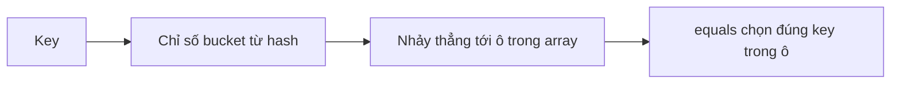
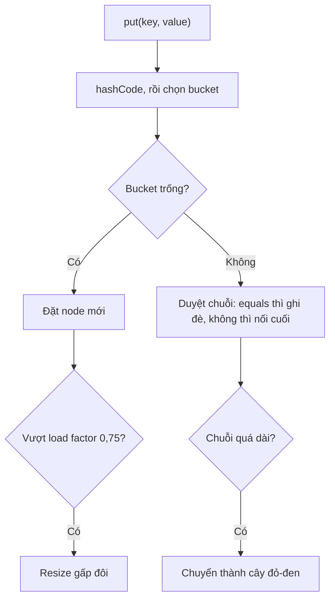
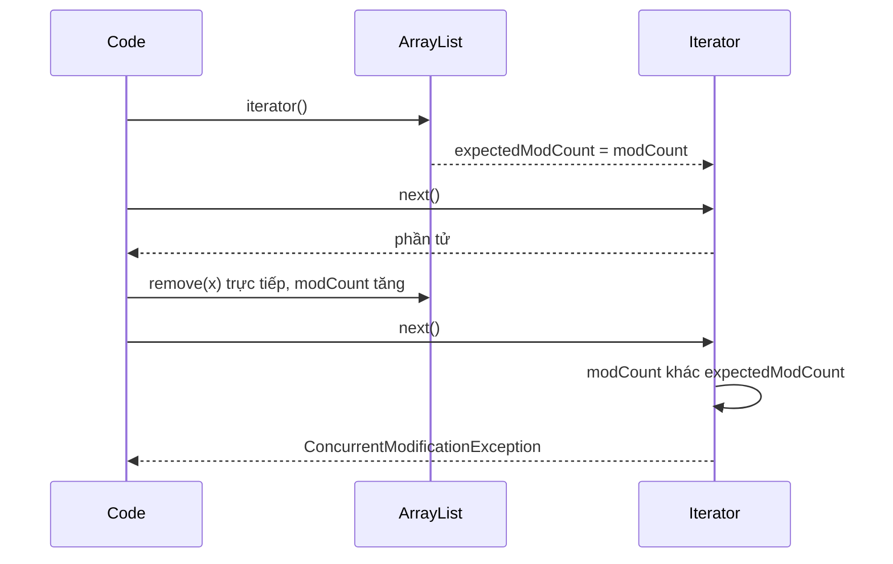

# Lý thuyết 8: Collections bên trong

## Vì sao cần nhìn vào bên trong collection

Ai cũng biết "`HashMap` tra cứu O(1)". Nhưng câu đó chỉ đúng khi mọi thứ diễn ra suôn sẻ. Nếu chỉ biết đến đó, bạn sẽ ngạc nhiên khi `ArrayList` chèn vào đầu danh sách lại chậm, khi `HashMap` dùng key có `hashCode` tệ bỗng chậm hẳn, hay khi nhiều thread cùng ghi vào một `HashMap` làm dữ liệu hỏng. Mỗi hiện tượng đó đều có lời giải thích ở cấu trúc dữ liệu bên dưới: array, hash table, cây, heap.

Bài này mở nắp `ArrayList`, `HashMap`, `TreeMap`, `PriorityQueue` và các collection đồng thời để xem chúng được xây thế nào. Bạn cần kiến thức này khi chọn cấu trúc cho dữ liệu lớn, khi truy tìm chỗ nghẽn hiệu năng, và tất nhiên khi bị hỏi phỏng vấn. Với dữ liệu nhỏ (vài trăm phần tử) thì cứ chọn cái dễ đọc nhất, chênh lệch hiệu năng không đáng kể.

Bốn cơ chế cần nắm: array tự nở ra khi đầy, hash và xử lý collision, cây đỏ-đen để giữ thứ tự và cứu hiệu năng khi đụng độ nhiều, và cơ chế fail-fast khi sửa collection trong lúc đang duyệt. Cuối cùng, hễ nhiều thread dùng chung một collection thì chọn collection đồng thời phù hợp, đừng dùng `HashMap` thường.

**Cốt lõi:** Mỗi collection là một cách tổ chức array, cây hoặc heap, và tốc độ như "O(1)" chỉ là hệ quả của cấu trúc đó. Điều kiện của cấu trúc mà hỏng thì tốc độ mất theo. `HashMap` biến key thành chỉ số của array rồi nhảy thẳng tới ô.

- Vì bucket được chọn bằng `hash & (n - 1)` nên bảng luôn là lũy thừa của 2 và hash phải được trộn bit.
- Vì hash tệ làm mọi key dồn vào một bucket nên có cây đỏ-đen làm lưới an toàn.
- Vì collection thường không đồng bộ gì cả nên `modCount` chỉ phát hiện lỗi cố gắng hết sức, và nhiều thread phải dùng collection concurrent.



Mô hình tư duy: sơ đồ cho thấy tra cứu nhanh nhờ nhảy thẳng tới ô, và hash là thứ quyết định ô đó đông hay thưa.

**Tóm tắt:**

- `ArrayList` là array `Object[]` tự nở khoảng 1,5 lần khi đầy: thêm cuối O(1) khấu hao, chèn hoặc xóa giữa O(n), truy cập theo chỉ số O(1).
- `HashMap` là array bucket: `hashCode` (đã trộn bit) chọn bucket, `equals` phân biệt key trong bucket; mặc định 16 ô, load factor 0,75, resize gấp đôi.
- Bucket từ 8 node trở lên và bảng từ 64 ô trở lên thì chuyển sang cây đỏ-đen, đưa tra cứu xấu nhất từ O(n) xuống O(log n).
- Hash tệ hoặc bị tấn công (HashDoS) khiến mọi key vào một bucket; key đổi field dính `hashCode` sau khi `put` làm entry biến mất.
- `LinkedHashMap` giữ thứ tự và làm LRU, `TreeMap` sắp xếp O(log n), `PriorityQueue` là binary heap chỉ bảo đảm phần tử nhỏ nhất ở đỉnh.
- Collection thường không thread-safe; `ConcurrentHashMap` dùng CAS và lock theo bucket, không cho `null`, và chỉ `merge`/`compute` mới atomic.
- Fail-fast dựa trên `modCount` chỉ là phát hiện lỗi cố gắng hết sức; xóa khi duyệt phải dùng `Iterator.remove()` hoặc `removeIf`.

## Các khái niệm cần biết

- **Bucket**: một ô trong array của hash table. Key được hash ra một con số rồi quy về chỉ số ô; các entry rơi cùng ô được nối lại với nhau.
- **Hash collision**: hai key khác nhau cho cùng bucket. Không tránh được hoàn toàn, nên `HashMap` luôn phải so sánh thêm bằng `equals`.
- **Load factor**: tỷ lệ đầy tối đa trước khi bảng nở ra (mặc định 0,75). Thấp thì tốn memory, cao thì đụng độ nhiều.
- **O(1) khấu hao** (amortized): phần lớn lần thêm tốn O(1), thỉnh thoảng có lần tốn O(n) do sao chép array, nhưng chia đều ra thì trung bình vẫn là hằng số.
- **Cây đỏ-đen**: cây nhị phân tìm kiếm tự cân bằng, đảm bảo tra cứu, thêm, xóa đều O(log n) kể cả trong trường hợp xấu nhất.
- **Binary heap**: cây (cài đặt bằng array) mà phần tử cha luôn nhỏ hơn hoặc bằng con (min-heap). Lấy phần tử nhỏ nhất rất nhanh nhưng toàn bộ không được sắp xếp.
- **CAS (compare-and-swap)**: lệnh CPU "chỉ ghi giá trị mới nếu giá trị hiện tại đúng như tôi nghĩ", nền tảng của cấu trúc lock-free.
- **`modCount`**: bộ đếm số lần cấu trúc collection bị thay đổi, dùng để phát hiện sửa khi đang duyệt.
- **HashDoS**: kiểu tấn công gửi nhiều key cùng hash để biến mọi thao tác thành chậm tuyến tính và làm nghẽn server.

## ArrayList

`ArrayList` là lựa chọn mặc định cho danh sách: truy cập theo chỉ số O(1), duyệt nhanh nhờ memory liền kề. Không nên dùng khi bạn chèn hoặc xóa liên tục ở đầu hoặc giữa danh sách lớn, vì mỗi lần phải dịch cả đoạn phần tử (khi đó cân nhắc `ArrayDeque` cho queue).

- Array `Object[]` bên trong; khi đầy **tăng khoảng 1,5 lần** và sao chép (`Arrays.copyOf`).
- Thêm cuối: O(1) khấu hao. Chèn/xóa giữa: O(n) do dịch phần tử.
- Biết trước kích thước: `new ArrayList<>(n)` để tránh sao chép nhiều lần.

**Phải thuộc:** `ArrayList` dựa trên array `Object[]`, khi đầy tăng khoảng 1,5 lần rồi sao chép; thêm cuối O(1) khấu hao, chèn hoặc xóa giữa O(n), truy cập theo chỉ số O(1).

## HashMap

Vấn đề đặt ra: muốn tìm theo key mà không phải duyệt cả danh sách. Cách giải quyết của `HashMap` là hash key thành chỉ số của một array, nhảy thẳng tới ô đó. Sơ đồ sau là đường đi của một lần `put`.



Đọc sơ đồ: bước quyết định là "bucket có trống không". Nếu không trống thì phải đi dọc chuỗi và dùng `equals` để biết là cùng key (ghi đè) hay chỉ trùng bucket (nối thêm). Hai cơ chế bảo vệ hiệu năng là cây hóa khi chuỗi dài và resize khi bảng đầy.

**Nền tảng:** `HashMap` là array các bucket: `hashCode` quy ra chỉ số bucket, `equals` phân biệt các key rơi cùng bucket. Hiệu năng O(1) chỉ đúng khi hash phân bố đều; hash tệ hoặc bị tấn công thì mọi key dồn vào một bucket, và cây đỏ-đen được thêm vào để chặn tình huống đó ở mức O(log n).

| Thông số | Giá trị |
|---|---|
| Kích thước bảng | Luôn là lũy thừa của 2 (mặc định 16) |
| Load factor | 0,75 |
| Va chạm | Chuỗi liên kết, từ 8 phần tử thành cây (tra cứu O(log n) thay O(n)) |
| `null` | Cho phép một key `null` |
| Thứ tự duyệt | **Không đảm bảo**, có thể đổi sau resize |

**Phải thuộc:** `HashMap`: bảng mặc định 16 ô, luôn là lũy thừa của 2, load factor 0,75 (đầy 75% thì resize gấp đôi). Bucket chuyển từ danh sách sang cây đỏ-đen khi từ 8 node trở lên và bảng từ 64 ô trở lên; thoái về danh sách khi còn 6 node hoặc ít hơn.

**Suy luận:** `HashMap` luôn dùng kích thước bảng là lũy thừa của 2 vì khi đó chọn bucket bằng `hash & (n - 1)` thay cho phép chia lấy dư, nhanh hơn nhiều, và việc này kéo theo hai hệ quả. Thứ nhất, chỉ các bit thấp của hash tham gia chọn bucket, nên `HashMap` phải trộn 16 bit cao xuống bằng XOR để hash có phân bố kém ở bit thấp vẫn không dồn vào vài bucket. Thứ hai, khi resize gấp đôi, mỗi node chỉ có hai khả năng là ở nguyên chỉ số hoặc dời thêm `oldCap` tùy một bit, nên không cần tính lại hash. Cây đỏ-đen chỉ là lưới an toàn cho trường hợp xấu: nó cần cả bucket từ 8 node lẫn bảng từ 64 ô, vì bảng nhỏ nhiều xung đột thì resize rẻ và hiệu quả hơn tạo cây. Điểm dễ nhầm là tin O(1) là tuyệt đối, trong khi nó chỉ đúng khi hash phân bố đều, và `hashCode` trả hằng số đẩy mọi thứ về một bucket. Hệ quả hành động: key phải immutable với `hashCode` tốt, và biết trước số phần tử thì cấp capacity ngay để tránh resize.

### Chọn bucket và resize bằng con số

Chỉ số bucket = `(h ^ (h >>> 16)) & (n - 1)` với `h = key.hashCode()`, `n` là kích thước bảng. Vì `n` là lũy thừa của 2 nên `& (n - 1)` tương đương `% n` nhưng nhanh hơn; phép XOR trộn 16 bit cao xuống để key chỉ khác nhau ở bit cao vẫn rải đều.

| Kích thước bảng `n` | Ngưỡng resize (`n * 0,75`) |
|---|---|
| 16 | 12 (phần tử thứ 13 gây resize lên 32) |
| 32 | 24 |
| 64 | 48 |

Khi resize, mỗi node **không cần tính lại hash**: chỉ xét bit `hash & oldCap`. Bằng 0 thì ở nguyên chỉ số cũ, khác 0 thì chuyển sang `chỉ số cũ + oldCap`.

Cây hóa có điều kiện kép: bucket từ 8 node **và** bảng từ 64 ô trở lên. Bảng nhỏ hơn 64 thì HashMap **resize** thay vì tạo cây. Cây còn thoái lại danh sách khi co xuống 6 node hoặc ít hơn.

```java
import java.util.*;

public class Bucket {
    static int spread(Object k) { int h = k.hashCode(); return h ^ (h >>> 16); }
    static int index(Object k, int n) { return spread(k) & (n - 1); }

    public static void main(String[] args) {
        // 2112 2112: hai chuỗi khác nhau, cùng hash
        System.out.println("Aa".hashCode() + " " + "BB".hashCode());
        // 0 0: rơi cùng bucket, phải so equals
        System.out.println(index("Aa", 16) + " " + index("BB", 16));
        String k = "banana";
        // 0 0: hash & 16 == 0 nên ở yên sau resize
        System.out.println(index(k, 16) + " " + index(k, 32));
    }
}
```

### Bẫy key thay đổi và hashCode tệ

- Key đổi trường dính vào `hashCode` sau khi `put`: entry nằm ở bucket cũ, `get` tìm bucket mới nên trả `null` (xem [Collections cơ bản](/go?p=08-Java%2FJava-Core%2Feasy%2Flt-05-collections-co-ban.md)).
- `hashCode()` luôn trả hằng số: mọi key vào một bucket, thoái hóa về O(n), hoặc O(log n) nếu key `Comparable` để cây hoạt động. Đây là cách tấn công hash collision vào server (HashDoS) và là lý do cây đỏ-đen tồn tại.
- Key là array hoặc object chưa override `hashCode`: dùng định danh object, `get` bằng bản sao luôn trượt.

### LRU cache bằng LinkedHashMap

```java
class Lru<K, V> extends LinkedHashMap<K, V> {
    private final int max;
    // true = thứ tự theo lần truy cập
    Lru(int max) { super(16, 0.75f, true); this.max = max; }
    @Override protected boolean removeEldestEntry(Map.Entry<K, V> e) { return size() > max; }
}
// put a, put b, get a, put c (max = 2)  ->  keySet() = [a, c]  (b ít dùng nhất bị loại)
```

Class này **không thread-safe** (`get` cũng sửa cấu trúc khi `accessOrder=true`).

### Đồng thời: cùng phép merge, hai kết quả

4 thread, mỗi thread gọi `merge("x", 1, Integer::sum)` 10 000 lần:

| Map | Kết quả |
|---|---|
| `ConcurrentHashMap` | Luôn `40000` (đã chạy xác nhận) |
| `HashMap` | Không xác định: thường nhỏ hơn 40000 do mất cập nhật, có thể hỏng cấu trúc |

Biết trước số phần tử: `new HashMap<>(capacity)` hoặc `HashMap.newHashMap(n)` (Java 19+) tránh resize.

## Các Map/Set khác

Khi `HashMap` không đủ, ta đổi cấu trúc theo nhu cầu: cần thứ tự thêm hoặc LRU thì `LinkedHashMap`; cần sắp xếp thì `TreeMap`. Đừng dùng `TreeMap` khi không cần thứ tự, vì O(log n) chậm hơn hash.

| Cấu trúc | Bên trong | Dùng khi |
|---|---|---|
| `LinkedHashMap` | HashMap + danh sách liên kết đôi | Giữ thứ tự thêm; cache LRU (`accessOrder=true`, `removeEldestEntry`) |
| `TreeMap` | Cây đỏ-đen | Cần sắp xếp, `floorKey`, `subMap`, O(log n) |
| `EnumMap` | Array theo ordinal | Key là `enum`, rất nhanh |
| `PriorityQueue` | Binary heap | Lấy min/max, O(log n); duyệt **không** theo thứ tự |
| `ArrayDeque` | Array vòng | Stack/queue |

## Collection đồng thời

Vấn đề: `HashMap` và `ArrayList` không thread-safe. Hai thread cùng ghi có thể làm mất cập nhật, hỏng cấu trúc hoặc cho kết quả khó tái hiện. Collection đồng thời giải quyết bằng cách đồng bộ có kiểm soát, nhưng mỗi loại hợp một kiểu dùng.

| Cần | Dùng | Lưu ý |
|---|---|---|
| Map nhiều thread | `ConcurrentHashMap` | Không lock toàn bảng (CAS và lock theo bucket); **không** cho `null`; `merge`, `compute` atomic |
| Danh sách đọc nhiều ghi ít | `CopyOnWriteArrayList` | Mỗi lần ghi sao chép toàn array |
| Queue chặn | `BlockingQueue` (`ArrayBlockingQueue`, `LinkedBlockingQueue`) | Nền tảng producer-consumer |
| Bọc collection thường | `Collections.synchronizedList` | Lock thô, duyệt vẫn phải tự đồng bộ |

```java
ConcurrentHashMap<String, LongAdder> counter = new ConcurrentHashMap<>();
// nguyên tử, không cần khóa ngoài
counter.computeIfAbsent(word, k -> new LongAdder()).increment();
```

Lỗi phổ biến: `if (!map.containsKey(k)) map.put(k, v)` trên map đồng thời **không** atomic; dùng `putIfAbsent`/`computeIfAbsent`.

**Phải thuộc:** `HashMap` không thread-safe; dùng `ConcurrentHashMap` (không cho key hoặc value `null`, `merge`/`compute` atomic). Kiểm tra rồi ghi (`containsKey` rồi `put`) không atomic, dùng `putIfAbsent`/`computeIfAbsent`. `CopyOnWriteArrayList` cho đọc nhiều ghi ít.

## Fail-fast

Giả sử bạn vừa duyệt danh sách vừa xóa phần tử bằng `list.remove(x)` trong vòng `for-each`. Iterator nhớ `modCount` lúc tạo và so lại ở mỗi lần `next()`; lệch thì báo lỗi ngay thay vì tiếp tục với dữ liệu không nhất quán.



**Suy luận:** Fail-fast hoạt động vì mỗi collection giữ `modCount` đếm số lần cấu trúc bị đổi, iterator ghi nhớ giá trị đó lúc tạo và so lại ở mỗi `next()`. Nếu lệch, nghĩa là ai đó đã thêm hoặc xóa ngoài iterator, nên nó throw ngay thay vì tiếp tục duyệt trên cấu trúc có thể đã dịch chuyển và trả dữ liệu sai. Chính vì chỉ so ở `next()` nên nó không phải bảo đảm: xóa phần tử áp chót khiến `hasNext()` trả `false` trước khi có lần `next()` nào kiểm tra, và vòng lặp kết thúc êm nhưng bỏ sót phần tử. Cũng vì không có đồng bộ nào, cơ chế này không bảo vệ khỏi nhiều thread cùng ghi. Do đó đừng dựa vào `ConcurrentModificationException` để phát hiện lỗi; muốn sửa khi duyệt thì dùng `Iterator.remove()` hoặc `removeIf`, còn muốn nhiều thread thì dùng collection concurrent có iterator weakly consistent.

Sửa cấu trúc khi đang duyệt (không qua iterator) làm `modCount` đổi, lần `next()` sau throw `ConcurrentModificationException`. Đây là cơ chế **phát hiện lỗi cố gắng hết sức**, không phải bảo đảm thread-safe.

## Sắp xếp

- `Comparable` (thứ tự tự nhiên, trong class) và `Comparator` (thứ tự ngoài, có thể nhiều kiểu).
- Comparator phải nhất quán và bắc cầu; trừ hai `int` để so sánh có thể **tràn số**, dùng `Integer.compare`.
- `List.sort`/`Arrays.sort` cho object dùng TimSort (ổn định, O(n log n)).

## Phỏng vấn khó: chuỗi hỏi xoáy

Người phỏng vấn senior thường mở bằng câu dễ rồi xoáy xuống cơ chế, đánh đổi và sự cố thật. Câu trả lời tốt luôn đi từ cốt lõi xuống: cấu trúc dữ liệu bên dưới, điều kiện để tốc độ đúng, và điều gì xảy ra khi điều kiện đó vỡ.

### Chuỗi 1: HashMap và hash tệ

1. **Câu mở:** `HashMap.get` là O(1), điều đó đúng khi nào?
2. **Xoáy 1:** Vì sao kích thước bảng luôn là lũy thừa của 2, và resize có phải tính lại hash không?
3. **Xoáy 2:** Nếu `hashCode` trả hằng số, hoặc key bị đổi field sau khi `put`, chuyện gì xảy ra?

**Đáp án ngắn:** O(1) chỉ đúng khi hash phân bố đều, vì `HashMap` biến key thành chỉ số bucket rồi nhảy thẳng tới ô, còn `equals` phân biệt các key rơi cùng ô. Bảng là lũy thừa của 2 để chọn bucket bằng `hash & (n - 1)` thay cho phép chia lấy dư; vì chỉ các bit thấp tham gia nên `HashMap` XOR 16 bit cao xuống để hash tệ ở bit thấp vẫn rải đều. Khi resize gấp đôi, mỗi node không cần tính lại hash, chỉ xét bit `hash & oldCap`: bằng 0 thì ở yên, khác 0 thì dời thêm `oldCap`. Nếu `hashCode` trả hằng số thì mọi key vào một bucket và thoái hóa về O(n). Cây đỏ-đen (bucket từ 8 node và bảng từ 64 ô) kéo xuống O(log n) nếu key `Comparable`; đây cũng là lý do chống HashDoS. Key đổi field dính `hashCode` sau `put` thì entry nằm ở bucket cũ, `get` tìm bucket mới nên trả `null`. Vì vậy key phải immutable với `hashCode` tốt.

**Sai lầm hay gặp:**

- Nói O(1) tuyệt đối, không nêu điều kiện hash đều.
- Quên cây hóa cần cả hai điều kiện, bảng nhỏ hơn 64 thì resize.
- Dùng object mutable làm key.

### Chuỗi 2: Duyệt, sửa và đồng thời

1. **Câu mở:** Vì sao `list.remove(x)` trong vòng `for-each` gây `ConcurrentModificationException`?
2. **Xoáy 1:** Có thể dựa vào exception này để phát hiện lỗi đa luồng không?
3. **Xoáy 2:** `ConcurrentHashMap` có làm `if (!map.containsKey(k)) map.put(k, v)` an toàn không?

**Đáp án ngắn:** Mỗi collection giữ `modCount` đếm số lần cấu trúc đổi; iterator ghi nhớ giá trị đó lúc tạo và so lại ở mỗi `next()`. Sửa trực tiếp ngoài iterator thì lệch và nó throw ngay thay vì duyệt trên cấu trúc đã dịch chuyển. Nhưng đây chỉ là phát hiện lỗi cố gắng hết sức: chỉ so ở `next()`, nên xóa phần tử áp chót làm `hasNext()` trả `false` trước khi có kiểm tra nào, vòng lặp kết thúc êm mà bỏ sót phần tử. Cũng không có đồng bộ nào, nên nó không bảo vệ khỏi nhiều thread cùng ghi. Muốn xóa khi duyệt thì dùng `Iterator.remove()` hoặc `removeIf`. `ConcurrentHashMap` dùng CAS và lock theo bucket, không cho `null`, và `merge`, `compute` atomic, nhưng kiểm tra rồi ghi tách thành hai bước thì vẫn không atomic. Phải dùng `putIfAbsent` hoặc `computeIfAbsent`. Lỗi mất cập nhật trên `HashMap` thường lộ lúc tải cao, như 4 thread cùng `merge` mà tổng nhỏ hơn kỳ vọng.

**Sai lầm hay gặp:**

- Coi `ConcurrentModificationException` là bảo đảm phát hiện lỗi.
- Nghĩ collection concurrent làm mọi chuỗi thao tác tự atomic.
- Bọc `Collections.synchronizedList` rồi duyệt không đồng bộ.

