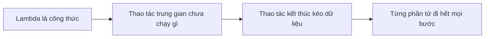
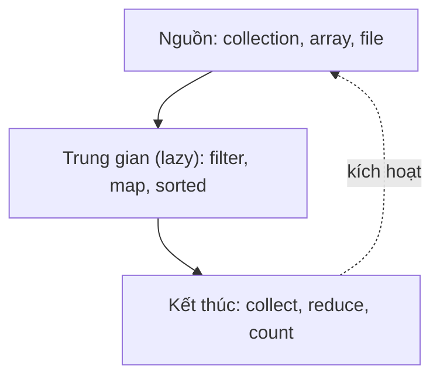
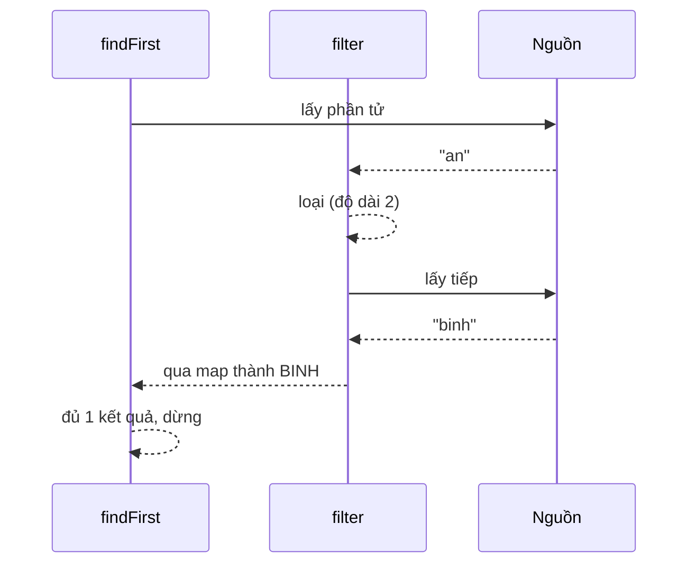
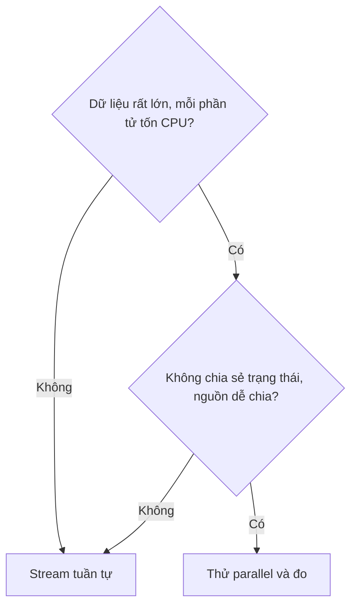

# Lý thuyết 9: Lambda, Functional Interface và Stream

## Lambda và Stream là gì, vì sao có

**Lambda** là đoạn code ngắn như `x -> x * 2` mà bạn truyền đi như một giá trị: truyền vào method, lưu vào variable, trả về từ hàm. **Stream** là chuỗi bước xử lý dữ liệu nối nhau: lọc, biến đổi, gom lại. Hai thứ này đi cùng nhau, vì mỗi bước của stream là một lambda mô tả "làm gì với từng phần tử".

Hãy xem vấn đề chúng giải quyết. Nếu làm bằng vòng `for`, bạn phải tự tạo variable tạm, viết `if`, gọi `add` vào list kết quả, và người đọc phải đọc cả vòng lặp mới hiểu code đang làm gì. Với stream bạn chỉ nói **cần cái gì** (`filter`, `map`, `collect`) thay vì **làm thế nào**, nên code ngắn hơn, và khi cần có thể đổi sang chạy parallel gần như chỉ bằng một chữ `parallel`.

Dùng stream khi lọc, biến đổi, gom nhóm một tập dữ liệu, hoặc truyền hành vi vào callback. Không dùng khi logic có nhiều bước phụ thuộc nhau, có `break`/`continue`, hoặc cần debug từng bước: vòng `for` thường dễ đọc và dễ gỡ lỗi hơn. Cấu trúc một stream gồm ba phần: nguồn, các thao tác trung gian (lazy, chưa chạy ngay) và một thao tác kết thúc để kích hoạt cả chuỗi. Đa phần các kiểu lambda đã có sẵn trong các functional interface chuẩn (`Function`, `Predicate`, `Consumer`...), bạn không cần tự tạo.

**Cốt lõi:** Lambda biến một hành vi thành giá trị truyền đi được, và stream dùng nó để bạn nói cần gì thay vì làm thế nào. Stream không chạy gì cho đến khi có thao tác kết thúc, rồi kéo từng phần tử đi hết pipeline.

- Vì giá trị variable được sao chép vào object lambda lúc tạo nên lambda chỉ bắt được variable effectively final.
- Vì thao tác trung gian chỉ ghi công thức nên pipeline lazy, và thao tác ngắn mạch dừng được sớm.
- Vì parallel stream dùng chung `ForkJoinPool.commonPool()` và dễ sai khi chia sẻ trạng thái nên mặc định không dùng.



Mô hình tư duy: sơ đồ cho thấy stream là công thức được ghi trước và chỉ chạy khi có người kéo ở cuối.

**Tóm tắt:**

- Lambda là đoạn code truyền đi như một giá trị, thực chất là cách viết gọn của object thuộc một functional interface (đúng một abstract method).
- Năm functional interface cốt lõi: `Function`, `Predicate`, `Consumer`, `Supplier`, và `UnaryOperator`/`BinaryOperator`; method reference viết gọn hơn khi lambda chỉ gọi lại một method.
- Lambda chỉ bắt được variable effectively final vì giá trị được sao chép vào object lambda lúc tạo.
- Stream là pipeline lazy: thao tác trung gian chỉ ghi công thức, thao tác kết thúc mới kích hoạt, và mỗi phần tử đi hết pipeline rồi mới tới phần tử kế.
- Stream chỉ dùng một lần; thao tác trung gian không được có tác dụng phụ.
- `toMap` throw lỗi khi trùng key nếu không có hàm gộp, `partitioningBy` luôn có đủ hai key `true` và `false`.
- Parallel stream dùng chung `ForkJoinPool.commonPool()`, nên mặc định không dùng và chỉ bật khi đã đo được lợi ích.
- Không dùng stream khi logic có `break`/`continue`, nhiều bước phụ thuộc nhau hoặc cần debug từng bước.

## Các khái niệm cần biết

- **Functional interface**: interface có đúng một abstract method. Lambda chính là cách viết gọn một object thuộc kiểu đó, nên compiler suy ra lambda này là `Predicate` hay `Function` từ ngữ cảnh.
- **Method reference** (`String::length`, `System.out::println`): cách viết còn gọn hơn lambda khi lambda chỉ gọi lại một method có sẵn.
- **Effectively final**: variable cục bộ không bao giờ bị gán lại sau khi khởi tạo (dù không ghi `final`). Chỉ variable loại này được lambda bắt.
- **Lazy** (hoãn): thao tác trung gian như `filter`, `map` chỉ ghi lại công thức, không làm gì cho đến khi có thao tác kết thúc.
- **Thao tác ngắn mạch** (short-circuit): thao tác như `findFirst`, `limit`, `anyMatch` có thể dừng pipeline sớm khi đã đủ kết quả.
- **Rào chắn trạng thái** (stateful operation): thao tác như `sorted`, `distinct` cần thấy đủ mọi phần tử trước khi cho phần tử nào đi tiếp.
- **Collector**: "công thức" gom kết quả của stream vào một cấu trúc (List, Map, chuỗi, số liệu thống kê). **Downstream collector** là collector lồng bên trong, như `counting()` trong `groupingBy`.
- **`flatMap`**: biến mỗi phần tử thành một stream rồi nối phẳng tất cả lại. Dùng khi mỗi phần tử cho nhiều kết quả, ví dụ từ danh sách đơn hàng lấy ra mọi dòng hàng: `orders.stream().flatMap(o -> o.lines().stream())`.
- **Boxing**: chuyển `int` thành `Integer`. Tốn memory và CPU, nên có `IntStream`, `LongStream` để tránh.

## Functional interface thông dụng

| Interface | Chữ ký | Ví dụ |
|---|---|---|
| `Function<T,R>` | `R apply(T)` | `s -> s.length()` |
| `Predicate<T>` | `boolean test(T)` | `x -> x > 0` |
| `Consumer<T>` | `void accept(T)` | `System.out::println` |
| `Supplier<T>` | `T get()` | `() -> new ArrayList<>()` |
| `UnaryOperator<T>`, `BinaryOperator<T>` | | `(a, b) -> a + b` |
| `Comparator<T>` | `int compare(T,T)` | `Comparator.comparing(User::age)` |

Một **functional interface** là interface có đúng một abstract method; lambda và method reference (`String::length`) là cách viết gọn của nó.

**Phải thuộc:** Năm functional interface cốt lõi: `Function<T,R>` (`apply`), `Predicate<T>` (`test`, trả `boolean`), `Consumer<T>` (`accept`, không trả), `Supplier<T>` (`get`, không nhận tham số), `UnaryOperator`/`BinaryOperator`. Lambda chỉ bắt variable cục bộ effectively final.

## Lambda bắt variable

Lambda chỉ dùng được variable cục bộ **effectively final** (không bị gán lại), vì giá trị được sao chép khi tạo lambda; cho phép đổi variable sẽ khiến lambda và code gọi nó thấy hai giá trị khác nhau, đặc biệt khi lambda chạy ở thread khác. Nếu bạn gán lại variable rồi dùng trong lambda, compiler báo lỗi "local variables referenced from a lambda expression must be final or effectively final". Cần trạng thái thay đổi: dùng `AtomicInteger` hoặc thiết kế lại để trả giá trị về thay vì sửa variable ngoài.

**Suy luận:** Lambda chỉ được bắt variable effectively final vì giá trị của variable đó được sao chép vào object lambda lúc nó được tạo, và lambda có thể chạy sau khi method tạo ra nó đã kết thúc, tức là frame trên stack chứa variable gốc đã biến mất. Nếu cho phép variable đổi tiếp, lambda và code ngoài sẽ thấy hai giá trị khác nhau, hoặc lambda phải giữ reference tới một ô stack không còn tồn tại; Java chọn cấm để loại bỏ cả hai rủi ro, nhất là khi lambda chạy trên thread khác. Từ đó suy ra cách "lách" bằng mảng một phần tử hay `AtomicInteger` chỉ đẩy thay đổi sang heap, nên thread-safety lúc này thành việc của bạn. Điểm dễ nhầm là nghĩ lambda trong `stream` có thể cập nhật tổng bên ngoài, trong khi thao tác trung gian phải không có tác dụng phụ và pipeline có thể chạy parallel. Hãy dùng `collect`, `reduce` hoặc `sum` thay vì sửa variable ngoài.

## Pipeline của Stream

Hãy hình dung dây chuyền nhà máy: nguyên liệu (nguồn) đi qua các trạm (thao tác trung gian) và chỉ chạy khi có người bấm nút ở cuối dây chuyền (thao tác kết thúc). Sơ đồ dưới thể hiện điều đó, mũi tên nét đứt cho thấy thao tác kết thúc "kéo" dữ liệu từ nguồn.



```java
Map<String, Double> avgByDept = employees.stream()
    .filter(e -> e.active())
    .collect(Collectors.groupingBy(
        Employee::department,
        Collectors.averagingDouble(Employee::salary)));

List<String> top3 = words.stream()
    .collect(Collectors.groupingBy(w -> w, Collectors.counting()))
    .entrySet().stream()
    .sorted(Map.Entry.<String, Long>comparingByValue().reversed())
    .limit(3).map(Map.Entry::getKey).toList();
```

### Thấy tận mắt thứ tự lazy bằng `peek`

```java
List<String> names = List.of("an", "binh", "chi", "dung", "em");
Optional<String> r = names.stream()
    .peek(s -> System.out.println("filter nhận " + s))
    .filter(s -> s.length() > 2)
    .peek(s -> System.out.println("map nhận " + s))
    .map(String::toUpperCase)
    .findFirst();
// filter nhận an
// filter nhận binh
// map nhận binh
// (kết quả BINH; "chi", "dung", "em" không bao giờ được đụng tới)
```

Sơ đồ dưới cho thấy flow chạy của đúng ví dụ trên.



Từng phần tử đi hết pipeline rồi mới tới phần tử kế (không phải "filter hết rồi mới map"), và `findFirst` là thao tác **ngắn mạch** nên dừng sớm. Ngược lại `sorted` là **rào chắn trạng thái**: phải nhận đủ mọi phần tử trước khi cho phần tử đầu đi tiếp, nên `sorted().limit(1)` vẫn duyệt cả 5 phần tử ở bước trước `sorted`. Không có thao tác kết thúc thì `peek` không in gì. `peek` chỉ để gỡ lỗi, đừng đặt logic nghiệp vụ vào đó.

**Nền tảng:** Stream là pipeline lazy: nguồn, các thao tác trung gian (chỉ ghi lại công thức) và một thao tác kết thúc kích hoạt tất cả. Mỗi phần tử đi hết pipeline rồi mới tới phần tử kế; thao tác ngắn mạch (`findFirst`, `limit`, `anyMatch`) dừng sớm, còn `sorted`, `distinct` là rào chắn phải thấy đủ dữ liệu.

**Suy luận:** Stream lazy vì nếu mỗi thao tác chạy hết trên cả tập dữ liệu thì phải tạo danh sách trung gian ở từng bước, tốn memory và không thể dừng sớm. Thay vào đó, các thao tác trung gian chỉ ghi lại công thức, và thao tác kết thúc kéo từng phần tử qua toàn bộ pipeline, nên `findFirst` hay `limit` dừng được ngay khi đủ kết quả. Từ cơ chế đó suy ra thứ tự `peek` in ra xen kẽ giữa các bước chứ không "filter hết rồi mới map", và rằng `sorted` hay `distinct` là rào chắn vì phải thấy đủ mọi phần tử trước khi cho phần tử đầu đi tiếp. Parallel stream chia nguồn cho nhiều thread trên cùng `ForkJoinPool.commonPool()`, nên task chặn I/O hay `forEach` ghi vào collection không an toàn sẽ gây chậm hoặc sai kết quả. Điểm dễ nhầm là tưởng parallel luôn nhanh hơn, trong khi với tập nhỏ hay thao tác rẻ, chi phí chia và gộp lớn hơn lợi ích. Hãy đo trước khi dùng và ưu tiên `collect` cho việc gộp kết quả.

### Collector hay dùng

```java
names.stream().collect(Collectors.groupingBy(String::length));
// {2=[an, em], 3=[chi], 4=[binh, dung]}
names.stream().collect(Collectors.partitioningBy(s -> s.length() > 2, Collectors.counting()));
// {false=2, true=3}
// [an, binh, chi, dung, em]
names.stream().collect(Collectors.joining(", ", "[", "]"));
Stream.of("a", "a").collect(Collectors.toMap(s -> s, s -> 1));
// IllegalStateException: Duplicate key a ...  (cần tham số thứ ba để gộp: (x, y) -> x)
```

| Collector | Ra | Ghi chú |
|---|---|---|
| `groupingBy(f)` | `Map<K, List<T>>` | Thêm collector hạ nguồn: `counting()`, `averagingDouble`, `mapping` |
| `partitioningBy(p)` | `Map<Boolean, ...>` | Luôn có đủ hai key `true`, `false` |
| `toMap(k, v)` | `Map` | Trùng key là **throw lỗi**; value `null` cũng lỗi |
| `toList()` (Stream) | `List` immutable | Java 16+ |

**Phải thuộc:** Stream chỉ dùng được một lần (dùng lại throw `IllegalStateException`). `toMap` throw lỗi khi trùng key nếu không có hàm gộp; `partitioningBy` luôn có đủ hai key `true`/`false`; `Stream.toList()` (Java 16) trả danh sách immutable.

## Điểm quan trọng

- **Lazy và xử lý từng phần tử qua cả pipeline** (không tạo danh sách trung gian); `limit` kết hợp `findFirst` có thể dừng sớm.
- Stream **dùng một lần**: dùng lại throw `IllegalStateException`.
- Thao tác trung gian **không có tác dụng phụ**; đừng sửa variable ngoài trong `map`/`filter`.
- Stream nguyên thủy `IntStream`, `LongStream` tránh boxing.
- `toList()` (Java 16) trả danh sách immutable; `Collectors.toList()` không đảm bảo.

## Parallel stream



Bẫy hay gặp: ghi vào collection không an toàn từ trong `parallel`.

```java
List<Integer> result = new ArrayList<>();
// sai: ArrayList không an toàn đa luồng
IntStream.range(0, 1000).parallel().forEach(result::add);
// result.size() có thể khác 1000 hoặc ném ArrayIndexOutOfBoundsException (không xác định)
// đúng
List<Integer> correct = IntStream.range(0, 1000).parallel().boxed().collect(Collectors.toList());
```

`collect` (và `reduce` với toán tử kết hợp) được thiết kế để gộp an toàn; `forEach` cộng dồn vào trạng thái chung thì không. `forEachOrdered` giữ thứ tự gặp nhưng mất phần lớn lợi ích parallel.

Dùng chung `ForkJoinPool.commonPool()`, tác vụ chặn I/O sẽ làm đói cả ứng dụng. Mặc định **không** dùng parallel; chỉ khi đo được lợi ích.

## Khi không nên dùng stream

- Vòng lặp có `break`/`continue` phức tạp, exception checked, nhiều variable thay đổi.
- Pipeline quá dài khó đọc: tách thành hàm có tên.
- Hot path cần hiệu năng tối đa với tập nhỏ.

## Optional và Stream

`Optional.stream()`, `flatMap(Optional::stream)` giúp lọc các giá trị vắng mặt; `Stream.mapMulti` (Java 16) cho trường hợp một phần tử ra nhiều.

## Phỏng vấn khó: chuỗi hỏi xoáy

Người phỏng vấn senior thường mở bằng câu dễ rồi xoáy xuống cơ chế, đánh đổi và sự cố thật. Câu trả lời tốt luôn đi từ cốt lõi xuống: stream thực sự chạy khi nào, trên thread nào, và ai giữ trạng thái.

### Chuỗi 1: Lazy và thứ tự chạy

1. **Câu mở:** Stream lazy nghĩa là gì?
2. **Xoáy 1:** Với `filter` rồi `map` rồi `findFirst`, phần tử nào đi qua bước nào, theo thứ tự ra sao?
3. **Xoáy 2:** `sorted().limit(1)` có dừng sớm không? Vì sao `peek` không in gì khi thiếu thao tác kết thúc?

**Đáp án ngắn:** Thao tác trung gian như `filter`, `map` chỉ ghi lại công thức; chỉ thao tác kết thúc như `collect`, `findFirst` mới kích hoạt và kéo dữ liệu từ nguồn. Nếu mỗi bước chạy hết cả tập thì phải tạo danh sách trung gian, tốn memory và không dừng sớm được. Vì thế từng phần tử đi hết pipeline rồi mới tới phần tử kế, không phải filter hết rồi mới map. Với danh sách `an, binh, chi...`, `an` bị `filter` loại, `binh` qua cả `map` và `findFirst` dừng, nên các phần tử sau không bao giờ bị đụng tới. Thao tác ngắn mạch như `findFirst`, `limit`, `anyMatch` cho phép dừng sớm. Ngược lại `sorted` và `distinct` là rào chắn trạng thái: phải thấy đủ mọi phần tử mới cho phần tử đầu đi tiếp, nên `sorted().limit(1)` vẫn duyệt hết phần trước `sorted`. Không có thao tác kết thúc thì không ai kéo nên `peek` không in gì. `peek` chỉ để gỡ lỗi, không đặt logic nghiệp vụ vào đó.

**Sai lầm hay gặp:**

- Tưởng mỗi bước chạy hết rồi mới sang bước sau.
- Không biết `sorted` phá khả năng dừng sớm.
- Dùng `peek` hoặc `map` có tác dụng phụ cho logic thật.

### Chuỗi 2: Capture và parallel stream

1. **Câu mở:** Vì sao lambda chỉ bắt được variable effectively final?
2. **Xoáy 1:** Cách lách bằng mảng một phần tử hoặc `AtomicInteger` có thực sự an toàn không?
3. **Xoáy 2:** `parallel().forEach(list::add)` sai ở đâu, và khi nào nên dùng parallel stream?

**Đáp án ngắn:** Giá trị variable được sao chép vào object lambda lúc tạo, và lambda có thể chạy sau khi frame trên stack đã biến mất, hoặc trên thread khác. Nếu cho đổi tiếp thì lambda và code ngoài thấy hai giá trị khác nhau, nên Java cấm. Cách lách bằng mảng hay `AtomicInteger` chỉ đẩy trạng thái sang heap, nên thread-safety thành việc của bạn, và thao tác trung gian vốn không được có tác dụng phụ. Thay vào đó dùng `collect`, `reduce` hoặc `sum`. Với parallel, `forEach(list::add)` trên `ArrayList` không an toàn: kết quả có thể thiếu phần tử hoặc ném `ArrayIndexOutOfBoundsException`, còn `collect` được thiết kế để gộp an toàn. Parallel stream dùng chung `ForkJoinPool.commonPool()`, nên tác vụ chặn I/O làm đói cả ứng dụng. Với tập nhỏ hoặc thao tác rẻ, chi phí chia và gộp lớn hơn lợi ích. Mặc định tôi không dùng, chỉ bật khi dữ liệu lớn, mỗi phần tử tốn CPU, không chia sẻ trạng thái, và đã đo được lợi ích.

**Sai lầm hay gặp:**

- Nghĩ parallel luôn nhanh hơn.
- Cộng dồn vào variable ngoài trong stream rồi coi là xong.
- Không biết `commonPool()` dùng chung toàn JVM.

