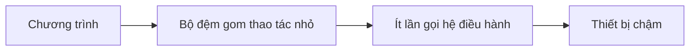
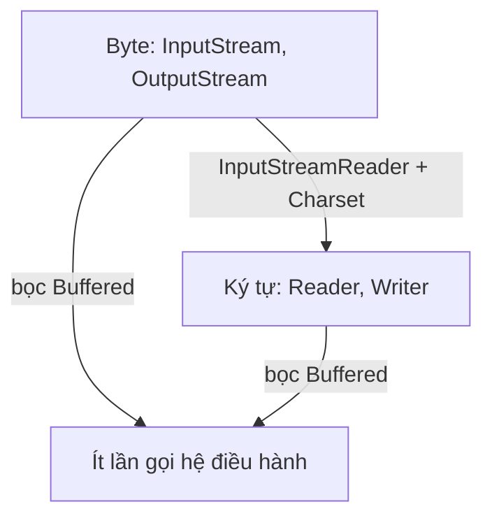
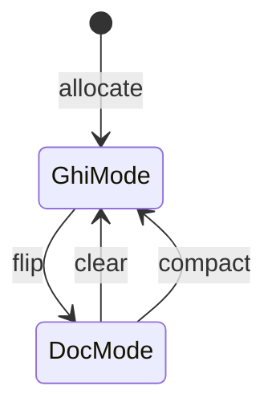
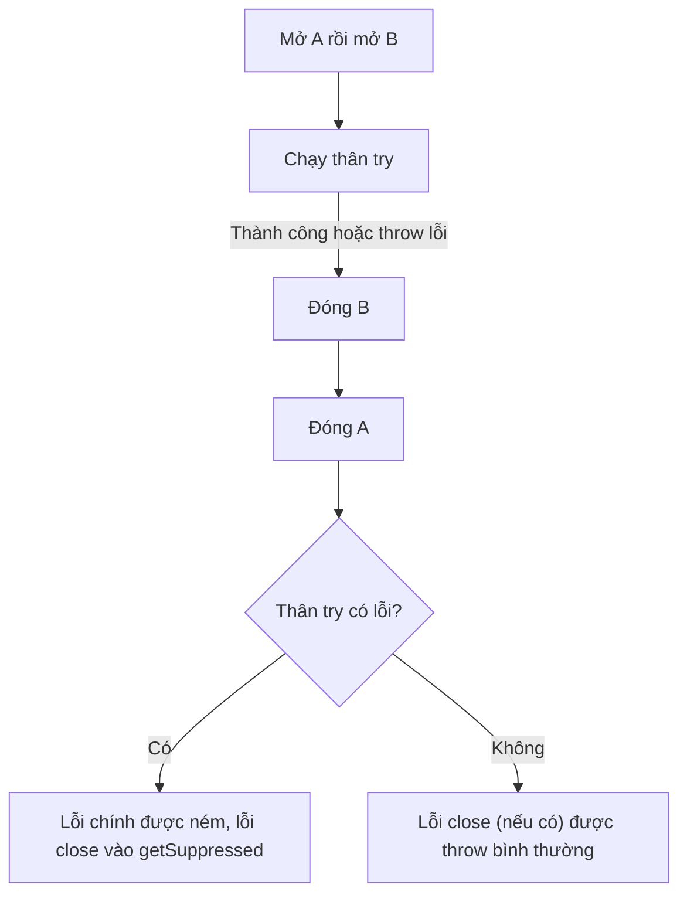

# Lý thuyết 10: I/O, NIO và Serialization

## I/O trong Java và những cái bẫy của nó

Mọi chương trình thực tế đều phải đọc hoặc ghi thứ gì đó ra ngoài memory: file, mạng, log, dữ liệu import/export. Java cung cấp việc này qua I/O truyền thống (`java.io`), NIO.2 (`Path`, `Files`) và mô hình channel cùng buffer. Điều đáng nhớ là I/O luôn là phần chậm nhất của chương trình, chậm hơn tính toán trong memory hàng nghìn lần, nên cách bạn dùng nó quyết định hiệu năng và độ ổn định.

Dùng sai thì hậu quả khá điển hình: quên đóng file thì rò tài nguyên (hệ điều hành báo "Too many open files" sau một thời gian chạy); không chỉ định charset thì tiếng Việt bị lỗi font trên máy khác; đọc cả file lớn vào memory thì `OutOfMemoryError`. File nhỏ thì `Files.readString` là đủ, còn file lớn thì phải đọc theo từng dòng hoặc từng khối.

Từ đó rút ra bốn nguyên tắc dùng xuyên suốt bài: ưu tiên `java.nio.file.Files`, luôn chỉ rõ `Charset`, đóng tài nguyên bằng try-with-resources, và xử lý file lớn theo stream (từng phần) chứ đừng nạp hết vào memory.

**Cốt lõi:** I/O chậm hơn tính toán trong memory rất nhiều, nên mọi kỹ thuật đều nhằm giảm số lần gọi hệ điều hành hoặc tránh để thread đứng chờ. Thứ đi qua đường I/O luôn là byte; ký tự chỉ có khi có bảng mã.

- Vì byte chỉ thành ký tự qua `Charset` nên hai bên phải dùng cùng bảng mã.
- Vì tài nguyên I/O không tự giải phóng nên phải đóng bằng try-with-resources, và file lớn phải xử lý theo stream.
- Vì `Buffer` dùng chung một `position` cho ghi và đọc nên phải `flip()` trước khi đọc.



Mô hình tư duy: sơ đồ cho thấy bộ đệm đứng giữa chương trình nhanh và thiết bị chậm để gom việc lại thành ít lần gọi hơn.

**Tóm tắt:**

- I/O luôn chậm hơn tính toán trong memory, nên mọi kỹ thuật (Buffered, channel, non-blocking, memory-mapped) đều nhằm giảm số lần gọi hệ điều hành hoặc tránh để thread đứng chờ.
- Ưu tiên `java.nio.file.Files` và `Path`, luôn chỉ rõ `Charset` (từ Java 18 mặc định UTF-8), và đóng tài nguyên bằng try-with-resources.
- `Reader` đọc ký tự và cần charset để giải mã; `InputStream` đọc byte; đọc từng byte không đệm chậm hơn rất nhiều.
- `Buffer` có `position`, `limit`, `capacity`; quên `flip()` trước khi đọc là lỗi kinh điển.
- NIO với `Selector` cho một thread theo dõi nhiều channel, nên một thread phục vụ nhiều kết nối nhưng code phức tạp hơn.
- File lớn phải xử lý theo stream hoặc theo khối, không `readAllBytes`; `Files.lines`, `Files.list`, `Files.walk` trả stream phải đóng.
- Chống path traversal bằng `normalize()` rồi kiểm tra đường dẫn còn nằm trong thư mục gốc.
- Không bao giờ deserialize dữ liệu không đáng tin bằng `ObjectInputStream`; ưu tiên JSON hoặc Protobuf.

## Các khái niệm cần biết

- **Charset** (bảng mã): quy ước chuyển giữa ký tự và byte (UTF-8, ISO-8859-1...). Hai bên đọc và ghi phải dùng cùng bảng mã, nếu không chữ có dấu sẽ hỏng.
- **Blocking và non-blocking**: I/O blocking khiến thread đứng chờ đến khi có dữ liệu; non-blocking trả về ngay để thread làm việc khác. Non-blocking cho phép một thread phục vụ nhiều kết nối, nhưng code phức tạp hơn.
- **Selector**: thành phần của NIO cho một thread theo dõi nhiều channel và biết channel nào sẵn sàng. Netty và các server hiệu năng cao dùng nó bên dưới; ứng dụng thường không dùng trực tiếp.
- **Buffered**: bọc stream bằng bộ đệm để gom nhiều thao tác nhỏ thành ít lần gọi hệ điều hành. Đọc từng byte không đệm chậm hơn nhiều lần.
- **Memory-mapped file** (`MappedByteBuffer`): ánh xạ tệp vào vùng nhớ của process, truy cập như array byte. Hợp cho tệp rất lớn cần truy cập ngẫu nhiên.
- **Path traversal**: tấn công dùng `../` trong đầu vào để thoát khỏi thư mục cho phép và đọc file nhạy cảm.
- **Serialization**: biến object thành chuỗi byte hoặc text để lưu hoặc gửi đi, và deserialization là chiều ngược lại.
- **Suppressed exception**: lỗi phụ bị "gắn kèm" vào lỗi chính thay vì ghi đè nó, xem phần try-with-resources.

## Hai thế giới

| | `java.io` (stream) | `java.nio` (kênh, buffer) |
|---|---|---|
| Mô hình | Stream byte/char, chặn | Channel + Buffer, có thể non-blocking |
| Dùng thực tế | `InputStream`, `Reader` | `Path`, `Files`, `FileChannel`, `Selector` |
| Hiện nay | Còn dùng cho stream tổng quát | `Files` cho tệp; mạng tầng cao dùng Netty/Tomcat |

**Nền tảng:** I/O luôn chậm hơn tính toán trong memory rất nhiều, nên mọi kỹ thuật (bộ đệm Buffered, channel, non-blocking, memory-mapped) đều nhằm giảm số lần gọi hệ điều hành hoặc tránh để thread đứng chờ. Byte đi qua `Charset` mới thành ký tự: hai bên phải dùng cùng bảng mã.

## Bốn họ class cần phân biệt



## Việc thường làm

```java
Path p = Path.of("data", "input.txt");

String all = Files.readString(p, StandardCharsets.UTF_8);                // tệp nhỏ

// tệp lớn: từng dòng
try (Stream<String> lines = Files.lines(p, StandardCharsets.UTF_8)) {
    long n = lines.filter(l -> l.contains("ERROR")).count();
}

Files.writeString(p, "nội dung", StandardCharsets.UTF_8,
        StandardOpenOption.CREATE, StandardOpenOption.TRUNCATE_EXISTING);

try (var out = Files.newBufferedWriter(tmp)) { ... }
// ghi an toàn: ghi tạm rồi đổi tên
Files.move(tmp, p, StandardCopyOption.ATOMIC_MOVE);
```

## Buffer và Channel

`Channel` là đường dẫn dữ liệu hai chiều tới tệp/socket, còn `Buffer` là vùng nhớ trung gian mà channel đọc vào hoặc ghi ra. Một buffer có ba con trỏ: `position` (vị trí thao tác tiếp), `limit` (mốc không được vượt), `capacity` (sức chứa cố định).

| Thao tác | position | limit | Ý nghĩa |
|---|---|---|---|
| `allocate(8)` | 0 | 8 | Mới tạo, ở chế độ ghi |
| `put` 3 byte | 3 | 8 | Đã ghi 3 byte |
| `flip()` | 0 | 3 | Chuyển sang đọc: chỉ đọc phần đã ghi |
| `get` 2 byte | 2 | 3 | Còn 1 byte chưa đọc |
| `compact()` | 1 | 8 | Dồn byte chưa đọc lên đầu, quay lại chế độ ghi |
| `clear()` | 0 | 8 | Coi như trống (dữ liệu không bị xóa thật) |

Hãy xem lifecycle của một buffer: ghi dữ liệu, `flip()` để đọc, rồi `clear()` hoặc `compact()` để ghi tiếp.



Đọc sơ đồ: buffer luôn ở một trong hai chế độ. `flip()` đặt `limit` bằng vị trí đã ghi và đưa `position` về 0 để đọc đúng phần vừa ghi. `clear()` bỏ qua dữ liệu chưa đọc, còn `compact()` giữ lại phần chưa đọc.

Quên `flip()` là lỗi kinh điển: đọc ra toàn số 0 hoặc không đọc được gì, vì `position` đang đứng sau dữ liệu vừa ghi.

**Suy luận:** `Buffer` cần `flip()` vì cùng một vùng nhớ phải phục vụ cả ghi lẫn đọc, và nó chỉ có một con trỏ `position` dùng chung. Sau khi ghi 3 byte, `position` đứng ở 3, tức là ngay sau dữ liệu; đọc lúc này sẽ đọc phần chưa ghi và ra toàn số 0. `flip()` đặt `limit` bằng vị trí đã ghi rồi đưa `position` về 0, nhờ vậy lần đọc chỉ chạy trên đúng phần dữ liệu hợp lệ. Sau khi đọc xong, `clear()` chỉ đặt lại con trỏ chứ không xóa dữ liệu, nên dữ liệu chưa đọc coi như bị bỏ, còn `compact()` dồn phần chưa đọc lên đầu rồi quay lại chế độ ghi. Điểm dễ nhầm là tưởng `clear()` xóa buffer, hoặc đọc channel vào buffer rồi quên `flip()`. Khi gặp dữ liệu đọc ra rỗng hay lệch, hãy kiểm tra trạng thái `position` và `limit` ở từng bước trước khi nghi ngờ nguồn dữ liệu.

**Phải thuộc:** `Buffer` có `position`, `limit`, `capacity`; `flip()` chuyển từ ghi sang đọc (`limit = position`, `position = 0`); `clear()` về trạng thái ghi và bỏ qua dữ liệu chưa đọc; `compact()` giữ phần chưa đọc.

```java
Path dir = Files.createTempDirectory("nio");
Path src = dir.resolve("a.txt");
Files.writeString(src, "Xin chào Việt Nam", StandardCharsets.UTF_8);

Path dst = dir.resolve("b.txt");
try (FileChannel in = FileChannel.open(src, StandardOpenOption.READ);
     FileChannel out = FileChannel.open(dst, StandardOpenOption.CREATE, StandardOpenOption.WRITE)) {
    // sao chép ở mức hệ điều hành, không qua heap Java
    in.transferTo(0, in.size(), out);
}
// Xin chào Việt Nam
System.out.println(Files.readString(dst, StandardCharsets.UTF_8));
```

Charset: chuỗi `"Xin chào Việt Nam"` có 17 ký tự nhưng UTF-8 cần **20 byte** (chữ có dấu 2 hoặc 3 byte). Đọc 20 byte đó bằng `ISO_8859_1` thì ra 20 ký tự, nên `length()` đổi và chữ hỏng. Đó là lý do luôn nêu `Charset`.

## try-with-resources hoạt động thế nào

Vấn đề của cách cũ `try/finally` là dễ quên đóng, và nếu `finally` throw lỗi thì lỗi đó che mất lỗi gốc. Try-with-resources giải quyết bằng cách tự gọi `close()` cho mọi object `AutoCloseable` khai báo trong ngoặc, dù thân `try` chạy thường hay throw lỗi. Dùng nó cho mọi thứ cần đóng: file, stream, kết nối, `Scanner`, stream từ `Files.lines`.



Tài nguyên đóng theo thứ tự **ngược** lúc mở. Nếu thân `try` throw lỗi rồi `close()` cũng throw lỗi, lỗi `close` **không che** lỗi chính mà được gắn vào `getSuppressed()`.

**Phải thuộc:** try-with-resources đóng tài nguyên theo thứ tự ngược với lúc mở; lỗi của `close()` khi thân `try` đã lỗi được gắn vào `getSuppressed()` thay vì che lỗi chính. Luôn nêu `Charset` rõ ràng (mặc định chung là UTF-8 chỉ từ Java 18).

```java
class Res implements AutoCloseable {
    final String name;
    Res(String name) { this.name = name; System.out.println("mở " + name); }
    @Override public void close() { System.out.println("đóng " + name); throw new IllegalStateException("lỗi đóng " + name); }
}

try (Res a = new Res("A"); Res b = new Res("B")) {
    throw new RuntimeException("lỗi chính");
} catch (Exception e) {
    System.out.println(e.getMessage() + " | suppressed=" + e.getSuppressed().length);
}
// mở A, mở B, đóng B, đóng A
// lỗi chính | suppressed=2
```

Với `try/finally` viết tay, lỗi trong `finally` sẽ **nuốt** lỗi chính. Đây là lý do nên dùng try-with-resources.

Chống path traversal: `Path root = base.toAbsolutePath().normalize(); Path p = root.resolve(userInput).normalize(); if (!p.startsWith(root)) throw ...`. Đã chạy thử với đầu vào `../../etc/passwd`: `startsWith` trả `false`.

## Điều cần nhớ

- **Luôn chỉ định `Charset`** (mặc định theo hệ thống ở bản cũ); từ Java 18 mặc định là UTF-8.
- `Files.lines`, `Files.list`, `Files.walk` trả stream **phải đóng** (try-with-resources).
- `Files.readAllBytes` trên tệp lớn gây `OutOfMemoryError`; xử lý theo stream hoặc theo khối.
- Dùng `Path`, không nối chuỗi đường dẫn; chống **path traversal** (`../`): `normalize()` rồi kiểm tra còn nằm trong thư mục gốc.
- Ghi tệp quan trọng: ghi vào tệp tạm rồi đổi tên atomic để không bị hỏng nửa chừng.
- Tệp rất lớn: `FileChannel` + `MappedByteBuffer` (memory-mapped) hoặc đọc theo khối.

## Serialization

| Cách | Nhận xét |
|---|---|
| `Serializable` gốc của Java | **Tránh**: dễ lỗ hổng bảo mật (deserialize dữ liệu không tin cậy), phụ thuộc cấu trúc class |
| JSON (Jackson/Gson) | Phổ biến, dễ đọc |
| Protobuf/Avro | Nhị phân gọn, có schema, tương thích phiên bản |

Lý do cơ chế gốc nguy hiểm: khi deserialize, Java tự dựng object và có thể chạy mã trong các class có sẵn trên classpath, nên kẻ tấn công gửi chuỗi byte được chế sẵn có thể thực thi mã tùy ý. Nếu cần trao đổi dữ liệu thì dùng JSON hoặc Protobuf, vốn chỉ điền dữ liệu vào cấu trúc bạn định nghĩa.

**Suy luận:** `Serializable` nguy hiểm vì khi deserialize, JVM tự dựng object và gọi các method đặc biệt như `readObject` của những class có sẵn trên classpath, theo dữ liệu do bên gửi quyết định. Kẻ tấn công không cần class của họ: chỉ cần ghép chuỗi byte sao cho các class "gadget" quen thuộc trong thư viện gọi nhau và cuối cùng thực thi lệnh, và việc này diễn ra trước khi code của bạn kịp kiểm tra bất cứ điều gì. Vì thế validate sau khi deserialize là quá muộn, và thêm thư viện vào classpath còn làm tăng bề mặt tấn công. Hệ quả là quy tắc không bao giờ deserialize dữ liệu không đáng tin bằng `ObjectInputStream`, và nếu buộc phải dùng thì áp bộ lọc `ObjectInputFilter` theo danh sách cho phép. Điểm dễ nhầm là cho rằng chỉ mình tự gửi dữ liệu nên an toàn, trong khi dữ liệu qua cache, queue hay cookie đều có thể bị sửa. Ưu tiên JSON hay Protobuf có schema, vì chúng chỉ điền dữ liệu chứ không chạy code.

Quy tắc: **không bao giờ** deserialize dữ liệu không đáng tin bằng `ObjectInputStream`.

## HTTP client

`java.net.http.HttpClient` (Java 11+): hỗ trợ HTTP/2, synchronous và asynchronous (`sendAsync` trả `CompletableFuture`). Luôn đặt timeout.

## Phỏng vấn khó: chuỗi hỏi xoáy

Người phỏng vấn senior thường mở bằng câu dễ rồi xoáy xuống cơ chế, đánh đổi và sự cố thật. Câu trả lời tốt luôn đi từ cốt lõi xuống: byte hay ký tự, ai giữ con trỏ, ai đứng chờ.

### Chuỗi 1: Buffer, channel và non-blocking

1. **Câu mở:** NIO khác `java.io` ở điểm nào?
2. **Xoáy 1:** Vì sao phải `flip()`, và quên nó thì thấy gì?
3. **Xoáy 2:** `clear()` có xóa dữ liệu không? Một thread phục vụ nhiều kết nối bằng cách nào và đánh đổi gì?

**Đáp án ngắn:** `java.io` là stream byte hoặc ký tự có tính chặn, còn NIO dùng channel cộng buffer và có thể non-blocking. Một `Buffer` có `position`, `limit`, `capacity`, và chỉ một `position` dùng chung cho cả ghi lẫn đọc. Sau khi ghi 3 byte, `position` đứng ở 3, ngay sau dữ liệu; đọc lúc này sẽ ra toàn số 0 hoặc không có gì. `flip()` đặt `limit` bằng vị trí đã ghi rồi đưa `position` về 0 để đọc đúng phần hợp lệ. `clear()` chỉ đặt lại con trỏ chứ không xóa dữ liệu, nên dữ liệu chưa đọc coi như bị bỏ; `compact()` dồn phần chưa đọc lên đầu rồi quay lại chế độ ghi. Với `Selector`, một thread theo dõi nhiều channel và biết channel nào sẵn sàng, nên rất ít thread phục vụ rất nhiều kết nối; Netty dùng cơ chế này bên dưới. Đánh đổi là code phức tạp hơn nhiều, nên ứng dụng thường dùng framework thay vì tự viết. Khi dữ liệu đọc ra rỗng hay lệch, tôi kiểm tra `position` và `limit` từng bước.

**Sai lầm hay gặp:**

- Tưởng `clear()` xóa buffer.
- Không giải thích được vì sao cần `flip()`, chỉ nhớ "phải gọi".
- Nói non-blocking nhanh hơn mà không nêu cái giá là độ phức tạp.

### Chuỗi 2: Serialization và an toàn

1. **Câu mở:** Vì sao không nên dùng `Serializable` gốc của Java?
2. **Xoáy 1:** Kẻ tấn công thực thi mã bằng cách nào khi họ không có class của mình trên server?
3. **Xoáy 2:** Nếu buộc phải dùng `ObjectInputStream` thì giảm rủi ro ra sao? Dữ liệu chỉ do hệ thống mình gửi thì có an toàn không?

**Đáp án ngắn:** Khi deserialize, JVM tự dựng object và gọi các method đặc biệt như `readObject` của những class có sẵn trên classpath, theo dữ liệu do bên gửi quyết định. Kẻ tấn công không cần class của họ: chỉ cần ghép chuỗi byte sao cho các class "gadget" quen thuộc trong thư viện gọi nhau và cuối cùng chạy lệnh. Việc này xảy ra trước khi code của bạn kịp kiểm tra gì, nên validate sau khi deserialize là quá muộn, và thêm thư viện vào classpath làm tăng bề mặt tấn công. Quy tắc là không bao giờ deserialize dữ liệu không đáng tin bằng `ObjectInputStream`. Nếu buộc phải dùng thì áp bộ lọc `ObjectInputFilter` theo danh sách cho phép. Dữ liệu "chỉ mình gửi" vẫn chưa an toàn, vì đi qua cache, queue hay cookie thì có thể bị sửa. Tôi ưu tiên JSON hoặc Protobuf có schema, vì chúng chỉ điền dữ liệu vào cấu trúc mình định nghĩa chứ không chạy code. Cơ chế gốc còn phụ thuộc cấu trúc class nên khó tương thích phiên bản.

**Sai lầm hay gặp:**

- Chỉ nói "không an toàn" mà không giải thích gadget và việc code chạy trước khi validate.
- Tin dữ liệu nội bộ là sạch.
- Không biết `ObjectInputFilter` dùng danh sách cho phép.

