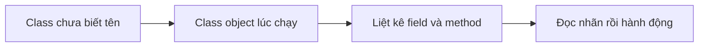
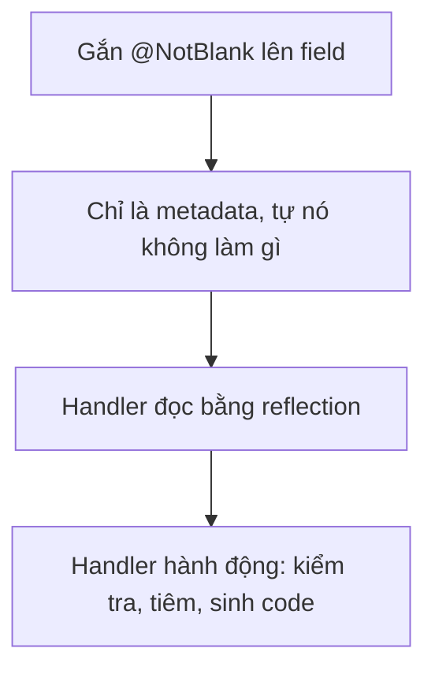
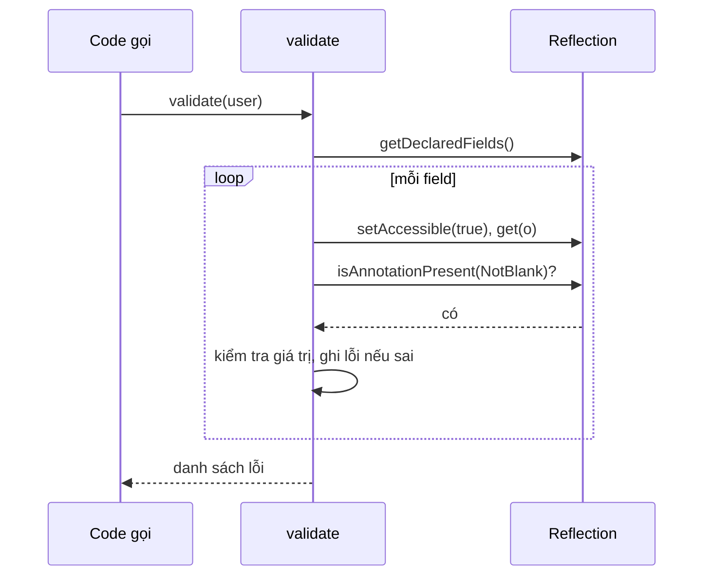

# Lý thuyết 11: Reflection và Annotation

## Reflection và annotation giải quyết điều gì

Thông thường bạn viết `user.getName()`: tên method được ghi cứng trong code và compiler kiểm tra nó. Nhưng framework như Spring hay Jackson không biết trước class `User` của bạn có field gì. Chúng phải **lúc đang chạy** nhìn vào class, liệt kê field, method, rồi đọc, ghi hay gọi chúng. Khả năng đó là **reflection**: code tự quan sát và thao tác chính cấu trúc của chương trình dù không biết tên lúc viết.

**Annotation** (`@Something`) là nhãn gắn lên class, method hay field để cung cấp thêm thông tin. Bản thân nhãn không làm gì cả, giống nhãn "dễ vỡ" dán trên thùng hàng: nó chỉ có tác dụng khi có người (handler) đọc và hành động theo. Hai thứ này phối hợp: framework dùng reflection để quét annotation của bạn rồi làm việc tương ứng.

Đây chính là lý do `@Autowired`, `@Test`, `@Transactional` hay `@NotBlank` hoạt động. Không hiểu cơ chế này thì chúng trông như phép màu, và khi lỗi bạn không biết đào từ đâu. Bạn cần nắm khi viết framework, thư viện hay công cụ dùng chung, hoặc khi muốn biết framework đang làm gì phía sau. Với code nghiệp vụ bình thường thì đừng dùng reflection: chậm hơn, mất kiểm tra lúc biên dịch (đổi tên method mà chuỗi tên không đổi thì hỏng lúc chạy) và khó debug.

Để tự dùng, bạn cần `Class`, `Method`, `Field`, `Constructor` để duyệt và gọi; và khi tự định nghĩa annotation thì cần `@Retention` (sống tới lúc nào) cùng `@Target` (gắn lên đâu), rồi xử lý lúc chạy hoặc lúc biên dịch.

**Cốt lõi:** Code thường biết tên mọi thứ lúc viết, còn framework thì không biết class của bạn, nên phải nhìn vào cấu trúc chương trình lúc chạy; đó là reflection. Annotation chỉ là nhãn dữ liệu, chỉ có tác dụng khi một handler đọc nó rồi hành động.

- Vì framework chưa biết class của bạn nên phải duyệt field và method qua `Class` lúc chạy.
- Vì annotation chỉ là metadata nên thiếu handler thì vô tác dụng, và `@Retention` quyết định handler có thấy nó không.
- Vì tên chỉ là chuỗi nên compiler không kiểm tra được, và không được tải class theo tên từ dữ liệu người dùng.



Mô hình tư duy: sơ đồ cho thấy reflection là cầu nối từ một class chưa biết tới hành động của framework.

**Tóm tắt:**

- Reflection cho code tự quan sát và gọi class, field, method lúc chạy qua `Class`, nhờ đó framework xử lý được class mà nó chưa từng biết tên lúc viết.
- Annotation chỉ là metadata; tác dụng đến từ một handler đọc nó bằng reflection lúc chạy hoặc annotation processor lúc biên dịch.
- Ba mức `@Retention`: `SOURCE`, `CLASS` (mặc định) và `RUNTIME`; chỉ `RUNTIME` đọc được bằng reflection, nên quên nó thì `isAnnotationPresent` trả `false`.
- `getMethod` chỉ thấy method public (kể cả kế thừa), `getDeclaredMethod` thấy mọi mức truy cập nhưng chỉ của chính class đó.
- Lỗi của method được gọi qua reflection bị bọc trong `InvocationTargetException`; lấy lỗi thật bằng `getCause()`.
- Reflection chậm hơn, mất an toàn lúc biên dịch, phá encapsulation và khó với GraalVM native image; cache `Method` hoặc dùng `MethodHandle`.
- Không tải hay gọi class theo tên lấy từ dữ liệu người dùng.

## Các khái niệm cần biết

- **Metadata** (siêu dữ liệu): dữ liệu mô tả dữ liệu hoặc code, ví dụ "field này không được rỗng". Annotation là metadata gắn vào code.
- **`@Retention`**: chọn annotation tồn tại đến giai đoạn nào (mã nguồn, file `.class`, hay lúc chạy). Chỉ `RUNTIME` mới đọc được bằng reflection.
- **`@Target`**: giới hạn annotation được gắn lên loại phần tử nào (field, method, class...). Gắn sai chỗ thì compiler báo lỗi.
- **`setAccessible(true)`**: tắt kiểm tra `private` của một `Field` hoặc `Method` để truy cập. Tiện cho framework, nhưng phá encapsulation.
- **Proxy động**: object được tạo lúc chạy thay mặt object thật, chặn mọi lời gọi để chèn thêm logic (transaction, log). Spring AOP dựa trên đó.
- **`MethodHandle`**: cách gọi method có tra cứu một lần, nhanh hơn `Method.invoke` khi gọi lặp lại.
- **JPMS (module Java 9+)**: hệ thống module có thể chặn reflection vào package không được `opens`.
- **Annotation processor**: handler chạy trong `javac`, đọc annotation và sinh code hoặc báo lỗi ngay lúc build.

## Reflection

```java
Class<?> c = Class.forName("com.example.User");
Object u = c.getDeclaredConstructor().newInstance();

Field f = c.getDeclaredField("name");
// phá encapsulation (bị hạn chế bởi module từ Java 9+)
f.setAccessible(true);
f.set(u, "An");

Method m = c.getMethod("greet", String.class);
Object result = m.invoke(u, "Bình");
```

| Việc | API |
|---|---|
| Lấy class | `obj.getClass()`, `Foo.class`, `Class.forName` |
| Liệt kê thành viên | `getDeclaredFields/Methods/Constructors` |
| Đọc annotation | `getAnnotation`, `isAnnotationPresent` |
| Tạo proxy động | `java.lang.reflect.Proxy` (xem bài hard) |

**Nền tảng:** Reflection cho code tự quan sát cấu trúc của chính chương trình lúc chạy (class, field, method), nên framework xử lý được class mà nó chưa từng biết tên lúc viết. Đổi lại: chậm hơn, mất kiểm tra lúc biên dịch và phá encapsulation.

## Annotation

```java
@Retention(RetentionPolicy.RUNTIME)       // còn tồn tại lúc chạy để reflection đọc được
@Target({ElementType.FIELD})
public @interface NotBlank { String message() default "không được để trống"; }
```

Mỗi mức `@Retention` quyết định ai có thể thấy annotation:

| `@Retention` | Còn đến |
|---|---|
| `SOURCE` | Chỉ ở mã nguồn (Lombok, `@Override`) |
| `CLASS` | Trong `.class`, không có lúc chạy |
| `RUNTIME` | Lúc chạy, reflection đọc được |

**Phải thuộc:** Ba mức `@Retention`: `SOURCE` (chỉ ở mã nguồn), `CLASS` (trong `.class`, mặc định, không có lúc chạy), `RUNTIME` (reflection đọc được). Quên `@Retention(RUNTIME)` thì `isAnnotationPresent` trả `false`.

## Mô hình "annotation chỉ là dữ liệu"



Đây chính là cách Spring `@Autowired`, `@Transactional`, Bean Validation hoạt động (xem [Tư duy Spring](/go?p=01-Spring-Boot%2Feasy%2Flt-09-tu-duy-spring.md)).

**Nền tảng:** Annotation chỉ là metadata, tự nó không làm gì; tác dụng đến từ một handler đọc nó (bằng reflection lúc chạy hoặc annotation processor lúc biên dịch) rồi hành động. `@Autowired`, `@Transactional`, Bean Validation đều hoạt động theo mô hình này.

**Suy luận:** Annotation không làm gì tự thân vì compiler chỉ lưu nó như dữ liệu gắn vào class, method hay field, giống nhãn dán trên thùng hàng. Vì vậy `@Autowired`, `@Transactional` hay `@NotBlank` chỉ có tác dụng khi có một handler (bean post-processor, proxy, validator) quét các phần tử đó bằng reflection rồi hành động. Từ đó suy ra `@Retention` quyết định ai thấy được: nhãn `SOURCE` biến mất ngay sau `javac` nên chỉ annotation processor dùng được, nhãn `CLASS` có trong file nhưng JVM không nạp, và chỉ `RUNTIME` mới hiện ra cho reflection. Thiếu `@Retention(RUNTIME)` là lỗi kinh điển vì code vẫn biên dịch, annotation vẫn nằm đó nhưng `isAnnotationPresent` luôn `false`. Điểm dễ nhầm là nghĩ gắn annotation là đủ, trong khi không có handler thì nó không có tác dụng, ví dụ `@Transactional` trên method gọi nội bộ bị bỏ qua vì không đi qua proxy. Khi debug annotation "không chạy", hãy hỏi ai đọc nó, đọc lúc nào và retention có khớp không.

## Ví dụ chạy được: validator tự viết

Một bộ kiểm tra hợp lệ tối giản, đúng cơ chế của Bean Validation: annotation tự định nghĩa, handler quét field bằng reflection. Sơ đồ dưới là các bước `validate` thực hiện cho mỗi object.



```java
import java.lang.annotation.*;
import java.lang.reflect.*;
import java.util.*;

public class Refl {
    @Retention(RetentionPolicy.RUNTIME) @Target(ElementType.FIELD)
    @interface NotBlank { String message() default "không được để trống"; }

    @Retention(RetentionPolicy.RUNTIME) @Target(ElementType.FIELD)
    @interface Max { int value(); }

    static class User {
        @NotBlank private String name;
        @Max(10) private int age;
        User(String name, int age) { this.name = name; this.age = age; }
        public void boom() { throw new IllegalArgumentException("lỗi bên trong"); }
        private String secret() { return "bí mật"; }
    }

    static List<String> validate(Object o) throws IllegalAccessException {
        List<String> errors = new ArrayList<>();
        for (Field f : o.getClass().getDeclaredFields()) {
            f.setAccessible(true);                            // đọc được field private
            Object v = f.get(o);
            if (f.isAnnotationPresent(NotBlank.class) && (v == null || v.toString().isBlank()))
                errors.add(f.getName() + ": " + f.getAnnotation(NotBlank.class).message());
            Max max = f.getAnnotation(Max.class);
            if (max != null && ((Integer) v) > max.value()) errors.add(f.getName() + " vượt " + max.value());
        }
        return errors;
    }

    public static void main(String[] args) throws Exception {
        // [name: không được để trống, age vượt 10]
        System.out.println(validate(new User("", 30)));
        System.out.println(validate(new User("An", 5))); // []

        User u = new User("An", 5);
        Field f = User.class.getDeclaredField("name");
        f.setAccessible(true);
        f.set(u, "Bình");                                // ghi field private
        System.out.println(f.get(u));                    // Bình

        Method m = User.class.getDeclaredMethod("secret");
        m.setAccessible(true);
        System.out.println(m.invoke(u));                 // bí mật
        try { User.class.getMethod("boom").invoke(u); }
        // lỗi bên trong
        catch (InvocationTargetException e) { System.out.println(e.getCause().getMessage()); }
    }
}
```

Điểm cần nhớ từ ví dụ:

| Điểm | Chi tiết |
|---|---|
| `getMethod` và `getDeclaredMethod` | `getMethod` chỉ thấy method **public** (kể cả kế thừa); `getDeclaredMethod` thấy mọi mức truy cập nhưng chỉ của chính class đó. Gọi `getMethod("secret")` trên method private throw `NoSuchMethodException` |
| `InvocationTargetException` | Exception của method được gọi bị **bọc**; lấy lỗi thật bằng `getCause()` |
| Thiếu `@Retention(RUNTIME)` | Mặc định là `CLASS`, `isAnnotationPresent` trả `false` dù đã gắn annotation |
| `static final` và field `final` | `static final`: `Field.set` ném `IllegalAccessException` dù đã `setAccessible(true)`. `final` của instance: ghi được sau `setAccessible(true)` nhưng kết quả không đáng tin (hằng bị inline lúc biên dịch, JIT có thể giả định không đổi), Java 26 còn cảnh báo (JEP 500); đừng làm |

## Chi phí và rủi ro

| Vấn đề | Giải thích |
|---|---|
| Chậm hơn gọi trực tiếp | Kiểm tra quyền, tra cứu; cache `Method`/`Field` đã tra, hoặc dùng `MethodHandle` |
| Mất an toàn lúc biên dịch | Đổi tên method mà chuỗi tên không đổi theo |
| Phá encapsulation | `setAccessible(true)` truy cập `private`; JPMS có thể chặn |
| Khó với GraalVM native image | Cần khai báo gợi ý reflection |
| Bảo mật | Không tải/gọi class theo tên từ dữ liệu người dùng |

**Suy luận:** Reflection chậm và nguy hiểm hơn gọi trực tiếp vì compiler không còn là người kiểm tra: tên method hay field chỉ là chuỗi, nên JVM phải tra cứu theo tên, kiểm tra quyền và đóng gói tham số mỗi lần gọi. Cũng vì chỉ là chuỗi, đổi tên method mà không đổi chuỗi sẽ không báo lỗi biên dịch mà nổ lúc chạy, và IDE không refactor được. `setAccessible(true)` vượt qua `private` nên phá encapsulation, và JPMS ra đời một phần để chặn lại bằng `opens`. GraalVM native image cần biết trước mọi thứ lúc build nên reflection phải được khai báo gợi ý, vì nó không thể đoán chuỗi tên lúc chạy. Rủi ro bảo mật lớn nhất xuất hiện khi tên class hay method đến từ dữ liệu người dùng, vì khi đó kẻ tấn công chọn được code để chạy. Vì vậy hãy cache `Method`/`Field` đã tra, ưu tiên `MethodHandle` khi gọi lặp lại, và không bao giờ tải class theo tên không tin cậy.

## Annotation processor (lúc biên dịch)

Khác với reflection (chạy lúc chạy chương trình), annotation processor chạy trong `javac` ở bước biên dịch: nó đọc annotation rồi sinh code hoặc kiểm tra. Ví dụ Lombok, MapStruct, Dagger. Ưu điểm: không tốn chi phí lúc chạy, lỗi hiện lúc build. Nên chọn khi code sinh ra có thể xác định trước (getter/setter, mapper, wiring DI); chọn reflection khi cần quyết định theo dữ liệu chỉ biết lúc chạy.

## Phỏng vấn khó: chuỗi hỏi xoáy

Người phỏng vấn senior thường mở bằng câu dễ rồi xoáy xuống cơ chế, đánh đổi và sự cố thật. Câu trả lời tốt luôn đi từ cốt lõi xuống: ai đọc nhãn, đọc lúc nào, và cái giá của việc dựa vào tên dạng chuỗi.

### Chuỗi 1: Annotation không tự làm gì

1. **Câu mở:** `@Autowired` hay `@NotBlank` hoạt động thế nào?
2. **Xoáy 1:** Tôi gắn annotation tự định nghĩa mà `isAnnotationPresent` luôn `false`, nguyên nhân thường là gì?
3. **Xoáy 2:** Còn trường hợp annotation có đủ nhưng vẫn "không chạy", như `@Transactional` trên method gọi nội bộ?

**Đáp án ngắn:** Annotation chỉ là metadata, compiler lưu nó như dữ liệu gắn vào class, method hay field, tự nó không làm gì. Tác dụng đến từ một handler như bean post-processor, proxy hay validator quét các phần tử bằng reflection rồi hành động; hoặc annotation processor chạy trong `javac` để sinh code hay báo lỗi lúc build. `@Retention` quyết định ai thấy được: `SOURCE` biến mất sau `javac`, `CLASS` có trong file `.class` nhưng không có lúc chạy (và là mặc định), chỉ `RUNTIME` mới đọc được bằng reflection. Thiếu `@Retention(RUNTIME)` là lỗi kinh điển vì code vẫn biên dịch mà `isAnnotationPresent` trả `false`. Với `@Transactional` trên lời gọi nội bộ thì logic chạy nhờ proxy chặn lời gọi, mà gọi nội bộ không đi qua proxy nên bị bỏ qua. Khi debug annotation "không chạy", tôi hỏi ba điều: ai đọc nó, đọc lúc nào, và retention có khớp không.

**Sai lầm hay gặp:**

- Nói annotation "tự làm" việc.
- Không phân biệt được ba mức `@Retention`.
- Không nối được lỗi `@Transactional` gọi nội bộ với cơ chế proxy.

### Chuỗi 2: Chi phí và rủi ro của reflection

1. **Câu mở:** Vì sao code nghiệp vụ bình thường không nên dùng reflection?
2. **Xoáy 1:** `getMethod` và `getDeclaredMethod` khác gì, và lỗi trong method được gọi qua `invoke` hiện ra dưới dạng nào?
3. **Xoáy 2:** Vì sao reflection gây khó cho GraalVM native image, và có rủi ro bảo mật gì?

**Đáp án ngắn:** Compiler không còn là người kiểm tra, vì tên method hay field chỉ là chuỗi. JVM phải tra cứu theo tên, kiểm tra quyền và đóng gói tham số mỗi lần gọi nên chậm hơn; đổi tên method mà chuỗi không đổi thì không báo lỗi biên dịch mà nổ lúc chạy. Cách giảm là cache `Method` hoặc `Field` đã tra, hoặc dùng `MethodHandle` khi gọi lặp lại. `getMethod` chỉ thấy method public, kể cả kế thừa; `getDeclaredMethod` thấy mọi mức truy cập nhưng chỉ của chính class đó. Lỗi của method được gọi bị bọc trong `InvocationTargetException`, lấy lỗi thật bằng `getCause()`. `setAccessible(true)` phá encapsulation, và JPMS có thể chặn nếu package không `opens`. Native image cần biết trước mọi thứ lúc build nên reflection phải khai báo gợi ý. Rủi ro lớn nhất là tải hay gọi class theo tên lấy từ dữ liệu người dùng, vì khi đó kẻ tấn công chọn được code chạy.

**Sai lầm hay gặp:**

- Chỉ nói "chậm" mà bỏ qua mất kiểm tra lúc biên dịch.
- Bắt `InvocationTargetException` rồi in luôn nó thay vì `getCause()`.
- Cho rằng `setAccessible(true)` luôn thành công trên Java hiện đại.

