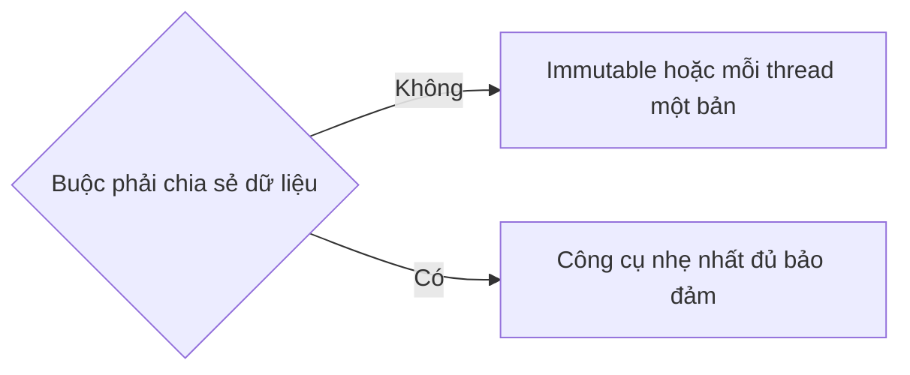
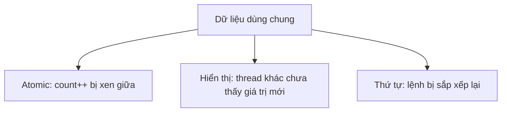
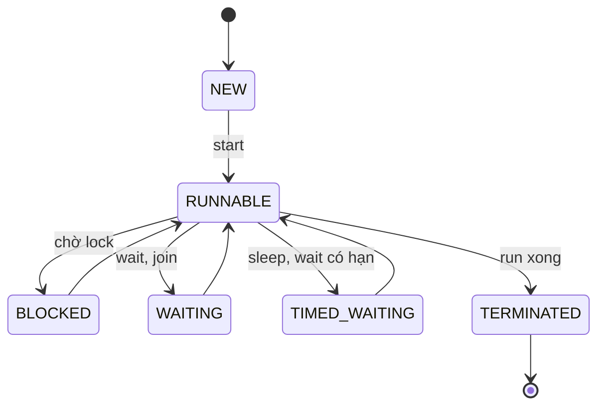
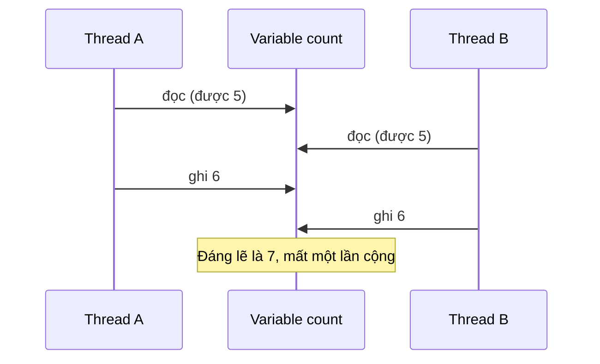

# Lý thuyết 12: Multithreading cơ bản và Java Memory Model

## Multithreading và Java Memory Model

Một **thread** là một dòng thực thi bên trong chương trình; nhiều thread chạy cùng lúc và cùng dùng chung memory của process. Lợi ích rõ ràng: tận dụng nhiều core CPU và không phải đứng chờ khi một thread bận I/O. Gần như mọi ứng dụng server đều dùng multithreading: xử lý nhiều request, tác vụ nền, tính toán parallel. Nếu bài toán không cần parallel thì cứ chạy đơn thread, ít lỗi hơn nhiều.

Cái giá phải trả nằm ở dữ liệu dùng chung. Nếu hai thread cùng sửa một dữ liệu mà không đồng bộ, có thể xảy ra hai chuyện: thread này không thấy giá trị mới mà thread kia vừa ghi, hoặc hai thread ghi chồng lên nhau làm mất một lần cập nhật. Điều đáng sợ là lỗi kiểu này lúc có lúc không, phụ thuộc vào thời điểm chạy, rất khó tái hiện. Quy tắc cho việc "thread này có thấy dữ liệu thread kia vừa ghi hay không, và theo thứ tự nào" được gọi là **Java Memory Model (JMM)**.

Bài này chỉ là nhập môn. Muốn học đầy đủ theo sách thì đi theo [Java Concurrency](/go?p=08-Java%2FJava-Concurrency%2Findex.md) (bắt đầu từ [lộ trình học](/go?p=08-Java%2FJava-Concurrency%2Flo-trinh.md)); chỗ nào có bản chi tiết hơn, bài này chỉ tóm tắt và dẫn link.

Cách tiếp cận đúng là cố gắng đừng chia sẻ dữ liệu giữa các thread (ưu tiên object immutable, hoặc mỗi thread một bản). Khi bắt buộc phải chia sẻ thì dùng `synchronized`, `volatile` hoặc các class atomic, và chỉ ở đúng chỗ cần.

**Nền tảng:** Dữ liệu dùng chung giữa các thread có ba vấn đề độc lập: tính atomic (`count++` là đọc, cộng, ghi nên bị xen giữa), tính hiển thị (mỗi core có cache riêng nên thread khác có thể chưa thấy giá trị mới) và thứ tự (compiler, JIT, CPU được sắp xếp lại lệnh). Mọi công cụ đồng bộ chỉ là cách bảo đảm một hoặc nhiều trong ba thứ này.

**Cốt lõi:** Nhiều thread dùng chung memory nên mọi rắc rối đến từ dữ liệu chia sẻ, và cách an toàn nhất là đừng chia sẻ. Khi bắt buộc, phải bảo đảm ba thứ độc lập: atomic, hiển thị và thứ tự.

- Vì `count++` gồm đọc, cộng, ghi nên thread khác xen vào làm mất cập nhật, và `volatile` không chữa được.
- Vì mỗi core có cache riêng và lệnh có thể bị sắp xếp lại nên thread khác chưa chắc thấy giá trị mới, cần happens-before.
- Vì deadlock cần đủ bốn điều kiện nên phá một điều kiện, như lock theo thứ tự cố định, là tránh được.



Mô hình tư duy: sơ đồ cho thấy không chia sẻ là lựa chọn đầu tiên, còn công cụ đồng bộ chỉ là phương án khi hết cách.

**Tóm tắt:**

- Nhiều thread dùng chung memory của process, nên chia sẻ dữ liệu sinh ra ba vấn đề độc lập: atomic, hiển thị (visibility) và thứ tự (ordering).
- `count++` là đọc, cộng, ghi nên hai thread xen vào nhau làm mất cập nhật; `volatile` không cứu được vì không biến ba bước thành một.
- `synchronized` bảo đảm loại trừ lẫn nhau, hiển thị và thứ tự; `volatile` chỉ bảo đảm hiển thị và thứ tự; `Atomic*` dùng CAS cho cập nhật đơn lẻ không cần lock.
- Happens-before là cầu nối bảo đảm thấy dữ liệu: thứ tự chương trình, unlock rồi lock cùng monitor, ghi rồi đọc `volatile`, `start()` và `join()`.
- Deadlock cần đủ bốn điều kiện (loại trừ lẫn nhau, giữ và chờ, không chiếm đoạt, chờ vòng); phòng bằng lock theo thứ tự cố định và giữ lock ngắn.
- `interrupt()` chỉ xin thread dừng; đừng nuốt `InterruptedException`, hãy throw tiếp hoặc gọi `interrupt()` lại.
- Đừng tự dựng bằng `wait/notify`; ưu tiên không chia sẻ trạng thái, rồi dùng công cụ cấp cao trong `java.util.concurrent`.

## Các khái niệm cần biết

- **Atomic**: một thao tác không thể bị thread khác xen vào giữa chừng, hoặc xảy ra trọn vẹn hoặc chưa xảy ra. `count++` không phải atomic vì gồm đọc, cộng, ghi.
- **Hiển thị (visibility)**: khi một thread ghi, thread khác có thấy giá trị đó không. Mỗi core có cache riêng nên mặc định không đảm bảo.
- **Thứ tự (ordering)**: compiler, JIT và CPU được phép sắp xếp lại lệnh nếu kết quả trong một thread không đổi, nhưng thread khác có thể quan sát thấy thứ tự khác.
- **Monitor (lock nội tại)**: mọi object Java đều có một lock; `synchronized` giành lock đó. Chỉ một thread giữ lock một lúc, các thread khác bị `BLOCKED` chờ.
- **CAS (compare-and-swap)**: lệnh CPU "ghi giá trị mới nếu giá trị hiện tại đúng như mong đợi", nền tảng của các class `Atomic*` để cập nhật không cần lock.
- **Happens-before**: mối quan hệ do JMM định nghĩa, nếu A happens-before B thì mọi thứ A ghi sẽ hiển thị cho B. Xem mục riêng bên dưới.
- **Deadlock**: hai hoặc nhiều thread chờ nhau mãi mãi vì mỗi bên giữ lock mà bên kia cần.
- **Daemon thread**: thread nền không giữ JVM sống; JVM thoát khi chỉ còn thread daemon.
- **Race condition**: kết quả sai do phụ thuộc vào thứ tự chạy ngẫu nhiên của các thread.

## Ba vấn đề của dữ liệu chia sẻ



**Suy luận:** Hai vấn đề hiển thị và atomic độc lập với nhau vì chúng đến từ hai nguyên nhân khác nhau của phần cứng. Mỗi core có cache riêng nên giá trị một thread ghi có thể nằm ở cache của nó rất lâu mà thread khác chưa thấy, đó là vấn đề hiển thị; còn `count++` gồm ba lệnh đọc, cộng, ghi nên một thread khác chen vào giữa là mất một lần đếm, đó là vấn đề atomic. Từ đó suy ra `volatile` chữa được vấn đề đầu chứ không chữa được vấn đề sau: nó buộc đọc ghi đi thẳng memory chung nhưng ba lệnh vẫn rời nhau. `synchronized` chữa cả hai vì một thread vào khối thì các thread khác phải chờ, và unlock rồi lock lại cùng monitor tạo ra quan hệ happens-before nên dữ liệu được thấy. Điểm dễ nhầm là chỉ nghĩ đến atomic mà bỏ sót hiển thị, ví dụ cờ `running` không `volatile` có thể khiến thread không bao giờ thoát vòng lặp. Khi chọn công cụ hãy chọn mức nhẹ nhất đủ bảo đảm: cờ dừng dùng `volatile`, bộ đếm dùng `Atomic*`, trạng thái nhiều field dùng `synchronized`, hoặc tốt nhất là immutable.

## Lifecycle thread



```java
Thread t = new Thread(() -> System.out.println("chạy ở " + Thread.currentThread().getName()));
t.start();     // start tạo luồng mới; run() gọi thẳng chỉ chạy trên luồng hiện tại
t.join();
```

### Chạy thử: mất lần đếm, join, interrupt

```java
static int plain = 0, sync = 0;
static final Object lock = new Object();
static AtomicInteger atom = new AtomicInteger();

// chạy r trên 4 thread rồi chờ xong
static void run(Runnable r) throws Exception {
    Thread[] ts = new Thread[4];
    for (int i = 0; i < 4; i++) { ts[i] = new Thread(r); ts[i].start(); }
    // không join thì in kết quả khi thread chưa xong
    for (Thread t : ts) t.join();
}

// mất lần đếm
run(() -> { for (int i = 0; i < 100_000; i++) plain++; });
run(() -> { for (int i = 0; i < 100_000; i++) synchronized (lock) { sync++; } });
run(() -> { for (int i = 0; i < 100_000; i++) atom.incrementAndGet(); });
// plain: nhỏ hơn 400000 (mỗi lần chạy một số khác); sync = 400000; atom = 400000
```

Sơ đồ dưới minh họa vì sao hai thread cộng 1 lần mà tổng chỉ tăng 1.



`plain++` thực chất là ba bước đọc, cộng, ghi; hai thread cùng đọc giá trị cũ thì một lần cộng bị mất. `volatile` **không** cứu được vì không biến ba bước thành một.

**Check-then-act** là dạng lỗi cùng họ: kiểm tra điều kiện rồi hành động ở hai bước tách rời.

```java
// hai thread cùng thấy null, tạo hai bản
if (instance == null) instance = new Service();
// map đồng thời vẫn sai: dùng putIfAbsent / computeIfAbsent
if (!map.containsKey(k)) map.put(k, v);
```

**Interrupt** là cách xin thread dừng, không ép buộc:

```java
Thread sleeper = new Thread(() -> {
    try { Thread.sleep(10_000); }
    catch (InterruptedException e) {
        // ném lỗi thì CỜ ĐÃ BỊ XÓA: isInterrupted() == false ở đây
        Thread.currentThread().interrupt();      // đặt lại cờ để tầng trên còn biết
    }
});
sleeper.start(); sleeper.interrupt(); sleeper.join();
```

| Tình huống | Hành vi |
|---|---|
| `interrupt()` khi đang `sleep`/`wait`/`join` | Throw `InterruptedException` và **xóa cờ** |
| `interrupt()` khi đang chạy vòng lặp thường | Chỉ đặt cờ; code phải tự kiểm tra `isInterrupted()` |
| Bắt `InterruptedException` rồi bỏ qua | Lỗi: nuốt tín hiệu dừng. Hoặc throw tiếp, hoặc `interrupt()` lại |
| Gọi `t.run()` thay vì `t.start()` | Chạy trên thread hiện tại (đã xác nhận in ra tên `main`) |
| Thread daemon | JVM thoát khi chỉ còn thread daemon, không chờ chúng |

Cách xử lý `InterruptedException` đúng, chính sách ngắt và hủy tác vụ được nói kỹ ở [Hủy tác vụ và Shutdown](/go?p=08-Java%2FJava-Concurrency%2Fmedium%2Flt-07-huy-va-shutdown.md).

Deadlock tối thiểu (hai thread lock ngược thứ tự thì treo; xem bằng `jstack`, mục "Found one Java-level deadlock"):

```java
// Thread 1: synchronized (a) { synchronized (b) { ... } }
// sửa: cả hai cùng khóa a rồi b
// Thread 2: synchronized (b) { synchronized (a) { ... } }
```

## Công cụ đồng bộ

Bốn công cụ dưới đây giải quyết ba vấn đề ở đầu bài với mức đảm bảo khác nhau. Chọn công cụ nhẹ nhất đủ đảm bảo cho bài toán của bạn: cờ dừng chỉ cần `volatile`, bộ đếm dùng `Atomic*`, còn immutable gồm nhiều variable liên quan nhau phải dùng `synchronized`.

| Công cụ | Đảm bảo | Dùng khi |
|---|---|---|
| `synchronized` | Loại trừ lẫn nhau + hiển thị + thứ tự | Bảo vệ một khối trạng thái |
| `volatile` | Hiển thị + thứ tự, **không** atomic | Cờ trạng thái, công bố reference |
| `Atomic*` (CAS) | Atomic, không lock | Bộ đếm, cập nhật đơn lẻ |
| `final` | Hiển thị an toàn sau khi khởi tạo | Object immutable |

**Phải thuộc:** `synchronized` bảo đảm loại trừ lẫn nhau, hiển thị và thứ tự; `volatile` chỉ bảo đảm hiển thị và thứ tự, không atomic (`volatile int` với `i++` vẫn sai); `Atomic*` dùng CAS, atomic và không lock. Gọi `t.run()` không tạo thread mới, phải gọi `t.start()`.

```java
class Counter {
    private int n;
    synchronized void inc() { n++; }       // không có synchronized thì mất lần đếm
    // đọc cũng cần đồng bộ để thấy giá trị mới nhất
    synchronized int get()  { return n; }
}
```

## Happens-before

Nếu hành động A **happens-before** B thì kết quả của A hiển thị cho B. Bốn nguồn quen thuộc nhất: thứ tự chương trình trong một thread, unlock rồi lock lại cùng monitor, ghi rồi đọc cùng variable `volatile`, và `start()`/`join()`. Ví dụ điển hình: thread A ghi dữ liệu rồi ghi cờ `volatile`, thread B đọc cờ thấy `true` thì chắc chắn thấy cả dữ liệu. Thiếu quan hệ này, một vòng lặp `while (running)` với `running` không `volatile` có thể không bao giờ thoát. Bảng quy tắc đầy đủ, công bố an toàn, double-checked locking và thí nghiệm tái hiện lỗi (có kết quả chạy thật) nằm ở bài gốc [Java Memory Model](/go?p=08-Java%2FJava-Concurrency%2Fhard%2Flt-16-java-memory-model.md); bản tóm lược ở [JMM chuyên sâu](/go?p=08-Java%2FJava-Core%2Fhard%2Flt-17-java-memory-model-sau.md).

**Phải thuộc:** Bốn nguồn happens-before quen thuộc: thứ tự chương trình trong một thread; unlock rồi lock lại cùng monitor; ghi rồi đọc cùng variable `volatile`; `Thread.start()` và `join()`. Deadlock cần đủ bốn điều kiện: loại trừ lẫn nhau, giữ và chờ, không chiếm đoạt, chờ vòng.

## Deadlock

Deadlock xảy ra khi bốn điều kiện cùng đúng: loại trừ lẫn nhau, giữ và chờ, không chiếm đoạt, chờ vòng. Cách phòng ngắn gọn nhất là luôn lock theo thứ tự cố định và giữ lock ngắn. Các dạng deadlock, `tryLock` có timeout và cách đọc thread dump được trình bày ở [Liveness hazards](/go?p=08-Java%2FJava-Concurrency%2Fhard%2Flt-10-liveness-hazards.md).

**Suy luận:** Deadlock chỉ xảy ra khi cùng lúc có bốn điều kiện, nên chỉ cần phá một điều kiện là tránh được nó. Điều kiện dễ phá nhất trong thực tế là chờ vòng: nếu mọi thread luôn lock theo cùng một thứ tự cố định thì không thể có chu trình thread A chờ B và B chờ A. Việc giữ lock ngắn cũng giảm cơ hội hai thread cùng giữ một lock và chờ lock kia, còn `tryLock` kèm timeout phá điều kiện "chờ mãi" và cho phép thread từ bỏ. Chính vì deadlock chỉ xuất hiện khi lịch chạy trùng khớp nên nó thường không lộ ở môi trường test mà đến lúc production mới treo, và lúc đó `jstack` hay `jcmd Thread.print` là công cụ chẩn đoán, vì báo "Found one Java-level deadlock". Điểm dễ nhầm là nghĩ chỉ lock tường minh mới gây deadlock, trong khi hai `synchronized` lồng nhau theo thứ tự ngược cũng đủ. Khi review, hãy tìm mọi chỗ giữ một lock rồi lấy lock khác và đảm bảo thứ tự nhất quán.

## wait/notify

`wait()`/`notifyAll()` dùng trong khối `synchronized` và **luôn đặt trong vòng lặp** kiểm tra điều kiện, vì thread có thể bị đánh thức giả hoặc bỏ lỡ tín hiệu. Thực tế hãy dùng `BlockingQueue` hoặc `CountDownLatch` thay vì tự viết. Cơ chế condition queue và AQS nằm ở [Synchronizer tùy biến](/go?p=08-Java%2FJava-Concurrency%2Fhard%2Flt-14-custom-synchronizer-aqs.md).

## Quy tắc thực dụng

1. Ưu tiên **không chia sẻ trạng thái**: immutable hoặc mỗi thread một bản.
2. Chia sẻ thì dùng công cụ cấp cao (`java.util.concurrent`), không tự dựng bằng `wait/notify`.
3. Đặt tên cho thread để gỡ lỗi dễ hơn.
4. Gỡ lỗi treo: `jstack` / `jcmd <pid> Thread.print`.

## Phỏng vấn khó: chuỗi hỏi xoáy

Người phỏng vấn senior thường mở bằng câu dễ rồi xoáy xuống cơ chế, đánh đổi và sự cố thật. Câu trả lời tốt luôn đi từ cốt lõi xuống: vấn đề nào trong ba vấn đề (atomic, hiển thị, thứ tự), và công cụ nào chữa đúng vấn đề đó.

### Chuỗi 1: volatile, synchronized và Atomic

1. **Câu mở:** `volatile` dùng để làm gì?
2. **Xoáy 1:** `volatile int count` rồi nhiều thread `count++` có đúng không? Vì sao?
3. **Xoáy 2:** Vậy khi nào chọn `volatile`, `Atomic*`, `synchronized`? Cờ `running` không `volatile` gây lỗi gì?

**Đáp án ngắn:** Dữ liệu chia sẻ có ba vấn đề độc lập là atomic, hiển thị và thứ tự. `volatile` chỉ bảo đảm hiển thị và thứ tự: ghi đi thẳng memory chung và đọc sau đó thấy giá trị mới, tạo quan hệ happens-before giữa ghi và đọc cùng variable. Nó không atomic. `count++` là ba bước đọc, cộng, ghi, nên hai thread cùng đọc 5 rồi cùng ghi 6 là mất một lần cộng; `volatile` không biến ba bước thành một. `synchronized` chữa cả ba vì loại trừ lẫn nhau và unlock rồi lock cùng monitor tạo happens-before. `Atomic*` dùng CAS cho cập nhật đơn lẻ không lock. Tôi chọn công cụ nhẹ nhất đủ bảo đảm: cờ dừng dùng `volatile`, bộ đếm dùng `Atomic*`, trạng thái nhiều field liên quan nhau dùng `synchronized`, tốt nhất là immutable. Thiếu `volatile` ở cờ `running`, vòng `while (running)` có thể không bao giờ thoát vì thread khác chưa thấy giá trị mới. Lỗi này lúc có lúc không nên rất khó tái hiện.

**Sai lầm hay gặp:**

- Nghĩ `volatile` làm `i++` an toàn.
- Chỉ nghĩ đến atomic mà bỏ sót hiển thị.
- Dùng `synchronized` cho mọi thứ mà không cân nhắc công cụ nhẹ hơn.

### Chuỗi 2: Deadlock

1. **Câu mở:** Deadlock là gì và khi nào xảy ra?
2. **Xoáy 1:** Bốn điều kiện là gì, và vì sao phá một điều kiện là đủ?
3. **Xoáy 2:** Vì sao deadlock hay lọt qua test rồi treo ở production, và bạn chẩn đoán thế nào?

**Đáp án ngắn:** Deadlock là hai hay nhiều thread chờ nhau mãi vì mỗi bên giữ lock mà bên kia cần. Nó cần đủ bốn điều kiện cùng lúc: loại trừ lẫn nhau, giữ và chờ, không chiếm đoạt, chờ vòng. Thiếu một điều kiện thì không có deadlock, nên chỉ cần phá một. Dễ phá nhất trong thực tế là chờ vòng: nếu mọi thread luôn lock theo cùng một thứ tự cố định thì không có chu trình A chờ B và B chờ A. Giữ lock ngắn giảm cơ hội trùng lịch, còn `tryLock` có timeout cho thread từ bỏ thay vì chờ mãi. Hai `synchronized` lồng nhau theo thứ tự ngược cũng đủ gây deadlock, không cần lock tường minh. Nó chỉ xuất hiện khi lịch chạy trùng khớp nên thường không lộ ở test mà treo lúc production. Tôi chẩn đoán bằng `jstack` hoặc `jcmd <pid> Thread.print`, tìm khối `Found one Java-level deadlock`. Khi review, tôi tìm mọi chỗ giữ một lock rồi lấy lock khác và kiểm tra thứ tự nhất quán.

**Sai lầm hay gặp:**

- Liệt kê bốn điều kiện nhưng không nói phá cái nào trong thực tế.
- Nghĩ chỉ lock tường minh mới gây deadlock.
- Nuốt `InterruptedException` khi xử lý chờ lock hoặc chờ thread.

