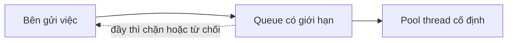
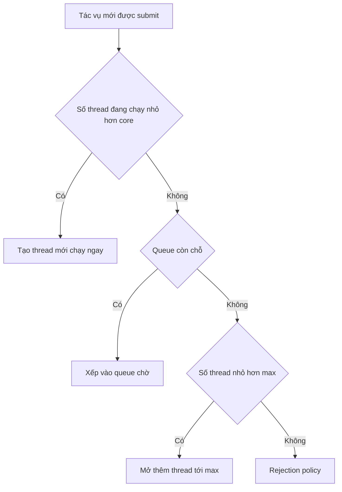
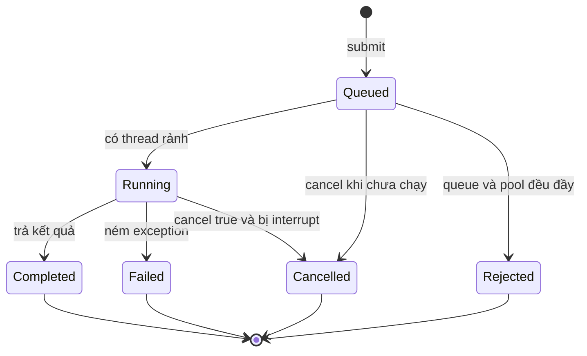
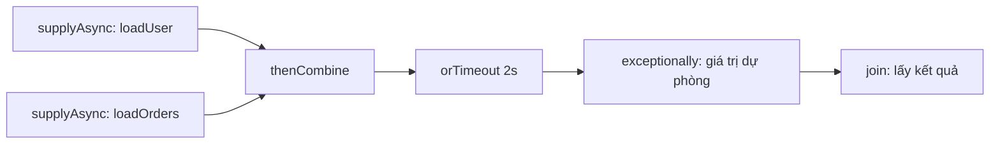
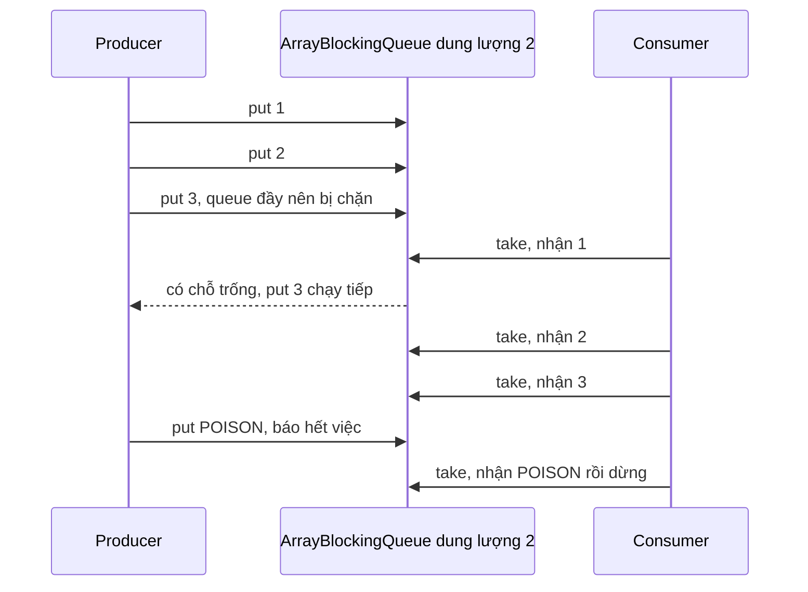
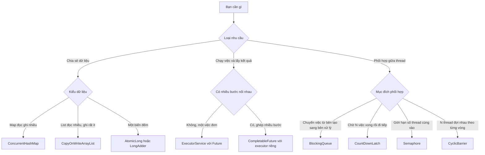

# Lý thuyết 13: java.util.concurrent

## Vì sao có java.util.concurrent

Bài trước cho bạn công cụ thô: `Thread`, `synchronized`, `wait/notify`. Dùng chúng trực tiếp rất dễ sai: deadlock, quên báo thức thread đang chờ, và tạo thread vô tội vạ sẽ làm server cạn tài nguyên (mỗi thread tốn memory stack và chi phí chuyển ngữ cảnh). Gói `java.util.concurrent` cung cấp sẵn những khối xây dựng đã được dùng và tối ưu nhiều năm: thread pool (`ExecutorService`), `Future`, lock, các bộ đồng bộ và collection an toàn cho multithreading. Bạn nên dùng chúng thay vì tự chế.

Bạn dùng gói này khi chạy tác vụ parallel, cần thread pool hoặc cần các thread phối hợp với nhau. Ngược lại, nếu chỉ cần một variable đếm đơn giản thì class atomic là đủ, không cần lock hay pool.

Cách làm thực tế gồm ba bước: tạo `ExecutorService` có giới hạn số thread, dùng `CompletableFuture` để nối các bước asynchronous, và chọn đúng công cụ đồng bộ (lock, latch, semaphore...) cho từng bài toán phối hợp.

**Cốt lõi:** Tự tạo và quản lý thread vừa dễ sai vừa đắt, nên ta tách "việc cần làm" khỏi "thread chạy nó": giao việc cho pool có giới hạn rồi nối các kết quả. Giới hạn là chìa khóa, vì nó tạo áp lực ngược để hệ thống tự điều tiết thay vì cạn tài nguyên.

- Vì pool ưu tiên tái dùng thread nên chỉ mở thêm thread vượt `core` khi queue đầy, và queue không giới hạn làm `max` vô dụng.
- Vì `Future.get()` chặn thread nên `CompletableFuture` cho phép mô tả "có kết quả thì làm tiếp".
- Vì `commonPool()` dùng chung toàn JVM nên tác vụ chặn I/O phải có executor riêng.



Mô hình tư duy: sơ đồ cho thấy queue có giới hạn đẩy áp lực ngược về bên gửi, nên tải vượt khả năng không làm cạn memory.

**Tóm tắt:**

- Tự dựng bằng `Thread`, `synchronized`, `wait/notify` rất dễ sai; `java.util.concurrent` cung cấp pool, future và công cụ phối hợp đã được kiểm chứng.
- `ThreadPoolExecutor` xử lý tác vụ mới theo thứ tự: dưới `core` thì tạo thread, còn lại xếp vào queue, queue đầy mới mở thêm thread tới `max`, vượt `max` thì áp dụng rejection policy.
- Queue không giới hạn làm `max` vô dụng, và `newFixedThreadPool` dùng queue như vậy nên có thể phình đến hết memory.
- `CompletableFuture` nối các bước asynchronous: `thenApply` cho hàm synchronous, `thenCompose` khi hàm trả về một `CompletableFuture`, `thenCombine` ghép hai kết quả.
- Mặc định `CompletableFuture` và parallel stream chạy trên `ForkJoinPool.commonPool()`, nên tác vụ chặn I/O cần executor riêng.
- Lỗi ở một bước làm các bước sau hỏng theo; thiếu `exceptionally`/`handle` và không ai gọi `join`/`get` thì lỗi biến mất âm thầm.
- Latch, barrier, semaphore là ba công cụ phối hợp; `LongAdder` nhanh hơn `AtomicLong` dưới tranh chấp cao.

## Các khái niệm cần biết

- **Thread pool**: tập thread được tạo sẵn và tái sử dụng để chạy nhiều tác vụ, thay vì tạo thread mới cho mỗi tác vụ. Giống quầy giao dịch ngân hàng: số quầy cố định, khách đến sau xếp hàng.
- **`Future`**: "phiếu hẹn" cho kết quả chưa có; `get()` chờ đến khi có kết quả. **`CompletableFuture`** mở rộng bằng khả năng nối bước tiếp theo mà không phải chờ chặn.
- **Core size và max size**: số thread duy trì thường xuyên và số thread tối đa pool được phép mở. Chi tiết cách chúng tương tác với queue nằm ở phần sau.
- **Rejection policy** (chính sách từ chối): việc pool làm khi đã đầy cả thread lẫn queue (throw lỗi, để chính thread gọi chạy tác vụ, bỏ tác vụ).
- **Backpressure** (áp lực ngược): cơ chế làm bên sản xuất chậm lại khi bên tiêu thụ không theo kịp, thay vì để queue phình vô hạn. Queue có giới hạn tự nhiên tạo ra điều này.
- **Latch, barrier, semaphore**: ba bộ phối hợp. Latch đợi event xong, barrier cho nhóm thread đợi nhau, semaphore giới hạn số thread cùng vào.
- **Tranh chấp (contention)**: nhiều thread cùng cố cập nhật một variable, dẫn đến phải thử lại nhiều lần với CAS.
- **`ForkJoinPool.commonPool()`**: pool dùng chung của JVM, mặc định cho `CompletableFuture` và parallel stream. Tác vụ chặn I/O ở đây làm đói mọi nơi khác dùng nó.

## ExecutorService

Vấn đề đặt ra là: tác vụ đến nhiều hơn số thread có thể xử lý thì làm gì? Pool trả lời bằng ba tầng: giao cho thread core rảnh, xếp hàng, mở thêm thread tới max, và cuối cùng mới từ chối. Đoạn code sau cấu hình đủ cả ba tầng, kèm queue có giới hạn.

```java
ExecutorService pool = new ThreadPoolExecutor(
        4, 8,                                      // core, max
        60, TimeUnit.SECONDS,
        new ArrayBlockingQueue<>(100),             // hàng đợi CÓ GIỚI HẠN
        // Java 21+; bản cũ dùng ThreadFactory tự viết
        Thread.ofPlatform().name("worker-", 0).factory(),
        new ThreadPoolExecutor.CallerRunsPolicy()  // chính sách khi đầy
);
Future<Integer> f = pool.submit(() -> compute());
int result = f.get(2, TimeUnit.SECONDS);
pool.shutdown();
```

Điểm hay bị hiểu sai: pool chỉ tạo thread vượt `core` **sau khi queue đầy**, nên queue không giới hạn làm `max` vô dụng. Bẫy liên quan: `Executors.newFixedThreadPool` dùng queue không giới hạn (có thể cạn memory), còn `newCachedThreadPool` tạo thread không giới hạn; ở production hãy tự cấu hình `ThreadPoolExecutor`. Sơ đồ quyết định của pool, thí nghiệm chạy thật với `AbortPolicy`, cách tính cỡ pool, các chính sách bão hòa và `ThreadFactory` nằm ở bài gốc [Thread pool trong thực tế](/go?p=08-Java%2FJava-Concurrency%2Fmedium%2Flt-08-thread-pool.md); nền tảng Executor, `Callable`/`Future` ở [Thực thi tác vụ](/go?p=08-Java%2FJava-Concurrency%2Fmedium%2Flt-06-task-execution.md).

**Phải thuộc:** `ThreadPoolExecutor` xử lý tác vụ mới theo thứ tự: dưới `core` thì tạo thread mới; còn lại xếp vào queue; queue đầy mới tạo thêm thread tới `max`; vượt `max` thì áp dụng rejection policy. Production nên tự cấu hình pool với queue có giới hạn thay vì `Executors.newFixedThreadPool`/`newCachedThreadPool`.

Sơ đồ dưới là đường đi của một tác vụ mới khi bạn gọi `submit`. Đọc từ trên xuống: pool kiểm tra lần lượt từng tầng và dừng ở tầng đầu tiên còn chỗ.



Điểm cần chú ý là thứ tự: queue được thử trước khi mở thêm thread vượt `core`. Với queue không giới hạn, nhánh "Queue còn chỗ" luôn đúng nên hai nhánh T3 và T4 không bao giờ xảy ra.

Mỗi tác vụ gửi vào pool đi qua một vòng đời. Sơ đồ trạng thái dưới giúp bạn biết `Future.get()` đang chờ ở giai đoạn nào và vì sao một tác vụ có thể "biến mất" nếu không ai lấy kết quả.



Đọc sơ đồ: tác vụ bắt đầu ở `Queued` (giai đoạn "đã nhận, chờ thread"; khi pool còn dưới `core` thì giai đoạn này gần như bằng không vì thread mới được tạo để chạy luôn), rồi đi tới một trong bốn trạng thái cuối. `Rejected` xảy ra ngay lúc `submit` nên `submit` ném `RejectedExecutionException` (với `AbortPolicy`), còn `Failed` thì exception bị nhốt vào `Future` và chỉ lộ ra khi gọi `get()` dưới dạng `ExecutionException`. Đây là lý do tác vụ `execute(Runnable)` ném lỗi thì thread chết kèm stack trace, nhưng `submit` thì lỗi im lặng nếu bạn bỏ quên `Future`. Tên trạng thái trong sơ đồ là mô hình khái niệm để học, không phải enum trong JDK.

**Suy luận:** Pool chỉ tạo thread vượt `core` sau khi queue đầy vì thiết kế ưu tiên tái dùng thread sẵn có hơn là tạo thread mới, vốn đắt vì mỗi thread tốn stack và chi phí lên lịch. Tác vụ được xếp hàng trước, và chỉ khi queue không còn chỗ, pool mới tin rằng tải thực sự vượt khả năng và mở thêm thread tới `max`. Hệ quả rất quan trọng: nếu queue không giới hạn thì nó không bao giờ đầy, nên pool không bao giờ vượt `core` và `max` trở nên vô dụng. Đồng thời queue không giới hạn cũng bỏ mất áp lực ngược, nên khi nhà sản xuất nhanh hơn người tiêu thụ thì tác vụ chất đống đến khi cạn memory; đó là lý do `newFixedThreadPool` nguy hiểm trong production. Ngược lại queue có giới hạn kèm rejection policy rõ ràng buộc bên gửi chậm lại hoặc bị từ chối, nên hệ thống tự điều tiết. Điểm dễ nhầm là chỉnh `max` rất lớn mong tăng thông lượng, trong khi nó chỉ có tác dụng khi queue đầy. Hãy tự tạo `ThreadPoolExecutor` với queue có giới hạn và chọn chính sách từ chối phù hợp.

## CompletableFuture

`CompletableFuture` giải quyết vấn đề `Future.get()` chặn thread: thay vì chờ, bạn mô tả "khi có kết quả thì làm tiếp việc này". Hai tác vụ độc lập chạy parallel rồi ghép, như sơ đồ dưới.



```java
CompletableFuture<User> u = CompletableFuture.supplyAsync(() -> loadUser(id), pool);
CompletableFuture<List<Order>> o = CompletableFuture.supplyAsync(() -> loadOrders(id), pool);

Summary s = u.thenCombine(o, Summary::new)          // chờ cả hai, ghép
             .orTimeout(2, TimeUnit.SECONDS)
             .exceptionally(ex -> Summary.empty())
             .join();
```

| Method | Ý nghĩa |
|---|---|
| `thenApply` | Biến đổi kết quả (synchronous) |
| `thenCompose` | Nối với một `CompletableFuture` khác (giống `flatMap`) |
| `thenCombine` | Ghép hai kết quả |
| `allOf`, `anyOf` | Chờ tất cả / một trong nhiều |
| `exceptionally`, `handle` | Xử lý lỗi |

Luôn truyền executor riêng cho tác vụ chặn; mặc định dùng `ForkJoinPool.commonPool()` dễ bị đói.

**Phải thuộc:** `thenApply` cho hàm synchronous, `thenCompose` khi hàm trả về `CompletableFuture` (giống `flatMap`), `thenCombine` ghép hai kết quả. `join()` throw `CompletionException` (unchecked), `get()` throw `ExecutionException` (checked). Tác vụ chặn I/O phải truyền executor riêng, đừng dùng `commonPool()`.

### Ghép và xử lý lỗi (đã chạy thử)

```java
CompletableFuture<String> u = CompletableFuture.supplyAsync(() -> "An", ex);
CompletableFuture<Integer> o = CompletableFuture.supplyAsync(() -> 3, ex);
u.thenCombine(o, (a, b) -> a + " có " + b + " đơn").join();   // "An có 3 đơn"

CompletableFuture<Integer> failed = CompletableFuture.supplyAsync(
        () -> { throw new IllegalStateException("hỏng"); }, ex);
failed.exceptionally(e -> -1).join();                            // -1
failed.handle((v, e) -> e == null ? "ok" : e.getClass().getSimpleName() + "/" + e.getCause().getClass().getSimpleName()).join();
// "CompletionException/IllegalStateException"
// ném CompletionException, getCause() là IllegalStateException (unchecked)
failed.join();
// ném ExecutionException, getCause() là IllegalStateException (checked)
failed.get();

// 10, phẳng, không lồng Future
supplyAsync(() -> 5, ex).thenCompose(x -> supplyAsync(() -> x * 2, ex)).join();
// nhiều future: allOf(futures...).join() rồi futures.stream().map(CompletableFuture::join) -> [1, 4, 9]
```

| Chọn | Khi |
|---|---|
| `thenApply` | Hàm synchronous trả giá trị thường |
| `thenCompose` | Hàm trả về một `CompletableFuture` (tránh `CompletableFuture<CompletableFuture<T>>`) |
| `join` | Trong pipeline/lambda (không bắt buộc bắt checked exception) |
| `get` | Cần timeout kiểu cũ hoặc API đòi checked exception |

Lỗi ở một bước làm mọi bước phụ thuộc phía sau bị hỏng theo cho tới khi gặp `exceptionally`/`handle`. Thiếu bước xử lý lỗi và không ai gọi `join`/`get` thì lỗi **biến mất âm thầm**.

**Nền tảng:** Thay vì tự quản lý `Thread`, ta giao tác vụ cho pool (tách "việc cần làm" khỏi "thread chạy nó") và nối các bước asynchronous bằng `CompletableFuture`. Pool giới hạn số thread để server không cạn tài nguyên; queue có giới hạn tạo backpressure.

## Công cụ đồng bộ hóa

Bảng nhanh để nhớ tên và ý nghĩa; cách dùng, ví dụ và bẫy của từng công cụ nằm ở các bài gốc.

| Công cụ | Dùng để | Bài gốc |
|---|---|---|
| `ReentrantLock` | Lock linh hoạt: `tryLock`, ngắt được, `Condition` | [Explicit locks](/go?p=08-Java%2FJava-Concurrency%2Fhard%2Flt-13-explicit-locks.md) |
| `ReadWriteLock`, `StampedLock` | Nhiều đọc hoặc một ghi | [Explicit locks](/go?p=08-Java%2FJava-Concurrency%2Fhard%2Flt-13-explicit-locks.md) |
| `Semaphore` | Giới hạn số thread đồng thời vào một tài nguyên | [Building blocks](/go?p=08-Java%2FJava-Concurrency%2Fmedium%2Flt-05-building-blocks.md) |
| `CountDownLatch` | Chờ N event xong (dùng một lần) | [Building blocks](/go?p=08-Java%2FJava-Concurrency%2Fmedium%2Flt-05-building-blocks.md) |
| `CyclicBarrier`, `Exchanger` | N thread đợi nhau tại một điểm (tái sử dụng); hai thread trao đổi dữ liệu | [Building blocks](/go?p=08-Java%2FJava-Concurrency%2Fmedium%2Flt-05-building-blocks.md) |
| `Phaser` | Rào chắn nhiều pha, số bên tham gia thay đổi (sau thời sách) | Tra Javadoc |

## Atomic và LongAdder

`AtomicInteger/Long` dựa trên CAS, hợp cho tranh chấp thấp. `LongAdder` chia bộ đếm thành nhiều ô và cộng dồn khi đọc `sum()`, nên **nhanh hơn dưới tranh chấp cao**. Cơ chế CAS, ABA và so sánh lock với atomic xem [Atomic và nonblocking](/go?p=08-Java%2FJava-Concurrency%2Fhard%2Flt-15-atomic-nonblocking.md).

## Producer-Consumer

Mẫu này tách bên tạo việc và bên xử lý việc qua một queue chặn. Dùng khi tốc độ tạo và xử lý khác nhau hoặc muốn tách rời hai phía; không dùng nếu mỗi việc phải có kết quả trả ngay cho người gọi (khi đó dùng `Future`). Queue có giới hạn tự tạo backpressure: `put` chặn khi đầy, `take` chặn khi rỗng. Ví dụ đầy đủ (tìm tệp, poison pill, serial confinement) ở [Building blocks, mục blocking queue](/go?p=08-Java%2FJava-Concurrency%2Fmedium%2Flt-05-building-blocks.md).

```java
BlockingQueue<Job> q = new ArrayBlockingQueue<>(100);
// Producer: q.put(job)   chặn khi đầy => tự có backpressure
// Consumer: q.take()     chặn khi rỗng
```

Sơ đồ dưới theo dõi một queue dung lượng 2 với producer nhanh và consumer chậm. Đọc từ trên xuống: producer đẩy hai việc vào là đầy, lần `put` tiếp theo bị chặn cho đến khi consumer `take` làm trống một chỗ.



Chương trình dưới tái hiện đúng kịch bản (queue dung lượng 2, consumer ngủ 200 ms mỗi lần). Đã chạy thật trên Java 11.

```java
// PC.java, chạy: java PC.java
import java.util.concurrent.*;
public class PC {
    public static void main(String[] args) throws Exception {
        BlockingQueue<Integer> q = new ArrayBlockingQueue<>(2);   // có giới hạn
        final int POISON = -1;
        Thread producer = new Thread(() -> {
            try {
                for (int i = 1; i <= 5; i++) {
                    q.put(i);                                      // chặn khi queue đầy
                    System.out.println("put  " + i);
                }
                q.put(POISON);                                     // báo hết việc
            } catch (InterruptedException e) { Thread.currentThread().interrupt(); }
        });
        Thread consumer = new Thread(() -> {
            try {
                while (true) {
                    Thread.sleep(200);                             // xử lý chậm hơn
                    int v = q.take();                              // chặn khi queue rỗng
                    if (v == POISON) break;
                    System.out.println("take " + v);
                }
            } catch (InterruptedException e) { Thread.currentThread().interrupt(); }
        });
        producer.start(); consumer.start();
        producer.join(); consumer.join();
    }
}
```

```text
put  1
put  2
put  3
take 1
take 2
put  4
take 3
put  5
take 4
take 5
```

Giải thích kết quả: `put 1` và `put 2` in ngay, còn `put 3` bị chặn khoảng 200 ms cho tới khi consumer thức dậy và `take` được phần tử đầu. Dòng `put 3` có thể nằm trước dòng `take 1` vì `put` đã trả về trước khi consumer kịp `println`. Với `put 4` và `put 5`, producer lại phải đợi consumer, nên hai thread chạy xen kẽ theo nhịp của consumer chậm. Đó là backpressure: producer không chạy trước consumer quá dung lượng queue. Thứ tự dòng log giữa hai thread có thể lệch nhẹ giữa các lần chạy; điều không đổi là số phần tử trong queue không vượt 2 và mỗi `take` nhận đúng thứ tự FIFO 1 đến 5.

## Chọn công cụ

| Cần làm gì | Chọn |
|---|---|
| Chạy tác vụ nền | `ExecutorService`, ghép bằng `CompletableFuture` |
| Bảo vệ dữ liệu chung | Immutable, rồi Atomic/Concurrent collection, rồi Lock, cuối cùng `synchronized` |
| Phối hợp giữa thread | `BlockingQueue`, `CountDownLatch`, `Semaphore` |

Sơ đồ dưới đi từ nhu cầu cụ thể tới công cụ. Đọc từ trên xuống, chọn nhánh khớp với câu hỏi bạn đang có; mỗi lá là một công cụ nên thử trước.



Một vài lưu ý khi dùng sơ đồ. `CopyOnWriteArrayList` chép cả mảng mỗi lần ghi nên chỉ hợp khi danh sách nhỏ, đọc rất nhiều, ví dụ danh sách listener. `CountDownLatch` dùng một lần, hết đếm thì không đặt lại được; cần lặp lại thì chuyển sang `CyclicBarrier`. Nếu không nhánh nào khớp, hãy quay lại thứ tự ở bảng trên: immutable trước, rồi atomic hoặc collection concurrent, rồi lock.

## Phỏng vấn khó: chuỗi hỏi xoáy

Người phỏng vấn senior thường mở bằng câu dễ rồi xoáy xuống cơ chế, đánh đổi và sự cố thật. Câu trả lời tốt luôn đi từ cốt lõi xuống: giới hạn nằm ở đâu, áp lực ngược đi về đâu, lỗi biến mất ở đâu.

### Chuỗi 1: ThreadPoolExecutor và queue

1. **Câu mở:** Khi submit tác vụ vào `ThreadPoolExecutor`, nó xử lý theo thứ tự nào?
2. **Xoáy 1:** Vì sao `max` lớn mà pool vẫn không mở thêm thread?
3. **Xoáy 2:** Vì sao `newFixedThreadPool` nguy hiểm ở production, và bạn cấu hình thế nào?

**Đáp án ngắn:** Tác vụ mới đi theo bốn tầng: dưới `core` thì tạo thread mới; còn lại xếp vào queue; queue đầy mới mở thêm thread tới `max`; vượt `max` thì áp dụng rejection policy. Thiết kế này ưu tiên tái dùng thread sẵn có vì tạo thread đắt, mỗi thread tốn stack và chi phí lên lịch; chỉ khi queue không còn chỗ pool mới tin tải vượt khả năng. Hệ quả là nếu queue không giới hạn thì nó không bao giờ đầy, pool không vượt `core` và `max` vô dụng. Queue không giới hạn còn bỏ mất áp lực ngược, nên khi bên gửi nhanh hơn bên xử lý, tác vụ chất đống đến cạn memory; `newFixedThreadPool` dùng queue như vậy, còn `newCachedThreadPool` tạo thread không giới hạn. Ở production tôi tự tạo `ThreadPoolExecutor` với queue có giới hạn, đặt tên thread để dễ gỡ lỗi, và chọn rejection policy rõ ràng, ví dụ `CallerRunsPolicy` để chính bên gửi chạy tác vụ và chậm lại. Kiểm tra bằng cách theo dõi độ dài queue và số tác vụ bị từ chối.

**Sai lầm hay gặp:**

- Tưởng pool mở thread tới `max` trước khi xếp queue.
- Chỉnh `max` rất lớn để tăng thông lượng.
- Không nhắc tới backpressure khi nói về queue có giới hạn.

### Chuỗi 2: CompletableFuture và lỗi biến mất

1. **Câu mở:** `thenApply` và `thenCompose` khác nhau thế nào?
2. **Xoáy 1:** Mặc định `CompletableFuture` chạy trên pool nào, và gọi API chặn I/O ở đó thì sao?
3. **Xoáy 2:** Một bước trong chuỗi ném exception, các bước sau và người gọi thấy gì? `join` và `get` khác gì?

**Đáp án ngắn:** `thenApply` nhận hàm synchronous trả giá trị thường; `thenCompose` dùng khi hàm trả về một `CompletableFuture`, giống `flatMap`, để tránh lồng `CompletableFuture<CompletableFuture<T>>`. Mặc định `CompletableFuture` và parallel stream đều chạy trên `ForkJoinPool.commonPool()`, dùng chung toàn JVM. Tác vụ chặn I/O ở đó chiếm thread, làm đói mọi nơi khác dùng pool này, nên phải truyền executor riêng cho tác vụ chặn. Lỗi ở một bước làm mọi bước phụ thuộc phía sau hỏng theo cho tới khi gặp `exceptionally` hoặc `handle`. Nếu thiếu bước xử lý lỗi và không ai gọi `join` hay `get` thì lỗi biến mất âm thầm. `join()` ném `CompletionException` (unchecked), còn `get()` ném `ExecutionException` (checked); cả hai đều có `getCause()` là lỗi thật. Tôi dùng `join` trong pipeline, `get` khi cần timeout kiểu cũ, và thêm `orTimeout` cùng giá trị dự phòng để một dịch vụ chậm không kéo cả chuỗi.

**Sai lầm hay gặp:**

- Dùng `thenApply` khi hàm trả về future rồi nhận kết quả lồng.
- Quên xử lý lỗi nên mất dấu tác vụ.
- Cho tác vụ chặn I/O chạy trên pool mặc định.

