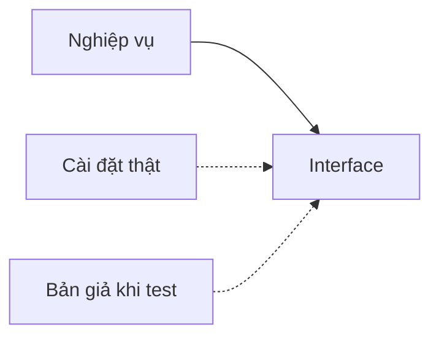
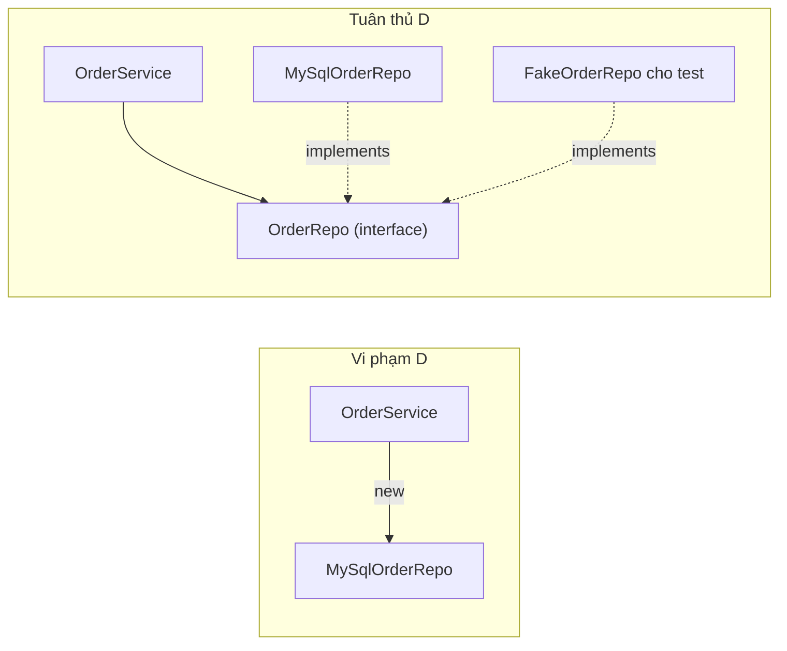
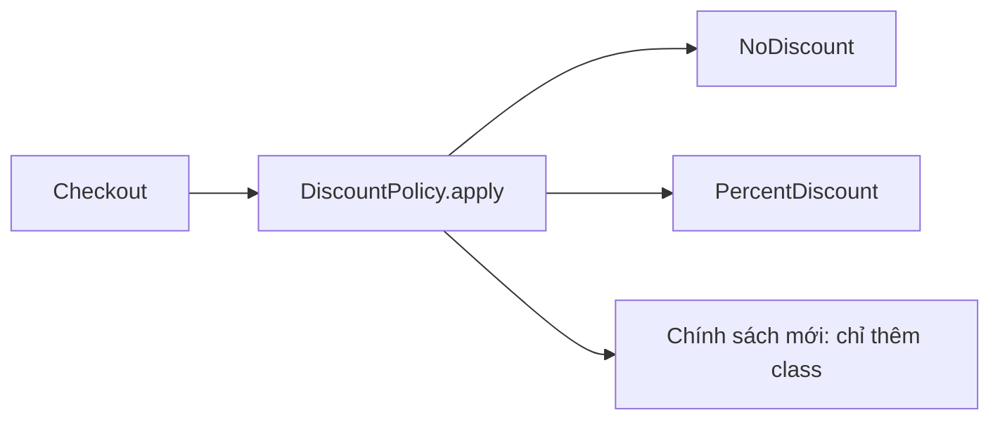
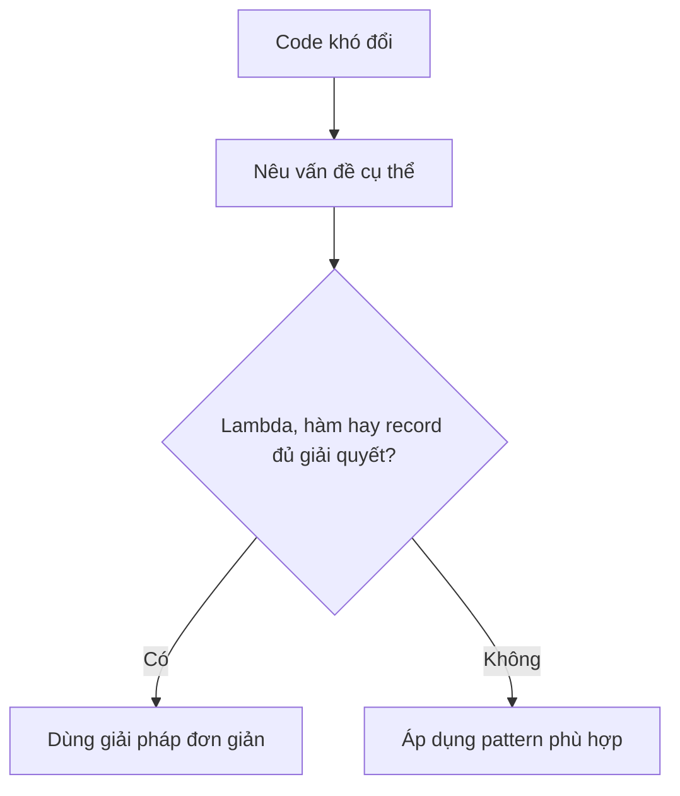

# Lý thuyết 14: SOLID và Design Pattern

## SOLID và Design Pattern giúp gì

Mọi dự án đều bắt đầu gọn gàng. Rồi code lớn lên, và nếu không có nguyên tắc thì nó "cứng" dần: thêm một tính năng phải sửa nhiều chỗ, class nào cũng dính chặt vào class khác nên rất khó test, và một đoạn `if/else` hay `switch` cứ dài thêm theo mỗi yêu cầu mới. Hai công cụ để chống lại điều đó là SOLID và design pattern.

**SOLID** là năm nguyên tắc thiết kế class cho gọn, chủ yếu trả lời câu hỏi "chia trách nhiệm và phụ thuộc thế nào để dễ đổi". **Design pattern** là những cách giải đã được nhiều người kiểm chứng cho các vấn đề thiết kế hay gặp (Factory, Strategy, Observer...). Ngoài việc cho lời giải, pattern còn cho cả team một tên chung: nói "chỗ này dùng Strategy" là ai cũng hình dung ra cấu trúc.

Hãy dùng chúng khi code bắt đầu khó đổi: thêm tính năng mà phải sửa nhiều nơi, hoặc một chuỗi `if/else` cứ dài thêm. Nếu code đơn giản đang chạy ổn thì đừng thêm pattern cho có. Thứ tự đúng là nhìn ra **vấn đề** trước, rồi mới chọn pattern giải nó. Áp pattern chỉ vì thấy hay sẽ thêm tầng trừu tượng không cần thiết, và hậu quả là code khó đọc hơn so với đoạn code thẳng ban đầu.

**Cốt lõi:** Code sống lâu vì phải đổi, và nó cứng dần khi các phần biết quá nhiều về nhau. SOLID và pattern đều có một mục đích: giảm sự phụ thuộc chặt (coupling) để sửa một chỗ không kéo sập chỗ khác.

- Vì mỗi class chỉ có một lý do để đổi và thêm loại mới là thêm class chứ không sửa code cũ, nên thay đổi không lan rộng.
- Vì nghiệp vụ chỉ biết interface và bên ngoài tiêm cài đặt cụ thể vào, nên đổi hạ tầng hoặc thay bản giả khi test không cần sửa nghiệp vụ.
- Vì pattern là lời giải cho một vấn đề đã nhìn ra, nên phải thấy code khó đổi trước rồi mới chọn pattern.



Mô hình tư duy: mũi tên phụ thuộc đi vào interface ổn định, còn các cài đặt cụ thể thay qua đổi lại ở bên ngoài mà nghiệp vụ không biết.

**Tóm tắt:**

- Mục tiêu chung của SOLID và pattern là giảm coupling để sửa một chỗ không kéo sập chỗ khác; chỉ dùng khi code bắt đầu khó đổi, đừng thêm pattern cho có.
- SOLID: S một lý do để thay đổi, O mở để mở rộng đóng để sửa, L class con thay được class cha, I interface nhỏ, D phụ thuộc vào abstraction chứ không vào cài đặt cụ thể.
- Dependency Inversion là nền của DI và Spring: nghiệp vụ phụ thuộc interface, bên ngoài tiêm class cụ thể vào, nên test thay bằng bản giả được.
- Pattern đã quen trong JDK và Spring: Strategy là `Comparator`, Decorator là `BufferedReader`, Builder là `StringBuilder`, Template Method là `JdbcTemplate`, Proxy là `@Transactional`.
- Với Java hiện đại, Strategy thường chỉ là lambda hoặc `Function`; ưu tiên composition, immutable và interface nhỏ trước pattern phức tạp.
- Observer có bẫy memory leak nếu người nghe không hủy đăng ký.
- Singleton lazy dùng double-checked locking phải có `volatile`; gọn hơn là holder idiom, `enum`, hoặc để container quản lý.

## Các khái niệm cần biết

- **Coupling**: class A biết càng nhiều về class B thì sửa B càng dễ làm hỏng A. Mục tiêu của SOLID là giảm coupling.
- **Composition over inheritance**: thay vì inheritance để tái sử dụng, hãy giữ object khác làm field và ủy quyền cho nó. Linh hoạt hơn vì đổi được lúc chạy.
- **Abstraction**: interface hoặc abstract class che giấu chi tiết cài đặt. Code phụ thuộc vào "contract" chứ không phải vào class cụ thể.
- **Over-engineering**: thiết kế phức tạp hơn nhu cầu thật, gây tốn công đọc và bảo trì mà không có lợi ích.
- **Double-checked locking**: kỹ thuật kiểm tra điều kiện hai lần (ngoài và trong khối lock) để lazy initialization thread-safe, xem mục Singleton.
- **Holder idiom**: dùng class tĩnh lồng giữ instance, tận dụng việc JVM chỉ nạp và khởi tạo class một lần, thread-safe.

## SOLID

Bảng sau tóm tắt năm nguyên tắc và dấu hiệu nhận biết vi phạm; phần diễn giải bên dưới cho biết hậu quả nếu bỏ qua.

| Chữ | Nguyên tắc | Dấu hiệu vi phạm |
|---|---|---|
| **S** | Một class, một lý do để thay đổi | Class "God" làm mọi thứ |
| **O** | Mở để mở rộng, đóng để sửa đổi | Thêm loại mới phải sửa chuỗi `if/else`, `switch` |
| **L** | Class con thay thế được class cha mà không phá hành vi | Class con throw `UnsupportedOperationException` |
| **I** | Interface nhỏ, tập trung | Bắt cài đặt method không dùng |
| **D** | Phụ thuộc vào trừu tượng, không vào cài đặt cụ thể | `new` trực tiếp phụ thuộc hạ tầng trong nghiệp vụ |

**Phải thuộc:** SOLID: S (một lý do để thay đổi), O (mở để mở rộng, đóng để sửa đổi), L (class con thay thế được class cha), I (interface nhỏ, tập trung), D (phụ thuộc vào trừu tượng, không vào cài đặt cụ thể).

Diễn giải ngắn, kèm hậu quả:

- **S (Single Responsibility)**: class làm quá nhiều việc thì mỗi lần đổi một việc có nguy cơ làm hỏng việc khác, và không thể test riêng từng phần.
- **O (Open/Closed)**: khi thêm loại mới (ví dụ chính sách giảm giá) mà phải sửa chuỗi `if/else` có sẵn, bạn có thể làm hỏng các loại cũ. Mục tiêu là thêm class mới, không sửa code cũ.
- **L (Liskov Substitution)**: nếu class con throw `UnsupportedOperationException` ở method của cha, code nhận class cha sẽ nổ khi gặp class con. Ví dụ kinh điển: `Square` kế thừa `Rectangle` rồi làm hỏng giả định "đổi chiều rộng không đổi chiều cao".
- **I (Interface Segregation)**: interface quá to buộc class cài đặt phải viết các method rỗng hoặc throw lỗi, và khách hàng bị phụ thuộc vào thứ họ không dùng.
- **D (Dependency Inversion)**: nghiệp vụ không nên `new` trực tiếp class hạ tầng (JDBC, HTTP client). Hãy phụ thuộc interface và để bên ngoài (Spring) tiêm class cụ thể vào, nhờ vậy test được bằng bản giả.



Đọc sơ đồ: ở bên phải, mũi tên phụ thuộc đi vào interface chứ không đi vào class cụ thể, nên đổi cài đặt hoặc thay bằng bản giả khi test không đụng tới `OrderService`.

**Nền tảng:** Mọi nguyên tắc thiết kế đều nhằm giảm coupling để thay đổi một chỗ không kéo sập chỗ khác. Dependency Inversion là nền của DI và Spring: nghiệp vụ phụ thuộc interface, bên ngoài tiêm cài đặt cụ thể vào, nên đổi cài đặt hoặc thay bản giả khi test không cần sửa nghiệp vụ.

**Suy luận:** Dependency Inversion đảo hướng phụ thuộc vì khi nghiệp vụ `new` thẳng một class hạ tầng như JDBC hay HTTP client, mọi thay đổi ở hạ tầng đều lan ngược lên nghiệp vụ, và không thể test nghiệp vụ mà không dựng cả hạ tầng. Nếu nghiệp vụ chỉ biết một interface do chính nó định nghĩa, hạ tầng phải tuân theo interface đó, nên mũi tên phụ thuộc đổi chiều và nghiệp vụ trở thành phần ổn định. Cũng vì vậy ta cần một nơi bên ngoài quyết định class cụ thể nào được dùng, và đó chính là vai trò của DI container như Spring. Hệ quả hành động là thay hạ tầng hoặc thay bản giả khi test không cần chạm vào nghiệp vụ, đúng tinh thần Open/Closed. Điểm dễ nhầm là nghĩ DI chỉ là dùng `@Autowired`, trong khi bản chất là hướng phụ thuộc, và nhầm là mọi class đều cần interface; tạo interface cho thứ chỉ có một cài đặt và không bao giờ đổi chỉ là over-engineering. Hãy tách interface ở các ranh giới thực sự thay đổi như cơ sở dữ liệu, dịch vụ ngoài, thời gian.

## Pattern thường dùng trong Java

Bảng dưới liệt kê các pattern hay gặp, chia theo ba nhóm: tạo object, ghép cấu trúc, và phân chia hành vi. Cột cuối cho thấy bạn đã dùng chúng trong JDK hoặc Spring mà có thể không nhận ra.

| Nhóm | Pattern | Giải quyết | Ví dụ thực tế |
|---|---|---|---|
| Khởi tạo | **Factory** | Tách việc tạo object khỏi việc dùng | `List.of`, `Calendar.getInstance` |
| | **Builder** | Object nhiều tham số tùy chọn | `StringBuilder`, `HttpRequest.newBuilder()` |
| | **Singleton** | Một thể hiện duy nhất | Bean Spring (do container quản lý) |
| Cấu trúc | **Decorator** | Thêm hành vi bằng cách bọc | `BufferedReader` bọc `Reader` |
| | **Adapter** | Chuyển interface này sang interface khác | `InputStreamReader` |
| | **Proxy** | Đại diện kiểm soát truy cập | `@Transactional` của Spring |
| Hành vi | **Strategy** | Hoán đổi thuật toán | `Comparator` |
| | **Observer** | Thông báo khi có thay đổi | Application event, listener |
| | **Template Method** | Khung thuật toán, bước con tùy chỉnh | `JdbcTemplate`, `HttpServlet` |
| | **Command** | Đóng gói yêu cầu thành object | `Runnable`, queue lệnh |

**Phải thuộc:** Ví dụ pattern có sẵn trong JDK và Spring: Strategy là `Comparator`; Decorator là `BufferedReader` bọc `Reader`; Builder là `StringBuilder`, `HttpRequest.newBuilder()`; Template Method là `JdbcTemplate`; Proxy là `@Transactional`.

## Ví dụ: Strategy thay chuỗi if/else

Vấn đề đặt ra: hàm tính giá có `if (type == ...) else if ...` và mỗi lần thêm loại giảm giá lại phải sửa hàm. Cách giải quyết là tách mỗi cách tính thành một object cùng interface, và chọn object đó từ bên ngoài.



```java
interface DiscountPolicy { BigDecimal apply(BigDecimal price); }
record NoDiscount() implements DiscountPolicy { public BigDecimal apply(BigDecimal p) { return p; } }
record PercentDiscount(int percent) implements DiscountPolicy {
    public BigDecimal apply(BigDecimal p) {
        return p.multiply(BigDecimal.valueOf(100 - percent)).divide(BigDecimal.valueOf(100));
    }
}
// Thêm chính sách mới = thêm class, không sửa code cũ (Open/Closed)
```

Với Java hiện đại, Strategy thường chỉ là **lambda** hoặc `Function`.

### Decorator, Observer, Builder bằng code nhỏ (đã chạy thử)

```java
interface Notifier { String send(String msg); }
class Basic implements Notifier { public String send(String m) { return "gửi: " + m; } }
abstract class Deco implements Notifier {
    protected final Notifier next;
    Deco(Notifier next) { this.next = next; }
}
class Upper extends Deco { Upper(Notifier n) { super(n); } public String send(String m) { return next.send(m.toUpperCase()); } }
class Log extends Deco { Log(Notifier n) { super(n); } public String send(String m) { System.out.println("log " + m); return next.send(m); } }

// bọc từng lớp, giống BufferedReader(InputStreamReader(...))
Notifier n = new Log(new Upper(new Basic()));
// in "log xin chào", trả "gửi: XIN CHÀO"
n.send("xin chào");

// Observer: người nghe đăng ký, chủ thể phát
class Topic {
    private final List<Consumer<String>> listeners = new ArrayList<>();
    void subscribe(Consumer<String> c) { listeners.add(c); }
    void publish(String s) { listeners.forEach(c -> c.accept(s)); }
}
```

Decorator hoạt động bằng cách mỗi class bọc làm phần việc của mình rồi chuyển cho class bên trong, như `Log` gọi `Upper` rồi `Basic` ở ví dụ trên. Bảng sau cho biết khi nào nên và không nên dùng từng pattern:

| Pattern | Dấu hiệu nên dùng | Dấu hiệu lạm dụng |
|---|---|---|
| Strategy | Nhiều nhánh `if/else` chọn thuật toán, hay thêm nhánh mới | Chỉ có hai nhánh ổn định |
| Decorator | Cần ghép hành vi theo nhiều tổ hợp (log, cache, nén) | Chỉ một tổ hợp cố định |
| Observer | Một event, nhiều bên cần biết, không muốn phụ thuộc nhau | Bên nghe bắt buộc xử lý đúng thứ tự, đồng bộ |
| Builder | Nhiều tham số tùy chọn, object immutable | Chỉ 2 đến 3 tham số: dùng `record` |
| Template Method | Khung giống nhau, vài bước khác | Có thể truyền hàm (lambda) thay vì inheritance |

Observer có bẫy: nếu người nghe không bao giờ hủy đăng ký thì chủ thể giữ reference mãi và gây **memory leak**; người nghe throw lỗi thì làm gãy vòng phát.

## Singleton đúng cách

```java
// an toàn đa luồng, chống reflection/serialization
public enum Registry { INSTANCE; ... }
```

Dạng lazy kiểu cũ phải dùng double-checked locking với variable `volatile`, nếu thiếu `volatile` thì thread khác có thể thấy object mới chỉ khởi tạo dở:

```java
private static volatile Service instance;
static Service get() {
    if (instance == null) {                       // kiểm tra nhanh, không khóa
        synchronized (Service.class) {
            if (instance == null) instance = new Service();   // kiểm tra lại trong khóa
        }
    }
    return instance;
}
```

Cách gọn hơn: class tĩnh lồng giữ instance (holder idiom, JVM đảm bảo nạp class an toàn), hoặc `enum`.

**Suy luận:** Double-checked locking cần `volatile` vì `instance = new Singleton()` gồm ba bước: cấp phát, chạy constructor, rồi gán reference. Compiler hoặc CPU được phép sắp xếp lại để gán reference trước khi constructor chạy xong, và nếu vậy một thread khác ở lần kiểm tra ngoài khối `synchronized` thấy `instance != null` và dùng một object mới khởi tạo dở. `volatile` cấm sắp xếp lại đó và tạo happens-before giữa ghi và đọc, nên thread khác chỉ thấy object đầy đủ. Kiểm tra lần hai bên trong lock chỉ để tránh tạo hai instance khi hai thread cùng qua kiểm tra ngoài. Điểm dễ nhầm là thấy hai lần kiểm tra `null` rồi tin rằng đã an toàn, trong khi thiếu `volatile` thì vẫn sai dù mã trông đúng. Vì dễ sai như vậy, hãy chọn holder idiom hay `enum` để JVM đảm bảo nạp class an toàn, hoặc để container quản lý singleton.

**Phải thuộc:** Double-checked locking chỉ đúng khi variable `instance` là `volatile` (thiếu thì thread khác có thể thấy object khởi tạo dở). Singleton gọn và an toàn: `enum` có một phần tử hoặc holder idiom.

Hoặc để container (Spring) quản lý lifecycle; tránh singleton tĩnh giữ trạng thái vì khó test.

## Quy trình chọn pattern



## Cảnh báo

- Pattern là công cụ, không phải mục tiêu; "over-engineering" tốn kém hơn code thẳng.
- Ưu tiên **composition**, **immutable**, **interface nhỏ** trước khi nghĩ đến pattern phức tạp.
- Nhiều pattern cũ (Visitor, Iterator tự viết) đã được thay bằng tính năng ngôn ngữ (pattern matching, stream).

## Phỏng vấn khó: chuỗi hỏi xoáy

Người phỏng vấn senior thường mở bằng câu dễ rồi xoáy xuống cơ chế, đánh đổi và sự cố thật; câu trả lời tốt luôn đi từ cốt lõi xuống.

### Chuỗi 1: Dependency Inversion và DI

1. **Câu mở:** Chữ D trong SOLID là gì?
2. **Xoáy 1:** "Inversion" đảo cái gì, và vì sao nói DI chỉ là `@Autowired` là chưa hiểu?
3. **Xoáy 2:** Nếu mỗi class đều có một interface một cài đặt thì sao? Bạn tách interface ở đâu và ở đâu thì không?

**Đáp án ngắn:** D là nghiệp vụ phụ thuộc vào abstraction chứ không vào cài đặt cụ thể. Cái bị đảo là hướng mũi tên phụ thuộc. Bình thường nghiệp vụ `new` thẳng class hạ tầng như JDBC hay HTTP client, nên hạ tầng đổi thì nghiệp vụ vỡ, và không test được nếu không dựng cả hạ tầng. Khi nghiệp vụ chỉ biết một interface do chính nó định nghĩa, hạ tầng phải tuân theo interface đó, nên nghiệp vụ trở thành phần ổn định. Cần một nơi bên ngoài chọn class cụ thể, đó là vai trò của DI container như Spring. Vậy bản chất là hướng phụ thuộc, `@Autowired` chỉ là cơ chế tiêm. Về giới hạn: tạo interface cho thứ chỉ có một cài đặt và không bao giờ đổi là over-engineering. Tôi chỉ tách ở ranh giới thật sự thay đổi: cơ sở dữ liệu, dịch vụ ngoài, thời gian. Lợi ích thấy ngay là test thay bản giả vào mà không sửa nghiệp vụ.

**Sai lầm hay gặp:**
- Trả lời "D là dùng `@Autowired`" mà không nói hướng phụ thuộc.
- Nhầm Dependency Inversion với Dependency Injection: một cái là nguyên tắc, một cái là kỹ thuật.
- Tạo interface cho mọi class rồi coi đó là tuân thủ SOLID.

### Chuỗi 2: Singleton và double-checked locking

1. **Câu mở:** Viết cho tôi một Singleton lazy thread-safe.
2. **Xoáy 1:** Vì sao biến `instance` phải `volatile`? Hai lần kiểm tra `null` chưa đủ sao?
3. **Xoáy 2:** Nếu bỏ lần kiểm tra thứ hai trong khối `synchronized` thì hỏng ở đâu? Có cách nào khỏi phải viết thế này không?

**Đáp án ngắn:** Dạng lazy kinh điển là double-checked locking: kiểm tra `null` ngoài khóa, vào `synchronized`, kiểm tra lại rồi mới tạo. Câu `instance = new Service()` gồm ba bước: cấp phát, chạy constructor, gán reference. Compiler hoặc CPU được phép đảo thứ tự để gán reference trước khi constructor chạy xong. Khi đó thread khác ở lần kiểm tra ngoài thấy `instance != null` và dùng một object khởi tạo dở. `volatile` cấm đảo thứ tự đó và tạo happens-before giữa ghi và đọc. Lần kiểm tra trong khóa để tránh tạo hai instance khi hai thread cùng qua kiểm tra ngoài; bỏ nó thì thread thứ hai vào khóa sau thread thứ nhất sẽ tạo bản thứ hai. Vì dễ sai nên tôi chọn holder idiom, `enum`, hoặc để Spring quản lý singleton. Tránh singleton tĩnh giữ trạng thái vì khó test.

**Sai lầm hay gặp:**
- Thấy hai lần kiểm tra `null` rồi tin là an toàn, quên `volatile`.
- Nói `synchronized` ở ngoài là đủ mà không giải thích việc xuất bản object dở.
- Không biết tới holder idiom hoặc `enum` để thay thế.

