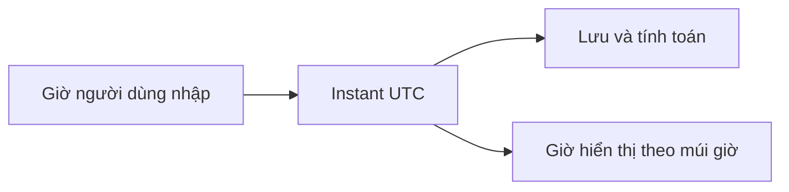
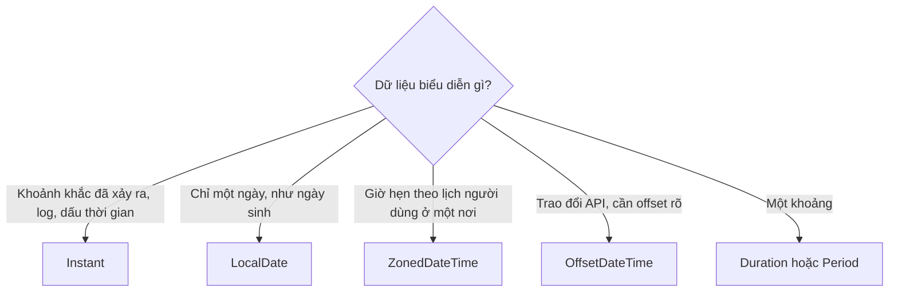
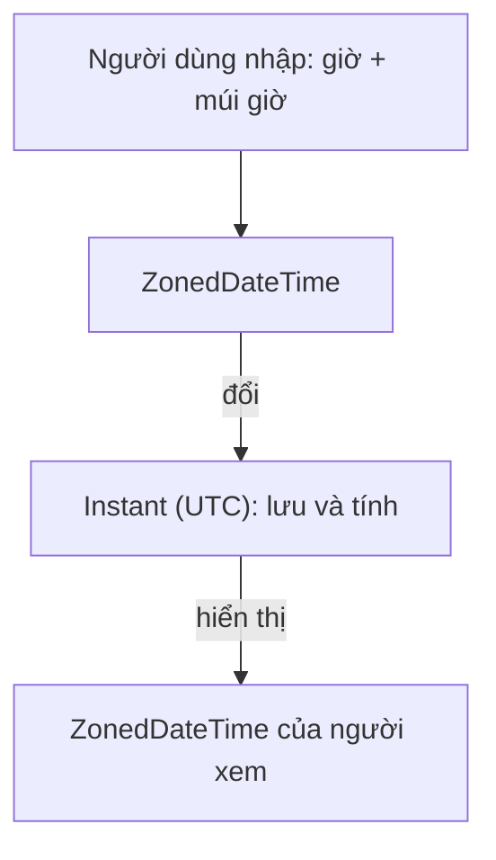

# Lý thuyết 15: Date/Time API, Regex và Text

## Vì sao thời gian khó hơn bạn nghĩ

Bất cứ hệ thống nào có thời gian (đơn hàng, lịch, báo cáo, log) đều dính tới API ngày giờ. Lỗi về thời gian rất hay gặp và khó thấy: đơn hàng bị lệch sang ngày hôm sau vì múi giờ, giờ mùa hè làm một ngày có 23 hoặc 25 giờ, hoặc parse sai định dạng nên ngày 31/02 lặng lẽ thành 28/02. Các class cũ `Date` và `SimpleDateFormat` còn khó dùng và không thread-safe, nên từ Java 8 ta dùng `java.time` (`LocalDate`, `Instant`, `ZonedDateTime`...).

Bài này cũng gom hai chủ đề cùng họ "văn bản": regex (tìm mẫu trong chuỗi) và định dạng số, ngày theo địa phương hóa (locale).

Nguyên tắc xuyên suốt: chọn kiểu đúng với **ý nghĩa** của dữ liệu (chỉ một ngày, một thời điểm tuyệt đối, hay ngày giờ kèm múi giờ), lưu dưới dạng UTC và chỉ đổi sang múi giờ người dùng khi hiển thị. Đừng dùng `Date`/`SimpleDateFormat` trừ khi phải tương tác với mã cũ.

**Nền tảng:** Thời gian có hai loại ý nghĩa: thời điểm tuyệt đối trên trục thời gian (`Instant`, UTC) và giờ treo tường chưa gắn múi giờ (`LocalDate`, `LocalDateTime`). Lưu và tính toán bằng `Instant` (UTC), chỉ đổi sang múi giờ người dùng khi hiển thị.

**Cốt lõi:** "Bây giờ" có hai nghĩa: một khoảnh khắc duy nhất mà mọi người cùng thấy, và con số trên đồng hồ treo tường ở một nơi cụ thể. `java.time` có kiểu riêng cho từng nghĩa, nên việc của bạn là chọn kiểu theo ý nghĩa dữ liệu.

- Vì `Instant` là một điểm duy nhất trên trục thời gian, nên dùng nó để lưu, so sánh và tính toán.
- Vì múi giờ chỉ có ý nghĩa với người xem, nên chỉ đổi sang múi giờ người dùng ở bước hiển thị.
- Vì giờ treo tường phụ thuộc quy tắc múi giờ như giờ mùa hè, nên một ngày có thể dài 23 hoặc 25 giờ và `plusDays` khác `plusHours`.



Mô hình tư duy: mọi giờ đi vào đều quy về một trục UTC chung, và múi giờ chỉ xuất hiện ở hai đầu vào và ra.

**Tóm tắt:**

- Chọn kiểu theo ý nghĩa dữ liệu: `Instant` cho thời điểm tuyệt đối, `LocalDate` cho chỉ ngày, `ZonedDateTime` cho ngày giờ kèm múi giờ, `OffsetDateTime` cho offset cố định.
- Lưu và tính toán bằng UTC (`Instant`), chỉ đổi sang múi giờ người dùng khi hiển thị.
- `LocalDateTime` không có múi giờ nên mơ hồ và không dùng cho thời điểm tuyệt đối.
- DST làm ngày có 23 hoặc 25 giờ, có giờ không tồn tại hoặc xuất hiện hai lần; `plusDays` cộng theo lịch còn `plusHours` cộng theo thời gian trôi.
- Mẫu `yyyy` là năm, `YYYY` là năm theo tuần (sai quanh cuối năm), `MM` là tháng còn `mm` là phút.
- `Date`, `Calendar`, `SimpleDateFormat` cũ và không thread-safe; tiêm `Clock` để test được thời gian.
- `Pattern` thread-safe còn `Matcher` thì không; regex phức tạp trên dữ liệu không tin cậy có thể gây ReDoS.
- Với dữ liệu máy đọc, chỉ định rõ `Locale.ROOT` hoặc `Locale.US` vì format và `toLowerCase` phụ thuộc locale.

## Các khái niệm cần biết

- **UTC và Instant**: UTC là mốc thời gian chuẩn toàn cầu không phụ thuộc múi giờ. `Instant` là một điểm trên trục thời gian đó, đếm từ epoch (0h ngày 1/1/1970 UTC). Hai máy ở hai nước cùng `Instant` nghĩa là cùng khoảnh khắc.
- **Múi giờ (time zone) và offset**: offset chỉ là độ lệch cố định so với UTC (`+07:00`); múi giờ (`Asia/Ho_Chi_Minh`) là tập quy tắc, gồm cả lịch chuyển giờ mùa hè. Chỉ có múi giờ mới biết một ngày cụ thể ở New York lệch bao nhiêu.
- **DST (Daylight Saving Time, giờ mùa hè)**: nhiều nước chỉnh đồng hồ tới hoặc lui một giờ hai lần mỗi năm. Hệ quả: ngày chỉ có 23 giờ, ngày khác 25 giờ, có giờ không tồn tại hoặc xuất hiện hai lần. Việt Nam không dùng DST nhưng người dùng và đối tác ở nước ngoài thì có.
- **Giờ treo tường (local time)**: giờ đọc trên đồng hồ không kèm múi giờ, như `LocalDateTime`. Cùng giờ treo tường có thể là những thời điểm khác nhau.
- **ResolverStyle**: mức nghiêm ngặt khi parse: `SMART` (mặc định) tự sửa ngày vô lý, `STRICT` throw lỗi.
- **Locale**: ngôn ngữ và vùng, quyết định dấu thập phân (`1,5` hay `1.5`), tên tháng, cách viết hoa chữ.
- **Backtracking và ReDoS**: engine regex của Java thử các khả năng và quay lui khi sai; mẫu viết xấu làm số lần thử tăng theo hàm mũ, gây treo CPU (Regular expression Denial of Service).
- **`Clock`**: nguồn thời gian có thể tiêm vào để test với thời gian cố định.

## Chọn kiểu theo ngữ nghĩa

| Kiểu | Biểu diễn | Dùng cho |
|---|---|---|
| `Instant` | Một thời điểm trên trục thời gian (UTC) | Dấu thời gian event, lưu DB, so sánh |
| `LocalDate` | Ngày, không giờ, không múi giờ | Ngày sinh, ngày hạn |
| `LocalTime` | Giờ trong ngày | Giờ mở cửa |
| `LocalDateTime` | Ngày giờ **không** múi giờ | Lịch hẹn theo giờ địa phương (cẩn thận) |
| `ZonedDateTime` | Ngày giờ + múi giờ | Hiển thị cho người dùng, lịch có xử lý DST |
| `OffsetDateTime` | Ngày giờ + độ lệch cố định | Trao đổi API, cột DB có offset |
| `Duration` | Khoảng theo giây/nano | Thời gian chạy |
| `Period` | Khoảng theo ngày/tháng/năm | "Cách 3 tháng" |

**Phải thuộc:** `Instant` cho thời điểm tuyệt đối, `LocalDate` cho chỉ ngày, `ZonedDateTime` cho ngày giờ kèm múi giờ (xử lý DST), `OffsetDateTime` cho offset cố định, `Duration` cho khoảng theo giây, `Period` cho khoảng theo ngày/tháng/năm. Các class `java.time` đều immutable; `Date`, `Calendar`, `SimpleDateFormat` thì không thread-safe.

Nếu phân vân chọn kiểu nào, hãy hỏi theo thứ tự sau.



Còn khi dữ liệu đi qua nhiều tầng, flow chuẩn như sau.



## Ví dụ

```java
Instant now = Instant.now();
ZonedDateTime vn = now.atZone(ZoneId.of("Asia/Ho_Chi_Minh"));
LocalDate deadline = LocalDate.of(2026, 3, 31);
long remainingDays = ChronoUnit.DAYS.between(LocalDate.now(), deadline);

DateTimeFormatter f = DateTimeFormatter.ofPattern("dd/MM/yyyy HH:mm");
String s = vn.format(f);
```

### Múi giờ và DST bằng con số (đã chạy thử, múi giờ `America/New_York`)

```java
ZoneId ny = ZoneId.of("America/New_York");

// Độ dài một ngày dương lịch
LocalDate d1 = LocalDate.of(2025, 3, 9);   // ngày chuyển sang giờ mùa hè
d1.atStartOfDay(ny).until(d1.plusDays(1).atStartOfDay(ny), ChronoUnit.HOURS);   // 23
LocalDate d2 = LocalDate.of(2025, 11, 2);  // ngày quay về giờ chuẩn
d2.atStartOfDay(ny).until(d2.plusDays(1).atStartOfDay(ny), ChronoUnit.HOURS);   // 25

// Giờ không tồn tại: 02:30 ngày 9/3 bị nhảy qua; Java dịch tới
// 2025-03-09T03:30-04:00[America/New_York]
LocalDateTime.of(2025, 3, 9, 2, 30).atZone(ny);

// Giờ xuất hiện hai lần: 01:30 ngày 2/11; mặc định chọn lần đầu
ZonedDateTime z = LocalDateTime.of(2025, 11, 2, 1, 30).atZone(ny);
z;                              // 2025-11-02T01:30-04:00[America/New_York]
// 2025-11-02T01:30-05:00[America/New_York]  (lần thứ hai)
z.withLaterOffsetAtOverlap();

// Cùng giờ treo tường, khác thời điểm tuyệt đối
ZonedDateTime hcm = ZonedDateTime.of(2025, 12, 31, 23, 30, 0, 0, ZoneId.of("Asia/Ho_Chi_Minh"));
hcm.toInstant();                              // 2025-12-31T16:30:00Z
// 2025-12-31T11:30-05:00[...]  cùng thời điểm, đổi cách hiển thị
hcm.withZoneSameInstant(ny);
// 2026-01-01T04:30:00Z         giữ số giờ, đổi thời điểm (thường là lỗi)
hcm.withZoneSameLocal(ny).toInstant();
```

Đọc ví dụ trên: ngày 9/3 ở New York đồng hồ nhảy từ 02:00 lên 03:00, nên giờ 02:30 không tồn tại và Java dịch tới 03:30. Ngày 2/11 đồng hồ lùi từ 02:00 về 01:00, nên 01:30 xuất hiện hai lần; Java mặc định chọn lần đầu, muốn lần hai phải gọi `withLaterOffsetAtOverlap()`. Hệ quả nếu bỏ qua: lịch hẹn bị lệch một giờ hoặc tính sai số giờ làm việc.

Quy tắc nhớ: **`plusDays` cộng theo lịch** (giữ giờ treo tường), **`plusHours` cộng theo thời gian trôi**. Từ 12:00 ngày 8/3 cộng 1 ngày ra 12:00 ngày 9/3, nhưng cộng 24 giờ ra 13:00 ngày 9/3 vì ngày đó chỉ dài 23 giờ.

**Phải thuộc:** Mẫu `yyyy` là năm, `YYYY` là năm theo tuần (sai quanh cuối năm); `MM` là tháng, `mm` là phút. `plusDays` cộng theo lịch, `plusHours` cộng theo thời gian trôi. Parse mặc định `SMART` tự sửa ngày vô lý, muốn báo lỗi dùng `STRICT`.

```java
Period.between(LocalDate.of(2025, 1, 31), LocalDate.of(2025, 3, 1));   // P1M1D
// 2025-02-28 (kẹp về cuối tháng)
LocalDate.of(2025, 1, 31).plusMonths(1);
Duration.ofMinutes(135);                                                // PT2H15M
// 2025-02-28: SMART mặc định tự sửa!
LocalDate.parse("31/02/2025", DateTimeFormatter.ofPattern("dd/MM/yyyy"));
// withResolverStyle(ResolverStyle.STRICT) cùng mẫu "uuuu" thì ném DateTimeParseException
// 30/12/2025 (sai năm: YYYY là năm theo tuần)
LocalDate.of(2024, 12, 30).format(DateTimeFormatter.ofPattern("dd/MM/YYYY"));
```

**Suy luận:** Thời gian khó vì "bây giờ" có hai nghĩa khác nhau: một điểm duy nhất trên trục thời gian mà mọi người cùng thấy, và con số trên đồng hồ treo tường ở một nơi cụ thể. `Instant` thuộc loại đầu nên so sánh, sắp xếp và lưu trữ không mơ hồ, còn `LocalDateTime` thuộc loại sau nên cùng một giá trị ứng với các thời điểm khác nhau ở các múi giờ. Vì vậy lưu UTC và chỉ đổi múi giờ lúc hiển thị là cách tách rõ hai nghĩa, và múi giờ phải là quy tắc đầy đủ (`Asia/Ho_Chi_Minh`) chứ không chỉ offset, vì chỉ quy tắc mới biết lịch chuyển giờ mùa hè. Từ đó suy ra DST: ngày chuyển giờ có 23 hoặc 25 giờ, nên `plusDays(1)` giữ giờ treo tường còn `plusHours(24)` cộng thời gian thật và hai kết quả lệch nhau một giờ. Điểm dễ nhầm là dùng `LocalDateTime` làm dấu thời gian trong DB rồi gặp lỗi lệch giờ khi server đổi múi giờ, hoặc viết `YYYY` thay `yyyy`. Hãy tự hỏi dữ liệu này là thời điểm hay giờ treo tường để chọn kiểu, và test bằng `Clock` cố định.

## Bẫy

| Bẫy | Giải thích |
|---|---|
| `LocalDateTime` cho thời điểm tuyệt đối | Thiếu múi giờ nên mơ hồ; dùng `Instant`/`ZonedDateTime` |
| Giờ mùa hè (DST) | Có ngày 23 hoặc 25 giờ; có giờ không tồn tại hoặc trùng lặp |
| `"yyyy"` và `"YYYY"` | `YYYY` là năm theo tuần, sai quanh cuối năm |
| `Date`, `Calendar`, `SimpleDateFormat` | Cũ, **không thread-safe**, nhiều lỗi; chỉ dùng khi tương tác mã cũ |
| Lấy `now()` rải rác trong code | Khó test; tiêm `Clock` rồi `clock.instant()` |

```java
class Service {
    private final Clock clock;
    Service(Clock clock) { this.clock = clock; }
    boolean expired(Instant deadline) { return clock.instant().isAfter(deadline); }
}
// Test dùng Clock.fixed(...)
```

## Regex

Regex (biểu thức chính quy) là ngôn ngữ mô tả mẫu chuỗi để tìm, kiểm tra hoặc trích xuất. Dùng khi mẫu đơn giản, cố định: email sơ bộ, mã đơn hàng, tách token. Không dùng để phân tích cú pháp có cấu trúc lồng nhau như JSON, HTML.

```java
// biên dịch một lần, tái sử dụng
Pattern p = Pattern.compile("(?<user>[\\w.]+)@(?<domain>[\\w.]+)");
Matcher m = p.matcher(text);
while (m.find()) System.out.println(m.group("user"));
```

- `Pattern` biên dịch mẫu một lần (tốn kém), `Matcher` là object chạy mẫu trên một chuỗi cụ thể. Nhóm có tên `(?<user>...)` giúp lấy kết quả bằng tên thay vì số thứ tự.
- `Pattern` immutable, thread-safe; `Matcher` thì **không**.
- **Backtracking thảm họa (ReDoS):** mẫu như `(a+)+$` có thể chạy theo hàm mũ trên đầu vào xấu; không dùng regex phức tạp trên dữ liệu không tin cậy.
- Cần phân tích có cấu trúc (JSON, HTML) thì dùng bộ phân tích chuyên dụng, không dùng regex.

## Định dạng và địa phương

- `String.format`, `NumberFormat`, `DateTimeFormatter` đều phụ thuộc `Locale`; chỉ định rõ `Locale.ROOT`/`Locale.US` cho dữ liệu máy đọc.
- `String.toLowerCase()` phụ thuộc locale (lỗi chữ `I` kiểu Thổ Nhĩ Kỳ): dùng `toLowerCase(Locale.ROOT)` cho định danh.

## Phỏng vấn khó: chuỗi hỏi xoáy

Người phỏng vấn senior thường mở bằng câu dễ rồi xoáy xuống cơ chế, đánh đổi và sự cố thật; câu trả lời tốt luôn đi từ cốt lõi xuống.

### Chuỗi 1: Lưu thời gian và DST

1. **Câu mở:** Bạn lưu thời gian trong database bằng kiểu gì?
2. **Xoáy 1:** Vì sao không dùng `LocalDateTime`? Nó thiếu cái gì?
3. **Xoáy 2:** Từ 12:00 ngày 8/3 ở New York, `plusDays(1)` và `plusHours(24)` ra kết quả khác nhau không? Vì sao?

**Đáp án ngắn:** Tôi lưu thời điểm tuyệt đối bằng `Instant` (UTC), và chỉ đổi sang múi giờ người dùng lúc hiển thị. Lý do là "bây giờ" có hai nghĩa: một điểm duy nhất trên trục thời gian, và con số trên đồng hồ treo tường ở một nơi. `Instant` thuộc loại đầu nên so sánh và sắp xếp không mơ hồ. `LocalDateTime` thuộc loại sau, không có múi giờ, nên cùng một giá trị ứng với nhiều thời điểm khác nhau, và lệch khi server đổi múi giờ. Múi giờ phải là quy tắc đầy đủ như `Asia/Ho_Chi_Minh`, không chỉ offset, vì chỉ quy tắc mới biết lịch giờ mùa hè. Ngày 9/3 ở New York chỉ có 23 giờ. `plusDays(1)` cộng theo lịch nên ra 12:00 ngày 9/3, còn `plusHours(24)` cộng thời gian trôi nên ra 13:00. Cùng gốc đó, 02:30 ngày chuyển giờ không tồn tại và Java dịch tới 03:30, còn 01:30 ngày lùi giờ xuất hiện hai lần. Tôi test bằng `Clock` cố định.

**Sai lầm hay gặp:**
- Dùng `LocalDateTime` làm dấu thời gian rồi chỉ phát hiện lỗi khi đổi múi giờ server.
- Nhầm offset `+07:00` với múi giờ, nên không giải thích được DST.
- Nói "một ngày luôn 24 giờ" hoặc quên `withZoneSameLocal` khác `withZoneSameInstant`.

### Chuỗi 2: Regex trong code chạy thật

1. **Câu mở:** `Pattern` và `Matcher` khác nhau thế nào?
2. **Xoáy 1:** Hai class này có thread-safe không? Bạn để `Pattern` ở đâu?
3. **Xoáy 2:** Server bị treo CPU vì một regex trên input người dùng. Cơ chế gì gây ra, và bạn xử lý ra sao?

**Đáp án ngắn:** `Pattern` là mẫu đã biên dịch, tốn kém nên biên dịch một lần rồi tái sử dụng. `Matcher` là object chạy mẫu đó trên một chuỗi cụ thể. `Pattern` immutable nên thread-safe và để thành hằng `static final`; `Matcher` giữ trạng thái nên không thread-safe, mỗi lần dùng tạo một cái mới. Engine regex của Java thử các khả năng và quay lui khi sai. Với mẫu viết xấu như `(a+)+$` trên đầu vào gần khớp, số lần thử tăng theo hàm mũ và treo CPU. Đó là ReDoS. Triệu chứng trong production là một request ngốn một core và thread không trả về. Cách xử lý: không dùng regex phức tạp trên dữ liệu không tin cậy, giới hạn độ dài input trước khi match, viết lại mẫu tránh lồng lặp mơ hồ. Và không dùng regex cho cấu trúc lồng như JSON hay HTML, hãy dùng bộ phân tích chuyên dụng.

**Sai lầm hay gặp:**
- Gọi `Pattern.compile` trong vòng lặp hoặc mỗi request.
- Chia sẻ một `Matcher` giữa các thread.
- Tưởng ReDoS chỉ là lý thuyết và không giới hạn độ dài input.

