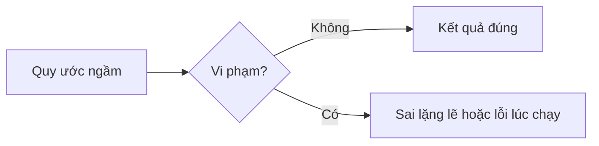
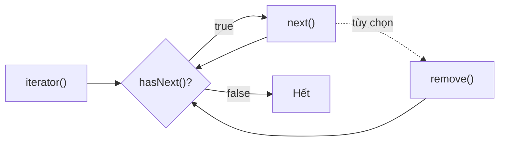
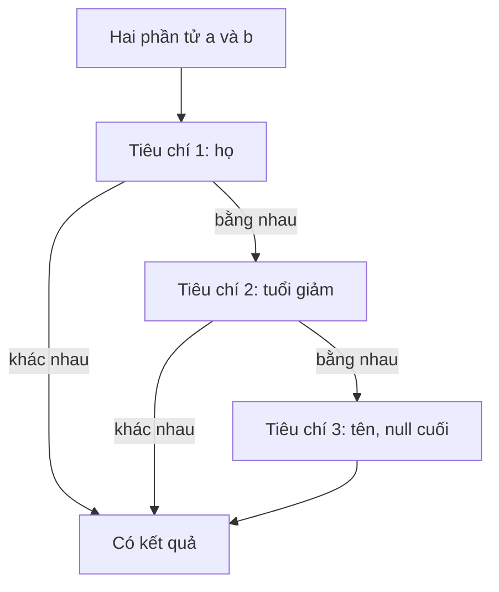

# Iterator, Comparable/Comparator và số học chính xác

## Ba công cụ làm việc với dữ liệu

Bài này gom ba thứ bạn chạm vào hầu như mỗi ngày khi xử lý dữ liệu, và cả ba đều có cạm bẫy "sai mà không báo lỗi". Thứ nhất là `Iterator`, cách chuẩn để duyệt collection, kèm cơ chế fail-fast khi bạn sửa collection lúc đang duyệt. Thứ hai là `Comparable`/`Comparator`, cách bảo Java sắp xếp object theo ý bạn. Thứ ba là `BigDecimal`, `BigInteger` và `Math` để tính số chính xác.

Vì sao phải cẩn thận? Viết `compareTo` sai quy ước thì `sort` hay `TreeMap` cho kết quả lạ mà không throw lỗi nào. Dùng `double` để tính tiền thì `0.1 + 0.2` ra `0.30000000000000004`. Xóa phần tử trong lúc `for-each` thì dính `ConcurrentModificationException`. Bạn sẽ gặp cả ba khi cần sort hoặc dùng object làm key của `TreeMap`/`TreeSet`, khi xóa phần tử lúc đang lặp, và khi tính tiền, tỷ lệ hay số rất lớn.

Cách làm gọn: ghép nhiều tiêu chí bằng `Comparator.comparing(...).thenComparing(...)`; xóa khi lặp bằng `Iterator.remove` hoặc `removeIf`; và với `BigDecimal` thì luôn chỉ rõ `RoundingMode`.

**Cốt lõi:** Cả ba công cụ đều dựa vào một quy ước ngầm mà Java không kiểm tra giúp bạn. Vi phạm quy ước thì kết quả sai lặng lẽ thay vì báo lỗi.

- Vì collection đếm số lần sửa để phát hiện thay đổi, nên sửa nó khi đang duyệt (ngoài `iterator.remove()`) bị coi là lỗi.
- Vì sắp xếp và `TreeMap` tin vào contract của `compare`, nên `a - b` tràn số hoặc comparator lệch với `equals` làm kết quả sai hoặc mất phần tử.
- Vì `double` lưu nhị phân còn `BigDecimal` lưu số nguyên kèm scale, nên `BigDecimal` mới chính xác cho tiền, và phép chia phải nói rõ cách làm tròn.



Mô hình tư duy: Java tin bạn giữ đúng quy ước, nên phải biết quy ước đó là gì vì lỗi thường không báo ngay.

**Tóm tắt:**

- `for-each` là cú pháp rút gọn của `Iterator`; `Iterator.remove()` chỉ hợp lệ ngay sau một lần `next()`.
- Sửa collection khi đang duyệt (ngoài `iterator.remove()`) throw `ConcurrentModificationException` theo kiểu cố gắng phát hiện, không đảm bảo; xóa an toàn bằng `removeIf` hoặc `iterator.remove()`.
- Iterator của collection đồng thời là weakly consistent: không throw lỗi nhưng có thể thấy hoặc không thấy thay đổi mới.
- `Comparable` cho một thứ tự tự nhiên trong class, `Comparator` cho nhiều thứ tự bên ngoài; ghép bằng `comparing(...).thenComparing(...)`.
- Không dùng `a - b` để so sánh vì tràn số, dùng `Integer.compare`; comparator của `TreeSet`/`TreeMap` còn quyết định thế nào là "trùng".
- `double` không biểu diễn chính xác số thập phân như 0,1 nên không dùng cho tiền; dùng `BigDecimal` khởi tạo từ chuỗi hoặc `valueOf`, so sánh bằng `compareTo`.
- `divide` phải chỉ rõ scale và `RoundingMode`; `HALF_EVEN` hợp kế toán; chỉ làm tròn ở bước cuối.

## Các khái niệm cần biết

- **Iterable và Iterator**: `Iterable` là thứ "duyệt được" (có method `iterator()`); `Iterator` là con trỏ duyệt với `hasNext()`, `next()`. `for-each` chỉ là cú pháp rút gọn.
- **Fail-fast và weakly consistent**: iterator fail-fast throw lỗi khi thấy collection bị sửa; iterator yếu nhất quán (weakly consistent) của collection đồng thời không throw lỗi, nhưng có thể thấy hoặc không thấy thay đổi mới.
- **Thứ tự tự nhiên và thứ tự ngoài**: thứ tự tự nhiên do chính class quy định qua `Comparable`; thứ tự ngoài do `Comparator` truyền vào, đổi được theo ngữ cảnh.
- **Stable sort**: phần tử bằng nhau giữ nguyên thứ tự ban đầu. Quan trọng khi sắp theo nhiều bước (sắp theo tên rồi theo phòng ban).
- **Overflow**: kết quả vượt phạm vi kiểu và quay vòng thành số sai (`Integer.MAX_VALUE + 1` ra số âm), không báo lỗi.
- **Sai số dấu phẩy động**: `double` lưu số nhị phân nên nhiều số thập phân đơn giản như 0,1 không biểu diễn chính xác.
- **Scale và RoundingMode**: scale là số chữ số sau dấu phẩy của `BigDecimal` (`2.00` có scale 2); `RoundingMode` quy định cách làm tròn khi cần bớt chữ số.

## Iterator



Hình bên trên cho thấy lifecycle một lần duyệt; `remove()` chỉ hợp lệ ngay sau một lần `next()` và chỉ xóa phần tử vừa trả về. Gọi `remove()` hai lần liên tiếp hoặc trước `next()` sẽ throw `IllegalStateException`.

- `for-each` là cú pháp rút gọn của `Iterator` trên `Iterable`; tự cài `Iterable<T>` là dùng được `for-each`.
- **Fail-fast**: collection đếm số lần sửa (`modCount`); sửa cấu trúc khi đang duyệt (ngoài `iterator.remove()`) → `ConcurrentModificationException` (cố gắng phát hiện, không đảm bảo).
- Xóa an toàn: `list.removeIf(x -> ...)` hoặc `iterator.remove()`.
- `ListIterator` duyệt hai chiều và thêm/sửa. Collection đồng thời (`CopyOnWriteArrayList`, `ConcurrentHashMap`) dùng iterator **yếu nhất quán** (weakly consistent), không throw lỗi.
- `Spliterator` là nền cho `Stream` parallel.

**Phải thuộc:** `Iterator.remove()` chỉ hợp lệ ngay sau một lần `next()`. Sửa collection khi đang duyệt (ngoài `iterator.remove()`) throw `ConcurrentModificationException` (cố gắng phát hiện, không đảm bảo); xóa an toàn bằng `removeIf` hoặc `iterator.remove()`. Iterator của collection đồng thời là weakly consistent, không throw lỗi.

## Comparable và Comparator

Vấn đề đặt ra: Java không tự biết `Person` nào "nhỏ hơn" `Person` nào. Có hai cách bảo nó. Cách một: chính class nói "thứ tự mặc định của tôi là thế này" qua `Comparable`. Cách hai: bên ngoài đưa luật sắp xếp qua `Comparator`, hợp khi cần nhiều kiểu sắp xếp hoặc khi không sửa được class. Quy tắc chọn: có một thứ tự hiển nhiên (số, ngày, mã) thì `Comparable`; ngược lại, hoặc cần đổi theo từng màn hình, thì `Comparator`.



Đọc sơ đồ: `thenComparing` chỉ được xét khi tiêu chí trước trả 0 (bằng nhau). Ví dụ mẫu bên dưới chạy theo đúng thứ tự này.

| | `Comparable<T>` | `Comparator<T>` |
|---|---|---|
| Ở đâu | Trong chính class (`compareTo`) | Bên ngoài, tách riêng |
| Số cách sắp xếp | Một ("thứ tự tự nhiên") | Nhiều tùy ngữ cảnh |
| Dùng cho | `TreeMap/TreeSet`, `Collections.sort` mặc định | `sort(cmp)`, `PriorityQueue`, `TreeMap(cmp)` |

```java
people.sort(Comparator.comparing(Person::lastName)
                      .thenComparing(Person::age, Comparator.reverseOrder())
                      .thenComparing(Person::name, Comparator.nullsLast(String::compareTo)));
```

Contract: `compare` phải **phản đối xứng**, **bắc cầu**, và nên **nhất quán với `equals`** (nếu không, `TreeSet` coi hai phần tử "bằng nhau" là trùng). Lỗi kinh điển: `return a - b;` tràn số với `int`; dùng `Integer.compare(a, b)`.

**Phải thuộc:** `Comparable.compareTo` định nghĩa thứ tự tự nhiên (một cách); `Comparator.compare` là thứ tự ngoài (nhiều cách). Không dùng `a - b` để so sánh vì tràn số, dùng `Integer.compare`. Comparator của `TreeSet`/`TreeMap` quyết định luôn thế nào là "trùng"; `List.sort` dùng TimSort (ổn định, O(n log n)).

`List.sort`/`Arrays.sort` cho object dùng **TimSort** (ổn định, O(n log n)); array nguyên thủy dùng dual-pivot quicksort.

**Suy luận:** `return a - b` trong comparator là lỗi kinh điển vì kết quả phép trừ phải nằm trong phạm vi `int` mà nó không bảo đảm. Khi `a` rất lớn dương và `b` rất lớn âm, hiệu vượt `Integer.MAX_VALUE` và quay vòng thành số âm, nên `compare` trả dấu ngược với thực tế. Hậu quả không phải exception mà là vi phạm contract: thứ tự không còn bắc cầu, và TimSort có thể ném `Comparison method violates its general contract` hoặc cho kết quả sai thất thường chỉ với một số dữ liệu nhất định. Điều này nguy hiểm vì test với dữ liệu nhỏ vẫn qua. `Integer.compare(a, b)` so sánh trực tiếp bằng `<` và `>` nên không bao giờ tràn. Cùng nguyên tắc: comparator của `TreeSet`/`TreeMap` quyết định luôn hai phần tử có "trùng" hay không, nên nếu không nhất quán với `equals` thì phần tử sẽ bị coi là trùng và mất. Hãy luôn dùng `Comparator.comparing` hoặc `Integer.compare`, và kiểm tra `null` bằng `nullsLast`.

### Chạy thử: Comparator ghép và bẫy tràn số

Dữ liệu `(họ, tuổi, tên)`: `(Nguyen,30,An)`, `(Tran,25,Binh)`, `(Nguyen,40,Chi)`, `(Nguyen,30,null)`, `(Nguyen,30,Dung)`. Sắp theo họ tăng, tuổi **giảm**, tên tăng với `null` cuối (đúng comparator ở trên) ra:

```text
Nguyen 40 Chi
Nguyen 30 An
Nguyen 30 Dung
Nguyen 30 null
Tran 25 Binh
```

```java
int a = Integer.MAX_VALUE, b = -10;
(a - b) < 0;                      // true: a - b tràn số thành âm, kết luận sai a < b
Integer.compare(a, b);            // 1: đúng

TreeSet<String> ts = new TreeSet<>(String.CASE_INSENSITIVE_ORDER);
ts.add("abc"); ts.add("ABC");
// 1: comparator trả 0 nghĩa là "trùng", dù equals nói khác
ts.size();
```

`thenComparing(P::age, Comparator.reverseOrder())` đảo **chỉ tiêu chí đó**; gọi `.reversed()` ở cuối chuỗi thì đảo cả chuỗi. `nullsLast` phải bọc **comparator của chính trường có thể null**, không bọc cả object.

## Số học chính xác

Vì sao `double` không dùng được cho tiền? Máy tính lưu số thực theo nhị phân, và 0,1 trong nhị phân là số lặp vô hạn như 1/3 trong thập phân, nên bị cắt bớt và sinh sai số nhỏ. Cộng nhiều lần thì sai số tích lũy, hậu quả là tổng tiền lệch vài xu, báo cáo không khớp. `BigDecimal` lưu số dưới dạng số nguyên lớn kèm scale thập phân nên chính xác với phép cộng, trừ, nhân; riêng phép chia phải cho biết cách làm tròn vì có phép chia không kết thúc (1/3).

```java
new BigDecimal("0.1").add(new BigDecimal("0.2"));    // 0.3 chính xác
// KHÔNG: lấy lỗi nhị phân của double
new BigDecimal(0.1);
BigDecimal.valueOf(0.1);                              // dùng chuỗi trong, an toàn hơn
// chia phải chỉ rõ độ chính xác/làm tròn
a.divide(b, 2, RoundingMode.HALF_UP);
// so giá trị; equals so cả scale (2.0 != 2.00)
a.compareTo(b) == 0;
```

Kết quả đã chạy xác nhận:

```java
// 0.1000000000000000055511151231257827021181583404541015625
new BigDecimal(0.1);
BigDecimal.valueOf(0.1);                      // 0.1
new BigDecimal("2.0").equals(new BigDecimal("2.00"));       // false (scale khác nhau)
new BigDecimal("2.0").compareTo(new BigDecimal("2.00"));    // 0
// ArithmeticException: Non-terminating decimal expansion
BigDecimal.ONE.divide(new BigDecimal(3));
new BigDecimal("10").divide(new BigDecimal("3"), 2, RoundingMode.HALF_UP);   // 3.33
// 3.305  (cộng: scale lớn hơn)
new BigDecimal("1.10").add(new BigDecimal("2.205"));
// 2.200  (nhân: scale cộng lại 2 + 1 = 3)
new BigDecimal("1.10").multiply(new BigDecimal("2.0"));
// 1E+2 (dùng toPlainString() để ra 100)
new BigDecimal("100").stripTrailingZeros();
// false: HashSet coi là hai phần tử
new BigDecimal("0.10").hashCode() == new BigDecimal("0.1").hashCode();
```

Chế độ làm tròn, cùng giá trị đầu vào:

| `RoundingMode` | 2,5 về 0 chữ số | -2,5 về 0 chữ số | 2,345 về 2 chữ số |
|---|---|---|---|
| `HALF_UP` | 3 | -3 | 2,35 |
| `HALF_EVEN` (làm tròn ngân hàng) | 2 | -2 | 2,34 |
| `DOWN` (cắt bớt) | 2 | -2 | 2,34 |
| `CEILING` (về +vô cực) | 3 | -2 | 2,35 |
| `FLOOR` (về -vô cực) | 2 | -3 | 2,34 |

`HALF_UP` là cách "học ở trường"; `HALF_EVEN` gom hòa về số chẵn nên không lệch dần khi cộng nhiều khoản, hợp cho kế toán. Thống nhất **một** quy tắc làm tròn cho cả hệ thống và chỉ làm tròn ở bước cuối, đừng làm tròn từng bước trung gian.

**Phải thuộc:** `BigDecimal` khởi tạo từ chuỗi hoặc `BigDecimal.valueOf(double)`, không dùng `new BigDecimal(double)`. So sánh giá trị bằng `compareTo` (`equals` so cả scale: `2.0` khác `2.00`). `divide` phải chỉ rõ scale và `RoundingMode` (hoặc `MathContext`), nếu không chia không kết thúc throw `ArithmeticException`.

**Suy luận:** `double` sai với tiền vì nó lưu số nhị phân, và 0,1 trong nhị phân là số lặp vô hạn như 1/3 trong thập phân, nên bị cắt bớt thành giá trị gần đúng. Mỗi phép cộng thêm một sai số nhỏ, cộng nhiều khoản thì tổng lệch vài xu và báo cáo không khớp. `BigDecimal` tránh vấn đề này vì lưu số dưới dạng số nguyên lớn kèm scale thập phân, nhưng vẫn có hai bẫy xuất phát từ cách lưu đó. Khởi tạo `new BigDecimal(0.1)` mang theo sai số của `double` đưa vào, nên phải dùng chuỗi hoặc `valueOf`. Và vì scale là một phần của giá trị, `2.0` và `2.00` khác nhau theo `equals` nhưng bằng nhau theo `compareTo`, nên so sánh giá trị phải dùng `compareTo`, và đặt `BigDecimal` làm key `HashMap` có thể lệch. Phép chia không kết thúc như 1/3 sẽ ném `ArithmeticException` trừ khi bạn chỉ rõ scale và `RoundingMode`. Hãy chọn một quy tắc làm tròn cho cả hệ thống và chỉ làm tròn ở bước cuối.

Chọn kiểu số theo bảng sau; `double` không phải kẻ thù, chỉ là sai chỗ khi dùng cho tiền.

| Kiểu | Dùng khi |
|---|---|
| `int/long` | Đếm, ID; tiền dưới dạng đơn vị nhỏ nhất (đồng/cent) |
| `double` | Khoa học, đồ họa; chấp nhận sai số |
| `BigDecimal` | Tiền tệ, thuế, tỷ lệ cần chính xác thập phân |
| `BigInteger` | Số nguyên vượt `long`, mật mã |

Tiện ích `Math`: `floorDiv/floorMod` (khác `/` `%` với số âm), `abs(Integer.MIN_VALUE)` vẫn âm, `Math.xxxExact` để bắt tràn số.

## Điều cần nhớ

- Không dùng `==` hay `-` để so sánh/sắp xếp số; dùng `compare`.
- `BigDecimal` khởi tạo từ **chuỗi** hoặc `valueOf`, so sánh bằng `compareTo`.
- Comparator cho `TreeMap/TreeSet` quyết định luôn "trùng" của key.

## Phỏng vấn khó: chuỗi hỏi xoáy

Người phỏng vấn senior thường mở bằng câu dễ rồi xoáy xuống cơ chế, đánh đổi và sự cố thật; câu trả lời tốt luôn đi từ cốt lõi xuống.

### Chuỗi 1: Comparator sai contract

1. **Câu mở:** Viết comparator sắp xếp `int` tăng dần.
2. **Xoáy 1:** Vì sao `return a - b` bị coi là lỗi? Hỏng với dữ liệu nào?
3. **Xoáy 2:** Comparator của `TreeSet<String>` dùng `CASE_INSENSITIVE_ORDER`, thêm `"abc"` rồi `"ABC"` thì còn mấy phần tử? Vì sao?

**Đáp án ngắn:** Tôi viết `Integer.compare(a, b)` hoặc dùng `Comparator.comparing`. `a - b` sai vì hiệu có thể vượt phạm vi `int` và quay vòng. Ví dụ `a = Integer.MAX_VALUE`, `b = -10` thì `a - b` ra số âm, comparator kết luận ngược `a < b`. Hậu quả không phải exception đều đặn mà là vi phạm contract: thứ tự không còn bắc cầu, TimSort có thể ném `Comparison method violates its general contract` hoặc cho thứ tự sai thất thường, và chỉ với một số dữ liệu. Test dữ liệu nhỏ vẫn qua nên rất khó phát hiện. `Integer.compare` dùng `<` và `>` trực tiếp nên không tràn. Với `TreeSet`, comparator quyết định luôn thế nào là "trùng": trả 0 là coi như cùng phần tử, nên `"abc"` và `"ABC"` chỉ còn 1 phần tử dù `equals` nói khác. Vì vậy comparator nên nhất quán với `equals`, và dùng `nullsLast` bọc đúng trường có thể null.

**Sai lầm hay gặp:**
- Nói `a - b` "hơi kém" mà không nêu được tràn số và vi phạm bắc cầu.
- Tưởng `TreeSet` dùng `equals` để loại trùng.
- Gọi `.reversed()` cuối chuỗi mà tưởng chỉ đảo tiêu chí cuối.

### Chuỗi 2: BigDecimal cho tiền

1. **Câu mở:** Vì sao không dùng `double` cho tiền?
2. **Xoáy 1:** `new BigDecimal(0.1)` khác `BigDecimal.valueOf(0.1)` ở đâu? `equals` và `compareTo` của `2.0` với `2.00`?
3. **Xoáy 2:** `BigDecimal.ONE.divide(new BigDecimal(3))` chuyện gì xảy ra? Bạn làm tròn ở bước nào?

**Đáp án ngắn:** `double` lưu nhị phân, và 0,1 trong nhị phân là số lặp vô hạn như 1/3 trong thập phân, nên bị cắt thành giá trị gần đúng. Cộng nhiều khoản thì sai số tích lũy, tổng lệch vài xu. `BigDecimal` lưu số nguyên lớn kèm scale nên chính xác với cộng, trừ, nhân. `new BigDecimal(0.1)` mang theo đúng sai số của `double` truyền vào, còn `valueOf` đi qua chuỗi nên ra 0,1; tốt nhất khởi tạo từ chuỗi. Scale là một phần của giá trị: `2.0` và `2.00` khác nhau theo `equals` và `hashCode` nhưng bằng nhau theo `compareTo`, nên so giá trị dùng `compareTo`, và đặt làm key `HashMap` có thể lệch. Phép chia 1/3 không kết thúc nên ném `ArithmeticException`; phải chỉ rõ scale và `RoundingMode`. Tôi chọn một quy tắc làm tròn cho cả hệ thống, thường `HALF_EVEN` cho kế toán, và chỉ làm tròn ở bước cuối.

**Sai lầm hay gặp:**
- Dùng `new BigDecimal(double)` rồi ngạc nhiên vì chuỗi số dài.
- So sánh bằng `equals` và gặp `2.0` khác `2.00`.
- Làm tròn từng bước trung gian rồi cộng lại.

