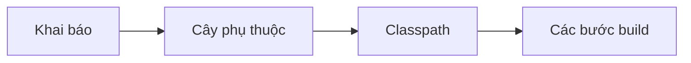
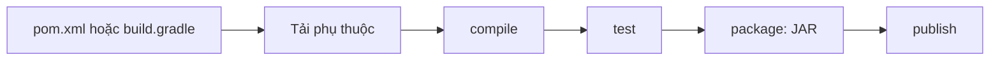
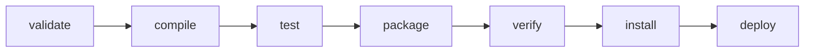
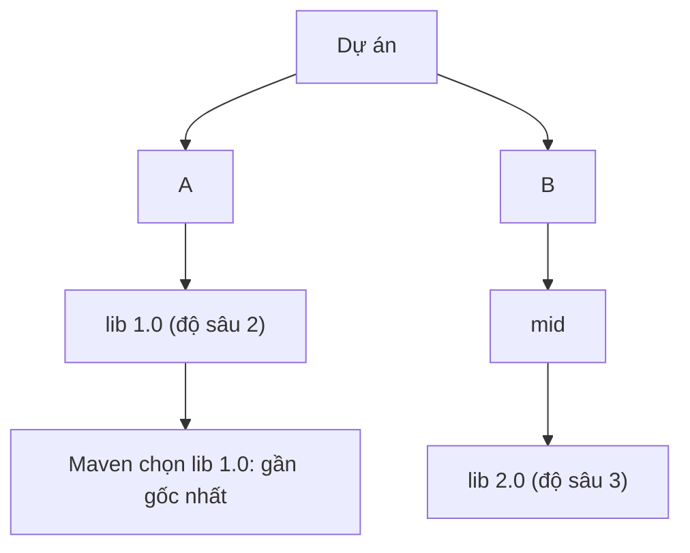

# Công cụ build: Maven, Gradle và quản lý dependency

## Công cụ build là gì và vì sao cần

Hãy tưởng tượng bạn không có công cụ build. Muốn dùng một thư viện, bạn phải tự tải file JAR về, chép vào dự án. Thư viện đó lại cần ba thư viện khác, mỗi cái lại cần thêm vài cái nữa, và chỉ cần lệch một phiên bản là chương trình nổ lúc chạy. Rồi máy bạn build được nhưng máy đồng nghiệp hay server CI thì không, vì mỗi nơi có một bộ JAR khác nhau.

Công cụ build như Maven và Gradle (Ant thì đã cũ) giải quyết toàn bộ việc đó: biên dịch, chạy test, đóng gói, và tự tải các thư viện dự án cần, đúng phiên bản, giống nhau trên mọi máy. Bạn dùng chúng trong gần như mọi dự án thật: khi thêm thư viện, tách module hoặc phát hành artifact. Chỉ với script nhỏ một file thì chạy `javac` là đủ.

Cách làm là khai báo dependency, plugin và các bước build trong `pom.xml` (Maven) hoặc `build.gradle(.kts)` (Gradle). Công cụ đọc khai báo đó rồi tự thực hiện mọi thứ.

**Cốt lõi:** Dự án không tự tải được thư viện đúng phiên bản và giống nhau trên mọi máy. Công cụ build đọc khai báo của bạn, dựng cây phụ thuộc rồi chạy các bước biên dịch, test, đóng gói theo một thứ tự xác định.

- Vì mọi thứ được khai báo trong `pom.xml` hoặc `build.gradle`, nên cùng cấu hình cho cùng kết quả ở mọi máy.
- Vì thư viện kéo theo thư viện khác thành một cây, nên khi hai nhánh đòi hai phiên bản, công cụ phải chọn một (Maven chọn bản gần gốc nhất).
- Vì chạy một phase là chạy mọi phase đứng trước, nên `mvn package` luôn đã biên dịch và test.



Mô hình tư duy: khai báo sinh ra cây phụ thuộc, cây thành classpath, và classpath là thứ các bước build dùng để chạy.

**Tóm tắt:**

- Maven và Gradle khai báo dependency, plugin, bước build trong `pom.xml` hoặc `build.gradle(.kts)` rồi tự biên dịch, test, đóng gói và tải thư viện đúng phiên bản trên mọi máy.
- Maven có lifecycle cố định `validate`, `compile`, `test`, `package`, `verify`, `install`, `deploy`; chạy một phase thì chạy mọi phase đứng trước, còn `clean` thuộc lifecycle riêng.
- Gradle chạy theo đồ thị task có build tăng dần và cache, nên nhanh hơn với dự án lớn, đổi lại script là code thật nên dễ phức tạp.
- Tọa độ artifact là `groupId:artifactId:version`; scope `compile`, `runtime` đi theo sang dự án dùng, còn `test` và `provided` thì không.
- Khi hai nhánh kéo hai phiên bản của cùng thư viện, Maven chọn bản gần gốc nhất (cùng độ sâu thì khai báo trước thắng), nên có thể gặp `NoSuchMethodError` lúc chạy.
- Quản lý version bằng BOM hoặc `dependencyManagement` (chỉ khai báo phiên bản, không thêm dependency) và wrapper; xem cây bằng `mvn dependency:tree`.
- Gradle dùng `api` khi kiểu của thư viện lộ ra ở chữ ký công khai, còn lại dùng `implementation` để build tăng dần nhanh hơn.

## Các khái niệm cần biết

- **Artifact**: sản phẩm của một dự án (thường là file JAR hoặc WAR) cùng metadata, có thể được dự án khác dùng làm phụ thuộc.
- **Classpath**: danh sách JAR và thư mục mà JVM tìm class khi chạy. Công cụ build dựng classpath từ phụ thuộc của bạn.
- **Phase và goal (Maven)**: phase là một chặng cố định của lifecycle (`compile`, `test`, `package`...); goal là một việc cụ thể do plugin cung cấp, được gắn vào phase.
- **Task (Gradle)**: đơn vị công việc có đầu vào và đầu ra, nối với nhau thành đồ thị phụ thuộc; Gradle chỉ chạy lại task nào có đầu vào thay đổi.
- **Incremental build và build cache**: chỉ làm lại phần bị ảnh hưởng, hoặc lấy kết quả đã build từ cache thay vì build lại.
- **Fat/uber JAR**: JAR chứa luôn mọi dependency để chạy bằng `java -jar`.
- **Jar hell**: trên classpath có hai phiên bản của cùng một class, JVM nạp bản nào gặp trước, gây lỗi khó đoán.
- **Build tái lập (reproducible)**: cùng mã nguồn và cấu hình thì cho cùng kết quả ở mọi nơi.

## Hình dung



## So sánh

Chọn Maven khi muốn quy ước cứng, dễ đoán, nhiều người cùng đọc hiểu (đa số dự án Spring doanh nghiệp). Chọn Gradle khi dự án lớn, nhiều module, cần tùy biến build hoặc build nhanh (Android dùng Gradle). Điểm yếu của Gradle là script có thể trở nên phức tạp vì nó là code thật.

| | Maven | Gradle |
|---|---|---|
| Cấu hình | XML khai báo, quy ước cứng | Groovy/Kotlin DSL, linh hoạt, lập trình được |
| Mô hình | **Lifecycle** cố định (`validate → compile → test → package → verify → install → deploy`) | **Đồ thị task**, có cache và build tăng dần |
| Tốc độ | Chậm hơn với dự án lớn | Nhanh nhờ incremental, build cache, daemon |
| Học | Dễ đoán, đồng nhất | Mạnh nhưng dễ viết phức tạp |
| Ant | Cũ, thủ công, không quản lý dependency | Hiếm dùng mới |

## Khái niệm cần nắm

- **Tọa độ**: `groupId:artifactId:version` (GAV) xác định duy nhất một artifact.
- **Phạm vi (scope/configuration)**: `compile/implementation`, `provided/compileOnly`, `runtime`, `test`.
- **Transitive dependency**: thư viện kéo theo thư viện khác; Maven chọn phiên bản theo "gần nhất" trong cây, có thể không như mong đợi. Xem cây: `mvn dependency:tree`, `gradle dependencies`.
- **BOM / dependencyManagement**: quản lý tập phiên bản đồng bộ (Spring Boot BOM) để khỏi ghi từng version.
- **Phiên bản SNAPSHOT** (đang phát triển, có thể đổi) khác bản **release** (immutable).
- **Repository**: local (`~/.m2`), Maven Central, repository nội bộ (Nexus, Artifactory).
- **Multi-module**: một dự án cha, nhiều module con dùng chung cấu hình.
- **Wrapper** (`mvnw`, `gradlew`): cố định phiên bản công cụ build trong repo.

## Lifecycle Maven chạy thế nào

Vấn đề đặt ra: bạn gõ `mvn package` thì Maven làm gì, theo thứ tự nào? Maven có ba lifecycle dựng sẵn (`default`, `clean`, `site`) và quy tắc cốt lõi là: chạy một phase thì chạy **tất cả phase đứng trước** trong cùng lifecycle. Plugin gắn **goal** của nó vào phase, nên đó là cách việc thật sự được làm.



Đọc sơ đồ: gõ `mvn package` là đi từ `validate` đến `package` rồi dừng; muốn dừng sớm hơn thì gọi phase đứng trước. Bảng sau liệt kê các lệnh thường dùng.

**Phải thuộc:** Lifecycle Maven (default): `validate`, `compile`, `test`, `package`, `verify`, `install`, `deploy`; chạy một phase thì chạy mọi phase đứng trước. `clean` thuộc lifecycle riêng. Tọa độ artifact là `groupId:artifactId:version`.

| Lệnh | Chạy | Ghi chú |
|---|---|---|
| `mvn test` | validate, compile, test | Surefire chạy unit test ở phase `test` |
| `mvn package` | tới `package` | Ra JAR trong `target/` |
| `mvn verify` | tới `verify` | Failsafe chạy integration test ở `integration-test` và kiểm tra ở `verify` |
| `mvn install` | tới `install` | Chép artifact vào `~/.m2` để dự án khác trên máy dùng |
| `mvn clean package` | `clean` rồi `package` | `clean` thuộc lifecycle **riêng**, phải gọi tường minh |
| `-DskipTests` | Biên dịch test nhưng không chạy | `-Dmaven.test.skip=true` bỏ cả biên dịch test |

## Transitive dependency: ai thắng

Khi hai đường phụ thuộc kéo về hai phiên bản khác nhau của cùng một thư viện, công cụ build phải chọn một. Sơ đồ dưới là ví dụ tiêu biểu.



Dự án phụ thuộc A và B. A kéo `lib:1.0` (độ sâu 2); B kéo `mid`, `mid` kéo `lib:2.0` (độ sâu 3). Maven chọn **định nghĩa gần gốc nhất**, nên được `lib:1.0` dù cũ hơn. Cùng độ sâu thì **khai báo trước thắng**. Hệ quả: nâng một thư viện có thể vô tình kéo `lib` về bản cũ, nổ `NoSuchMethodError` lúc chạy, không phải lúc build.

**Suy luận:** Maven áp dụng quy tắc "gần gốc nhất" vì dự án của bạn cần một cách chọn xác định khi một thư viện xuất hiện ở nhiều nhánh, và nó coi dependency ở độ sâu nhỏ là lựa chọn có chủ ý hơn dependency bắc cầu ở sâu. Ví dụ `A` kéo `lib:1.0` ở độ sâu 2 còn `B` kéo `mid` rồi `lib:2.0` ở độ sâu 3 thì Maven chọn `lib:1.0` dù cũ hơn, nên `B` có thể gọi method chỉ có ở 2.0 và nổ `NoSuchMethodError` lúc chạy. Lỗi chỉ lộ ở lúc chạy vì lúc biên dịch `B` đã dùng đúng bản nó khai báo, còn việc thay bản do Maven quyết định khi dựng classpath. Cùng nguyên nhân, nâng cấp một thư viện có thể vô tình kéo `lib` về bản cũ mà không báo gì. Điểm dễ nhầm là tin rằng Maven luôn lấy bản mới nhất. Cách xử lý đi từ cơ chế: xem ai kéo bản nào bằng `mvn dependency:tree -Dverbose`, rồi ép bản đúng qua `dependencyManagement` hoặc BOM để quyết định rõ ràng thay vì để quy tắc "gần nhất" quyết định.

**Nền tảng:** Transitive dependency hình thành một cây; khi hai nhánh kéo về hai phiên bản của cùng một thư viện, công cụ build phải chọn một (Maven chọn bản gần gốc nhất, cùng độ sâu thì khai báo trước thắng). Phiên bản bị chọn sai là nguồn của `NoSuchMethodError` lúc chạy, nên cần xem cây phụ thuộc và ghim phiên bản bằng BOM hoặc `dependencyManagement`.

```xml
<!-- Ghim phiên bản cho cả cây, kể cả transitive dependency -->
<dependencyManagement>
  <dependencies>
    <dependency>
      <groupId>org.springframework.boot</groupId>
      <artifactId>spring-boot-dependencies</artifactId>
      <version>3.3.0</version>
      <type>pom</type>
      <scope>import</scope>              <!-- nhập BOM: lấy toàn bộ bảng phiên bản -->
    </dependency>
  </dependencies>
</dependencyManagement>

<dependencies>
  <dependency>
    <groupId>com.fasterxml.jackson.core</groupId>
    <artifactId>jackson-databind</artifactId>   <!-- không cần ghi version: lấy từ BOM -->
  </dependency>
</dependencies>
```

`dependencyManagement` chỉ **khai báo phiên bản**, không thêm dependency vào dự án. Phải có `<dependency>` ở mục `dependencies` thì mới được dùng.

Phạm vi và tính bắc cầu (cho phụ thuộc trực tiếp của thư viện bạn dùng): `compile` và `runtime` đi theo sang dự án bạn; `test` và `provided` **không** đi theo.

## Gradle: `implementation` và `api`

```kotlin
plugins { `java-library` }
dependencies {
    // lộ ra cho người dùng module này
    api("org.apache.commons:commons-lang3:3.14.0")
    // ẩn: chỉ module này thấy
    implementation("com.google.guava:guava:33.0.0-jre")
    testImplementation("org.junit.jupiter:junit-jupiter:5.10.2")
}
```

Dùng `api` khi kiểu của thư viện xuất hiện trong chữ ký công khai của module bạn (người dùng buộc phải thấy nó); còn lại dùng `implementation` để giấu chi tiết. `implementation` giúp module phía dưới không phải biên dịch lại khi thư viện nội bộ đổi, nên build tăng dần nhanh hơn. Gradle chạy theo đồ thị task: task có đầu vào/đầu ra không đổi được đánh dấu `UP-TO-DATE` và bỏ qua; kết quả còn có thể lấy từ build cache.

## Plugin hay gặp

`maven-compiler-plugin` (đặt phiên bản Java), `surefire` (unit test), `failsafe` (integration test), `spring-boot-maven-plugin` (fat JAR), `jacoco` (độ phủ), `checkstyle/spotbugs/PMD/SonarQube` (chất lượng mã), `versions` (kiểm tra bản mới), `OWASP dependency-check` (lỗ hổng).

## Gỡ lỗi phụ thuộc

- Xung đột phiên bản → `NoSuchMethodError`/`ClassNotFoundException` lúc chạy: xem cây phụ thuộc, ghim phiên bản bằng `dependencyManagement`/`constraints`, `exclusions`.
- Hai phiên bản cùng class trên classpath ("jar hell"): dùng `mvn dependency:tree -Dverbose`.
- Fat/uber JAR: gói mọi thứ để chạy một lệnh `java -jar`; layered JAR tối ưu layer Docker.

## Điều cần nhớ

- Đừng tự đặt version rải rác; dùng BOM và wrapper.
- Build phải **tái lập**: ghim phiên bản, tránh `LATEST` và khoảng phiên bản mở.
- Quét lỗ hổng và giấy phép phụ thuộc trong CI. Xem thêm [DevOps](/go?p=04-DevOps%2Findex.md).

## Phỏng vấn khó: chuỗi hỏi xoáy

Người phỏng vấn senior thường mở bằng câu dễ rồi xoáy xuống cơ chế, đánh đổi và sự cố thật; câu trả lời tốt luôn đi từ cốt lõi xuống.

### Chuỗi 1: Xung đột phiên bản transitive

1. **Câu mở:** Transitive dependency là gì?
2. **Xoáy 1:** Hai nhánh kéo hai phiên bản khác nhau của cùng thư viện thì Maven chọn bản nào? Có phải bản mới nhất không?
3. **Xoáy 2:** Build xanh nhưng lên chạy nổ `NoSuchMethodError`. Bạn điều tra và sửa thế nào?

**Đáp án ngắn:** Transitive dependency là thư viện mà thư viện bạn dùng kéo theo, và chúng tạo thành một cây. Khi một thư viện xuất hiện ở nhiều nhánh với phiên bản khác nhau, Maven không chọn bản mới nhất mà chọn định nghĩa gần gốc nhất; cùng độ sâu thì khai báo trước thắng. Ví dụ `A` kéo `lib:1.0` ở độ sâu 2, còn `B` kéo `mid` rồi `lib:2.0` ở độ sâu 3, thì được `lib:1.0`. Nếu `B` gọi method chỉ có ở 2.0, lỗi không lộ lúc biên dịch vì `B` đã biên dịch với bản nó khai báo; nó chỉ nổ lúc chạy khi classpath dùng bản cũ. Tôi chạy `mvn dependency:tree -Dverbose` để xem ai kéo bản nào, rồi ghim bản đúng qua `dependencyManagement` hoặc BOM, hoặc dùng `exclusions`. Mục tiêu là quyết định có chủ ý thay vì để quy tắc "gần nhất" quyết định. Với Gradle thì xem `gradle dependencies`.

**Sai lầm hay gặp:**
- Nói Maven luôn lấy bản mới nhất.
- Tưởng build xanh nghĩa là classpath đúng.
- Thêm `dependency` mà không biết `dependencyManagement` chỉ khai báo phiên bản, không thêm dependency.

### Chuỗi 2: Lifecycle Maven

1. **Câu mở:** `mvn package` làm những gì?
2. **Xoáy 1:** Vì sao `mvn package` đã chạy test? `clean` có nằm trong đó không?
3. **Xoáy 2:** `-DskipTests` khác `-Dmaven.test.skip=true` thế nào, và integration test chạy ở phase nào?

**Đáp án ngắn:** Maven có lifecycle `default` gồm `validate`, `compile`, `test`, `package`, `verify`, `install`, `deploy`. Quy tắc cốt lõi: chạy một phase thì chạy mọi phase đứng trước trong cùng lifecycle. Nên `mvn package` đi từ `validate` qua `compile` và `test` rồi mới đóng gói JAR vào `target/`. Plugin gắn goal của nó vào phase, và đó là cách việc thật sự được làm, như Surefire chạy unit test ở phase `test`. `clean` thuộc lifecycle riêng nên không tự chạy, phải gọi tường minh `mvn clean package`. `-DskipTests` vẫn biên dịch test nhưng không chạy; `-Dmaven.test.skip=true` bỏ cả biên dịch test. Failsafe chạy integration test ở `integration-test` và kiểm tra kết quả ở `verify`, nên cần `mvn verify` chứ `package` chưa đủ. `install` chép artifact vào `~/.m2` để dự án khác trên máy dùng.

**Sai lầm hay gặp:**
- Tưởng `mvn package` không chạy test hoặc đã tự `clean`.
- Nhầm hai cờ skip và không biết cái nào còn biên dịch test.
- Nghĩ integration test chạy cùng phase với unit test.

