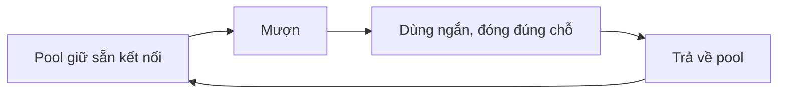
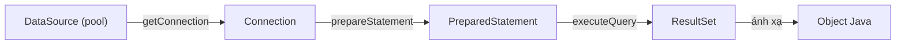
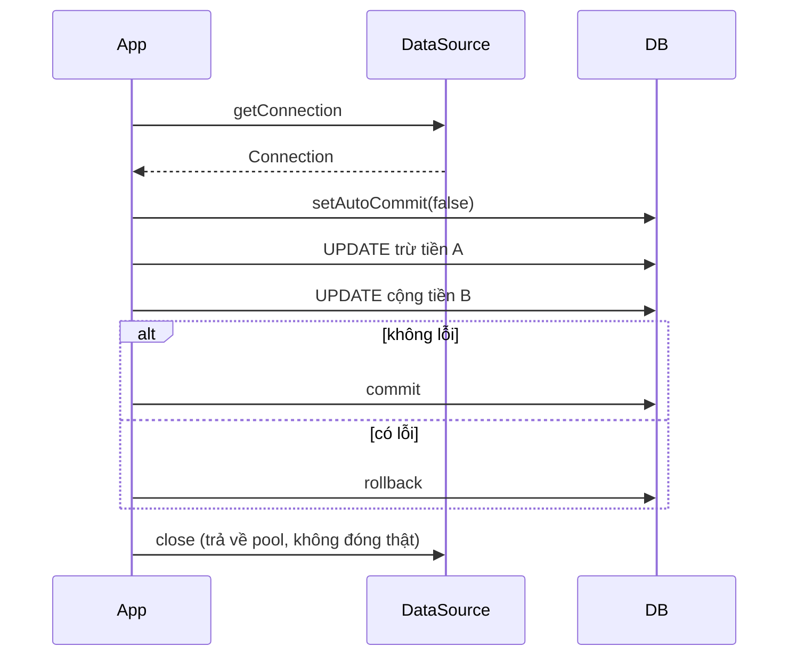
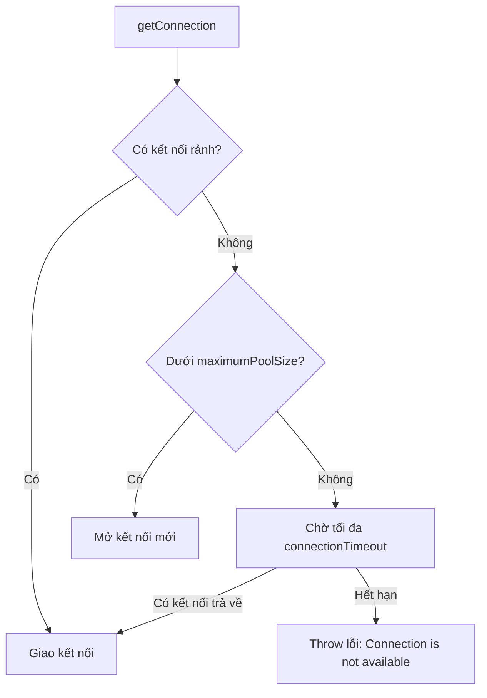
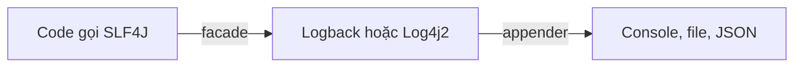

# JDBC, Connection Pool và Logging

## Ba mảnh ghép của tầng dữ liệu và vận hành

Bài này gom ba thứ gắn chặt với nhau khi ứng dụng Java làm việc với database và chạy thật trên production. **JDBC** là API chuẩn của Java để nói chuyện với database quan hệ: bạn đưa câu SQL, nhận lại kết quả. **Connection pool** giữ sẵn một nhóm kết nối để dùng lại thay vì mở mới mỗi lần. **Logging** (SLF4J cùng Logback hoặc Log4j2) là ghi lại những gì ứng dụng đang làm để sau còn xem.

Vì sao cần hiểu? JPA và Spring Data đều chạy trên JDBC, không hiểu nó thì khó giải thích N+1 query, timeout hay kết nối bị rò. Mở kết nối mới cho mỗi request thì rất chậm (phải bắt tay TCP, TLS, xác thực). Còn trên production, không có log tốt thì gần như không điều tra được sự cố, vì bạn không ngồi cạnh để quan sát.

Bạn dùng JDBC trực tiếp khi viết query thô hoặc batch, tinh chỉnh hiệu năng hay điều tra sự cố. Với CRUD thông thường thì thường dùng JPA hay Spring Data, nhưng pool và log thì dự án nào cũng cần. Cách làm chuẩn: dùng `PreparedStatement` (tham số hóa, chống SQL injection) cùng try-with-resources, lấy kết nối từ pool (HikariCP), và log đúng mức (`INFO`, `WARN`, `ERROR`) kèm ngữ cảnh như id đơn hàng, id người dùng.

**Cốt lõi:** Nói chuyện với database và vận hành trên production đều xoay quanh tài nguyên hữu hạn: kết nối đắt để mở, và chỉ có log mới cho bạn thấy chuyện đã xảy ra. JDBC là cửa chuẩn tới database, pool giữ kết nối để mượn và trả, còn log là thứ bạn đọc lại khi sự cố.

- Vì mở kết nối rất đắt nên pool giữ sẵn kết nối, và `close()` chỉ trả về pool chứ không đóng thật.
- Vì kết nối là tài nguyên hữu hạn nên giữ càng lâu càng hại, và pool cạn thường do transaction dài hoặc quên đóng chứ ít khi do pool nhỏ.
- Vì MDC gắn theo thread nên khi sang thread khác hoặc dùng lại thread pool, bạn phải tự sao chép và dọn nó.



Mô hình tư duy: kết nối là xe mượn từ bãi, càng trả sớm thì người sau càng ít phải chờ.

**Tóm tắt:**

- JDBC là API chuẩn để nói chuyện với database; flow là `DataSource`, `Connection`, `PreparedStatement`, `ResultSet`, và đổi database chủ yếu là đổi driver cùng URL.
- Luôn dùng `PreparedStatement` để chống SQL injection và đóng tài nguyên bằng try-with-resources; quên đóng là connection leak.
- Transaction thủ công: `setAutoCommit(false)`, rồi `commit()` hoặc `rollback()` trên cùng một `Connection`; batch (`addBatch`, `executeBatch`) giảm round-trip.
- Mở kết nối rất đắt nên connection pool (HikariCP, mặc định của Spring Boot) giữ sẵn kết nối; `close()` chỉ trả về pool, không đóng thật.
- Pool nhỏ vừa đủ thường nhanh hơn pool lớn; pool cạn thường do transaction dài, gọi mạng chậm trong transaction hoặc quên đóng kết nối.
- SLF4J là facade, Logback hoặc Log4j2 ở dưới; mức log `TRACE < DEBUG < INFO < WARN < ERROR`, dùng tham số `{}` thay vì nối chuỗi và truyền exception làm tham số cuối.
- MDC dựa trên `ThreadLocal` nên không tự đi theo sang thread khác (`@Async`, executor); phải sao chép thủ công và `MDC.clear()` khi dùng thread pool.

## Các khái niệm cần biết

- **JDBC driver**: thư viện của hãng database (PostgreSQL, MySQL...) hiện thực API JDBC. Code của bạn chỉ gọi interface chuẩn, đổi database chủ yếu là đổi driver và URL.
- **SQL injection**: kẻ tấn công nhét SQL vào dữ liệu nhập, nếu bạn nối chuỗi vào câu lệnh. `PreparedStatement` gửi câu SQL và tham số tách riêng nên dữ liệu không bao giờ được hiểu là lệnh.
- **Transaction**: nhóm lệnh hoặc cùng thành công (`commit`) hoặc cùng bị hủy (`rollback`), như chuyển tiền trừ một bên cộng một bên.
- **Round-trip**: một lượt đi về qua mạng giữa app và DB. Giảm round-trip (batch) thường là cách tối ưu hiệu quả nhất.
- **Connection leak**: lấy kết nối mà không trả, pool dần cạn và request treo.
- **HikariCP**: thư viện connection pool nhanh và nhẹ, mặc định của Spring Boot.
- **Facade (SLF4J)**: facade cho logging, code của bạn gọi SLF4J còn bên dưới có thể đổi Logback hay Log4j2 mà không sửa code.
- **Appender**: đích đến của log (console, file, JSON gửi tới hệ thống tập trung).
- **MDC (Mapped Diagnostic Context)**: bản đồ key-value gắn theo thread, được tự động in vào mọi dòng log, dùng để gắn `traceId`, `userId`.
- **ThreadLocal**: variable mà mỗi thread có một bản riêng; nền tảng của MDC.

## JDBC



```java
String sql = "SELECT id, name FROM users WHERE email = ?";
try (Connection c = dataSource.getConnection();
     PreparedStatement ps = c.prepareStatement(sql)) {
    ps.setString(1, email);                 // tham số hóa: chống SQL injection
    try (ResultSet rs = ps.executeQuery()) {
        while (rs.next()) { /* rs.getLong("id") ... */ }
    }
}
```

- **Luôn** `PreparedStatement`, không nối chuỗi SQL (injection).
- Transaction: `c.setAutoCommit(false)` → `commit()`/`rollback()`; mức cô lập `setTransactionIsolation`.
- **Batch**: `addBatch()` + `executeBatch()` giảm round-trip khi chèn nhiều dòng.
- `fetchSize` kiểm soát số dòng kéo mỗi lần với kết quả lớn; truy vấn lớn dùng streaming/phân trang.
- Đóng `ResultSet/Statement/Connection` bằng try-with-resources; quên đóng = **rò rỉ kết nối**.
- Driver nạp qua `ServiceLoader` (không cần `Class.forName` từ JDBC 4).

**Phải thuộc:** Flow JDBC: `DataSource` sang `Connection` sang `PreparedStatement` sang `ResultSet`. Luôn dùng `PreparedStatement` (chống SQL injection) và try-with-resources. Transaction: `setAutoCommit(false)`, rồi `commit()` hoặc `rollback()` trên cùng một `Connection`. Batch bằng `addBatch()` và `executeBatch()` để giảm round-trip.

### Transaction thủ công và batch

Vấn đề đặt ra: chuyển tiền cần hai lệnh `UPDATE`, nếu lệnh thứ hai lỗi mà lệnh đầu đã ghi thì tiền biến mất. Cách giải quyết là đặt cả hai vào một transaction trên cùng một `Connection`: tắt tự commit, và chỉ `commit` khi tất cả thành công, ngược lại `rollback`. Spring `@Transactional` chỉ tự động hóa đúng đoạn này.



```java
void transfer(DataSource dataSource, long fromId, long toId, BigDecimal amount) throws SQLException {
    try (Connection c = dataSource.getConnection()) {
        c.setAutoCommit(false);
        try (PreparedStatement debit = c.prepareStatement(
                 "UPDATE account SET balance = balance - ? WHERE id = ? AND balance >= ?");
             PreparedStatement credit = c.prepareStatement(
                 "UPDATE account SET balance = balance + ? WHERE id = ?")) {
            debit.setBigDecimal(1, amount); debit.setLong(2, fromId); debit.setBigDecimal(3, amount);
            if (debit.executeUpdate() != 1) throw new SQLException("không đủ số dư hoặc sai tài khoản");
            credit.setBigDecimal(1, amount); credit.setLong(2, toId);
            credit.executeUpdate();
            c.commit();
        } catch (SQLException | RuntimeException e) {
            c.rollback();                       // hủy cả hai lệnh
            throw e;
        }
    }                                           // close() trả connection về pool
}
```

Hai điểm hay bị bỏ sót: (1) `close()` trên connection của pool là **trả về pool**; pool thường đặt lại `autoCommit` khi trả, nhưng đừng dựa vào đó, hãy tự `rollback` khi lỗi. (2) Điều kiện `balance >= ?` nằm trong `UPDATE` để kiểm tra và trừ là **một lệnh atomic**, tránh check-then-act giữa hai request.

Batch giảm số lần đi về mạng:

```java
try (PreparedStatement ps = c.prepareStatement("INSERT INTO item(order_id, sku) VALUES (?, ?)")) {
    for (String sku : skus) { ps.setLong(1, orderId); ps.setString(2, sku); ps.addBatch(); }
    int[] counts = ps.executeBatch();               // một lần gửi, nhiều dòng
}
```

Với một số driver (ví dụ MySQL) phải bật tham số kết nối như `rewriteBatchedStatements=true` thì batch mới thực sự gom; tùy driver và phiên bản.

## Connection pool

Mở kết nối rất đắt (TCP, TLS, xác thực), nên giữ sẵn một tập kết nối dùng lại. **HikariCP** là mặc định của Spring Boot. Về bản chất, pool là bãi giữ xe: bạn mượn một kết nối, dùng xong thì "trả" (thực ra `close()` chỉ trả về bãi, không đóng thật). Khi bãi hết xe, người đến sau phải chờ.



| Tham số | Ý nghĩa |
|---|---|
| `maximumPoolSize` | Số kết nối tối đa; không phải càng lớn càng tốt (CSDL có giới hạn, tranh chấp) |
| `minimumIdle` | Số kết nối rảnh tối thiểu |
| `connectionTimeout` | Chờ lấy kết nối từ pool trước khi lỗi |
| `maxLifetime` / `idleTimeout` | Lifecycle kết nối, phải nhỏ hơn timeout của CSDL/firewall |
| `leakDetectionThreshold` | Cảnh báo kết nối giữ quá lâu (rò rỉ) |

```java
HikariConfig cfg = new HikariConfig();
cfg.setJdbcUrl("jdbc:postgresql://db:5432/shop");
cfg.setUsername("app");
cfg.setPassword(System.getenv("DB_PASSWORD"));   // không ghi mật khẩu vào code
cfg.setMaximumPoolSize(10);
cfg.setConnectionTimeout(3_000);                 // ms, chờ lấy connection
cfg.setMaxLifetime(25 * 60_000);                 // nhỏ hơn giới hạn phía DB/firewall
// cảnh báo kèm stack trace nơi lấy connection
cfg.setLeakDetectionThreshold(10_000);
DataSource dataSource = new HikariDataSource(cfg);
```

Cách chọn `maximumPoolSize`: pool nhỏ, đủ để DB bận mà không bị quá tải. Công thức khởi điểm do tác giả HikariCP gợi ý là `số core DB * 2 + số ổ đĩa`, sau đó **đo** rồi chỉnh. Ví dụ ứng dụng có 200 thread nhưng DB chỉ 4 core thì pool 10 vẫn đủ: thread dư xếp hàng chờ connection thay vì tranh nhau DB.

**Suy luận:** Pool nhỏ lại tốt hơn pool lớn vì DB chỉ có vài core và vài ổ đĩa, nên khi có nhiều truy vấn chạy đồng thời hơn khả năng đó, chúng không nhanh hơn mà chỉ tranh nhau CPU, đĩa và lock, làm mọi truy vấn chậm đi. Một pool vừa đủ để DB bận nhưng không quá tải khiến các thread dư xếp hàng chờ connection ở phía ứng dụng, nơi chờ rẻ hơn nhiều so với tranh nhau bên trong DB. Công thức khởi điểm `số core DB * 2 + số ổ đĩa` rồi đo lại bắt nguồn từ đây, và ví dụ 200 thread với DB 4 core thì pool 10 đã đủ. Cũng vì connection là tài nguyên hữu hạn nên giữ nó càng lâu càng hại: transaction dài, gọi mạng chậm bên trong transaction hay quên đóng đều làm pool cạn, và triệu chứng là request treo rồi lỗi "Connection is not available". Điểm dễ nhầm là tăng `maximumPoolSize` khi pool cạn, trong khi thủ phạm thường là một chỗ giữ connection quá lâu. Hãy rút ngắn transaction, đặt `leakDetectionThreshold` và đo trước khi chỉnh kích thước.

**Nền tảng:** Mở kết nối DB rất đắt nên pool giữ sẵn một tập kết nối để mượn và trả (`close()` chỉ trả về pool, không đóng thật). Pool nhỏ vừa đủ thường tốt hơn pool lớn; thread dư xếp hàng chờ connection thay vì tranh nhau DB. Pool cạn thường do transaction dài, gọi mạng chậm trong transaction hoặc quên đóng kết nối.

Triệu chứng pool cạn: request treo rồi lỗi "Connection is not available". Nguyên nhân hay gặp: transaction dài, gọi mạng chậm trong transaction, quên đóng kết nối. Xem [Transaction](/go?p=01-Spring-Boot%2Fmedium%2Flt-05-transaction.md) và [Database](/go?p=02-Database%2Findex.md).

## Logging

Vấn đề: khi sự cố xảy ra ở production, bạn chỉ có log để biết chuyện gì đã diễn ra. Mục tiêu là log đủ để trả lời "ai, làm gì, khi nào, ở đâu" mà không ngập dữ liệu hay lộ thông tin nhạy cảm. Đường đi của một dòng log như sau.



Đọc sơ đồ: code chỉ biết SLF4J. Logback (hoặc Log4j2) quyết định dòng log có được ghi không (theo mức) rồi gửi qua các appender tới đích.

- **SLF4J** là facade; bên dưới chọn Logback (mặc định Spring Boot) hoặc Log4j2. Thư viện chỉ phụ thuộc SLF4J.
- Mức: `TRACE < DEBUG < INFO < WARN < ERROR`. Production thường `INFO`; điều chỉnh mức theo gói khi cần.
- Dùng tham số, không nối chuỗi (nối chuỗi tốn công tạo chuỗi dù mức log bị tắt): `log.debug("User {} not found", id);`
- Ghi exception đầy đủ: `log.error("Thanh toán lỗi, orderId={}", id, ex);`
- **MDC** (Mapped Diagnostic Context): gắn `traceId`, `userId` vào mọi dòng log của một request.

```java
MDC.put("traceId", traceId);             // gắn vào mọi dòng log của thread này
try {
    // mẫu logback: %d %-5level [%X{traceId}] %logger - %msg%n
    log.info("Nhận đơn orderId={}", id);
} finally {
    // thread pool tái sử dụng thread: không xóa thì rò sang request khác
    MDC.clear();
}
```

**Suy luận:** MDC không tự đi theo sang thread khác vì nó lưu dữ liệu trong `ThreadLocal`, tức là mỗi thread có một bản riêng gắn với chính thread đó. Khi request chuyển công việc sang `@Async` hoặc executor, thread mới có `ThreadLocal` rỗng nên log ở đó mất `traceId` và `userId`, đúng chỗ bạn cần chúng nhất để truy vết. Ngược lại với thread pool, thread được tái sử dụng nên nếu quên `MDC.clear()` thì dữ liệu của request trước còn dính lại và xuất hiện trong log của request sau, gây nhầm lẫn khi điều tra, thậm chí lộ thông tin sang người khác. Điểm dễ nhầm là nghĩ MDC "toàn cục theo request", trong khi nó gắn theo thread. Cách xử lý đi từ cơ chế: sao chép MDC thủ công khi chuyển thread (hoặc dùng decorator của executor), và luôn dọn trong `finally`. Cũng đừng log mật khẩu, token hay dữ liệu cá nhân.

MDC dựa trên `ThreadLocal`, nên **không tự đi theo** sang thread khác (`@Async`, executor); phải sao chép thủ công khi chuyển thread.

**Phải thuộc:** Mức log: `TRACE < DEBUG < INFO < WARN < ERROR`. Dùng tham số `log.debug("User {}", id)` thay vì nối chuỗi; truyền exception làm tham số cuối để in stack trace. MDC dựa trên `ThreadLocal` nên không tự đi theo sang thread khác và phải `MDC.clear()` khi dùng thread pool.

- Log có cấu trúc (JSON) dễ truy vấn trong ELK/Loki; xoay vòng file; không log mật khẩu/token/dữ liệu cá nhân.
- Không dùng `System.out.println` và `e.printStackTrace()` trong mã thật.
- Lỗ hổng Log4Shell (Log4j2, 2021) nhắc rằng thư viện log cũng cần cập nhật bảo mật.

## Điều cần nhớ

- JDBC: tham số hóa, đóng tài nguyên, transaction ngắn.
- Pool nhỏ vừa đủ thường nhanh hơn pool quá lớn.
- Log để **trả lời câu hỏi lúc sự cố**: ai, cái gì, khi nào, mã theo dõi.

## Phỏng vấn khó: chuỗi hỏi xoáy

Người phỏng vấn senior thường mở bằng câu dễ rồi xoáy xuống cơ chế, đánh đổi và sự cố thật; câu trả lời tốt luôn đi từ cốt lõi xuống.

### Chuỗi 1: Pool cạn kết nối

1. **Câu mở:** Vì sao phải dùng connection pool?
2. **Xoáy 1:** Pool đang cạn, request treo rồi báo "Connection is not available". Bạn có tăng `maximumPoolSize` không?
3. **Xoáy 2:** Ứng dụng có 200 thread, DB có 4 core. Pool 10 hay 200? Vì sao?

**Đáp án ngắn:** Mở kết nối rất đắt vì phải bắt tay TCP, TLS và xác thực, nên pool giữ sẵn một tập kết nối để mượn và trả; `close()` chỉ trả về pool chứ không đóng thật. Khi pool cạn, tôi không vội tăng kích thước. Kết nối là tài nguyên hữu hạn, nên thủ phạm thường là chỗ giữ nó quá lâu: transaction dài, gọi mạng chậm bên trong transaction, hoặc quên đóng. Tôi đặt `leakDetectionThreshold` để lấy stack trace nơi mượn, rồi rút ngắn transaction. Về kích thước, pool nhỏ vừa đủ thường nhanh hơn: DB chỉ có vài core và ổ đĩa, nên nhiều truy vấn đồng thời hơn khả năng đó chỉ tranh CPU, đĩa và lock. Công thức khởi điểm do tác giả HikariCP gợi ý là số core DB nhân 2 cộng số ổ đĩa, rồi đo và chỉnh. Với 4 core thì pool 10 đủ, thread dư xếp hàng chờ ở phía ứng dụng, nơi chờ rẻ hơn. `connectionTimeout` quyết định chờ bao lâu thì lỗi.

**Sai lầm hay gặp:**
- Phản xạ tăng pool khi cạn, đẩy luôn áp lực sang DB.
- Cho rằng pool lớn thì luôn nhanh hơn.
- Không biết `close()` trên kết nối của pool là trả về pool.

### Chuỗi 2: MDC và thread pool

1. **Câu mở:** MDC dùng để làm gì?
2. **Xoáy 1:** Sau khi chuyển việc sang `@Async`, log mất `traceId`. Vì sao?
3. **Xoáy 2:** Ngược lại, log của request B lại in `userId` của request A. Chuyện gì đã xảy ra?

**Đáp án ngắn:** MDC là bản đồ key-value gắn vào mọi dòng log của một request, như `traceId` và `userId`, để truy vết khi sự cố. Cơ chế bên dưới là `ThreadLocal`, tức là mỗi thread có một bản riêng. Vì vậy MDC không tự đi theo sang thread khác: khi chuyển sang `@Async` hoặc executor, thread mới có `ThreadLocal` rỗng nên log mất `traceId` đúng chỗ cần nhất. Cách xử lý là sao chép MDC thủ công khi chuyển thread, hoặc dùng decorator của executor làm việc đó. Chiều ngược lại cũng từ cùng cơ chế: thread pool tái sử dụng thread, nên nếu quên `MDC.clear()` thì dữ liệu của request trước còn dính lại và hiện trong log request sau, gây nhầm khi điều tra và có thể lộ thông tin. Vì thế tôi luôn dọn trong `finally`. Ngoài ra không log mật khẩu, token hay dữ liệu cá nhân.

**Sai lầm hay gặp:**
- Nghĩ MDC là toàn cục theo request thay vì theo thread.
- Gắn MDC mà không dọn trong `finally`.
- Nối chuỗi trong log thay vì dùng tham số `{}` và truyền exception làm tham số cuối.

