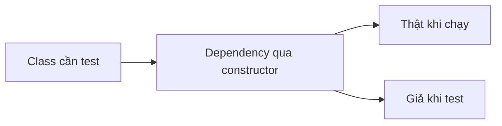
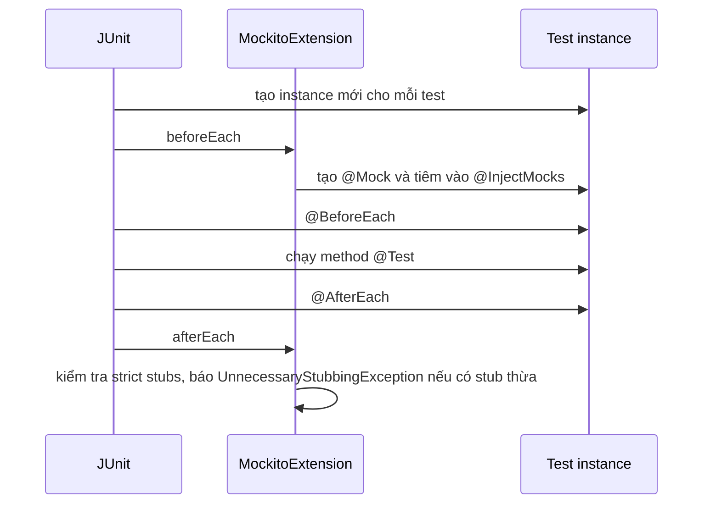
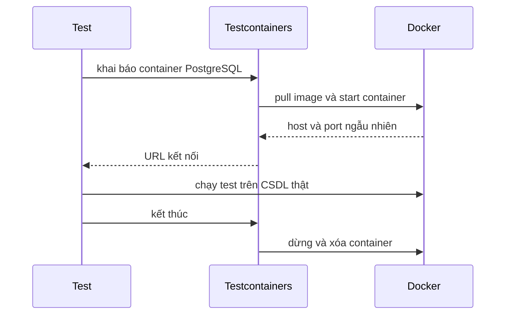

# Kiểm thử trong Java: JUnit 5, Mockito, AssertJ, Testcontainers

Bạn vừa sửa một dòng code và không chắc mình có làm hỏng chỗ khác hay không. Cách duy nhất để yên tâm là chạy lại toàn bộ chức năng bằng tay, việc vừa chậm vừa dễ sót. Kiểm thử tự động giải quyết đúng vấn đề này: bạn viết một lần các kịch bản kiểm tra, máy chạy lại chúng trong vài giây mỗi khi code đổi. Không có test thì mỗi lần refactor hay sửa lỗi đều phải cầu may. Có một lợi ích phụ: code khó viết test thường là code thiết kế chưa tốt (các class dính chặt vào nhau, tự tạo phụ thuộc bên trong), nên việc viết test giúp lộ ra vấn đề thiết kế sớm.

Bài này giới thiệu bốn công cụ, mỗi công cụ lo một việc:

- **JUnit 5** là bộ khung chạy test: tìm các method `@Test`, chạy chúng, báo kết quả.
- **Mockito** tạo object giả (mock) thay cho các dependency như repository hay dịch vụ gửi mail, để bạn test một class mà không cần cả hệ thống.
- **AssertJ** giúp viết câu kiểm tra (assert) dễ đọc và có thông báo lỗi rõ.
- **Testcontainers** chạy database hay message queue thật trong container Docker khi bạn cần test với hạ tầng thật.

**Cốt lõi:** Test tự động tồn tại để bạn sửa code mà không phải cầu may. Muốn test nhanh và đáng tin, mỗi test phải chạy cô lập, và những thứ chậm hoặc không tất định phải được thay bằng bản giả.

- Vì mỗi test dùng một instance mới và trạng thái sạch nên kết quả không phụ thuộc thứ tự chạy.
- Vì database, mạng và đồng hồ chậm hoặc không tất định nên chỉ mock ranh giới ngoài, còn bên trong chạy thật.
- Vì dependency được tiêm qua constructor nên thay bằng bản giả được, và code không tiêm được là code khó test.



Mô hình tư duy: class chỉ nhận dependency từ ngoài vào, nên test có thể đưa bản giả vào mà không sửa class.

**Tóm tắt:**

- Kiểm thử tự động cho phép sửa code mà không phải cầu may; theo tháp kiểm thử thì nhiều unit test nhanh và cô lập, vừa phải integration test, ít E2E.
- JUnit 5 gồm Platform, Jupiter và Vintage; mỗi method test chạy trên một instance class test mới, nên các test không chia sẻ trạng thái và phải độc lập về thứ tự.
- `@BeforeEach`/`@AfterEach` chạy quanh mỗi test, còn `@BeforeAll`/`@AfterAll` chạy một lần và phải `static` (trừ khi `@TestInstance(PER_CLASS)`); theo mẫu Arrange-Act-Assert.
- Mockito: mock trả mặc định `null`/`0`/rỗng, stub bằng `when(...).thenReturn(...)`, kiểm tra bằng `verify`; đã dùng matcher cho một tham số thì mọi tham số đều phải là matcher.
- Với spy phải dùng `doReturn(x).when(spy).m()`; chỉ mock ranh giới ngoài (CSDL, mạng, đồng hồ), mock quá nhiều làm test dính chặt vào cài đặt.
- Code dễ test là code nhận dependency qua constructor (kể cả `Clock`), không tự tạo bên trong.
- Testcontainers chạy CSDL thật trong Docker để tránh khác biệt của H2 so với production; độ phủ chỉ là chỉ báo, test flaky phải sửa gốc chứ đừng chạy lại cho qua.

## Khi nào dùng, khi nào không

Viết test mỗi khi thêm tính năng hoặc sửa lỗi, và chạy chúng trong CI trước khi merge. Chọn loại test theo tháp kiểm thử bên dưới: nhiều unit test chạy nhanh, vừa phải integration test, ít E2E. Mock chỉ nên dùng cho dependency ở ranh giới ngoài (CSDL, mạng, đồng hồ). Nếu mock quá nhiều, test sẽ chỉ kiểm tra chính các mock và vỡ mỗi lần refactor mà không bắt được lỗi thật. Khi cần xác nhận câu SQL hay cấu hình Kafka chạy đúng, đừng mock mà hãy dùng Testcontainers.

## Các khái niệm cần biết

- **Unit test**: test một đơn vị nhỏ (một class, một method) trong cô lập, không chạm mạng hay CSDL, chạy trong mili giây.
- **Integration test**: test nhiều thành phần ghép lại, ví dụ service cùng repository và database thật.
- **E2E (end-to-end)**: test toàn hệ thống từ UI đến CSDL như người dùng thật; chậm và dễ hỏng vì phụ thuộc nhiều thứ.
- **Test double**: tên chung cho mọi object thay thế cái thật trong test (mock, stub, spy, fake). Dùng khi phụ thuộc thật chậm, khó dựng hoặc không ổn định.
- **Arrange-Act-Assert**: chia test thành ba bước: chuẩn bị dữ liệu và mock, gọi hành vi cần test, kiểm tra kết quả. Giúp test đọc như một câu chuyện.
- **Flaky test**: test lúc xanh lúc đỏ dù code không đổi, thường do phụ thuộc thời gian hoặc thứ tự chạy.
- **TDD (Test-Driven Development)**: viết test thất bại trước, rồi viết code tối thiểu cho test qua, rồi refactor.

Lifecycle một lần chạy test với JUnit 5 và Mockito như sau.



Đọc sơ đồ: JUnit tạo một instance class test mới cho từng method test (nên các test không chia sẻ trạng thái), extension của Mockito dựng mock trước khi test chạy và kiểm tra stub thừa sau khi test xong.

## Tháp kiểm thử

| Tầng | Số lượng | Đặc điểm |
|---|---|---|
| E2E / UI | Ít nhất | Chậm, mong manh |
| Integration | Vừa phải | Ghép nhiều thành phần, CSDL thật |
| Unit | Nhiều nhất | Nhanh, cô lập |

**Nền tảng:** Test tự động tồn tại để sửa code mà không phải cầu may. Tháp kiểm thử: nhiều unit test nhanh và cô lập, vừa phải integration test, ít E2E. Code dễ test là code nhận phụ thuộc qua constructor (đồng hồ, repository), không tự tạo bên trong.

## JUnit 5

Đoạn dưới cho thấy ba kiểu test hay gặp: test đơn, test theo bảng dữ liệu (`@ParameterizedTest`) và test mong đợi exception.

```java
class PriceServiceTest {
    @Test
    @DisplayName("giảm giá 10% cho hạng VIP")
    void vipGetsDiscount() {
        var price = new PriceService().calc(Customer.vip(), 100);
        assertEquals(90, price);
    }

    @ParameterizedTest
    @CsvSource({"0,0", "100,90", "200,180"})
    void table(int in, int out) { assertEquals(out, new PriceService().vip(in)); }

    @Test void throwsOnNegative() {
        assertThrows(IllegalArgumentException.class, () -> new PriceService().vip(-1));
    }
}
```

- Lifecycle: `@BeforeEach/@AfterEach` chạy quanh mỗi test (dùng để dựng và dọn dữ liệu), `@BeforeAll/@AfterAll` chạy một lần cho cả class (method phải `static`, dùng cho việc tốn kém như khởi động container).
- `@Nested` nhóm các test theo ngữ cảnh; `@Tag` để lọc khi chạy (ví dụ chỉ chạy nhóm "slow"); `@Disabled` tạm tắt test; `@Timeout` làm test fail nếu chạy quá lâu.
- JUnit 5 = Platform (nền chạy test, IDE và Maven/Gradle làm việc với nó) + Jupiter (API và engine viết test mới) + Vintage (chạy lại test JUnit 3/4 cũ). TestNG là lựa chọn khác, ít gặp hơn cho dự án mới.
- Mỗi test phải **độc lập**, không phụ thuộc thứ tự chạy, tên mô tả hành vi, theo mẫu **Arrange-Act-Assert**. Nếu test B chỉ qua khi test A chạy trước, bạn sẽ gặp lỗi chập chờn khi thứ tự đổi.

**Suy luận:** JUnit tạo một instance class test mới cho mỗi method test vì mục tiêu là cô lập: nếu các test dùng chung một object, field mà test này sửa sẽ rò sang test kia, và kết quả phụ thuộc thứ tự chạy mà JUnit không bảo đảm. Do đó mỗi test bắt đầu từ trạng thái sạch do `@BeforeEach` dựng, và `@BeforeAll` phải `static` vì nó chạy trước khi có instance nào, trừ khi bạn chủ động đổi sang `@TestInstance(PER_CLASS)`. Hệ quả là test B không được phụ thuộc test A chạy trước, nếu không sẽ có lỗi chập chờn (flaky) khi thứ tự đổi hoặc chạy parallel. Điểm dễ nhầm là lưu kết quả vào field `static` hay dữ liệu dùng chung giữa các test, hoặc dựa vào thời gian thật. Hãy dọn dữ liệu ở `@AfterEach`, tiêm `Clock`, và sửa gốc khi gặp test flaky thay vì chạy lại cho qua.

**Phải thuộc:** JUnit 5 gồm Platform, Jupiter, Vintage. `@BeforeEach`/`@AfterEach` chạy quanh mỗi test; `@BeforeAll`/`@AfterAll` chạy một lần và phải `static` (trừ khi dùng `@TestInstance(PER_CLASS)`). JUnit tạo instance class test mới cho mỗi method test; mẫu Arrange-Act-Assert.

## Mockito

Vấn đề đặt ra: `OrderService` cần `OrderRepo` và `Mailer`. Nếu dùng bản thật, test phải có database và SMTP. Mockito cho phép tạo bản giả của hai thứ đó, bạn nói trước "khi gọi `save` thì trả về cái này" (stub), chạy code, rồi hỏi "`send` có được gọi không" (verify). Dùng khi phụ thuộc chậm, khó dựng hoặc có tác dụng phụ ra ngoài; không dùng cho những class thuần logic nhỏ mà bạn tạo bản thật được dễ dàng.


| Khái niệm | Ý nghĩa |
|---|---|
| **Mock** | Object giả, mặc định trả `null/0`, ghi nhận lời gọi |
| **Stub** | `when(repo.find(1)).thenReturn(user)`: cấu hình trả về |
| **Verify** | `verify(mailer).send(any())`: kiểm tra có gọi |
| **Spy** | Bọc object thật, ghi đè một phần |
| **ArgumentCaptor** | Bắt tham số được truyền để kiểm tra |

**Phải thuộc:** Mockito: mock trả mặc định `null`/`0`/rỗng; stub bằng `when(...).thenReturn(...)`, kiểm tra bằng `verify`. Đã dùng matcher cho một tham số thì mọi tham số đều phải là matcher. Với spy dùng `doReturn(x).when(spy).m()`. Chỉ mock ranh giới ngoài (CSDL, mạng, đồng hồ).

```java
@ExtendWith(MockitoExtension.class)
class OrderServiceTest {
    @Mock OrderRepo repo;
    @InjectMocks OrderService service;

    @Test void saves() {
        when(repo.save(any())).thenAnswer(i -> i.getArgument(0));
        service.create(cmd);
        verify(repo).save(argThat(o -> o.total() == 100));
    }
}
```

Trong đoạn trên, `@Mock` tạo mock, `@InjectMocks` tạo `OrderService` thật và nhét các mock vào constructor, `@ExtendWith(MockitoExtension.class)` kích hoạt việc đó. `thenAnswer` cho phép tính kết quả từ chính tham số truyền vào. `argThat` kiểm tra tham số bằng một điều kiện tự viết.

Mock chỉ nên thay **ranh giới ngoài** (CSDL, mạng, đồng hồ). Mock quá nhiều làm test dính chặt vào cài đặt và vỡ khi refactor. Mockito dùng proxy/ByteBuddy bên dưới (xem [Proxy động](/go?p=08-Java%2FJava-Core%2Fhard%2Flt-21-dynamic-proxy-methodhandle.md)).

### Ví dụ đầy đủ: service có phụ thuộc và đồng hồ

```java
record Order(Long id, String sku, int qty, Instant createdAt) {}
interface OrderRepo { Order save(Order o); }
interface Mailer { void send(long orderId); }

class OrderService {
    private final OrderRepo repo; private final Mailer mailer; private final Clock clock;
    OrderService(OrderRepo repo, Mailer mailer, Clock clock) { this.repo = repo; this.mailer = mailer; this.clock = clock; }

    Order create(String sku, int qty) {
        if (qty <= 0) throw new IllegalArgumentException("qty phải > 0");
        Order saved = repo.save(new Order(null, sku, qty, clock.instant()));
        mailer.send(saved.id());
        return saved;
    }
}
```

```java
@ExtendWith(MockitoExtension.class)
class OrderServiceTest {
    @Mock OrderRepo repo;
    @Mock Mailer mailer;
    @Captor ArgumentCaptor<Order> captor;
    Clock clock = Clock.fixed(Instant.parse("2025-01-01T00:00:00Z"), ZoneOffset.UTC);

    @Test
    void createSavesWithClockTimeAndSendsMail() {
        // Arrange
        when(repo.save(any())).thenAnswer(i -> {
            Order o = i.getArgument(0);
            // giả lập DB gán id
            return new Order(7L, o.sku(), o.qty(), o.createdAt());
        });
        var service = new OrderService(repo, mailer, clock);

        // Act
        Order created = service.create("SKU-1", 2);

        // Assert
        verify(repo).save(captor.capture());
        assertThat(captor.getValue().createdAt()).isEqualTo(Instant.parse("2025-01-01T00:00:00Z"));
        assertThat(created.id()).isEqualTo(7L);
        verify(mailer).send(7L);
    }

    @Test
    void createRejectsNonPositiveQty() {
        var service = new OrderService(repo, mailer, clock);
        assertThatThrownBy(() -> service.create("SKU-1", 0)).isInstanceOf(IllegalArgumentException.class);
        // lỗi sớm thì không được chạm hạ tầng
        verifyNoInteractions(repo, mailer);
    }
}
```

Test đồng hồ và test lỗi đều **không cần Spring** và chạy trong mili giây vì phụ thuộc được tiêm qua constructor.

**Suy luận:** Mock chỉ nên thay ranh giới ngoài vì đó là nơi test cần cô lập để chạy nhanh và ổn định: CSDL, mạng và đồng hồ đều chậm, khó dựng hoặc không tất định. Còn bên trong, các class cộng tác chạy thật rất nhanh và đã là một phần hành vi bạn muốn kiểm tra. Khi mock cả class nội bộ, test mô tả "gọi method nào theo thứ tự nào" thay vì "kết quả là gì", nên nó dính chặt vào cách cài đặt và vỡ ngay khi refactor dù hành vi không đổi. Từ đó suy ra ưu tiên assert kết quả hoặc trạng thái, và chỉ `verify` các tác dụng phụ ra ngoài như gửi mail. Điểm dễ nhầm là tưởng test xanh nghĩa là đúng, trong khi mock trả mặc định `null` hay `0` có thể làm test xanh oan, và H2 thay CSDL thật có thể xanh trong khi production vẫn lỗi do khác cú pháp. Hãy tiêm dependency qua constructor để thay được bằng bản giả khi cần, và dùng Testcontainers khi cần bằng chứng với hạ tầng thật.

Bẫy hay hỏi về Mockito:

| Bẫy | Hậu quả / cách xử |
|---|---|
| Stub mà test không dùng (`MockitoExtension` mặc định strict) | `UnnecessaryStubbingException`: xóa stub thừa, đừng tắt strict |
| Trộn giá trị thô với matcher: `when(repo.find(1L, any()))` | `InvalidUseOfMatchersException`; đã dùng matcher thì **mọi** tham số đều là matcher: `eq(1L), any()` |
| `when(spy.method())` trên spy | Gọi **method thật** ngay lúc stub; dùng `doReturn(x).when(spy).method()` |
| Mock trả mặc định | `null` cho object, `0`/`false`, collection rỗng, `Optional.empty()`; hay làm test "xanh" oan |
| `verify(x).foo()` thiếu `times` | Mặc định `times(1)`: gọi 2 lần thì fail |
| Mock class `final`, hàm `static` | Cần mock maker inline (mặc định từ Mockito 5; `mockStatic` dùng trong khối try-with-resources) |
| Kiểm tra gọi hàm thay vì kết quả | Test dính chặt cài đặt, vỡ khi refactor; ưu tiên assert kết quả/trạng thái, chỉ `verify` tác dụng phụ ra ngoài |

## AssertJ và Hamcrest

```java
assertThat(users).extracting(User::name).containsExactly("An", "Binh");
assertThat(result).isNotNull().hasSize(2);
assertThatThrownBy(() -> svc.run()).isInstanceOf(IllegalStateException.class).hasMessageContaining("rỗng");
```

AssertJ dùng chuỗi gọi trôi chảy (fluent): IDE gợi ý method theo data type, và thông báo lỗi nêu rõ giá trị mong đợi so với giá trị thực, rõ hơn `assertEquals`. Hamcrest là thư viện matcher cùng mục đích, hay gặp trong code cũ; dự án mới thường chọn AssertJ.

## Integration test và Testcontainers

Unit test với mock không chứng minh được câu SQL của bạn đúng. Dùng H2 (CSDL trong memory) thay thế thì lại khác production về cú pháp và hành vi, nên test xanh nhưng lên production vẫn lỗi. Testcontainers giải quyết bằng cách khởi động đúng loại CSDL thật trong Docker, dùng cho test rồi xóa đi. Đổi lại test chậm hơn và cần Docker trên máy chạy CI, nên chỉ dùng cho những test thực sự cần hạ tầng thật.



- **Testcontainers** khởi động PostgreSQL/Kafka/Redis thật trong Docker cho test: tránh khác biệt của H2 so với CSDL production.
- Spring: `@SpringBootTest`, các lát cắt `@DataJpaTest`, `@WebMvcTest` (xem [Testing trong Spring](/go?p=01-Spring-Boot%2Feasy%2Flt-12-testing-co-ban.md)).
- **WireMock/MockServer** giả lập dịch vụ HTTP; **Cucumber** cho kiểm thử hành vi (BDD); **JMeter/Gatling/k6** cho tải; **ArchUnit** kiểm tra luật kiến trúc.

## Chất lượng và thói quen

- Độ phủ (JaCoCo đo tỉ lệ dòng và nhánh được test chạy qua) là chỉ báo, không phải mục tiêu: 100% độ phủ vẫn có thể không có assert nào. Hãy đo cả nhánh quan trọng.
- Kiểm thử đột biến (PIT) cố ý sửa code (đổi `>` thành `>=`...) rồi xem test có bắt được không, từ đó đánh giá chất lượng bộ test.
- Test không ổn định (flaky): do thời gian, thứ tự, multithreading, dữ liệu chung; sửa gốc, đừng "chạy lại cho qua".
- Tiêm đồng hồ (`Clock`) thay vì gọi `Instant.now()` cứng để test thời gian.
- TDD: viết test thất bại trước → code tối thiểu → refactor.

## Điều cần nhớ

- Unit test nhanh và cô lập; integration test dùng hạ tầng thật qua container.
- Mock ranh giới, không mock mọi thứ.
- Test là tài liệu sống mô tả hành vi.

## Phỏng vấn khó: chuỗi hỏi xoáy

Người phỏng vấn senior thường mở bằng câu dễ rồi xoáy xuống cơ chế, đánh đổi và sự cố thật; câu trả lời tốt luôn đi từ cốt lõi xuống.

### Chuỗi 1: Test flaky và vòng đời JUnit

1. **Câu mở:** Test của bạn lúc xanh lúc đỏ. Nguyên nhân thường là gì?
2. **Xoáy 1:** JUnit 5 tạo instance class test như thế nào? Điều đó giúp gì cho độc lập giữa các test?
3. **Xoáy 2:** Vì sao `@BeforeAll` phải `static`? Đổi điều đó thế nào, và có rủi ro gì?

**Đáp án ngắn:** Test flaky thường do phụ thuộc thời gian, thứ tự chạy, multithreading hoặc dữ liệu dùng chung. JUnit 5 tạo một instance class test mới cho mỗi method test, nên field của test này không rò sang test kia; mỗi test bắt đầu từ trạng thái sạch do `@BeforeEach` dựng. Đó là cách bảo đảm test không phụ thuộc thứ tự chạy, thứ mà JUnit không hứa. `@BeforeAll` chạy một lần trước khi có instance nào, nên phải `static`. Nếu muốn non-static thì đổi sang `@TestInstance(PER_CLASS)`, nhưng khi đó cả class dùng chung một instance và quay lại rủi ro chia sẻ trạng thái, nên chỉ dùng khi thật cần, như khởi động container tốn kém. Khi gặp test flaky tôi sửa gốc: dọn dữ liệu ở `@AfterEach`, tiêm `Clock` thay vì gọi `Instant.now()`, bỏ field `static` dùng chung. Tôi không chạy lại cho qua vì như vậy giấu lỗi thật.

**Sai lầm hay gặp:**
- Nói "JUnit chạy test theo thứ tự khai báo" rồi viết test B dựa vào test A.
- Lưu kết quả vào field `static` chia sẻ giữa các test.
- Xử lý flaky bằng retry mà không tìm gốc.

### Chuỗi 2: Mock đến đâu là đủ

1. **Câu mở:** Khi nào dùng Mockito?
2. **Xoáy 1:** Test xanh nhưng production vẫn lỗi. Mock góp phần gây ra thế nào?
3. **Xoáy 2:** Với spy, vì sao `when(spy.method())` có thể gây lỗi? Và `UnnecessaryStubbingException` nói điều gì?

**Đáp án ngắn:** Tôi dùng Mockito cho dependency ở ranh giới ngoài như CSDL, mạng, đồng hồ, vì chúng chậm, khó dựng hoặc không tất định. Bên trong, các class cộng tác chạy thật rất nhanh và là một phần hành vi cần kiểm tra. Mock cả class nội bộ làm test mô tả "gọi method nào" thay vì "kết quả là gì", nên vỡ khi refactor dù hành vi không đổi. Test xanh oan thường do mock trả mặc định `null`, `0` hoặc collection rỗng, hoặc do H2 thay CSDL thật khác cú pháp; khi cần bằng chứng với hạ tầng thật tôi dùng Testcontainers. Với spy, `when(spy.method())` gọi method thật ngay lúc stub, nên dùng `doReturn(x).when(spy).method()`. `UnnecessaryStubbingException` do `MockitoExtension` mặc định strict báo rằng có stub thừa; cách xử lý là xóa stub, không tắt strict. Ưu tiên assert kết quả hoặc trạng thái, chỉ `verify` tác dụng phụ ra ngoài như gửi mail.

**Sai lầm hay gặp:**
- Mock mọi thứ rồi test chỉ kiểm tra chính các mock.
- Trộn giá trị thô với matcher: đã dùng matcher thì mọi tham số đều phải là matcher.
- Tắt strict stubs để cho test qua.

