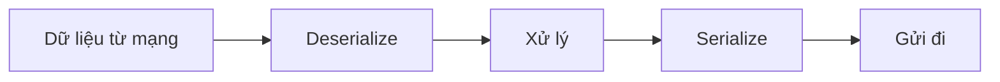
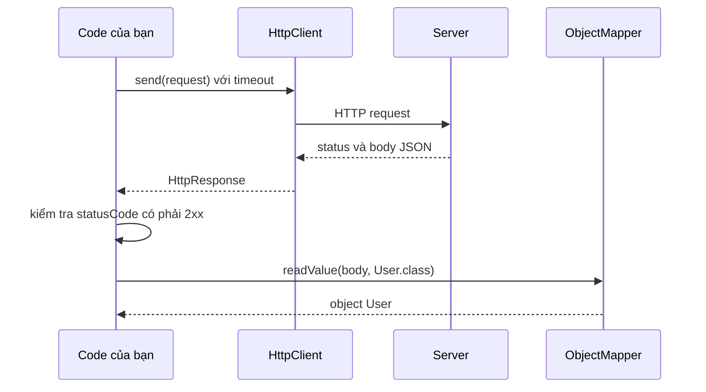
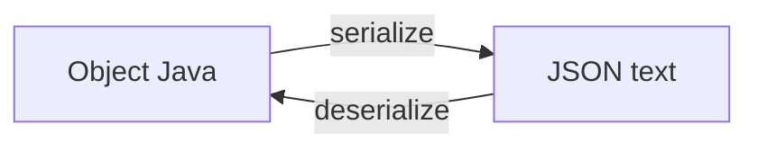

# JSON, HTTP client, Socket và thư viện tiện ích

Hầu hết backend làm đúng một việc lặp đi lặp lại: nhận dữ liệu JSON qua HTTP, xử lý, rồi gửi JSON qua HTTP cho nơi khác. JDK chỉ cung cấp phần lõi, còn những việc hằng ngày như chuyển object thành JSON, sinh getter/setter, map entity sang DTO nằm ở các thư viện bên ngoài. Bài này gom những thứ đó: JSON (Jackson, Gson), HTTP client `java.net.http`, Socket, và các tiện ích như Lombok, MapStruct, Guava, Apache Commons.

## Vấn đề nó giải quyết

Nếu không biết công cụ nào có sẵn, bạn dễ tự viết lại thứ đã có: tự parse JSON bằng chuỗi, tự viết getter/setter, tự copy từng trường giữa hai class. Vừa mất công vừa dễ lỗi, và đặc biệt parse JSON thủ công thường vướng các lỗi về escape ký tự và bảo mật.

## Khi nào dùng, khi nào không

Dùng khi gọi hoặc nhận API, map giữa entity và DTO, hoặc cắt bớt code lặp. Trước khi tự viết một hàm tiện ích, hãy kiểm tra JDK hay thư viện đang dùng đã có chưa. Ngược lại, đừng kéo thêm một thư viện chỉ để dùng một hàm nhỏ mà JDK hiện đại đã làm được (ví dụ `List.of` thay cho Guava `ImmutableList` trong trường hợp đơn giản): mỗi thư viện là một phụ thuộc cần cập nhật và có thể có lỗ hổng.

Chọn thư viện chuẩn của hệ sinh thái đang dùng (Spring thì mặc định Jackson). Nên biết nó chạy thế nào bên dưới: Jackson dùng reflection lúc chạy, còn Lombok và MapStruct xử lý annotation lúc biên dịch. Biết vậy thì khi lỗi bạn mới biết nhìn vào đâu: lỗi của Jackson xuất hiện lúc chạy, còn lỗi của Lombok hay MapStruct báo ngay lúc build.

**Cốt lõi:** Backend là một chu trình lặp: nhận dữ liệu qua mạng, đổi thành object, xử lý, đổi ngược lại rồi gửi đi. Phần lớn lỗi nằm ở ranh giới của chu trình này, nơi dữ liệu và mạng không nằm trong tầm kiểm soát của bạn.

- Vì generics bị xóa lúc chạy nên Jackson không biết kiểu phần tử, và bạn phải cung cấp `TypeReference`.
- Vì 404 hay 500 vẫn là phản hồi hợp lệ về giao thức nên `HttpClient` không throw, và bạn phải tự kiểm tra `statusCode()`.
- Vì Jackson dùng reflection lúc chạy còn Lombok và MapStruct chạy lúc biên dịch nên lỗi xuất hiện ở hai thời điểm khác nhau.



Mô hình tư duy: object Java nằm ở giữa, hai đầu là văn bản trên mạng, và mọi chuyển đổi hay lỗi mạng đều xảy ra ở hai đầu đó.

**Tóm tắt:**

- Backend lặp một chu trình: nhận dữ liệu qua mạng, deserialize (JSON sang object), xử lý, serialize ngược lại rồi gửi đi; tách DTO khỏi entity để đổi cấu trúc CSDL không làm vỡ contract API.
- Jackson là chuẩn thực tế: tạo `ObjectMapper` một lần rồi dùng lại (thread-safe sau khi cấu hình); generics bị xóa nên đọc `List<User>` phải truyền `TypeReference`.
- Cần `JavaTimeModule` cho `java.time` (Spring Boot đã đăng ký sẵn); không tin JSON bên ngoài.
- `HttpClient` (Java 11+) không throw lỗi khi server trả 404 hoặc 500, nên phải tự kiểm tra `statusCode()`.
- Luôn đặt cả `connectTimeout` (trên client) và `timeout` (trên request); chỉ retry yêu cầu idempotent, có giới hạn lần và thời gian chờ tăng dần.
- Lombok và MapStruct là annotation processor chạy lúc biên dịch, nên không tốn chi phí lúc chạy; Jackson và Gson dựa reflection lúc chạy.
- Dùng Socket trực tiếp chỉ khi cần tự định nghĩa giao thức; thêm thư viện là thêm dependency và rủi ro bảo mật.

## Các khái niệm cần biết

- **Serialize / deserialize**: serialize là biến object Java thành văn bản (ở đây là JSON) để gửi đi hoặc lưu; deserialize là chiều ngược lại.
- **DTO (Data Transfer Object)**: class chỉ để chở dữ liệu qua ranh giới (API, giữa các tầng), tách biệt với entity lưu trong CSDL. Nhờ vậy đổi cấu trúc CSDL không làm vỡ contract API.
- **Reflection**: khả năng chương trình xem và gọi class, field, method lúc đang chạy. Jackson dùng nó để đọc getter và gán field, đổi lại chậm hơn mã sinh sẵn.
- **Annotation processor**: đoạn code chạy trong lúc `javac` biên dịch, đọc annotation và sinh thêm hoặc sửa mã. Lombok và MapStruct hoạt động theo cách này, nên không tốn chi phí lúc chạy.
- **Idempotent**: gọi một yêu cầu nhiều lần cho kết quả giống gọi một lần (GET, PUT, DELETE). Điều kiện để retry an toàn.
- **Circuit breaker**: khi dịch vụ gọi tới lỗi liên tục thì tạm thời ngừng gọi và trả lỗi ngay, tránh làm treo cả hệ thống của bạn (Resilience4j cung cấp).
- **TCP / UDP**: hai giao thức vận chuyển; TCP đảm bảo tin cậy và đúng thứ tự, UDP nhanh nhưng không đảm bảo.

Flow một cuộc gọi API điển hình khi ghép các mảnh trên lại như sau.



Đọc sơ đồ: `HttpClient` không tự throw lỗi khi server trả 404 hay 500, nên bước kiểm tra mã trạng thái là việc của bạn. Chỉ khi mã hợp lệ mới deserialize body.

**Nền tảng:** Backend lặp đi lặp lại một chu trình: nhận dữ liệu qua mạng, deserialize (JSON sang object), xử lý, serialize ngược lại và gửi đi. Tách DTO khỏi entity để đổi cấu trúc CSDL không làm vỡ contract API.

## JSON



| Thư viện | Ghi chú |
|---|---|
| **Jackson** | Chuẩn thực tế (Spring dùng), cực mạnh, cấu hình qua `ObjectMapper` và chú thích |
| **Gson** | Gọn, dễ dùng, ít tính năng hơn |
| **JSON-B (Jakarta)** | Đặc tả chuẩn Jakarta EE |

```java
var mapper = new ObjectMapper().registerModule(new JavaTimeModule());
String json = mapper.writeValueAsString(user);
User u = mapper.readValue(json, User.class);
// xóa kiểu generics, cần TypeReference
List<User> list = mapper.readValue(json, new TypeReference<List<User>>() {});
```

`ObjectMapper` là class trung tâm của Jackson: nó biết cách đọc và ghi JSON. Tạo nó khá tốn nên hãy tạo một lần rồi dùng lại. Chú thích thường gặp: `@JsonProperty`, `@JsonIgnore`, `@JsonFormat`, `@JsonInclude`, `@JsonCreator`. Cấu hình hay chỉnh: bỏ qua trường lạ (`FAIL_ON_UNKNOWN_PROPERTIES`), định dạng ngày. **Không** deserialize JSON không tin cậy vào kiểu polymorphism tùy ý (`enableDefaultTyping`): lỗ hổng thực thi mã. `ObjectMapper` an toàn dùng chung giữa các thread sau khi cấu hình xong.

### Jackson: các hành vi mặc định hay gây bất ngờ

```java
// record: Jackson 2.12 trở lên
record User(long id, String name, LocalDate born) {}

var mapper = new ObjectMapper().registerModule(new JavaTimeModule())
        // ngày ra "2000-01-31" thay vì [2000,1,31]
        .disable(SerializationFeature.WRITE_DATES_AS_TIMESTAMPS);

User u = mapper.readValue("""
        {"id":1,"name":"An","born":"2000-01-31","extra":true}""", User.class);
// ném UnrecognizedPropertyException vì "extra": mặc định FAIL_ON_UNKNOWN_PROPERTIES = true
// Spring Boot tự tắt cờ này trong ObjectMapper nó cấu hình; ObjectMapper tự new thì KHÔNG

// phần tử là LinkedHashMap, không phải User
Object o = mapper.readValue("[{\"id\":1}]", List.class);
List<User> users = mapper.readValue(json, new TypeReference<List<User>>() {});   // đúng
```

| Hành vi | Nguyên nhân / cách xử lý |
|---|---|
| Thiếu `JavaTimeModule`: lỗi với `LocalDate`/`Instant` | Jackson lõi không biết kiểu `java.time`; Spring Boot đã đăng ký sẵn |
| `List<User>` ra `List<LinkedHashMap>` | Type erasure: truyền `TypeReference` (xem [Generics](/go?p=08-Java%2FJava-Core%2Fmedium%2Flt-07-generics.md)) |
| Trường không có getter không ra JSON | Jackson dựa getter hoặc field `public`; record thì dùng accessor |
| `null` vs thiếu trường | `@JsonInclude(NON_NULL)` bỏ `null` khi ghi; khi đọc không phân biệt "thiếu" và "null" với kiểu thường |
| Ghi `double`/`BigDecimal` | `BigDecimal` ra số thập phân đầy đủ; client JS có thể mất độ chính xác với số lớn, khi đó dùng chuỗi |

**Phải thuộc:** `ObjectMapper` của Jackson tạo một lần rồi dùng lại, thread-safe sau khi cấu hình. Generics bị xóa nên đọc `List<User>` phải truyền `TypeReference`, nếu không ra `List<LinkedHashMap>`. Cần `JavaTimeModule` cho `java.time` (Spring Boot đã đăng ký sẵn); `FAIL_ON_UNKNOWN_PROPERTIES` mặc định `true` với `ObjectMapper` tự `new`.

**Suy luận:** `List<User>` ra `List<LinkedHashMap>` vì type erasure xóa tham số kiểu khỏi bytecode, nên khi Jackson nhận `List.class` nó không biết phần tử là `User` và đành dựng cấu trúc JSON mặc định là `LinkedHashMap`. Lỗi không nổ ngay mà chỉ nổ khi bạn lấy phần tử ra và ép về `User`, tức là xa chỗ gây ra, nên rất khó đoán nguyên nhân. `TypeReference` giải quyết bằng chính mẹo super type token: một class con ẩn danh lưu lại kiểu cha khai báo trong metadata của class, và Jackson đọc lại được kiểu đầy đủ từ đó. Tương tự, Jackson lõi không biết `java.time`, nên thiếu `JavaTimeModule` thì `LocalDate` và `Instant` lỗi; Spring Boot đăng ký sẵn nên bạn chỉ gặp khi tự tạo `ObjectMapper`. Điểm dễ nhầm là tạo `ObjectMapper` mới ở mỗi lần dùng, vừa tốn kém vừa mất cấu hình đã chỉnh. Hãy dùng chung một `ObjectMapper` đã cấu hình và truyền `TypeReference` cho kiểu generic.

## HTTP client (Java 11+)

```java
var client = HttpClient.newBuilder().connectTimeout(Duration.ofSeconds(3)).build();
var req = HttpRequest.newBuilder(URI.create("https://api.example.com/users/1"))
        .timeout(Duration.ofSeconds(5)).header("Accept", "application/json").GET().build();
HttpResponse<String> res = client.send(req, BodyHandlers.ofString());        // đồng bộ
// bất đồng bộ
client.sendAsync(req, BodyHandlers.ofString()).thenApply(HttpResponse::body);
```

Đã chạy thử với server cục bộ (`com.sun.net.httpserver`) trên Java 11:

| Tình huống | Kết quả |
|---|---|
| Endpoint trả 200 | `statusCode()` = 200, `body()` là chuỗi JSON |
| Endpoint không tồn tại | **Không throw lỗi**, `statusCode()` = 404: tự kiểm tra mã trạng thái |
| Server trả chậm hơn `timeout` của request | `HttpTimeoutException` |
| `sendAsync(...).thenApply(HttpResponse::body)` | `CompletableFuture<String>`, ghép được như trong [java.util.concurrent](/go?p=08-Java%2FJava-Core%2Fmedium%2Flt-13-java-util-concurrent.md) |

```java
HttpResponse<String> res = client.send(req, BodyHandlers.ofString());
if (res.statusCode() / 100 != 2) throw new IllegalStateException("API lỗi " + res.statusCode());
User u = mapper.readValue(res.body(), User.class);
```

Hai timeout khác nhau: `connectTimeout` (trên client) giới hạn thiết lập kết nối, `timeout` (trên request) giới hạn chờ phản hồi. Chỉ đặt một trong hai là chưa đủ. Chỉ nên **retry** các yêu cầu idempotent (GET, PUT), và có giới hạn lần cùng thời gian chờ tăng dần.

**Phải thuộc:** `HttpClient` (Java 11+) không throw lỗi khi server trả 404 hoặc 500, phải tự kiểm tra `statusCode()`. Luôn đặt cả `connectTimeout` (trên client) và `timeout` (trên request); chỉ retry yêu cầu idempotent, có giới hạn lần và thời gian chờ tăng dần.

Nếu không đặt timeout, một server treo có thể giữ thread của bạn chờ vô hạn và kéo cả dịch vụ sập theo. `HttpClient` hỗ trợ HTTP/2 và asynchronous. Trong Spring dùng `RestClient`/`WebClient`. **Luôn đặt timeout** (kết nối và đọc); dùng lại một `HttpClient`. `HttpURLConnection` là API cũ.

**Suy luận:** `HttpClient` không throw lỗi khi gặp 404 hay 500 vì từ góc nhìn giao thức đó vẫn là một phản hồi hợp lệ: kết nối thành công, server trả lời có mã trạng thái. Exception chỉ dành cho lỗi truyền thông như timeout hay không kết nối được, nên kiểm tra mã trạng thái là việc của bạn, và quên bước này sẽ đem body lỗi đi deserialize như dữ liệu thật. Timeout phải đặt hai nơi vì chúng chặn hai giai đoạn khác nhau: `connectTimeout` giới hạn việc thiết lập kết nối, còn `timeout` của request giới hạn thời gian chờ phản hồi; thiếu một trong hai thì server treo có thể giữ thread của bạn vô hạn và kéo cả dịch vụ sập theo. Retry chỉ an toàn với yêu cầu idempotent như GET hay PUT vì gọi lại nhiều lần cho kết quả giống một lần, còn POST có thể tạo hai đơn hàng. Điểm dễ nhầm là retry không giới hạn, làm hệ thống đang yếu bị dội thêm tải, nên cần giới hạn lần và thời gian chờ tăng dần, thường kèm circuit breaker.

## Socket

| | TCP | UDP |
|---|---|---|
| Class | `Socket`/`ServerSocket` | `DatagramSocket` |
| Đặc tính | Tin cậy, có thứ tự, hướng kết nối | Không đảm bảo, nhanh, nhẹ |

Dùng Socket trực tiếp khi bạn cần tự định nghĩa giao thức (chat, giao thức nhị phân riêng); với web API thông thường hãy dùng HTTP client hoặc framework, đừng tự làm từ socket. Máy chủ blocking: mỗi kết nối một thread (nay dùng được virtual thread). Mô hình mở rộng: NIO `Selector`/`Channel` (một thread theo dõi nhiều kết nối, Netty xây trên đó). Bản chất mạng xem [TCP/IP](/go?p=03-Network-Security%2Feasy%2Flt-01-tcp-ip-dns.md).

## Thư viện tiện ích

| Công cụ | Làm gì | Cơ chế / lưu ý |
|---|---|---|
| **Lombok** | `@Getter @Builder @Slf4j`... bớt mã lặp | Annotation processor sửa AST (cây cú pháp của code) lúc biên dịch; tránh `@Data` trên entity JPA (equals/hashCode, lazy) |
| **MapStruct** | Ánh xạ DTO ↔ entity | Sinh mã thường lúc biên dịch, nhanh, kiểm tra được lúc build (hơn ModelMapper dùng reflection) |
| **Guava** | `ImmutableList`, `Multimap`, `Cache`, `Preconditions` | Nhiều tính năng đã vào JDK (`List.of`, `Optional`) |
| **Apache Commons** | `StringUtils`, `IOUtils`, `Lang3`, `Collections4` | Dùng chọn lọc; JDK hiện đại đã có nhiều thứ |
| **Resilience4j** | Retry, circuit breaker, rate limiter | Xem [Spring Cloud](/go?p=01-Spring-Boot%2Fhard%2Flt-08-microservices-spring-cloud.md) |
| **Caffeine** | Cache cục bộ hiệu năng cao | Chính sách loại bỏ W-TinyLFU (giữ lại mục hay được dùng, loại mục ít dùng) |
| **Jakarta Validation** | `@NotNull @Size` kiểm tra đầu vào | Hibernate Validator là cài đặt |

## Điều cần nhớ

- Annotation processor (Lombok, MapStruct) chạy **lúc biên dịch**; Jackson/Gson dựa **reflection** lúc chạy.
- Đặt timeout cho mọi cuộc gọi mạng; không tin JSON bên ngoài.
- Thêm thư viện là thêm dependency và rủi ro bảo mật: dùng khi thật sự có lợi.

## Phỏng vấn khó: chuỗi hỏi xoáy

Người phỏng vấn senior thường mở bằng câu dễ rồi xoáy xuống cơ chế, đánh đổi và sự cố thật; câu trả lời tốt luôn đi từ cốt lõi xuống.

### Chuỗi 1: Jackson và generics

1. **Câu mở:** Bạn đọc một mảng JSON thành `List<User>` bằng Jackson thế nào?
2. **Xoáy 1:** Nếu viết `readValue(json, List.class)` thì sao? Vì sao?
3. **Xoáy 2:** `TypeReference` giải quyết bằng cơ chế gì? Và `ObjectMapper` bạn tạo ở đâu?

**Đáp án ngắn:** Tôi truyền `new TypeReference<List<User>>() {}` cho `readValue`. Nếu dùng `List.class` thì phần tử ra là `LinkedHashMap` chứ không phải `User`. Lý do là type erasure xóa tham số kiểu khỏi bytecode, nên Jackson nhận `List.class` không biết phần tử là gì và đành dựng cấu trúc JSON mặc định. Lỗi không nổ ngay mà chỉ nổ khi lấy phần tử ra ép về `User`, xa chỗ gây lỗi nên khó đoán nguyên nhân. `TypeReference` dùng mẹo super type token: class con ẩn danh lưu kiểu cha đã khai báo trong metadata của class, và Jackson đọc lại được kiểu đầy đủ từ đó. `ObjectMapper` tạo khá tốn nên tôi tạo một lần, cấu hình xong rồi dùng chung giữa các thread. Với `ObjectMapper` tự `new`, cần đăng ký `JavaTimeModule` cho `java.time`, và `FAIL_ON_UNKNOWN_PROPERTIES` mặc định bật nên trường lạ làm ném lỗi; Spring Boot đã chỉnh sẵn hai điểm này.

**Sai lầm hay gặp:**
- Dùng `List.class` rồi gặp `ClassCastException` ở chỗ khác.
- Tạo `ObjectMapper` mới cho mỗi lần dùng, mất cấu hình đã chỉnh.
- Bật `enableDefaultTyping` với JSON không tin cậy, mở lỗ hổng thực thi mã.

### Chuỗi 2: HttpClient, timeout và retry

1. **Câu mở:** Bạn gọi một API bên ngoài bằng `java.net.http` thế nào?
2. **Xoáy 1:** Server trả 500 thì `send` có throw không? Bạn xử lý sao?
3. **Xoáy 2:** Có hai loại timeout, chúng khác nhau thế nào? Retry POST được không?

**Đáp án ngắn:** Tôi tạo một `HttpClient` dùng lại, gửi `HttpRequest` rồi đọc `HttpResponse`. `send` không throw khi gặp 404 hay 500, vì từ góc nhìn giao thức đó vẫn là phản hồi hợp lệ: kết nối thành công và server đã trả lời. Exception chỉ dành cho lỗi truyền thông như timeout hay không kết nối được. Nên tôi tự kiểm tra `statusCode()` trước, và chỉ deserialize body khi mã là 2xx, nếu không sẽ đem body lỗi đi parse như dữ liệu thật. Có hai timeout vì chúng chặn hai giai đoạn: `connectTimeout` trên client giới hạn thiết lập kết nối, `timeout` trên request giới hạn chờ phản hồi. Thiếu một trong hai thì server treo giữ thread của tôi vô hạn và kéo cả dịch vụ sập theo. Retry chỉ an toàn với yêu cầu idempotent như GET, PUT; POST có thể tạo hai đơn hàng. Retry phải giới hạn số lần, thời gian chờ tăng dần, thường kèm circuit breaker.

**Sai lầm hay gặp:**
- Tưởng 4xx hoặc 5xx sẽ tự throw exception.
- Chỉ đặt một trong hai loại timeout, hoặc không đặt.
- Retry vô hạn, dội thêm tải vào dịch vụ đang yếu.

