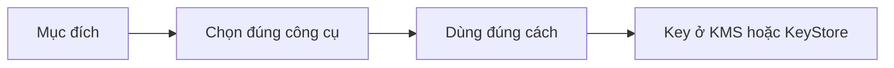
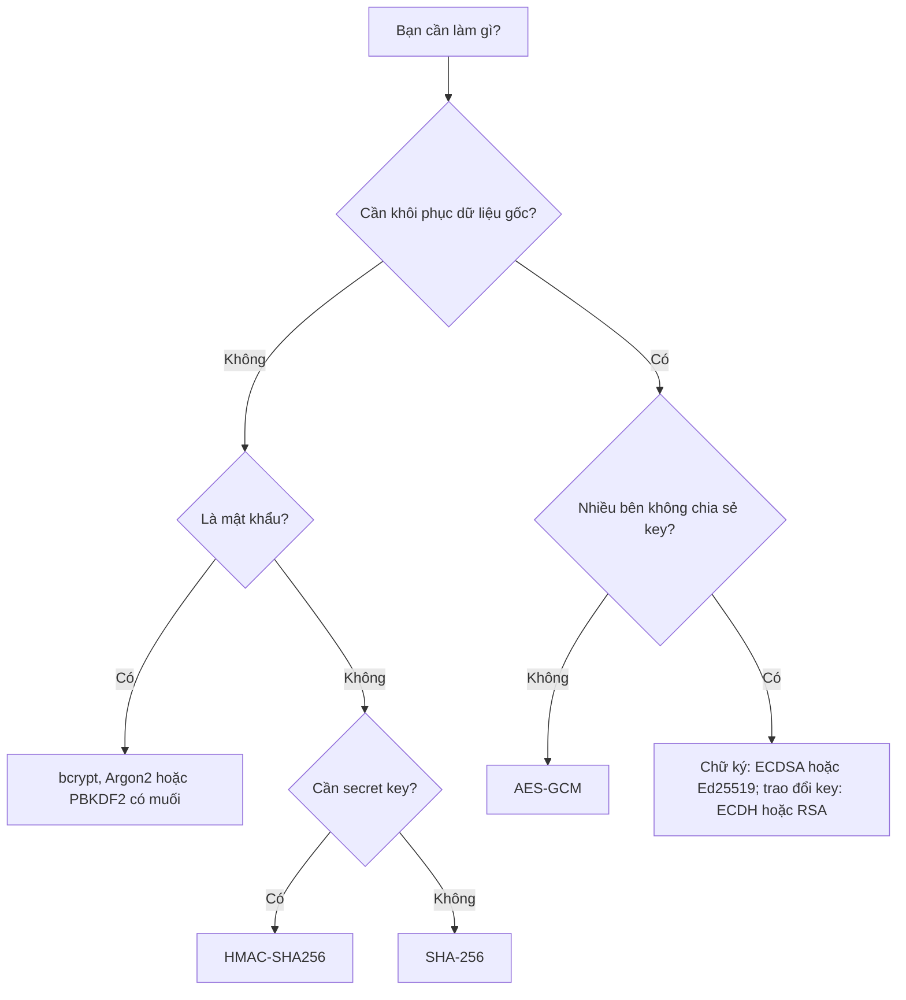
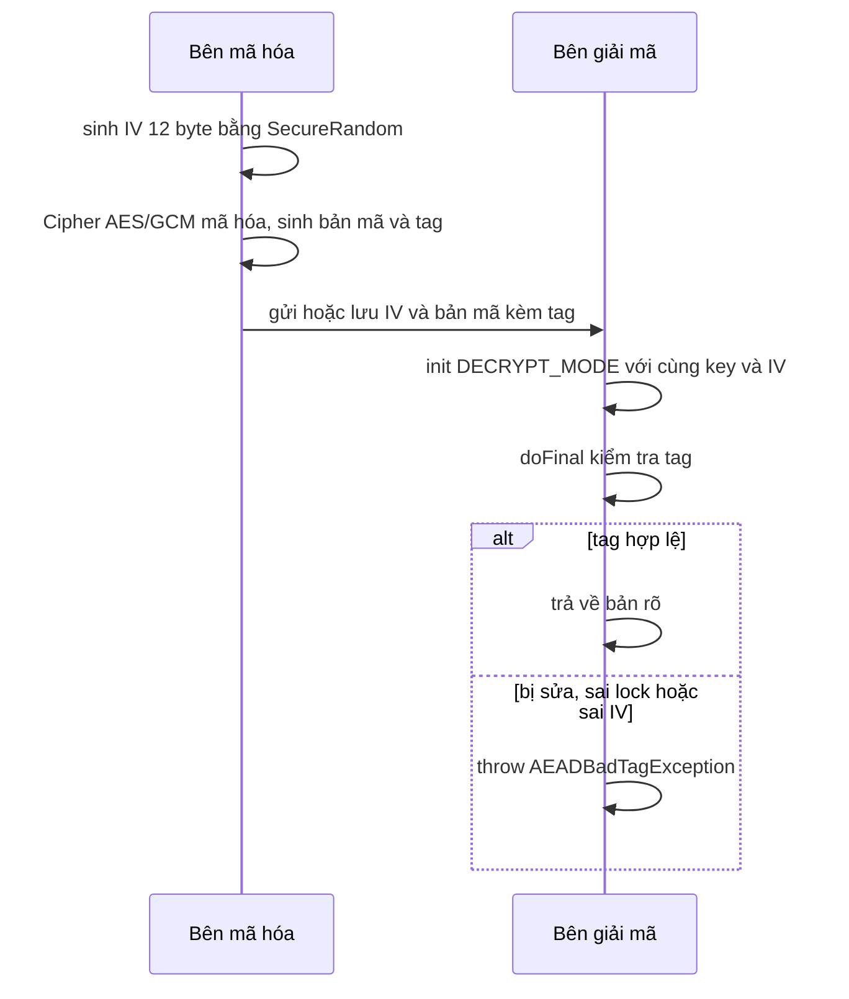

# Mật mã học trong Java (JCA/JCE)

Mật mã học trong Java nằm ở hai package có sẵn trong JDK: `java.security` (JCA, kiến trúc mật mã) và `javax.crypto` (JCE, phần mở rộng). Chúng cung cấp hash, symmetric và asymmetric encryption, chữ ký số, sinh số ngẫu nhiên và `KeyStore` để lưu key.

## Vì sao phải học kỹ phần này

Lưu mật khẩu, ký token, encrypt dữ liệu hay TLS đều dựa vào đây. Cái khó là các lỗi phổ biến như dùng chế độ ECB, dùng IV cố định hay hash bằng MD5 vẫn chạy bình thường, chương trình không báo lỗi gì, nên rất khó nhận ra. Nhưng chúng để lại lỗ hổng bảo mật nghiêm trọng: dữ liệu bị lộ mẫu, mật khẩu bị dò ra hàng loạt khi CSDL rò rỉ. Với mật mã, "chạy được" hoàn toàn không có nghĩa là "an toàn".

## Khi nào dùng, khi nào không

Dùng khi hash mật khẩu, encrypt trường nhạy cảm, kiểm tra dữ liệu có bị sửa không, ký và kiểm tra JWT. Nếu thư viện cấp cao đã làm sẵn (Spring Security `PasswordEncoder`, Tink) thì dùng nó, đừng ghép từng API cấp thấp, vì mỗi lần ghép là một cơ hội chọn sai tham số. Nguyên tắc cốt lõi: chọn thuật toán và chế độ hiện đại (ví dụ AES-GCM), sinh số ngẫu nhiên bằng `SecureRandom`, và tuyệt đối đừng tự nghĩ ra thuật toán hay giao thức.

**Cốt lõi:** Mật mã sai vẫn chạy bình thường mà không báo lỗi, nên "chạy được" không có nghĩa là an toàn. Mỗi mục đích (toàn vẹn, xác thực, giữ bí mật, chữ ký) có một công cụ riêng, và an toàn nằm ở chế độ và cách dùng chứ không chỉ ở tên thuật toán.

- Vì hash là một chiều còn encryption đảo ngược được bằng key nên hai thứ không thay nhau được.
- Vì GCM sinh keystream từ cặp key và IV nên IV phải mới cho mỗi lần encrypt, còn tái dùng là lộ dữ liệu và giả mạo được thẻ.
- Vì SHA-256 được thiết kế để nhanh nên mật khẩu phải dùng hash chậm có salt riêng từng người.



Mô hình tư duy: chọn công cụ theo mục đích trước, rồi mới lo tham số như IV và salt, và key phải nằm ngoài mã nguồn.

**Tóm tắt:**

- Bốn khối xây dựng khác nhau: hash (một chiều, kiểm tra toàn vẹn), HMAC (hash có secret key, xác thực thông điệp), symmetric encryption (một key, nhanh) và asymmetric encryption (cặp public key và private key, cho chữ ký và trao đổi key).
- Chọn đúng công cụ cho đúng mục đích quan trọng hơn chọn thuật toán nào; có thư viện cấp cao (Spring Security `PasswordEncoder`, Tink) thì dùng nó thay vì ghép API cấp thấp.
- Encrypt dữ liệu dùng `AES/GCM/NoPadding` với IV 12 byte sinh bằng `SecureRandom`, mới cho mỗi lần encrypt; tái dùng IV trong GCM là thảm họa, và `AES/ECB` lộ mẫu dữ liệu.
- Mật khẩu phải hash chậm và có salt riêng từng người (bcrypt, Argon2, PBKDF2), không dùng SHA-256 trần; MD5 và SHA-1 đã bị phá.
- Key, IV và token luôn dùng `SecureRandom`; so sánh secret bằng `MessageDigest.isEqual` để thời gian không rò thông tin.
- `Base64` chỉ là encoding, không bảo mật; encryption đảo ngược được bằng key còn hash thì một chiều.
- Quản lý key khó hơn thuật toán: giữ key trong KMS, HSM hoặc `KeyStore`, không viết cứng trong mã hay repo.

## Các khái niệm cần biết

- **Hash**: hàm một chiều biến dữ liệu bất kỳ thành chuỗi có độ dài cố định (SHA-256 luôn ra 32 byte). Dùng làm dấu vân tay để kiểm tra dữ liệu có bị đổi không. Không thể suy ngược ra dữ liệu gốc.
- **Symmetric encryption**: một key dùng cho cả mã hóa và giải mã (AES). Nhanh, dùng cho dữ liệu lớn; khó ở chỗ phải chia sẻ key an toàn.
- **Asymmetric encryption**: cặp public key và private key (RSA, EC). Dùng cho chữ ký và trao đổi key, chậm hơn nhiều so với đối xứng.
- **Chữ ký số**: người giữ secret key ký, ai có public key cũng kiểm tra được. Chứng minh thông điệp đến từ đúng người và không bị sửa.
- **HMAC**: hash có kèm secret key, chỉ ai biết key mới tạo hoặc kiểm tra được thẻ.
- **IV (initialization vector)**: giá trị khởi tạo ngẫu nhiên đi kèm mỗi lần encrypt để cùng một bản rõ không ra cùng một bản mã. Không cần giữ bí mật nhưng phải khác nhau mỗi lần.
- **GCM / AEAD**: chế độ encryption vừa che giấu dữ liệu vừa tạo thẻ xác thực (tag) để phát hiện bị sửa. Đây là lựa chọn mặc định hiện nay.
- **ECB**: chế độ encryption từng khối độc lập, hai khối rõ giống nhau cho hai khối mã giống nhau nên lộ mẫu. Đừng dùng.
- **Salt**: chuỗi ngẫu nhiên riêng cho từng mật khẩu trước khi hash, để hai người cùng mật khẩu có hash khác nhau và bảng tra cứu dựng sẵn (rainbow table) vô dụng.
- **KMS/HSM**: dịch vụ hoặc thiết bị phần cứng chuyên giữ key, mã nguồn không bao giờ thấy key gốc.

Khi nhận một yêu cầu, bạn có thể chọn công cụ theo flow sau.



## Chọn công cụ theo mục đích

| Mục đích | Công cụ | API Java |
|---|---|---|
| Toàn vẹn, dấu vân tay | SHA-256 | `MessageDigest` |
| Xác thực thông điệp | HMAC-SHA256 | `Mac` |
| Lưu mật khẩu | bcrypt, Argon2, PBKDF2 (hash chậm, có salt) | Spring Security hoặc thư viện |
| Encrypt dữ liệu | AES-GCM | `Cipher` |
| Chữ ký, trao đổi key | RSA, ECDSA, Ed25519 | `Signature`, `KeyPairGenerator` |

**Nền tảng:** Bốn khối xây dựng khác nhau: hash (một chiều, kiểm tra toàn vẹn), HMAC (hash có secret key, xác thực thông điệp), symmetric encryption (một key, nhanh, cho dữ liệu lớn) và asymmetric encryption (cặp public key/private key, cho chữ ký và trao đổi key). Chọn đúng công cụ cho đúng mục đích quan trọng hơn chọn thuật toán.

## Ví dụ cốt lõi

Ba đoạn dưới là ba việc hay gặp nhất: hash để kiểm tra toàn vẹn, mã hóa AES-GCM, và ký bằng secret key.

```java
// Băm toàn vẹn
byte[] h = MessageDigest.getInstance("SHA-256").digest(data);

// Mã hóa AES-GCM (xác thực kèm mã hóa), IV 12 byte ngẫu nhiên MỖI LẦN
byte[] iv = new byte[12]; new SecureRandom().nextBytes(iv);
Cipher c = Cipher.getInstance("AES/GCM/NoPadding");
c.init(Cipher.ENCRYPT_MODE, key, new GCMParameterSpec(128, iv));
byte[] ct = c.doFinal(plain);     // lưu kèm iv

// Chữ ký
Signature s = Signature.getInstance("SHA256withECDSA");
s.initSign(privateKey); s.update(msg); byte[] sig = s.sign();
```

Với GCM, flow mã hóa và giải mã diễn ra như sau: IV mới được sinh cho mỗi lần encrypt và lưu cùng bản mã, khi giải mã thẻ xác thực được kiểm tra trước khi trả dữ liệu.



**Suy luận:** GCM cần IV mới cho mỗi lần encrypt vì nó biến AES thành một dòng keystream: keystream sinh từ cặp (key, IV), rồi XOR với bản rõ. Nếu hai thông điệp dùng cùng (key, IV) thì chúng dùng cùng keystream, nên XOR hai bản mã cho ra XOR của hai bản rõ và kẻ tấn công suy ra được nội dung từ cấu trúc đã biết. Tệ hơn, thẻ xác thực của GCM cũng dựa trên cùng key, nên tái dùng IV còn lộ vật liệu đủ để giả mạo thẻ và qua mặt cơ chế phát hiện sửa dữ liệu. Vì vậy IV không cần bí mật nhưng phải duy nhất cho mỗi lần encrypt, nên sinh ngẫu nhiên bằng `SecureRandom` rồi lưu cùng bản mã. ECB sai ở lý do khác: mỗi khối mã hóa độc lập nên hai khối rõ giống nhau cho hai khối mã giống nhau, lộ mẫu dữ liệu như ảnh còn nhìn ra hình. Điểm dễ nhầm là nghĩ "đã encrypt rồi thì an toàn", trong khi chế độ và cách dùng IV mới quyết định an toàn. Hãy dùng AES-GCM với IV mới mỗi lần và `AEADBadTagException` là tín hiệu dữ liệu hoặc key sai, không cố phân biệt thêm.

### Chạy thử: thấy tận mắt từng tính chất

Đoạn sau chỉ dùng JDK (đã chạy xác nhận, kết quả in ra ghi trong comment).

```java
MessageDigest md = MessageDigest.getInstance("SHA-256");
// ba7816bf8f01cfea414140de5dae2223b00361a396177a9cb410ff61f20015ad
hex(md.digest("abc".getBytes(UTF_8)));
// a52d159f262b2c6d...  (đổi 1 ký tự: kết quả khác hoàn toàn)
hex(md.digest("abd".getBytes(UTF_8)));
// luôn 32 byte bất kể đầu vào dài bao nhiêu

// Lưu IV cùng bản mã, giải mã lại
// iv (12) + bản mã + tag
byte[] packed = ByteBuffer.allocate(iv.length + ct.length).put(iv).put(ct).array();
// plain 15 byte -> ct 31 byte: bản mã dài thêm 16 byte là tag xác thực của GCM

// Sửa 1 bit của bản mã rồi giải mã
ct2[0] ^= 1;
dec.init(Cipher.DECRYPT_MODE, key, new GCMParameterSpec(128, iv2));
// AEADBadTagException: không trả về dữ liệu rác
dec.doFinal(ct2);
```

Điều cần rút ra:

| Quan sát | Ý nghĩa |
|---|---|
| Đổi 1 ký tự, hash đổi hoàn toàn | Hiệu ứng tuyết lở; hash không thể "suy ngược" nội dung |
| Bản mã GCM dài hơn bản rõ 16 byte | Có thẻ xác thực; sửa dữ liệu bị phát hiện (toàn vẹn + bí mật) |
| Cùng key, **IV tái dùng** | Với GCM là thảm họa: lộ quan hệ giữa các bản rõ và cho phép giả mạo thẻ. IV mới mỗi lần encrypt |
| ECB mã hóa hai khối rõ giống nhau | Cho hai khối mã **giống nhau** (đã kiểm chứng): lộ mẫu dữ liệu |
| `AEADBadTagException` | Sai key, sai IV hoặc dữ liệu bị sửa; không phân biệt được, và đó là chủ ý |

**Phải thuộc:** Encrypt dữ liệu dùng `AES/GCM/NoPadding` với IV 12 byte sinh bằng `SecureRandom`, mới cho mỗi lần encrypt, tag 128 bit; IV tái dùng với cùng key trong GCM là thảm họa. Tránh `AES/ECB`, DES, MD5, SHA-1.

**Suy luận:** Mật khẩu phải hash chậm và có salt vì mục tiêu thay đổi: SHA-256 thiết kế để nhanh, nên kẻ có bản hash bị lộ thử hàng tỷ mật khẩu mỗi giây trên GPU. Hàm hash chậm như bcrypt, Argon2 hay PBKDF2 cố ý tốn thời gian và memory, nên một lần tính vẫn chấp nhận được với server nhưng làm cuộc tấn công thử từng mật khẩu đắt gấp triệu lần. Salt riêng cho từng người giải quyết vấn đề khác: nếu không có salt, hai người cùng mật khẩu có cùng hash và bảng tra dựng sẵn (rainbow table) giải được cả loạt một lúc, còn có salt thì kẻ tấn công phải tấn công riêng từng tài khoản. Cũng vì vậy số vòng lặp (hệ số công việc) phải tăng theo phần cứng và kiểm tra lại theo khuyến nghị hiện hành. Điểm dễ nhầm là hash mật khẩu bằng SHA-256 cộng một salt chung toàn hệ thống, hoặc dùng `equals` thường để so sánh hash, làm rò rỉ thông tin qua thời gian. Hãy dùng `PasswordEncoder` của Spring Security và `MessageDigest.isEqual` cho mọi so sánh secret.

### Mật khẩu: hash chậm, có salt

JDK có sẵn PBKDF2; bcrypt/Argon2 cần thư viện (Spring Security `BCryptPasswordEncoder`, `Argon2PasswordEncoder`).

```java
// muối riêng cho từng người dùng
byte[] salt = new byte[16]; new SecureRandom().nextBytes(salt);
SecretKeyFactory f = SecretKeyFactory.getInstance("PBKDF2WithHmacSHA256");
// 32 byte
byte[] derivedKey = f.generateSecret(new PBEKeySpec(password, salt, 600_000, 256)).getEncoded();
// lưu: tham số (số vòng) + salt + derivedKey. Kiểm tra: tính lại với cùng salt rồi MessageDigest.isEqual(derivedKey, newDerivedKey)
```

Số vòng lặp là "hệ số công việc": tăng theo phần cứng, cỡ vài trăm nghìn vòng cho PBKDF2-HMAC-SHA256 theo khuyến nghị hiện hành (kiểm tra lại hướng dẫn mới nhất khi triển khai). Salt làm hai người cùng mật khẩu ra hash khác nhau và vô hiệu bảng tra cứu dựng sẵn. Với `bcrypt`, chuỗi kết quả đã chứa sẵn thuật toán, cost và salt, nên chỉ cần lưu một cột.

**Phải thuộc:** Mật khẩu phải hash chậm và có salt riêng từng người (bcrypt, Argon2, PBKDF2), không dùng SHA-256 trần. Key, IV, token dùng `SecureRandom`, không dùng `Random`. So sánh secret bằng `MessageDigest.isEqual` (thời gian hằng). `Base64` chỉ là encoding, không bảo mật.

HMAC khác hash thường: `Mac` cần **secret key**, kẻ tấn công không biết key thì không tạo được thẻ hợp lệ. Dùng cho chữ ký webhook, JWT HS256.

## Nguyên tắc

| Nên | Tránh |
|---|---|
| `SecureRandom` cho key, IV, token | `Random`, `Math.random()` |
| AES-GCM hoặc ChaCha20-Poly1305 | `AES/ECB` (lộ mẫu), CBC không xác thực, DES |
| SHA-256/SHA-3 | MD5, SHA-1 (đã bị phá cho mục đích bảo mật) |
| Mật khẩu: bcrypt/Argon2/PBKDF2 có salt và hệ số công việc | Hash nhanh (SHA-256 trần) cho mật khẩu |
| Key trong KMS/HSM/`KeyStore`, xoay vòng | Key viết cứng trong mã hoặc repo |
| So sánh secret bằng `MessageDigest.isEqual` (thời gian hằng) | `equals` thường (rò rỉ qua thời gian) |

- **Provider**: JCA là khung cắm được (thuật toán do các nhà cung cấp triển khai, bạn gọi qua API chung); `Cipher.getInstance` chọn nhà cung cấp (SunJCE, BouncyCastle).
- **KeyStore**: PKCS12 lưu key/chứng chỉ; TLS cấu hình qua `javax.net.ssl` (`SSLContext`, truststore).
- Encryption **không phải** hash: hash một chiều, encryption đảo ngược được bằng key. `Base64` chỉ là encoding, không bảo mật.
- Không tự thiết kế giao thức; dùng TLS và thư viện đã kiểm chứng (Tink, Spring Security `PasswordEncoder`).

Nền tảng lý thuyết xem [Mật mã học ứng dụng](/go?p=03-Network-Security%2Fhard%2Flt-07-mat-ma-bao-mat-he-thong.md) và [HTTPS/TLS](/go?p=03-Network-Security%2Fmedium%2Flt-03-https-tls.md).

## Điều cần nhớ

- Mật khẩu: hash chậm có salt; dữ liệu: AES-GCM với IV mới mỗi lần.
- Ngẫu nhiên bảo mật luôn là `SecureRandom`.
- Quản lý key khó hơn thuật toán: giữ key ngoài mã nguồn.

## Phỏng vấn khó: chuỗi hỏi xoáy

Người phỏng vấn senior thường mở bằng câu dễ rồi xoáy xuống cơ chế, đánh đổi và sự cố thật; câu trả lời tốt luôn đi từ cốt lõi xuống.

### Chuỗi 1: AES-GCM và IV

1. **Câu mở:** Bạn encrypt một trường nhạy cảm bằng gì?
2. **Xoáy 1:** Vì sao IV phải mới cho mỗi lần encrypt? IV có cần bí mật không?
3. **Xoáy 2:** Vì sao không dùng `AES/ECB`? Và giải mã báo `AEADBadTagException` thì nghĩa là gì?

**Đáp án ngắn:** Tôi dùng `AES/GCM/NoPadding` với IV 12 byte sinh bằng `SecureRandom`, tag 128 bit, và lưu IV cùng bản mã. GCM biến AES thành keystream sinh từ cặp (key, IV) rồi XOR với bản rõ. Nếu hai thông điệp dùng chung (key, IV) thì dùng chung keystream, nên XOR hai bản mã cho ra XOR của hai bản rõ và kẻ tấn công suy ra nội dung từ cấu trúc đã biết. Tệ hơn, thẻ xác thực cũng dựa trên cùng key nên tái dùng IV còn cho phép giả mạo thẻ. Vậy IV không cần bí mật nhưng phải duy nhất. ECB sai vì lý do khác: mỗi khối mã hóa độc lập, hai khối rõ giống nhau cho hai khối mã giống nhau và lộ mẫu dữ liệu. GCM còn là AEAD nên bản mã dài thêm 16 byte tag, và sửa một bit là bị phát hiện. `AEADBadTagException` nghĩa là sai key, sai IV hoặc dữ liệu bị sửa, và không phân biệt được là chủ ý. Key thì giữ ở KMS, HSM hoặc `KeyStore`.

**Sai lầm hay gặp:**
- Nghĩ "đã encrypt rồi thì an toàn" mà không nói chế độ và IV.
- Dùng IV cố định hoặc đếm tăng trùng lặp giữa các lần.
- Nhầm IV là bí mật cần giấu.

### Chuỗi 2: Lưu mật khẩu

1. **Câu mở:** Bạn lưu mật khẩu người dùng thế nào?
2. **Xoáy 1:** Sao không dùng SHA-256, vốn là hash an toàn?
3. **Xoáy 2:** Salt giải quyết vấn đề gì? Vì sao salt chung toàn hệ thống là chưa đủ, và so sánh hash bằng `equals` có sao không?

**Đáp án ngắn:** Tôi dùng hash chậm có salt riêng từng người: bcrypt, Argon2 hoặc PBKDF2, thường qua `PasswordEncoder` của Spring Security. SHA-256 an toàn cho toàn vẹn, nhưng được thiết kế để nhanh, nên kẻ có bản hash bị lộ thử hàng tỷ mật khẩu mỗi giây trên GPU. Hash chậm cố ý tốn thời gian và memory, nên một lần tính vẫn chấp nhận được với server nhưng cuộc tấn công thử từng mật khẩu đắt gấp rất nhiều lần. Salt giải quyết việc khác: nếu không có salt, hai người cùng mật khẩu có cùng hash và rainbow table dựng sẵn giải được cả loạt. Salt riêng khiến kẻ tấn công phải tấn công từng tài khoản; salt chung thì hai người cùng mật khẩu vẫn trùng hash. Hệ số công việc phải tăng theo phần cứng và kiểm tra lại theo khuyến nghị hiện hành. Khi so sánh secret tôi dùng `MessageDigest.isEqual` để thời gian không rò thông tin. Với bcrypt, chuỗi kết quả đã chứa thuật toán, cost và salt.

**Sai lầm hay gặp:**
- Hash mật khẩu bằng SHA-256 hoặc MD5, kể cả có salt chung.
- Nhầm `Base64` hoặc encryption với hash.
- Dùng `Random` thay `SecureRandom` để sinh salt hoặc token.

