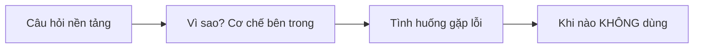

# Bảng ôn phỏng vấn Java Core (góc nhìn người phỏng vấn)

Cách dùng: đọc câu hỏi, **tự trả lời thành tiếng** trước. Nếu bí, đọc **Gợi ý suy luận** (các câu hỏi nhỏ dẫn đường), tự dựng chuỗi nguyên nhân và kết quả, rồi mới đối chiếu **Lập luận** và **Đáp án ngắn**. Dòng **Hỏi xoáy** là câu người phỏng vấn thường hỏi tiếp khi bạn trả lời đúng. Mức: **E** (nền tảng, ai cũng phải biết), **M** (trung bình, làm việc thực tế), **H** (sâu, phân biệt ứng viên giỏi). Dòng **Nhớ** trỏ về bài gốc.

**Tóm tắt:**

- Bộ câu hỏi chia thành 12 mảng: nền tảng JVM và memory, data type và String, OOP, Exception, Collections, Generics, Lambda và Stream, Multithreading, JVM nội bộ (class loading, GC, JIT), I/O và reflection, thiết kế và kiểm thử và build, cùng các câu tình huống tổng hợp.
- Chủ đề chạy xuyên suốt là "dữ liệu nằm ở đâu và ai thấy nó": stack riêng từng thread, heap chung, reference trỏ tới object, và hệ quả với truyền theo giá trị, GC, memory leak.
- Contract `equals`/`hashCode`, key immutable và cơ chế bucket của `HashMap` giải thích hầu hết lỗi Collections; type erasure giải thích hầu hết giới hạn của Generics.
- Đồng thời quy về ba vấn đề atomic, hiển thị, thứ tự; công cụ đi từ `volatile`, `Atomic*`, `synchronized` đến `java.util.concurrent`, và virtual thread cho tác vụ chờ I/O.
- Chẩn đoán dựa trên bằng chứng: thread dump cho treo, heap dump cho OOM, log GC và JFR cho hiệu năng; lấy bằng chứng trước, sửa sau.
- Hay bị hỏi xoáy nhất: Java truyền theo giá trị hay theo reference (swap không hoạt động vì sao); ghi đè `equals` mà quên `hashCode`; `volatile` có làm `i++` atomic không và vì sao double-checked locking cần `volatile`.
- Cũng hay bị xoáy: `@Transactional` không chạy khi gọi nội bộ (self-invocation qua proxy), pool core 4 max 16 với queue không giới hạn vì sao chỉ có 4 thread, và `Integer` so sánh bằng `==` đúng với 100 nhưng sai với 1000.

## 0. Đánh giá độ phủ của bộ ghi chú

| Nhóm kiến thức | Độ phủ | Ghi chú / chỗ còn mỏng |
|---|---|---|
| JVM, memory, GC, JIT, class loading | Tốt | Đủ cho phỏng vấn sâu |
| Data type, String, OOP, Exception | Tốt | `String.intern`, `serialVersionUID` chỉ nêu ở bảng này |
| Collections và Generics | Tốt | Cây đỏ-đen trong HashMap (treeify) nêu ở bảng này |
| Concurrency (thread, JMM, `java.util.concurrent`) | Khá | Tham số `ThreadPoolExecutor`, AQS nêu ở bảng này, chưa có bài riêng |
| Lambda, Stream, Java hiện đại | Tốt | Java 22 đến 27 (Stream Gatherers, FFM API, ScopedValue) chỉ có bảng tổng hợp ở [Java hiện đại](/go?p=08-Java%2FJava-Core%2Feasy%2Flt-06-java-hien-dai.md) và [Virtual Threads](/go?p=08-Java%2FJava-Core%2Fhard%2Flt-20-virtual-threads-structured-concurrency.md), chưa có câu hỏi riêng |
| Thư viện, build, test, log, JDBC | Khá | Đủ mức tổng quan |
| Thiết kế (SOLID, pattern, API) | Khá | Pattern chỉ phần thường dùng |
| Thuật toán và CTDL | Ở thư mục Algorithms | Không thuộc Java Core |

## 1. Nền tảng Java, JVM và memory

### 1.1 Cùng là "Java", vì sao có JDK, JRE, JVM, và một chương trình Java chạy được trên cả Windows lẫn Linux? (E)

**Phải thuộc:** Câu này là câu cốt lõi, gặp rất thường xuyên.

**Gợi ý suy luận:**
- Ai thực sự chạy mã bạn viết: CPU hay một lớp trung gian? Mã trung gian đó có định dạng gì?
- Để chạy được cần những gì, để viết và đóng gói cần thêm những gì?
- Lớp trung gian phụ thuộc hệ điều hành ở chỗ nào?

**Lập luận:** Mã nguồn được `javac` dịch ra bytecode chứ không phải mã máy, và bytecode là tập lệnh của một máy ảo trừu tượng nên giống hệt nhau ở mọi nơi. Vì CPU không hiểu bytecode, cần một bộ thực thi đọc từng lệnh rồi chuyển sang lệnh của máy thật: đó là JVM. JVM lại cần thư viện chuẩn (`String`, `List`...) để chương trình có sẵn nền tảng, nên JVM cộng thư viện chuẩn thành JRE. Người phát triển cần thêm trình biên dịch và công cụ (`javac`, `jar`, `jcmd`), nên JRE cộng công cụ thành JDK, và đó là lý do JDK chứa JRE chứa JVM. Phần duy nhất phải viết riêng cho từng hệ điều hành và CPU là JVM, nên cùng một file `.class` chạy được trên Windows lẫn Linux mà không cần biên dịch lại. Chỗ dễ nhầm là nghĩ Java chạy khắp nơi nhờ thư viện hay nhờ biên dịch lại, trong khi thực ra nhờ tầng trung gian bytecode cộng một JVM riêng cho mỗi nền tảng. Hệ quả hành động: khi triển khai chỉ cần có đúng JVM trên máy đích rồi mang file `.class` hoặc JAR sang, và từ Java 11 hãy cài JDK vì không còn bản JRE phát hành riêng.

**Đáp án ngắn:** JVM chạy bytecode; JRE = JVM + thư viện chuẩn; JDK = JRE + công cụ (`javac`, `jar`, `jcmd`). "Write once, run anywhere" nhờ bytecode trung lập cộng JVM riêng cho từng HĐH. Từ Java 11 không còn bản JRE phát hành riêng.

**Hỏi xoáy:** "Write once, run anywhere" thực hiện bằng gì? (bytecode + JVM theo từng HĐH)

**Nhớ:** JDK ⊃ JRE ⊃ JVM; bytecode là điểm trung lập. Bài: [lt-01](/go?p=08-Java%2FJava-Core%2Feasy%2Flt-01-tu-duy-java-jvm.md), [lt-24](/go?p=08-Java%2FJava-Core%2Feasy%2Flt-24-cu-phap-nen-tang.md).

### 1.2 Bạn gõ `java Main` thì từ file `.java` đến lúc in ra màn hình điều gì đã xảy ra? Java biên dịch hay thông dịch? (E)

**Gợi ý suy luận:**
- File `.java` có chạy trực tiếp được không? Bước nào biến nó thành thứ JVM hiểu?
- Trước khi chạy, JVM cần đưa class vào memory và kiểm tra gì (class loader, verifier)?
- Mã chạy lặp nhiều lần có nên thông dịch mãi không?

**Lập luận:** `javac` dịch `.java` sang bytecode `.class` ngay lúc build, vì file nguồn không phải thứ JVM chạy trực tiếp được. Khi chạy, class loader tìm và nạp class vào memory, rồi verifier kiểm tra bytecode có hợp lệ và an toàn không, vì JVM không thể tin mọi file `.class` nó nhận. Sau đó JVM thông dịch từng lệnh bytecode để chương trình khởi động ngay mà không phải chờ biên dịch. Thông dịch mãi thì chậm, nên JVM đếm số lần gọi, và method nào chạy nhiều lần là "nóng" sẽ được JIT biên dịch sang mã máy để từ đó chạy nhanh hơn nhiều. Vì vậy câu "Java biên dịch hay thông dịch" có đáp án là cả hai: biên dịch ra bytecode lúc build, thông dịch lúc đầu, rồi biên dịch lại phần nóng bằng JIT lúc chạy. Hệ quả dễ thấy là chương trình chạy chậm lúc đầu rồi nhanh dần (warm-up), nên khi đo hiệu năng phải cho chạy nóng trước.

**Đáp án ngắn:** `javac` ra bytecode, class loader nạp rồi xác minh, JVM thông dịch và JIT biên dịch phần nóng ra mã máy. Java là cả hai.

**Hỏi xoáy:** Java biên dịch hay thông dịch? (cả hai)

**Nhớ:** biên dịch sang bytecode, nạp, xác minh, thông dịch, JIT. Bài: [lt-01](/go?p=08-Java%2FJava-Core%2Feasy%2Flt-01-tu-duy-java-jvm.md), [lt-16](/go?p=08-Java%2FJava-Core%2Fhard%2Flt-16-jvm-architecture-classloading.md).

### 1.3 Hai thread cùng gọi một method có variable cục bộ, còn cùng giữ một object `List`. Vì sao variable cục bộ không cần đồng bộ còn `List` thì cần? Mỗi thứ nằm ở đâu? (E)

**Gợi ý suy luận:**
- Mỗi thread có vùng nhớ riêng nào khi gọi method (stack frame)?
- Object tạo bằng `new` nằm ở vùng nào, ai cùng thấy vùng đó?
- Field của object nằm cùng chỗ với object hay với variable cục bộ?

**Lập luận:** Mỗi lần gọi method, JVM tạo một frame trên stack của chính thread đó để chứa variable cục bộ và tham số, nên hai thread gọi cùng một method vẫn có hai frame riêng và không ai chạm được vào dữ liệu của người kia. Ngược lại object tạo bằng `new` nằm trên heap, và heap là vùng chung của mọi thread. Hai thread cùng giữ reference tới một `List` nghĩa là cùng trỏ vào một object trên heap, nên cùng sửa nó và cần đồng bộ để tránh mất cập nhật hay hỏng cấu trúc. Field của object, kể cả field primitive, là một phần của object nên cũng nằm trên heap, chứ không nằm trên stack như variable cục bộ. Chỗ dễ nhầm là tưởng `int` luôn nằm trên stack: variable cục bộ `int` thì có, còn field `int` của một object thì ở heap cùng object. Hệ quả hành động: khi review code multithreading, hãy tách riêng thứ chỉ có ở stack (an toàn) khỏi mọi object được chia sẻ qua reference (cần bảo vệ).

**Đáp án ngắn:** Stack (riêng mỗi thread) chứa variable cục bộ, tham số, frame. Heap (chung) chứa mọi object và array, kể cả field của chúng.

**Hỏi xoáy:** Field primitive nằm đâu? (heap, cùng object). Variable `static` nằm đâu? (từ Java 8, giá trị static nằm trên heap trong object `Class`; Metaspace chỉ giữ metadata của class).

**Nhớ:** stack riêng theo thread, heap chung. Bài: [lt-02](/go?p=08-Java%2FJava-Core%2Feasy%2Flt-02-kieu-du-lieu-string.md).

### 1.4 Bạn viết hàm `swap(a, b)` cho hai object, vì sao sau khi gọi, hai variable ở nơi gọi vẫn y nguyên? Java truyền theo giá trị hay reference? (E)

**Phải thuộc:** Câu này là câu cốt lõi, gặp rất thường xuyên.

**Gợi ý suy luận:**
- Khi gọi hàm, tham số trong hàm là chính variable cũ hay một variable mới?
- Với object, "giá trị" của variable là gì: object hay địa chỉ trỏ tới nó?
- Gán lại tham số trong hàm ảnh hưởng gì tới variable bên ngoài?

**Lập luận:** Khi gọi hàm, Java tạo tham số là một variable cục bộ mới trong frame của hàm và khởi tạo nó bằng bản sao giá trị của đối số. Với primitive, giá trị đó là con số; với object, giá trị đó là địa chỉ của object, nên tham số và variable ở nơi gọi là hai variable khác nhau cùng trỏ một object. Hoán đổi hai tham số trong `swap` chỉ đổi hai bản sao địa chỉ nằm trong frame của hàm, và khi hàm kết thúc frame bị bỏ nên hai variable ở nơi gọi vẫn y nguyên. Nhưng vì bản sao vẫn trỏ cùng object, gọi `p.setName(...)` bên trong hàm sửa object thật, và nơi gọi thấy thay đổi đó. Hai hiện tượng này khớp nhau chứ không mâu thuẫn, và việc không viết được `swap` chính là bằng chứng Java truyền theo giá trị chứ không theo reference. Chỗ dễ nhầm là thấy "sửa được nội dung" rồi kết luận "truyền theo reference". Hệ quả hành động: muốn trả kết quả mới ra ngoài thì phải `return` nó, và khi review phải phân biệt hàm đang sửa nội dung hay chỉ gán lại tham số.

**Đáp án ngắn:** Java luôn truyền theo giá trị; với object, giá trị là bản sao của địa chỉ. Nên `swap` không hoạt động, nhưng sửa nội dung object thì thấy bên ngoài.

**Hỏi xoáy:** Viết `swap(a, b)` có hoạt động không? (không)

**Nhớ:** pass-by-value, reference cũng là giá trị được sao chép. Bài: [lt-02](/go?p=08-Java%2FJava-Core%2Feasy%2Flt-02-kieu-du-lieu-string.md).

### 1.5 Nếu mọi thứ đều để trên stack cho nhanh thì chương trình hỏng ở đâu? Vì sao cần heap? (E)

**Gợi ý suy luận:**
- Khi method kết thúc thì frame của nó ra sao? Object trả về cho nơi gọi thì sao?
- Hai thread muốn dùng chung một object thì stack riêng có đủ không?
- Ai quyết định lúc nào thu hồi vùng nhớ không còn dùng?

**Lập luận:** Nếu mọi thứ nằm trên stack thì nó gắn với frame của method, mà frame bị hủy ngay khi method thoát, nên object cần sống lâu hơn method tạo ra nó (trả về cho nơi gọi, lưu vào cache) sẽ biến mất cùng frame. Stack lại riêng từng thread, nên hai thread không thể chia sẻ một object nằm trên stack của một bên. Thứ ba, kích thước nhiều object (array, danh sách, chuỗi) chỉ biết lúc chạy, trong khi frame có bố cục cố định lúc biên dịch. Vì ba lý do đó cần một vùng riêng độc lập với lifecycle của method: heap, nơi object sống đến khi không còn đường reference nào tới được và GC thu hồi. Cái giá phải trả là GC tốn công và có thể gây pause, đồng thời object chung giữa thread cần đồng bộ. Điểm dễ nhầm là nghĩ stack luôn nhanh hơn nên nên dùng nhiều: stack nhanh nhưng không phục vụ được nhu cầu sống lâu và chia sẻ. Hệ quả hành động: tránh cấp phát object thừa trong vòng lặp nóng để giảm áp lực GC, và coi mọi object chia sẻ là vùng cần bảo vệ.

**Đáp án ngắn:** Object cần sống lâu hơn method, dùng chung giữa thread, kích thước biến đổi, nên nằm heap do GC quản lý. Giá phải trả là GC và đồng bộ.

**Hỏi xoáy:** Cái giá của heap? (GC, đồng bộ)

**Nhớ:** lifecycle object không gắn với frame. Bài: [lt-02](/go?p=08-Java%2FJava-Core%2Feasy%2Flt-02-kieu-du-lieu-string.md).

### 1.6 Một service lúc thì báo `StackOverflowError`, lúc thì `OutOfMemoryError`. Hai lỗi này khác nhau ở đâu và bạn điều tra thế nào? (M)

**Gợi ý suy luận:**
- Mỗi lời gọi method tiêu tốn vùng nhớ nào? Gọi lồng quá sâu thì vùng nào cạn?
- Object tạo ra mà không được thu hồi thì vùng nào đầy?
- Muốn biết cái gì đang chiếm memory thì cần "chụp" cái gì?

**Lập luận:** Hai lỗi chỉ cùng tên "tràn" nhưng xảy ra ở hai vùng khác nhau do hai nguyên nhân khác nhau. Mỗi lần gọi method thêm một frame vào stack của thread đó, nên đệ quy không có điều kiện dừng hoặc gọi lồng quá sâu làm cạn stack của một thread và cho `StackOverflowError`. Còn `OutOfMemoryError` nghĩa là heap (hoặc Metaspace, hoặc memory native) hết chỗ dù GC đã cố dọn, tức là lượng object còn được giữ vượt dung lượng. Vì GC chỉ thu object không còn truy cập được, nguyên nhân thường là còn reference giữ object, hoặc dữ liệu thực sự quá lớn. Để điều tra, một stack trace lặp lại hàng nghìn dòng cùng method chỉ ra vòng đệ quy, còn với OOM cần chụp heap dump (bật `-XX:+HeapDumpOnOutOfMemoryError`) rồi dùng MAT xem dominator tree và đường tới GC root. Điểm dễ nhầm là tăng `-Xmx` hay `-Xss` cho hết lỗi, trong khi chỉ trì hoãn sự cố và che nguyên nhân thật. Hãy sửa gốc bằng điều kiện dừng đệ quy hoặc bỏ reference thừa.

**Đáp án ngắn:** SOE là đầy stack của một thread (đệ quy sâu); OOM là đầy heap, Metaspace hoặc memory native. Với OOM: heap dump và MAT để tìm rò rỉ.

**Hỏi xoáy:** Xử lý OOM thế nào? (heap dump + MAT, tìm rò rỉ)

**Nhớ:** stack theo độ sâu gọi, heap theo số object sống. Bài: [lt-32](/go?p=08-Java%2FJava-Core%2Fhard%2Flt-32-cong-cu-chan-doan-jvm.md).

### 1.7 Java có GC mà ứng dụng vẫn tăng RAM dần rồi OOM. Vì sao, cho ví dụ? (M)

**Phải thuộc:** Câu này là câu cốt lõi, gặp rất thường xuyên.

**Gợi ý suy luận:**
- GC xác định "rác" dựa trên điều gì (khả năng truy cập)?
- Nếu một object không còn dùng nhưng vẫn có đường reference tới nó thì sao?
- Những nơi sống lâu nào thường giữ reference (static, cache, listener, ThreadLocal)?

**Lập luận:** GC xác định rác dựa trên khả năng truy cập chứ không dựa trên việc code có còn dùng object hay không: nó đi từ các GC root (variable cục bộ trên stack, static, thread đang chạy) và chỉ thu những object không có đường nào tới được. Vì vậy một object đã vô dụng nhưng vẫn còn một reference từ chỗ nào đó vẫn được coi là sống. Các chỗ sống lâu hay giữ reference thừa là static map, cache không giới hạn kích thước, listener chưa gỡ đăng ký, `ThreadLocal` trong thread pool và inner class ngầm giữ outer. Chúng tích tụ object theo thời gian nên heap tăng dần mà GC không thu hồi được, cuối cùng ra `OutOfMemoryError`. Dấu hiệu nhận biết là đáy heap sau mỗi lần Full GC cứ nâng lên. Điểm dễ nhầm là cho rằng có GC thì không thể leak, trong khi leak trong Java là reference còn sót chứ không phải quên `free`. Hệ quả hành động: so hai heap dump cách nhau để thấy class nào tăng, rồi dùng dominator tree và đường tới GC root để tìm ai giữ, và sửa bằng giới hạn cache, hủy đăng ký, `remove()`.

**Đáp án ngắn:** Có. Reference thừa khiến GC không dọn: static map, cache không giới hạn, listener, ThreadLocal, inner class giữ outer. Phát hiện bằng so hai heap dump và dominator tree trong MAT.

**Hỏi xoáy:** Phát hiện bằng gì? (so hai heap dump, MAT dominator tree)

**Nhớ:** rò rỉ Java là reference còn sót, không phải thiếu GC. Bài: [lt-18](/go?p=08-Java%2FJava-Core%2Fhard%2Flt-18-gc-chuyen-sau.md), [lt-32](/go?p=08-Java%2FJava-Core%2Fhard%2Flt-32-cong-cu-chan-doan-jvm.md).

### 1.8 Làm sao viết cache để khi thiếu RAM thì JVM tự bỏ bớt, hoặc map không giữ key mãi? (M)

**Gợi ý suy luận:**
- Reference thường (mạnh) có bao giờ bị GC thu khi còn truy cập được không?
- Cần mức "thu khi thiếu memory" và mức "thu ở lần GC kế" thì cần loại reference nào?
- Muốn được báo trước khi object bị hủy để dọn tài nguyên thì sao?

**Lập luận:** Reference mạnh (mặc định) khiến object luôn được coi là sống miễn còn truy cập được, nên cache dùng nó sẽ phình mãi cho đến khi hết memory. Muốn để JVM tự bỏ bớt khi thiếu RAM cần reference yếu hơn, và Java chia thành bốn mức theo thời điểm GC được phép thu. `SoftReference` bị thu khi sắp thiếu memory (trước `OutOfMemoryError`), nên hợp cho cache đơn giản nhạy với memory. `WeakReference` bị thu ở lần GC kế tiếp khi không còn reference mạnh nào, nên hợp với dữ liệu phụ gắn với một object khác như `WeakHashMap`, và `WeakHashMap` yếu ở key chứ không ở giá trị. `PhantomReference` không lấy lại được object mà chỉ cho thông báo qua `ReferenceQueue` để dọn tài nguyên sau khi object bị hủy, thay cho `finalize`. Chỗ dễ nhầm là để giá trị của `WeakHashMap` tham chiếu ngược về key: khi đó key luôn còn đường tới nên không bao giờ bị thu. Với cache nghiêm túc hãy dùng Caffeine có giới hạn kích thước và thời gian thay vì tự xây bằng Soft hoặc Weak.

**Đáp án ngắn:** Mạnh: không thu; Soft: thu khi thiếu memory; Weak: thu ở GC kế; Phantom: dọn tài nguyên sau khi hủy.

**Hỏi xoáy:** `WeakHashMap` yếu ở key hay giá trị? (key)

**Nhớ:** bốn mức reference quyết định thời điểm GC được thu. Bài: [lt-31](/go?p=08-Java%2FJava-Core%2Fhard%2Flt-31-threadlocal-forkjoin-reference.md).

## 2. Data type và String

### 2.1 Vì sao `int x = null;` không biên dịch được còn `Integer x = null;` thì được? Hai nhóm kiểu khác nhau gì? (E)

**Gợi ý suy luận:**
- Variable primitive lưu thẳng giá trị hay lưu địa chỉ? "Không có giá trị" biểu diễn thế nào?
- Variable reference lưu cái gì, nên `null` nghĩa là gì?
- Field chưa gán và variable cục bộ chưa gán xử lý khác nhau ra sao?

**Lập luận:** Kiểu primitive (`byte short int long float double char boolean`) chứa thẳng giá trị trong ô nhớ của variable, nên mọi lúc nó đều có một giá trị cụ thể và không có chỗ nào để biểu diễn "không có". Kiểu reference thì ô nhớ chứa địa chỉ của object trên heap, và `null` chính là "chưa trỏ tới đâu", vì vậy `Integer x = null;` hợp lệ còn `int x = null;` bị compiler từ chối. Cùng nguyên tắc đó giải thích vì sao unbox một `Integer` là `null` ra `NullPointerException`: JVM phải lấy ra một số nguyên từ một reference rỗng. Việc khởi tạo cũng đi theo: field của object được JVM gán giá trị mặc định (0, `false`, `null`) lúc tạo object, còn variable cục bộ nằm trên stack không được gán sẵn nên dùng trước khi gán là lỗi biên dịch. Chỗ dễ nhầm là nghĩ field primitive không có mặc định, hoặc nghĩ variable cục bộ cũng mặc định bằng 0. Hệ quả hành động: dùng primitive làm mặc định cho số và cờ, chỉ dùng wrapper khi cần `null` hay generic, và chú ý unbox `null` khi đọc từ Map hay DB.

**Đáp án ngắn:** 8 primitive giữ giá trị, không `null`; kiểu reference giữ địa chỉ. Field có giá trị mặc định, variable cục bộ thì không.

**Hỏi xoáy:** Giá trị mặc định của field và variable cục bộ? (field có, cục bộ không)

**Nhớ:** primitive = giá trị, reference = địa chỉ. Bài: [lt-02](/go?p=08-Java%2FJava-Core%2Feasy%2Flt-02-kieu-du-lieu-string.md), [lt-24](/go?p=08-Java%2FJava-Core%2Feasy%2Flt-24-cu-phap-nen-tang.md).

### 2.2 `0.1 + 0.2 == 0.3` cho kết quả gì, và bạn tính tiền thế nào cho đúng? (E)

**Gợi ý suy luận:**
- `double` lưu số dưới dạng nhị phân: 0,1 có biểu diễn hữu hạn trong nhị phân không?
- Nếu không, phép cộng cộng thêm sai số nào?
- Tiền cần chính xác tới từng đơn vị nhỏ nhất, vậy nên dùng kiểu nào?

**Lập luận:** `double` lưu số dưới dạng nhị phân, và 0,1 cùng 0,2 là số tuần hoàn vô hạn trong nhị phân giống 1/3 trong thập phân, nên chúng chỉ được lưu dưới dạng xấp xỉ bị cắt ở một số bit. Cộng hai xấp xỉ đó cho một kết quả lệch rất nhỏ so với xấp xỉ gần nhất của 0,3, nên `0.1 + 0.2` ra `0.30000000000000004` và `==` trả `false`. Với tiền thì sai số nhỏ cũng không chấp nhận được, vì cộng nhiều khoản sai số tích lũy và báo cáo lệch vài xu. Giải pháp là lưu số nguyên đơn vị nhỏ nhất (đồng, cent) hoặc dùng `BigDecimal`, vốn lưu số nguyên lớn kèm scale thập phân nên biểu diễn chính xác. Chỗ dễ nhầm là `new BigDecimal(0.1)` vẫn mang theo sai số của `double` truyền vào nên phải khởi tạo từ chuỗi hoặc `valueOf`, và `equals` của `BigDecimal` xét cả scale (`2.0` khác `2.00`) trong khi `compareTo` chỉ so giá trị. Khi tính tiền, hãy thống nhất một quy tắc làm tròn và chỉ làm tròn ở bước cuối.

**Đáp án ngắn:** `false`, vì số thực nhị phân chỉ xấp xỉ. Tiền dùng `BigDecimal` từ chuỗi hoặc số nguyên đơn vị nhỏ nhất.

**Hỏi xoáy:** `new BigDecimal(0.1)` khác `valueOf` thế nào? `equals` vs `compareTo`? (`equals` xét cả scale, `compareTo` chỉ so giá trị)

**Nhớ:** float/double xấp xỉ nhị phân. Bài: [lt-26](/go?p=08-Java%2FJava-Core%2Fmedium%2Flt-26-iterator-comparator-bigdecimal.md).

### 2.3 Đoạn mã so sánh hai `Integer` bằng `==` chạy đúng với 100 nhưng sai với 1000. Tại sao? (E)

**Phải thuộc:** Câu này là câu cốt lõi, gặp rất thường xuyên.

**Gợi ý suy luận:**
- `Integer` là kiểu gì (reference), nên `==` so cái gì?
- Autoboxing gọi `Integer.valueOf`: method này có dùng lại object đã tạo không?
- Nếu unbox một `Integer` là `null` thì sao?

**Lập luận:** `Integer` là kiểu reference, nên `==` giữa hai `Integer` so địa chỉ chứ không so giá trị. Autoboxing gọi `Integer.valueOf`, và method này giữ sẵn một cache các object cho khoảng `-128..127` vì các số nhỏ được dùng rất nhiều, nên hai lần boxing số nhỏ cùng giá trị trả về cùng một object và `==` đúng. Ngoài khoảng đó mỗi lần boxing tạo một object mới với địa chỉ khác, nên `==` trả `false` dù giá trị bằng nhau. Vì cache chỉ là chi tiết tối ưu, code chạy đúng với 100 chỉ là tình cờ và sẽ sai khi dữ liệu thật lớn hơn. Hai bẫy cùng họ: unbox `null` ném `NullPointerException`, và boxing trong vòng lặp lớn tạo hàng loạt object thừa gây áp lực GC. Hệ quả hành động: so sánh wrapper luôn bằng `equals` (hoặc `Objects.equals` khi có thể `null`), và dùng primitive hoặc stream nguyên thủy (`IntStream`) trong đường nóng.

**Đáp án ngắn:** `Integer` cache `-128..127` nên `==` chỉ vô tình đúng với số nhỏ. So wrapper bằng `equals`; unbox `null` gây NPE.

**Hỏi xoáy:** So sánh wrapper bằng gì? (`equals`)

**Nhớ:** `==` so địa chỉ, boxing có cache nhỏ. Bài: [lt-02](/go?p=08-Java%2FJava-Core%2Feasy%2Flt-02-kieu-du-lieu-string.md).

### 2.4 Vì sao thiết kế `String` immutable? Nó mang lại và tốn gì? (E)

**Phải thuộc:** Câu này là câu cốt lõi, gặp rất thường xuyên.

**Gợi ý suy luận:**
- Nếu chuỗi sửa được, một chuỗi dùng chung giữa nhiều thread hoặc làm key `HashMap` gặp chuyện gì?
- Nếu chuỗi immutable, `hashCode` có thể tính một lần rồi nhớ không?
- Muốn nhiều variable cùng dùng một literal để tiết kiệm memory (String pool) thì cần điều kiện gì?

**Lập luận:** `String` được thiết kế immutable vì nó là kiểu dùng nhiều nhất và được chia sẻ khắp nơi: nếu nội dung đổi được thì mọi nơi giữ cùng một chuỗi sẽ thấy thay đổi bất ngờ. Từ đó suy ra bốn lợi ích. Thứ nhất, chuỗi chia sẻ giữa thread không cần lock vì không ai sửa được nó. Thứ hai, `hashCode` tính một lần rồi nhớ lại được, và `String` làm key `HashMap` an toàn vì hash không đổi nên không lạc bucket. Thứ ba, String pool mới khả thi: nhiều variable cùng trỏ một literal chỉ an toàn khi không ai sửa nó. Thứ tư, các giá trị đã kiểm tra như đường dẫn file hay URL không thể bị đổi sau khi kiểm tra xong, nên có ý nghĩa bảo mật. Cái giá là mỗi lần "sửa" (`+`, `replace`) tạo chuỗi mới nên nối trong vòng lặp tạo nhiều object trung gian, và hệ quả hành động là dùng `StringBuilder` cho việc nối nhiều lần.

**Đáp án ngắn:** Thread-safe, hash cache được nên làm key Map an toàn, cho phép String pool, an toàn bảo mật. Giá là tạo chuỗi mới khi nối nhiều lần, dùng `StringBuilder`.

**Hỏi xoáy:** Hệ quả hiệu năng? (nối trong vòng lặp dùng `StringBuilder`)

**Nhớ:** immutable, nên chia sẻ và cache an toàn. Bài: [lt-02](/go?p=08-Java%2FJava-Core%2Feasy%2Flt-02-kieu-du-lieu-string.md).

### 2.5 Nối chuỗi trong vòng lặp 100.000 lần bằng `+` chậm thảm hại. Vì sao, và `StringBuilder`/`StringBuffer` khác nhau gì? (E)

**Gợi ý suy luận:**
- Vì `String` immutable, mỗi lần `+` tạo ra gì và sao chép gì?
- Bộ đệm sửa tại chỗ giải quyết điều này thế nào?
- Nếu bộ đệm đó có thêm lock đồng bộ thì được gì, mất gì?

**Lập luận:** Vì `String` immutable, mỗi lần `s = s + x` tạo một chuỗi hoàn toàn mới và chép toàn bộ nội dung cũ sang, nên lần nối thứ n tốn công tỷ lệ với độ dài hiện tại và tổng công việc của cả vòng lặp tăng theo bình phương. Cũng vì vậy 100.000 lần nối sinh ra 100.000 object trung gian bị bỏ đi ngay, vừa chậm vừa tạo áp lực GC. `StringBuilder` giải quyết bằng một array ký tự sửa tại chỗ: nối vào cuối và chỉ nở ra khi hết chỗ, rồi tạo chuỗi cuối cùng một lần bằng `toString()`, nên tổng công việc gần tuyến tính. `StringBuffer` có cùng cơ chế nhưng mọi method đều `synchronized`, nên an toàn khi nhiều thread dùng chung một buffer nhưng chậm hơn, và vì thường mỗi thread tự có builder riêng nên hiếm khi cần. Chỗ dễ nhầm là nghĩ `+` luôn chậm: nối vài chuỗi hay hằng lúc biên dịch (`"a" + "b"` được nối sẵn) thì không đáng kể. Khi review, hãy chỉ tìm `+` trong vòng lặp và thay bằng `StringBuilder` hoặc `String.join`.

**Đáp án ngắn:** String immutable; StringBuilder sửa được, không đồng bộ, nhanh; StringBuffer đồng bộ (ít dùng).

**Hỏi xoáy:** `"a" + "b"` lúc biên dịch? (hằng số được nối sẵn, không tạo chuỗi lúc chạy)

**Nhớ:** String immutable nên nối nhiều dùng builder. Bài: [lt-02](/go?p=08-Java%2FJava-Core%2Feasy%2Flt-02-kieu-du-lieu-string.md).

### 2.6 `"a" == "a"` là `true` nhưng `new String("a") == "a"` là `false`. Giải thích, và `new String("a")` tạo mấy object? (M)

**Gợi ý suy luận:**
- `==` so cái gì? Hai literal giống nhau có được trình biên dịch/JVM gộp thành một không (String pool)?
- `new` có bao giờ trả object đã có không?
- Muốn lấy bản trong pool từ một chuỗi bất kỳ thì dùng gì?

**Lập luận:** `==` so địa chỉ chứ không so nội dung. Literal như `"a"` được JVM đưa vào String pool và dùng lại, nên hai chỗ viết `"a"` trỏ cùng một object và `==` đúng. `new String("a")` thì `new` luôn tạo một object mới trên heap, không bao giờ trả lại object có sẵn, nên địa chỉ khác literal và `==` sai. Nó có thể tạo tới hai object: một là object mới trên heap, và một là literal `"a"` trong pool nếu pool chưa có sẵn. `intern()` trả về bản trong pool, nên `new String("a").intern() == "a"` là `true`, nhưng ít khi cần và dùng nhiều có thể làm pool phình. Điểm dễ nhầm là chỉ thử với literal rồi kết luận `==` đúng cho chuỗi, trong khi chuỗi đọc từ file, mạng hay ghép lúc chạy không nằm trong pool. Hệ quả hành động: luôn so chuỗi bằng `equals`, và đừng dựa vào `==` kể cả khi nó "tình cờ" đúng.

**Đáp án ngắn:** `==` so địa chỉ, `equals` so nội dung. Literal vào pool; `new String` luôn tạo object mới trên heap (kèm literal nếu pool chưa có).

**Hỏi xoáy:** `intern()` làm gì? (trả về bản trong pool; dùng hạn chế)

**Nhớ:** literal vào pool, `new` thì không. Bài: [lt-02](/go?p=08-Java%2FJava-Core%2Feasy%2Flt-02-kieu-du-lieu-string.md).

### 2.7 `Integer.MAX_VALUE + 1` ra gì, và vì sao đây là lỗi âm thầm nguy hiểm? (M)

**Gợi ý suy luận:**
- `int` có 32 bit: điều gì xảy ra khi cộng vượt bit cao nhất (bù hai)?
- Java có throw lỗi khi tràn không?
- Có API nào kiểm tra tràn và throw lỗi?

**Lập luận:** `int` dùng 32 bit biểu diễn bù hai, nên khi cộng vượt giá trị lớn nhất, bit dấu bật lên và kết quả quay vòng thành số âm nhỏ nhất: `Integer.MAX_VALUE + 1` ra `-2147483648`. Java đã chọn cho số nguyên quay vòng im lặng thay vì ném lỗi vì kiểm tra tràn ở mọi phép tính sẽ làm chậm, và hành vi quay vòng được định nghĩa rõ trong đặc tả. Hậu quả là chương trình tiếp tục chạy với số sai, nên thường sinh lỗi khó thấy như tiền âm, chỉ số âm hay độ dài âm, và chỉ lộ ở xa chỗ gây ra. Cùng gốc đó, `Math.abs(Integer.MIN_VALUE)` vẫn âm vì không có số dương tương ứng trong 32 bit. Cách phát hiện là dùng `Math.addExact` hay `multiplyExact`, vốn ném `ArithmeticException` khi tràn, hoặc `Math.toIntExact` khi ép từ `long`. Điểm dễ nhầm là `int * int` tràn trước khi gán vào `long`, nên phải ép một toán hạng sang `long` trước phép tính. Hãy dùng phiên bản `Exact` hoặc `long` ở chỗ số tiền và số lượng, nơi sai số có hậu quả.

**Đáp án ngắn:** Quay vòng thành số âm mà không báo lỗi; dùng `Math.addExact` để throw lỗi.

**Hỏi xoáy:** `Math.abs(Integer.MIN_VALUE)`? (vẫn âm)

**Nhớ:** số nguyên bù hai quay vòng khi tràn. Bài: [lt-24](/go?p=08-Java%2FJava-Core%2Feasy%2Flt-24-cu-phap-nen-tang.md).

## 3. OOP

### 3.1 Bốn trụ cột OOP là gì, và mỗi trụ giải quyết vấn đề gì của mã nguồn? (E)

**Gợi ý suy luận:**
- Nếu mọi field đều public, ai bảo vệ quy tắc "số dư không âm"?
- Hai class có phần chung thì tái dùng bằng cách nào? Gọi cùng một lời gọi nhưng hành vi khác nhau theo object thật thì gọi là gì?
- Người dùng chỉ cần biết "làm gì" chứ không cần "làm thế nào" thì biểu diễn bằng gì?

**Lập luận:** Mỗi trụ cột sinh ra để chữa một nỗi đau cụ thể khi code lớn lên. Nếu mọi field đều public thì ai cũng sửa được trạng thái và không ai giữ được quy tắc như "số dư không âm", nên encapsulation giấu trạng thái và chỉ cho sửa qua method tự kiểm tra, để bảo vệ invariant. Hai class có phần chung thì chép code sẽ sửa một chỗ phải sửa nhiều nơi, nên inheritance cho quan hệ "là-một" để tái dùng. Khi cùng một lời gọi cần hành vi khác nhau tùy object thật, polymorphism chọn method theo kiểu thật lúc chạy, nên mã gọi không phải `if/else` theo loại và thêm kiểu mới không phải sửa nơi dùng. Người dùng chỉ cần biết "làm gì", nên abstraction định nghĩa contract bằng interface hoặc abstract class và che "làm thế nào". Chỗ dễ nhầm là coi encapsulation chỉ là getter/setter (đó là public field trá hình) và coi inheritance là cách tái dùng mặc định, trong khi composition thường tốt hơn. Khi thiết kế, hãy hỏi mỗi class đang bảo vệ invariant nào và phụ thuộc vào contract nào.

**Đáp án ngắn:** Encapsulation (giấu trạng thái), kế thừa (là-một), polymorphism (cùng lời gọi, hành vi theo kiểu thật), trừu tượng (contract).

**Hỏi xoáy:** Encapsulation có phải chỉ là getter/setter? (không, là bảo vệ invariant)

**Nhớ:** mỗi trụ cột giải quyết một nỗi đau: bảo vệ, tái dùng, mở rộng, tách contract. Bài: [lt-03](/go?p=08-Java%2FJava-Core%2Feasy%2Flt-03-oop.md).

### 3.2 Hai method cùng tên, một cái được chọn lúc biên dịch, một cái lúc chạy. Đó là overload hay override? (E)

**Phải thuộc:** Câu này là câu cốt lõi, gặp rất thường xuyên.

**Gợi ý suy luận:**
- Trình biên dịch chỉ biết kiểu khai báo của variable hay kiểu object thật?
- Chọn method theo tham số thì chốt được lúc nào, còn theo object thật thì lúc nào?
- Class con viết lại có được thu hẹp quyền truy cập không (nghĩ tới nguyên tắc thay thế)?

**Lập luận:** Phép chọn method chỉ khác nhau ở chỗ ai biết đủ thông tin và biết lúc nào. Với overload, các method cùng tên chỉ khác danh sách tham số, và compiler biết kiểu khai báo của đối số lúc biên dịch nên chốt method ngay lúc đó (static binding). Với override, class con viết lại method của cha, mà object thật có thể là class con nào chỉ biết khi chạy, nên JVM chọn theo kiểu thật qua bảng method ảo (dynamic dispatch). Để mã cũ dùng class cha không vỡ khi được đưa class con vào, override phải tuân điều kiện thay thế: không thu hẹp quyền truy cập, không ném checked exception rộng hơn, và kiểu trả về cùng hoặc là kiểu con. Chỗ dễ nhầm là `equals(Dog d)` tưởng là override nhưng thực ra là overload của `equals(Object)`, nên `HashSet` vẫn gọi bản cũ; và `static`, `private`, field cũng không có dynamic dispatch. Hệ quả hành động: luôn đặt `@Override` để compiler bắt lỗi chữ ký.

**Đáp án ngắn:** Overload: cùng tên khác tham số, chọn lúc biên dịch. Override: class con viết lại, chọn lúc chạy theo kiểu thật.

**Hỏi xoáy:** Quy tắc override về quyền truy cập, checked exception, kiểu trả về? (không thu hẹp quyền, không thêm checked rộng hơn, trả về kiểu hiệp biến)

**Nhớ:** overload = compile time, override = runtime. Bài: [lt-03](/go?p=08-Java%2FJava-Core%2Feasy%2Flt-03-oop.md), [lt-25](/go?p=08-Java%2FJava-Core%2Feasy%2Flt-25-enum-object-inner-class.md).

### 3.3 Khi nào bạn chọn interface, khi nào abstract class? Vì sao Java 8 lại thêm `default` method? (E)

**Phải thuộc:** Câu này là câu cốt lõi, gặp rất thường xuyên.

**Gợi ý suy luận:**
- Một class được kế thừa bao nhiêu class cha và implement bao nhiêu interface?
- Cần giữ trạng thái (field thay đổi) và constructor chung thì ở đâu?
- Thêm method vào interface đã phát hành thì mọi class cài đặt cũ gặp chuyện gì?

**Lập luận:** Interface và abstract class khác nhau ở những gì Java cho phép mỗi bên chứa và kế thừa. Một class chỉ kế thừa được một class cha nhưng implement được nhiều interface, nên interface hợp để mô tả nhiều khả năng độc lập (contract), còn field của interface chỉ là hằng. Abstract class có field thường và constructor nên chia sẻ được trạng thái hoặc khung thuật toán, đổi lại chiếm mất lượt kế thừa duy nhất. Vấn đề của interface là sau khi phát hành, thêm một method vào đó làm mọi class cài đặt cũ không biên dịch được; Java 8 thêm `default` method để tiến hóa API mà không phá mã cũ. Hệ quả kéo theo là hai interface có `default` trùng tên thì class phải tự override và chọn bằng `A.super.m()`. Chỗ dễ nhầm là chọn abstract class chỉ để tái dùng code trong khi chưa cần trạng thái chung. Mặc định hãy chọn interface, và chỉ dùng abstract class khi thật sự cần chia sẻ trạng thái hoặc template method.

**Đáp án ngắn:** Interface: contract, implement nhiều, field là hằng, có `default`/`static`. Abstract class: có trạng thái, constructor, chỉ một class cha.

**Hỏi xoáy:** Vì sao có `default` method? (tiến hóa API không phá class cũ). Hai default trùng tên? (class phải override và chọn)

**Nhớ:** nhiều contract dùng interface, chia sẻ trạng thái dùng abstract class. Bài: [lt-03](/go?p=08-Java%2FJava-Core%2Feasy%2Flt-03-oop.md).

### 3.4 Vì sao nhiều người khuyên "ưu tiên composition hơn inheritance"? Ví dụ `Stack extends ArrayList` sai ở đâu? (M)

**Gợi ý suy luận:**
- Class con kế thừa thì được tất cả method public của cha: có method nào làm hỏng invariant của class con không?
- Quan hệ kế thừa cố định lúc biên dịch, còn quan hệ "có-một" có đổi được lúc chạy không?
- Điều kiện nào thì kế thừa thật sự đúng (nguyên tắc Liskov)?

**Lập luận:** Inheritance gắn con với cha ngay lúc biên dịch, và con thừa hưởng toàn bộ method public của cha cùng cách cha gọi nội bộ các method khác. `Stack extends ArrayList` vì thế thừa luôn `add(index, e)` và `remove(index)`, cho phép chèn giữa và phá quy tắc LIFO của stack, tức là con không còn giữ được invariant của chính nó. Thứ hai, thay đổi cài đặt trong cha có thể làm vỡ con mà không ai sửa gì, đó là vấn đề base class mong manh. Composition giữ một object khác làm field và chỉ mở những method cần thiết, nên API gọn, ràng buộc lỏng và đổi được thành phần lúc chạy. Kế thừa chỉ đúng khi quan hệ "là-một" thật sự và class con thay class cha được ở mọi nơi mà không phá hành vi (Liskov). Chỗ dễ nhầm là coi kế thừa là cách tái dùng code mặc định. Hãy tự hỏi "B có thực sự là một A không" trước, nếu không chắc thì chọn composition cộng interface.

**Đáp án ngắn:** Mặc định composition ("có-một", lỏng, đổi lúc chạy); kế thừa khi thật sự "là-một" và tuân Liskov.

**Hỏi xoáy:** `Stack extends ArrayList` sai ở đâu? (lộ method phá LIFO)

**Nhớ:** kế thừa là coupling mạnh nhất. Bài: [lt-03](/go?p=08-Java%2FJava-Core%2Feasy%2Flt-03-oop.md).

### 3.5 Một method `static` có `this` không, có override được không, và khi nào lạm dụng thì gây hại? (E)

**Gợi ý suy luận:**
- Method static thuộc class hay object? Vậy nó có object nào để làm `this`?
- Override cần chọn theo object thật lúc chạy: static có điều kiện đó không?
- Trạng thái static dùng chung toàn chương trình gây khó khăn gì cho test và multithreading?

**Lập luận:** Method `static` thuộc về class chứ không thuộc object nào, nên khi gọi không có object để làm `this`, và vì vậy nó không truy cập được field instance. Override cần chọn method theo kiểu thật của object lúc chạy, mà `static` được chọn theo kiểu khai báo ngay lúc biên dịch, nên class con khai báo lại method static cùng chữ ký chỉ che nó (hiding) chứ không override. Trạng thái `static` là một variable toàn cục dùng chung mọi thread và mọi test: test này sửa thì test kia thấy, và nhiều thread cùng sửa mà không đồng bộ thì mất cập nhật. Vì vậy `static` chỉ nên dùng cho hằng, tiện ích thuần không có trạng thái và factory. Chỗ dễ nhầm là nghĩ gọi static qua một instance (`obj.staticMethod()`) thì có polymorphism, trong khi kiểu khai báo mới quyết định. Hệ quả hành động: tránh trạng thái `static` có thể đổi, và dùng dependency injection cho thứ cần thay trong test.

**Đáp án ngắn:** Thuộc class, không có `this`; dùng cho hằng, tiện ích, factory. Không override (chỉ bị che).

**Hỏi xoáy:** Khi nào lạm dụng static gây hại? (trạng thái chung khó test, không thread-safe)

**Nhớ:** static = của class, không polymorphism. Bài: [lt-35](/go?p=08-Java%2FJava-Core%2Feasy%2Flt-35-tu-khoa-java.md).

### 3.6 `final List<String> list = new ArrayList<>();` vẫn `list.add("x")` được. Vậy `final` cấm cái gì ở variable, method, class? (E)

**Phải thuộc:** Câu này là câu cốt lõi, gặp rất thường xuyên.

**Gợi ý suy luận:**
- Variable reference chứa gì? `final` cấm đổi phần nào: địa chỉ hay nội dung object?
- Method `final` cấm điều gì trong kế thừa?
- Class `final` cấm điều gì?

**Lập luận:** Variable `final` chứa một giá trị, và với reference giá trị đó là địa chỉ, nên `final` chỉ cấm gán lại variable sang địa chỉ khác chứ không đóng băng object ở địa chỉ đó. Vì thế `final List<String> list` vẫn `add` được, vì ta đang sửa nội dung object chứ không gán lại `list`. Muốn immutable thật phải làm cho bản thân object immutable, ví dụ `List.of`, `List.copyOf` hoặc `Collections.unmodifiableList`. Cùng ý tưởng "cấm một loại thay đổi" áp dụng cho method và class: `final` method cấm class con override, `final` class cấm kế thừa (như `String`). Chỗ dễ nhầm là coi `final` trên collection là immutable, dẫn tới dữ liệu bị sửa từ nơi khác. Hệ quả hành động: dùng `final` cho field để chắc gán đúng một lần trong constructor, nhưng muốn không sửa được thì phải chọn kiểu immutable.

**Đáp án ngắn:** Variable gán một lần (reference immutable, nội dung vẫn đổi được), method không override, class không kế thừa.

**Hỏi xoáy:** `final List` có thêm phần tử được không? (được)

**Nhớ:** `final` cấm gán lại reference, không cấm sửa object. Bài: [lt-35](/go?p=08-Java%2FJava-Core%2Feasy%2Flt-35-tu-khoa-java.md).

### 3.7 Class cha gọi một method bị class con override ngay trong constructor và nhận về giá trị `null`/0 bất ngờ. Vì sao? (M)

**Gợi ý suy luận:**
- Khi `new Con()`, constructor của class nào chạy trước?
- Lúc đó field của class con đã được khởi tạo chưa?
- Lời gọi method override chọn theo kiểu thật hay kiểu khai báo?

**Lập luận:** Thứ tự khởi tạo khi `new Con()` là cố định: giá trị mặc định cho mọi field, rồi constructor của cha chạy hoàn tất (gồm field và khối khởi tạo của cha), rồi mới tới field và khối khởi tạo của con, cuối cùng là thân constructor của con. Object đang dựng đã là một object thuộc class con ngay từ lúc cấp phát, nên nếu constructor của cha gọi một method mà con override, JVM chọn method theo kiểu thật và chạy bản của con. Nhưng lúc đó field của con chưa được khởi tạo, nên bản override đọc ra giá trị mặc định `null` hay `0` thay vì giá trị bạn gán ở dòng khai báo. Lỗi không báo gì mà chỉ cho giá trị sai, nên khó phát hiện. Cùng bẫy với `this` thoát ra khỏi constructor (đăng ký listener, bắt đầu thread) khi object chưa dựng xong. Hệ quả hành động: đừng gọi method có thể bị override trong constructor, và nếu cần thì dùng static factory hay method `final`/`private`.

**Đáp án ngắn:** Cha trước con; static trước instance; field/khối khởi tạo rồi thân constructor. Gọi method override trong constructor cha là bẫy vì con thấy field chưa khởi tạo.

**Hỏi xoáy:** Gọi method override trong constructor gây gì? (class con thấy field chưa khởi tạo)

**Nhớ:** không gọi method overridable trong constructor. Bài: [lt-25](/go?p=08-Java%2FJava-Core%2Feasy%2Flt-25-enum-object-inner-class.md).

### 3.8 `record` khác class thường ở đâu, và vì sao không hợp làm entity JPA? (M)

**Gợi ý suy luận:**
- Một class chỉ để giữ dữ liệu thường phải viết lại những method nào (constructor, getter, `equals`, `hashCode`, `toString`)?
- Nếu mọi field `final` thì class có sửa được sau khi tạo không?
- JPA cần tạo proxy, constructor không đối số, và sửa field khi nạp: record có cho phép không?

**Lập luận:** Nếu mọi field của một class dữ liệu đều `final` thì nó không sửa được sau khi tạo, và các method lặp lại (constructor, accessor, `equals`, `hashCode`, `toString`) hoàn toàn suy ra được từ danh sách field. `record` chính là cách khai báo đó: compiler tự sinh các method ấy, các field là `final` và class không kế thừa được, nên nó hợp làm DTO và value object. JPA thì cần ngược lại: entity phải sửa được field khi nạp từ DB, cần constructor không đối số, và Hibernate hay tạo proxy kế thừa class entity để lazy loading, mà record vừa immutable vừa không kế thừa được. Cũng vì `equals`/`hashCode` sinh từ mọi field, entity có id đổi sau khi lưu sẽ làm hash đổi theo. Điểm dễ nhầm là nghĩ record immutable hoàn toàn: nó chỉ immutable nông, nếu một component là `List` thì nội dung vẫn sửa được. Hãy dùng record cho DTO, giá trị và kết quả truy vấn, defensive copy trong compact constructor khi component là collection.

**Đáp án ngắn:** Class dữ liệu immutable tự sinh constructor, accessor, `equals/hashCode/toString`. Không kế thừa được, không hợp entity JPA.

**Hỏi xoáy:** Record kế thừa được không? (không, nhưng implement interface được)

**Nhớ:** record = dữ liệu immutable gọn. Bài: [lt-06](/go?p=08-Java%2FJava-Core%2Feasy%2Flt-06-java-hien-dai.md).

### 3.9 Ứng dụng giữ mãi một object lớn dù bạn chỉ lưu một inner class nhỏ. Vì sao static nested thì không bị? (M)

**Gợi ý suy luận:**
- Inner class (không static) cần một object ngoài để tồn tại: nó giữ reference ngầm tới đâu?
- Reference ngầm đó ngăn GC thu object ngoài trong trường hợp nào?
- Lambda và anonymous class khác nhau về `this` thế nào?

**Lập luận:** Một inner class (không `static`) cần truy cập thành viên của class ngoài, nên compiler âm thầm thêm vào mỗi inner object một field giữ `Outer.this`. Reference ngầm đó là một đường từ inner object tới outer object, và GC chỉ thu object khi không còn đường nào tới được. Vì vậy nếu bạn đưa một inner object nhỏ cho nơi sống lâu như cache, static field, thread pool hay listener đã đăng ký, toàn bộ outer object (và mọi thứ nó giữ) cũng bị giữ sống theo dù không còn ai dùng, tức là rò rỉ. Static nested không có field đó nên không gặp vấn đề này, và đó là lý do `Builder` hay `Map.Entry` là static nested. Anonymous class cũng giữ outer, còn lambda thì `this` là class bao ngoài chứ không có `this` riêng nên không tự giữ thêm gì. Chỗ dễ nhầm là chỉ thấy inner object nhỏ mà không thấy outer lớn phía sau, nên chỉ heap dump mới lộ ra. Hãy mặc định khai báo `static` cho class lồng, và chỉ bỏ nó khi thật sự cần thành viên instance của class ngoài.

**Đáp án ngắn:** Static nested không giữ reference class ngoài; inner giữ `Outer.this` nên có thể gây rò rỉ.

**Hỏi xoáy:** Memory leak từ inner class? Lambda vs anonymous class (`this`)?

**Nhớ:** inner class luôn móc vào object ngoài. Bài: [lt-25](/go?p=08-Java%2FJava-Core%2Feasy%2Flt-25-enum-object-inner-class.md).

### 3.10 Bạn ghi đè `equals` mà quên `hashCode`, sau đó `HashSet` chứa trùng hoặc tìm không ra phần tử. Vì sao? (E)

**Phải thuộc:** Câu này là câu cốt lõi, gặp rất thường xuyên.

**Gợi ý suy luận:**
- `HashMap/HashSet` tìm phần tử bằng bước nào trước: `hashCode` hay `equals`?
- Nếu hai object `equals` nhưng `hashCode` khác nhau thì rơi vào bucket nào?
- Nếu `hashCode` dựa trên field đổi được, sau khi sửa field thì sao?

**Lập luận:** `HashMap` và `HashSet` tìm phần tử theo hai bước: `hashCode` đưa key tới một bucket, rồi chỉ trong bucket đó mới dùng `equals` để phân biệt. Nếu hai object `equals` nhưng `hashCode` khác nhau, chúng rơi vào hai bucket khác nhau và không bao giờ được so với nhau, nên `HashSet` chứa cả hai (trùng) và `get` bằng một bản "bằng nhau" không tìm thấy. Mặc định `hashCode` của `Object` tính theo địa chỉ, nên chỉ ghi đè `equals` mà quên `hashCode` là đủ để vi phạm contract. Vì vậy contract bắt buộc: hai object `equals` thì phải cùng `hashCode` (chiều ngược lại không cần, vì va chạm vẫn xảy ra và `equals` phân xử). Cùng cơ chế giải thích vì sao đổi field tham gia `hashCode` sau khi bỏ vào map làm entry nằm sai bucket và "mất". Điểm dễ nhầm là lỗi này không ném exception nào mà chỉ cho kết quả sai. Hãy ghi đè cả hai từ cùng một tập field immutable, hoặc dùng `record`.

**Đáp án ngắn:** `equals` phải phản xạ, đối xứng, bắc cầu, nhất quán; bằng nhau thì `hashCode` phải bằng. Vi phạm thì `HashMap/HashSet` hỏng.

**Hỏi xoáy:** Dùng field đổi được trong `hashCode`? (phần tử "mất" sau khi đổi)

**Nhớ:** hash chọn bucket, equals xác nhận. Bài: [lt-05](/go?p=08-Java%2FJava-Core%2Feasy%2Flt-05-collections-co-ban.md).

### 3.11 Vì sao dùng `enum` tốt hơn hằng số `int`, và vì sao lưu DB bằng `ordinal` nguy hiểm? (M)

**Gợi ý suy luận:**
- Hằng `int` có ngăn truyền nhầm giá trị `99` không? Kiểu `enum` thì sao?
- Enum có thêm được field, method không? Có bao nhiêu thể hiện (nghĩ tới singleton)?
- `ordinal` là gì: số thứ tự khai báo; chèn một giá trị vào giữa thì sao?

**Lập luận:** Hằng `int` chỉ là một con số, nên compiler không ngăn bạn truyền `99` vào chỗ chỉ có ba giá trị hợp lệ, và lỗi chỉ lộ lúc chạy hoặc không bao giờ. `enum` là một kiểu riêng có tập thể hiện đóng, nên truyền sai không biên dịch được, và vì là class thật nó còn mang được field, constructor và hành vi riêng cho từng hằng. Mỗi hằng là một singleton do JVM tạo đúng một lần khi nạp class, nên so sánh bằng `==` đúng và enum an toàn với serialization và reflection. Cũng vì mỗi hằng có một `ordinal` là chỉ số nhỏ, `EnumMap` và `EnumSet` dùng array hoặc bitmask bên trong nên rất nhanh. Chính `ordinal` là chỗ nguy hiểm: nó chỉ là vị trí khai báo, nên chèn một hằng vào giữa hoặc đổi thứ tự làm mọi số đã lưu trong DB trỏ sang ý nghĩa khác mà không báo lỗi nào. Hệ quả hành động: lưu bằng tên (`EnumType.STRING`) hoặc một mã riêng ổn định, và không dùng enum cho tập giá trị do người dùng tạo lúc chạy.

**Đáp án ngắn:** An toàn kiểu, có hành vi/field, singleton an toàn, dùng `EnumMap/EnumSet`. Lưu `ordinal` sai khi đổi thứ tự khai báo.

**Hỏi xoáy:** Lưu DB bằng `ordinal` sai ở đâu? (đổi thứ tự là đổi nghĩa dữ liệu)

**Nhớ:** enum = tập giá trị đóng có kiểu. Bài: [lt-25](/go?p=08-Java%2FJava-Core%2Feasy%2Flt-25-enum-object-inner-class.md).

### 3.12 Bạn `clone()` một object, sửa bản sao mà bản gốc cũng đổi. Vì sao, và nên làm gì? (M)

**Gợi ý suy luận:**
- `clone()` mặc định chép field thế nào: chép giá trị hay chép đệ quy object con?
- Field là reference thì bản sao và bản gốc cùng trỏ tới đâu?
- Có cách nào rõ ràng hơn để sao chép?

**Lập luận:** `Object.clone()` mặc định là shallow copy: nó chép từng field theo giá trị, nên field primitive được chép thật còn field reference chỉ chép địa chỉ. Kết quả là bản sao và bản gốc trỏ cùng một object con, nên sửa object con qua bên nào thì bên kia cũng thấy, đúng như hiện tượng bạn gặp. Muốn bản sao độc lập phải deep copy, tức là chép đệ quy từng thành phần có thể sửa được, nhưng `clone()` không làm việc đó và còn đòi phải implement `Cloneable`, cho phép tạo object mà không qua constructor, dễ phá invariant. Vì thế thực hành tốt là dùng copy constructor hoặc static factory, nơi bạn kiểm soát rõ field nào chép sâu, và với collection dùng `List.copyOf` hay `new ArrayList<>(old)`. Chỗ dễ nhầm là tưởng sao chép một `List` bằng constructor là deep copy, trong khi phần tử bên trong vẫn chung. Với object immutable thì không cần sao chép gì cả.

**Đáp án ngắn:** Mặc định shallow copy, cần `Cloneable`; nên dùng copy constructor và deep copy khi cần.

**Hỏi xoáy:** Deep copy làm thế nào? (chép đệ quy thành phần mutable, copy constructor)

**Nhớ:** nông chép địa chỉ, sâu chép object. Bài: [lt-25](/go?p=08-Java%2FJava-Core%2Feasy%2Flt-25-enum-object-inner-class.md).

## 4. Exception

### 4.1 Vì sao Java có hai loại exception, checked và unchecked, và vì sao Spring đổi checked thành unchecked? (E)

**Phải thuộc:** Câu này là câu cốt lõi, gặp rất thường xuyên.

**Gợi ý suy luận:**
- Có lỗi nào do hoàn cảnh bên ngoài (file thiếu, mạng rớt) mà chương trình đúng vẫn gặp và có thể phục hồi?
- Có lỗi nào là do lập trình (null, chỉ số sai) mà bắt thì cũng không sửa được?
- Nếu mọi tầng phải khai báo `throws` thì mã chịu hậu quả gì?

**Lập luận:** Hai loại exception tồn tại vì lỗi có hai bản chất khác nhau về việc người gọi làm được gì. Lỗi do môi trường bên ngoài như file thiếu hay mạng rớt xảy ra dù code đúng và người gọi có thể thử lại hoặc dùng giá trị dự phòng, nên Java biến chúng thành checked: compiler buộc `catch` hoặc khai báo `throws`, để không ai quên. Lỗi lập trình như `null` hay chỉ số sai có thể xuất hiện ở mọi dòng và không có cách "xử lý" nào ngoài sửa code, nên chúng là unchecked (`RuntimeException`), và bắt khai báo thì `throws` sẽ phủ kín mọi chữ ký. Vấn đề của checked là khai báo lan xuyên nhiều tầng, tầng giữa không làm gì được vẫn phải mang `throws`, và không hợp với lambda. Vì vậy Spring bọc `SQLException` thành `DataAccessException` unchecked để tầng giữa không phải biết chi tiết, và chỉ ranh giới trên cùng xử lý tập trung. Điểm dễ nhầm là `@Transactional` mặc định chỉ rollback với unchecked, nên một checked exception vẫn commit. Hãy chọn loại bằng câu hỏi "người gọi có làm được gì có ích không", và bọc thì giữ `cause`.

**Đáp án ngắn:** Checked: trình biên dịch ép `catch` hoặc `throws`, cho lỗi ngoài có thể phục hồi (I/O). Unchecked: `RuntimeException`, lỗi lập trình.

**Hỏi xoáy:** Vì sao Spring đổi checked thành unchecked? (tránh lan `throws`, tầng trên xử lý tập trung)

**Nhớ:** checked = có thể phục hồi, unchecked = bug. Bài: [lt-04](/go?p=08-Java%2FJava-Core%2Feasy%2Flt-04-exception.md).

### 4.2 Có nên `catch (Throwable)`? `Error` khác `Exception` ở đâu? (E)

**Gợi ý suy luận:**
- Khi JVM hết heap hoặc stack, tiếp tục chạy bình thường có an toàn không?
- `Throwable` bao gồm những nhánh nào?
- Nuốt `Error` làm mất thông tin gì?

**Lập luận:** `Throwable` có hai nhánh với ý nghĩa khác hẳn nhau: `Exception` là tình huống chương trình có thể xử lý, còn `Error` báo sự cố của chính JVM như `OutOfMemoryError`, `StackOverflowError` hay `NoClassDefFoundError`. Khi `Error` xảy ra, trạng thái nội bộ có thể đã hỏng: heap hết chỗ thì ngay cả việc tạo object để log cũng có thể thất bại, và một thread đã tràn stack không đáng tin cậy để chạy tiếp. Vì `catch (Throwable)` gồm cả hai nhánh, nó nuốt luôn các sự cố này, làm chương trình chạy tiếp trong trạng thái hỏng và che mất nguyên nhân thật. Chỗ dễ nhầm là nghĩ bắt `Throwable` là "an toàn hơn" vì bắt được nhiều hơn, trong khi thứ bạn cần là bắt đúng loại có thể phục hồi. Ngoại lệ hợp lý là ở ranh giới trên cùng (thread chạy tác vụ nền) để log rồi dừng đàng hoàng, không để thread chết lặng lẽ. Hệ quả hành động: bắt `Exception` cụ thể, và để `Error` nổi lên.

**Đáp án ngắn:** `Error` là sự cố JVM (OOM, StackOverflow), thường không bắt. Bắt `Throwable` sẽ nuốt cả những lỗi không thể phục hồi.

**Hỏi xoáy:** Bắt `Throwable` có hậu quả gì? (che lỗi nghiêm trọng, chương trình chạy tiếp ở trạng thái hỏng)

**Nhớ:** Throwable gồm Error và Exception. Bài: [lt-04](/go?p=08-Java%2FJava-Core%2Feasy%2Flt-04-exception.md).

### 4.3 `try { return 1; } finally { ... }` thì `finally` có chạy không, và nếu `finally` có `return` thì điều gì xảy ra? (M)

**Gợi ý suy luận:**
- `finally` đảm bảo chạy trong trường hợp nào, và trường hợp nào thì không (thoát process)?
- Giá trị `return` ở `try` được tính trước hay sau khi chạy `finally`?
- Nếu `finally` cũng `return` thì cái nào thắng, exception đang bay thì sao?

**Lập luận:** `finally` được đảm bảo chạy vì compiler đặt bản sao khối `finally` trên mọi đường thoát khỏi `try`, kể cả `return` hay exception, và chỉ không chạy khi tiến trình chết, như `System.exit` hoặc JVM bị kill. Với `return`, giá trị trả về được tính và giữ lại trước, rồi `finally` mới chạy, nên với kiểu primitive việc sửa variable trong `finally` không đổi giá trị đã chốt (nhưng với object thì nội dung vẫn đổi được). Chính tính "luôn chạy" gây ra bẫy: nếu `finally` có `return` hay `throw`, nó ghi đè giá trị đang trả hoặc exception đang lan, nên lỗi thật biến mất mà không để lại dấu vết. Chỗ dễ nhầm là tưởng `finally` chạy cả khi `System.exit` được gọi, hoặc nghĩ `return` ở `try` bị hủy bởi `finally`. Hệ quả hành động: dùng `finally` chỉ để dọn dẹp, không đặt `return` hay `throw` trong đó, và ưu tiên try-with-resources.

**Đáp án ngắn:** Luôn chạy trừ `System.exit`, JVM chết. `return` trong `finally` che exception.

**Hỏi xoáy:** Thứ tự khi `try` có `return` và `finally` sửa variable? (giá trị return đã chốt trước)

**Nhớ:** finally để dọn dẹp, không để trả giá trị. Bài: [lt-04](/go?p=08-Java%2FJava-Core%2Feasy%2Flt-04-exception.md).

### 4.4 Quên đóng file/connection gây rò rỉ. try-with-resources giải quyết thế nào và "suppressed exception" là gì? (M)

**Phải thuộc:** Câu này là câu cốt lõi, gặp rất thường xuyên.

**Gợi ý suy luận:**
- Viết `finally { close }` thủ công dễ sai ở đâu (quên, `close` throw lỗi che lỗi gốc)?
- Nhiều tài nguyên thì đóng theo thứ tự nào để tránh phụ thuộc hỏng?
- Nếu thân `try` throw lỗi A rồi `close` throw lỗi B thì giữ cái nào?

**Lập luận:** Viết `finally { close() }` thủ công dễ sai theo hai cách: quên đóng ở một nhánh, và `close()` tự nó ném exception, che mất exception gốc của thân `try`. try-with-resources giải quyết bằng cách để compiler tự sinh lời gọi `close()` cho mọi object `AutoCloseable` khi thoát khối, kể cả khi có lỗi, nên không thể quên. Nhiều tài nguyên được đóng theo thứ tự ngược với khai báo vì tài nguyên mở sau thường phụ thuộc tài nguyên mở trước, nên đóng nó trước thì không để lại tham chiếu treo. Nếu thân `try` ném lỗi A rồi `close()` ném lỗi B, exception chính vẫn là A vì đó là nguyên nhân gốc, còn B được gắn vào A như suppressed exception và xem bằng `getSuppressed()`, nên không mất thông tin nào. Điểm dễ nhầm là tưởng try-with-resources chỉ đóng được file: bất kỳ class nào implement `AutoCloseable` như `Connection` hay `Statement` đều dùng được. Hãy luôn ưu tiên nó thay cho `finally` thủ công.

**Đáp án ngắn:** Tự `close()` tài nguyên `AutoCloseable` theo thứ tự ngược, lỗi `close` thành suppressed.

**Hỏi xoáy:** Suppressed exception là gì? (lỗi phụ đính kèm lỗi chính)

**Nhớ:** try-with-resources thay `finally` đóng tài nguyên. Bài: [lt-04](/go?p=08-Java%2FJava-Core%2Feasy%2Flt-04-exception.md).

### 4.5 Log của hệ thống ghi cùng một lỗi năm lần ở năm tầng. Nên xử lý và log exception ở đâu? (M)

**Gợi ý suy luận:**
- Tầng nào thực sự làm được điều gì đó có ích với lỗi (phục hồi, thử lại, trả lỗi cho người dùng)?
- Nếu tầng giữa bọc exception mà đánh mất nguyên nhân gốc thì điều tra ra sao?
- `catch (Exception e) {}` rỗng gây hậu quả gì?

**Lập luận:** Chỉ một tầng thực sự biết cách xử lý một lỗi: tầng có đủ ngữ cảnh để quyết định thử lại, báo người dùng hay hủy tác vụ, thường là ranh giới trên cùng như controller hay consumer. Các tầng dưới không biết làm gì nên chỉ nên để exception lan lên, hoặc bọc nó thành exception của tầng mình nhưng phải giữ `cause`, nếu không stack trace gốc mất và không thể điều tra. Nếu mỗi tầng vừa log vừa ném tiếp thì cùng một lỗi được ghi năm lần ở năm tầng, nhân bản log và làm nhiễu việc tìm nguyên nhân thật. Vì vậy quy tắc là "xử lý hoặc ném, đừng làm cả hai": log đúng một lần ở ranh giới, kèm stack trace đầy đủ. Ngược lại `catch (Exception e) {}` rỗng nuốt lỗi, hệ thống chạy sai mà không dấu vết, nên là thói quen tệ nhất. Hệ quả hành động: ở tầng giữa chỉ bắt khi xử lý được, bọc thì giữ `cause`, và để một `@ControllerAdvice` hay handler duy nhất chịu trách nhiệm log và trả lỗi.

**Đáp án ngắn:** Bắt khi xử lý được; bọc giữ `cause`; log **một lần** ở ranh giới.

**Hỏi xoáy:** Vì sao không `catch (Exception e) {}`? (nuốt lỗi, mất dấu vết)

**Nhớ:** xử lý hoặc throw tiếp, đừng làm cả hai. Bài: [lt-04](/go?p=08-Java%2FJava-Core%2Feasy%2Flt-04-exception.md).

### 4.6 Một service throw checked exception ở bên trong `@Transactional` nhưng dữ liệu vẫn được commit. Vì sao? (M)

**Gợi ý suy luận:**
- Spring quyết định rollback dựa trên loại exception nào theo mặc định?
- Quy ước đó gắn với phân biệt checked/unchecked thế nào?
- Muốn rollback cả checked thì cấu hình gì?

**Lập luận:** Spring quyết định rollback dựa trên loại exception thoát ra khỏi method `@Transactional`, và mặc định chỉ rollback với unchecked (`RuntimeException` và `Error`). Quy ước này bắt nguồn từ cách phân biệt checked và unchecked trong Java: checked được coi là tình huống nghiệp vụ có thể dự đoán và xử lý, còn unchecked là lỗi bất thường khiến dữ liệu dở dang. Vì thế khi một checked exception bay ra ngoài, Spring coi đó là kết thúc có chủ ý và vẫn commit mọi thay đổi đã làm trước đó, nên dữ liệu bị ghi dở mà không có lỗi nào báo. Muốn rollback cả checked thì phải khai báo tường minh `rollbackFor = Exception.class` (hoặc loại cụ thể), hoặc bọc thành unchecked. Điểm dễ nhầm là nghĩ cứ có exception ra khỏi method là transaction rollback, và cũng dễ quên rằng exception bị `catch` bên trong thì Spring không thấy gì. Khi review service có checked exception, hãy kiểm tra `rollbackFor` và xác nhận bằng một test tích hợp.

**Đáp án ngắn:** Mặc định chỉ rollback với unchecked; checked cần `rollbackFor`.

**Nhớ:** quy tắc rollback mặc định của Spring theo unchecked. Bài: [lt-04](/go?p=08-Java%2FJava-Core%2Feasy%2Flt-04-exception.md).

## 5. Collections

### 5.1 Vì sao thực tế `ArrayList` thắng `LinkedList` ở gần mọi trường hợp, dù lý thuyết chèn giữa của LinkedList là O(1)? (E)

**Gợi ý suy luận:**
- Array liền kề trong memory có lợi gì cho cache CPU so với các nút rải rác?
- Muốn chèn vào giữa `LinkedList` thì trước tiên phải làm gì (tìm vị trí)?
- Mỗi nút của LinkedList tốn thêm bao nhiêu memory?

**Lập luận:** Lý thuyết nói chèn giữa `LinkedList` là O(1) nhưng chỉ đúng nếu bạn đã đứng sẵn ở vị trí đó; thực tế để tới vị trí giữa phải duyệt từ đầu hoặc cuối nên toàn bộ thao tác vẫn O(n). `ArrayList` chèn giữa cũng O(n) vì phải dịch phần tử, nhưng việc dịch là chép một khối memory liền kề, vốn là thao tác CPU làm rất nhanh. Memory liền kề còn thân thiện với cache CPU: một lần nạp cache line đã mang theo nhiều phần tử kế tiếp. Ngược lại các nút của `LinkedList` nằm rải rác trên heap nên mỗi bước duyệt dễ gây cache miss, và mỗi nút còn tốn thêm hai con trỏ cùng header object, nên cả memory lẫn tốc độ đều kém. Kết quả là `ArrayList` thường thắng ngay cả khi chèn, và `ArrayDeque` thắng khi dùng làm stack hay queue. Điểm dễ nhầm là chỉ nhìn ký hiệu O mà bỏ qua hằng số và cache. Hãy mặc định `ArrayList` và `ArrayDeque`, và chỉ cân nhắc `LinkedList` khi đã đo.

**Đáp án ngắn:** ArrayList: array động, truy cập O(1), chèn giữa O(n) nhưng cache tốt; LinkedList: chèn đầu/cuối O(1), truy cập O(n), tốn memory.

**Hỏi xoáy:** Vì sao thực tế ArrayList thắng gần mọi trường hợp? (cache locality, ít memory, duyệt tìm vị trí vẫn O(n))

**Nhớ:** độ phức tạp lý thuyết chưa đủ, còn memory và cache. Bài: [lt-05](/go?p=08-Java%2FJava-Core%2Feasy%2Flt-05-collections-co-ban.md), [lt-08](/go?p=08-Java%2FJava-Core%2Fmedium%2Flt-08-collections-noi-bo.md).

### 5.2 `HashMap.get` lấy O(1) bằng cách nào, và chuyện gì xảy ra khi nhiều key trùng bucket hoặc map đầy? (M)

**Phải thuộc:** Câu này là câu cốt lõi, gặp rất thường xuyên.

**Gợi ý suy luận:**
- Làm sao biến một key bất kỳ thành chỉ số array (hash rồi lấy phần dư)?
- Hai key khác nhau cùng chỉ số thì lưu thế nào và so sánh bằng gì?
- Số phần tử nhiều lên so với số bucket thì độ dài bucket thế nào, cần làm gì (load factor, resize)?

**Lập luận:** `HashMap` biến tìm kiếm thành phép tính: `hashCode` của key (đã trộn bit cao xuống thấp) được ánh xạ ra một chỉ số của array bucket, nên truy cập đi thẳng tới ô cần thiết, O(1) trung bình. Hai key khác nhau có thể rơi cùng bucket, nên trong bucket các node nối thành chuỗi và `get` so `hashCode` rồi `equals` để tìm đúng key. Hiệu năng chỉ giữ được khi bucket ngắn, nên khi số phần tử vượt `load factor` (0,75) nhân với số bucket, map nở gấp đôi (resize) và phân phối lại. Capacity luôn là lũy thừa của 2 để chọn bucket bằng `hash & (n - 1)` thay cho phép chia lấy dư, nhanh hơn, và khi resize mỗi node chỉ ở nguyên chỗ hoặc dời thêm `oldCap`. Từ Java 8, nếu một bucket có từ 8 node trở lên và bảng từ 64 ô, chuỗi đổi thành cây đỏ-đen để tệ nhất là O(log n) thay vì O(n), chống cả tấn công HashDoS. Điểm dễ nhầm là key có `hashCode` kém hoặc đổi sau khi `put` làm entry nằm sai bucket. Hãy dùng key immutable với `hashCode` tốt, và cấp sẵn capacity khi biết trước số phần tử.

**Đáp án ngắn:** Hash key ra bucket, trong bucket so `hashCode` rồi `equals`; resize khi vượt `load factor` 0,75; bucket dài thành cây đỏ-đen.

**Hỏi xoáy:** Từ Java 8 bucket dài (≥ 8 phần tử, bảng ≥ 64) chuyển thành **cây đỏ-đen** O(log n). Sao capacity là lũy thừa 2? (chỉ số tính nhanh bằng AND bit)

**Nhớ:** array bucket + hash + equals + resize. Bài: [lt-08](/go?p=08-Java%2FJava-Core%2Fmedium%2Flt-08-collections-noi-bo.md).

### 5.3 Hai thread cùng `put` vào một `HashMap` thì mất dữ liệu hoặc treo. Dùng gì thay, và vì sao `Hashtable` lỗi thời? (M)

**Gợi ý suy luận:**
- `put` gồm nhiều bước (tìm bucket, chèn, resize): hai thread xen kẽ thì điều gì hỏng?
- Lock cả map cho mỗi thao tác có giới hạn gì về parallel?
- Lock chi tiết (theo bucket) và CAS cải thiện thế nào?

**Lập luận:** `put` vào `HashMap` gồm nhiều bước (tìm bucket, chèn node, tăng đếm, resize), và `HashMap` không đồng bộ nên hai thread xen vào giữa các bước đó có thể ghi đè nhau, mất dữ liệu, hoặc làm hỏng cấu trúc khi resize, thậm chí gây vòng lặp vô hạn ở các bản cũ. `Hashtable` giải quyết bằng cách `synchronized` mọi method, tức là một lock duy nhất cho cả bảng, nên các thread dù chạm bucket khác nhau vẫn phải xếp hàng, kém mở rộng, và đó là lý do nó lỗi thời. `ConcurrentHashMap` (Java 8+) đi hướng chi tiết hơn: chèn vào ô trống bằng CAS không cần lock, còn khi bucket đã có node thì chỉ lock riêng node đầu của bucket đó, nên các thread chạm bucket khác nhau chạy parallel. Nó không cho `null` key hay value vì `get` trả `null` sẽ mơ hồ giữa "không có key" và "giá trị là null" mà bạn không thể phân biệt an toàn khi nhiều thread cùng sửa. Điểm dễ nhầm là nghĩ từng thao tác atomic thì chuỗi `containsKey` rồi `put` cũng atomic, trong khi phải dùng `putIfAbsent`, `computeIfAbsent`, `merge`. Hãy dùng `ConcurrentHashMap` và các method atomic của nó thay vì tự đồng bộ ngoài.

**Đáp án ngắn:** `HashMap` không thread-safe; dùng `ConcurrentHashMap` (lock theo bucket/CAS), không cho `null`.

**Hỏi xoáy:** `Hashtable` vì sao lỗi thời? (lock toàn bảng). `compute`/`merge` atomic? (có trên ConcurrentHashMap)

**Nhớ:** thread-safe càng ít lock càng mở rộng tốt. Bài: [lt-08](/go?p=08-Java%2FJava-Core%2Fmedium%2Flt-08-collections-noi-bo.md).

### 5.4 Cần tập hợp không trùng: khi nào chọn `HashSet`, `LinkedHashSet`, `TreeSet`, và `TreeSet` coi hai phần tử là "trùng" bằng gì? (E)

**Gợi ý suy luận:**
- Cần tra cứu nhanh nhất mà không quan tâm thứ tự thì dùng cấu trúc nào (hash)?
- Cần giữ thứ tự chèn, hoặc thứ tự sắp xếp thì thêm gì?
- Cây sắp xếp xác định "cùng phần tử" bằng cách nào khi chỉ có phép so sánh?

**Lập luận:** Ba loại `Set` khác nhau ở cấu trúc dữ liệu bên dưới, và mọi đặc tính suy ra từ đó. `HashSet` dựa trên hash table nên thêm, tìm, xóa O(1) trung bình nhưng không có thứ tự. `LinkedHashSet` thêm một danh sách liên kết đôi chạy qua các phần tử để giữ thứ tự chèn với chi phí memory nhỏ. `TreeSet` là cây đỏ-đen cân bằng nên giữ thứ tự sắp xếp và cho phép các phép như `floor` hay `subSet`, đổi lại O(log n) và phần tử phải so sánh được. Vì cây chỉ có phép so sánh để tổ chức, nó xác định "cùng phần tử" bằng `compareTo` hoặc `Comparator` trả 0, chứ không dùng `equals`. Hệ quả là nếu comparator chỉ so một phần field, hai object khác nhau theo `equals` vẫn bị coi là trùng và một cái bị mất khỏi set. Chỗ dễ nhầm là comparator không nhất quán với `equals`. Hãy chọn `HashSet` làm mặc định, thêm Linked khi cần thứ tự chèn, và Tree chỉ khi thật sự cần sắp xếp, và đảm bảo comparator xét đủ field định danh.

**Đáp án ngắn:** Hash: không thứ tự O(1); Linked: giữ thứ tự chèn; Tree: sắp xếp O(log n), cần so sánh được.

**Hỏi xoáy:** `TreeSet` coi "trùng" bằng gì? (`compareTo`, không phải `equals`)

**Nhớ:** Hash dùng hash/equals, Tree dùng so sánh. Bài: [lt-08](/go?p=08-Java%2FJava-Core%2Fmedium%2Flt-08-collections-noi-bo.md).

### 5.5 Comparator viết `return a - b` chạy đúng với dữ liệu nhỏ rồi sai bí ẩn ở dữ liệu lớn. Vì sao, và `Comparable` khác `Comparator` thế nào? (E)

**Gợi ý suy luận:**
- `a - b` với `int` lớn và âm lớn có thể tràn không, tràn thì dấu kết quả ra sao?
- Một class muốn có thứ tự tự nhiên của mình thì khai báo ở đâu?
- Muốn nhiều cách sắp xếp khác nhau mà không sửa class thì dùng gì?

**Lập luận:** `return a - b` hoạt động với số nhỏ vì phép trừ nằm gọn trong `int`, nhưng khi `a` rất lớn dương và `b` rất lớn âm hiệu số vượt `Integer.MAX_VALUE` và quay vòng thành số âm, nên `compare` trả dấu ngược với thực tế. Hậu quả không phải exception mà là vi phạm contract của comparator: thứ tự không còn bắc cầu, và TimSort có thể ném `Comparison method violates its general contract` hoặc cho kết quả sai chỉ với một số bộ dữ liệu, nên test dữ liệu nhỏ vẫn qua. `Integer.compare(a, b)` so sánh bằng `<` và `>` nên không bao giờ tràn. Về khác biệt, `Comparable` đặt một thứ tự tự nhiên ngay trong class qua `compareTo`, còn `Comparator` đưa luật sắp xếp từ bên ngoài, cho phép nhiều cách sắp và dùng được cả khi không sửa được class. Comparator ghép được qua `comparing(...).thenComparing(...)` và xử lý `null` bằng `nullsLast`. Điểm dễ nhầm là tin rằng test pass với số nhỏ nghĩa là đúng. Hãy luôn dùng `Integer.compare` hoặc `Comparator.comparing`, không bao giờ trừ.

**Đáp án ngắn:** Comparable là thứ tự tự nhiên trong class; Comparator là thứ tự tùy biến bên ngoài. `return a - b` có thể tràn số.

**Hỏi xoáy:** Lỗi `return a - b`? (tràn số). `Comparator.comparing().thenComparing()`.

**Nhớ:** so sánh bằng `Integer.compare`, không trừ. Bài: [lt-26](/go?p=08-Java%2FJava-Core%2Fmedium%2Flt-26-iterator-comparator-bigdecimal.md).

### 5.6 Vòng `for-each` xóa phần tử của `List` throw `ConcurrentModificationException`. Cơ chế nào throw lỗi và xóa an toàn thế nào? (E)

**Phải thuộc:** Câu này là câu cốt lõi, gặp rất thường xuyên.

**Gợi ý suy luận:**
- Iterator làm sao biết collection bị sửa trong lúc duyệt (bộ đếm `modCount`)?
- Ai được phép sửa mà iterator còn đồng bộ?
- Collection đồng thời xử lý chuyện này khác thế nào (snapshot, weakly consistent)?

**Lập luận:** Mỗi collection giữ một bộ đếm `modCount` tăng lên mỗi lần cấu trúc bị đổi (thêm hoặc xóa), và iterator ghi nhớ giá trị đó lúc được tạo rồi so lại ở mỗi lần `next()`. Nếu hai giá trị lệch, nghĩa là ai đó đã sửa collection ngoài iterator, nên nó ném `ConcurrentModificationException` ngay thay vì tiếp tục duyệt trên cấu trúc đã dịch chuyển và trả dữ liệu mơ hồ; đó là cơ chế fail-fast. Khi xóa qua chính `iterator.remove()`, iterator tự cập nhật lại giá trị mong đợi nên không lệch, và `removeIf` cũng làm đúng như vậy, đó là hai cách xóa an toàn. Vì chỉ so ở `next()`, fail-fast chỉ là cố gắng phát hiện chứ không phải bảo đảm: xóa phần tử áp chót làm `hasNext()` trả `false` trước khi kiểm tra nên vòng lặp kết thúc êm và bỏ sót phần tử. Cơ chế này cũng không bảo vệ khỏi nhiều thread cùng ghi, vì không có đồng bộ nào. Hãy dùng `iterator.remove()` hoặc `removeIf` khi xóa lúc duyệt, và dùng collection concurrent (iterator weakly consistent, không ném lỗi) khi nhiều thread.

**Đáp án ngắn:** Fail-fast throw CME khi sửa cấu trúc lúc duyệt (qua `modCount`); collection đồng thời weakly consistent. Xóa an toàn bằng `iterator.remove` hoặc `removeIf`.

**Hỏi xoáy:** Xóa an toàn khi duyệt? (`iterator.remove`, `removeIf`)

**Nhớ:** fail-fast chỉ là best-effort, không phải bảo đảm đồng bộ. Bài: [lt-26](/go?p=08-Java%2FJava-Core%2Fmedium%2Flt-26-iterator-comparator-bigdecimal.md).

### 5.7 `List.of(...)`, `Arrays.asList(...)` và `new ArrayList<>(...)` đều cho list, nhưng `add` lại throw `UnsupportedOperationException` ở hai cái đầu. Khác nhau thế nào? (M)

**Gợi ý suy luận:**
- `Arrays.asList` bọc array có sẵn: thêm phần tử thì array đổi kích thước được không?
- Sửa phần tử trong list thì array gốc có đổi không?
- `unmodifiableList` là bản sao hay khung nhìn trên list gốc?

**Lập luận:** Ba cách tạo list khác nhau ở thứ nằm bên dưới và việc chúng có cho phép sửa hay không. `List.of` tạo một list immutable thật, cấm `null`, nên mọi thao tác sửa đều ném `UnsupportedOperationException`. `Arrays.asList` không tạo dữ liệu mới mà bọc chính array bạn đưa vào thành một khung nhìn có kích thước cố định: `set` ghi xuyên vào array nên cả hai cùng đổi, còn `add` và `remove` bị cấm vì array không thể đổi kích thước. `new ArrayList<>(...)` chép phần tử sang một array của riêng nó, nên là bản sao độc lập và sửa được tự do. `Collections.unmodifiableList` chỉ là khung nhìn không sửa được trên list gốc: sửa list gốc thì khung nhìn thay đổi theo, nên không an toàn nếu ai đó còn giữ list gốc, trong khi `List.copyOf` mới là bản sao immutable thật. Điểm dễ nhầm là tưởng "không sửa được qua khung nhìn" nghĩa là dữ liệu không đổi được. Hãy dùng `List.copyOf` khi trả collection ra ngoài và `List.of` cho hằng.

**Đáp án ngắn:** `List.of` immutable thật, không `null`; `Arrays.asList` kích thước cố định, ghi xuyên vào array.

**Hỏi xoáy:** `Collections.unmodifiableList` khác `List.copyOf`? (khung nhìn vs bản sao)

**Nhớ:** immutable thật khác khung nhìn immutable. Bài: [lt-05](/go?p=08-Java%2FJava-Core%2Feasy%2Flt-05-collections-co-ban.md).

### 5.8 Với dữ liệu lớn, bạn chọn collection thế nào theo độ phức tạp, và `HashMap` tệ nhất là bao nhiêu? (M)

**Gợi ý suy luận:**
- Array động thêm vào cuối thường O(1) nhưng đôi khi phải chép: gọi là gì (amortized)?
- Hash trung bình O(1) nhưng nếu mọi key cùng bucket thì sao?
- Cây cân bằng và heap có chi phí chuẩn nào?

**Lập luận:** Mỗi con số trong bảng độ phức tạp có một nguồn gốc cụ thể, và biết nó giúp lập luận được cả trường hợp xấu. `ArrayList.get` là O(1) vì array cho truy cập thẳng theo chỉ số, còn `add` cuối là O(1) khấu hao: phần lớn lần thêm tốn O(1), thỉnh thoảng array hết chỗ phải chép sang array lớn hơn khoảng 1,5 lần, và chia đều chi phí đó thì trung bình vẫn hằng số. `HashMap` là O(1) trung bình khi hash phân bố đều, nhưng nếu mọi key dồn vào một bucket thì tra cứu thoái hóa về O(n); từ Java 8 bucket dài chuyển thành cây đỏ-đen nên tệ nhất còn O(log n). `TreeMap` và `PriorityQueue` dựa trên cây cân bằng hoặc binary heap có chiều cao log n, nên mỗi thao tác O(log n), nhưng heap chỉ bảo đảm phần tử nhỏ nhất ở đỉnh chứ không sắp xếp toàn bộ. Điểm dễ nhầm là cho rằng "O(1)" là tuyệt đối và bỏ qua hằng số, cache hay hash tệ. Khi chọn collection cho dữ liệu lớn, hãy dựa vào mẫu truy cập thật và đo, thay vì chỉ thuộc bảng.

**Đáp án ngắn:** ArrayList get O(1), add amortized O(1); HashMap O(1) trung bình; TreeMap O(log n); PriorityQueue offer/poll O(log n).

**Hỏi xoáy:** HashMap tệ nhất? (O(n) → O(log n) nhờ treeify)

**Nhớ:** biết nguồn gốc của mỗi con số, không chỉ thuộc bảng. Bài: [lt-08](/go?p=08-Java%2FJava-Core%2Fmedium%2Flt-08-collections-noi-bo.md).

## 6. Generics

### 6.1 Nếu không có generics, `List` chứa gì và bạn gặp rắc rối nào lúc chạy? (E)

**Gợi ý suy luận:**
- Một `List` thô chứa kiểu gì, và lấy ra thì phải làm gì (ép kiểu)?
- Ép kiểu sai báo lỗi ở lúc biên dịch hay lúc chạy?
- Muốn lỗi đó lộ sớm hơn thì thông tin kiểu phải có ở đâu?

**Lập luận:** Trước khi có generics, `List` lưu mọi thứ dưới dạng `Object`, vì đó là kiểu chung duy nhất mà một container có thể chứa. Hệ quả là lấy phần tử ra phải tự ép kiểu, và compiler không có thông tin để biết bạn đã nhét đúng kiểu hay chưa. Nếu ai đó nhét một `Integer` vào danh sách bạn tưởng chứa `String`, lỗi chỉ nổ lúc chạy dưới dạng `ClassCastException` tại chỗ ép kiểu, có thể rất xa chỗ gây ra và có khi đã lên production. Generics đưa tham số kiểu vào khai báo (`List<String>`), nên compiler biết kiểu phần tử ngay lúc biên dịch, từ chối `add(42)` và tự chèn phép ép kiểu khi đọc. Nhờ vậy lỗi kiểu dời từ lúc chạy sang lúc biên dịch, không còn ép kiểu thủ công, và một class viết một lần dùng được cho nhiều kiểu. Điểm dễ nhầm là raw type (`List` không tham số) vẫn biên dịch được và tắt toàn bộ kiểm tra đó, nên đừng trộn nó vào code generics.

**Đáp án ngắn:** An toàn kiểu lúc biên dịch, bỏ ép kiểu, tái sử dụng mã.

**Nhớ:** generics chuyển lỗi kiểu từ lúc chạy sang lúc biên dịch. Bài: [lt-07](/go?p=08-Java%2FJava-Core%2Fmedium%2Flt-07-generics.md).

### 6.2 Vì sao không viết được `new T()`, `new T[10]` hay `obj instanceof List<String>`? (M)

**Phải thuộc:** Câu này là câu cốt lõi, gặp rất thường xuyên.

**Gợi ý suy luận:**
- Sau khi biên dịch, bytecode còn nhớ `T` là kiểu gì không?
- Vì sao Java 5 chọn cách này (tương thích mã cũ)?
- Muốn có thông tin kiểu lúc chạy thì truyền gì vào?

**Lập luận:** Generics được thêm vào ở Java 5, khi đã có hàng triệu dòng code và thư viện dùng `List` thuần, và bytecode cũ phải tiếp tục chạy với bytecode mới. Để giữ tương thích, Java chọn type erasure: compiler kiểm tra kiểu rồi xóa tham số kiểu khỏi bytecode, biến `T` thành `Object` hay cận trên của nó và chèn phép ép kiểu ở nơi cần, nên `List<String>` và `List<Integer>` lúc chạy cùng là `List`. Từ đó suy ra mọi giới hạn: `new T()` không làm được vì JVM không biết `T` là class nào, `new T[10]` không an toàn vì array cần biết kiểu phần tử lúc chạy, và `obj instanceof List<String>` vô nghĩa vì kiểu tham số đã mất. Cũng vì vậy hai method `f(List<String>)` và `f(List<Integer>)` trùng chữ ký sau khi xóa nên không overload được. Cách vòng là truyền `Class<T>` hoặc dùng type token (`TypeReference`), vì class con ẩn danh lưu lại kiểu cha khai báo trong metadata. Điểm dễ nhầm là cho rằng generics bảo vệ lúc chạy, trong khi raw type hay ép kiểu không kiểm tra vẫn đưa object sai vào list.

**Đáp án ngắn:** Type erasure: kiểu bị xóa sau biên dịch (thành `Object`/cận trên) để backward compatibility; lấy kiểu lúc chạy bằng `Class<T>` hoặc type token.

**Hỏi xoáy:** Không `new T()`, `T[]`, `instanceof List<String>`; lấy kiểu lúc chạy bằng gì? (`Class<T>`, type token)

**Nhớ:** generics chỉ tồn tại lúc biên dịch. Bài: [lt-07](/go?p=08-Java%2FJava-Core%2Fmedium%2Flt-07-generics.md).

### 6.3 `List<String>` gán được cho `List<Object>` không, và nếu cho phép thì hỏng ở đâu? (M)

**Gợi ý suy luận:**
- Nếu `List<String>` là `List<Object>`, ta `add(Integer)` vào thì list chứa gì?
- Array làm điều này (hiệp biến): hệ quả gì lúc chạy?
- Muốn "đọc được như cha" hoặc "ghi được như con" thì dùng ký hiệu nào?

**Lập luận:** Nếu `List<String>` được coi là `List<Object>`, ta có thể gọi `add(Integer)` qua tham chiếu `List<Object>`, và danh sách vốn là list `String` giờ chứa một `Integer`. Sau đó đọc phần tử đó qua `List<String>` sẽ ép nó về `String` và ném `ClassCastException` ở một chỗ xa chỗ gây ra, đúng loại lỗi mà generics sinh ra để loại bỏ. Vì vậy Java làm generics invariant: `List<Object>` không phải cha của `List<String>`, dù `Object` là cha của `String`. Array thì ngược lại, hiệp biến: `Object[] a = new String[1]` biên dịch được, nhưng `a[0] = 1` chỉ bị chặn lúc chạy bằng `ArrayStoreException`. Generics chọn bắt lỗi ngay lúc biên dịch nên phải chặn phép gán đó. Chỗ dễ nhầm là nghĩ "String là Object nên List<String> là List<Object>". Khi cần linh hoạt, dùng wildcard: `List<? extends Object>` để đọc, `List<? super String>` để ghi, thay vì nới lỏng kiểu.

**Đáp án ngắn:** Không (generics **invariant**); dùng wildcard.

**Hỏi xoáy:** `? extends` vs `? super`? (extends đọc, super ghi)

**Nhớ:** invariant bảo vệ khỏi ghi sai kiểu. Bài: [lt-07](/go?p=08-Java%2FJava-Core%2Fmedium%2Flt-07-generics.md).

### 6.4 Khi nào dùng `? extends T` và khi nào `? super T`? PECS nghĩa là gì? (H)

**Gợi ý suy luận:**
- Với `List<? extends Number>` lấy ra được kiểu gì, và thêm vào được không (không biết chính xác kiểu con)?
- Với `List<? super Integer>` thêm `Integer` được không, lấy ra được kiểu gì?
- Tham số nào là nguồn cung cấp dữ liệu (producer), tham số nào nhận dữ liệu (consumer)?

**Lập luận:** Wildcard trả lời câu hỏi "tôi biết gì về kiểu phần tử" và từ đó suy ra được điều gì an toàn. Với `List<? extends Number>`, ta chỉ biết phần tử là một kiểu con nào đó của `Number` (có thể `Integer`, có thể `Double`), nên đọc ra luôn an toàn dưới dạng `Number`, nhưng không giá trị nào (ngoài `null`) chắc chắn hợp kiểu để ghi vào. Với `List<? super Integer>`, mọi kiểu có thể xảy ra đều là cha của `Integer`, nên ghi một `Integer` vào luôn an toàn, nhưng khi đọc ra chỉ chắc là `Object`. Như vậy tham số là nguồn cung cấp dữ liệu (producer) thì dùng `extends`, tham số nhận dữ liệu (consumer) thì dùng `super`, đó chính là PECS. Ví dụ `Collections.copy(dest, src)` có `dest` là `List<? super T>` và `src` là `List<? extends T>`. Chỗ dễ nhầm là dùng `? extends` rồi thắc mắc vì sao không `add` được, hoặc dùng `?` khi cần trả đúng kiểu đầu vào, lúc đó phải dùng `<T>`. Với API công khai, hãy dùng wildcard ở tham số nhưng đừng để lộ chúng ở kiểu trả về.

**Đáp án ngắn:** Producer Extends, Consumer Super: nguồn đọc dùng `extends`, nơi ghi dùng `super`.

**Hỏi xoáy:** Ví dụ `Collections.copy(dest, src)`: `dest` là `List<? super T>`, `src` là `List<? extends T>`.

**Nhớ:** PECS suy ra từ việc đọc/ghi an toàn. Bài: [lt-07](/go?p=08-Java%2FJava-Core%2Fmedium%2Flt-07-generics.md).

## 7. Lambda, Stream, Java hiện đại

### 7.1 Vì sao có thể viết `list.forEach(x -> ...)`: lambda thực chất là gì và khác anonymous class ở đâu? (E)

**Gợi ý suy luận:**
- Để trình biên dịch biết lambda là cài đặt cho method nào, interface đích phải có đặc điểm gì?
- Anonymous class tạo ra một class thật với `this` riêng: lambda có không?
- Lambda được cài bằng gì ở bytecode (`invokedynamic`)?

**Lập luận:** Lambda viết được ngắn vì khi interface đích chỉ có đúng một abstract method (functional interface), compiler không cần bạn nêu tên method hay tên interface: nó suy ra từ ngữ cảnh, nên `x -> x * 2` đủ để chỉ ra cài đặt của method duy nhất đó. So với anonymous class, lambda khác ở chỗ không sinh ra một class riêng lúc biên dịch: nó được biên dịch qua `invokedynamic`, và JVM dựng cài đặt lúc chạy, nên file `.class` gọn hơn và JVM tối ưu tự do hơn. Một khác biệt hay hỏi là `this`: trong anonymous class `this` là chính object anonymous, còn trong lambda `this` là class bao ngoài vì lambda không có định danh riêng. Hệ quả là lambda không giữ thêm một object ngoài ngầm như inner class khi không dùng đến thành viên của nó. Chỗ dễ nhầm là nghĩ lambda chỉ là cú pháp rút gọn của anonymous class, trong khi cơ chế bên dưới và ngữ nghĩa `this` đều khác. Dùng lambda cho hành vi ngắn, còn nhiều method hoặc cần trạng thái riêng thì dùng class.

**Đáp án ngắn:** Functional interface có đúng một abstract method; lambda là cách viết ngắn một cài đặt của nó.

**Hỏi xoáy:** Lambda khác anonymous class? (không có `this` riêng, dùng `invokedynamic`)

**Nhớ:** lambda = triển khai của functional interface. Bài: [lt-09](/go?p=08-Java%2FJava-Core%2Fmedium%2Flt-09-lambda-stream.md).

### 7.2 Compiler báo "local variables referenced from a lambda must be final or effectively final". Vì sao có luật này? (M)

**Gợi ý suy luận:**
- Lambda có thể chạy sau khi method đã trả về: variable cục bộ lúc đó còn tồn tại không (stack)?
- Lambda nhận bản sao hay chính variable?
- Nếu biến đổi sau khi bản sao đã chụp thì hai bên có đồng bộ không?

**Lập luận:** Variable cục bộ nằm trên stack, và nó biến mất khi method kết thúc, trong khi lambda có thể được chạy sau đó, thậm chí trên thread khác. Vì vậy lambda không thể giữ tham chiếu tới ô stack gốc; nó sao chép giá trị của variable vào chính object lambda lúc nó được tạo. Nếu cho phép variable gốc đổi sau thời điểm sao chép, lambda và code ngoài sẽ thấy hai giá trị khác nhau của "cùng một variable", gây hiểu nhầm, và nếu lambda được phép sửa bản sao thì thay đổi đó cũng không phản ánh ra ngoài. Java chọn cách chặn từ đầu: variable phải `final` hoặc effectively final (không bao giờ gán lại), để việc sao chép luôn nhất quán. Hệ quả là lambda "bắt giá trị chứ không bắt variable". Cách lách bằng array một phần tử hay `AtomicInteger` chỉ chuyển trạng thái sang heap, và khi lambda chạy parallel thì thread-safety lúc đó là việc của bạn. Hãy dùng `reduce`, `collect`, `sum` thay vì sửa variable ngoài từ lambda.

**Đáp án ngắn:** Giá trị được sao chép vào object lambda; sửa sau sẽ không đồng bộ, nên cấm.

**Nhớ:** lambda bắt giá trị, không bắt variable. Bài: [lt-09](/go?p=08-Java%2FJava-Core%2Fmedium%2Flt-09-lambda-stream.md).

### 7.3 Bạn viết một chuỗi `stream().filter().map()` nhưng không thấy lệnh nào chạy. Vì sao, và có dùng lại stream được không? (E)

**Phải thuộc:** Câu này là câu cốt lõi, gặp rất thường xuyên.

**Gợi ý suy luận:**
- Thao tác trung gian trả về gì: kết quả hay một mô tả pipeline?
- Cái gì "kích hoạt" tính toán?
- Duyệt xong rồi, stream còn dữ liệu không?

**Lập luận:** `filter` và `map` là thao tác trung gian: chúng không xử lý dữ liệu mà chỉ ghi vào pipeline một bước mới và trả về một stream khác, giống viết công thức mà chưa nấu. Chỉ khi gặp thao tác kết thúc như `collect`, `count` hay `findFirst`, pipeline mới chạy, và mỗi phần tử đi hết cả chuỗi rồi mới tới phần tử kế (lazy), thay vì tạo một danh sách trung gian cho từng bước. Thiết kế này cho phép tối ưu: `findFirst` hay `limit` dừng sớm ngay khi đủ kết quả, và `peek` in xen kẽ giữa các bước. Một stream đại diện cho một lần duyệt nguồn, nên sau khi có thao tác kết thúc nó bị đóng, dùng lại sẽ ném `IllegalStateException`. Chỗ dễ nhầm là đặt thao tác có tác dụng phụ (in, sửa variable ngoài) trong `map` hay `filter`, vì kết quả phụ thuộc thứ tự và lazy, thậm chí không chạy gì cả nếu không có thao tác kết thúc. Hãy giữ thao tác trung gian thuần, và tạo stream mới từ nguồn khi cần duyệt lại.

**Đáp án ngắn:** Thao tác trung gian chỉ chạy khi có thao tác kết thúc. Stream chỉ dùng một lần.

**Hỏi xoáy:** Stream dùng lại được không? (không, một lần)

**Nhớ:** lazy: không có terminal op thì không chạy. Bài: [lt-09](/go?p=08-Java%2FJava-Core%2Fmedium%2Flt-09-lambda-stream.md).

### 7.4 Từ danh sách đơn hàng, mỗi đơn có danh sách sản phẩm, bạn muốn một danh sách phẳng mọi sản phẩm. Dùng `map` hay `flatMap`? (E)

**Gợi ý suy luận:**
- `map` biến mỗi phần tử thành gì: một giá trị, và kết quả có bao nhiêu phần tử?
- Nếu mỗi giá trị lại là một stream thì kết quả là gì (stream của stream)?
- Làm sao "gỡ lồng" về một stream duy nhất?

**Lập luận:** `map` ánh xạ một phần tử thành đúng một giá trị, nên với mỗi đơn hàng trả về danh sách sản phẩm, kết quả là `Stream<List<Product>>`, một stream của các list lồng nhau, còn bạn muốn một stream phẳng gồm các sản phẩm. `flatMap` đổi vai trò hàm: nó nhận một hàm trả về một stream cho mỗi phần tử rồi nối phẳng tất cả các stream con thành một stream duy nhất, nên `orders.stream().flatMap(o -> o.products().stream())` cho đúng thứ cần. Cách nhớ: `map` là 1-1, `flatMap` là 1-nhiều rồi san phẳng. Điểm dễ nhầm là dùng `map` rồi lồng vòng `for` hay `flatten` thủ công, hoặc quên rằng hàm truyền vào `flatMap` phải trả về stream chứ không phải list. Cùng ý tưởng xuất hiện ở `Optional.flatMap` và `CompletableFuture.thenCompose`, nơi bạn muốn tránh kết quả lồng nhau. Khi thấy kiểu trả về có hai lớp bọc như `Stream<List<...>>` hay `Optional<Optional<...>>`, hãy nghĩ tới `flatMap`.

**Đáp án ngắn:** `map` 1-1; `flatMap` làm phẳng các stream con.

**Nhớ:** lồng cần gỡ thì `flatMap`. Bài: [lt-09](/go?p=08-Java%2FJava-Core%2Fmedium%2Flt-09-lambda-stream.md).

### 7.5 Đổi `stream()` thành `parallelStream()` mà chương trình chậm đi, thậm chí lỗi. Vì sao, và khi nào nên dùng? (M)

**Gợi ý suy luận:**
- Chia việc, chạy parallel rồi gộp kết quả tốn thêm gì so với việc nhỏ?
- Parallel stream chạy trên pool nào, dùng chung với ai?
- Nếu thao tác chặn I/O hoặc sửa trạng thái chung thì điều gì xảy ra?

**Lập luận:** Parallel stream không miễn phí: nó phải chia nguồn thành các phần, lập lịch cho nhiều thread, rồi gộp kết quả, và với việc nhỏ chi phí đó lớn hơn phần việc thật nên chương trình chậm đi. Nó còn chạy trên `ForkJoinPool.commonPool()` dùng chung toàn JVM với số thread chỉ khoảng số nhân trừ 1, nên một tác vụ chặn I/O trong đó chiếm thread và làm đói mọi nơi khác dùng pool, kể cả `CompletableFuture`. Nếu thao tác sửa trạng thái chung (thêm vào một `ArrayList`, tăng một bộ đếm) thì nhiều thread cùng ghi gây race condition và mất cập nhật, vì không có đồng bộ nào. Điều kiện để có lợi là dữ liệu lớn, tính toán CPU thuần, thao tác độc lập không có tác dụng phụ, và nguồn dễ chia như `ArrayList` hay array, không phải `LinkedList`. Chỗ dễ nhầm là tưởng parallel luôn nhanh hơn. Hãy mặc định tuần tự, đo trước khi bật parallel, và dùng `collect` hay `reduce` để gộp kết quả an toàn.

**Đáp án ngắn:** Dữ liệu lớn, CPU thuần, nguồn dễ chia, thao tác độc lập; tránh I/O vì dùng chung ForkJoin common pool.

**Hỏi xoáy:** Vì sao có thể chậm hơn? (chi phí chia/gộp, tranh chấp pool, dữ liệu nhỏ)

**Nhớ:** parallel không miễn phí. Bài: [lt-09](/go?p=08-Java%2FJava-Core%2Fmedium%2Flt-09-lambda-stream.md), [lt-31](/go?p=08-Java%2FJava-Core%2Fhard%2Flt-31-threadlocal-forkjoin-reference.md).

### 7.6 Khi nào dùng `Optional` là đúng và khi nào là lạm dụng? (M)

**Gợi ý suy luận:**
- `Optional` giải quyết vấn đề gì (người gọi quên kiểm tra `null`)?
- Đặt nó vào field, tham số, collection thì có thêm lợi ích không, chi phí gì?
- `orElse(x)` có tính `x` dù có giá trị không?

**Lập luận:** `Optional` ra đời để giải quyết một vấn đề cụ thể: người gọi quên kiểm tra `null` và bị `NullPointerException` ở xa. Đặt nó ở kiểu trả về buộc người gọi nhìn thấy ngay trên chữ ký rằng "kết quả có thể vắng", và API (`map`, `flatMap`, `orElseThrow`) dẫn họ xử lý trường hợp đó. Nhưng chính vì nó là một object bọc, đặt `Optional` vào field, tham số hay collection thêm một class tốn memory, làm chữ ký rối, không serialize tiện, và bản thân `Optional` có thể là `null`, tức là thêm chứ không bớt một tầng kiểm tra. Hai bẫy khác: `orElse(x)` nhận một giá trị đã tính xong nên luôn tính `x` kể cả khi `Optional` có giá trị (tệ nếu `x` tốn kém), còn `orElseGet(supplier)` chỉ gọi lambda khi rỗng; và `get()` không kiểm tra thì chỉ là `null` đổi tên. Hệ quả hành động: dùng `Optional` làm kiểu trả về cho "có thể không có", và dùng `orElseGet` khi giá trị mặc định tốn kém.

**Đáp án ngắn:** Biểu diễn "có thể không có" ở kết quả trả về; không dùng cho field, tham số, collection.

**Hỏi xoáy:** `orElse` vs `orElseGet`? (eager vs lazy)

**Nhớ:** Optional cho giá trị trả về. Bài: [lt-06](/go?p=08-Java%2FJava-Core%2Feasy%2Flt-06-java-hien-dai.md).

### 7.7 Khi chuyển từ Java 11 lên 17 rồi 21, bạn được lợi những tính năng nào và chọn LTS nào? (M)

**Gợi ý suy luận:**
- Các tính năng nào giảm mã rườm rà cho dữ liệu (record, sealed, text block)?
- Tính năng nào thay đổi cách viết đồng thời (virtual threads)?
- LTS là gì và vì sao quan trọng cho sản phẩm?

**Lập luận:** Mỗi bản LTS gom một nhóm tính năng giải quyết những nỗi đau cụ thể của bản trước. Từ 11 lên 17, bạn được `record` (bỏ boilerplate cho class dữ liệu), `sealed` (đóng tập class con để `switch` kiểm tra đủ trường hợp), text block (chuỗi nhiều dòng), switch expression và `instanceof` pattern (gộp kiểm tra với ép kiểu). Lên 21, bạn có virtual threads (giữ code chặn tuần tự mà vẫn phục vụ rất nhiều tác vụ chờ I/O), pattern matching cho `switch`, record patterns và sequenced collections. Sản phẩm thật cần bản vá bảo mật lâu dài, nên chọn LTS (hiện là 17, 21, 25) thay vì bản ngắn hạn chỉ được hỗ trợ khoảng sáu tháng. Chỗ dễ nhầm là nâng theo tính năng mới mà bỏ qua thư viện: từ 17 reflection vào ruột JDK bị chặn nên framework và thư viện cũ có thể lỗi. Hãy chọn LTS theo mức hỗ trợ của thư viện và hạ tầng đang dùng, nâng từng bậc, và chạy đủ test cùng kiểm tra cờ JVM đã bị loại.

**Đáp án ngắn:** 17: record, sealed, text block, switch expression, pattern `instanceof`. 21: virtual threads, pattern matching switch, record patterns, sequenced collections.

**Hỏi xoáy:** Chọn LTS nào cho sản phẩm?

**Nhớ:** chọn LTS, nâng theo thư viện. Bài: [lt-06](/go?p=08-Java%2FJava-Core%2Feasy%2Flt-06-java-hien-dai.md), [lt-22](/go?p=08-Java%2FJava-Core%2Fhard%2Flt-22-modules-version-ecosystem.md).

## 8. Multithreading và Concurrency

### 8.1 Vì sao hai thread dễ chia sẻ dữ liệu còn hai process thì khó, và vì sao nên dùng executor thay vì `new Thread`? (E)

**Gợi ý suy luận:**
- Process và thread khác nhau về không gian memory thế nào?
- Tạo thread tốn gì, nếu mỗi request tạo một thread thì điều gì xảy ra khi tải tăng?
- Muốn tái dùng thread và giới hạn số lượng thì cần gì?

**Lập luận:** Process có không gian memory riêng, nên cô lập tốt nhưng muốn trao đổi dữ liệu phải qua cơ chế như socket hay pipe, chậm và phức tạp. Các thread trong cùng một process thì chia sẻ heap, nên trao đổi dữ liệu chỉ là đọc ghi cùng một object, rất dễ và nhanh, đổi lại cũng dễ sinh race condition và phải đồng bộ. Tạo một `Thread` thật tốn tài nguyên: khoảng 1 MB stack và một thread của hệ điều hành, nên nếu mỗi request tạo một thread thì khi tải tăng đột biến số thread tăng không kiểm soát, cạn memory và chuyển ngữ cảnh nhiều làm cả hệ thống chậm. Executor giải quyết bằng một pool: tái dùng số thread cố định, xếp tác vụ vào queue, giới hạn mức parallel và cho lấy kết quả qua `Future`. Điểm dễ nhầm là tưởng thread nhẹ như object thường và `new Thread` ở mỗi nơi là vô hại. Hãy giao tác vụ cho `ExecutorService` có giới hạn, đặt tên thread để gỡ lỗi, và cân nhắc virtual thread cho tác vụ chờ I/O.

**Đáp án ngắn:** Process có memory riêng; thread chia sẻ heap. Ưu tiên executor vì tái dùng và giới hạn số thread.

**Hỏi xoáy:** Vì sao ưu tiên executor thay vì `new Thread`?

**Nhớ:** thread chia sẻ heap, pool giới hạn tài nguyên. Bài: [lt-12](/go?p=08-Java%2FJava-Core%2Fmedium%2Flt-12-thread-co-ban.md), [lt-13](/go?p=08-Java%2FJava-Core%2Fmedium%2Flt-13-java-util-concurrent.md).

### 8.2 Hai thread cùng `count++` 1000 lần mỗi thread nhưng kết quả nhỏ hơn 2000. Vì sao? (E)

**Phải thuộc:** Câu này là câu cốt lõi, gặp rất thường xuyên.

**Gợi ý suy luận:**
- `count++` thực sự gồm những bước nào trong CPU?
- Hai thread xen kẽ giữa các bước đó thì điều gì mất?
- Cách nào làm cả ba bước thành không chia cắt được?

**Lập luận:** `count++` trông như một thao tác nhưng thực chất gồm ba bước: đọc giá trị hiện tại, cộng 1, ghi lại, và không có gì bảo đảm ba bước đó chạy liền nhau. Khi hai thread cùng đọc giá trị cũ (ví dụ 5), cả hai cùng tính ra 6 rồi cùng ghi 6, nên một lần cộng bị mất, và lặp đi lặp lại khiến kết quả cuối nhỏ hơn 2000. Đây là race condition: kết quả phụ thuộc thứ tự xen kẽ ngẫu nhiên của các thread, nên mỗi lần chạy có thể khác và có khi tình cờ đúng. `volatile` không cứu được vì nó chỉ lo hiển thị và thứ tự chứ không biến ba bước thành một. Cách sửa là làm cả chuỗi thành không chia cắt được: `AtomicInteger` dùng CAS cho cập nhật đơn lẻ, `synchronized` hay lock cho cả khối, hoặc tránh chia sẻ bằng cách để mỗi thread giữ bộ đếm riêng rồi gộp. Chỗ dễ nhầm là chạy thử vài lần thấy đúng rồi kết luận an toàn, trong khi lỗi chỉ hiện dưới tải. Hãy chọn công cụ nhẹ nhất đủ đảm bảo, và tránh chia sẻ trạng thái khi có thể.

**Đáp án ngắn:** Race condition: kết quả phụ thuộc thứ tự khi nhiều thread sửa dữ liệu chung; `count++` không atomic. Sửa bằng `synchronized`, `AtomicInteger`, immutable.

**Hỏi xoáy:** Sửa bằng gì? (`synchronized`, `AtomicInteger`, immutable)

**Nhớ:** đọc-cộng-ghi không atomic. Bài: [lt-12](/go?p=08-Java%2FJava-Core%2Fmedium%2Flt-12-thread-co-ban.md).

### 8.3 Dữ liệu chia sẻ giữa thread gặp ba loại vấn đề nào, và `volatile` chữa được cái nào? (M)

**Phải thuộc:** Câu này là câu cốt lõi, gặp rất thường xuyên.

**Gợi ý suy luận:**
- Một thao tác bị xen giữa bởi thread khác là vấn đề gì?
- Thread A ghi mà thread B không thấy (cache CPU) là vấn đề gì?
- Trình biên dịch/CPU đổi thứ tự lệnh thì thread khác thấy gì?

**Lập luận:** Ba vấn đề này độc lập vì chúng đến từ ba nguyên nhân khác nhau của phần cứng và compiler. Atomicity: một thao tác như `count++` gồm nhiều bước nên thread khác có thể xen vào giữa. Visibility: mỗi core có cache riêng, nên giá trị thread A ghi có thể chưa tới thread B và B cứ đọc giá trị cũ. Ordering: compiler, JIT và CPU được phép đổi thứ tự lệnh nếu kết quả trong một thread không đổi, nên thread khác có thể thấy các lần ghi theo thứ tự khác. `volatile` chữa hai vấn đề sau: mỗi lần ghi được đẩy ra và mỗi lần đọc phải lấy giá trị mới, đồng thời cấm sắp xếp lại các lệnh quanh nó, và tạo quan hệ happens-before giữa ghi và đọc kế sau. Nhưng nó không chữa atomicity vì `i++` vẫn là ba bước rời nhau. Chỗ dễ nhầm là nghĩ `volatile` làm biến "thread-safe" nói chung. Hãy dùng `volatile` cho cờ trạng thái, `Atomic*` cho bộ đếm, và `synchronized` khi cần bảo vệ nhiều field.

**Đáp án ngắn:** Atomic, nhìn thấy, thứ tự. `volatile` giải quyết visibility và ordering, không atomicity.

**Hỏi xoáy:** `volatile` giải quyết cái nào? (visibility và ordering, không atomicity)

**Nhớ:** ba chữ: atomic, visible, ordered. Bài: [lt-12](/go?p=08-Java%2FJava-Core%2Fmedium%2Flt-12-thread-co-ban.md), [lt-17](/go?p=08-Java%2FJava-Core%2Fhard%2Flt-17-java-memory-model-sau.md).

### 8.4 Khi nào bạn dùng `ReentrantLock` thay vì `synchronized`? (M)

**Gợi ý suy luận:**
- `synchronized` tự nhả lock khi thoát: có cách thử lock với timeout hoặc ngắt khi chờ không?
- Cần nhiều điều kiện chờ riêng trên một lock thì cần gì?
- Dùng lock tường minh thì phải nhả ở đâu để không rò?

**Lập luận:** `synchronized` đơn giản vì JVM lo tất cả: nó giành monitor khi vào khối và tự nhả khi thoát, kể cả khi có exception, nên không thể quên. Cái giá của sự đơn giản là thiếu linh hoạt: thread chờ monitor thì chờ vô hạn, không ngắt được, không thử giành lock với timeout, chỉ có một hàng chờ ngầm cho mỗi monitor. `ReentrantLock` đưa các khả năng đó ra API: `tryLock` (cả dạng có timeout) để không bị treo, `lockInterruptibly` để ngắt được khi chờ, chế độ công bằng, và nhiều `Condition` cho nhiều điều kiện chờ riêng trên cùng một lock. Đổi lại bạn phải tự `unlock()` và luôn đặt nó trong `finally`, nếu không một exception sẽ để lock bị giữ mãi và treo hệ thống. "Reentrant" nghĩa là thread đang giữ lock vào lại được mà không tự deadlock chính nó. Điểm dễ nhầm là chuyển sang `ReentrantLock` chỉ vì "nó xịn hơn". Mặc định hãy dùng `synchronized`, và chỉ dùng lock tường minh khi thật sự cần timeout, ngắt hoặc nhiều điều kiện.

**Đáp án ngắn:** Synchronized đơn giản, tự nhả; ReentrantLock có `tryLock`, timeout, ngắt được, công bằng, nhiều `Condition`.

**Hỏi xoáy:** Lock nên nhả ở đâu? (`finally`). Reentrant nghĩa là gì?

**Nhớ:** lock tường minh = linh hoạt + trách nhiệm. Bài: [lt-13](/go?p=08-Java%2FJava-Core%2Fmedium%2Flt-13-java-util-concurrent.md).

### 8.5 Một cờ `boolean running` để dừng thread không bao giờ dừng dù thread khác đã đặt `false`. Vì sao và `volatile` sửa thế nào? (M)

**Phải thuộc:** Câu này là câu cốt lõi, gặp rất thường xuyên.

**Gợi ý suy luận:**
- Thread đọc cờ có thể giữ giá trị trong thanh ghi/cache: nó có cần đọc lại không?
- `volatile` thay đổi quan hệ đọc/ghi này ra sao (happens-before)?
- Vì sao double-checked locking cần `volatile` (sắp xếp lại khi tạo object)?

**Lập luận:** Khi không có đồng bộ nào, JIT và CPU được phép giữ giá trị của `running` trong thanh ghi hoặc cache của core, nên vòng lặp `while (running)` có thể đọc đi đọc lại một giá trị cũ và không bao giờ thấy lần ghi `false` của thread khác. JIT thậm chí có thể nâng việc đọc ra ngoài vòng lặp vì thấy bên trong không có gì đổi nó. `volatile` sửa bằng cách tạo happens-before giữa lần ghi và các lần đọc kế sau, và buộc mỗi lần đọc lấy giá trị mới nhất, nên thread dừng được. Cùng cơ chế đó giải thích double-checked locking: `instance = new Singleton()` gồm cấp phát, chạy constructor, gán reference, và nếu bị sắp xếp lại thì reference được công bố trước khi constructor xong; `volatile` cấm sắp xếp lại này nên thread khác không thấy object dựng dở. Chỗ dễ nhầm là tin `volatile` làm `i++` atomic, trong khi nó chỉ lo hiển thị và thứ tự. Hãy dùng `volatile` cho cờ trạng thái đơn giản, và `Atomic*` hoặc lock khi cần đọc rồi ghi.

**Đáp án ngắn:** Đảm bảo thấy giá trị mới nhất, tạo happens-before, cấm sắp xếp lại; không atomic cho `i++`.

**Hỏi xoáy:** Dùng cho cờ dừng thread; double-checked locking cần `volatile` vì sao? (ngăn công bố object khi chưa khởi tạo xong)

**Nhớ:** volatile = visibility + ordering. Bài: [lt-17](/go?p=08-Java%2FJava-Core%2Fhard%2Flt-17-java-memory-model-sau.md).

### 8.6 Làm sao một thread chắc chắn thấy dữ liệu thread khác đã ghi? "Happens-before" là gì? (H)

**Phải thuộc:** Câu này là câu cốt lõi, gặp rất thường xuyên.

**Gợi ý suy luận:**
- Vì CPU và trình biên dịch có thể đổi thứ tự và cache, cần một quy tắc nói rõ khi nào "thấy được": quy tắc đó cần dựa trên những thao tác đồng bộ nào?
- Lock/unlock, ghi/đọc volatile, `start`, `join` có chung điểm gì?
- Công bố object cho thread khác an toàn (safe publication) cần gì?

**Lập luận:** Phần cứng và compiler được tự do đổi thứ tự và giữ giá trị trong cache để chạy nhanh, nên không có "thứ tự tuyệt đối" nào mà mọi thread cùng thấy. JMM thay vào đó định nghĩa một quan hệ happens-before: nếu hành động A happens-before B thì mọi thứ A đã ghi hiển thị cho B, và ngoài quan hệ đó không có bảo đảm gì. Quan hệ này chỉ sinh ra từ một số điểm đồng bộ rõ ràng: unlock rồi lock cùng monitor, ghi rồi đọc cùng biến `volatile`, `Thread.start()` với mọi hành động của thread con, `join()` với hành động của thread vừa kết thúc, và tính bắc cầu. Điểm chung của chúng là mỗi cái tạo một cặp "đẩy ra" rồi "lấy vào" giữa hai thread. Safe publication, tức đưa reference object cho thread khác sao cho nó thấy object dựng xong, đi qua chính các cơ chế đó: gán vào `volatile` hay `final`, qua lock, qua collection concurrent, hoặc static initializer. Điểm dễ nhầm là tin chạy thử không lỗi là đúng, trong khi thiếu cạnh happens-before thì lỗi chỉ hiện trên CPU khác hay sau khi JIT tối ưu. Hãy tìm cạnh hb giữa mọi cặp ghi và đọc dữ liệu chia sẻ.

**Đáp án ngắn:** Quy tắc đảm bảo hiệu ứng của thao tác A được B nhìn thấy: lock/unlock, ghi/đọc volatile, `start`/`join`.

**Hỏi xoáy:** Safe publication?

**Nhớ:** không có happens-before thì không có bảo đảm. Bài: [lt-17](/go?p=08-Java%2FJava-Core%2Fhard%2Flt-17-java-memory-model-sau.md).

### 8.7 Hệ thống treo, các thread đều chờ nhau. Deadlock cần điều kiện gì và tránh thế nào? (M)

**Phải thuộc:** Câu này là câu cốt lõi, gặp rất thường xuyên.

**Gợi ý suy luận:**
- Thread A giữ lock 1 chờ lock 2, thread B giữ lock 2 chờ lock 1: những điều kiện nào cùng xảy ra?
- Phá điều kiện nào là dễ nhất (thứ tự lock, timeout)?
- Làm sao thấy ai đang chờ ai khi đã treo?

**Lập luận:** Deadlock chỉ xảy ra khi bốn điều kiện cùng đúng: loại trừ lẫn nhau (lock chỉ một thread giữ), giữ và chờ (giữ lock này trong khi xin lock kia), không chiếm đoạt (không ai lấy được lock của người khác) và chờ vòng (A chờ B, B chờ A). Vì cần đủ cả bốn, chỉ cần phá một điều kiện là tránh được. Điều kiện dễ phá nhất trong thực tế là chờ vòng: nếu mọi thread luôn lock theo cùng một thứ tự cố định thì không thể có chu trình. `tryLock` kèm timeout phá điều kiện chờ vô hạn vì thread từ bỏ và nhả lock thay vì chờ mãi, và giữ lock ngắn cùng thu hẹp phạm vi giảm cơ hội giữ nhiều lock cùng lúc. Vì deadlock chỉ xuất hiện khi lịch chạy trùng khớp, nó thường không lộ khi test mà đến production mới treo, nên khi đã treo hãy lấy thread dump (`jstack` hay `jcmd Thread.print`), JVM in rõ "Found one Java-level deadlock" kèm chu trình. Điểm dễ nhầm là nghĩ chỉ lock tường minh mới gây deadlock, trong khi hai `synchronized` lồng nhau theo thứ tự ngược cũng đủ.

**Đáp án ngắn:** Giữ-chờ, loại trừ, không ngắt, chờ vòng. Tránh: lock theo thứ tự nhất quán, `tryLock` timeout, giảm phạm vi lock.

**Hỏi xoáy:** Phát hiện bằng gì? (thread dump `jstack`)

**Nhớ:** phá một trong bốn điều kiện. Bài: [lt-12](/go?p=08-Java%2FJava-Core%2Fmedium%2Flt-12-thread-co-ban.md), [lt-32](/go?p=08-Java%2FJava-Core%2Fhard%2Flt-32-cong-cu-chan-doan-jvm.md).

### 8.8 Bạn cấu hình pool core=4, max=16, queue không giới hạn, nhưng tải cao vẫn chỉ có 4 thread chạy. Vì sao? (M)

**Phải thuộc:** Câu này là câu cốt lõi, gặp rất thường xuyên.

**Gợi ý suy luận:**
- Khi có task mới, pool thử theo thứ tự nào: tạo thread core, xếp hàng, hay tạo thread vượt core?
- Queue không giới hạn có bao giờ "đầy" không?
- Vậy `maximumPoolSize` có bao giờ được dùng?

**Lập luận:** Pool xử lý tác vụ mới theo một thứ tự cố định: nếu số thread đang chạy dưới `corePoolSize` thì tạo thread mới, nếu không thì xếp tác vụ vào queue, và chỉ khi queue không nhận thêm được nữa mới tạo thêm thread tới `maximumPoolSize`, rồi cuối cùng mới áp dụng chính sách từ chối. Thiết kế này ưu tiên tái dùng thread sẵn có vì tạo thread vượt core tốn kém, và chỉ tin rằng tải thật sự vượt khả năng khi queue đã đầy. Một queue không giới hạn (như của `newFixedThreadPool`) thì không bao giờ đầy, nên điều kiện tạo thread vượt core không bao giờ xảy ra: pool đứng ở 4 thread dù `max` là 16, và `max` trở nên vô dụng. Tệ hơn, queue không giới hạn làm mất áp lực ngược: khi tác vụ đến nhanh hơn xử lý, chúng chất đống đến khi cạn memory và gây `OutOfMemoryError`. Chỗ dễ nhầm là chỉnh `max` rất lớn mong tăng thông lượng. Hãy tự tạo `ThreadPoolExecutor` với queue có giới hạn, `ThreadFactory` đặt tên thread và chính sách từ chối rõ ràng.

**Đáp án ngắn:** Tham số: `corePoolSize`, `maximumPoolSize`, `keepAliveTime`, queue, `ThreadFactory`, chính sách từ chối. Thread vượt core chỉ tạo khi queue đầy.

**Hỏi xoáy:** Queue không giới hạn gây gì? (không bao giờ tới max, rủi ro OOM)

**Nhớ:** thứ tự: core, queue, max, từ chối. Bài: [lt-13](/go?p=08-Java%2FJava-Core%2Fmedium%2Flt-13-java-util-concurrent.md).

### 8.9 `AtomicInteger.incrementAndGet` an toàn mà không cần lock. Cơ chế nào, và nó có điểm yếu gì? (H)

**Gợi ý suy luận:**
- CPU có lệnh nào "so sánh giá trị cũ, nếu khớp thì ghi mới" trong một bước không?
- Nếu so sánh thất bại (có thread khác chen) thì làm gì?
- Nếu giá trị đổi A thành B rồi lại về A thì phép so sánh thấy gì?

**Lập luận:** `AtomicInteger.incrementAndGet` dựa trên CAS (compare-and-swap), một lệnh của CPU làm trong một bước không chia cắt: "nếu giá trị hiện tại đúng bằng giá trị tôi đọc lúc nãy thì ghi giá trị mới, ngược lại báo thất bại". Thuật toán là lạc quan: đọc giá trị, tính giá trị mới, thử CAS, và nếu thất bại vì thread khác chen vào thì lặp lại, nên không cần lock và không thread nào bị chặn bởi thread khác. Vì không lock, nó không gây deadlock và nhanh khi tranh chấp thấp. Điểm yếu thứ nhất là khi tranh chấp cao, nhiều thread cùng thất bại và thử lại liên tục, lãng phí CPU; `LongAdder` giảm bằng cách chia bộ đếm thành nhiều ô và chỉ cộng dồn lúc đọc `sum()`. Điểm yếu thứ hai là vấn đề ABA: nếu giá trị đổi A sang B rồi về A, CAS vẫn thấy "khớp" dù trạng thái đã đi một vòng, nguy hiểm với cấu trúc lock-free, và `AtomicStampedReference` thêm số phiên bản để phát hiện. Điểm dễ nhầm là tin CAS làm được mọi thứ: nó chỉ atomic cho một biến, không cho nhiều biến cùng lúc.

**Đáp án ngắn:** So sánh-và-đổi atomic bằng lệnh CPU; thất bại thì thử lại (không lock). `LongAdder` giảm tranh chấp.

**Hỏi xoáy:** Vấn đề ABA? (giá trị A-B-A nhìn như chưa đổi)

**Nhớ:** CAS = lạc quan, thử lại khi thua. Bài: [lt-13](/go?p=08-Java%2FJava-Core%2Fmedium%2Flt-13-java-util-concurrent.md).

### 8.10 Vì sao `ConcurrentHashMap` nhanh hơn `Collections.synchronizedMap` khi nhiều thread cùng dùng? (H)

**Gợi ý suy luận:**
- Một lock duy nhất bao toàn map thì mấy thread cùng làm việc được?
- Có thể chỉ lock phần nhỏ (một bucket) hoặc dùng CAS khi ô trống không?
- Đọc có cần lock không nếu dữ liệu công bố an toàn?

**Lập luận:** `Collections.synchronizedMap` bọc map bằng một lock duy nhất, nên mọi thao tác, kể cả đọc, phải giành lock đó: dù có nhiều core, các thread vẫn xếp hàng và chỉ một thread làm việc tại một thời điểm. `ConcurrentHashMap` từ Java 8 giảm phạm vi bảo vệ xuống mức nhỏ nhất cần thiết. Chèn vào một ô bucket còn trống chỉ cần một CAS, không lock. Khi bucket đã có node, thao tác sửa chỉ lock riêng node đầu của bucket đó, nên hai thread chạm hai bucket khác nhau không cản nhau. Đọc thì không lock vì các field được công bố qua `volatile`, nên thread đọc luôn thấy dữ liệu nhất quán mà không phải chờ. Hệ quả là thông lượng tăng gần tuyến tính theo số core khi key phân bố đều, trong khi `synchronizedMap` gần như không mở rộng. Điểm dễ nhầm là cả hai đều "thread-safe" nên giống nhau, trong khi chuỗi `containsKey` rồi `put` vẫn không atomic ở cả hai và phải dùng `putIfAbsent`, `merge`, `compute`. Duyệt `synchronizedMap` còn phải tự lock bên ngoài.

**Đáp án ngắn:** Java 8+: CAS cho ô trống, lock theo từng bucket khi sửa, đọc không lock.

**Hỏi xoáy:** Khác `Collections.synchronizedMap`? (lock toàn bộ)

**Nhớ:** giảm phạm vi lock tăng parallel. Bài: [lt-08](/go?p=08-Java%2FJava-Core%2Fmedium%2Flt-08-collections-noi-bo.md).

### 8.11 `ReentrantLock`, `Semaphore`, `CountDownLatch` có chung khung nền nào? (H)

**Gợi ý suy luận:**
- Cả ba đều có một "trạng thái" (đã lock, số giấy phép, đếm ngược): làm sao cập nhật nó an toàn (CAS)?
- Thread không lấy được thì làm gì (xếp hàng chờ, bị chặn)?
- Ai đánh thức thread chờ khi có thể?

**Lập luận:** Cả ba đều thực chất là cùng một việc: một trạng thái số nguyên chia sẻ cộng một queue các thread chờ. `ReentrantLock` có `state` là số lần giữ lock, `Semaphore` có `state` là số giấy phép còn lại, `CountDownLatch` có `state` là số đếm ngược. Mọi class đều cần hai thứ giống nhau: cập nhật `state` an toàn mà không lock, nên dùng CAS; và khi một thread không lấy được thì xếp nó vào queue FIFO rồi chặn nó lại bằng `LockSupport.park`, để khi trạng thái đổi có thể đánh thức đúng thread kế tiếp bằng `unpark`. `AbstractQueuedSynchronizer` (AQS) cung cấp sẵn cả hai: biến `state` atomic, queue FIFO của các thread chờ, và cơ chế chặn rồi đánh thức. Mỗi class đồng bộ chỉ cần định nghĩa ý nghĩa của `state` (thế nào là lấy được, thế nào là nhả), nên khác nhau chỉ ở hai method nhỏ. Điểm dễ nhầm là nghĩ mỗi công cụ có cơ chế chờ riêng, trong khi chúng dùng chung một khung. Bài này chưa có chương riêng, nên cần đọc thêm nguồn về AQS khi đào sâu.

**Đáp án ngắn:** AQS: khung nền với variable trạng thái atomic và queue FIFO các thread chờ, chặn/đánh thức bằng `LockSupport`.

**Nhớ:** các class đồng bộ chỉ khác nhau ý nghĩa của `state`. Chưa có bài riêng, chỉ nêu ở đây.

### 8.12 Bạn cần gọi ba API chậm parallel rồi gộp kết quả mà không block thread. Dùng gì, và nó chạy trên pool nào? (M)

**Gợi ý suy luận:**
- `Future.get()` chặn thread gọi: có cách ghép "khi xong A thì làm B" mà không block không?
- Muốn đợi cả ba xong thì có tổ hợp nào?
- Nếu không chỉ định executor thì tác vụ chạy ở đâu?

**Lập luận:** `Future.get()` chặn thread gọi cho đến khi có kết quả, nên đợi ba API tuần tự hoặc chờ từng cái sẽ giữ thread vô ích và không ghép được bước tiếp theo. `CompletableFuture` giải quyết bằng cách cho bạn mô tả "khi có kết quả thì làm tiếp việc này": `thenApply` biến đổi kết quả, `thenCompose` nối với một tác vụ asynchronous khác, `thenCombine` ghép hai kết quả, `allOf` đợi nhiều tác vụ rồi gộp, và `exceptionally` hoặc `handle` xử lý lỗi, tất cả không block thread gọi. Ba lời gọi chậm vì thế chạy parallel và được ghép khi xong. Nếu không chỉ định executor, các tác vụ asynchronous chạy trên `ForkJoinPool.commonPool()`, một pool dùng chung toàn JVM chỉ có khoảng số nhân trừ 1 thread. Vì vậy tác vụ I/O chặn trên đó chiếm hết thread và làm đói parallel stream cùng mọi nơi dùng pool này. Điểm dễ nhầm là thiếu bước xử lý lỗi và không ai gọi `join`/`get`, khiến lỗi biến mất âm thầm. Hãy truyền một executor riêng cho tác vụ chặn và luôn gắn `exceptionally` hoặc `handle`.

**Đáp án ngắn:** Ghép chuỗi tác vụ asynchronous non-blocking, xử lý lỗi `exceptionally`; mặc định chạy trên ForkJoin common pool.

**Hỏi xoáy:** Chạy trên pool nào nếu không chỉ định? (ForkJoin common pool)

**Nhớ:** truyền executor riêng cho tác vụ I/O. Bài: [lt-13](/go?p=08-Java%2FJava-Core%2Fmedium%2Flt-13-java-util-concurrent.md).

### 8.13 Server mở 100.000 kết nối chặn I/O, thread nền tảng không đủ. Virtual thread giải quyết thế nào và khi nào không hợp? (H)

**Gợi ý suy luận:**
- Thread nền tảng gắn với một OS thread, tốn memory: sao không mở nổi 100.000?
- Khi virtual thread chặn I/O thì OS thread bên dưới được dùng để làm gì?
- Với tác vụ CPU thuần thì thêm virtual thread có ích gì?

**Lập luận:** Thread nền tảng ánh xạ 1-1 với một thread của hệ điều hành và giữ khoảng 1 MB stack, nên 100.000 thread cần hàng chục GB memory cùng chi phí lên lịch của hệ điều hành, vượt xa khả năng của máy. Virtual thread bỏ ràng buộc đó: nó do JVM lập lịch, stack nằm trên heap và co giãn theo nhu cầu, nên tạo hàng trăm nghìn cái chỉ tốn memory theo mức dùng thật. Khi một virtual thread chặn I/O, JVM chép stack của nó vào heap rồi nhả OS thread (carrier) cho virtual thread khác, nên số OS thread chỉ cỡ số core mà vẫn phục vụ rất nhiều kết nối đang chờ. Từ đó suy ra giới hạn: với tác vụ CPU thuần thì số core vẫn là nút thắt nên không có lợi, và tài nguyên hữu hạn như pool kết nối DB vẫn cần `Semaphore`. Cạm bẫy chính là pinning: virtual thread bị ghim vào carrier khi đang trong `synchronized` ở các bản trước Java 24 hoặc khi gọi native, khiến chặn I/O giữ luôn OS thread. Hãy dùng mỗi tác vụ một virtual thread, không đặt chúng vào pool, và dùng `ReentrantLock` thay `synchronized` quanh I/O ở bản cũ.

**Đáp án ngắn:** Thread nhẹ do JVM lập lịch trên ít OS thread, chặn I/O rẻ; hợp tác vụ nhiều I/O, không hợp CPU thuần.

**Hỏi xoáy:** Pinning là gì? Còn cần pool không? (không pool virtual thread; pool giới hạn tài nguyên khác bằng semaphore)

**Nhớ:** virtual thread = nhiều chờ I/O, ít CPU. Bài: [lt-20](/go?p=08-Java%2FJava-Core%2Fhard%2Flt-20-virtual-threads-structured-concurrency.md).

### 8.14 Bạn lưu thông tin người dùng hiện tại vào `ThreadLocal` trong web app dùng thread pool. Vài request sau lộ dữ liệu người khác. Vì sao? (M)

**Gợi ý suy luận:**
- `ThreadLocal` gắn dữ liệu với object nào: request hay thread?
- Thread trong pool có bị hủy sau mỗi request không?
- Vậy cuối request cần làm gì?

**Lập luận:** `ThreadLocal` gắn dữ liệu với thread chứ không gắn với request: mỗi thread giữ một map riêng trỏ tới giá trị của nó. Trong thread pool, thread được tái sử dụng cho nhiều request nối tiếp chứ không bị hủy sau mỗi request, nên giá trị mà request A đặt vẫn còn nguyên khi request B tình cờ chạy trên cùng thread đó. Kết quả là B đọc thấy dữ liệu người dùng của A, tức là lộ dữ liệu, và nếu giá trị lớn thì nó còn bị giữ mãi nên gây memory leak. Cách sửa đi từ cơ chế: `set` ở đầu request và `remove()` trong `finally` ở cuối, tốt nhất gói vào filter hoặc interceptor để không ai phải nhớ. Điểm dễ nhầm là cho rằng `@Async` hay thread mới thừa hưởng giá trị, trong khi chúng bắt đầu với `ThreadLocal` rỗng, nên MDC của log và security context cũng không tự đi theo sang thread khác. Hướng hiện đại là `ScopedValue` với phạm vi tường minh và immutable, hợp hơn cho virtual thread.

**Đáp án ngắn:** Dữ liệu riêng theo thread (transaction, security context). Trong thread pool phải `remove()` kẻo rò dữ liệu sang request khác.

**Hỏi xoáy:** Thay thế hiện đại? (`ScopedValue`)

**Nhớ:** thread pool tái dùng thread, ThreadLocal sống theo thread. Bài: [lt-31](/go?p=08-Java%2FJava-Core%2Fhard%2Flt-31-threadlocal-forkjoin-reference.md).

### 8.15 Vì sao `wait()` phải gọi trong `synchronized` và đặt trong vòng `while`, và khác `sleep` ở đâu? (M)

**Gợi ý suy luận:**
- Kiểm tra điều kiện rồi mới chờ có thể bị thread khác chen giữa: cần gì để hai bước này atomic?
- `wait` phải nhả lock để thread khác thay đổi điều kiện: `sleep` có nhả không?
- Được đánh thức rồi điều kiện chắc chắn đúng chưa (spurious wakeup, nhiều người chờ)?

**Lập luận:** `wait()` cho một thread chờ một điều kiện, và điều kiện đó chỉ có nghĩa nếu việc kiểm tra và việc chờ xảy ra như một thể thống nhất. Nếu kiểm tra điều kiện rồi mới chờ ngoài khối đồng bộ, thread khác có thể đổi điều kiện và `notify` ngay giữa hai bước, thread đầu bỏ lỡ tín hiệu và chờ mãi, nên `wait` bắt buộc nằm trong `synchronized` của chính object đó. Để thread khác có cơ hội đổi điều kiện, `wait` phải nhả monitor trong lúc chờ, rồi giành lại khi được đánh thức. Còn `sleep` chỉ tạm dừng và không nhả lock, nên thread khác vẫn bị chặn. Vì thức dậy không có nghĩa điều kiện đã đúng (có thể là thức giả, hoặc thread khác đã tiêu thụ mất điều kiện đó), phải kiểm tra lại trong vòng `while` chứ không phải `if`. Điểm dễ nhầm là dùng `if`, hoặc `notify` thay `notifyAll` khi có nhiều điều kiện chờ. Thực tế hãy dùng `BlockingQueue` hay `Condition` thay vì tự dựng bằng `wait/notify`.

**Đáp án ngắn:** Gọi trong `synchronized`; `wait` nhả lock và chờ; kiểm tra điều kiện trong vòng `while`.

**Hỏi xoáy:** Khác `sleep`? (sleep không nhả lock)

**Nhớ:** wait/notify luôn đi với điều kiện và vòng while. Bài: [lt-12](/go?p=08-Java%2FJava-Core%2Fmedium%2Flt-12-thread-co-ban.md).

## 9. JVM nội bộ: class loading, memory, GC, JIT

### 9.1 Đặt `-Xmx2g` nhưng RAM của process Java lên tới 3,5 GB. Phần dư nằm ở đâu? (M)

**Gợi ý suy luận:**
- JVM có những vùng nhớ nào ngoài heap?
- Mỗi thread cần gì riêng?
- `-Xmx` giới hạn vùng nào?

**Lập luận:** `-Xmx` chỉ giới hạn heap, tức là vùng chứa object do GC quản lý, trong khi một process JVM còn dùng nhiều vùng memory khác nằm ngoài heap và không bị `-Xmx` chặn. Metaspace chứa metadata của class, nên nạp nhiều class hay rò rỉ class loader làm nó phình. Mỗi thread có stack riêng, và hàng trăm thread với 1 MB mỗi cái cũng thành hàng trăm MB, cộng thêm PC register và native stack. Code cache giữ mã máy do JIT sinh ra, direct memory (NIO, `DirectByteBuffer`) nằm ngoài heap, và JVM còn có memory nội bộ cho GC, symbol và native library. Cộng tất cả lại, tổng RSS của process lớn hơn `-Xmx`, nên một container giới hạn RAM bằng đúng heap sẽ bị OOM-killer giết dù heap chưa đầy. Điểm dễ nhầm là đặt `-Xmx` bằng gần hết giới hạn container. Hãy chừa chỗ cho phần ngoài heap, ví dụ dùng `-XX:MaxRAMPercentage` khoảng 65 đến 75 và theo dõi bằng Native Memory Tracking.

**Đáp án ngắn:** Heap (young/old), Metaspace, stack thread, PC register, native stack, code cache, direct memory; `-Xmx` chỉ giới hạn heap.

**Hỏi xoáy:** Vì sao RAM process lớn hơn `-Xmx`?

**Nhớ:** heap chỉ là một phần memory JVM. Bài: [lt-16](/go?p=08-Java%2FJava-Core%2Fhard%2Flt-16-jvm-architecture-classloading.md).

### 9.2 `ClassNotFoundException` và `NoClassDefFoundError` khác nhau thế nào, và vì sao class loader hỏi cha trước? (H)

**Gợi ý suy luận:**
- Các giai đoạn nạp class: loading, linking (verify, prepare, resolve), initialization: lỗi ở giai đoạn nào thì ra lỗi nào?
- Nếu mỗi loader tự nạp `java.lang.String` của riêng mình thì điều gì xảy ra?
- Thứ tự bootstrap, platform, app có ý nghĩa gì?

**Lập luận:** Việc nạp một class đi qua các giai đoạn loading (tìm và nạp bytecode), linking (verify, prepare, resolve) và initialization (chạy static initializer), và hai lỗi này khác nhau ở chỗ lỗi xảy ra khi nào và vì sao. `ClassNotFoundException` là exception checked xảy ra khi bạn nạp class bằng tên chuỗi (`Class.forName`, `loadClass`) mà không tìm thấy trên classpath. `NoClassDefFoundError` là `Error`: class có lúc biên dịch nhưng lúc chạy không nạp được, vì thiếu JAR, hoặc static initializer đã ném lỗi ở lần đầu nên các lần sau class bị đánh dấu hỏng. Loader hỏi cha trước (Application, Platform, rồi Bootstrap) vì nếu mỗi loader tự nạp `java.lang.String` theo ý mình thì ai cũng có thể thay bằng bản giả, còn hỏi cha trước bảo đảm class lõi chỉ đến từ Bootstrap và không nạp trùng. Hệ quả là cùng tên nhưng khác loader là hai class khác nhau, nguồn của `ClassCastException` lạ trong server ứng dụng. Điểm dễ nhầm là coi hai lỗi này giống nhau. Khi gặp `NoClassDefFoundError`, hãy tìm lỗi `ExceptionInInitializerError` ở lần đầu trong log.

**Đáp án ngắn:** Loading, linking, initialization; loader hỏi cha trước (bootstrap, platform, app) để an toàn và không nạp trùng class lõi.

**Hỏi xoáy:** `ClassNotFoundException` vs `NoClassDefFoundError`? Vì sao ủy quyền cha?

**Nhớ:** ủy quyền cha bảo vệ class lõi. Bài: [lt-16](/go?p=08-Java%2FJava-Core%2Fhard%2Flt-16-jvm-architecture-classloading.md).

### 9.3 GC xác định object nào là rác, và hai object trỏ vòng vào nhau thì sao? (M)

**Phải thuộc:** Câu này là câu cốt lõi, gặp rất thường xuyên.

**Gợi ý suy luận:**
- Đếm số reference có xử lý được vòng không?
- Cách khác: bắt đầu từ những "gốc" nào và đi theo reference?
- Object không đi tới được từ gốc thì sao?

**Lập luận:** Đếm số reference nghe hợp lý nhưng thất bại với vòng: hai object trỏ lẫn nhau luôn có số đếm khác 0 dù không còn ai ngoài chúng dùng tới, nên không bao giờ được thu hồi. JVM thay vào đó dùng khả năng truy cập: bắt đầu từ tập các GC root (variable cục bộ trên stack, field static, thread đang chạy, tham chiếu JNI) rồi đi theo mọi reference để đánh dấu những gì tới được, phần còn lại là rác. Vì chỉ xét có đường từ root hay không, hai object trỏ nhau mà không ai từ root với tới được vẫn bị dọn, chuyện vòng hoàn toàn không ảnh hưởng. Hệ quả ngược lại cũng quan trọng: một object vô dụng nhưng còn một đường từ root (static map, cache, listener, `ThreadLocal`) vẫn được coi là sống, đó là cách memory leak xảy ra trong Java. Điểm dễ nhầm là cho rằng gán `x = null` giải phóng ngay: nó chỉ cắt một đường reference, còn GC dọn lúc nào là chuyện khác. Vì vậy memory leak phải được tìm bằng cách xem ai còn giữ đường tới object.

**Đáp án ngắn:** Khả năng truy cập từ GC root, không đếm reference; reference vòng vẫn bị dọn.

**Hỏi xoáy:** Reference vòng có bị dọn? (có)

**Nhớ:** sống = truy cập được từ root. Bài: [lt-18](/go?p=08-Java%2FJava-Core%2Fhard%2Flt-18-gc-chuyen-sau.md).

### 9.4 Vì sao heap chia thế hệ (young/old)? (M)

**Gợi ý suy luận:**
- Thống kê: đa số object sống lâu hay chết nhanh?
- Nếu đa số chết trẻ thì dọn vùng nào thường xuyên là hiệu quả?
- Object sống sót nhiều lần được làm gì?

**Lập luận:** Việc chia heap thành thế hệ dựa trên một quan sát thực nghiệm gọi là giả thuyết thế hệ: đa số object chết rất sớm, ví dụ biến tạm, kết quả trung gian, còn một số ít sống lâu như cache hay bean. Nếu mỗi lần dọn đều quét cả heap thì phải chạm tới cả đống object sống lâu vốn gần như không đổi, rất tốn công. Chia ra thì có thể dọn riêng vùng young, nhỏ và đầy rác, rất nhanh và thường xuyên (Minor GC), vì chi phí của nó tỷ lệ với số object còn sống chứ không phải số rác. Object sống sót qua nhiều lần Minor GC được thăng cấp sang old, vùng này lớn hơn và ít bị quét hơn, nên các lần dọn đắt (Major hay Full GC) thưa thớt. Từ đó suy ra bẫy: object trung hạn (sống vài giây, ví dụ cache ngắn hạn) bị thăng cấp sớm rồi chết ở old, gây Full GC sớm. Điểm dễ nhầm là tưởng heap lớn hơn luôn giảm pause. Hãy giảm cấp phát và tránh giữ object lâu hơn cần thiết, rồi đọc log GC để biết Minor và Full GC xảy ra thế nào.

**Đáp án ngắn:** Vì đa số object chết trẻ: dọn young nhanh, thường xuyên; old ít.

**Hỏi xoáy:** Minor/Major/Full GC?

**Nhớ:** chia thế hệ để dọn đúng chỗ nhiều rác. Bài: [lt-18](/go?p=08-Java%2FJava-Core%2Fhard%2Flt-18-gc-chuyen-sau.md).

### 9.5 Bạn chọn GC nào cho ứng dụng cần throughput, cho API cần độ trễ thấp, cho heap hàng trăm GB? (H)

**Gợi ý suy luận:**
- Mục tiêu xung đột nào: tổng công việc hay độ dài mỗi lần dừng?
- Dọn đồng thời với ứng dụng giúp gì và tốn gì?
- Heap lớn làm thời gian dừng của GC cổ điển thế nào?

**Lập luận:** Các collector khác nhau ở chỗ chúng đặt hai mục tiêu xung đột là thông lượng (tổng công việc làm được) và độ trễ (độ dài mỗi lần dừng) vào đâu. Parallel dừng toàn bộ ứng dụng nhưng dọn bằng nhiều thread, ít overhead nhất, nên tối ưu thông lượng và hợp batch chịu được pause dài. G1 chia heap thành các region và ưu tiên dọn region nhiều rác, một phần đồng thời với ứng dụng, đặt mục tiêu mềm `-XX:MaxGCPauseMillis`, nên cân bằng và là mặc định cho web thông thường. ZGC dọn gần như hoàn toàn đồng thời, nên pause rất ngắn kể cả heap hàng trăm GB, đổi lại chèn barrier quanh mỗi lần đọc hoặc ghi reference nên tốn thêm CPU và memory. Với GC cổ điển, thời gian dừng tăng theo kích thước heap, đó là lý do heap rất lớn cần collector đồng thời. Điểm dễ nhầm là chọn ZGC chỉ vì nghe hiện đại cho ứng dụng nhỏ, trong khi lợi ích không đáng kể. Hãy đo bằng log GC, đặt mục tiêu cụ thể như p99 dưới X ms, rồi mới đổi collector.

**Đáp án ngắn:** Parallel: throughput; G1: cân bằng, mặc định, mục tiêu pause; ZGC: pause rất thấp, heap lớn.

**Hỏi xoáy:** Chọn thế nào theo yêu cầu?

**Nhớ:** chọn GC theo mục tiêu đo được. Bài: [lt-18](/go?p=08-Java%2FJava-Core%2Fhard%2Flt-18-gc-chuyen-sau.md).

### 9.6 Ứng dụng thỉnh thoảng đứng hình vài trăm ms. Stop-the-world là gì và giảm thế nào? (M)

**Gợi ý suy luận:**
- Vì sao GC cần dừng ứng dụng khi di chuyển/đánh dấu object?
- Nếu ứng dụng cấp phát ít hơn thì GC cần chạy ít hơn?
- Biết GC dừng bao lâu bằng cách nào?

**Lập luận:** Stop-the-world cần thiết vì GC phải nhìn đồ thị object ở trạng thái nhất quán: nếu thread ứng dụng vẫn đang sửa reference trong lúc GC đánh dấu hoặc di chuyển object thì GC có thể thu nhầm object còn sống, hoặc để lại reference trỏ vào chỗ cũ. Vì vậy JVM tạm dừng mọi thread ứng dụng tại các safepoint cho những pha như đánh dấu gốc hay di chuyển object, và pause bạn thấy là tổng thời gian các pha đó. Từ cơ chế ấy suy ra ba cách giảm. Thứ nhất, dùng collector làm phần lớn việc đồng thời (G1, ZGC) để chỉ dừng ngắn. Thứ hai, giảm áp lực cấp phát (ít object tạm, tránh boxing), vì cấp phát ít thì GC cần chạy ít hơn. Thứ ba, chỉnh kích thước heap và vùng young cho hợp, và tránh để object trung hạn bị thăng cấp sớm. Để biết đứng hình do đâu, đọc log GC (`-Xlog:gc*`) xem `Pause` dài bao nhiêu và thường xuyên ra sao. Điểm dễ nhầm là gán mọi đứng hình cho GC, trong khi có thể do safepoint, swap hay lock.

**Đáp án ngắn:** Tạm dừng mọi thread ứng dụng để GC; giảm bằng GC đồng thời, giảm cấp phát, chỉnh heap.

**Hỏi xoáy:** Đọc GC log thế nào?

**Nhớ:** STW = giá của việc đồ thị object phải đứng yên. Bài: [lt-18](/go?p=08-Java%2FJava-Core%2Fhard%2Flt-18-gc-chuyen-sau.md).

### 9.7 Benchmark ngây thơ cho kết quả sai: vòng lặp chạy 0 ns. JIT làm gì khiến vậy? (H)

**Gợi ý suy luận:**
- Method "nóng" được JVM xử lý thế nào sau nhiều lần gọi?
- Nếu kết quả tính toán không được dùng, JIT có cần chạy nó không?
- Lần chạy đầu và các lần sau khác nhau thế nào (warm-up)?

**Lập luận:** JIT chỉ giữ lại những gì ảnh hưởng đến kết quả quan sát được, nên nó xóa mọi thứ còn lại. Nếu bạn tính một giá trị trong vòng lặp mà không dùng kết quả, dead-code elimination loại bỏ cả phép tính và bạn đo ra 0 ns; nếu đầu vào là hằng, constant folding tính sẵn lúc biên dịch. Ngoài ra method "nóng" mới được biên dịch ra mã máy, qua các mức C1 rồi C2 với inlining, escape analysis, loop unrolling, nên lúc đầu mã chạy ở dạng thông dịch chậm và nhanh dần sau warm-up. Vì vậy đo một lần một JVM bằng `System.nanoTime` đo trúng pha interpreter hoặc đo thứ JIT đã xóa. JMH khắc phục: fork JVM riêng, chạy vòng warm-up không tính điểm, dùng `Blackhole` hoặc trả kết quả để chặn loại bỏ, và báo sai số. Điểm dễ nhầm là tin con số trung bình khi sai số chồng nhau, hoặc tin một method nhanh khi cô lập mà không kiểm chứng trong ứng dụng thật. Hãy dùng JMH cho vi benchmark và xác nhận bằng profiler.

**Đáp án ngắn:** Biên dịch hot method sang mã máy; inlining, loại bỏ mã chết, escape analysis, loop unrolling. Benchmark ngây thơ sai vì warm-up và dead-code elimination; dùng JMH.

**Hỏi xoáy:** Vì sao benchmark ngây thơ sai? JMH?

**Nhớ:** JIT khiến hiệu năng phụ thuộc thời điểm đo. Bài: [lt-19](/go?p=08-Java%2FJava-Core%2Fhard%2Flt-19-jit-benchmark.md).

### 9.8 JMM đảm bảo gì, và vì sao double-checked locking sai nếu thiếu `volatile`? (H)

**Phải thuộc:** Câu này là câu cốt lõi, gặp rất thường xuyên.

**Gợi ý suy luận:**
- Trình biên dịch/CPU có thể đổi thứ tự lệnh: tạo object gồm những bước nào?
- Nếu reference được gán trước khi constructor xong, thread khác thấy gì?
- Quy tắc nào cấm đảo thứ tự đó?

**Lập luận:** JMM định nghĩa khi nào một thread được bảo đảm thấy giá trị thread khác ghi, và ngoài quan hệ happens-before nó cho phép compiler, JIT và CPU sắp xếp lại lệnh tự do. Câu `instance = new Singleton()` gồm ba bước: cấp phát memory, chạy constructor để khởi tạo field, và gán reference vào `instance`. Hai bước sau có thể bị sắp xếp lại, nên reference được gán trước khi constructor xong. Trong double-checked locking, thread B ở lần kiểm tra ngoài khối `synchronized` có thể thấy `instance != null` và dùng một object mới khởi tạo dở, với field ở giá trị mặc định. `volatile` cấm sắp xếp lại quanh lần ghi đó và tạo happens-before giữa ghi và các lần đọc sau, nên thread khác chỉ thấy object đầy đủ. Lần kiểm tra thứ hai trong lock chỉ để tránh tạo hai instance khi hai thread cùng qua kiểm tra ngoài. Điểm dễ nhầm là thấy hai lần kiểm tra `null` rồi tin là an toàn, trong khi thiếu `volatile` vẫn sai. Hãy dùng holder idiom hoặc `enum`, để JVM bảo đảm nạp class an toàn.

**Đáp án ngắn:** Quy tắc thread nào thấy ghi của thread khác; happens-before, sắp xếp lại. DCL cần `volatile` để cấm công bố object chưa khởi tạo xong.

**Hỏi xoáy:** Double-checked locking đúng cách?

**Nhớ:** công bố an toàn cần happens-before. Bài: [lt-17](/go?p=08-Java%2FJava-Core%2Fhard%2Flt-17-java-memory-model-sau.md).

### 9.9 Production báo CPU cao, treo, hoặc OOM. Với mỗi triệu chứng bạn thu thập gì? (M)

**Gợi ý suy luận:**
- CPU cao: thread nào đang ăn CPU, và nó đang chạy đoạn mã nào?
- Treo: một thread dump có đủ để thấy thread chờ lâu không?
- OOM: cần ảnh chụp memory lúc xảy ra, làm sao có nó khi crash?

**Lập luận:** Mỗi triệu chứng nằm ở một vùng khác nhau của JVM nên cần một loại bằng chứng khác nhau. CPU cao nghĩa là có thread đang chạy tính toán: dùng `top -H` để tìm thread ngốn CPU, đổi id thread sang hex rồi khớp với `nid=0x...` trong thread dump để biết nó đang ở đoạn mã nào. Treo nghĩa là nhiều thread không tiến triển: một thread dump chỉ là ảnh tĩnh nên cần lấy vài lần cách nhau vài giây, thread nào luôn đứng ở cùng một chỗ là nghi phạm, và JVM in sẵn khối "Found one Java-level deadlock" nếu có. OOM nghĩa là cần xem ai giữ memory: bật `-XX:+HeapDumpOnOutOfMemoryError` để có heap dump ngay lúc crash rồi mở bằng MAT xem dominator tree và đường tới GC root. Vấn đề GC thì đọc log (`-Xlog:gc*`) hoặc dùng JFR, vốn đủ nhẹ để bật trên production. Điểm dễ nhầm là đoán rồi sửa trước khi có bằng chứng, và quên rằng lấy heap dump làm dừng JVM và chứa dữ liệu nhạy cảm. Hãy cấu hình sẵn heap dump khi OOM và GC log để sau sự cố mới có dữ liệu.

**Đáp án ngắn:** CPU: `top -H` + thread dump; treo: nhiều thread dump; OOM: heap dump + MAT; GC: log + JFR.

**Hỏi xoáy:** Cờ `-XX:+HeapDumpOnOutOfMemoryError`

**Nhớ:** mỗi triệu chứng một công cụ chụp ảnh. Bài: [lt-32](/go?p=08-Java%2FJava-Core%2Fhard%2Flt-32-cong-cu-chan-doan-jvm.md).

## 10. I/O, Reflection, thư viện

### 10.1 Đọc file văn bản tiếng Việt thấy ký tự lỗi, và file vài GB làm hết memory. Hai vấn đề này xử lý thế nào? (E)

**Gợi ý suy luận:**
- Byte và ký tự khác nhau ở đâu, ai quyết định cách chuyển (charset)?
- Nạp cả file vào memory thì chi phí theo kích thước file thế nào?
- Có cách đọc từng phần có đệm không?

**Lập luận:** Máy tính chỉ lưu byte, còn chữ là một cách diễn giải byte đó theo một bảng mã, nên chuyển giữa byte và ký tự luôn cần charset. `InputStream` đọc byte thô, còn `Reader` đọc ký tự và dùng charset để giải mã; nếu bạn không chỉ định, Java dùng mặc định của máy (ở bản cũ), nên cùng một file có thể ra chữ đúng ở máy này và ký tự lỗi ở máy kia, đặc biệt với tiếng Việt có dấu 2 hoặc 3 byte trong UTF-8. Vì vậy luôn chỉ rõ `StandardCharsets.UTF_8` cho cả đọc và ghi (từ Java 18 mặc định là UTF-8). Với file vài GB, nạp cả file vào memory (`readAllBytes`, `readString`) tốn memory tỷ lệ với kích thước file và gây `OutOfMemoryError`. Đọc theo stream có đệm (`BufferedReader`, `Files.lines`) chỉ giữ một phần nhỏ tại một thời điểm nên memory không tăng theo file, và đệm còn giảm số lần gọi hệ điều hành. Điểm dễ nhầm là quên đóng stream trả về của `Files.lines`. Hãy dùng try-with-resources và `Path`, `Files` thay cho API cũ.

**Đáp án ngắn:** Byte vs ký tự (cần charset); đọc có đệm, theo stream, `Files.lines`/`BufferedReader`, không nạp cả file.

**Hỏi xoáy:** Quên chỉ định charset gây gì? (ký tự sai trên máy khác)

**Nhớ:** byte cần charset để thành ký tự. Bài: [lt-10](/go?p=08-Java%2FJava-Core%2Fmedium%2Flt-10-io-nio.md).

### 10.2 Vì sao server nhiều kết nối dùng NIO thay vì IO thường? (M)

**Gợi ý suy luận:**
- IO chặn cần mấy thread cho 10.000 kết nối?
- Một thread có thể theo dõi nhiều kênh cùng lúc bằng cách nào?
- Buffer và Channel khác stream thế nào?

**Lập luận:** Với I/O chặn truyền thống, một thread gọi `read` sẽ đứng chờ đến khi có dữ liệu, nên phục vụ 10.000 kết nối cần 10.000 thread, mỗi cái tốn stack và chi phí chuyển ngữ cảnh, và phần lớn thời gian chúng chỉ chờ. NIO đổi mô hình: dữ liệu đi qua `Channel` vào `Buffer`, và channel có thể đặt ở chế độ non-blocking, trả về ngay khi chưa có dữ liệu. `Selector` cho phép một thread đăng ký nhiều channel và hỏi "channel nào đang sẵn sàng", rồi chỉ xử lý những channel đó, nên ít thread phục vụ rất nhiều kết nối. Netty và các server hiệu năng cao xây trên cơ chế này (event loop), và `Path`, `Files` là API tệp hiện đại đi cùng. Đổi lại code phức tạp hơn vì phải tự quản lý trạng thái từng kết nối, và bất kỳ lệnh chặn nào trên thread event loop đều làm đứng hàng loạt kết nối. Điểm dễ nhầm là dùng NIO cho mọi việc, trong khi với ứng dụng thường, framework đã lo hoặc virtual thread cho phép giữ code chặn đơn giản. Hãy dùng NIO khi bạn xây thư viện hay server mạng, và để framework xử lý còn lại.

**Đáp án ngắn:** Channel + Buffer, non-blocking với `Selector`, `Path/Files`.

**Hỏi xoáy:** Netty xây trên gì? (NIO)

**Nhớ:** NIO = ít thread, nhiều kênh. Bài: [lt-10](/go?p=08-Java%2FJava-Core%2Fmedium%2Flt-10-io-nio.md).

### 10.3 Serialization tiện nhưng bị coi là rủi ro bảo mật. Vì sao, và `serialVersionUID`, `transient` làm gì? (M)

**Gợi ý suy luận:**
- Deserialize dựng lại object từ byte: ai kiểm soát byte đó?
- Class đổi phiên bản thì byte cũ còn khớp không, và ai kiểm tra?
- Có field nào không nên lưu (mật khẩu, cache)?

**Lập luận:** Serialization chuyển object thành chuỗi byte và ngược lại, và nguy hiểm nằm ở chiều ngược: khi deserialize, JVM tự dựng object và có thể gọi các method đặc biệt như `readObject` của những class có sẵn trên classpath, theo dữ liệu do bên gửi quyết định. Kẻ tấn công không cần class của họ, chỉ cần ghép chuỗi byte sao cho các class "gadget" quen thuộc gọi nhau và cuối cùng chạy lệnh tùy ý, và việc này diễn ra trước khi code của bạn kịp kiểm tra gì, nên validate sau khi deserialize là quá muộn. `serialVersionUID` là số phiên bản của class được ghi vào dữ liệu; khi đọc, JVM so với class hiện tại và từ chối nếu khác, tránh nạp byte cũ vào cấu trúc class đã đổi. `transient` đánh dấu field bị bỏ qua, dùng cho dữ liệu nhạy cảm như mật khẩu hoặc dữ liệu tính lại được. Điểm dễ nhầm là cho rằng chỉ mình gửi dữ liệu nên an toàn, trong khi dữ liệu qua cache, queue hay cookie có thể bị sửa. Không bao giờ deserialize dữ liệu không tin cậy bằng `ObjectInputStream`, và dùng JSON hay Protobuf chỉ điền dữ liệu chứ không chạy code.

**Đáp án ngắn:** Chuyển object ↔ byte; `serialVersionUID` kiểm tra tương thích; `transient` bỏ field. Deserialize dữ liệu không tin cậy có thể thực thi mã.

**Hỏi xoáy:** Thay thế? (JSON, Protobuf)

**Nhớ:** không deserialize dữ liệu không tin cậy. Bài: [lt-10](/go?p=08-Java%2FJava-Core%2Fmedium%2Flt-10-io-nio.md).

### 10.4 Spring, Jackson, JPA gọi được field private và method của class bạn mà không biết tên lúc biên dịch. Cơ chế nào và giá phải trả? (M)

**Gợi ý suy luận:**
- Làm sao đọc thông tin class lúc chạy khi chưa có trong mã (object `Class`)?
- Gọi qua API tổng quát khác gọi trực tiếp ở chi phí và an toàn thế nào?
- Cách làm việc tương tự nhưng ở lúc biên dịch tên là gì?

**Lập luận:** Framework như Spring, Jackson hay JPA phải làm việc với class mà chúng chưa từng biết lúc được viết, nên chúng cần đọc cấu trúc class lúc chạy thay vì gọi cứng tên method. Cơ chế đó là reflection: từ một object `Class` ta liệt kê field, method, constructor, đọc annotation, rồi gọi hoặc gán qua `Method.invoke` và `Field.set`, với `setAccessible(true)` để vượt qua `private`. Vì tên chỉ là chuỗi, compiler không kiểm tra được, và JVM phải tra cứu, kiểm tra quyền và đóng gói tham số ở mỗi lần gọi nên chậm hơn gọi trực tiếp và khó để JIT tối ưu. Từ đó suy ra giá phải trả: mất an toàn lúc biên dịch (đổi tên method mà chuỗi không đổi thì lỗi lúc chạy), phá encapsulation, khó với GraalVM native image, và rủi ro bảo mật nếu tên class đến từ dữ liệu người dùng. Annotation processor làm việc tương tự nhưng ở lúc biên dịch, sinh code sẵn nên không tốn chi phí lúc chạy (Lombok, MapStruct). Hãy cache `Method` hay `Field` đã tra hoặc dùng `MethodHandle` khi gọi lặp lại, và từ Java 17 chú ý `--add-opens` khi reflection vào JDK.

**Đáp án ngắn:** Kiểm tra/gọi class, field, method lúc chạy; chậm hơn, phá encapsulation; nền cho Spring, Jackson, JPA.

**Hỏi xoáy:** Khác annotation processor? (lúc biên dịch)

**Nhớ:** reflection = linh hoạt đổi lấy tốc độ và an toàn. Bài: [lt-11](/go?p=08-Java%2FJava-Core%2Fmedium%2Flt-11-reflection-annotation.md).

### 10.5 Bạn đánh dấu `@Foo` lên class mà không có gì xảy ra. Annotation thực chất làm gì? (M)

**Gợi ý suy luận:**
- Annotation chứa logic hay chỉ chứa dữ liệu?
- Ai đọc nó và khi nào (lúc chạy hay lúc biên dịch)?
- `@Retention` quyết định điều gì?

**Lập luận:** Annotation chỉ là siêu dữ liệu gắn vào class, method hay field: compiler lưu nó như một nhãn chứ không chạy bất cứ logic nào, nên đánh dấu `@Foo` mà không có gì xảy ra là chuyện bình thường. Tác dụng chỉ có khi có một handler đọc nhãn đó và hành động: lúc chạy, handler dùng reflection quét class để đọc annotation (như Spring với `@Autowired`, `@Transactional`, validator với `@NotBlank`); lúc biên dịch, annotation processor trong `javac` đọc nó để sinh code hoặc báo lỗi (như Lombok, MapStruct). `@Retention` quyết định nhãn còn tồn tại đến giai đoạn nào: `SOURCE` chỉ ở mã nguồn, `CLASS` (mặc định) nằm trong file `.class` nhưng JVM không nạp, và chỉ `RUNTIME` mới đọc được bằng reflection. Vì vậy quên `@Retention(RUNTIME)` là lỗi kinh điển: code vẫn biên dịch nhưng `isAnnotationPresent` luôn `false`. Điểm dễ nhầm là nghĩ gắn annotation là đủ. Khi debug annotation không chạy, hãy hỏi ai đọc nó, đọc lúc nào, và retention có khớp không.

**Đáp án ngắn:** Chỉ là **siêu dữ liệu**; cần handler (reflection lúc chạy hoặc annotation processor lúc biên dịch) mới có tác dụng.

**Hỏi xoáy:** `@Retention` các mức? (SOURCE, CLASS, RUNTIME)

**Nhớ:** annotation = nhãn, handler mới là hành động. Bài: [lt-11](/go?p=08-Java%2FJava-Core%2Fmedium%2Flt-11-reflection-annotation.md).

### 10.6 Vì sao gọi một method `@Transactional` từ method khác trong cùng class lại không có transaction? (H)

**Phải thuộc:** Câu này là câu cốt lõi, gặp rất thường xuyên.

**Gợi ý suy luận:**
- AOP, transaction hoạt động bằng cách đặt object nào đứng trước object thật (proxy)?
- Lời gọi nội bộ `this.foo()` đi qua proxy không?
- JDK proxy và CGLIB khác nhau thế nào (interface hay kế thừa)?

**Lập luận:** Transaction của Spring không nằm trong method của bạn mà do một proxy bọc quanh bean thật: khi bên ngoài gọi method `@Transactional`, lời gọi đi qua proxy, proxy mở transaction, gọi method thật rồi commit hoặc rollback. Bên trong object thật, `this` là chính object thật chứ không phải proxy, nên khi `methodA` gọi `this.methodB()` thì đó là lời gọi thẳng, proxy không hề thấy và `@Transactional` trên `methodB` bị bỏ qua, mà không có lỗi hay cảnh báo nào. Về cách proxy được dựng: JDK dynamic proxy cần bean implement interface và chỉ bắt method của interface; CGLIB tạo class con của bean nên không bắt được method `final` hay `private`, và Spring Boot mặc định dùng CGLIB. Điểm dễ nhầm là cho rằng đặt annotation lên method là đủ, và lỗi dễ lọt qua test đơn vị vì chúng gọi thẳng vào object thật. Cách khắc phục đi từ cơ chế: tách method cần proxy sang bean khác để lời gọi đi qua proxy, hoặc đặt annotation lên method được gọi từ ngoài, rồi xác nhận bằng một test tích hợp.

**Đáp án ngắn:** Proxy chặn lời gọi lúc chạy: AOP, transaction, mock; JDK proxy cần interface, CGLIB dùng inheritance. Self-invocation bỏ qua proxy.

**Hỏi xoáy:** Vì sao self-invocation bỏ qua proxy?

**Nhớ:** hành vi bổ sung chỉ có khi gọi qua proxy. Bài: [lt-21](/go?p=08-Java%2FJava-Core%2Fhard%2Flt-21-dynamic-proxy-methodhandle.md).

### 10.7 Lưu thời điểm transaction vào DB rồi hiển thị sai giờ ở máy khác múi giờ. Chọn kiểu thời gian nào cho đúng? (M)

**Gợi ý suy luận:**
- Có phải mọi giá trị thời gian đều cần múi giờ? Ngày sinh cần không?
- Một thời điểm cụ thể trên dòng thời gian toàn cầu biểu diễn thế nào?
- Vì sao `SimpleDateFormat`, `Date` bị tránh?

**Lập luận:** Thời gian khó vì có hai nghĩa khác nhau: một điểm duy nhất trên trục thời gian mà mọi người cùng thấy, và con số trên đồng hồ treo tường ở một nơi cụ thể. `Instant` thuộc loại đầu, là mốc UTC không phụ thuộc múi giờ, nên so sánh và lưu trữ không mơ hồ. `LocalDate` hay `LocalDateTime` thuộc loại sau nên không đủ thông tin để xác định một thời điểm: cùng giá trị ứng với các thời điểm khác nhau ở các múi giờ. Vì vậy thời điểm của một transaction phải lưu dưới dạng UTC hoặc `Instant`, và chỉ đổi sang múi giờ người dùng bằng `ZonedDateTime` lúc hiển thị, còn ngày sinh không cần múi giờ nên `LocalDate` là đủ. `java.time` immutable nên thread-safe, trong khi `Date`, `Calendar` và `SimpleDateFormat` có trạng thái nên không thread-safe và hay gây lỗi, nên chỉ dùng khi tương tác mã cũ. Điểm dễ nhầm là lưu `LocalDateTime` làm dấu thời gian trong DB rồi lệch giờ khi server đổi múi giờ hoặc qua giờ mùa hè. Hãy tự hỏi dữ liệu là thời điểm hay giờ treo tường để chọn kiểu, và tiêm `Clock` để test.

**Đáp án ngắn:** Ngày không giờ / mốc UTC / có múi giờ: `LocalDate` / `Instant` / `ZonedDateTime`; tránh `Date`, `Calendar`, `SimpleDateFormat`.

**Hỏi xoáy:** Lưu thời điểm vào DB? (UTC/`Instant`)

**Nhớ:** lưu UTC, hiển thị theo múi giờ. Bài: [lt-15](/go?p=08-Java%2FJava-Core%2Fmedium%2Flt-15-date-time-text.md).

### 10.8 Vì sao truy vấn bằng nối chuỗi bị SQL injection, và vì sao phải dùng connection pool? (M)

**Gợi ý suy luận:**
- Nếu dữ liệu người dùng nối vào chuỗi SQL, DB phân biệt dữ liệu và câu lệnh được không?
- Tham số hóa tách câu lệnh và dữ liệu thế nào, và có lợi gì cho plan?
- Mở kết nối DB tốn gì?

**Lập luận:** SQL injection xảy ra vì khi nối dữ liệu người dùng vào chuỗi SQL, DB nhận một chuỗi duy nhất và không thể phân biệt đâu là câu lệnh đâu là dữ liệu, nên kẻ tấn công chèn `' OR '1'='1` hay `; DROP TABLE` và nó được hiểu như lệnh. `PreparedStatement` tách hai phần: câu SQL có chỗ trống `?` được gửi và phân tích trước, rồi tham số được gửi riêng, nên dữ liệu không bao giờ được hiểu là lệnh, và DB còn tái dùng kế hoạch thực thi cho các lần sau. Về connection pool: mở một kết nối DB rất đắt vì phải bắt tay TCP, TLS và xác thực, nên pool giữ sẵn một tập kết nối để mượn và trả, `close()` chỉ trả về pool chứ không đóng thật. Cũng vì connection là tài nguyên hữu hạn nên giữ nó lâu thì pool cạn: transaction dài, gọi mạng chậm trong transaction, hoặc quên đóng đều làm request treo rồi lỗi "Connection is not available". Điểm dễ nhầm là tăng `maximumPoolSize` khi pool cạn, trong khi thủ phạm thường là chỗ giữ connection quá lâu. Hãy luôn dùng tham số hóa và try-with-resources, rút ngắn transaction và đặt `leakDetectionThreshold`.

**Đáp án ngắn:** Chống SQL injection, tái dùng plan; pool tái dùng kết nối vì mở rất đắt.

**Hỏi xoáy:** Pool cạn do đâu? (transaction dài, quên đóng)

**Nhớ:** tách lệnh và dữ liệu, tái dùng thứ đắt. Bài: [lt-28](/go?p=08-Java%2FJava-Core%2Fmedium%2Flt-28-jdbc-connection-pool-logging.md).

### 10.9 Vì sao không dùng `System.out.println` trong production, và vì sao viết `log.info("x={}", x)` thay vì nối chuỗi? (E)

**Gợi ý suy luận:**
- `System.out` có mức log, định tuyến, xoay file, ngữ cảnh (traceId) không?
- Nối chuỗi tốn công ngay cả khi mức log đang tắt: tham số `{}` khác thế nào?
- SLF4J và Logback có quan hệ gì (mặt tiền và cài đặt)?

**Lập luận:** `System.out.println` chỉ ghi chữ ra console, nên không có mức log để lọc theo môi trường, không có định dạng thống nhất, không chọn được đích (file, hệ thống tập trung), không xoay file khi đầy, và không gắn được ngữ cảnh như `traceId` của request. Trên production, thiếu những thứ đó nghĩa là gần như không điều tra được sự cố. SLF4J là facade: code của bạn và các thư viện chỉ gọi SLF4J, còn Logback hay Log4j2 ở dưới quyết định ghi hay không (theo mức) và gửi tới đâu (appender), nên đổi cài đặt mà không sửa code. Viết `log.info("x={}", x)` thay vì nối chuỗi vì nối chuỗi tốn công tạo chuỗi ngay cả khi mức log đang tắt, còn với `{}` chuỗi chỉ được ghép khi mức đó được bật. MDC gắn `traceId`, `userId` vào mọi dòng log của một request, nhưng nó dựa trên `ThreadLocal` nên không tự đi theo sang thread khác. Điểm dễ nhầm là log cả mật khẩu hay token, hoặc `e.printStackTrace()` thay cho `log.error("...", e)` để mất ngữ cảnh. Hãy log có cấu trúc, đúng mức, truyền exception làm tham số cuối.

**Đáp án ngắn:** SLF4J mặt tiền, Logback/Log4j2 cài đặt; mức TRACE..ERROR; MDC gắn traceId. Tham số `{}` để chỉ ghép chuỗi khi mức log bật.

**Hỏi xoáy:** Vì sao không `System.out`? Log tham số `{}` vì sao?

**Nhớ:** log có mức, có đích, có ngữ cảnh. Bài: [lt-28](/go?p=08-Java%2FJava-Core%2Fmedium%2Flt-28-jdbc-connection-pool-logging.md).

## 11. Thiết kế, kiểm thử, build

### 11.1 SOLID gồm những nguyên tắc nào, và Spring DI hiện thực nguyên tắc nào? (M)

**Gợi ý suy luận:**
- Một class có nhiều lý do thay đổi thì chuyện gì xảy ra khi sửa?
- Thêm tính năng mà không sửa mã cũ thì cần cấu trúc gì?
- Mã cấp cao nên phụ thuộc class cụ thể hay contract?

**Lập luận:** SOLID gồm năm nguyên tắc cùng mục tiêu: giảm coupling để một thay đổi không kéo sập chỗ khác. Đơn trách nhiệm: nếu một class có nhiều lý do để đổi, mỗi lần sửa một việc có nguy cơ làm hỏng việc khác và không test riêng được. Đóng/mở: thêm hành vi mới bằng class mới thay vì sửa chuỗi `if/else` cũ, nên không làm vỡ các trường hợp đã chạy. Liskov: class con thay được class cha ở mọi nơi mà không phá hành vi, nếu không kế thừa đang sai chỗ. Tách interface: interface nhỏ để không ép class phụ thuộc thứ nó không dùng. Đảo ngược phụ thuộc: mã nghiệp vụ phụ thuộc contract (interface) thay vì class cụ thể, và để bên ngoài quyết định cài đặt nào. Spring DI hiện thực nguyên tắc cuối: container tiêm cài đặt vào qua interface, nên nghiệp vụ không `new` hạ tầng và test thay được bằng bản giả. Điểm dễ nhầm là nghĩ DI chỉ là `@Autowired`, và tạo interface cho thứ chỉ có một cài đặt không bao giờ đổi, đó là over-engineering. Hãy tách interface ở các ranh giới thật sự thay đổi.

**Đáp án ngắn:** Đơn trách nhiệm, đóng/mở, thay thế Liskov, tách interface, đảo ngược phụ thuộc. Spring DI hiện thực DIP.

**Hỏi xoáy:** Nguyên tắc nào Spring DI hiện thực? (DIP)

**Nhớ:** SOLID giảm chi phí thay đổi. Bài: [lt-14](/go?p=08-Java%2FJava-Core%2Fmedium%2Flt-14-solid-design-patterns.md).

### 11.2 Singleton viết tay gây khó test và có thể tạo hai thể hiện trong multithreading. Cách đúng là gì? (M)

**Phải thuộc:** Câu này là câu cốt lõi, gặp rất thường xuyên.

**Gợi ý suy luận:**
- Hai thread cùng thấy `instance == null` thì sao?
- Enum, holder idiom đảm bảo khởi tạo một lần nhờ cơ chế nào?
- Trạng thái toàn cục khó thay thế khi test thế nào?

**Lập luận:** Singleton viết tay có hai vấn đề độc lập. Thứ nhất, đoạn "kiểm tra `instance == null` rồi tạo" gồm nhiều bước không atomic, nên hai thread cùng thấy `null` có thể cùng tạo và ra hai thể hiện, vi phạm chính ý nghĩa singleton. Thứ hai, singleton tĩnh là trạng thái toàn cục, nên mọi nơi gọi `getInstance()` dính chặt vào nó, test không thay được bằng mock và các test ảnh hưởng nhau. Các cách đúng đều dựa vào việc JVM bảo đảm thread-safe ở chỗ khác: `enum` singleton và holder idiom nhờ việc nạp và khởi tạo class chạy đúng một lần dưới lock của JVM, còn double-checked locking chỉ đúng khi field là `volatile`, vì thiếu nó thread khác có thể thấy object dựng dở. Điểm dễ nhầm là thấy hai lần kiểm tra `null` rồi tin là an toàn. Với ứng dụng Spring, đơn giản nhất là để container quản lý bean singleton và tiêm vào qua constructor, nên test thay bằng bản giả được. Hãy tránh singleton tĩnh giữ trạng thái đổi được.

**Đáp án ngắn:** Enum singleton hoặc holder idiom; double-checked locking cần `volatile`. Trong Spring: bean singleton do container quản.

**Hỏi xoáy:** Vì sao singleton thủ công gây khó test?

**Nhớ:** đừng tự giữ trạng thái toàn cục. Bài: [lt-14](/go?p=08-Java%2FJava-Core%2Fmedium%2Flt-14-solid-design-patterns.md).

### 11.3 Khi nào dùng Strategy, Factory, Builder, Observer, Decorator? (M)

**Gợi ý suy luận:**
- Chuỗi `if/else` chọn thuật toán nên thay bằng gì?
- Tạo object phức tạp, nhiều tham số thì sao?
- Một thay đổi cần báo cho nhiều bên, hoặc cần bọc thêm hành vi?

**Lập luận:** Mỗi pattern sinh ra để chữa một nỗi đau cụ thể, nên chọn theo vấn đề chứ không theo tên. Khi có chuỗi `if/else` chọn thuật toán và hay thêm nhánh mới, Strategy tách mỗi cách thành một object cùng interface (trong Java hiện đại thường chỉ là lambda), như `Comparator` trong JDK. Khi việc tạo object phức tạp hoặc cần che class cụ thể, Factory đặt việc tạo vào một chỗ (`List.of`). Khi có nhiều tham số tùy chọn, Builder đặt tên cho từng bước và kiểm tra ở `build()`. Khi một thay đổi cần báo cho nhiều bên mà không muốn họ phụ thuộc nhau, Observer phát event, nhưng nhớ rằng người nghe không hủy đăng ký sẽ gây memory leak. Khi cần ghép thêm hành vi theo nhiều tổ hợp, Decorator bọc object (như `BufferedReader` bọc `Reader`). Điểm dễ nhầm là dùng pattern cho code đơn giản đang chạy ổn, đó là over-engineering. Hãy thêm pattern khi code bắt đầu khó đổi, ưu tiên composition, immutable và interface nhỏ trước pattern phức tạp.

**Đáp án ngắn:** Strategy thay if/else; Factory che việc tạo; Builder cho nhiều tham số; Observer phát event; Decorator bọc thêm hành vi.

**Hỏi xoáy:** Pattern nào có trong JDK? (`Comparator`, `Collections.unmodifiable...`, `InputStream`)

**Nhớ:** chọn pattern theo vấn đề, không theo tên. Bài: [lt-14](/go?p=08-Java%2FJava-Core%2Fmedium%2Flt-14-solid-design-patterns.md).

### 11.4 Thiết kế một class immutable cần những bước nào, và mang lại gì? (M)

**Gợi ý suy luận:**
- Ai có thể sửa trạng thái sau khi tạo: setter, kế thừa, reference bị lộ?
- Field là collection/array thay đổi được thì giữ an toàn thế nào?
- Immutable giúp gì cho multithreading và key của Map?

**Lập luận:** Một class immutable phải chặn mọi con đường làm đổi trạng thái sau khi tạo, nên mỗi bước giải quyết một con đường cụ thể. Class `final` để class con không thêm trạng thái đổi được hoặc ghi đè method. Field `final private` để không ai gán lại từ ngoài, và không có setter. Nếu field là collection, array hoặc `Date` thay đổi được thì phải defensive copy khi nhận vào (nếu không người gọi vẫn giữ reference và sửa được bên trong) và khi trả ra (nếu không ai sửa được qua reference trả về). Những thứ đó cộng lại cho phép chia sẻ object giữa các thread mà không cần lock vì không ai sửa được, và `hashCode` ổn định nên làm key `Map` an toàn. Điểm dễ nhầm là nghĩ `final` field là đủ, trong khi `final List` vẫn sửa được nội dung, và `record` cũng chỉ immutable nông. Hãy dùng `List.copyOf` cho collection, kiểu immutable cho thành phần như `String` hay `LocalDate`, và xem `record` làm điểm xuất phát với defensive copy trong compact constructor.

**Đáp án ngắn:** `final` class, field `final` private, không setter, defensive copy phần tử thay đổi được.

**Hỏi xoáy:** Lợi ích? (thread-safe, làm key Map)

**Nhớ:** immutable = không cần đồng bộ. Bài: [lt-23](/go?p=08-Java%2FJava-Core%2Fhard%2Flt-23-api-design-effective-java.md).

### 11.5 Một API đã phát hành, cần thêm tính năng mà không phá người dùng cũ. Nguyên tắc thiết kế nào áp dụng? (H)

**Gợi ý suy luận:**
- Public surface càng rộng thì cam kết giữ càng nhiều: nên giảm thế nào?
- Thêm method vào interface cũ làm gì với mã cài đặt cũ?
- Lỗi nên lộ sớm hay muộn?

**Lập luận:** Một khi API đã công khai, mỗi thành viên `public` trở thành một lời hứa với những người đã dùng nó và bạn không thể biết hết họ là ai, nên đổi hay xóa là phá code của người khác. Vì vậy ngay từ đầu phải giảm public surface (mặc định `private`, chỉ mở thứ cần), làm cho dùng đúng thì dễ và dùng sai thì khó, ghi rõ contract bằng Javadoc và test, và throw lỗi sớm ở đầu method thay vì để lỗi phát sinh sâu bên trong. Khi cần thêm tính năng mà không phá người dùng cũ, phải biết cái gì tương thích: thêm method vào class hay thêm `default` method vào interface thường an toàn; thêm method trừu tượng vào interface làm mọi class cài đặt cũ không biên dịch được, và đổi chữ ký, đổi kiểu trả về, xóa thành viên công khai đều phá tương thích. Loại bỏ dần bằng `@Deprecated(forRemoval = true)`, ghi hướng thay thế, giữ ít nhất một phiên bản chính trước khi xóa, và dùng semantic versioning. Điểm dễ nhầm là cho rằng thêm method vào interface luôn an toàn. Hãy dùng `default` và công cụ kiểm tra tương thích nhị phân như japicmp trong CI.

**Đáp án ngắn:** Khó dùng sai, contract rõ, backward compatibility, ít public surface, throw lỗi sớm.

**Hỏi xoáy:** Thêm method vào interface đã phát hành? (`default`)

**Nhớ:** mọi thứ công khai là một lời hứa. Bài: [lt-23](/go?p=08-Java%2FJava-Core%2Fhard%2Flt-23-api-design-effective-java.md).

### 11.6 Test chạy chậm và vỡ mỗi khi refactor dù hành vi không đổi. Nguyên nhân thường là gì, mock dùng khi nào? (M)

**Gợi ý suy luận:**
- Unit test nên cô lập gì, integration test ghép gì?
- Thứ nào không kiểm soát được (DB, mạng, đồng hồ) nên thay bằng mock?
- Mock mọi thứ thì test gắn với cái gì: hành vi hay cài đặt?

**Lập luận:** Test chạy chậm và vỡ khi refactor thường có chung một nguồn: test gắn vào cài đặt thay vì hành vi. Unit test nên cô lập một đơn vị nhỏ, chạy trong mili giây, không chạm mạng hay CSDL, còn integration test ghép thành phần thật (kể cả CSDL thật bằng Testcontainers) để chứng minh các phần phối hợp đúng. Mock chỉ nên thay những thứ không kiểm soát được hoặc chậm ở ranh giới ngoài: CSDL, mạng, đồng hồ. Khi mock cả các class cộng tác bên trong, test mô tả "gọi method nào theo thứ tự nào" thay vì "kết quả là gì", nên chỉ cần đổi cách cài đặt mà hành vi không đổi là test vỡ dù code vẫn đúng. Test chạy chậm thì thường vì thiếu cô lập nên mọi test đều dựng cả Spring context hay chạm DB thật. Điểm dễ nhầm là tin test xanh là đúng, trong khi mock trả mặc định `null` có thể làm test xanh oan, và H2 thay CSDL thật có thể xanh trong khi production lỗi. Hãy tiêm dependency qua constructor để thay bằng bản giả dễ dàng, ưu tiên assert kết quả hoặc trạng thái, và chỉ `verify` tác dụng phụ ra ngoài.

**Đáp án ngắn:** Unit nhanh, cô lập; integration ghép thành phần thật; mock ranh giới ngoài (DB, mạng, đồng hồ).

**Hỏi xoáy:** Mock quá nhiều gây gì? (test dính cài đặt)

**Nhớ:** test hành vi, không test cài đặt. Bài: [lt-29](/go?p=08-Java%2FJava-Core%2Fmedium%2Flt-29-kiem-thu-junit-mockito.md).

### 11.7 Build lên production bị `NoSuchMethodError` dù chạy tốt ở máy bạn. Nguyên nhân transitive dependency và cách xử lý? (M)

**Gợi ý suy luận:**
- Hai thư viện cùng cần một thư viện thứ ba nhưng khác phiên bản: công cụ build chọn bản nào?
- Bản được chọn thiếu method mà bản kia dùng thì lúc nào mới lộ lỗi?
- Làm sao xem cây phụ thuộc và ghim phiên bản?

**Lập luận:** Lỗi này xuất phát từ cách công cụ build giải quyết transitive dependency. Khi hai nhánh kéo hai phiên bản khác nhau của cùng một thư viện, Maven chọn một bản duy nhất theo quy tắc "gần gốc nhất" (cùng độ sâu thì khai báo trước thắng), chứ không phải bản mới nhất. Nếu bản được chọn thiếu một method mà thư viện khác đã biên dịch với bản mới, code vẫn biên dịch bình thường vì lúc build mỗi nơi đều thấy bản của nó, và lỗi chỉ lộ lúc chạy ở đúng nhánh gọi method thiếu dưới dạng `NoSuchMethodError`. Máy bạn chạy tốt vì classpath hay cache cục bộ khác môi trường production, hoặc nhánh lỗi chưa được chạy. Cách xử lý đi từ cơ chế: xem ai kéo bản nào bằng `mvn dependency:tree -Dverbose` hoặc `gradle dependencies`, rồi ghim phiên bản bằng BOM hay `dependencyManagement` (Gradle dùng `constraints`), hoặc loại bằng `exclusions`. Điểm dễ nhầm là tin Maven luôn lấy bản mới nhất, và nâng một thư viện có thể vô tình kéo thư viện khác về bản cũ. Hãy ghim phiên bản và quét cây phụ thuộc trong CI.

**Đáp án ngắn:** Xem cây phụ thuộc, ghim bằng BOM/`dependencyManagement`, exclusion. Maven: lifecycle cố định, XML; Gradle: đồ thị task, DSL.

**Hỏi xoáy:** `NoSuchMethodError` lúc chạy do đâu? (hai phiên bản khác nhau của cùng thư viện)

**Nhớ:** ghim phiên bản, đọc cây phụ thuộc. Bài: [lt-27](/go?p=08-Java%2FJava-Core%2Fmedium%2Flt-27-build-tool-maven-gradle.md).

### 11.8 Lưu mật khẩu bằng SHA-256 trần hoặc sinh token bằng `Random` đều bị coi là sai. Vì sao? (M)

**Gợi ý suy luận:**
- Hash nhanh có lợi hay hại cho kẻ thử đoán hàng tỷ lần mỗi giây?
- Hai người cùng mật khẩu thì hash có giống nhau không nếu không có salt?
- `Random` có đoán được dãy kế tiếp không?

**Lập luận:** SHA-256 được thiết kế để nhanh, nên nếu kẻ tấn công có được bản hash của mật khẩu, họ thử hàng tỷ mật khẩu mỗi giây trên GPU và dò ra phần lớn mật khẩu thông dụng. Vì vậy mật khẩu cần hàm hash chậm có chủ đích như bcrypt, Argon2 hay PBKDF2, tốn thời gian và memory cho mỗi lần tính, một cái giá chấp nhận được với server nhưng làm tấn công thử từng mật khẩu đắt gấp triệu lần. Thiếu salt thì hai người cùng mật khẩu có cùng hash, và bảng tra dựng sẵn (rainbow table) giải được cả loạt cùng lúc; salt riêng từng người khiến kẻ tấn công phải tấn công từng tài khoản. Với token, `Random` là bộ sinh tuyến tính có thể đoán dãy kế tiếp từ vài đầu ra, nên token hay key phải dùng `SecureRandom`. Cùng họ lỗi này là chế độ ECB, nơi mỗi khối mã hóa độc lập nên hai khối rõ giống nhau cho hai khối mã giống nhau và lộ mẫu dữ liệu, và việc tái dùng IV trong GCM. Điểm dễ nhầm là tưởng cứ dùng thuật toán "mạnh" là an toàn, trong khi cách dùng quyết định. Hãy dùng `PasswordEncoder` của Spring Security và AES-GCM với IV mới mỗi lần.

**Đáp án ngắn:** Hash chậm có salt (bcrypt/Argon2); token dùng `SecureRandom`.

**Hỏi xoáy:** Vì sao SHA-256 trần không đủ? ECB sai ở đâu?

**Nhớ:** bảo mật cần chậm có chủ đích và ngẫu nhiên thật. Bài: [lt-33](/go?p=08-Java%2FJava-Core%2Fmedium%2Flt-33-mat-ma-hoc-trong-java.md).

## 12. Câu hỏi tổng hợp kiểu tình huống

Với mỗi tình huống, hãy đi theo chuỗi: **triệu chứng, tài nguyên nghi ngờ, công cụ đo, nguyên nhân, cách sửa**.

### 12.1 API chậm đột ngột sau khi lên production

**Gợi ý suy luận:**
- Chậm do chờ CPU, GC, thread, kết nối DB hay truy vấn?
- Mỗi thứ để lại dấu vết ở đâu (thread dump, GC log, JFR, log truy vấn)?

**Lập luận:** Chưa đo thì mọi suy đoán về một API chậm đều chỉ là đoán, vì thời gian trễ có thể nằm ở nhiều chỗ khác hẳn nhau và mỗi chỗ để lại dấu vết riêng. Nếu chậm do CPU, `top -H` cộng thread dump chỉ ra thread nào đang tính toán ở đâu; nếu do GC, log GC hay JFR cho thấy pause dài hoặc Full GC liên tục; nếu do thread pool hay connection pool cạn, thread dump cho thấy nhiều thread `WAITING` ở cùng một chỗ như `getConnection`; nếu do truy vấn, log truy vấn chậm hay APM cho thấy câu SQL chậm hoặc N+1. Trình tự hợp lý đi từ ngoài vào trong: so sánh trước và sau khi triển khai (thay đổi gì), kiểm tra tài nguyên, lấy bằng chứng, đặt giả thuyết, rồi kiểm chứng lại sau khi sửa. Điểm dễ nhầm là sửa theo cảm tính, như tăng heap hay tăng pool, che mất nguyên nhân thật. Hãy lấy thread dump vài lần cách nhau vài giây, bật sẵn GC log và JFR, và đo trước khi sửa.

**Đáp án ngắn:** Kiểm tra CPU/GC/thread pool/connection pool; thread dump, GC log, JFR; truy vấn chậm, N+1; đo trước khi sửa.

### 12.2 Ứng dụng tăng RAM dần rồi OOM

**Gợi ý suy luận:**
- Memory tăng đều nghĩa là object nào đang tích lại, và vì sao GC không dọn (còn reference)?
- So sánh hai thời điểm giúp thấy gì?

**Lập luận:** RAM tăng đều đặn rồi OOM nghĩa là có object tích lại mà GC không thu được, tức là còn đường reference từ một GC root tới chúng. Vì vậy cần bằng chứng về object nào và ai giữ, và một ảnh chụp là chưa đủ: heap dump ở hai thời điểm cách nhau cho thấy class nào tăng số lượng, phân biệt được rò rỉ thật với một lượng dữ liệu lớn nhưng ổn định. Sau đó mở bằng MAT: dominator tree chỉ ra object giữ nhiều memory nhất, và "path to GC roots" cho biết vì sao nó chưa bị thu, thường là static map, cache không giới hạn, listener chưa hủy đăng ký, `ThreadLocal` trong thread pool hoặc inner class giữ outer. Để có dữ liệu đúng lúc crash, bật `-XX:+HeapDumpOnOutOfMemoryError`; trên production, theo dõi đáy heap sau mỗi Full GC để thấy xu hướng. Điểm dễ nhầm là tăng `-Xmx` cho hết lỗi, chỉ trì hoãn sự cố, và quên rằng heap dump chứa dữ liệu nhạy cảm. Hãy sửa gốc bằng giới hạn cache, hủy đăng ký, `remove()`.

**Đáp án ngắn:** Heap dump hai thời điểm, MAT tìm path to GC root; nghi cache không giới hạn, listener, ThreadLocal, static collection.

### 12.3 Kết quả ngẫu nhiên khi chạy nhiều thread

**Gợi ý suy luận:**
- Dữ liệu nào được nhiều thread cùng sửa?
- Vấn đề là atomic, nhìn thấy hay thứ tự?

**Lập luận:** Kết quả thay đổi từ lần chạy này sang lần khác với cùng đầu vào là dấu hiệu của một lỗi phụ thuộc thời điểm xen kẽ của các thread, tức là race condition hoặc vấn đề hiển thị, vì chương trình single-thread với dữ liệu tất định luôn cho cùng kết quả. Việc đầu tiên là xác định dữ liệu nào được nhiều thread cùng truy cập và có ít nhất một thread ghi, rồi hỏi vấn đề thuộc loại nào: atomic (đọc rồi ghi bị xen giữa, như `count++`), hiển thị (thread khác không thấy giá trị mới) hay thứ tự (lệnh bị sắp xếp lại). Cách sửa nhẹ nhất đi theo thứ bậc: bỏ chia sẻ bằng object immutable hoặc mỗi thread một bản, rồi `volatile` cho cờ đơn giản, `Atomic*` cho cập nhật đơn lẻ, collection concurrent, và cuối cùng là lock. Điểm dễ nhầm là chạy thử vài lần thấy đúng rồi kết luận đã sửa, trong khi lỗi thread chỉ xuất hiện dưới tải hay trên CPU khác. Hãy tái hiện bằng test lặp nhiều lần hoặc công cụ như jcstress, và kiểm tra thread dump nếu có nghi ngờ deadlock.

**Đáp án ngắn:** Nghi race/visibility: xác định dữ liệu chung, dùng immutable, `Atomic`, `ConcurrentHashMap` hoặc lock; test lặp nhiều lần.

### 12.4 Thiết kế class `Money`

**Gợi ý suy luận:**
- Sai số số thực ảnh hưởng tiền thế nào, và đồng thời nhiều thread dùng chung thì cần tính chất gì?
- Cộng hai số tiền khác loại tiền tệ có nghĩa không?

**Lập luận:** Một class `Money` đại diện cho giá trị mà sai số nhỏ cũng không chấp nhận được, nên mọi quyết định thiết kế đi từ đó. Số thực nhị phân không biểu diễn chính xác như 0,1 nên không dùng `double`; thay vào đó dùng `BigDecimal` khởi tạo từ chuỗi hoặc số nguyên theo đơn vị nhỏ nhất (cent, đồng), và quy tắc làm tròn như `HALF_EVEN` phải được chỉ rõ chứ không ngầm định. Một con số tiền không có ý nghĩa nếu thiếu tiền tệ, và cộng 10 USD với 10 VND là lỗi, nên class phải mang theo đơn vị tiền tệ và từ chối phép tính khác loại. Vì `Money` được truyền khắp nơi và dùng chung giữa các thread, nó nên immutable: các phép cộng trừ trả về object mới, từ đó không cần lock và làm key `Map` an toàn. `equals` và `hashCode` phải theo giá trị (số tiền cộng tiền tệ), và lưu ý `BigDecimal.equals` xét cả scale nên cần chuẩn hóa scale. Điểm dễ nhầm là chia tiền: chia 100 cho 3 phần không rơi hết cent, nên cần thuật toán phân bổ phần dư. Hãy dùng `record` cộng defensive copy, và test các trường hợp biên.

**Đáp án ngắn:** Immutable, `BigDecimal` hoặc số nguyên đơn vị nhỏ nhất, kèm tiền tệ, `equals/hashCode`, làm tròn tường minh, chia không rơi cent.

### 12.5 Thiết kế cache trong memory

**Gợi ý suy luận:**
- Cache không giới hạn gây hậu quả gì (xem 1.7)?
- Nhiều thread cùng truy cập, và nhiều thread cùng miss một lock thì sao?

**Lập luận:** Cache là cái đổi memory lấy tốc độ, nên các quyết định thiết kế đều xoay quanh việc không để memory phình và không để nhiều thread tranh nhau. Cache không giới hạn thì giống memory leak (xem 1.7), nên cần giới hạn kích thước, chính sách loại bỏ (LRU hay W-TinyLFU) và TTL để dữ liệu cũ hết hạn. Nhiều thread cùng truy cập nên cần cấu trúc đồng thời như `ConcurrentHashMap` hoặc Caffeine thay vì `HashMap` thường. Khi nhiều thread cùng miss một key, nếu mỗi thread tự tính lại thì cùng một giá trị đắt được tính nhiều lần và đổ tải lên nguồn, gọi là cache stampede; cách xử lý là chỉ một thread tính còn các thread khác chờ, như `computeIfAbsent` của `ConcurrentHashMap` hay `LoadingCache`. Cuối cùng cần đo tỷ lệ hit để biết cache có hiệu quả không, vì cache hit rate thấp chỉ tốn memory. Điểm dễ nhầm là tự xây bằng `SoftReference` rồi mong JVM tự quyết định, hành vi khó đoán. Hãy dùng Caffeine cho cache cục bộ, và cân nhắc nhất quán dữ liệu khi cache nhiều node.

**Đáp án ngắn:** `ConcurrentHashMap` hoặc Caffeine; giới hạn kích thước, TTL, chính sách loại bỏ, chống cache stampede, đo hit rate.

### 12.6 `NullPointerException` trong production

**Gợi ý suy luận:**
- Stack trace chỉ ra variable nào null (helpful NPE)?
- Null đến từ đâu và nên chặn ở biên nào?

**Lập luận:** `NullPointerException` xảy ra khi một reference không trỏ tới object nào mà bạn gọi method hay đọc field qua nó, nên bước đầu tiên là tìm reference nào là `null` và nó từ đâu tới. Từ Java 14, helpful NPE ghi rõ trong thông báo biểu thức nào là `null` (ví dụ `because "user.address" is null`), nên stack trace cho biết chính xác dòng và variable. Sau đó phải truy ngược nguồn: `null` đến từ DB (cột cho phép null), từ JSON thiếu trường, từ `Map.get` không có key, từ unbox một `Integer` null, hay từ method trả về null. Chặn ở ranh giới sẽ hiệu quả hơn vá từng chỗ: kiểm tra tham số công khai bằng `Objects.requireNonNull` để lỗi lộ sớm và rõ, dùng `Optional` làm kiểu trả về cho "có thể vắng", trả collection rỗng thay vì `null`, và quy ước tham số không null nếu không ghi chú khác. Điểm dễ nhầm là bọc `try/catch` bắt NPE hoặc thêm `if (x != null)` khắp nơi, che nguồn gốc thật. Hãy sửa ở nơi null được tạo ra hoặc nơi lẽ ra phải chặn nó.

**Đáp án ngắn:** Đọc stack trace, tìm nguồn null; ngăn bằng `Objects.requireNonNull`, `Optional` ở kết quả, quy ước không null.

### 12.7 Nâng cấp từ Java 8 lên 17/21

**Gợi ý suy luận:**
- Cái gì có thể vỡ: thư viện cũ, API bị gỡ hoặc encapsulation (JPMS), hành vi mặc định?
- Làm sao phát hiện sớm?

**Lập luận:** Nâng từ Java 8 lên 17 hay 21 vỡ ở những chỗ mà JDK đã đổi hành vi hoặc đóng chặt, nên cần kiểm tra theo từng nguồn rủi ro. Từ Java 9 JPMS đóng phần ruột JDK, và từ 17 cờ `--illegal-access` bị bỏ nên reflection vào JDK bị từ chối (`InaccessibleObjectException`), làm thư viện cũ như Jackson, Hibernate hay Lombok lỗi nếu chưa nâng bản; `--add-opens` chỉ là biện pháp tạm. Một số API bị gỡ hoặc loại bỏ (như module Java EE trong JDK, `finalize` lỗi thời), GC mặc định đổi sang G1 nên đặc tính pause và memory khác, và cờ JVM cũ có thể không còn được hỗ trợ. Build tool và plugin cũng phải nâng để hiểu phiên bản class mới. Cách phát hiện sớm là chạy bộ test đầy đủ trên bản mới trong CI, đọc kỹ cảnh báo biên dịch và log khởi động, và dùng `--release` để compiler chặn API quá mới. Điểm dễ nhầm là nâng JDK rồi coi là xong mà không đo lại hiệu năng và GC. Hãy nâng từng bậc LTS, nâng thư viện dùng reflection hay bytecode trước, và chỉ dùng tính năng mới dần sau khi ổn định.

**Đáp án ngắn:** Kiểm tra thư viện, API bị gỡ/encapsulation, GC mặc định, build tool, chạy test; dùng tính năng mới dần.

## Cách tự luyện

1. Che phần **Lập luận** và **Đáp án ngắn**, nói thành tiếng trong 1-2 phút mỗi câu; bí thì mở **Gợi ý suy luận** và tự dựng chuỗi "vì A nên B".
2. Đánh dấu câu sai/ấp úng, quay lại bài ở dòng **Nhớ**.
3. Với câu mức **H**, luôn chuẩn bị ví dụ lỗi thật bạn từng gặp hoặc có thể mô phỏng.
4. Câu trả lời tốt có cấu trúc: **định nghĩa ngắn, vì sao tồn tại, đánh đổi, ví dụ**.

